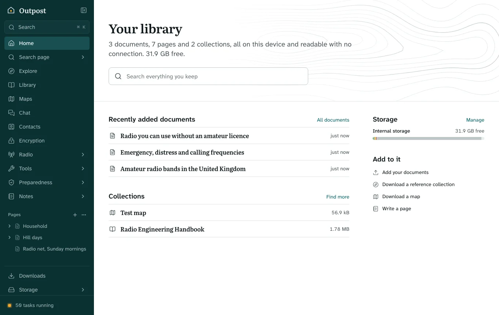
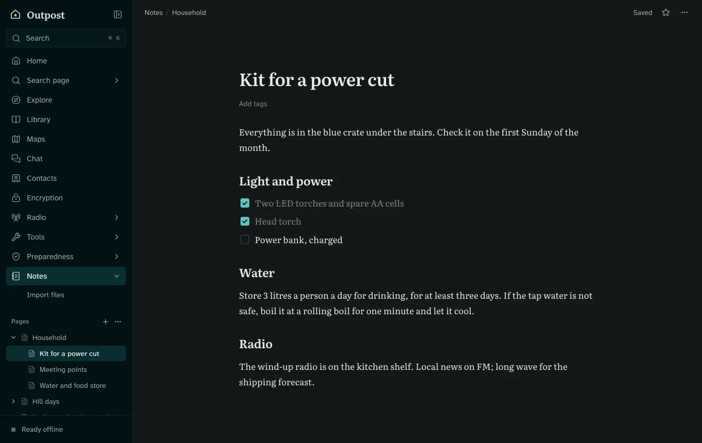
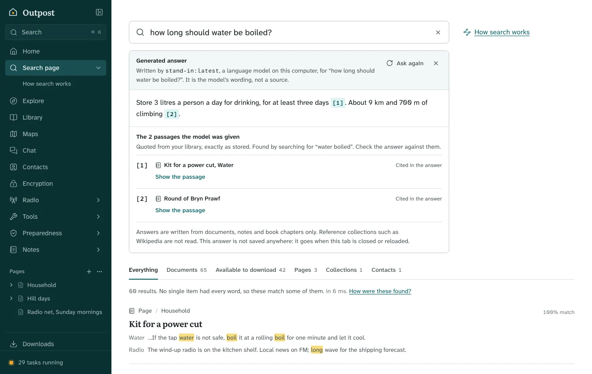
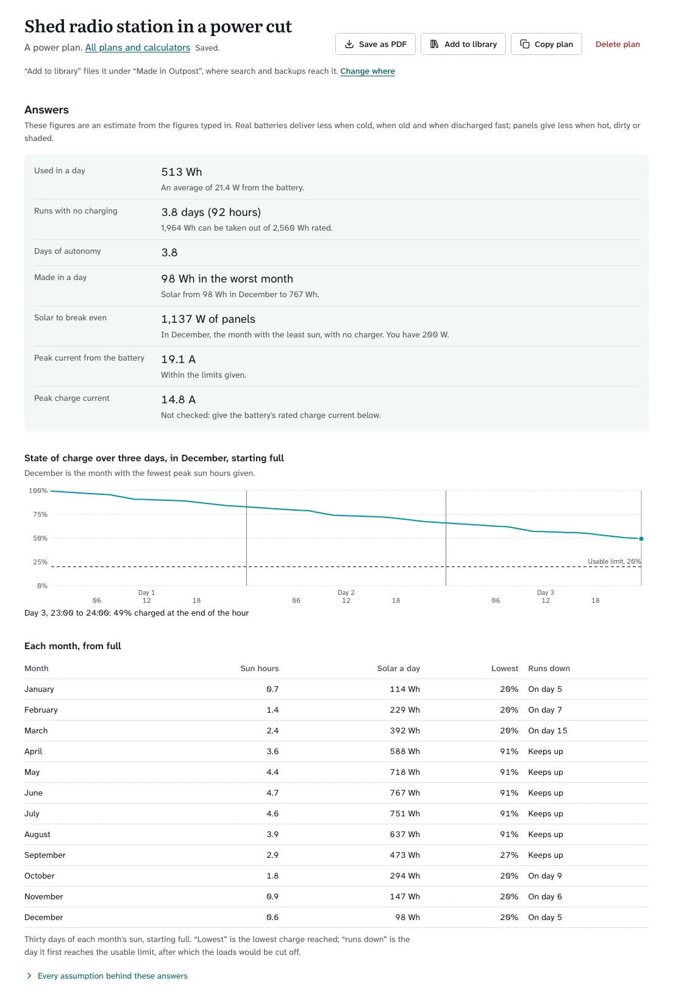
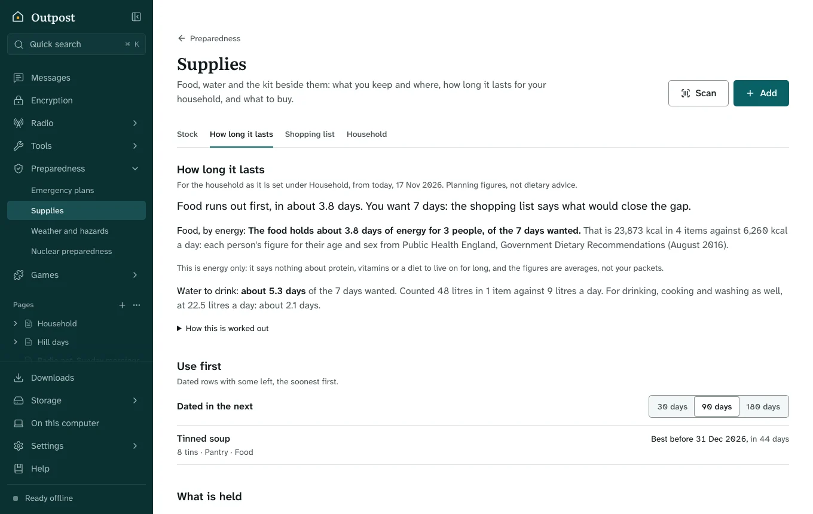
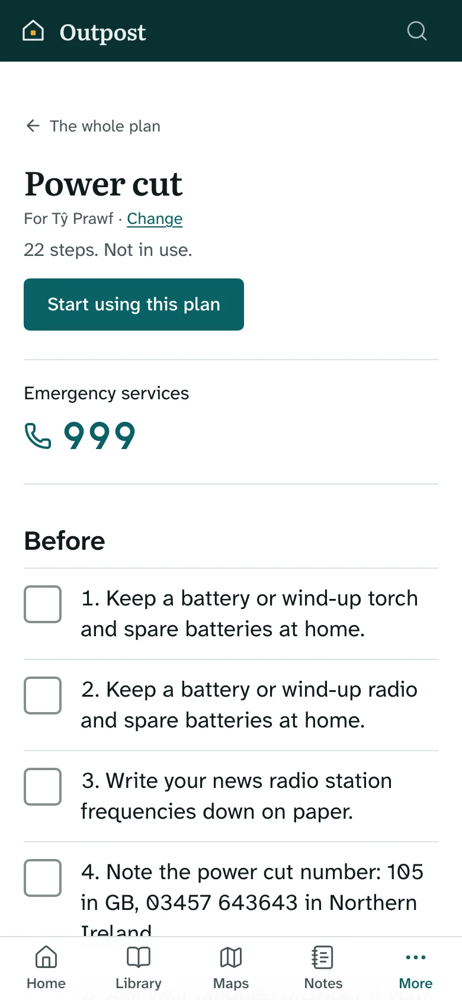
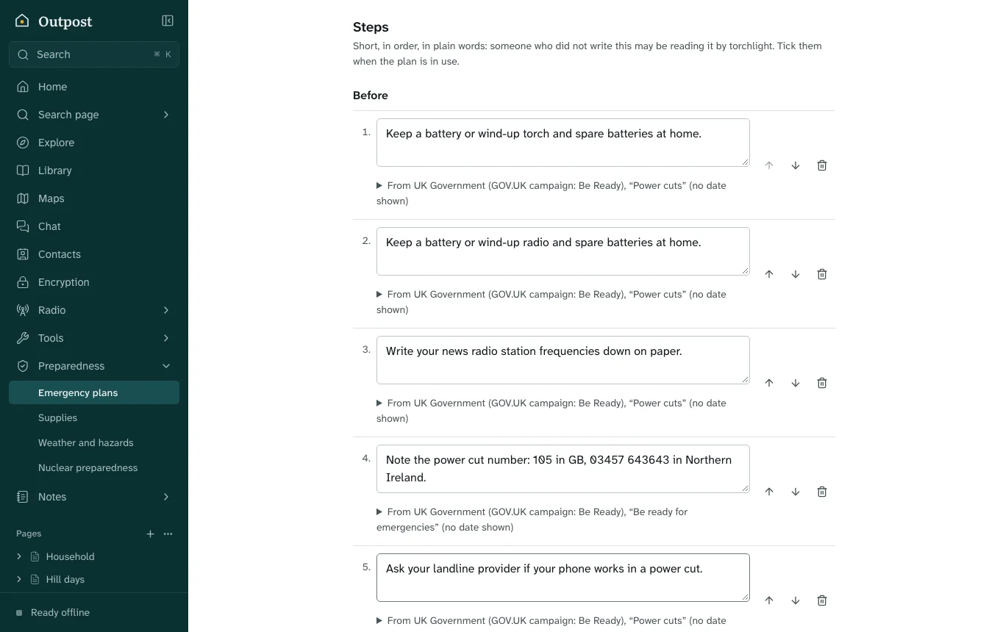
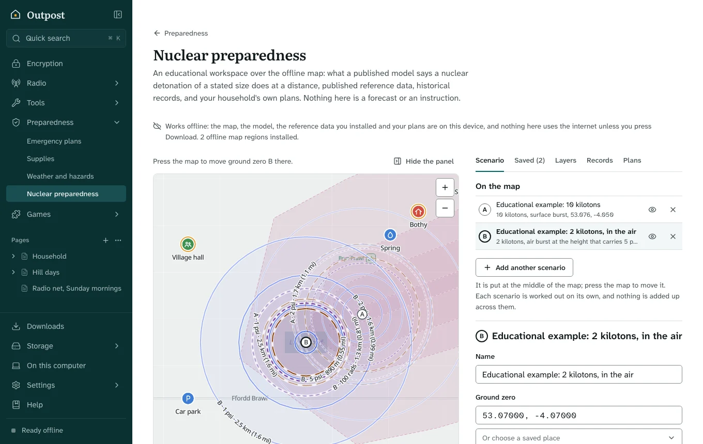
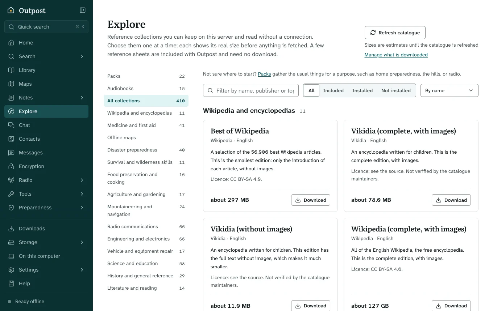
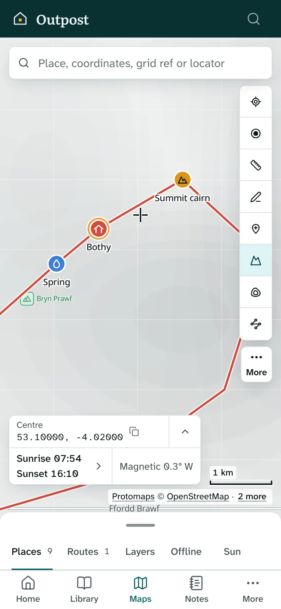

# Outpost

**Knowledge beyond the network.**

Outpost is a self-hosted, offline-first knowledge and preparedness app. One program,
on a laptop, a home server, a NAS or a Raspberry Pi, holds an offline encyclopedia, your
own documents and notes, offline maps, contacts, radio planning tools, calculators and a
household's emergency plans and supplies, behind one search box. You choose what to
download while you have a connection; after that, everything you kept works with the
network cable pulled out. Phones and other computers on your home network use it in
their browser.

It is for people who want their reference library to keep working when the internet
does not: students and teachers on poor connections, travellers, hill walkers,
radio amateurs, people preparing a household for a power cut or a flood, and anyone
who keeps a personal library.

**What it is not:**

- **Not a cloud service.** It runs on a computer you own. There is no Outpost server
  elsewhere, no telemetry and no analytics.
- **Not an account system.** There are no accounts and no sign-in. Everyone who can
  reach it can read and change everything in it, so it is for one person or a household
  on a network they trust.
- **Not an emergency service.** Its plans, calculators, forecasts and effects simulator
  are general information and planning aids. In an emergency, follow the emergency
  services and official warnings.
- **Not chatty.** Nothing leaves the machine except as the direct result of a press: a
  download, a catalogue refresh, a weather update, and the other actions listed in
  [What needs a connection](docs/offline.md#what-needs-a-connection).

Outpost is open source under the [MIT Licence](LICENSE). It is version 0.1.0, not yet
released, developed and tried by hand on one kind of computer (a Mac with Apple
Silicon); see [Limits](#limits) before relying on it.



*Home, with made-up demonstration data. Every picture in this README was taken by
[`e2e/readme/screenshots.spec.ts`](e2e/readme/screenshots.spec.ts) from a fresh
Outpost filled with data written for the purpose; see
[Making the pictures again](#making-the-pictures-again).*

## Contents

- [Features](#features)
- [Install and run](#install-and-run)
- [What needs a download or a build first](#what-needs-a-download-or-a-build-first)
- [Privacy and security in brief](#privacy-and-security-in-brief)
- [Limits](#limits)
- [Data sources and licences](#data-sources-and-licences)
- [Developing and contributing](#developing-and-contributing)
- [Documentation](#documentation)

## Features

Grouped as the app's sidebar groups them. Each row links to the page that describes it
in full, including what it does not do.

### Home and search

| Feature | What it does | Docs |
| --- | --- | --- |
| Home | How much is in the library, recent documents and collections, free space, and the ways to add more. | |
| One search | Full-text search across documents, notes, collections, saved places and contacts, with ranked results, highlighted passages and filters. Quick search from any screen (Ctrl or Cmd + K). | [Search](docs/search.md) |
| Search by meaning | Optional semantic search with a small model that is built in (nothing to install, nothing downloaded at run time), and hybrid ranking of the two. Off until switched on. | [Search](docs/search.md#semantic-search) |
| Scanned pages (OCR) | Reads the text of scanned PDFs and images on request, or automatically if turned on. English is built in. | [Search](docs/search.md#scanned-pages-and-images-ocr) |
| How search works | Follows one question of yours through every step (cutting into passages, matching words, matching meaning, combining, the context a model is given) with the real numbers from your library. | [Search](docs/search.md#seeing-how-it-works) |

### Library, collections and the reader

| Feature | What it does | Docs |
| --- | --- | --- |
| Your documents | Add PDFs, EPUBs, Markdown, HTML, text and images. Each is checked, given a checksum, read for its text and indexed down to the page; originals are kept untouched. | [Library](docs/library.md) |
| Readers | A PDF viewer that opens at the page a result points to; EPUB books chapter by chapter with their contents and pictures; Markdown and text. | [EPUB](docs/epub.md) |
| Save a web page | Paste an address to keep a readable copy of the article, one page at a time, for your own reading. | [Notes and imports](docs/notes-and-imports.md#saving-a-web-page) |
| Explore and packs | A catalogue of 310 collections that can be browsed offline: Kiwix archives (Wikipedia, medicine, repair, Project Gutenberg shelves and more) and official handbooks fetched from their publishers. Seventeen packs gather the usual things for a purpose. Each entry states its size and licence before anything is fetched. | [Sources](docs/sources.md), [catalogue](catalog/README.md) |
| Reference collections | ZIM archives read in the app through kiwix-serve, behind a sandboxing proxy. PDFs and e-books inside an archive open in Outpost's own viewer and can be added to your library with no connection. | [Architecture](docs/architecture.md#reference-collections-through-kiwix-serve-behind-a-sandboxing-proxy) |
| Included with Outpost | Nine radio reference sheets written for Outpost from regulators' documents, and sixteen books from LogBook73 (a radio engineering handbook and fifteen radio guides). No download needed. | [Radio](docs/radio.md) |
| PDFs made in Outpost | Map pages, HF predictions, communication plans, power plans, emergency cards and more can be saved, shared, or added to the library from the screen that made them. | [Library](docs/library.md#where-outpost-makes-a-pdf) |


*A reference sheet that ships with Outpost, in the reader.*

### Notes

| Feature | What it does | Docs |
| --- | --- | --- |
| Notes | A page tree and a block editor: headings, lists, to-dos, tables, code, callouts, images, links between pages, backlinks, templates, favourites, trash, and export to Markdown. | [Notes and imports](docs/notes-and-imports.md) |
| Import files | Brings in Markdown, HTML and Notion exports as a tree of pages. | [Notes and imports](docs/notes-and-imports.md#imports) |
| Encrypted pages | A page can be encrypted with an OpenPGP key, so it is ciphertext wherever it is copied. | [Encryption](docs/encryption.md#pages-of-notes) |



*A page of made-up notes, in the dark theme.*

### Maps

| Feature | What it does | Docs |
| --- | --- | --- |
| Offline maps | Download a country, a mountain range or any box you draw, with the exact size shown first, and view it with no connection. 188 ready-made regions. | [Maps](docs/maps.md) |
| Terrain and contours | An optional terrain download gives hill shading, contour lines traced on your device, and the heights of routes. | [Maps](docs/maps.md#contour-lines) |
| Places | Saved places with a note, a colour and one of sixteen icons. | [Maps](docs/maps.md#markers) |
| Routes | Draw a route point by point, edit its shape, see its distance, ascent and elevation profile; import and export GPX. | [Maps](docs/maps.md#drawing-a-route) |
| Find a known route | Search OpenStreetMap for a named route and add it (the one map feature that uses a connection, and only when you search). | [Maps](docs/maps.md#finding-a-known-route) |
| Recording a track | Records where you walk while the screen is on. Needs an `https` address. | [Maps](docs/maps.md#recording-a-track) |
| Coordinates and place search | Coordinates, British grid references and Maidenhead locators; offline place names from GeoNames. | [Maps](docs/maps.md#coordinate-formats) |
| Sun times | Sunrise, sunset and twilight for any place and date, worked out on the device. | [Maps](docs/maps.md#sunrise-and-sunset) |
| The grey line | Day and night drawn over the map, for now or a time you choose. | [Maps](docs/maps.md#the-grey-line-day-and-night) |
| Line of sight | Whether two points can see each other over the installed terrain. | [Maps](docs/maps.md#line-of-sight) |
| Satellite imagery | The whole world from NASA's Blue Marble, or a chosen area at 10 m from Sentinel-2, downloaded and kept on disk. | [Maps](docs/maps.md#satellite-imagery) |
| Aerial photographs | National aerial photographs for an area in New Zealand (LINZ) and the lower 48 United States (NAIP), 5 cm to 1 m a pixel. | [Maps](docs/maps.md#aerial-photographs) |
| Reference layers | Boundaries, populated places, airports, publicly mapped facilities, hospitals and emergency services, shelters and meeting points, population density and historical records, each pack downloaded on a press or imported, every record with its source and licence. For England, the Environment Agency's planning flood zones 2 and 3 for the area on screen, with the Agency's own definitions and its caveat that the map is not for judging one property. | [Reference layers](docs/reference-layers.md) |
| Printing | A one-page map at a stated scale, with scale bars, north, a grid of latitude and longitude, and the credits, made on your device as a PDF. | [Maps](docs/maps.md#printing-a-map) |


*Saved places and a route with its profile, on the test suite's made-up map (an
invented hill and lake; not a real map).*

### Chat and answers from the library

| Feature | What it does | Docs |
| --- | --- | --- |
| Answer from my library | If you run a language model on your own machine or network (Ollama, llama.cpp or LM Studio), search can write a short answer from passages of your documents, notes and book chapters, with a citation after each statement. Outpost includes no model and downloads none. | [Answers](docs/ai.md), [set-up guide](docs/setup-guide.md) |
| Chat | Conversations with the same model server, kept on your Outpost, with or without your library. Everyone who can open your Outpost can read them. | [Answers](docs/ai.md#chat) |



*An answer from the library. The words were written by the test suite's stand-in
model server, which repeats the first sentence of each source it is given: it is not a
language model, and a real model's answers read differently.*

### Contacts

| Feature | What it does | Docs |
| --- | --- | --- |
| Contacts | People and places to reach when the phone network is down, with an emergency list that prints on one sheet, radio callsigns and frequencies, and one-touch call, text and email. | [Contacts](docs/contacts.md) |
| From and to a phone | Bring contacts in as a vCard file; let a phone keep a read-only copy over CardDAV. | [Contacts](docs/contacts.md#keeping-a-copy-on-a-phone-carddav) |


*Contacts with invented names; the numbers are from the ranges Ofcom keeps for drama.*

### Encryption

| Feature | What it does | Docs |
| --- | --- | --- |
| OpenPGP | Make and keep keys, encrypt and sign text and files, and encrypt pages of notes, in the browser; checked against GnuPG. Outpost's use of OpenPGP has not been audited. | [Encryption](docs/encryption.md) |
| Ciphers by hand | Classical ciphers to work with pencil and paper, with printable pads. For interest and practice; they protect nothing from anyone with a computer. | [Encryption](docs/encryption.md#by-hand) |

### Radio

| Feature | What it does | Docs |
| --- | --- | --- |
| HF propagation | Predicts how a shortwave signal gets from one place to another, hour by hour and band by band, for your power, antennas and mode, including steep (NVIS) paths. Worked out on your computer by VOACAP: a monthly median for planning, never today's conditions. | [HF propagation](docs/hf-propagation.md) |
| A second model | Optionally runs the ITU's P.533 (ITURHFProp) beside VOACAP for the same path, and states where they differ. You build its engine on your own computer. | [HF propagation](docs/hf-propagation.md#a-second-model-itu-p533) |
| Antennas | Your own radios and antennas, and generic ones: dipoles, inverted-V, end-fed wires of a stated length (level, vertical or sloping), verticals, the SPOOLTENNA. Each is run as one of VOACAP's antenna models, and the screen says where that is an approximation. | [HF propagation](docs/hf-propagation.md#equipment) |
| HF coverage | Where one transmitter is predicted to be heard, as a layer over the offline map. | [HF propagation](docs/hf-propagation.md#coverage-maps) |
| Communication plans | Several stations, and which band serves each pair at which hour; exported as PDF or Markdown. | [HF propagation](docs/hf-propagation.md#communication-plans) |
| Contact log | What actually happened on the air, typed in or read from ADIF, set beside what the engine predicted. | [HF propagation](docs/hf-propagation.md#the-contact-log) |
| Repeaters | A database of repeaters you bring in as a file, enter by hand, or fetch from the two publishers whose terms allow it; found, measured from a place, drawn on the map and written out for a radio. | [Radio](docs/radio.md#repeaters) |
| Morse trainer | Learn Morse by ear with the Koch method and drills, send it on the screen (multi-touch paddles on a phone), on a keyboard or on a real key, work a practice contact, and get a call ready for the air. Progress over time and weak characters, kept for the household. | [Morse trainer](docs/morse-trainer.md) |


*VOACAP's prediction for London to Birmingham on 40 m, the planner's own example.*


*The same prediction, band by band, in the dark theme.*

### Tools

| Feature | What it does | Docs |
| --- | --- | --- |
| Water | Water to store by the UK Government's, the CDC's, Ready.gov's or the WHO's figure; rain from a roof; filter life; making water safe to drink, quoted from the bodies that publish it. | [Tools](docs/tools.md#water) |
| Outdoors | Walking time by Naismith's rule with Langmuir's and Tranter's corrections, gradient, distance and bearing, the sun's day, wind chill, heat index, and water and food for a walk. | [Tools](docs/tools.md#outdoors) |
| Radio calculators | Antenna lengths, free-space path loss, the radio horizon, cable loss, watts, dBm and S-units, battery life on a duty cycle. | [Tools](docs/tools.md#radio-calculators) |
| Building | Concrete and mortar, area and volume, roof pitch, a cutting list, U-values and heat loss, sheets and fixings. | [Tools](docs/tools.md#building) |
| Cooking | Roasting times and safe temperatures from UK food-safety guidance, a timer, boiling at altitude, conversions, scaling a recipe. | [Tools](docs/tools.md#cooking) |
| Power and batteries | Battery runtime from common devices: pick a Raspberry Pi, phones to charge, radios, a router or a NAS from a library of makers' published figures (each with its source), and see how long the battery runs them, how many charges it holds, and what battery a few days would need; keep your own devices for next time. Quick calculators besides (solar, cable size and voltage drop, series and parallel, generator fuel, small electronics), and power plans: a battery system kept by name, worked out into how long it runs and how much solar it needs. Monthly sun hours can be filled in from figures already fetched on Weather and hazards, and the plan says where they came from. | [Power](docs/tools-power.md) |
| QR codes | Makes a code from text, a web address, a Wi-Fi network, a contact or a saved place, on the device; nothing typed is sent anywhere. | [QR codes](docs/tools-qr-and-network.md#qr-codes-toolsqr) |
| Solar clock | Where the sun is now at a place; after a power cut, the time to set your clocks by from a stick's shadow (noon, the shadow's length or bearing, sunrise on the sea), with an honest range; a horizontal sundial and a nocturnal to print. Worked out on the device, no internet. | [Solar clock](docs/tools-solar-clock.md) |
| Devices on this network | Lists what answers on the network the computer running Outpost is on: a NAS, a printer, a Raspberry Pi whose address you have forgotten. Never put in search. A start-up option limits starting a scan to the computer itself. | [Network](docs/tools-qr-and-network.md#devices-on-this-network-toolsnetwork) |

Every calculator shows its answer as you type and says, under **How this is worked
out**, the formula, its source with the date it was read, and the range it holds for.

<table>
<tr>
<td width="62%"></td>
<td></td>
</tr>
<tr>
<td><em>A power plan, with figures typed for the demonstration.</em></td>
<td><em>The water calculators on a phone.</em></td>
</tr>
</table>


*Devices on this network, scanning the test suite's made-up network (a stand-in): no
real network's devices are shown.*

### Preparedness

| Feature | What it does | Docs |
| --- | --- | --- |
| Emergency plans | A household's plans for a power cut, flooding, no phone or internet, severe weather, sheltering at home or leaving at short notice, started from templates drawn from official guidance, each step saying whose words it is. **Use now** shows the steps in large type with ticks; wallet cards, a fridge sheet and a grab list print as PDF. Over HTTPS a plan can be kept on a phone and used, ticks and all, with the server out of reach. A warning held for your home place is shown as one line, with its age. | [Emergency plans](docs/emergency-plans.md) |
| Supplies | Food, water and kit kept at home: how many days they last for your household, what to use first, and what to buy. Find items by barcode (typed, from a photo, or with the live camera on an `https` page). | [Supplies](docs/supplies.md) |
| Weather and hazards | Forecasts, UK severe-weather and flood warnings, river levels and climate averages for places you choose, fetched when you press and kept with their age; a log of your own barometer readings. | [Weather](docs/weather.md) |
| Nuclear preparedness | An educational, offline workspace over the map. An effects simulator draws what Glasstone and Dolan's published model says a detonation of a stated size does at a distance, for an idealised case, with every figure cited: up to six hypothetical scenarios at once, one colour for each kind of effect, and an idealised fallout pattern for a surface burst in a wind you give. Where a WorldPop grid is installed, each ring can say how many people live inside it: a count of residents, never a casualty figure and never a total across scenarios. The published reference layers and a browser of historical records are shown as on Maps, and a Plans tab draws on Emergency plans, with a radiation emergency template quoting the UK Health Security Agency under the Open Government Licence. Scenarios go on paper as a PDF with a map of each one's rings and fallout pattern over the offline map (and an overview of several), or as words only, with the same Save, Add to library and Share as every PDF. Mapped infrastructure is never marked, ranked or scored as a target; results are educational estimates, not forecasts or instructions. | [Nuclear preparedness](docs/nuclear-preparedness.md) |

<table>
<tr>
<td width="62%"></td>
<td></td>
</tr>
<tr>
<td><em>Supplies for a made-up household of three.</em></td>
<td><em>The power cut plan, from its template, in use on a phone.</em></td>
</tr>
</table>



### Games

Small games for when the internet is out, drawn in code, with no sound and nothing fetched.

| Feature | What it does | Docs |
| --- | --- | --- |
| Allotment | One plot for the household, the same on every device: sow, grow in real time, harvest, sell at the stall, and add beds, hens, a hive or a greenhouse. Nothing withers or runs out; left for a year, everything is ripe and waiting. | [Games](docs/games.md#allotment) |
| Solitaire | The card game also called patience or Klondike: draw one or three, undo, tap a card to send it where it fits. | [Games](docs/games.md#solitaire) |
| Peg solitaire | The English board of 33 holes: jump pegs until one is left. | [Games](docs/games.md#peg-solitaire) |
| Sudoku | Puzzles made on the device at three levels, each with exactly one answer; notes, undo and a check. | [Games](docs/games.md#sudoku) |
| Draughts | English draughts against the computer or two at one device. | [Games](docs/games.md#draughts) |
| Pairs | A memory game for children, in three sizes. | [Games](docs/games.md#pairs) |

*A plan made from the power cut template: each step says whose words it is.*



*The nuclear preparedness workspace: two educational scenarios on the test suite's
made-up map, each kind of effect in its own colour, one with the model's idealised
fallout pattern.*

### Looking after it

| Feature | What it does | Docs |
| --- | --- | --- |
| Downloads | Every download and background job in one list: resumable, retried, checked against a checksum, with pausing and rate limits. | [Offline](docs/offline.md#what-needs-a-connection) |
| Storage | Internal disks, USB drives, SSDs and NAS shares as storage locations, recognised by a marker file when they come back. Move collections between locations with verification. On a Mac, connect a network share from the app. | [Storage](docs/storage.md) |
| Manage and clean up | One screen that lists everything installed, removes what you no longer want, clears leftovers, checks the database, and can erase everything. | [Storage](docs/storage.md#managing-and-cleaning-up) |
| Backups | A backup file of the database, attachments and extracted text, by hand or on a schedule to a storage location, optionally encrypted with a passphrase. | [Storage](docs/storage.md#backing-up) |
| Portable drives | A USB drive holding Outpost and part of your library, which starts with a double-click on another Mac, Windows or Linux computer with nothing installed; what was written on it is brought back home with a preview. | [Portable drives](docs/portable.md) |
| On this phone | Over HTTPS the app keeps itself on a phone, and chosen pages of notes, routes, saved places, map areas and emergency plans are kept there to read where the server cannot be reached. | [Offline](docs/offline.md#a-phone-out-of-reach-of-the-server) |
| HTTPS on your network | An `https` address on your own network with no domain and no internet, with a certificate Outpost makes or one of your own. Location, the camera, recording a track and keeping things on a phone need it. | [Deployment](docs/deployment.md#https-on-your-network) |
| Settings | Appearance (including the 12- or 24-hour clock), downloads, reading documents, search by meaning, answers, maps, who can use this library, backups and HTTPS. | [Deployment](docs/deployment.md#environment-variables) |

<table>
<tr>
<td width="62%"></td>
<td></td>
</tr>
<tr>
<td><em>Explore, browsed with no connection.</em></td>
<td><em>The map on a phone (the test map).</em></td>
</tr>
</table>

## Install and run

Four ways are documented in [docs/deployment.md](docs/deployment.md), which also has
every setting. What has been tried: Outpost is developed and run by hand on macOS on
Apple Silicon, from source, as the packaged app, and as the full Compose stack with the
`arm64` image. Nothing builds or tests it automatically, and nothing else has been
tried: not Linux on x86-64, not an Intel Mac, not Windows, not a Raspberry Pi, not a NAS.

| Platform | How | Status |
| --- | --- | --- |
| macOS, Apple Silicon | Docker Desktop, from source, the packaged app, or a portable drive | Developed and tried here by hand |
| Linux ARM64, Raspberry Pi 4 and 5 (64-bit OS) | Docker Compose; the scripts in `deploy/pi/` | Untried on a Pi; the scripts have never been run on one |
| Linux x86-64 | Docker Compose, or the packaged app | Untried |
| macOS, Intel | Docker Desktop, or the packaged app | Untried |
| Windows 10 and 11 | Docker Desktop with WSL 2 | Untried |
| NAS and home servers | Any that run containers | Untried |

### With Docker Compose

You need Docker with the Compose plugin.

```bash
git clone https://github.com/tyleruk2000/outpost.git
cd outpost
cp .env.example .env
docker compose up -d --build
```

Then open <http://localhost:8080>. The build needs an internet connection; no image is
published, so there is nothing to pull. While there is internet, one more line makes
the HF planner work offline from the start (VOACAP's data, 559 kB; see
[below](#what-needs-a-download-or-a-build-first)):

```bash
docker compose exec outpost node /app/scripts/fetch-voacap-data.mjs --data-dir /data
```

By default Outpost answers only on the computer it runs on. To use it from phones and
other computers on your network, set both of these in `.env` and run
`docker compose up -d` again, after reading
[Letting other devices use it](docs/deployment.md#letting-other-devices-use-it-lan-access):

```ini
OUTPOST_LAN_ACCESS=true
OUTPOST_BIND=0.0.0.0
```

### From source

You need Node.js 24 or newer and pnpm 9.

```bash
git clone https://github.com/tyleruk2000/outpost.git
cd outpost
pnpm install
node scripts/fetch-map-assets.mjs   # map fonts and icons; needs a connection once
node scripts/fetch-embedding-model.mjs  # the model for search by meaning (24 MB); also once
pnpm build                          # builds the web app into apps/web/dist
node scripts/fetch-voacap-data.mjs --data-dir apps/server/data   # HF planner data (559 kB); optional, once
pnpm start
```

Open <http://localhost:8080>. `pnpm start` does not read `.env`: set variables in the
shell (`OUTPOST_DATA_DIR`, `OUTPOST_STORAGE_ROOTS`, and for LAN access
`OUTPOST_HOST=0.0.0.0` with `OUTPOST_LAN_ACCESS=true`). Reference collections need
kiwix-serve beside it: see
[Reference collections without Docker](docs/deployment.md#reference-collections-without-docker).

### The packaged app

A folder that runs with nothing but a Node 24 binary; it is what the Docker image and
portable drives contain.

```bash
pnpm install
node scripts/fetch-map-assets.mjs
node scripts/fetch-embedding-model.mjs
node scripts/build-app.mjs            # writes dist/app

NODE_ENV=production \
OUTPOST_DATA_DIR=/srv/outpost/data \
OUTPOST_STORAGE_ROOTS=/srv/outpost/library \
node dist/app/server/outpost.mjs
```

`NODE_ENV=production` is required. See [The packaged app](docs/deployment.md#the-packaged-app).
The folder includes SQLite binaries for Windows, but nobody has run it there.

### On a Raspberry Pi

A 64-bit operating system is required, and 4 GB of memory fits keyword search,
reading, notes and maps. Two scripts in `deploy/pi/` set a Pi up to be carried somewhere
with no router and no internet, reached from phones over a Wi-Fi network of its own.

**Neither script has been run on a Raspberry Pi.** They were written from Docker's and
NetworkManager's documentation and checked only for syntax and with `--dry-run` on a
Mac. Read them, run each with `--dry-run` first, and expect to adjust them.

```bash
./deploy/pi/install.sh --dry-run                        # see what it would do
./deploy/pi/install.sh --install-docker --lan --https   # needs the internet this once
sudo ./deploy/pi/hotspot.sh on --ssid "Outpost"         # asks for a password
```

See [Raspberry Pi 4 and 5](docs/deployment.md#raspberry-pi-4-and-5) for memory,
storage and what each script does.

Updating, logs, reverse proxies and every environment variable are in
[docs/deployment.md](docs/deployment.md). Back up first (**Settings → Backup**).

## What needs a download or a build first

Outpost ships its code, its catalogue, its reference sheets and the radio books, and
nothing else. Everything below is fetched only when a person presses a button or runs a
set-up line, and each states its size first.

| What | Size | Why it is not in the repository | Docs |
| --- | --- | --- | --- |
| Map regions | Shown exactly before the download (a box of up to 60 GB); terrain is a second, optional file | OpenStreetMap data from the Protomaps build, fetched for the area you choose | [Maps](docs/maps.md#downloading-a-region) |
| Place names | One GeoNames dataset: towns worldwide, or one country | Fetched on request from GeoNames | [Maps](docs/maps.md#offline-place-search) |
| Reference collections | From a few megabytes to many gigabytes each, shown in Explore | Each publisher's own, under its own licence; never bundled | [Sources](docs/sources.md) |
| VOACAP's data for the HF planner | 15 files, 559 kB | The ITU has not given permission for them to be passed on, and four of their headers say "All rights reserved"; so they are fetched once, at set-up or with one press | [HF propagation](docs/hf-propagation.md#voacaps-coefficients-a-one-time-download) |
| The second HF model (ITU P.533) | Engine built on your computer with Docker (a build image of about 740 MB; the result is 233 kB), and maps of 137 MB | The ITU's code and maps are under no open licence, so nothing of them ships; each person builds the engine from the ITU's own repository | [HF propagation](docs/hf-propagation.md#a-second-model-itu-p533) |
| Satellite imagery | The world at 2 km: 256 MB fetched, 15.5 MB kept. At 500 m: 3.26 GB fetched, about 350 MB kept (estimated; never run). Sentinel-2: about 16 MB fetched for 100 km², under 1 MB kept | Fetched from NASA and Copernicus for the area you choose | [Maps](docs/maps.md#satellite-imagery) |
| Aerial photographs (New Zealand, United States) | 1 km² of a 7.5 cm survey: 11.75 MB fetched, 4.63 MB kept | Fetched from LINZ or NAIP for a small area you choose | [Maps](docs/maps.md#aerial-photographs) |
| Reference data packs for the map | Stated per item before download (OurAirports' file is 12.8 MB; Natural Earth's regions and places are 41 MB and 19 MB) | Each publisher's own terms; fetched on a press or imported | [Reference layers](docs/reference-layers.md) |
| A model server for answers and chat | A model is several gigabytes | Which model to run is your decision; Outpost includes and downloads none | [Set-up guide](docs/setup-guide.md) |
| The device-maker registry | About 3.9 MB, from the IEEE | The IEEE states no permission to pass it on | [Network](docs/tools-qr-and-network.md#who-made-each-device) |
| Map fonts and icons, and the search model | The search model is 24 MB | Fetched once when Outpost is built, not at run time | [Deployment](docs/deployment.md#from-source) |

## Privacy and security in brief

From [docs/security.md](docs/security.md), which has the whole threat model:

- **No accounts.** Whoever can reach Outpost can read, add, change and delete
  everything in it, contacts and chat conversations included. By default only the
  computer it runs on can reach it. With LAN access on, everyone on that network can;
  turn it on only for a network where you trust everyone, never forward the port to the
  internet, and put it behind a public reverse proxy only if the proxy asks people to
  sign in.
- **What only the computer itself may do.** Erasing everything, restoring a backup,
  deleting backups kept on a storage location, setting or removing the backup
  passphrase, and replacing or deleting the HTTPS certificate authority are accepted
  only from the computer Outpost runs on, unless it was started with
  `OUTPOST_ALLOW_REMOTE_ERASE=true`. This is not authentication: it asks "where from?",
  because there is no "who?".
- **Every outbound request is the result of a press.** No telemetry, no CDN, no remote
  fonts. The app's own content policy forbids the browser from contacting other
  servers, and the end-to-end tests fail if the app tries. Downloads cannot be pointed
  at addresses inside your network.
- **Your model, your address.** Answers and Chat send your question and passages of
  your library to the model server address you set, and nowhere else.
- **HTTPS on your network** is optional and off by default. Outpost makes a certificate
  authority of its own, limited to private addresses and names, and each device is told
  once to trust it; or you give it a certificate of your own. Plain `http` keeps working
  beside it. Location, the live camera, recording a track and keeping things on a phone
  need it.
- **Nothing is encrypted at rest** except what you encrypt yourself, private keys on the
  Encryption screen, and backups protected with a passphrase. Use encrypted drives for
  anything that leaves the house.

Please report security problems privately, as described in [SECURITY.md](SECURITY.md).

## Limits

Stated here so nobody has to find them out. Each is taken from the docs page named.

**Not tested:**

- **A real iPhone or Android phone.** Phone width was tested in Chromium's emulation:
  keeping things on a phone, the barcode camera, the emergency plans' `tel:` links,
  printing from a phone, and trusting the HTTPS certificate on a device have not been
  tried on a phone ([offline](docs/offline.md#what-has-and-has-not-been-tested),
  [supplies](docs/supplies.md#what-was-not-tested),
  [emergency plans](docs/emergency-plans.md#not-tested),
  [HTTPS](docs/deployment.md#what-was-tested)).
- **A Raspberry Pi, Windows, Linux on x86-64, an Intel Mac, a NAS.** See
  [Install and run](#install-and-run).
- **A printer.** No map page, emergency card or cipher pad has been printed on paper
  ([maps](docs/maps.md#limits-and-what-has-not-been-tried),
  [emergency plans](docs/emergency-plans.md#not-tested),
  [encryption](docs/encryption.md#not-tested)).
- **Safari and Firefox.** The screens were built and tested in Chromium; Safari and
  Firefox were not tried for encryption or for keeping things on a phone
  ([encryption](docs/encryption.md#not-tested), [offline](docs/offline.md#what-has-and-has-not-been-tested)).
- **CardDAV with any phone**, and a portable drive carried to a second computer
  ([contacts](docs/contacts.md#what-has-been-tested-and-what-has-not),
  [portable drives](docs/portable.md)).
- **Answers and Chat** were measured with two small models (`llama3.2:3b`,
  `llama3.2:1b`) on Ollama on a Mac; llama.cpp and LM Studio have not been run
  ([answers](docs/ai.md#not-tried-with-a-real-model)).

**Caveats:**

- **HF propagation** is a monthly median from VOACAP, not today's conditions and not a
  promise of a contact. 2 to 30 MHz, short path only, sporadic E off
  ([what it is not](docs/hf-propagation.md#what-it-is-not),
  [limits](docs/hf-propagation.md#limits)).
- **The second model** compares with isotropic antennas only, and is not offered for
  coverage maps or plans ([what is not done](docs/hf-propagation.md#what-is-not-done)).
- **The nuclear effects simulator** is an educational estimate from a published model
  for an idealised case (flat ground, clear air, no buildings), not a forecast and not
  instructions; it gives no casualty figures, and its fallout pattern is for a steady
  wind that real fallout never follows
  ([limitations](docs/nuclear-preparedness.md#limitations)).
- **Calculators and plans** give general information, not advice, from the sources they
  name ([tools](docs/tools.md), [power](docs/tools-power.md#what-is-not-modelled)).
- **Weather** is a copy with its age, as good as the moment it was fetched; flood data
  is for England only ([weather](docs/weather.md#not-done)).
- **OCR** is slow and makes mistakes, and reads English unless a language file is added.
  The built-in search model is small and English.
- **EPUB books** are shown in Outpost's own type; fixed layouts, scripts and
  copy-protected books are not read ([EPUB](docs/epub.md)).

**Deliberately not built:**

- Accounts, permissions, live co-editing, clustering, and an optional PostgreSQL back
  end ([architecture](docs/architecture.md#limits-and-trade-offs)).
- Routing: routes are drawn, imported or found, never calculated
  ([maps](docs/maps.md#what-is-not-included)).
- A bundled language model, a model download, or tools a model can call
  ([answers](docs/ai.md#what-does-not-exist)).
- Two-way contact sync ([contacts](docs/contacts.md#what-is-not-built)).
- A product database for barcodes, and flood-risk zones on the map
  ([supplies](docs/supplies.md#open-food-facts-and-why-nothing-is-looked-up),
  [weather](docs/weather.md#not-done)).
- Any dataset of historical targets, and any layer, sort or score that ranks places
  ([reference layers](docs/reference-layers.md#what-is-not-built-and-why)).

## Data sources and licences

Every source considered, its terms in its publisher's words, and why some are not used,
is in [docs/sources.md](docs/sources.md). In short:

| Source | Used for | Licence or terms |
| --- | --- | --- |
| OpenStreetMap, packaged by Protomaps | Map regions, found routes, reference layers | ODbL |
| Mapterhorn | Terrain, hill shading, contours | Various open licences ([attribution](https://mapterhorn.com/attribution)) |
| GeoNames | Place search | CC BY 4.0 |
| Natural Earth | World outline, boundaries | Public domain |
| Kiwix and openZIM | Reference collections (ZIM archives), kiwix-serve | Each archive its own licence; kiwix-serve GPL-3.0, run as a separate program |
| Official publishers (FAA, NASA, USGS, NWS, FAO, WHO, OpenStax and others) | PDF handbooks in the catalogue | Each its own, stated on each entry |
| NASA Blue Marble, Copernicus Sentinel-2, LINZ, USDA NAIP | Satellite imagery and aerial photographs | Credit to NASA; free, full and open; CC BY 4.0; public domain |
| VOACAP (NTIA/ITS) via hfcast-engine | HF propagation | Engine Apache-2.0; its CCIR coefficients not shipped |
| ITU-R Study Group 3 (ITURHFProp) | The optional second HF model | No open licence; nothing shipped |
| Open-Meteo (Met Office models), Met Office, Environment Agency, NASA POWER, PVGIS | Weather and hazards | CC BY 4.0; Crown copyright; OGL; credit to NASA; credit to the JRC |
| OurAirports, Wikidata, WorldPop, BABS, Environment Agency (flood zones) | Reference layers | Public domain; CC0; CC BY 4.0; open use with source; OGL |
| UK Government (Be Ready, GOV.UK), Met Office, Ofcom and others | Emergency plan templates | OGL v3 and others, quoted only where their terms allow |
| Glasstone and Dolan, *The Effects of Nuclear Weapons* (1977) | The effects simulator | A US Government work |
| IEEE Registration Authority | Device makers, on a press | Not bundled |

**Outpost itself** is released under the [MIT Licence](LICENSE). The reference sheets
that ship with it are the project's own compilations of facts from official sources,
under the same licence. The radio handbook and guides were written by the same author
for LogBook73 and are included under that project's MIT licence. The packaged app and
the Docker image include `THIRD-PARTY-LICENSES.txt`.

It is built with [MapLibre GL JS](https://maplibre.org), [Tiptap](https://tiptap.dev),
[PDF.js](https://mozilla.github.io/pdf.js/), [Mermaid](https://mermaid.js.org),
OpenPGP.js (LGPL-3.0, shipped as a separate file and loaded at run time), ONNX Runtime,
and the libraries in the package manifests; the licence of each is in
[docs/architecture.md](docs/architecture.md#dependency-licences). Typefaces: Atkinson
Hyperlegible (Braille Institute) and Literata (TypeTogether), under the SIL Open Font
Licence.

SPOOLTENNA is a trade mark of Panther Creek Solutions LLC, named only to say which
antenna is meant. QR Code is a registered trademark of DENSO WAVE INCORPORATED.

The projects that showed the way: Internet-in-a-Box, PrepperPi, Offgrid Pi,
Paperless-ngx and Organic Maps. No code was taken from them.

## Developing and contributing

Contributions are welcome: code, catalogue entries, documentation. Start with
[CONTRIBUTING.md](CONTRIBUTING.md); how the server and the screens are put together is
in [docs/architecture.md](docs/architecture.md),
[docs/development/server-modules.md](docs/development/server-modules.md) and
[docs/development/web-screens.md](docs/development/web-screens.md).

```bash
pnpm install
pnpm dev                                   # API on :8080, web app on :5173
pnpm lint && pnpm typecheck
pnpm --filter @outpost/server test         # real server on temporary folders, no network
pnpm --filter @outpost/web test
node scripts/build-app.mjs && pnpm e2e     # browser tests against the packaged app, internet blocked
```

There is no continuous integration: the checks are run by hand before a change is
accepted. `node scripts/check-readme-links.mjs` checks that every relative link and
anchor in this README leads somewhere.

### Making the pictures again

```bash
node scripts/build-app.mjs
cd e2e && pnpm exec playwright test -c readme-screenshots.config.ts
```

This starts an Outpost of its own on an empty data folder (port 9081 and the two after
it, or `OUTPOST_README_PORT`), beside the test suite's stand-ins, writes the
demonstration data, and replaces the pictures in `docs/screenshots/`. Nothing in it
reaches the internet or a real model server.

## Documentation

| | |
| --- | --- |
| [Deployment](docs/deployment.md) | Installing on each platform, LAN access, HTTPS, settings |
| [Storage](docs/storage.md) | Locations, NAS examples, moving, backups |
| [Offline use](docs/offline.md) | What works without a connection, and keeping things on a phone |
| [Portable drives](docs/portable.md) | Making and using a USB drive |
| [Search](docs/search.md) | Query syntax, semantic and hybrid search, OCR |
| [Answers and language models](docs/ai.md) | Setting up a model of your own, the exact prompt, what is sent where |
| [Set-up guide](docs/setup-guide.md) | Search by meaning, answers and chat in a few steps. Also inside Outpost |
| [The library](docs/library.md) | Documents, and PDFs made in Outpost |
| [Reading EPUB books](docs/epub.md) | What the reader shows and leaves out |
| [Notes and imports](docs/notes-and-imports.md) | The editor, imports, saving web pages |
| [Contacts](docs/contacts.md) | Contacts, vCard files and CardDAV |
| [Encryption](docs/encryption.md) | OpenPGP keys, text, files and pages; ciphers by hand |
| [Maps](docs/maps.md) | Regions, routes, imagery, printing, the grey line, line of sight |
| [Reference layers](docs/reference-layers.md) | Published data for the map, and its terms |
| [Radio](docs/radio.md) | Reference sheets, the handbook and guides, repeaters |
| [HF propagation](docs/hf-propagation.md) | The planner, coverage, plans, the log, the second model |
| [Tools](docs/tools.md) | The calculators, with every formula and source |
| [Power and batteries](docs/tools-power.md) | Calculators and power plans |
| [QR codes and devices on this network](docs/tools-qr-and-network.md) | The two network tools |
| [Solar clock](docs/tools-solar-clock.md) | Time from the sun and stars, its formulas, sources and measured accuracy |
| [Emergency plans](docs/emergency-plans.md) | Plans, templates and their sources, cards |
| [Supplies](docs/supplies.md) | Stock, the household, barcodes, CSV |
| [Weather and hazards](docs/weather.md) | What is fetched, from whom, and how old it is |
| [Nuclear preparedness](docs/nuclear-preparedness.md) | The workspace, the effects simulator, its rules and its sources |
| [Games](docs/games.md) | The six games, their rules, and what is kept where |
| [Sources](docs/sources.md) | Every content source considered, and its terms |
| [Security](docs/security.md) | Threat model and controls |
| [API](docs/api.md) | HTTP API reference |
| [Architecture](docs/architecture.md) | Design decisions, limits and dependency licences |
| [Troubleshooting](docs/troubleshooting.md) | Common problems |
