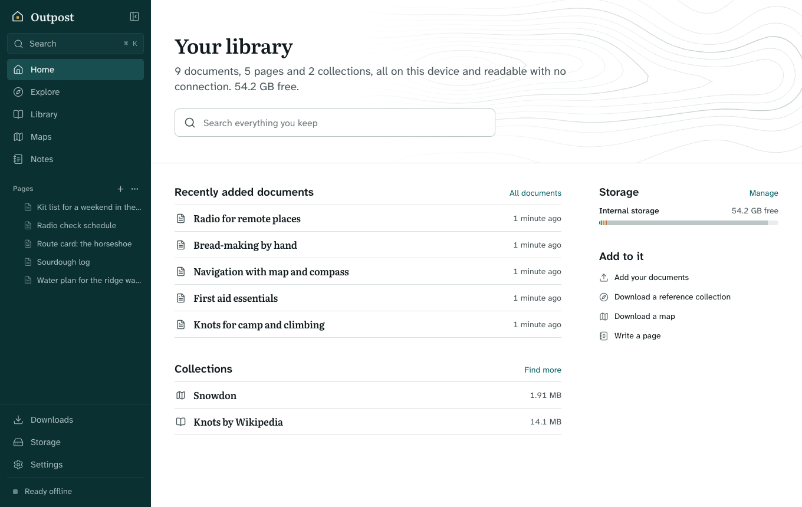
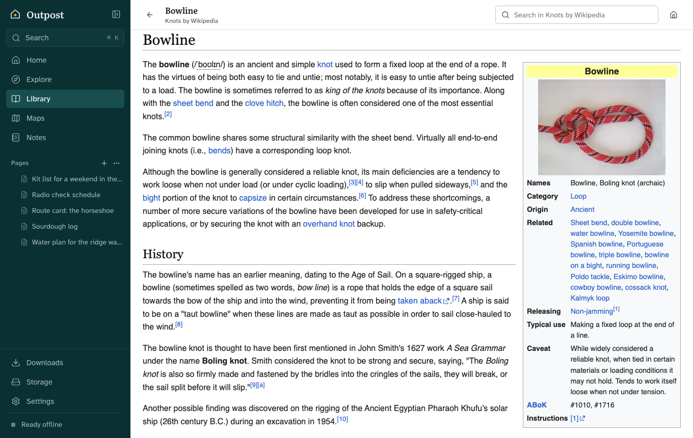
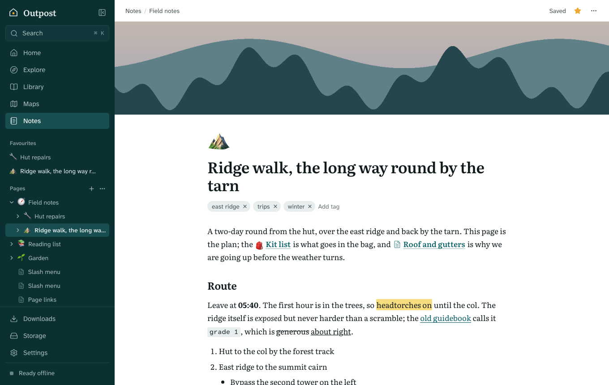
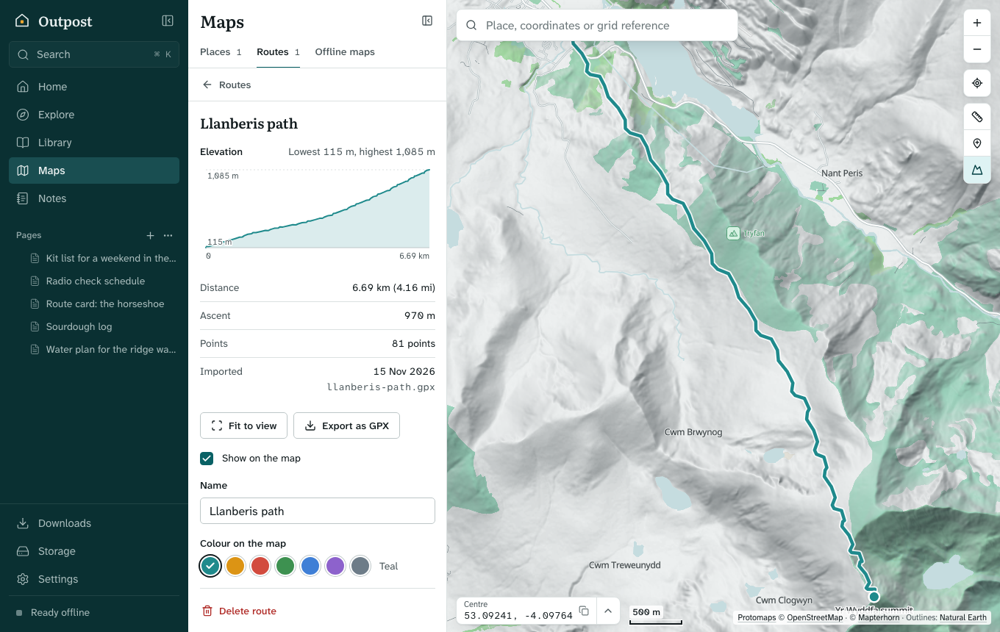
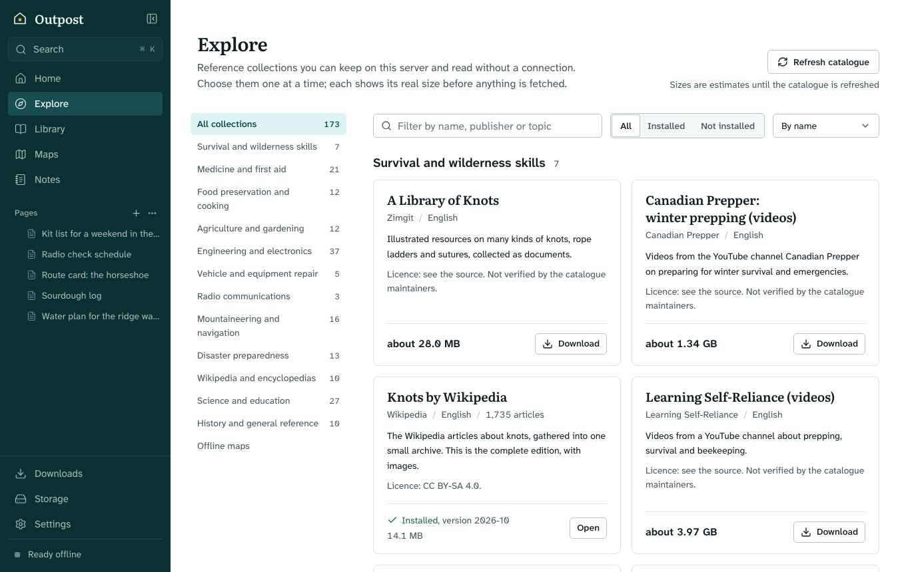

# Outpost

**Knowledge beyond the network.**

Outpost is a self-hosted, offline-first knowledge platform. It puts an encyclopedia,
your own documents, a notes workspace and offline maps behind one search box, on
hardware you control, and keeps working when the internet does not.

Install it once on a laptop, a home server, a NAS or a Raspberry Pi. Download the
reference collections and maps you want onto storage you choose. Add your own
documents and write your own notes. Then pull the network cable: everything you chose
to keep is still there.

It is built for study, research, travel, the outdoors, workshops, and being prepared.



| | |
| --- | --- |
|  |  |
|  |  |

These are screenshots of the running application, taken by the script in
`e2e/tools/`.

## What it does

- **Reference collections.** Browse a curated catalogue (Wikipedia, medicine and first
  aid, repair guides, food preservation, engineering, and more) and download
  individual collections as [Kiwix](https://kiwix.org) ZIM archives. Downloads resume,
  retry, and are checked against the publisher's checksum. Read them in the app.
- **Your documents.** Add PDFs, EPUBs, Markdown, HTML, text and images. Text is
  extracted and indexed down to the page; originals are kept untouched. A built-in
  PDF viewer opens at the page a search result points to.
- **Notes.** A page tree and a block editor: headings, lists, to-dos, tables, code,
  callouts, images, links between pages, backlinks, templates, favourites, trash, and
  export to Markdown. Import from Markdown, HTML, and Notion exports.
- **Offline maps.** Download a country, a mountain range, or any box you draw, with
  the exact size shown first. Save places, import and export GPX routes, measure
  distances, search place names, and enter coordinates or British grid references.
- **One search.** Full-text search across documents, notes, collections and saved
  places, with ranked results, highlighted passages and filters. Optional semantic
  search finds passages by meaning, and hybrid ranking combines the two.
- **Storage you control.** Internal disks, USB drives, SSDs and NAS shares. See what
  uses the space, move collections between locations with verification, and unplug a
  drive without losing your library's records.
- **Take it with you.** Write a portable drive: a USB stick holding Outpost itself and
  part of your library, which starts with a double-click on another Mac, Windows or
  Linux computer with nothing installed.
- **Private by construction.** No accounts in the cloud, no telemetry, no external AI.
  The app is forbidden by its own content policy from contacting any other server.

What it does **not** do yet is listed under [Limitations](#limitations). Nothing in
this README describes something that is not implemented and tested.

## Supported platforms

| Platform | How | Status |
| --- | --- | --- |
| macOS, Apple Silicon | Docker Desktop, the packaged app, or a portable drive | Developed and tested here, including the full Compose stack |
| Linux ARM64, Raspberry Pi 4 and 5 (64-bit OS) | Docker Compose | The ARM64 image is built and run on Apple Silicon; not yet tried on a physical Pi |
| Linux x86-64 | Docker Compose, or the packaged app | Image build and tests are set up in CI; no CI run has happened yet |
| macOS, Intel | Docker Desktop, or the packaged app | Untested |
| Windows 10 and 11 | Docker Desktop with WSL2 | Server tests are set up for Windows in CI; no CI run has happened yet |
| NAS and home servers | Any that run containers | Untested on specific models |

"Set up in CI" means the workflow exists in `.github/workflows/`. Until the first run
is green, treat those platforms as expected to work rather than proven. 4 GB of RAM or
more is recommended on a Raspberry Pi.

## Quick start

You need [Docker](https://docs.docker.com/get-docker/) with Compose.

```bash
git clone https://github.com/tyleruk2000/outpost.git
cd outpost
cp .env.example .env
docker compose up -d --build
```

Open <http://localhost:8080>.

The first start builds the image, which takes a few minutes. By default Outpost
answers only on the computer it runs on. To use it from phones and other computers on
your network, set `OUTPOST_LAN_ACCESS=true` and `OUTPOST_BIND=0.0.0.0` in `.env` and
restart; sign-in is then required. See [docs/deployment.md](docs/deployment.md) for
every platform, for running without Docker, and for all settings.

## Storage

Outpost keeps three kinds of thing in three places:

| What | Where | Notes |
| --- | --- | --- |
| Database, notes attachments, settings | The data volume (`outpost-data`) | Keep on a local disk |
| Documents, collections, maps | Storage locations you add | Any mounted folder |
| The app | The image, or a portable drive | Replaceable at any time |

The server administrator decides which folders Outpost may use (the storage roots; in
Docker, anything mounted under `/storage`). Inside those, you add **storage locations**
from the Storage screen, choose a default for new downloads, and pick a different one
for any single download. Each location is identified by a small marker file, so a
drive that comes back at a different mount point is recognised.

### NAS and external drives

Mount the share or drive on the host, map it into both containers, then add it in the
app:

```yaml
# compose.yaml
services:
  outpost:
    volumes:
      - /mnt/nas/outpost:/storage/nas
  kiwix:
    volumes:
      - /mnt/nas/outpost:/storage/nas:ro
```

Docker can also mount NFS and SMB shares itself; `compose.yaml` has commented
examples. Outpost never stores share passwords: the operating system or Docker does
the mounting. Full examples for Linux, macOS, Windows and common NAS systems are in
[docs/storage.md](docs/storage.md).

## Downloading collections

Open **Explore**. The catalogue ships with the app and can be browsed offline; press
**Refresh catalogue** while online to get current sizes and versions. Choose a
collection, check its size against the free space on the location you pick, and
download. Progress, pausing and retrying are on the **Downloads** screen.

Collections are downloaded from their publishers' official endpoints and are never
bundled with Outpost. Each entry states its licence, and says so plainly where the
maintainers have not verified it. To add entries, see [catalog/README.md](catalog/README.md).

Maps are downloaded from the **Maps** screen by region. See [docs/maps.md](docs/maps.md).

## Using it offline

Once installed and populated, Outpost needs no connection. Reading, searching, writing
notes, viewing documents and using maps all work with the network unplugged. Only
starting new downloads and refreshing the catalogue need the internet, and the
interface says so when you are offline. The end-to-end tests run with the internet
blocked and fail if the app tries to reach it. Details and a pre-departure checklist:
[docs/offline.md](docs/offline.md).

## Portable drives

From **Storage → Take it with you**, write Outpost and chosen content to a folder on
a USB drive. On another computer, open the folder and double-click the launcher. The
drive carries its own copy of the app and of the program that runs it, so nothing is
installed. See [docs/portable.md](docs/portable.md).

## Architecture

One Node.js process serves the web app and the API from a SQLite database and a set of
folders. One optional helper, kiwix-serve, reads ZIM archives behind a sandboxing
proxy.

```
 Browser ──► Outpost (Node 24, Fastify, React app)
                 ├── SQLite: library records, notes, full-text index, jobs
                 ├── data directory: attachments, extracted text
                 ├── storage locations: documents, collections, maps
                 └── kiwix-serve: reads ZIM archives (proxied, sandboxed)
```

- **Server:** TypeScript on Node 24, Fastify, Drizzle ORM, SQLite with FTS5.
- **Web:** React, Vite, Tailwind CSS, TanStack Query, Tiptap, MapLibre GL JS.
- **Search:** FTS5 keyword search; optional vectors with a pluggable embedding
  provider; reciprocal rank fusion for hybrid ranking.
- **Maps:** regional extracts of the Protomaps planet build (OpenStreetMap data) as
  PMTiles, served and styled locally.

The reasoning behind each choice, the security model and the known trade-offs are in
[docs/architecture.md](docs/architecture.md).

## Documentation

| | |
| --- | --- |
| [Deployment](docs/deployment.md) | Installing on each platform, settings, running without Docker |
| [Storage](docs/storage.md) | Locations, NAS examples, moving and verifying |
| [Offline use](docs/offline.md) | What works without a connection, and how that is guaranteed |
| [Search](docs/search.md) | Query syntax, semantic and hybrid search |
| [Maps](docs/maps.md) | Regions, data sources, GPX, coordinates |
| [Notes and imports](docs/notes-and-imports.md) | The editor, Markdown and Notion imports |
| [Portable drives](docs/portable.md) | Making and using a USB drive |
| [Security](docs/security.md) | Threat model and controls |
| [API](docs/api.md) | HTTP API reference |
| [Preparing for AI](docs/ai.md) | Retrieval interfaces for future question answering |
| [Troubleshooting](docs/troubleshooting.md) | Common problems |
| [Architecture](docs/architecture.md) | Design decisions and trade-offs |

## Limitations

Stated here so nobody has to find them out:

- **No OCR.** Scanned PDFs and images are stored and viewable but not searchable.
- **No language model.** Outpost does not answer questions in prose. The retrieval and
  citation interfaces a model would use exist and are documented.
- **Semantic search needs a model you provide**: a local embedding server such as
  Ollama, or an optional package that is not part of the packaged app.
- **Reference collections need kiwix-serve.** It is in the Compose stack. On portable
  drives it is included for macOS and Linux; the Kiwix project publishes no Windows
  build, so collections cannot be opened from a drive on Windows.
- **Maps** have no contour lines and no routing. Hill shading needs a separate terrain
  download.
- **One server, one library.** There is no clustering and no PostgreSQL back end.
- **No live collaboration.** Two people editing the same page are warned of the
  conflict rather than merged.
- **A portable drive is a copy.** Changes made on the drive are not merged back.

## Roadmap

In rough order: OCR as an optional provider; a bundled local embedding option;
question answering with citations through a local model (Ollama, llama.cpp); contour
lines and richer topographic layers; merging a portable drive back into its source;
storage pools; an optional PostgreSQL and pgvector back end. Work is tracked in the
repository's issues.

## Contributing

Contributions are welcome: code, catalogue entries, documentation, translations of
the catalogue. Start with [CONTRIBUTING.md](CONTRIBUTING.md). Please report security
problems privately as described in [SECURITY.md](SECURITY.md).

```bash
pnpm install
pnpm dev        # API on :8080, web app on :5173
pnpm test       # server and web unit tests
```

## Licence and attribution

Outpost is released under the [MIT Licence](LICENSE).

It stands on other people's work:

- **[Kiwix](https://kiwix.org)** and **openZIM** publish the ZIM archives and
  kiwix-serve (GPL-3.0), which Outpost runs as a separate program.
- **Map data © [OpenStreetMap](https://www.openstreetmap.org/copyright) contributors**
  (ODbL), packaged by **[Protomaps](https://protomaps.com)**. Terrain from
  **[Mapterhorn](https://mapterhorn.com/attribution)**. Place names from
  **[GeoNames](https://www.geonames.org)** (CC BY 4.0). World outline from
  **Natural Earth** (public domain).
- **[MapLibre GL JS](https://maplibre.org)**, **[Tiptap](https://tiptap.dev)**,
  **[PDF.js](https://mozilla.github.io/pdf.js/)**, and the libraries listed in the
  package manifests.
- Typefaces: **Atkinson Hyperlegible** (Braille Institute) and **Literata**
  (TypeTogether), both under the SIL Open Font Licence.

The projects that showed the way: Internet-in-a-Box, PrepperPi, Offgrid Pi,
Paperless-ngx and Organic Maps. No code was taken from them.

Every downloadable collection has its own licence, shown in the app. Outpost does not
bundle or redistribute any of them.
