# Outpost

**Knowledge beyond the network.**

Outpost is a self-hosted, offline-first knowledge and preparedness app. One program,
on a laptop, a home server, a NAS or a Raspberry Pi, holds an offline encyclopedia, your
own documents and notes, offline maps, contacts, a message board for the household, radio
planning tools, calculators and a household's emergency plans and supplies, behind one
search box. You choose what to
download while you have a connection; after that, everything you kept works with the
network cable pulled out. Phones and other computers on your home network use it in
their browser.

It is for people who want their reference library to keep working when the internet
does not: students and teachers on poor connections, travellers, hill walkers,
radio amateurs, people preparing a household for a power cut or a flood, and anyone
who keeps a personal library.

**What it is not:**

- **Not a cloud service.** It runs on a computer you own. There is no Outpost server
  elsewhere, no telemetry and no analytics.
- **Not an account system.** There are no accounts and no sign-in. Everyone who can
  reach it can read and change everything in it, so it is for one person or a household
  on a network they trust.
- **Not an emergency service.** Its plans, calculators, forecasts and effects simulator
  are general information and planning aids, and its message board and mesh radio are
  not a way to call for help. In an emergency, follow the emergency services and
  official warnings.
- **Not chatty.** Nothing leaves the machine except as the direct result of a press: a
  download, a catalogue refresh, a weather update, and the other actions listed in
  [What needs a connection](docs/offline.md#what-needs-a-connection).

Outpost is open source under the [MIT Licence](LICENSE). It is version 0.1.0, not yet
released, developed and tried by hand on one kind of computer (a Mac with Apple
Silicon); see [Limits](#limits) before relying on it.


*Home, with made-up demonstration data. Every picture in this README was taken by
[`e2e/readme/screenshots.spec.ts`](e2e/readme/screenshots.spec.ts) from a fresh
Outpost filled with data written for the purpose; see
[Making the pictures again](#making-the-pictures-again).*

## Contents

- [Features](#features)
- [Install and run](#install-and-run)
- [What needs a download or a build first](#what-needs-a-download-or-a-build-first)
- [Privacy and security in brief](#privacy-and-security-in-brief)
- [Limits](#limits)
- [Data sources and licences](#data-sources-and-licences)
- [Developing and contributing](#developing-and-contributing)
- [Documentation](#documentation)

## Features

Grouped as the app's sidebar groups them. Each row links to the page that describes it
in full, including what it does not do.

### Home and search

| Feature | What it does | Docs |
| --- | --- | --- |
| Home | How much is in the library, recent documents and collections, free space, the emergency plan and how long food and water last, anything new on the household board, and the ways to add more. | |
| One search | Full-text search across documents, notes, collections, saved places and contacts, with ranked results, highlighted passages and filters. What is on this device comes before what would have to be downloaded, and matching screens are offered too. | [Search](docs/search.md) |
| Quick search | From any screen (Ctrl or Cmd + K): finds screens, each section of Settings and each guide by their names and by everyday words ("food" offers Supplies), and lists the keyboard shortcuts. | [Search](docs/search.md) |
| Search by meaning | Optional semantic search with a small model that is built in (nothing to install, nothing downloaded at run time), and hybrid ranking of the two. Off until switched on. | [Search](docs/search.md#semantic-search) |
| Scanned pages (OCR) | Reads the text of scanned PDFs and images on request, or automatically if turned on. English is built in. | [Search](docs/search.md#scanned-pages-and-images-ocr) |
| How search works | Follows one question of yours through every step (cutting into passages, matching words, matching meaning, combining, the context a model is given) with the real numbers from your library. | [Search](docs/search.md#seeing-how-it-works) |

### Library, collections and the reader

| Feature | What it does | Docs |
| --- | --- | --- |
| Your documents | Add PDFs, EPUBs, Markdown, HTML, text and images. Each is checked, given a checksum, read for its text and indexed down to the page; originals are kept untouched. | [Library](docs/library.md) |
| Readers | A PDF viewer that opens at the page a result points to; EPUB books chapter by chapter with their contents and pictures; Markdown and text. | [EPUB](docs/epub.md) |
| Audiobooks | A zip of a book's chapters, or its audio files, becomes one book with its chapters in order. It plays from your Outpost with speed, 30-second skips and lock-screen controls, and each device keeps its place. Lock-screen controls have not been tried on a real phone. | [Library](docs/library.md#audiobooks) |
| Save a web page | Paste an address to keep a readable copy of the article, one page at a time, for your own reading. | [Notes and imports](docs/notes-and-imports.md#saving-a-web-page) |
| Explore and packs | A catalogue of 410 entries that can be browsed offline: 173 Kiwix archives (Wikipedia, medicine, repair, Project Gutenberg shelves, Stack Exchange sites and more) and 212 official handbooks, guides and leaflets fetched from their publishers, among them the CDC, FEMA, the UK government, the Met Office, OpenStax and the WHO. Twenty-two packs gather the usual things for a purpose, from "A few days without power" to "For children". Each entry states its size and licence before anything is fetched. A shelf of fifteen LibriVox audiobooks is offered as links for your browser to download. | [Sources](docs/sources.md), [catalogue](catalog/README.md) |
| Reference collections | ZIM archives read in the app through kiwix-serve, behind a sandboxing proxy. PDFs and e-books inside an archive open in Outpost's own viewer and can be added to your library with no connection. | [Architecture](docs/architecture.md#reference-collections-through-kiwix-serve-behind-a-sandboxing-proxy) |
| Learning progress | For course archives such as Khan Academy and PhET: where each learner got to, pages done, and time this week, with "Carry on where Sam left off" and a page to print. Built and tested against a small made-up course archive, not yet a real one. | [Learning progress](docs/learning.md) |
| Included with Outpost | Nine radio reference sheets written for Outpost from regulators' documents, and sixteen books from LogBook73 (a radio engineering handbook and fifteen radio guides). No download needed. | [Radio](docs/radio.md) |
| PDFs made in Outpost | Map pages, HF predictions, communication plans, power plans, emergency cards and more can be saved, shared, or added to the library from the screen that made them. | [Library](docs/library.md#where-outpost-makes-a-pdf) |


*A reference sheet that ships with Outpost, in the reader.*

### Maps

| Feature | What it does | Docs |
| --- | --- | --- |
| Offline maps | Download a country, a mountain range or any box you draw, with the exact size shown first, and view it with no connection. 188 ready-made regions, your own area offered first. | [Maps](docs/maps.md) |
| Terrain and contours | An optional terrain download gives hill shading, contour lines traced on your device, and the heights of routes. | [Maps](docs/maps.md#contour-lines) |
| Height of the ground | The readout gives the height under a resting pointer, or at the centre of the map on a touch screen, from the installed terrain; nothing is shown where there is none. Metres or feet for every height on the map screens. | [Maps](docs/maps.md#the-height-of-the-ground) |
| Places | Saved places with a note, a colour and one of sixteen icons. | [Maps](docs/maps.md#markers) |
| Routes | Draw a route point by point, edit its shape, see its distance, ascent and elevation profile; import and export GPX. | [Maps](docs/maps.md#drawing-a-route) |
| Find a known route | Search OpenStreetMap for a named route and add it, through the route server named beside the search, only when you search. | [Maps](docs/maps.md#finding-a-known-route) |
| Recording a track | Records where you walk while the screen is on. Needs an `https` address. | [Maps](docs/maps.md#recording-a-track) |
| Coordinates and place search | Coordinates, British grid references and Maidenhead locators; offline place names from GeoNames; and for Great Britain, Ordnance Survey's OS Open Names: settlements, hills, roads and every postcode, found however a postcode is typed. | [Maps](docs/maps.md#coordinate-formats), [Great Britain](docs/maps.md#place-names-for-great-britain) |
| Sun times | Sunrise, sunset and twilight for any place and date, worked out on the device. | [Maps](docs/maps.md#sunrise-and-sunset) |
| The grey line | Day and night drawn over the map, for now or a time you choose. | [Maps](docs/maps.md#the-grey-line-day-and-night) |
| Line of sight | Whether two points can see each other over the installed terrain. | [Maps](docs/maps.md#line-of-sight) |
| Satellite imagery | The whole world from NASA's Blue Marble, or a chosen area at 10 m from Sentinel-2, downloaded and kept on disk. | [Maps](docs/maps.md#satellite-imagery) |
| Aerial photographs | National aerial photographs for an area in New Zealand (LINZ) and the lower 48 United States (NAIP), 5 cm to 1 m a pixel. | [Maps](docs/maps.md#aerial-photographs) |
| Reference layers | Boundaries, populated places, airports with their radio frequencies (not for navigation), publicly mapped facilities, hospitals and emergency services, shelters and meeting points, population density and historical records, each pack downloaded on a press or imported, every record with its source and licence. For England, the Environment Agency's planning flood zones 2 and 3 for the area on screen, with the Agency's own definitions and its caveat that the map is not for judging one property. | [Reference layers](docs/reference-layers.md) |
| Food and supplies | Shops, markets, food banks, drinking water, fuel and pharmacies from OpenStreetMap, for the area on screen (up to about a county) or for a whole US state, German Land, English county or other region from a Geofabrik extract; in the UK, the Food Standards Agency's registered food shops beside them. The nearest of each kind to home, with distance and bearing, worked out offline. Coverage is as good as the mapping, and patchy in the countryside. | [Reference layers](docs/reference-layers.md#food-and-supplies) |
| Printing | A one-page map at a stated scale, with scale bars, north, a grid of latitude and longitude, and the credits, made on your device as a PDF. | [Maps](docs/maps.md#printing-a-map) |


*Saved places and a route with its profile, on the test suite's made-up map (an
invented hill and lake; not a real map).*

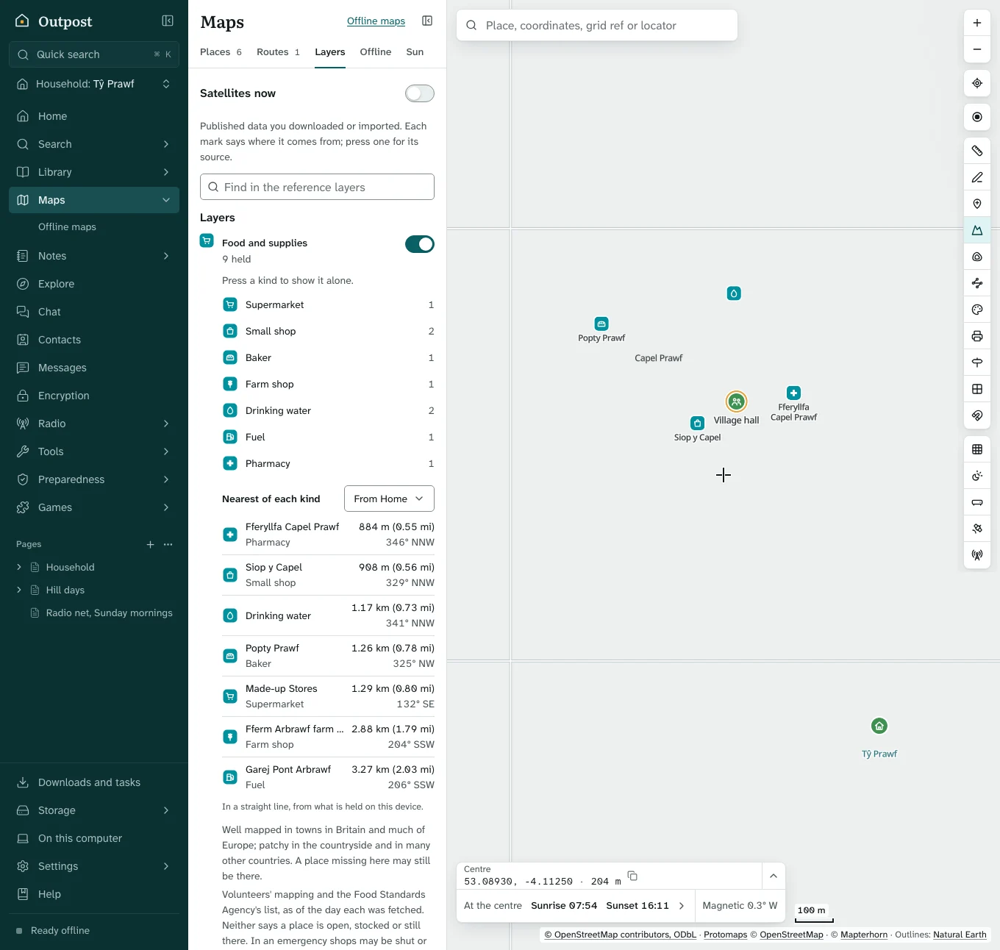

*The Food and supplies layer and the nearest of each kind, on the test map. The shops
and taps were made up for the picture and served by a stand-in for OpenStreetMap; no
real place is shown.*

### Notes

| Feature | What it does | Docs |
| --- | --- | --- |
| Notes | A page tree and a block editor: headings, lists, to-dos, tables, code, callouts, images, links between pages, backlinks, templates, favourites, trash, and export to Markdown. A change saved on another device is not overwritten without asking. | [Notes and imports](docs/notes-and-imports.md) |
| Import files | Brings in Markdown, HTML and Notion exports as a tree of pages, saying first what will be made, overwritten and left alone. | [Notes and imports](docs/notes-and-imports.md#imports) |
| Encrypted pages | A page can be encrypted with an OpenPGP key, so it is ciphertext wherever it is copied. | [Encryption](docs/encryption.md#pages-of-notes) |


*A page of made-up notes, in the dark theme.*

### Chat and answers from the library

| Feature | What it does | Docs |
| --- | --- | --- |
| Answer from my library | If you run a language model on your own machine or network (Ollama, llama.cpp or LM Studio), search can write a short answer from passages of your documents, notes and book chapters, with a citation after each statement. Outpost includes no model and downloads none. | [Answers](docs/ai.md), [set-up guide](docs/setup-guide.md) |
| Chat | Conversations with the same model server, kept on your Outpost, with or without your library. Everyone who can open your Outpost can read them. | [Answers](docs/ai.md#chat) |
| Looking things up | When switched on (it is off by default), a model in Chat can look things up in Outpost: places and layers on the map, supplies, emergency plans, the weather as last fetched, the sun, radio, the catalogue and the library, each area switchable. The tools only read; Outpost runs them on the server, and the reply says under it what was looked at. | [Answers](docs/ai.md#looking-things-up-in-outpost) |
| Which model | Seven small models measured on one Mac for answers and for looking things up, with a recommendation, shown inside Outpost where a model is chosen. None has been timed on a Raspberry Pi. | [Which model](docs/which-model.md) |
| Tools for other programs (MCP) | The same read-only tools at `/mcp` for programs on the home network that speak the Model Context Protocol. Off by default, and switched on only at the computer Outpost runs on. Not yet tried with a real MCP client. | [MCP](docs/mcp.md) |


*An answer from the library. The words were written by the test suite's stand-in
model server, which repeats the first sentence of each source it is given: it is not a
language model, and a real model's answers read differently.*


*Chat looking something up, with **Looked at** opened under the reply. The question
carries an instruction for the test suite's stand-in model server, which calls the tool
it is told to and repeats what came back: it is not a language model.*

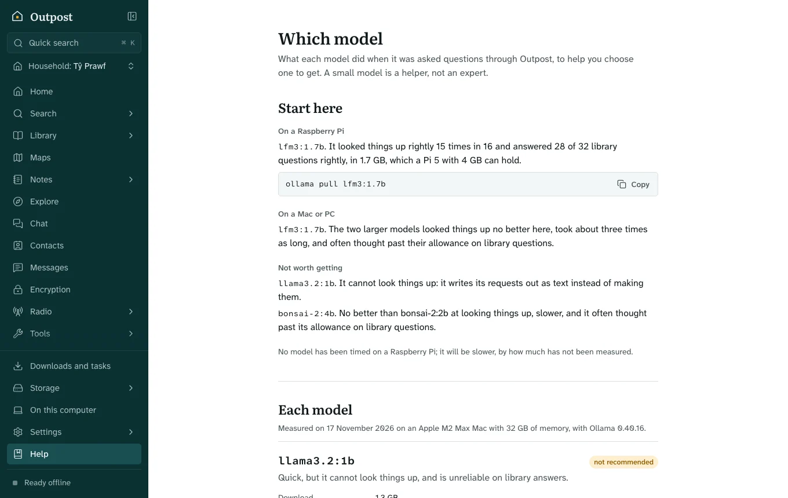

*Which model, as it is shown inside Outpost.*

### Contacts

| Feature | What it does | Docs |
| --- | --- | --- |
| Contacts | People and places to reach when the phone network is down, with an emergency list that prints on one sheet, radio callsigns and frequencies, and one-touch call, text and email. | [Contacts](docs/contacts.md) |
| From and to a phone | Bring contacts in as a vCard file; let a phone keep a read-only copy over CardDAV. | [Contacts](docs/contacts.md#keeping-a-copy-on-a-phone-carddav) |

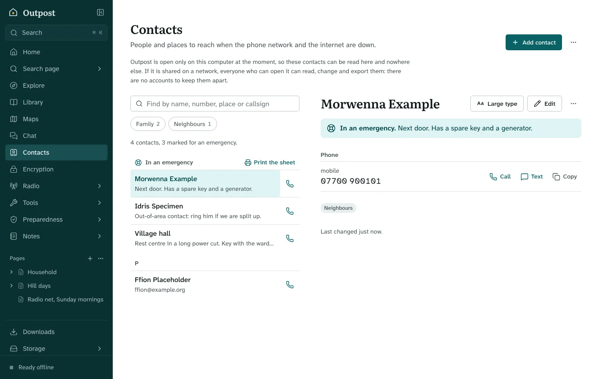

*Contacts with invented names; the numbers are from the ranges Ofcom keeps for drama.*

### Messages

| Feature | What it does | Docs |
| --- | --- | --- |
| The household board | A board for the people of one household on the home network, with no internet: short messages for everyone, check-ins ("I'm safe, gone to Mum's") with each person's latest at the top, and a file or photo sent from one device for another to save. No accounts and no push notifications: anyone on the network can post under any name, and it does not wake a locked phone. | [Messages](docs/messages.md) |
| Mesh radio | The board can reach beyond the Wi-Fi through a LoRa radio running Meshtastic (over MQTT, with Outpost as the broker or through the household's) or MeshCore (by USB or its network port). **Not yet tried with a real radio**: it was built from the projects' documentation and tested against stand-ins. | [Mesh radio](docs/mesh-radio.md) |


*The household board on a phone, with made-up names: each person's latest check-in
first.*

### Encryption

| Feature | What it does | Docs |
| --- | --- | --- |
| OpenPGP | Make and keep keys, encrypt and sign text and files, and encrypt pages of notes, in the browser; checked against GnuPG. Outpost's use of OpenPGP has not been audited. | [Encryption](docs/encryption.md) |
| Ciphers by hand | Classical ciphers to work with pencil and paper, with printable pads. For interest and practice; they protect nothing from anyone with a computer. | [Encryption](docs/encryption.md#by-hand) |

### Radio

| Feature | What it does | Docs |
| --- | --- | --- |
| HF propagation | Predicts how a shortwave signal gets from one place to another, hour by hour and band by band, for your power, antennas and mode, including steep (NVIS) paths. The answer comes first: on what share of days a contact is predicted to get through, and the path's MUF explained, in local time beside UTC. Worked out on your computer by VOACAP: a monthly median for planning, never today's conditions. | [HF propagation](docs/hf-propagation.md) |
| A second model | Optionally runs the ITU's P.533 (ITURHFProp) beside VOACAP for the same path, and states where they differ. You build its engine on your own computer. | [HF propagation](docs/hf-propagation.md#a-second-model-itu-p533) |
| Antennas | Your own radios and antennas, and generic ones: dipoles, inverted-V, end-fed wires of a stated length (level, vertical or sloping), verticals, the SPOOLTENNA. Each is run as one of VOACAP's antenna models, and the screen says where that is an approximation. | [HF propagation](docs/hf-propagation.md#equipment) |
| HF coverage | Where one transmitter is predicted to be heard, as a layer over the offline map. | [HF propagation](docs/hf-propagation.md#coverage-maps) |
| Communication plans | Several stations, and which band serves each pair at which hour; exported as PDF or Markdown. | [HF propagation](docs/hf-propagation.md#communication-plans) |
| Contact log | What actually happened on the air, typed in or read from ADIF, set beside what the engine predicted. | [HF propagation](docs/hf-propagation.md#the-contact-log) |
| Repeaters | A database of repeaters you bring in as a file, enter by hand, or fetch from the two publishers whose terms allow it; found, measured from a place (home, to start with), drawn on the map and written out for a radio. | [Radio](docs/radio.md#repeaters) |
| Estimated range | For a repeater on the map, where its aerial is in line of sight for a handheld, a car or a roof aerial, over the installed terrain, out to 100 km; with no terrain, the smooth-Earth radio horizon, dashed. Line of sight only, and it says what it leaves out. Switched on repeater by repeater in each one's card; up to eight outlines stay on the map, each labelled with its callsign. | [Radio](docs/radio.md#the-estimated-range) |
| Morse trainer | Learn Morse by ear with the Koch method and drills, send it on the screen (multi-touch paddles on a phone), on a keyboard or on a real key, work a practice contact, and get a call ready for the air. Progress over time and weak characters, kept for the household. Not tried on a real iPhone or with a real paddle. | [Morse trainer](docs/morse-trainer.md) |
| Frequencies to listen to | Where to tune when the internet is out: time signals (with how to set a clock by ear), emergency and news broadcasters, weather, distress and calling, amateur emergency nets and licence-free channels, by country, each with its source and the day it was checked. Filters by the kind of set you have; prints as a PDF. | [Frequencies to listen to](docs/radio-frequencies.md) |

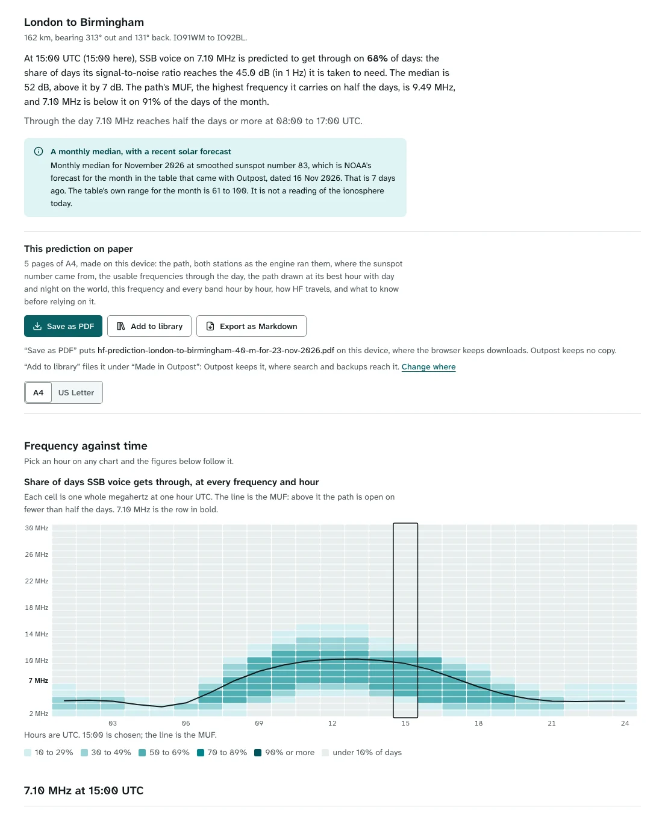

*VOACAP's prediction for London to Birmingham on 40 m, the planner's own example.*

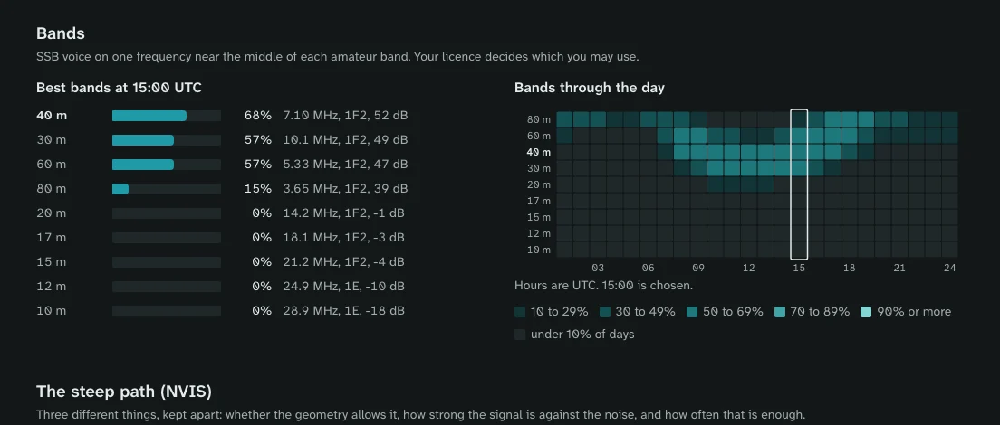

*The same prediction, band by band, in the dark theme.*

<table>
<tr>
<td width="62%">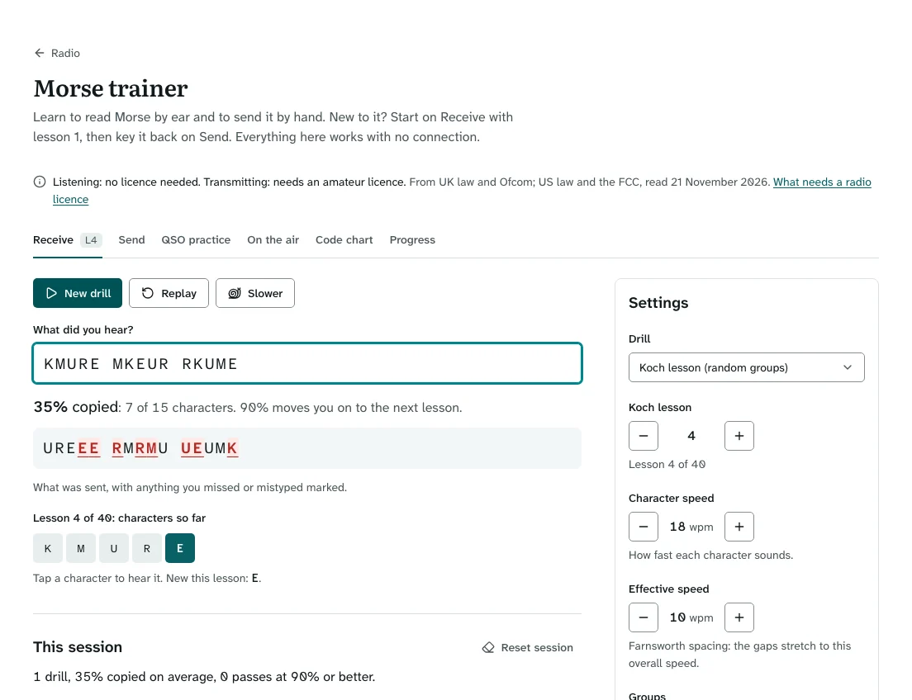</td>
<td>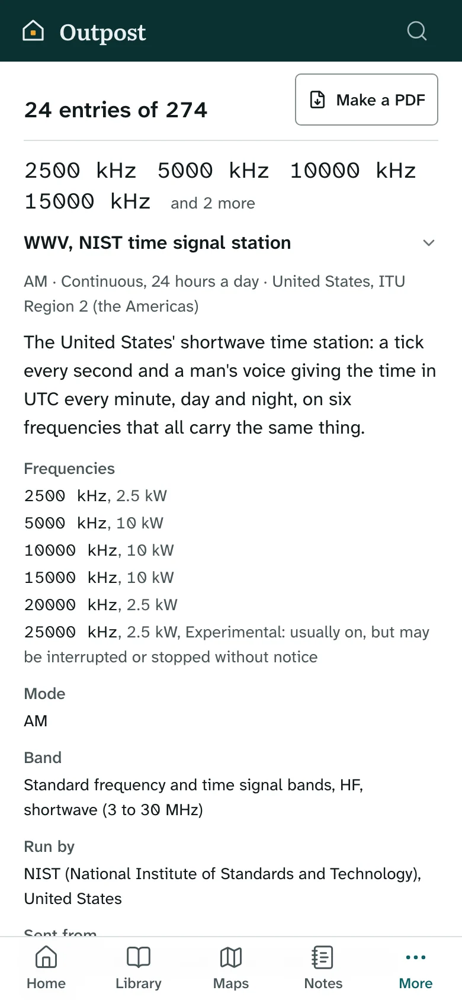</td>
</tr>
<tr>
<td><em>A Koch receive drill, copied and marked.</em></td>
<td><em>Time signals on a phone, WWV opened.</em></td>
</tr>
</table>

### Tools

| Feature | What it does | Docs |
| --- | --- | --- |
| Water | Water to store by the UK Government's, the CDC's, Ready.gov's or the WHO's figure; rain from a roof; filter life; making water safe to drink, quoted from the bodies that publish it. | [Tools](docs/tools.md#water) |
| Outdoors | Walking time by Naismith's rule with Langmuir's and Tranter's corrections, gradient, distance and bearing, the sun's day, wind chill, heat index, and water and food for a walk. | [Tools](docs/tools.md#outdoors) |
| Radio calculators | Antenna lengths, free-space path loss, the radio horizon, cable loss, watts, dBm and S-units, battery life on a duty cycle; the antenna and the radio horizon are drawn. | [Tools](docs/tools.md#radio-calculators) |
| Building | Concrete and mortar, area and volume, roof pitch, a cutting list, U-values and heat loss, sheets and fixings. | [Tools](docs/tools.md#building) |
| Cooking | Roasting times and safe temperatures from UK food-safety guidance, a timer, boiling at altitude, conversions, scaling a recipe. | [Tools](docs/tools.md#cooking) |
| Power and batteries | Battery runtime from common devices: pick a Raspberry Pi, phones to charge, radios, a router or a NAS from a library of makers' published figures (each with its source), and see how long the battery runs them, how many charges it holds, and what battery a few days would need; keep your own devices for next time. Quick calculators besides (solar, cable size and voltage drop, series and parallel, generator fuel, small electronics), and power plans: a battery system kept by name, worked out into how long it runs and how much solar it needs. Monthly sun hours can be fetched for the plan's place on a press, and the plan says where they came from. | [Power](docs/tools-power.md) |
| QR codes | Makes a code from text, a web address, a Wi-Fi network, a contact or a saved place, on the device; nothing typed is sent anywhere. | [QR codes](docs/tools-qr-and-network.md#qr-codes-toolsqr) |
| Compass | Where magnetic north and the map's grid north lie from true north at a place (NOAA's World Magnetic Model 2025, and the National Grid), and so what to add or subtract between map and compass, with the three norths drawn; a bearing converted between them; and on a phone at an `https` address, a live compass corrected to true or grid north. The live compass has not been tried on a real phone. | [Compass](docs/tools-compass.md) |
| Solar clock | Where the sun is now at a place; after a power cut, the time to set your clocks by from a stick's shadow (noon, the shadow's length or bearing, sunrise on the sea), with an honest range and a diagram of each method; a horizontal sundial and a nocturnal to print, drawn for the place. Worked out on the device, no internet. Tested by arithmetic, not yet against a real shadow. | [Solar clock](docs/tools-solar-clock.md) |
| Night sky | The Moon's phase, rise and set tonight; a chart of the stars to magnitude 4.5, the planets and 27 constellations for a place now or at another time; and finding north by the Plough or south by the Southern Cross, drawn for that night. Worked out on the device from the Yale Bright Star Catalogue; held to the US Naval Observatory's almanac. | [Night sky](docs/night-sky.md) |
| Celestial navigation | A position from sextant sights of the Sun, Moon, planets and navigational stars, with the almanac worked out on the device (within half a minute of arc of the US Naval Observatory's for stars and the Sun), corrections shown step by step, lines of position and the fix on a plotting sheet and the map, noon and Polaris latitude, and a printable sight form. For learning and as a fallback, not for navigating a vessel. | [Celestial navigation](docs/celestial-navigation.md) |
| Tide times | High and low water at the nearest tide stations, a day to a month ahead, worked out on the computer from NOAA's published constants: the US coasts and a few ports elsewhere. Matches NOAA's own tables to a minute or two; ignores storm surges and is not for navigation. | [Tide times](docs/tides.md) |
| Garden | What to sow, plant out and harvest this month in the UK, from the RHS calendar for 22 vegetables, with tender crops kept back until after your last frost; and a record of what the household sowed. Other countries are not covered yet. | [Garden](docs/garden.md) |
| Devices on this network | Lists what answers on the network the computer running Outpost is on: a NAS, a printer, a Raspberry Pi whose address you have forgotten. Never put in search. A start-up option limits starting a scan to the computer itself. | [Network](docs/tools-qr-and-network.md#devices-on-this-network-toolsnetwork) |

Every calculator shows its answer as you type and says, under **How this is worked
out**, the formula, its source with the date it was read, and the range it holds for.

<table>
<tr>
<td width="62%"></td>
<td>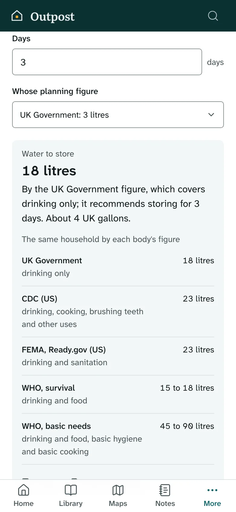</td>
</tr>
<tr>
<td><em>A power plan, with figures typed for the demonstration.</em></td>
<td><em>The water calculators on a phone.</em></td>
</tr>
</table>

<table>
<tr>
<td width="62%">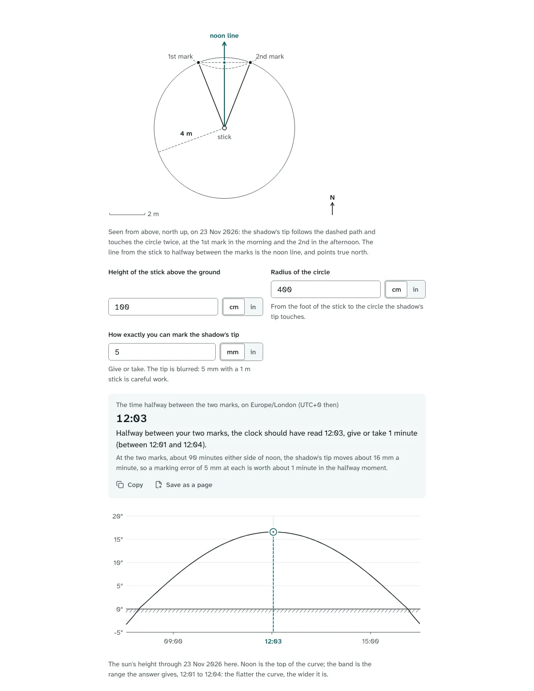</td>
<td>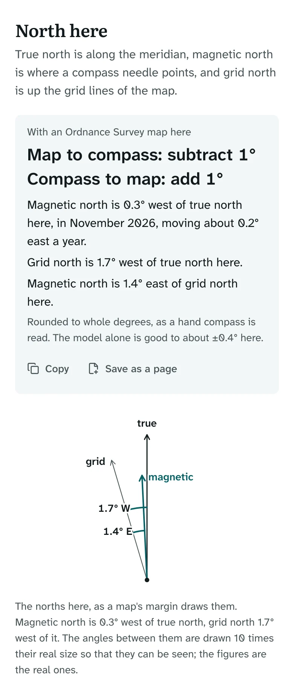</td>
</tr>
<tr>
<td><em>Clock recovery from two equal shadows, with its diagrams.</em></td>
<td><em>North here, on the test map, on a phone.</em></td>
</tr>
</table>

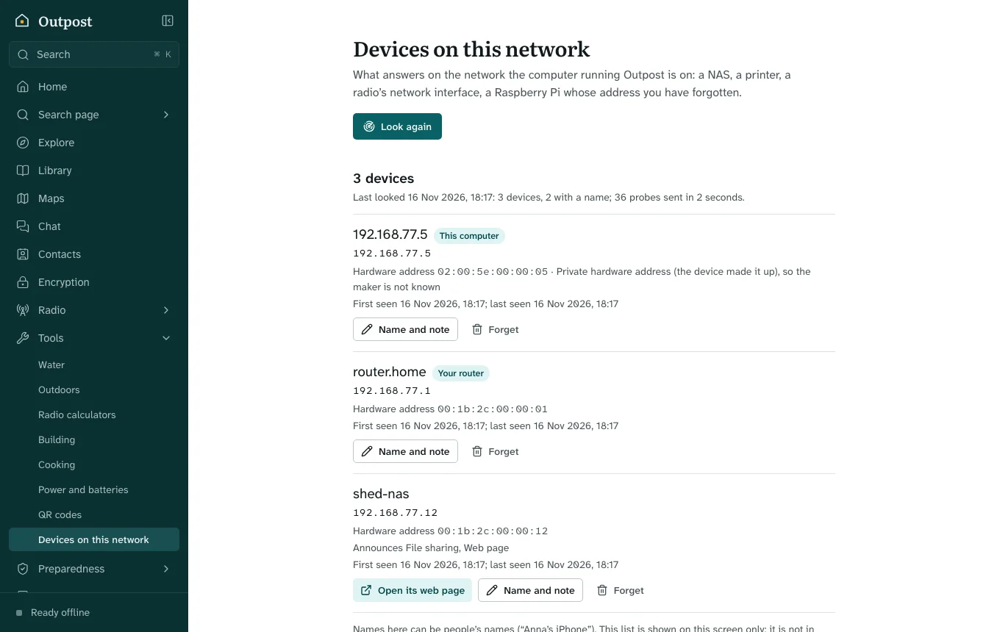

*Devices on this network, scanning the test suite's made-up network (a stand-in): no
real network's devices are shown.*

### Preparedness

| Feature | What it does | Docs |
| --- | --- | --- |
| Emergency plans | A household's plans for a power cut, flooding, no phone or internet, severe weather, sheltering at home or leaving at short notice, started from templates drawn from official guidance, each step saying whose words it is. **Use now** shows the steps in large type with ticks; wallet cards, a fridge sheet and a grab list print as PDF. Over HTTPS a plan can be kept on a phone and used, ticks and all, with the server out of reach. A warning held for your home place is shown as one line, with its age. | [Emergency plans](docs/emergency-plans.md) |
| Medical sheets, keeping in touch, grab cards, binder | A medical sheet for each person (medicines counted down, allergies, conditions, GP, next of kin), out of search and the model's tools unless switched on, and optionally encrypted in the browser; the household's communication plan in primary, alternate, contingency and emergency order; a grab card each, wallet or A6; and one PDF binder of the chosen printables, which Home says is out of date when its contents change. Records only, no medical advice. | [Household papers](docs/household-papers.md) |
| Check-ins, log, checks, drill | "I'm safe" or "I need help" in one press, with a roll call of who has checked in since a time and a way to ask everyone; a log of events stamped with time and name, printed or written to Notes; routine checks with the day each was last done, Home naming what is overdue; and an offline drill that says what Outpost holds for a day without the internet. A phone on HTTPS can check in and write new pages out of reach, sent when it is back. | [Readiness](docs/readiness.md) |
| Supplies | Food, water and kit kept at home: how many days they last for your household, what to use first, and what to buy. Typing a food's name offers its energy per 100 g from USDA FoodData Central, which ships with Outpost; the days of food say whose daily figure they use and which foods are not counted. Find items by barcode (typed, from a photo, or with the live camera on an `https` page). | [Supplies](docs/supplies.md) |
| Weather and hazards | Forecasts, UK severe-weather and flood warnings and climate averages for places you choose, fetched when you press and kept with their age; a log of your own barometer readings. | [Weather](docs/weather.md) |
| River and sea levels | The Environment Agency's measuring stations near a place, on a press: each one's latest level, when it was measured, what it is measured from, where it sits in the Agency's typical range, and whether it is rising, steady or falling; a station's last three days as a chart and a table. England only. | [Weather](docs/weather.md#river-and-sea-levels) |
| Nuclear preparedness | An educational, offline workspace over the map. An effects simulator draws what Glasstone and Dolan's published model says a detonation of a stated size does at a distance, for an idealised case, with every figure cited: up to six hypothetical scenarios at once, one colour for each kind of effect, and an idealised fallout pattern for a surface burst in a wind you give. Where a WorldPop grid is installed, each ring can say how many people live inside it: a count of residents, never a casualty figure and never a total across scenarios. The published reference layers and a browser of historical records are shown as on Maps, and a Plans tab draws on Emergency plans, with a radiation emergency template quoting the UK Health Security Agency under the Open Government Licence. Scenarios go on paper as a PDF with a map of each one's rings and fallout pattern over the offline map (and an overview of several), or as words only, with the same Save, Add to library and Share as every PDF. Mapped infrastructure is never marked, ranked or scored as a target; results are educational estimates, not forecasts or instructions. | [Nuclear preparedness](docs/nuclear-preparedness.md) |

<table>
<tr>
<td width="62%"></td>
<td></td>
</tr>
<tr>
<td><em>Supplies for a made-up household of three.</em></td>
<td><em>The power cut plan, from its template, in use on a phone.</em></td>
</tr>
</table>


*A plan made from the power cut template: each step says whose words it is.*

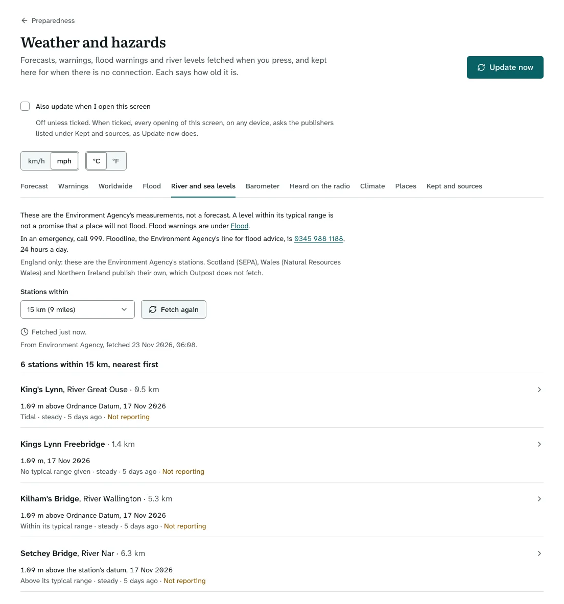

*River and sea levels from the Environment Agency's answers recorded for the test suite
(stations near King's Lynn). The suite's stand-in gives every station the same
reading, so these are not real levels.*


*The nuclear preparedness workspace: two educational scenarios on the test suite's
made-up map, each kind of effect in its own colour, one with the model's idealised
fallout pattern.*

### Games

Small games for when the internet is out, drawn in code, with no sound and nothing fetched.

| Feature | What it does | Docs |
| --- | --- | --- |
| Allotment | One plot for the household, the same on every device: sow, water, harvest, sell at the stall, and add beds, hens, a hive or a greenhouse. A crop grows only in its real British months (from the RHS's calendar) and while its bed is moist from the can or the rain, and otherwise waits, losing nothing; an almanac says what to sow this month. Nothing withers or runs out; left for a year, everything is ripe and waiting. | [Games](docs/games.md#allotment) |
| Steading | One settlement for the household: build workshops, link them with routes and find what holds each chain back; houses fill once they have water, food and firewood, with real figures for what a household uses in a day. Nothing gets worse while you are away. | [Games](docs/games.md#steading) |
| Solitaire | The card game also called patience or Klondike: draw one or three, undo, tap a card to send it where it fits. | [Games](docs/games.md#solitaire) |
| Peg solitaire | The English board of 33 holes: jump pegs until one is left. | [Games](docs/games.md#peg-solitaire) |
| Sudoku | Puzzles made on the device at three levels, each with exactly one answer; notes, undo and a check. | [Games](docs/games.md#sudoku) |
| Draughts | English draughts against the computer or two at one device. | [Games](docs/games.md#draughts) |
| Chess | Full rules, against Outpost's own computer at four strengths (not a strong engine) or two at one device; PGN and FEN copied out and pasted in. | [Games](docs/games.md#chess) |
| Pairs | A memory game for children, in three sizes. | [Games](docs/games.md#pairs) |
| Snake | The classic, at four speeds (a slow one for small children), with walls or wrapping edges. | [Games](docs/games.md#snake) |
| Skerry | Twelve puzzles solved by typing commands at a pretend terminal, as the new keeper of an island weather station; it teaches finding your way round files, searching, counting and pipes. Nothing typed touches anything real. | [Games](docs/games.md#skerry) |

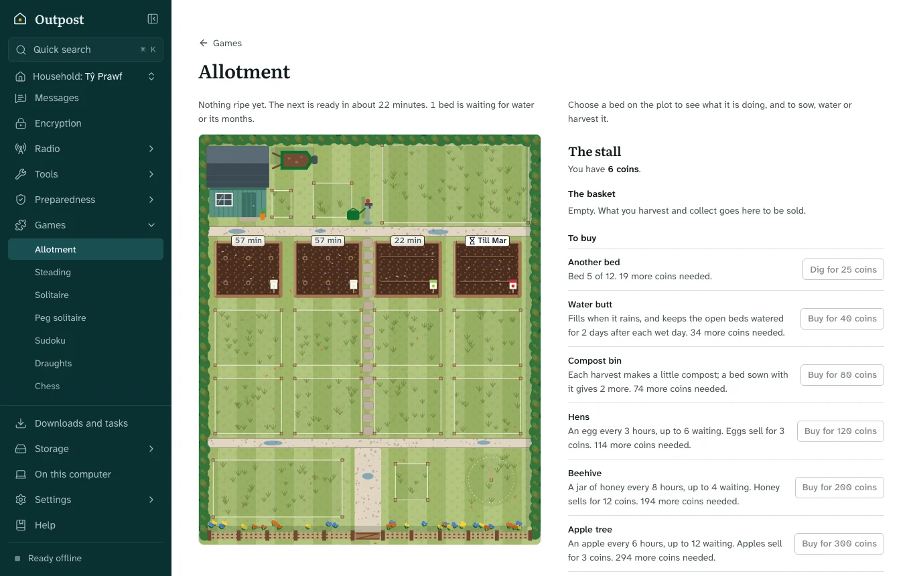

*The allotment by day: onions and salad growing, radishes sown in November waiting for
March.*

### Looking after it

| Feature | What it does | Docs |
| --- | --- | --- |
| Downloads | Every download and background job in one list: resumable, retried, checked against a checksum, with pausing and rate limits. | [Offline](docs/offline.md#what-needs-a-connection) |
| Storage | Internal disks, USB drives, SSDs and NAS shares as storage locations, recognised by a marker file when they come back. Move collections between locations with verification. On a Mac, connect a network share from the app. | [Storage](docs/storage.md) |
| Manage and clean up | One screen that lists everything installed, removes what you no longer want, clears leftovers, checks the database, and can erase everything. Each removal says before the press what will happen and whether it can be undone. | [Storage](docs/storage.md#managing-and-cleaning-up) |
| Backups | A backup file of the database, attachments and extracted text, by hand or on a schedule to a storage location, optionally encrypted with a passphrase. | [Storage](docs/storage.md#backing-up) |
| Portable drives | A USB drive holding Outpost and part of your library, which starts with a double-click on another Mac, Windows or Linux computer with nothing installed; what was written on it is brought back home with a preview (**Bring back changes from a drive**). | [Portable drives](docs/portable.md) |
| On this phone | Over HTTPS the app keeps itself on a phone, and chosen pages of notes, routes, saved places, map areas and emergency plans are kept there to read where the server cannot be reached. | [Offline](docs/offline.md#a-phone-out-of-reach-of-the-server) |
| HTTPS on your network | An `https` address on your own network with no domain and no internet, with a certificate Outpost makes or one of your own. Location, the camera, the live compass, recording a track and keeping things on a phone need it. | [Deployment](docs/deployment.md#https-on-your-network) |
| Settings | Appearance (theme, the 12- or 24-hour clock, text size, heights in metres or feet), downloads, reading documents, search by meaning, answers, looking things up, maps, the message board, mesh radio, backups and HTTPS. | [Deployment](docs/deployment.md#environment-variables) |
| Help | Every page of Outpost's documentation inside the app, grouped for a household and readable with no internet; the quick search finds each guide and its sections. | [Documentation](#documentation) |

While nothing is happening the server does not poll for work, and a tab in the background
asks it for nothing.

<table>
<tr>
<td width="62%"></td>
<td></td>
</tr>
<tr>
<td><em>Explore, browsed with no connection.</em></td>
<td><em>The map on a phone (the test map).</em></td>
</tr>
</table>

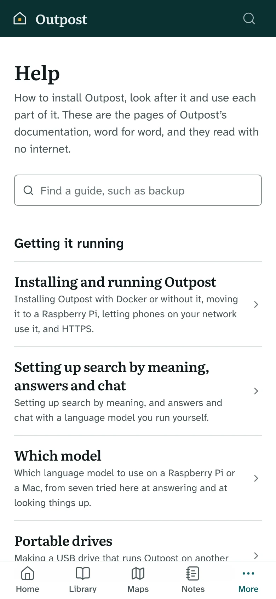

*Help on a phone: the documentation, grouped for a household.*

## Install and run

Four ways are documented in [docs/deployment.md](docs/deployment.md), which also has
every setting. What has been tried: Outpost is developed and run by hand on macOS on
Apple Silicon, from source, as the packaged app, and as the full Compose stack with the
`arm64` image. Nothing builds or tests it automatically, and nothing else has been
tried: not Linux on x86-64, not an Intel Mac, not Windows, not a Raspberry Pi, not a NAS.

| Platform | How | Status |
| --- | --- | --- |
| macOS, Apple Silicon | Docker Desktop, from source, the packaged app, or a portable drive | Developed and tried here by hand |
| Linux ARM64, Raspberry Pi 4 and 5 (64-bit OS) | Docker Compose; the scripts in `deploy/pi/` | Set up once on a Pi 5 with the install and NAS scripts; not used there yet, and the hotspot script is untried |
| Linux x86-64 | Docker Compose, or the packaged app | Untried |
| macOS, Intel | Docker Desktop, or the packaged app | Untried |
| Windows 10 and 11 | Docker Desktop with WSL 2 | Untried |
| NAS and home servers | Any that run containers | Untried |

### With Docker Compose

You need Docker with the Compose plugin.

```bash
git clone https://github.com/tyleruk2000/outpost.git
cd outpost
cp .env.example .env
docker compose up -d --build
```

Then open <http://localhost:8080>. The build needs an internet connection; no image is
published, so there is nothing to pull. While there is internet, one more line makes
the HF planner work offline from the start (VOACAP's data, 559 kB; see
[below](#what-needs-a-download-or-a-build-first)):

```bash
docker compose exec outpost node /app/scripts/fetch-voacap-data.mjs --data-dir /data
```

By default Outpost answers only on the computer it runs on. To use it from phones and
other computers on your network, set both of these in `.env` and run
`docker compose up -d` again, after reading
[Letting other devices use it](docs/deployment.md#letting-other-devices-use-it-lan-access):

```ini
OUTPOST_LAN_ACCESS=true
OUTPOST_BIND=0.0.0.0
```

### From source

You need Node.js 24 or newer and pnpm 9.

```bash
git clone https://github.com/tyleruk2000/outpost.git
cd outpost
pnpm install
node scripts/fetch-map-assets.mjs   # map fonts and icons; needs a connection once
node scripts/fetch-embedding-model.mjs  # the model for search by meaning (24 MB); also once
pnpm build                          # builds the web app into apps/web/dist
node scripts/fetch-voacap-data.mjs --data-dir apps/server/data   # HF planner data (559 kB); optional, once
pnpm start
```

Open <http://localhost:8080>. `pnpm start` does not read `.env`: set variables in the
shell (`OUTPOST_DATA_DIR`, `OUTPOST_STORAGE_ROOTS`, and for LAN access
`OUTPOST_HOST=0.0.0.0` with `OUTPOST_LAN_ACCESS=true`). Reference collections need
kiwix-serve beside it: see
[Reference collections without Docker](docs/deployment.md#reference-collections-without-docker).

### The packaged app

A folder that runs with nothing but a Node 24 binary; it is what the Docker image and
portable drives contain.

```bash
pnpm install
node scripts/fetch-map-assets.mjs
node scripts/fetch-embedding-model.mjs
node scripts/build-app.mjs            # writes dist/app

NODE_ENV=production \
OUTPOST_DATA_DIR=/srv/outpost/data \
OUTPOST_STORAGE_ROOTS=/srv/outpost/library \
node dist/app/server/outpost.mjs
```

`NODE_ENV=production` is required. See [The packaged app](docs/deployment.md#the-packaged-app).
The folder includes SQLite binaries for Windows, but nobody has run it there.

### On a Raspberry Pi

A 64-bit operating system is required, and 4 GB of memory fits keyword search,
reading, notes and maps.
[From a Mac to a Raspberry Pi, step by step](docs/deployment.md#from-a-mac-to-a-raspberry-pi-step-by-step)
walks from a Pi still in its box to Outpost open on a phone, with your library brought
across. Three scripts in `deploy/pi/` install it, connect a folder on a NAS, and set a
Pi up to be carried somewhere with no router and no internet, reached from phones over a
Wi-Fi network of its own.

**The install and NAS scripts have been run once, on one Raspberry Pi 5** (17 November
2026), and were changed by what that showed; the hotspot script has not been run on a
Pi, and the Pi has not yet been used with a real library. Read them, run each with
`--dry-run` first, and expect to adjust them.
[What has been tried](docs/deployment.md#what-has-been-tried-and-what-has-not) says
exactly what.

```bash
./deploy/pi/install.sh --dry-run                        # see what it would do
./deploy/pi/install.sh --install-docker --lan --https   # needs the internet this once
sudo ./deploy/pi/hotspot.sh on --ssid "Outpost"         # asks for a password
```

See [Raspberry Pi 4 and 5](docs/deployment.md#raspberry-pi-4-and-5) for memory,
storage and what each script does.

Updating, logs, reverse proxies and every environment variable are in
[docs/deployment.md](docs/deployment.md). Back up first (**Settings → Backup**).

## What needs a download or a build first

Outpost ships its code, its catalogue, its reference sheets, the radio books, the
frequencies to listen to, USDA FoodData Central's energy table and the World Magnetic
Model's coefficients, and nothing else. Everything below is fetched only when a person presses a button or runs a
set-up line, and each states its size first.

| What | Size | Why it is not in the repository | Docs |
| --- | --- | --- | --- |
| Map regions | Shown exactly before the download (a box of up to 60 GB); terrain is a second, optional file | OpenStreetMap data from the Protomaps build, fetched for the area you choose | [Maps](docs/maps.md#downloading-a-region) |
| Place names | One GeoNames dataset: towns worldwide, or one country | Fetched on request from GeoNames | [Maps](docs/maps.md#offline-place-search) |
| Place names and postcodes for Great Britain | 103 MB fetched (October 2026 edition); 519 MB in the database with streets, 366 MB without | Ordnance Survey's OS Open Names, fetched on a press and updated whole when OS publishes a new edition | [Maps](docs/maps.md#place-names-for-great-britain) |
| Reference collections | From a few megabytes to many gigabytes each, shown in Explore | Each publisher's own, under its own licence; never bundled | [Sources](docs/sources.md) |
| VOACAP's data for the HF planner | 15 files, 559 kB | The ITU has not given permission for them to be passed on, and four of their headers say "All rights reserved"; so they are fetched once, at set-up or with one press | [HF propagation](docs/hf-propagation.md#voacaps-coefficients-a-one-time-download) |
| The second HF model (ITU P.533) | Engine built on your computer with Docker (a build image of about 740 MB; the result is 233 kB), and maps of 137 MB | The ITU's code and maps are under no open licence, so nothing of them ships; each person builds the engine from the ITU's own repository | [HF propagation](docs/hf-propagation.md#a-second-model-itu-p533) |
| Satellite imagery | The world at 2 km: 256 MB fetched, 15.5 MB kept. At 500 m: 3.26 GB fetched, about 350 MB kept (estimated; never run). Sentinel-2: about 16 MB fetched for 100 km², under 1 MB kept | Fetched from NASA and Copernicus for the area you choose | [Maps](docs/maps.md#satellite-imagery) |
| Aerial photographs (New Zealand, United States) | 1 km² of a 7.5 cm survey: 11.75 MB fetched, 4.63 MB kept | Fetched from LINZ or NAIP for a small area you choose | [Maps](docs/maps.md#aerial-photographs) |
| Reference data packs for the map | Stated per item before download (OurAirports' file is 12.8 MB and its frequencies 1.3 MB; Natural Earth's regions and places are 41 MB and 19 MB) | Each publisher's own terms; fetched on a press or imported | [Reference layers](docs/reference-layers.md) |
| Food and supplies for the map | The area on screen, up to about a county, from OpenStreetMap or the Food Standards Agency; or a region's Geofabrik extract, its size shown first (Rutland 1.95 MB, Ohio 328 MB, England 1.72 GB), deleted once read unless you keep it | OpenStreetMap's and the Agency's data, fetched for the area you choose | [Reference layers](docs/reference-layers.md#food-and-supplies) |
| River and sea levels | Small: 14 kB for the eleven stations near one place, 96 kB for one station's last days, as measured once by hand | The Environment Agency's live readings, fetched on a press | [Weather](docs/weather.md#river-and-sea-levels) |
| Audiobooks | As LibriVox gives them; the shelf states an approximate size | Your browser downloads the zip from LibriVox's link, and you add it; Outpost fetches no recording | [Library](docs/library.md#audiobooks) |
| A model server for answers and chat | A model is several gigabytes | Which model to run is your decision; Outpost includes and downloads none | [Set-up guide](docs/setup-guide.md) |
| The device-maker registry | About 3.9 MB, from the IEEE | The IEEE states no permission to pass it on | [Network](docs/tools-qr-and-network.md#who-made-each-device) |
| Map fonts and icons, and the search model | The search model is 24 MB | Fetched once when Outpost is built, not at run time | [Deployment](docs/deployment.md#from-source) |

## Privacy and security in brief

From [docs/security.md](docs/security.md), which has the whole threat model:

- **No accounts.** Whoever can reach Outpost can read, add, change and delete
  everything in it, contacts and chat conversations included. By default only the
  computer it runs on can reach it. With LAN access on, everyone on that network can;
  turn it on only for a network where you trust everyone, never forward the port to the
  internet, and put it behind a public reverse proxy only if the proxy asks people to
  sign in.
- **What only the computer itself may do.** Erasing everything, restoring a backup,
  deleting backups kept on a storage location, setting or removing the backup
  passphrase, replacing or deleting the HTTPS certificate authority or the certificate
  and key you gave Outpost, deleting several of a person's own files in one step, and
  setting up the mesh radio are accepted only from the computer Outpost runs on, unless
  it was started with `OUTPOST_ALLOW_REMOTE_ERASE=true`. The mesh radio set-up and the
  switch for the MCP endpoint have their own option, `OUTPOST_ALLOW_REMOTE_SETTINGS=true`
  (in a container, where no request looks local, the only way to change them). This is not authentication: it asks
  "where from?", because there is no "who?".
- **Every outbound request is the result of a press.** No telemetry, no CDN, no remote
  fonts. The app's own content policy forbids the browser from contacting other
  servers, and the end-to-end tests fail if the app tries. Downloads cannot be pointed
  at addresses inside your network. What a press can reach: the catalogue and its
  publishers; map regions, terrain and place names (GeoNames, Ordnance Survey);
  satellite imagery and aerial photographs; a route server for "Find a known route";
  the sources of reference data for the map (Natural Earth, OurAirports, OpenStreetMap
  by Overpass or Geofabrik, Wikidata, WorldPop, BABS, the Environment Agency and the Food
  Standards Agency); a web page or a link being saved; a repeater publisher; weather,
  warnings, river and sea levels and climate averages; NOAA's solar cycle table and the
  second HF model's maps; the IEEE's device-maker registry; Node and the Kiwix reader for
  a new kind of portable drive. Three connections are made without a press at the
  moment, each because a person set it up earlier: new passages sent to an embedding
  server you chose, a remembered network share reconnected, and the mesh radio's link to
  the household's broker or MeshCore radio. The whole list, with the code that opens
  each, is in [No telemetry](docs/security.md#no-telemetry).
- **Your model, your address.** Answers and Chat send your question and passages of
  your library to the model server address you set, and nowhere else. With looking
  things up switched on, what the tools read goes to the same address. The MCP endpoint
  is off by default; while it is on, any program on the home network that speaks MCP can
  read what the tools read, and so can whatever that program is connected to.
- **The board and the radio.** Messages on the household board are readable and
  changeable by everyone on the network, under any name. Anything sent on a mesh radio
  channel can be read by anyone with a radio on that channel, and the MQTT broker speaks
  plain TCP, its password included.
- **HTTPS on your network** is optional and off by default. Outpost makes a certificate
  authority of its own, limited to private addresses and names, and each device is told
  once to trust it; or you give it a certificate of your own. Plain `http` keeps working
  beside it. Location, the live camera, the live compass, recording a track and keeping
  things on a phone need it.
- **Nothing is encrypted at rest** except what you encrypt yourself, private keys on the
  Encryption screen, and backups protected with a passphrase. Use encrypted drives for
  anything that leaves the house.

Please report security problems privately, as described in [SECURITY.md](SECURITY.md).

## Limits

Stated here so nobody has to find them out. Each is taken from the docs page named.

**Not tested:**

- **A real iPhone or Android phone.** Phone width was tested in Chromium's emulation:
  keeping things on a phone, the barcode camera, the emergency plans' `tel:` links,
  printing from a phone, and trusting the HTTPS certificate on a device have not been
  tried on a phone ([offline](docs/offline.md#what-has-and-has-not-been-tested),
  [supplies](docs/supplies.md#what-was-not-tested),
  [emergency plans](docs/emergency-plans.md#not-tested),
  [HTTPS](docs/deployment.md#what-was-tested)). Nor have most of the features added
  last: the live compass, the Morse trainer's sound on an iPhone, an audiobook's
  lock-screen controls, the board on real phones on a real home network, and the games
  ([compass](docs/tools-compass.md#not-tested),
  [Morse trainer](docs/morse-trainer.md#what-was-not-tested),
  [audiobooks](docs/library.md#audiobooks),
  [messages](docs/messages.md#what-has-and-has-not-been-tested),
  [games](docs/games.md#not-tested)).
- **Windows, Linux on x86-64, an Intel Mac, Outpost on a NAS, and most of a Raspberry
  Pi.** One Pi 5 has been set up once with the install and NAS scripts; a Pi 4, a 4 GB
  board, the hotspot script, HTTPS from a phone and everyday use on a Pi are untried. See
  [Install and run](#install-and-run).
- **A printer.** No map page, emergency card, cipher pad, sundial or nocturnal has been
  printed on paper ([maps](docs/maps.md#limits-and-what-has-not-been-tried),
  [emergency plans](docs/emergency-plans.md#not-tested),
  [encryption](docs/encryption.md#not-tested),
  [solar clock](docs/tools-solar-clock.md#not-tested)).
- **Safari and Firefox.** The screens were built and tested in Chromium; Safari and
  Firefox were not tried for encryption, for keeping things on a phone, or for archive
  pages that are small web apps in the reader
  ([encryption](docs/encryption.md#not-tested), [offline](docs/offline.md#what-has-and-has-not-been-tested),
  [security](docs/security.md#reference-zim-content)).
- **CardDAV with any phone**, and a portable drive carried to a second computer
  ([contacts](docs/contacts.md#what-has-been-tested-and-what-has-not),
  [portable drives](docs/portable.md)).
- **A real radio on the mesh radio link.** It was built from Meshtastic's and MeshCore's
  documentation and tested against stand-ins; nobody has connected a real radio
  ([mesh radio](docs/mesh-radio.md#what-was-and-was-not-tested)).
- **Answers, Chat and looking things up** were measured with seven small models on
  Ollama on one Mac (an Apple M2 Max); llama.cpp and LM Studio have not been run, and no
  model has been timed on a Raspberry Pi, which will be slower by an amount not measured.
  The MCP endpoint has not been tried with a real MCP client
  ([which model](docs/which-model.md), [answers](docs/ai.md#not-tried-with-a-real-model),
  [MCP](docs/mcp.md)).
- **A real course archive** for learning progress (the tests use a small made-up one),
  and a real LibriVox zip for audiobooks ([learning](docs/learning.md#not-done),
  [audiobooks](docs/library.md#audiobooks)).
- **A real shadow.** The solar clock's methods were tested by running the arithmetic
  backwards from a known instant, not with a stick outside
  ([solar clock](docs/tools-solar-clock.md#not-tested)).

**Caveats:**

- **HF propagation** is a monthly median from VOACAP, not today's conditions and not a
  promise of a contact. 2 to 30 MHz, short path only, sporadic E off
  ([what it is not](docs/hf-propagation.md#what-it-is-not),
  [limits](docs/hf-propagation.md#limits)).
- **The second model** compares with isotropic antennas only, and is not offered for
  coverage maps or plans ([what is not done](docs/hf-propagation.md#what-is-not-done)).
- **A repeater's estimated range** is line of sight over the installed terrain only:
  not a measure of signal strength, and not a promise of a contact
  ([radio](docs/radio.md#the-estimated-range)).
- **The nuclear effects simulator** is an educational estimate from a published model
  for an idealised case (flat ground, clear air, no buildings), not a forecast and not
  instructions; it gives no casualty figures, and its fallout pattern is for a steady
  wind that real fallout never follows
  ([limitations](docs/nuclear-preparedness.md#limitations)).
- **Calculators and plans** give general information, not advice, from the sources they
  name ([tools](docs/tools.md), [power](docs/tools-power.md#what-is-not-modelled)).
- **Weather** is a copy with its age, as good as the moment it was fetched; flood data
  and river and sea levels are for England only ([weather](docs/weather.md#not-done)).
- **Food and supplies** is as complete as OpenStreetMap's mapping, which is patchy in
  the countryside; the Food Standards Agency's positions can be a postcode's rather
  than a door's ([reference layers](docs/reference-layers.md#food-and-supplies)).
- **OCR** is slow and makes mistakes, and reads English unless a language file is added.
  The built-in search model is small and English.
- **EPUB books** are shown in Outpost's own type; fixed layouts, scripts and
  copy-protected books are not read ([EPUB](docs/epub.md)).

**Deliberately not built:**

- Accounts, permissions, live co-editing, clustering, and an optional PostgreSQL back
  end ([architecture](docs/architecture.md#limits-and-trade-offs)).
- Routing: routes are drawn, imported or found, never calculated
  ([maps](docs/maps.md#what-is-not-included)).
- A bundled language model, a model download, agents, or any tool a model can call that
  does more than read ([answers](docs/ai.md#what-does-not-exist)).
- Two-way contact sync ([contacts](docs/contacts.md#what-is-not-built)).
- A product database for barcodes
  ([supplies](docs/supplies.md#open-food-facts-and-why-nothing-is-looked-up)).
- Any dataset of historical targets, and any layer, sort or score that ranks places
  ([reference layers](docs/reference-layers.md#what-is-not-built-and-why)).

**Decided against:**

- **Books fetched from Project Gutenberg's website.** Its robot access policy says the
  site is for human users only, so its books are offered through Kiwix's shelves, and a
  single book is best downloaded in a browser and added
  ([sources](docs/sources.md)).
- **Ordnance Survey's Terrain 50.** Over Great Britain the terrain Outpost already
  downloads is made from finer lidar, so it would make the map coarser
  ([maps](docs/maps.md#terrain-from-ordnance-survey-why-it-was-not-added)).
- **The USDA's list of SNAP retailers** as a second source of food shops for the United
  States: its pages refused an ordinary request, so its terms could not be read
  ([reference layers](docs/reference-layers.md#a-second-source-for-the-united-states-not-built)).

## Data sources and licences

Every source considered, its terms in its publisher's words, and why some are not used,
is in [docs/sources.md](docs/sources.md). In short:

| Source | Used for | Licence or terms |
| --- | --- | --- |
| OpenStreetMap, packaged by Protomaps; extracts from Geofabrik | Map regions, found routes, reference layers, food and supplies | ODbL |
| Ordnance Survey, OS Open Names | Place names, roads and postcodes for Great Britain | OGL v3.0 |
| Mapterhorn | Terrain, hill shading, contours | Various open licences ([attribution](https://mapterhorn.com/attribution)) |
| GeoNames | Place search | CC BY 4.0 |
| Natural Earth | World outline, boundaries | Public domain |
| Kiwix and openZIM | Reference collections (ZIM archives), kiwix-serve | Each archive its own licence; kiwix-serve GPL-3.0, run as a separate program |
| Official publishers (CDC, NIOSH, FEMA, Ready.gov, the US Department of Energy, USDA, FAA, NASA, USGS, NWS, the UK government, the Met Office, HSE, UKHSA, FAO, WHO, OpenStax and others) | PDF handbooks, guides and leaflets in the catalogue | Each its own, stated on each entry |
| LibriVox | The audiobook shelf in Explore, as links your browser follows | Recordings public domain in the USA; not fetched by Outpost |
| NASA Blue Marble, Copernicus Sentinel-2, LINZ, USDA NAIP | Satellite imagery and aerial photographs | Credit to NASA; free, full and open; CC BY 4.0; public domain |
| VOACAP (NTIA/ITS) via hfcast-engine | HF propagation | Engine Apache-2.0; its CCIR coefficients not shipped |
| ITU-R Study Group 3 (ITURHFProp) | The optional second HF model | No open licence; nothing shipped |
| Open-Meteo (Met Office models), Met Office, Environment Agency, NASA POWER, PVGIS | Weather and hazards, river and sea levels | CC BY 4.0; Crown copyright; OGL; credit to NASA; credit to the JRC |
| OurAirports (airports and their frequencies), Wikidata, WorldPop, BABS, Environment Agency (flood zones) | Reference layers | Public domain; CC0; CC BY 4.0; open use with source; OGL |
| Food Standards Agency | Registered food shops in the UK, on the food and supplies layer | OGL |
| USDA FoodData Central (SR Legacy, April 2018) | Food energy in Supplies, shipped with Outpost | CC0 |
| NOAA NCEI and the British Geological Survey, World Magnetic Model 2025 | Magnetic north on the Compass, the map and the solar clock, shipped | Public domain |
| NOAA CO-OPS, harmonic constants for 1,370 tide stations | Tide times, shipped | Public domain |
| Stations, broadcasters, regulators and coastguards, each page named on its entry | Frequencies to listen to, shipped | Facts, checked against each page and dated; no compiled list copied |
| Royal Horticultural Society, "Grow your own" pages | The allotment's growing months and the facts on its crop cards | Facts only, each page read once; nothing copied |
| UK Government (Be Ready, GOV.UK), Met Office, Ofcom and others | Emergency plan templates | OGL v3 and others, quoted only where their terms allow |
| Glasstone and Dolan, *The Effects of Nuclear Weapons* (1977) | The effects simulator | A US Government work |
| IEEE Registration Authority | Device makers, on a press | Not bundled |

**Outpost itself** is released under the [MIT Licence](LICENSE). The reference sheets
that ship with it are the project's own compilations of facts from official sources,
under the same licence. The radio handbook and guides were written by the same author
for LogBook73 and are included under that project's MIT licence. The packaged app and
the Docker image include `THIRD-PARTY-LICENSES.txt`.

It is built with [MapLibre GL JS](https://maplibre.org), [Tiptap](https://tiptap.dev),
[PDF.js](https://mozilla.github.io/pdf.js/), [Mermaid](https://mermaid.js.org),
OpenPGP.js (LGPL-3.0, shipped as a separate file and loaded at run time), ONNX Runtime,
and the libraries in the package manifests; the licence of each is in
[docs/architecture.md](docs/architecture.md#dependency-licences). Typefaces: Atkinson
Hyperlegible (Braille Institute) and Literata (TypeTogether), under the SIL Open Font
Licence.

SPOOLTENNA is a trade mark of Panther Creek Solutions LLC, named only to say which
antenna is meant. QR Code is a registered trademark of DENSO WAVE INCORPORATED.

The projects that showed the way: Internet-in-a-Box, PrepperPi, Offgrid Pi,
Paperless-ngx and Organic Maps. No code was taken from them.

## Developing and contributing

Contributions are welcome: code, catalogue entries, documentation. Start with
[CONTRIBUTING.md](CONTRIBUTING.md); how the server and the screens are put together is
in [docs/architecture.md](docs/architecture.md),
[docs/development/server-modules.md](docs/development/server-modules.md) and
[docs/development/web-screens.md](docs/development/web-screens.md).

```bash
pnpm install
pnpm dev                                   # API on :8080, web app on :5173
pnpm lint && pnpm typecheck
pnpm --filter @outpost/server test         # real server on temporary folders, no network
pnpm --filter @outpost/web test
node scripts/build-app.mjs && pnpm e2e     # browser tests against the packaged app, internet blocked
```

There is no continuous integration: the checks are run by hand before a change is
accepted. `node scripts/check-readme-links.mjs` checks that every relative link and
anchor in this README leads somewhere.

### Making the pictures again

```bash
node scripts/build-app.mjs
cd e2e && pnpm exec playwright test -c readme-screenshots.config.ts
```

This starts an Outpost of its own on an empty data folder (port 9081 and the two after
it, or `OUTPOST_README_PORT`), beside the test suite's stand-ins, writes the
demonstration data, and replaces the pictures in `docs/screenshots/`. Nothing in it
reaches the internet or a real model server.

## Documentation

Every page below is also inside Outpost, under **Help**.

| | |
| --- | --- |
| [Deployment](docs/deployment.md) | Installing on each platform, from a Mac to a Raspberry Pi step by step, LAN access, HTTPS, settings |
| [Storage](docs/storage.md) | Locations, NAS examples, moving, backups |
| [The server](docs/device.md) | Server status, setting a wrong clock, `outpost.local`, Prometheus and Grafana |
| [Offline use](docs/offline.md) | What works without a connection, and keeping things on a phone |
| [Portable drives](docs/portable.md) | Making and using a USB drive |
| [Search](docs/search.md) | Query syntax, quick search, semantic and hybrid search, OCR |
| [Answers and language models](docs/ai.md) | Setting up a model of your own, the exact prompt, looking things up, what is sent where |
| [Set-up guide](docs/setup-guide.md) | Search by meaning, answers and chat in a few steps |
| [Which model](docs/which-model.md) | Seven models measured for answers and looking things up, and which to use |
| [Tools for other programs (MCP)](docs/mcp.md) | Switching on `/mcp`, who may call it, connecting a program |
| [The library](docs/library.md) | Documents, audiobooks, and PDFs made in Outpost |
| [Learning progress](docs/learning.md) | Where each learner got to in a course archive |
| [Reading EPUB books](docs/epub.md) | What the reader shows and leaves out |
| [Notes and imports](docs/notes-and-imports.md) | The editor, imports, saving web pages |
| [Contacts](docs/contacts.md) | Contacts, vCard files and CardDAV |
| [Messages](docs/messages.md) | The household board, check-ins and sending a file |
| [Mesh radio](docs/mesh-radio.md) | The board beyond the Wi-Fi through a LoRa radio; not tried with a real radio |
| [Encryption](docs/encryption.md) | OpenPGP keys, text, files and pages; ciphers by hand |
| [Maps](docs/maps.md) | Regions, place names, heights, routes, imagery, printing, the grey line, line of sight |
| [Reference layers](docs/reference-layers.md) | Published data for the map, food and supplies, airport frequencies, and their terms |
| [Radio](docs/radio.md) | Reference sheets, the handbook and guides, repeaters and their estimated range |
| [HF propagation](docs/hf-propagation.md) | The planner, coverage, plans, the log, the second model |
| [Morse trainer](docs/morse-trainer.md) | The tabs, the keys, timing, and what is stored |
| [Frequencies to listen to](docs/radio-frequencies.md) | What is covered, how each entry was sourced and dated, and the gaps |
| [Tools](docs/tools.md) | The calculators, with every formula and source |
| [Power and batteries](docs/tools-power.md) | Calculators and power plans |
| [Compass](docs/tools-compass.md) | Magnetic, grid and true north, the model, and the live compass |
| [QR codes and devices on this network](docs/tools-qr-and-network.md) | The two network tools |
| [Solar clock](docs/tools-solar-clock.md) | Time from the sun and stars, its formulas, sources, diagrams and measured accuracy |
| [Night sky](docs/night-sky.md) | The Moon, the star chart, finding north, and how accurate it is |
| [Celestial navigation](docs/celestial-navigation.md) | Sights, corrections, the fix, noon and Polaris, the sight form, and the almanac's accuracy |
| [Garden](docs/garden.md) | The month's sowing, planting and harvest, the last frost, and the record of sowings |
| [Emergency plans](docs/emergency-plans.md) | Plans, templates and their sources, cards |
| [Household papers](docs/household-papers.md) | Medical sheets, keeping in touch, grab cards and the binder |
| [Check-ins, the log, routine checks and the offline drill](docs/readiness.md) | Roll call, the log of events, routine checks, the offline drill |
| [Supplies](docs/supplies.md) | Stock, the household, food energy, barcodes, CSV |
| [Weather and hazards](docs/weather.md) | What is fetched, from whom, and how old it is; river and sea levels; the barometer |
| [Nuclear preparedness](docs/nuclear-preparedness.md) | The workspace, the effects simulator, its rules and its sources |
| [Games](docs/games.md) | The games, their rules, the allotment's real months, and what is kept where |
| [Sources](docs/sources.md) | Every content source considered, and its terms |
| [Security](docs/security.md) | Threat model and controls |
| [API](docs/api.md) | HTTP API reference |
| [Architecture](docs/architecture.md) | Design decisions, limits and dependency licences |
| [Server modules](docs/development/server-modules.md) | Writing a module of the server |
| [Web screens](docs/development/web-screens.md) | Building a screen of the web app |
| [Troubleshooting](docs/troubleshooting.md) | Common problems, and every message the Raspberry Pi scripts stop with |
