# Outpost

**Knowledge beyond the network.**

Outpost is a self-hosted, offline-first knowledge and preparedness app. One program, on a
laptop, a home server, a NAS or a Raspberry Pi, holds an offline encyclopedia, your own
documents and notes, offline maps and road routes, contacts, a household message board,
radio planning tools, calculators, and each household's emergency plans, supplies and
printed book, behind one search box.
You choose what to download while you have a connection; after that, everything you kept
works with the network cable pulled out. Phones and other computers on your home network
use it in their browser.

**What it is not:**

- **Not a cloud service.** It runs on a computer you own. No telemetry, no analytics.
- **Not an account system.** There is no sign-in: everyone who can reach it can read and
  change everything, so it is for one person or a household on a network they trust.
- **Not an emergency service.** Its plans, calculators, forecasts and simulator are
  general information; its board and mesh radio are not a way to call for help. In an
  emergency, follow the emergency services and official warnings.
- **Not chatty.** Nothing leaves the machine except as the direct result of a press (see
  [offline.md](docs/offline.md)).

Outpost is open source under the [MIT Licence](LICENSE). It is version 0.1.0, not yet
released, and has been tried by hand on a Mac with Apple Silicon and one Raspberry Pi 5.
[What has not been tried](docs/testing-status.md) lists the rest, by feature.


*Home, with made-up demonstration data, as are all the pictures here.*

## Features

Each guide, also inside Outpost under **Help**, says what a feature does and does not do.

### Home and search

| Feature | What it does |
| --- | --- |
| Home | What is in the library, free space, the emergency plan, how long food and water last, and anything new on the board. |
| [One search](docs/search.md) | One ranked list from documents, notes, reference archives, places, contacts, plans and supplies, each with the reason it was found; other spellings are searched too, and a typo gets "did you mean". |
| [Quick search](docs/search.md) | Ctrl or Cmd + K finds screens, settings and guide sections by name or everyday words. |
| [Search by meaning and OCR](docs/search-by-meaning.md) | One switch, and the model that comes with Outpost finds passages saying the same thing in other words. Scanned pages are read in English. **How search by meaning works** and **How search was tuned** explain each step with diagrams. |

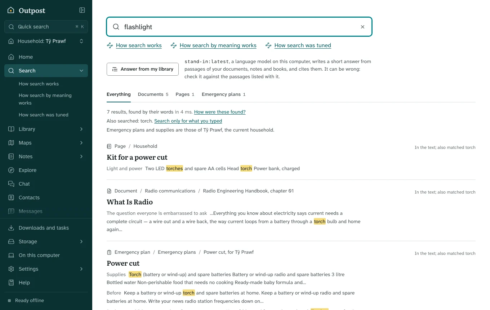

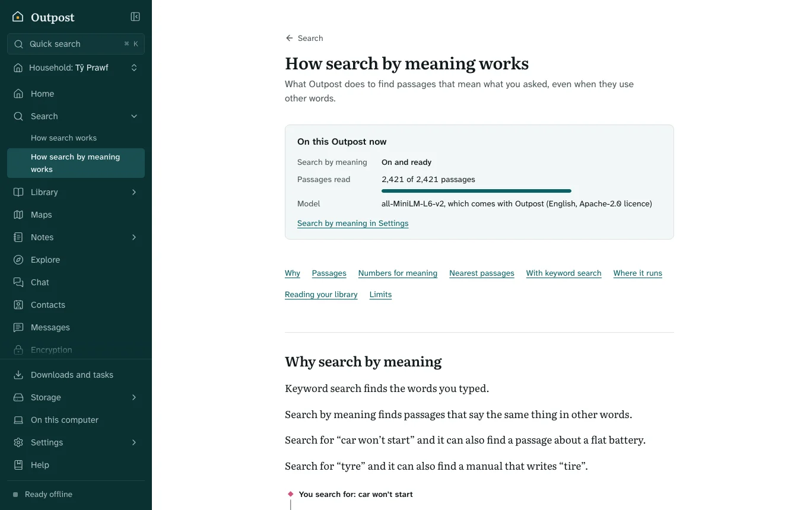

### Library, collections and the reader

| Feature | What it does |
| --- | --- |
| [Your documents](docs/library.md) | PDFs, EPUBs, Markdown, HTML, text and images, indexed by page, originals untouched. |
| [Audiobooks](docs/library.md) | A zip of chapters becomes one book; each device keeps its place. |
| [Save a web page](docs/notes-and-imports.md) | Keep a readable copy of an article from its address. |
| [Explore and packs](docs/sources.md) | A catalogue of 432 entries (Kiwix archives and official handbooks) in 24 packs, browsable offline; each states its size and licence first ([format](catalog/README.md)). |
| [Reference collections](docs/architecture.md) | ZIM archives (Wikipedia and the like) read in the app through kiwix-serve behind a sandboxing proxy. |
| [Learning progress](docs/learning.md) | Where each learner got to in a course archive. |
| [Included with Outpost](docs/radio.md) | Nine radio reference sheets compiled from regulators' documents, and sixteen LogBook73 radio books. No download needed. |

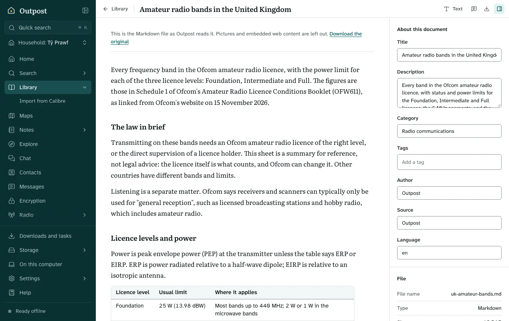

### Maps

| Feature | What it does |
| --- | --- |
| [Offline maps](docs/map-data.md) | **Add a place** (a country, part of one or an area you draw), tick Map, Routes, Nearby places or Walking and cycling, and see the size before anything downloads. One row a place, updated from there. |
| [Terrain and contours](docs/map-styles.md) | Every map comes with its hills: hill shading, contour lines and the height of the ground, in metres or feet. |
| [Places and routes](docs/map-routes.md) | Saved places; routes drawn with distance, ascent and profile; GPX, KML, KMZ and GeoJSON in, GPX out. |
| [Directions](docs/road-routes.md) | Drive, Door to door, Walk or Cycle, worked out on this device and written as you would write it down: the road, the place on the signs, the junctions, the ferry or tunnel. Says which country still needs its roads. A printable route card and a plain-text copy. |
| [Reachable from here](docs/road-routes.md) | How far you get in 15, 30 or 60 minutes from any point, over main roads or, with Walking and cycling, every street. |
| [Find and record routes](docs/map-routes.md) | Look a named route up in OpenStreetMap, or record where you walk while the screen is on, over `https`. |
| [Coordinates and place search](docs/map-places.md) | Grid references, UTM, MGRS and Maidenhead; offline place names, and every British postcode. |
| [Sun, grey line, line of sight](docs/map-sun-and-radio.md) | Sunrise and twilight anywhere, day and night over the map, and whether two points can see each other. |
| [Satellite imagery](docs/map-imagery.md) | NASA's Blue Marble for the world, 10 m Sentinel-2 for an area, and aerial photographs for New Zealand and the US. |
| [Layers on the map](docs/reference-layers.md) | Published data for the map (boundaries, airports, shelters, population, flood zones), each with its source and licence. |
| [Food and supplies](docs/reference-layers.md) | Shops, food banks, water, fuel and pharmacies from OpenStreetMap (and in the UK the Food Standards Agency), with the nearest of each to home worked out offline. |
| [Printing](docs/map-printing.md) | A one-page PDF map at a stated scale. |

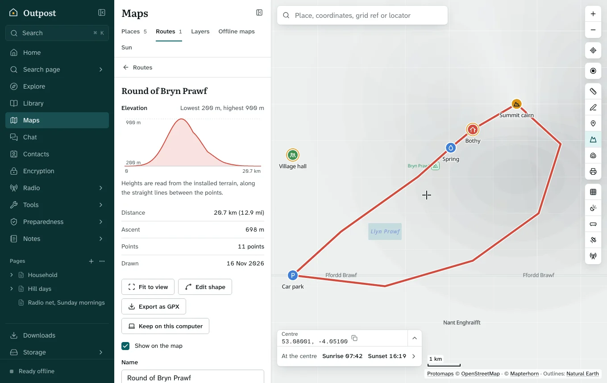

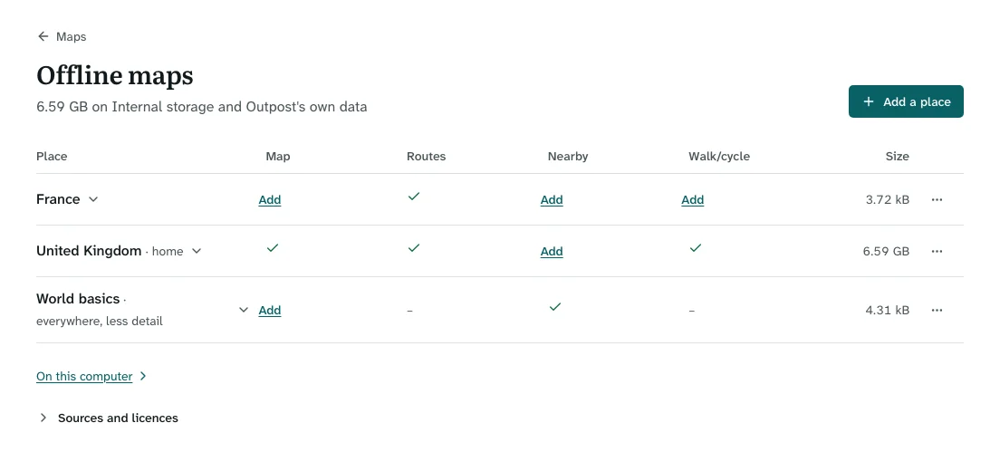

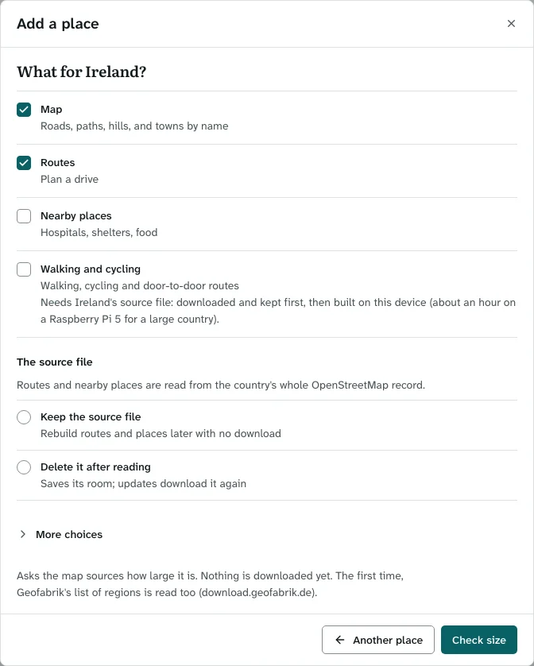 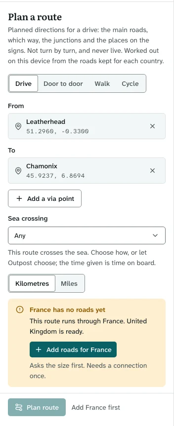

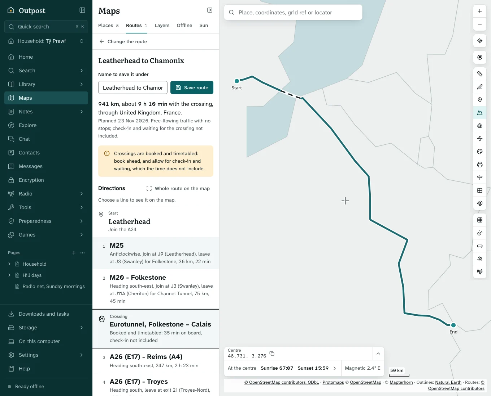

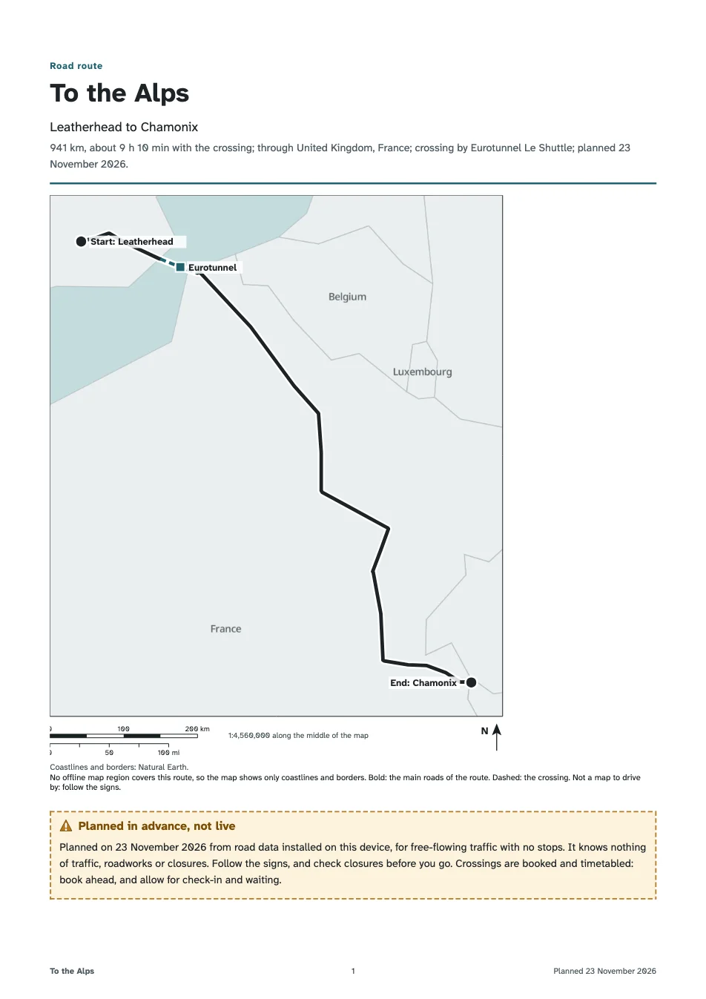

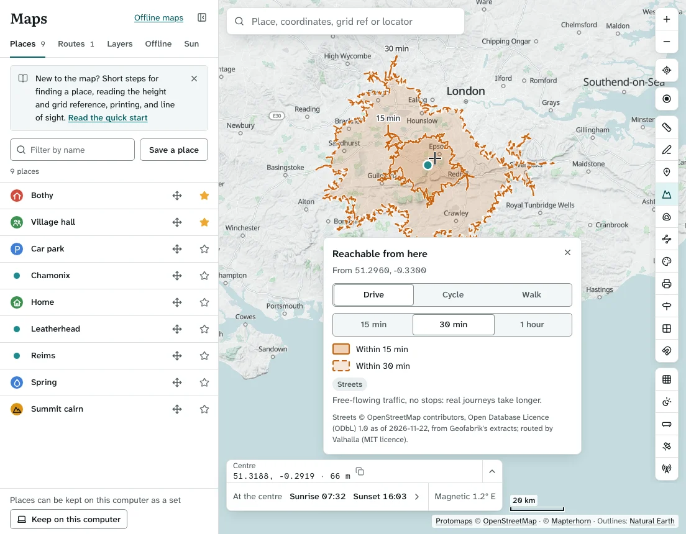

*The drive's roads are made up, not OpenStreetMap's; the reach is a recorded real answer.*

### Notes

| Feature | What it does |
| --- | --- |
| [Notes](docs/notes-and-imports.md) | A page tree and block editor with links between pages, templates and Markdown export. |
| [Import files](docs/notes-and-imports.md) | Brings in Markdown, HTML and Notion exports, saying first what will be made and what left alone. |
| [Encrypted pages](docs/encryption.md) | A page can be encrypted with an OpenPGP key, so it is ciphertext wherever it is copied. |


### Chat and answers from the library

| Feature | What it does |
| --- | --- |
| [Answer from my library](docs/ai.md) | With a language model you run yourself (Ollama, llama.cpp or LM Studio), search writes a short answer from your documents, citing each statement. Outpost includes no model; the [set-up guide](docs/setup-guide.md) gets one running. |
| [Chat](docs/ai.md) | Conversations with the same model, kept on your Outpost and readable by everyone who can open it. |
| [Looking things up](docs/ai.md) | Off by default: a model in Chat can read places, supplies, plans, weather and the library, and shows what it read. |
| [Which model](docs/which-model.md) | Seven small models measured on one Mac, with a recommendation where a model is chosen. |
| [Tools for other programs (MCP)](docs/mcp.md) | The same read-only tools at `/mcp` for programs on the home network; off by default, switched on only at Outpost's own computer. |

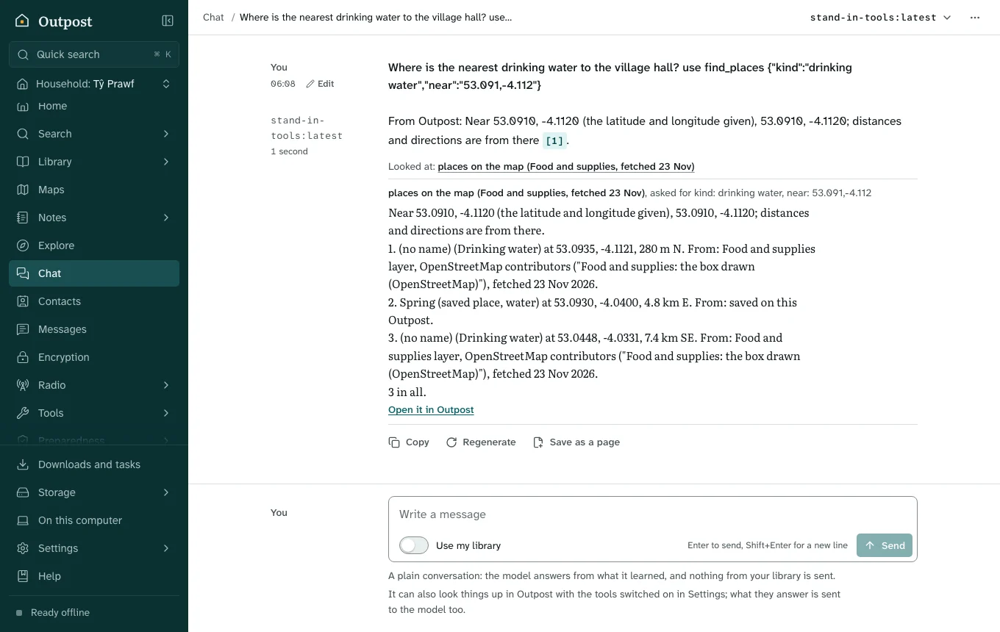

*The reply is from the test suite's stand-in model server, not a language model.*

### Contacts, messages and encryption

| Feature | What it does |
| --- | --- |
| [Contacts](docs/contacts.md) | People to reach when the phones are down, with a one-page emergency list; vCard in, and a read-only CardDAV copy for a phone. |
| [The household board](docs/messages.md) | Messages, check-ins and files between devices on the home network, with no internet; anyone on it can post under any name. |
| [Mesh radio](docs/mesh-radio.md) | The board reaches beyond the Wi-Fi through a Meshtastic or MeshCore LoRa radio. |
| [OpenPGP](docs/encryption.md) | Make keys, encrypt and sign text and files, and encrypt pages, in the browser; checked against GnuPG but not audited. |
| [Ciphers by hand](docs/encryption.md) | Pencil-and-paper ciphers with printable pads, for interest; they protect nothing from a computer. |

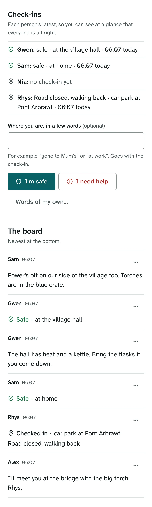

### Radio

| Feature | What it does |
| --- | --- |
| [HF propagation](docs/hf-propagation.md) | How often a shortwave path gets through, hour by hour and band by band, for your equipment, by VOACAP on your computer. A monthly median for planning, not today's conditions. |
| [A second model](docs/hf-propagation.md) | Optionally runs the ITU's P.533 beside VOACAP and states where they differ; you build its engine yourself. |
| [Coverage, plans and log](docs/hf-propagation.md) | Where one transmitter is heard, which band serves each pair of stations hour by hour, and a contact log beside the prediction. |
| [Repeaters](docs/radio.md) | Repeaters from a file, by hand or from publishers that allow it, on the map with an estimated range. |
| [Heard on the radio](docs/heard-on-the-radio.md) | APRS stations, aircraft and ships your own receivers decode, on the map; listening only. |
| [Satellites](docs/satellites.md) | When amateur, weather and crewed satellites pass over and what to tune to through a pass, worked out on the device. |
| [Morse trainer](docs/morse-trainer.md) | Learn by ear with the Koch method, send on screen, keyboard or a real key, and practise a contact. |
| [Frequencies to listen to](docs/radio-frequencies.md) | Time signals, broadcasters, weather, distress channels and emergency nets by country, each with its source and the day it was checked. |
| [What needs a licence](docs/radio-licences.md) | What you may listen to and send on in the UK and the US, from the regulators' own documents. |

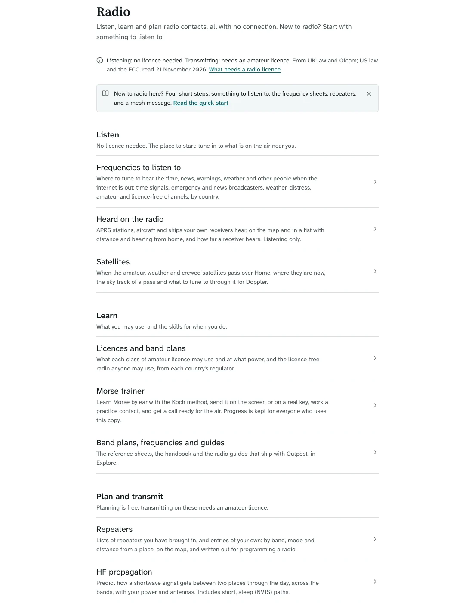


### Tools

Every calculator answers as you type and shows, under **How this is worked out**, its
formula, its source with the date read, and the range it holds for.

| Feature | What it does |
| --- | --- |
| [Water](docs/tools.md) | Water to store by the UK, CDC, Ready.gov or WHO figure, rain from a roof, filter life, and making water safe to drink. |
| [Outdoors](docs/tools.md) | Walking time by Naismith's rule, gradient, bearing, wind chill and heat index. |
| [Radio calculators](docs/tools.md) | Antenna lengths, path loss, radio horizon, cable loss, dBm and S-units. |
| [Building and cooking](docs/tools.md) | Concrete, roof pitch, heat loss; roasting times, safe temperatures and recipe scaling. |
| [Power and batteries](docs/tools-power.md) | How long a battery bank or power station runs your devices, from makers' figures; the bank drawn as wired; solar, cable and generator calculators and saved power plans. |
| [Compass](docs/tools-compass.md) | Magnetic and grid north from true north at a place (World Magnetic Model 2025), and a live compass on a phone over `https`. |
| [Solar clock](docs/tools-solar-clock.md) | The sun's position, setting a clock from a shadow after a power cut, and a sundial and nocturnal to print. |
| [Night sky](docs/night-sky.md) | The Moon's phase and times, a star chart for a place and time, and finding north by the stars. |
| [Celestial navigation](docs/celestial-navigation.md) | A position from sextant sights, the almanac worked out on the device; for learning, not for navigating a vessel. |
| [Tide times](docs/tides.md) | High and low water at stations within 100 km, worldwide, from NOAA's and TICON-4's constants; not for navigation. |
| [Garden](docs/garden.md) | What to sow, plant and harvest this month in the UK, from the RHS calendar, and a record of sowings. |
| [QR codes and devices on this network](docs/tools-qr-and-network.md) | Make QR codes on the device, and list what answers on the local network. |

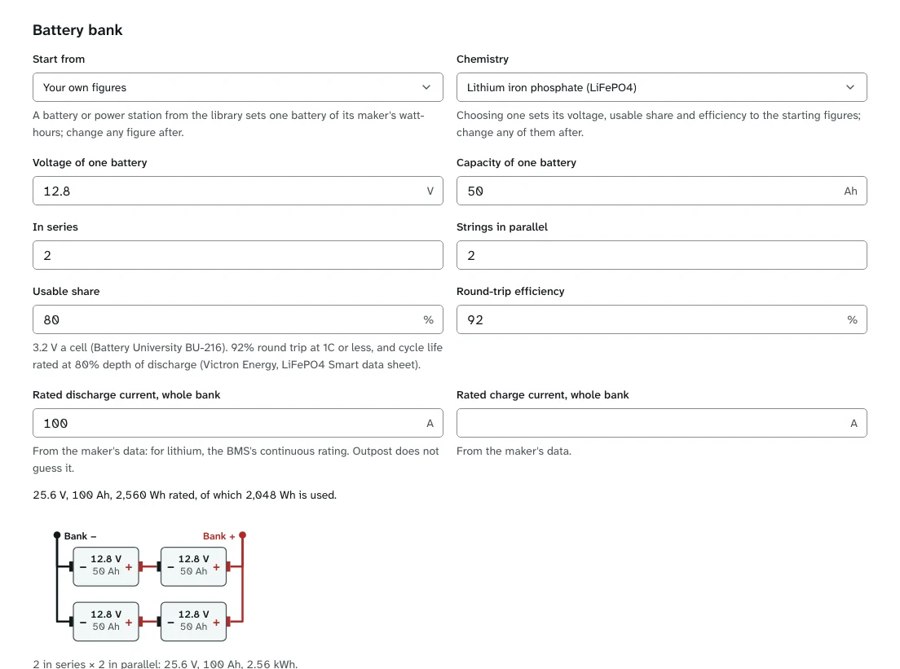

### Preparedness

| Feature | What it does |
| --- | --- |
| [Households](docs/households.md) | One household or several, fixed or on the move: each with its own people, supplies, plans and papers, chosen from the sidebar. Preparedness opens with **Getting ready**: five steps. |
| [Emergency plans](docs/emergency-plans.md) | Plans for a power cut, flood, severe weather, sheltering or leaving, from templates naming whose guidance each step is; **Use now** shows them in large type. |
| [Household papers](docs/household-papers.md) | A medical sheet for each person, the communication plan, grab cards and one PDF binder. Records only, no medical advice. |
| [Household book](docs/household-book.md) | A few questions, then a printable emergency book from the answers and what Outpost holds: first minutes, people, help near home, first aid, water, journeys, the radio plan and the repeaters round home. |
| [Check-ins, log, checks, drill](docs/readiness.md) | "I'm safe" in one press with a roll call, a log of events, routine checks with what is overdue, and an offline drill. |
| [Supplies](docs/supplies.md) | Food, water and kit at home: how many days they last for your household, what to use first, and what to buy; food energy from USDA FoodData Central, shipped. |
| [Weather and hazards](docs/weather.md) | Forecasts, national warnings (UK, Europe, US, Canada, New Zealand, Japan), climate averages and England's river levels, fetched on a press. A barometer log. |
| [Nuclear preparedness](docs/nuclear-preparedness.md) | An educational workspace: an effects simulator from Glasstone and Dolan's published model, reference layers and a radiation emergency plan. Estimates for an idealised case, never targets or casualty figures. |

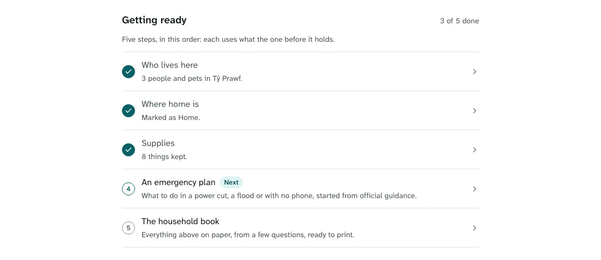

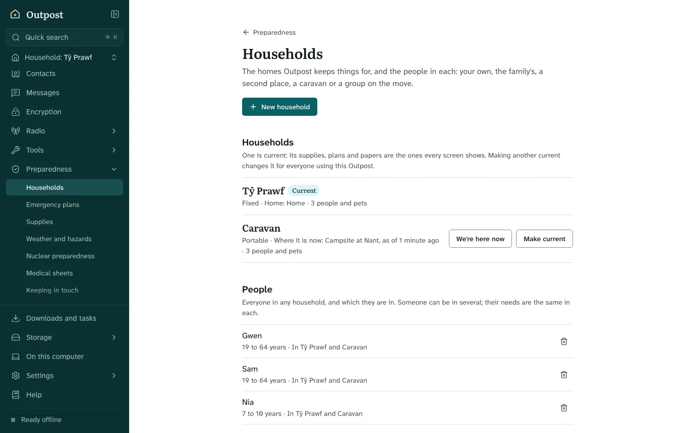


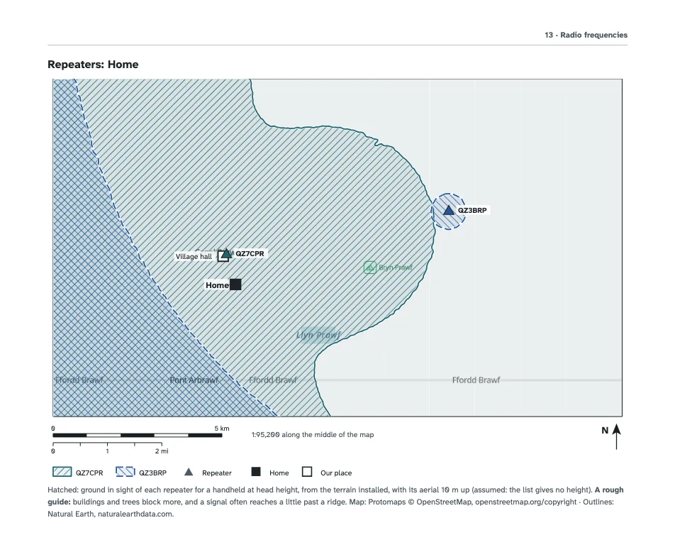

### Games

| Feature | What it does |
| --- | --- |
| [Allotment and Steading](docs/games.md) | A household plot that grows in real British months, and a settlement of workshops, belts and power on a land you choose; nothing is lost while you are away. |
| [Cards and puzzles](docs/games.md) | Solitaire, peg solitaire, Sudoku, Pairs and Snake. |
| [Draughts and chess](docs/games.md) | Against the computer or two at one device; chess reads and writes PGN and FEN. |
| [Skerry](docs/games.md) | Twelve puzzles solved at a pretend terminal that teach files, searching and pipes. |

### Looking after it

| Feature | What it does |
| --- | --- |
| [Downloads and tasks](docs/downloads-and-tasks.md) | Every download and task in one place, each with a page of its own: progress, time left and what happened; downloads resume and are checksummed. |
| [Storage](docs/storage.md) | Disks, USB drives and NAS shares as storage locations; collections move between them with verification. Offline maps are one row, opened by place. |
| [Manage and clean up](docs/storage.md) | Everything installed in one list; each removal says first whether it can be undone. |
| [Backups](docs/storage.md#backing-up) | The database, attachments and text to a file, by hand or on a schedule, optionally encrypted. |
| [Portable drives](docs/portable.md) | A USB drive that runs Outpost on another computer with nothing installed, and brings back what was written on it. |
| [On this phone](docs/offline.md) | Over HTTPS the app, chosen notes, routes, map areas and plans stay on a phone to read away from the server. |
| [HTTPS on your network](docs/deployment.md#https-on-your-network) | An `https` address with no domain and no internet, from a certificate Outpost makes or one of your own. |
| [Server status and updates](docs/device.md) | The server's health, clock and `outpost.local`; updates from the app or a USB stick. |

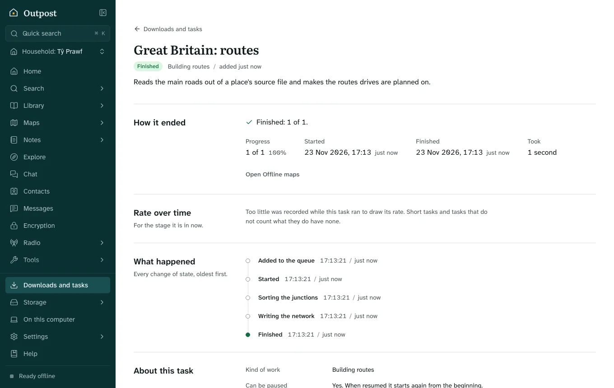

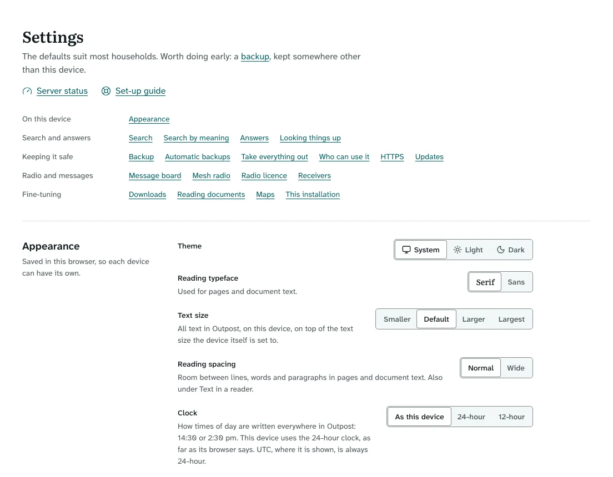

## Install and run

**Setting up a Raspberry Pi for a household?** Follow
[On a Raspberry Pi, step by step](docs/deployment.md#on-a-raspberry-pi-step-by-step) from
the start ([below](#on-a-raspberry-pi) in short). Every way to install, and every
setting, is in [deployment.md](docs/deployment.md).

### With Docker Compose

You need Docker with the Compose plugin. The build needs the internet; no image is
published.

```bash
git clone https://github.com/tyleruk2000/outpost.git
cd outpost
cp .env.example .env
docker compose up -d --build
```

Open <http://localhost:8080>. While you still have the internet, fetch VOACAP's data so
the HF planner works offline (559 kB):

```bash
docker compose exec outpost node /app/scripts/fetch-voacap-data.mjs --data-dir /data
```

It answers only on its own computer. To let other devices on your network in, read
[deployment.md](docs/deployment.md), set these in `.env` and run `docker compose up -d`:

```ini
OUTPOST_LAN_ACCESS=true
OUTPOST_BIND=0.0.0.0
```

### From source

You need Node.js 26 or newer and pnpm 9.

```bash
git clone https://github.com/tyleruk2000/outpost.git
cd outpost
pnpm install
node scripts/fetch-map-assets.mjs        # map fonts and icons, once
node scripts/fetch-embedding-model.mjs   # search-by-meaning model (24 MB), once
pnpm build
node scripts/fetch-voacap-data.mjs --data-dir apps/server/data   # optional HF data
pnpm start
```

Open <http://localhost:8080>. `pnpm start` does not read `.env`: set `OUTPOST_DATA_DIR`,
`OUTPOST_STORAGE_ROOTS` and, for LAN access, `OUTPOST_HOST=0.0.0.0` with
`OUTPOST_LAN_ACCESS=true` in the shell. Reference collections need kiwix-serve beside it.

The packaged app (`node scripts/build-app.mjs`, a folder that runs with only Node 26) is
described in [deployment.md](docs/deployment.md).

### On a Raspberry Pi

**Start with [On a Raspberry Pi, step by step](docs/deployment.md#on-a-raspberry-pi-step-by-step)**:
from writing the card to the family's phones, with a NAS, nightly backups, maps, walking
and cycling, and a reference library, using only the Pi and a laptop. A 64-bit system and
a card of 64 GB or more are needed; 4 GB of memory is enough for keyword search, reading,
notes and maps. In short, signed in to the Pi:

```bash
sudo apt update && sudo apt install -y git
git clone https://github.com/tyleruk2000/outpost.git && cd outpost
./deploy/pi/install.sh --dry-run --install-docker --lan   # what it would do
./deploy/pi/install.sh --install-docker --lan             # needs the internet this once
```

The scripts in `deploy/pi/` also connect a NAS folder (`nas-share.sh`), make a Wi-Fi
hotspot (`hotspot.sh`) and open Outpost as the Pi for restoring a backup
(`on-this-pi.sh`); run each with `--dry-run` or `--help` first. Back up before updating
(**Settings → Automatic backups → Back up now**).

## What needs a download or a build first

Outpost ships its code, catalogue, reference sheets and radio books, the frequencies to
listen to, USDA FoodData Central's energy table, the World Magnetic Model and NOAA's tide
constants. Everything else is fetched only on a press or a set-up line, and states its
size first:

| What | Size, and why it is not bundled |
| --- | --- |
| [Offline maps: map and hills](docs/map-data.md) | Shown at Check size (an area of up to 60 GB); OpenStreetMap data for the place you choose |
| [Offline maps: routes and nearby places](docs/road-routes.md) | Read from the country's source file (Great Britain's 2.2 GB makes 30 MB of routes), kept or deleted after, as you choose |
| [Walking and cycling](docs/deployment.md#street-routes) | An optional add-on (`./deploy/pi/install.sh --street-routes`); on a Pi 5, Great Britain takes 2.7 GB and 56 minutes to build, the United Kingdom 2.9 GB and 91 minutes |
| [Place names](docs/map-places.md) | A GeoNames dataset; for Great Britain OS Open Names, 103 MB |
| [Reference collections](docs/sources.md) | A few megabytes to many gigabytes, each under its publisher's licence |
| [VOACAP's data](docs/hf-propagation.md) | 559 kB; the ITU has not given permission to pass it on |
| [The second HF model](docs/hf-propagation.md) | Built on your computer with Docker, plus 137 MB of maps; under no open licence |
| [Satellite imagery and aerial photographs](docs/map-imagery.md) | The world at 2 km: 256 MB fetched, 15.5 MB kept; Sentinel-2 about 16 MB per 100 km² |
| [Layers on the map, food and supplies](docs/reference-layers.md) | Stated per item; a source file runs from 1.95 MB (Rutland) to 1.72 GB (England) |
| [Audiobooks](docs/library.md) | Downloaded by your browser from LibriVox's links |
| [A model server](docs/setup-guide.md) | Several gigabytes a model; your choice, Outpost includes none |
| [The device-maker registry](docs/tools-qr-and-network.md) | About 3.9 MB; the IEEE states no permission to pass it on |
| [Map fonts, icons, search model](docs/deployment.md) | The model is 24 MB; fetched once at build time |

## Privacy and security in brief

The full threat model is in [security.md](docs/security.md).

- **No accounts.** Whoever can reach Outpost can read and change everything; a household
  PIN limits changes to devices unlocked with it, but is no defence against someone
  determined. By default only the computer it runs on can reach it. Turn LAN access on
  only on a network where you trust everyone, and never expose it to the internet
  without a proxy that asks people to sign in.
- **Some things only the computer itself may do**: erasing everything, restoring a
  backup, changing the backup passphrase or certificates, and setting up the mesh radio
  or MCP (unless started with `OUTPOST_ALLOW_REMOTE_ERASE=true` or
  `OUTPOST_ALLOW_REMOTE_SETTINGS=true`).
- **Every outbound request follows a press**, except three a person set up earlier (an
  embedding server, a remembered network share, the mesh radio's link). No telemetry,
  CDN or remote fonts, and downloads cannot be pointed inside your network.
- **Your model, your address.** Answers and Chat send your question and passages of your
  library only to the model server you set; while MCP is on, any program on the network
  that speaks it can read what the tools read.
- **The board and the mesh radio** are readable by everyone on the network or channel.
- **Nothing is encrypted at rest** except private keys, what you encrypt, and backups
  with a passphrase. Use encrypted drives for anything that leaves the house.

Report security problems privately, as described in [SECURITY.md](SECURITY.md).

## Data sources and licences

Every source and its terms, in its publisher's words, are in [sources.md](docs/sources.md).

| Source | Licence or terms |
| --- | --- |
| OpenStreetMap (maps, routes, nearby places, layers, food and supplies) | ODbL |
| Ordnance Survey OS Open Names; Environment Agency; Food Standards Agency | OGL v3.0 |
| Mapterhorn (terrain) | Various open licences ([attribution](https://mapterhorn.com/attribution)) |
| GeoNames; Natural Earth | CC BY 4.0; public domain |
| Kiwix archives; kiwix-serve | Each archive its own; GPL-3.0, run as a separate program |
| Official publishers in the catalogue (CDC, FEMA, UK government, WHO and others) | Each its own, stated on each entry |
| NASA Blue Marble; Copernicus Sentinel-2; LINZ; USDA NAIP | Credit to NASA; free, full and open; CC BY 4.0; public domain |
| VOACAP via hfcast-engine; ITU-R ITURHFProp | Apache-2.0, coefficients not shipped; no open licence, nothing shipped |
| Open-Meteo; Met Office; NASA POWER; PVGIS | CC BY 4.0; Crown copyright; credit to NASA; credit to the JRC |
| OurAirports; Wikidata; WorldPop; BABS | Public domain; CC0; CC BY 4.0; open use with source |
| USDA FoodData Central; World Magnetic Model 2025; NOAA tide constants (shipped) | CC0; public domain; public domain |
| TICON-4 tide constants, DGFI-TUM (shipped) | CC BY 4.0 |
| Frequencies, the RHS's growing months | Facts, each page named and dated |
| Emergency plan templates (UK Government and others) | OGL v3 and others, quoted where allowed |
| Glasstone and Dolan, *The Effects of Nuclear Weapons* (1977) | A US Government work |

Outpost and its reference sheets are under the [MIT Licence](LICENSE); the LogBook73 radio
books under that project's MIT licence. Dependencies' licences are in
[architecture.md](docs/architecture.md) and `THIRD-PARTY-LICENSES.txt`; OpenPGP.js
(LGPL-3.0) ships as a separate file. Typefaces: Atkinson Hyperlegible and Literata (SIL
Open Font Licence).

SPOOLTENNA is a trade mark of Panther Creek Solutions LLC, named only to say which
antenna is meant. QR Code is a registered trademark of DENSO WAVE INCORPORATED.

Projects that showed the way (no code taken): Internet-in-a-Box, PrepperPi, Offgrid Pi,
Paperless-ngx, Organic Maps.

## Developing and contributing

Code, catalogue entries and documentation are welcome: start with
[CONTRIBUTING.md](CONTRIBUTING.md), which has the checks to run (there is no continuous
integration). The README pictures are made again with
`cd e2e && pnpm exec playwright test -c readme-screenshots.config.ts` after
`node scripts/build-app.mjs`.

## Documentation

Every page is also inside Outpost, under **Help**. Besides the guides linked above:
[Deployment](docs/deployment.md), [Troubleshooting](docs/troubleshooting.md),
[Security](docs/security.md), [Offline use](docs/offline.md),
[Map quick start](docs/map-quick-start.md), [Radio quick start](docs/radio-quick-start.md),
[What has not been tried](docs/testing-status.md), and for developers
[Architecture](docs/architecture.md), [API](docs/api.md),
[Server modules](docs/development/server-modules.md),
[Web screens](docs/development/web-screens.md), [Design quality](docs/development/design-quality.md)
and [Releases](docs/development/releases.md).
