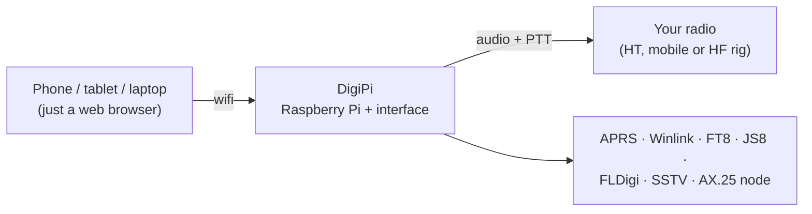

# Why the DigiPi (a data station on your wifi)

Somewhere between "a radio" and "a computer program" there is a third kind of station: a small box that sits beside your transceiver, speaks the digital modes on its behalf, and hands you the controls in a web browser. That is DigiPi. It is a free-software project by Craig, KM6LYW, that turns a Raspberry Pi into — in the project's own words — "an easy-to-use amateur radio data transceiver hotspot," where "all radio data modes are easily accessible over wifi via your phone or web browser." Plug a radio in one side and a power lead in the other, and your phone becomes an APRS messenger, a Winlink email terminal, an FT8 station and more — no software installed on the phone at all. This guide is the long-form manual for it: the hardware choices, the install, the modes one by one, and the operating judgement the project's own pages assume you already have.

## What DigiPi actually is

Strip the novelty away and DigiPi is **a pre-built Raspberry Pi operating-system image loaded with the standard amateur data-modes software stack, wired together behind one web interface**. The Pi does the hard work — encoding, decoding, keying the radio — and serves the results to any browser on your network.

The published feature list is genuinely broad:

- **APRS, thoroughly**: a WebChat interface for [APRS messaging](outpost:entry/logbook73.handbook/aprs-messaging), a **digipeater** for the `144.390 MHz` (Americas) and `144.800 MHz` (Europe) APRS channels, an **iGate** bridging RF to the internet, and a live map/dashboard.
- **Winlink email** — both a client and a server role — through the Pat interface, with the **ARDOP** modem for world-wide HF email and the **MERCURY** OFDM modem (VARA-HF-like) carried as an explicitly _experimental_ transport.
- **Weak-signal and keyboard modes**: WSJT-X for [FT8](outpost:entry/logbook73.handbook/ft8), an improved JS8Call, and FLDigi covering CW, PSK31, RTTY, MFSK, Olivia and friends.
- **Slow-scan television** — [picture transmission](outpost:entry/logbook73.handbook/sstv) from a browser.
- **Proper packet plumbing underneath**: [AX.25 networking](outpost:entry/logbook73.handbook/packet-radio), node services and bulletin boards, and IP tunneling using amateur radio's own `44.*` internet address space.
- **Bluetooth pairing** for mobile-app integration, and a family of small status screens if you want the box to show its own face.

One box, one web page, the whole data side of the hobby. That is the pitch, and — unusually for pitches — the project largely delivers it.

## Who is behind it, and how it is distributed

DigiPi is the work of **Craig, KM6LYW**, whose YouTube channel carries the configuration and demo videos, and whose Discord and mailing list are where the community lives. The distribution model deserves an honest paragraph, because it surprises people:

- **The software is free.** Everything DigiPi bundles carries an open-source licence, and the project's own code and configuration live publicly at `github.com/craigerl/digipi`. The repository is candid about its purpose: it is "not a recipe for creating a bootable SD card image" — it exists "largely for developers wanting to create their own radio/digipi project, GPL-compliance, and education."
- **The ready-made SD-card image is a supporter perk.** The download password goes to supporters of the KM6LYW Patreon page, at any support level, as the project's way of giving something tangible back. You are paying for the convenience of the _assembled_ image, not for the software.

Is that fair? This guide thinks so, and says so plainly: you can build the whole thing yourself from public source, or you can support the developer and receive the polished image that makes DigiPi the easiest data station in amateur radio. Most people choose the second and consider it money well spent on their own terms.

## Who DigiPi suits

- **The phone-first operator.** If your phone is where you live, DigiPi meets you there. APRS messages arrive like texts; Winlink reads like webmail; FT8 runs in a tab. Nothing to install, nothing to update on the client side — the radio side becomes an appliance.
- **The APRS enthusiast.** A dedicated, always-on digipeater and iGate that sips power and needs no keyboard is exactly what the [APRS infrastructure](outpost:entry/logbook73.handbook/aprs-infrastructure) runs on. DigiPi makes owning a piece of that infrastructure a weekend project.
- **The emergency-communications and Winlink crowd.** Email over RF, from a box you can run off a battery, operated from any phone in the room — the [go-kit](outpost:entry/logbook73.guide.digipi/configs) writes itself.
- **The portable data operator.** Paired with a tiny interface such as the [Digirig Mobile](outpost:entry/logbook73.guide.digirig/overview) and an HF rig, DigiPi is a [SOTA](outpost:entry/logbook73.handbook/sota)/[POTA](outpost:entry/logbook73.handbook/pota) data companion that weighs less than your lunch.
- **The tinkerer with a licence.** Under the friendly web page sits the real Linux amateur stack — AX.25, software TNCs, Pat — with the lid off. You can use DigiPi for years without looking underneath, but the [theory chapter](outpost:entry/logbook73.guide.digipi/theory) is there when curiosity strikes.

## What it is not

- **It is not a radio.** DigiPi transmits nothing by itself; it needs a transceiver and an interface to key it. Chapter [1](outpost:entry/logbook73.guide.digipi/hardware) maps the supported combinations — including which Raspberry Pi boards are and are not up to the job.
- **It is not a general-purpose Pi desktop.** The image is a purpose-built appliance that runs read-only in normal operation (a deliberate design you will come to love — [chapter 2](outpost:entry/logbook73.guide.digipi/install) explains why). Treat it like firmware, not like a laptop.
- **It is not a licence workaround.** Everything DigiPi transmits is your transmission, under your callsign and your licence conditions — and some of its headline features (digipeating, unattended operation, internet gateways) sit exactly where licence conditions vary from country to country. [Chapter 4](outpost:entry/logbook73.guide.digipi/aprs) and [best practices](outpost:entry/logbook73.guide.digipi/best-practices) treat this seriously, because the project rightly assumes a licensed, informed operator.
- **It is not tied to one vendor's hardware.** Half a dozen interface options are supported, from a homebrew-friendly hat to commercial cables. This guide leans on the [Digirig Mobile](outpost:entry/logbook73.guide.digirig/overview) for its HF examples — the companion guide next door covers that little box in equal depth — but the choice is genuinely yours.

## A word on safety and the licence

The usual short list, tuned for a box that can transmit while you are in another room:

- **Your callsign, your responsibility.** DigiPi's services identify as you and transmit as you. Configure your real callsign, keep the passcodes private, and know what each enabled service will send before you enable it. [Getting Licensed](outpost:entry/logbook73.handbook/getting-licensed) covers the prerequisites; your national licence covers the conditions.
- **Unattended and automatic operation is nationally regulated.** Digipeaters, iGates and Winlink gateways run without a hand on the key. Whether, where and how that is permitted differs by country — in the UK, for instance, unattended operation has its own conditions in the licence. Check yours before leaving anything running overnight. This guide flags the question wherever it arises and never pretends one answer fits all.
- **Duty cycle is real.** Data modes transmit hard. A radio that chats happily all evening on FM may run hot digipeating packets or sending Winlink traffic. Give transmitters airflow and sane power levels, and mind [RF safety](outpost:entry/logbook73.handbook/rf-safety) for antennas that transmit when nobody is standing there to think about it.

## How this guide is organised

[Hardware](outpost:entry/logbook73.guide.digipi/hardware) chooses the Pi, the interface and the screen. [Install](outpost:entry/logbook73.guide.digipi/install) gets you from blank SD card to the web page. [The web interface](outpost:entry/logbook73.guide.digipi/web-interface) tours the controls, then the mode chapters go deep: [APRS](outpost:entry/logbook73.guide.digipi/aprs), [Winlink](outpost:entry/logbook73.guide.digipi/winlink), [weak-signal and keyboard modes](outpost:entry/logbook73.guide.digipi/weak-signal), and [operating from your phone](outpost:entry/logbook73.guide.digipi/phone-operating). [Theory](outpost:entry/logbook73.guide.digipi/theory) lifts the lid on the stack, [updates](outpost:entry/logbook73.guide.digipi/updates) covers versions and community, and the guide closes with [ready-made configurations](outpost:entry/logbook73.guide.digipi/configs), [troubleshooting](outpost:entry/logbook73.guide.digipi/troubleshooting), [best practices](outpost:entry/logbook73.guide.digipi/best-practices) and the [quick-reference card](outpost:entry/logbook73.guide.digipi/quick-reference).

## Try it yourself

Even before hardware arrives, you can start:

1. **Watch the configuration/demo video** on the KM6LYW Radio YouTube channel — twenty minutes there will make this whole guide feel familiar.
2. **Read the [APRS chapters of the handbook](outpost:entry/logbook73.handbook/aprs)** if packet radio is new to you; DigiPi will make far more sense when digipeaters and iGates are already ideas you own.
3. **Inventory your junk box.** A supported Pi, a spare SD card and an HT you already own are most of a first DigiPi — [chapter 1](outpost:entry/logbook73.guide.digipi/hardware) tells you exactly what qualifies.
