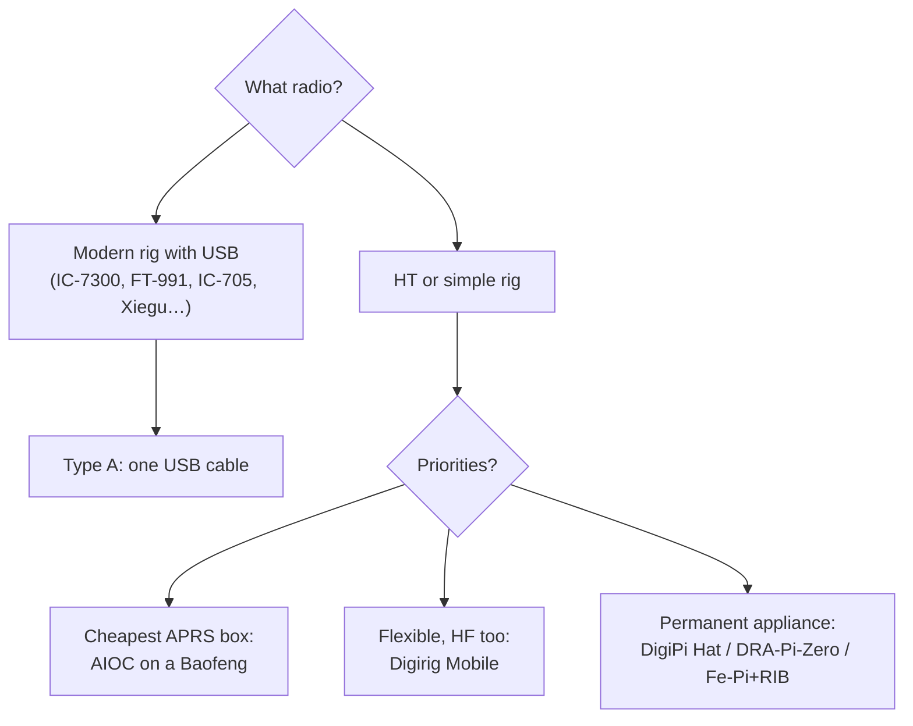

# Hardware: the Pi, the interface and the screen

DigiPi is a recipe with three ingredients — a Raspberry Pi, a radio interface, and the radio itself — plus two optional garnishes: a little status screen and a battery. Choose well here and the install chapter is ten minutes of pleasure; choose badly and you will spend an evening discovering why the project's hardware list says what it says. This chapter is that list, explained.

## The Raspberry Pi: which boards qualify

The project is refreshingly blunt about processor requirements. In its own words: **"Single-core Pi's like the Zero, 3A, 2B are unsupported (3B+, 3A+, Pi4, Pi5 and Zero2W are fine)."** Decoding that into a shopping decision:

| Board                     | Verdict               | Notes                                                                                                                      |
| ------------------------- | --------------------- | -------------------------------------------------------------------------------------------------------------------------- |
| **Pi Zero 2 W**           | ✅ The classic DigiPi | Tiny, cheap, wifi built in, sips power — the portable and dedicated-appliance favourite. Cannot drive the big DSI screens. |
| **Pi 3A+ / 3B+**          | ✅ Fine               | Plentiful second-hand; 3B+ adds wired Ethernet, handy for a shelf iGate.                                                   |
| **Pi 4 / Pi 5**           | ✅ Fine               | Overkill for the job, which is no crime; the extra grunt helps if you run the heavier modems and a big display together.   |
| **Original Zero, 3A, 2B** | ❌ Unsupported        | Single-core boards. The modern modems want more; don't fight it.                                                           |

Practical guidance on top of the official line: for a **portable** or **single-purpose** DigiPi, the Zero 2 W is the sweet spot; for a **home shelf box** that runs several services and maybe a screen, a Pi 4 is cheap insurance. Whatever you pick, buy a **good power supply** — most "mysterious Pi problems" in any project are undervoltage wearing a costume.

## The SD card

The image "fits on an 8 GB card with room to spare", so almost any modern card qualifies on capacity. Spend your money on **provenance rather than size**: a genuine name-brand card from a reputable seller. Two habits pay off for an appliance that may run for months: keep a **second card with the image already flashed** (the fastest possible disaster recovery), and label cards with the DigiPi version on them. The read-only design ([chapter 2](outpost:entry/logbook73.guide.digipi/install)) is kind to SD cards, which is one reason DigiPis grow old gracefully.

## The radio interface: Type A and Type B

DigiPi sorts the radio question into two clean categories.

### Type A — radios with USB built in

Modern transceivers with a built-in USB sound card and CAT port need nothing but **a USB cable** to the Pi. The project names the IC-7300, Yaesu FT-991, IC-705 and Xiegu rigs as examples of this class. If your radio's manual mentions a built-in USB audio codec, you are probably a Type A household, and your interface budget is a cable.

### Type B — radios that need an interface box

HTs and simpler rigs need a gadget that carries audio both ways and keys PTT. DigiPi supports a small ecosystem of them:

| Interface                              | Style                                                | Best known for                                                                                                                                                                                                                                           |
| -------------------------------------- | ---------------------------------------------------- | -------------------------------------------------------------------------------------------------------------------------------------------------------------------------------------------------------------------------------------------------------- |
| **AIOC ("All-In-One-Cable")**          | Open-hardware plug for Baofeng/Kenwood two-pin HTs   | The cheapest respectable path from a UV-5R to a data station — the whole interface lives inside a moulded plug                                                                                                                                           |
| **Digirig Mobile**                     | Commercial USB-C interface box with per-radio cables | The flexible choice, especially for HF rigs — and note the project's explicit caveat: **Digirig Mobile, "not Lite"** (the Lite lacks the serial port; DigiPi wants the Mobile). Our [companion guide](outpost:entry/logbook73.guide.digirig/overview) covers it in full depth. |
| **Masters Communications DRA-Pi-Zero** | Board that mates with the Pi                         | A tidy sandwich build for dedicated boxes                                                                                                                                                                                                                |
| **DigiPi Hat**                         | Purpose-made hat sold via elekitsorparts             | The "designed for exactly this" option; stacks on the GPIO header                                                                                                                                                                                        |
| **Fe-Pi Audio Z v2 + N7EBB RIB**       | Audio hat plus radio-interface board                 | The homebrew-flavoured route for builders                                                                                                                                                                                                                |

Choosing between them, honestly: **AIOC** if your radio is a two-pin HT and your goal is APRS on a budget; **Digirig Mobile** if you want one interface that also serves your laptop, your HF rig, and [CAT control](outpost:entry/logbook73.guide.digirig/rig-control); one of the **hat-style boards** if you are building a permanent one-box appliance and like clean wiring. There is no wrong answer on the supported list — there are only wrong pinouts, which is what [cables](outpost:entry/logbook73.guide.digirig/cables) chapters exist for.

## The radio itself

Anything the interface can key. Three archetypes recur throughout this guide:

- **A cheap HT on `144.390`/`144.800 MHz`** — the classic APRS digipeater/iGate donor. It will transmit more than it ever has in its life; mind its duty cycle and use modest power.
- **A mobile/base VHF rig** — the serious APRS infrastructure choice, with real heatsinking and clean audio.
- **An HF transceiver** — for Winlink over ARDOP, FT8 and the rest of the [HF data world](outpost:entry/logbook73.handbook/hf-data-modes). This is where a Type A rig or a [Digirig-cabled](outpost:entry/logbook73.guide.digirig/cables) HF radio earns its keep.

## Screens (optional, delightful)

DigiPi runs happily headless — the web page _is_ the interface — but it supports a family of little displays for at-a-glance status, and they give the box a personality:

| Display                 | Size / resolution | Notes                                                           |
| ----------------------- | ----------------- | --------------------------------------------------------------- |
| **ST7789 TFT**          | 1.3" · `240×240`  | The tiny classic; status at a glance                            |
| **ILI9341 TFT**         | 2.8" · `240×320`  | The middle child                                                |
| **ILI9486 / MHS35 TFT** | 3.5" · `320×480`  | The big small screen; room for real information                 |
| **DSI touchscreens**    | 5"/7" · `800×480` | Proper control-panel feel — but **unsupported on the Zero 2 W** |
| **HDMI**                | 720p or better    | Any monitor or TV in a pinch                                    |

If you are buying: match the screen to the Pi (the DSI caveat above), and buy the exact controller named — TFT clones with lookalike controllers are a well-known source of blank screens, and [troubleshooting](outpost:entry/logbook73.guide.digipi/troubleshooting) can only help so much with mystery silicon.

## Power

Nothing exotic: a quality mains USB supply at home, and in the field whatever clean 5 V you trust — a USB power bank runs a Zero 2 W build for a long day. The project's pages don't publish consumption figures, so this guide won't invent any; the honest advice is to measure _your_ build with _your_ screen and radio, and size batteries with headroom. Two field rules regardless: the radio should have its **own** power (don't ask a Pi supply to key a transmitter), and shut the Pi down properly when you can — though the read-only design ([chapter 2](outpost:entry/logbook73.guide.digipi/install)) exists precisely so that a yanked plug is a shrug, not a corrupted card.

## Shopping lists, condensed

- **Pocket APRS box**: Pi Zero 2 W · AIOC · a two-pin HT · 8 GB+ card · power bank.
- **Shelf digipeater/iGate**: Pi 3B+ or 4 (Ethernet is nice) · DigiPi Hat or DRA-Pi-Zero · VHF mobile rig · decent PSU.
- **HF data go-kit**: Pi Zero 2 W or 3A+ · [Digirig Mobile](outpost:entry/logbook73.guide.digirig/overview) + radio cable · HF rig · 3.5" TFT if you like a face on the box.

Details of assembly per interface live with the interface makers (and, for the Digirig, in [the companion guide's cables chapter](outpost:entry/logbook73.guide.digirig/cables)); DigiPi's own part begins when power first flows — which is [the next chapter](outpost:entry/logbook73.guide.digipi/install).
