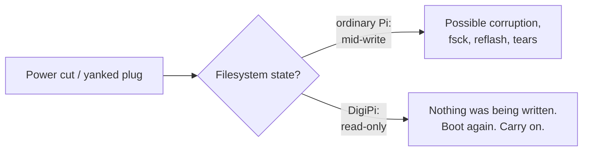

# Install: image, first boot and wifi

DigiPi installs the way good appliances should: flash a card, boot, tell it your wifi, tell it your callsign, done. There is no monitor-and-keyboard stage, no package manager, no editing files over SSH — the whole first-run happens from your phone. This chapter walks it end to end, then explains the design decision that makes DigiPi unusually hard to kill: the read-only filesystem.

## Before you start

You need: the DigiPi image (downloaded via the supporter link — see [the overview](outpost:entry/logbook73.guide.digipi/overview) for the distribution model), an SD card (the image "fits on an 8 GB card with room to spare"), a card writer, and your assembled hardware from [chapter 1](outpost:entry/logbook73.guide.digipi/hardware). Have on hand for the setup form: your **callsign**, your **grid square** (the [handbook](outpost:entry/logbook73.handbook/aprs-your-station) explains finding it), and the **passcodes** the services need — an APRS-IS passcode for iGating and your Winlink account details if you use those services.

## Step 1 — flash the card

Two documented paths:

- **Balena Etcher**: point it at the downloaded image file as-is and flash. Etcher handles compressed images itself.
- **Anything else**: **unzip the image first** — the project is explicit that other tools need the decompressed image — then write it to the card with your usual imager.

Verify-after-write options are worth the extra minute; a marginal flash is the most boring possible first-boot failure.

## Step 2 — first boot and the DigiPi hotspot

Card in, radio and interface connected (fine to leave for later), power on. On first boot, with no known wifi to join, **DigiPi opens its own wifi hotspot** so you can reach it from anything with a browser:

1. On your phone or laptop, watch the wifi list for a network called **`DigiPi`**.
2. Join it with the documented password **`abcdefghij`**.
3. Browse to **`http://10.0.0.5/wifi.php`** — or just `http://10.0.0.5/` and choose **Wifi**.
4. Enter your home wifi's SSID and password, and reboot when asked.

That hotspot behaviour is not just a first-boot trick — it is DigiPi's standing fallback whenever it can't find a known network, which is exactly what makes [field operating](outpost:entry/logbook73.guide.digipi/phone-operating) work: on a summit with no infrastructure, the same `DigiPi` network appears and your phone connects straight to the box.

## Step 3 — find it on your network

After the reboot DigiPi joins your wifi. Reach it at:

- **`http://digipi/`** — the friendly name, which works on most home networks; or
- **its IP address** — if the name doesn't resolve, log into your router and look for the newest wifi client, then browse to that address.

Bookmark whichever works. This page is now your radio's front door.

## Step 4 — the setup form

The web interface's initial configuration asks for the identity every service will use: **your callsign, your passcodes, your grid square**. Fill it in carefully — this is the identity DigiPi will _transmit_:

- **Callsign**: yours, exactly, with the SSID conventions of [APRS](outpost:entry/logbook73.handbook/aprs-anatomy) applying to the APRS side (the handbook explains which SSIDs conventionally mean digipeater, iGate, portable and so on).
- **APRS-IS passcode**: the standard code derived from your callsign that the APRS-IS network requires before it will accept your packets for [iGating](outpost:entry/logbook73.handbook/aprs-igates).
- **Winlink details**: the account that [chapter 5](outpost:entry/logbook73.guide.digipi/winlink) will use.
- **Grid square**: where you are, for beacons and maps.

Once initial configuration completes, the system settles into its normal **read-only** running state — which deserves its own section, because it changes how you think about the box.

## The read-only design, and why you want it

A normal Linux computer writes to its disk constantly — logs, caches, temporary files. Pull the plug mid-write and the filesystem can corrupt; do that to a Raspberry Pi on an SD card a few dozen times and you have the classic dead-Pi story. DigiPi's answer is the appliance answer: **after setup, the system runs with its filesystem read-only**, like firmware in a router.

The consequences, practical and cultural:

- **Power cuts are shrugs.** The field workflow of "unplug it when done" — unthinkable for a normal Pi — is the _designed_ workflow here.
- **SD cards live long lives.** Write wear, the other SD killer, mostly stops happening.
- **The box is not your project computer.** Changes you make outside the sanctioned web-interface paths don't belong and won't persist the way you expect. Treat the image as firmware: configuration through the web UI, upgrades by re-flashing ([chapter 9](outpost:entry/logbook73.guide.digipi/updates)), tinkering on the public GitHub source if that is your joy.

## A ten-minute first shakedown

With setup done, prove the box before you trust it:

1. **Reach the interface from two devices** — your phone and something else — so you know the name/IP story cold.
2. **Start one receive-only service** and confirm decodes: APRS on a busy channel, or FT8 on a lively band, depending on your radio. Decodes prove the audio path _into_ the box.
3. **Make one deliberate, attended transmission** — an APRS beacon or an FT8 CQ — with the radio's power low and you listening on another receiver if you can. This proves PTT and transmit audio, and it is the moment to check your interface levels (the [Digirig levels chapter](outpost:entry/logbook73.guide.digirig/levels) applies almost verbatim to any interface).
4. **Reboot by pulling power** — yes, deliberately, once — and watch it come back clean. Now you _believe_ the read-only story, and the field version of you will thank the shack version of you.

## When something in this chapter doesn't happen

The hotspot never appears, `digipi/` won't resolve, the setup page balks — [troubleshooting](outpost:entry/logbook73.guide.digipi/troubleshooting) takes these symptom by symptom. The short version of the philosophy there: it is nearly always the card, the power supply, or the network name — in that order — and almost never the software.

Next: the front door you just bookmarked, room by room — [the web interface](outpost:entry/logbook73.guide.digipi/web-interface).
