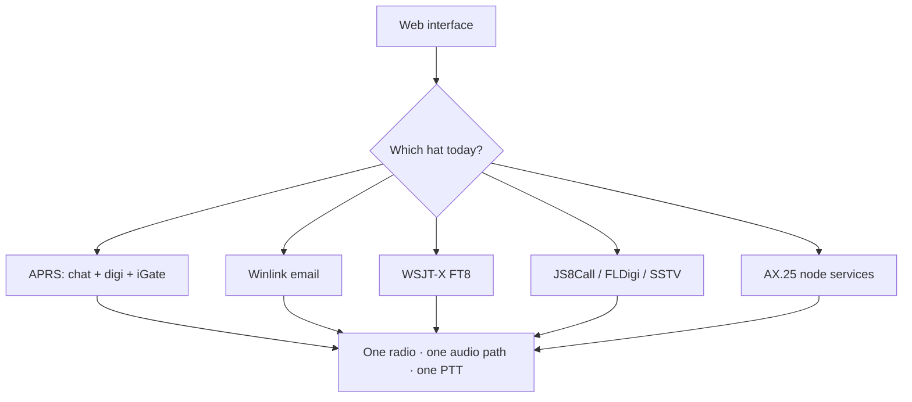

# The web interface: your station as a web page

The web page at `http://digipi/` is the whole cockpit. There is no desktop behind it to fall back on, and no need for one: choosing modes, watching traffic, sending messages, tuning the station's behaviour — the browser does it all, from any device on the network. This chapter is a guided tour of how that cockpit _thinks_, so the mode chapters that follow can concentrate on operating.

A small honesty note before the tour: DigiPi's interface evolves between releases, and this guide describes **what the interface provides** — the controls and information the project documents — rather than pinning exact button captions that may shift with versions. Where your screen's wording differs from this chapter's descriptions, trust your screen; the _shape_ below is stable.

## The mental model: one station, many hats

DigiPi bundles many services — APRS chat, digipeater, iGate, Winlink, FT8, JS8, FLDigi, SSTV, the AX.25 node — but they all share **one radio, one audio path, one PTT line**. The web interface is therefore, at heart, a **hat rack**: you choose which hat the station wears right now, and the interface starts and stops the underlying services accordingly.

Two consequences fall straight out of that model and explain most first-week confusion:

- **Modes are switched, not stacked.** Sound-card modems can't share a microphone; asking for FT8 while the packet stack owns the audio is a request to change hats, and the interface treats it as such. If a mode "won't start," ask first what is _already running_.
- **The radio must match the hat.** DigiPi changes what the _Pi_ does; retuning the _radio_ to the right frequency, mode and power is still the operator's job (except where [CAT control](outpost:entry/logbook73.guide.digirig/rig-control) is wired, when the station can help). Selecting the Winlink hat while the radio still sits on the APRS channel transmits your email attempts into the packet channel — legal-ish, mortifying, avoidable.

## What the interface gives you

Across its screens, the interface provides these families of control and information:

| Area                             | What it provides                                                                                                       |
| -------------------------------- | ---------------------------------------------------------------------------------------------------------------------- |
| **Mode/service switching**       | Start and stop the bundled services — the hat rack itself                                                              |
| **APRS operating**               | The WebChat messaging screen, plus the live map/dashboard of stations heard                                            |
| **Winlink**                      | The Pat-based email screens — compose, read, and session control                                                       |
| **Weak-signal & keyboard modes** | Access to the WSJT-X, JS8Call and FLDigi environments and the SSTV facility                                            |
| **Status**                       | What is running, what the station has heard, and the box's own vitals                                                  |
| **Configuration**                | The identity and network settings from [the install chapter](outpost:entry/logbook73.guide.digipi/install) — callsign, passcodes, grid, wifi |

Each mode's screen gets proper treatment in its own chapter ([APRS](outpost:entry/logbook73.guide.digipi/aprs), [Winlink](outpost:entry/logbook73.guide.digipi/winlink), [weak-signal](outpost:entry/logbook73.guide.digipi/weak-signal)); the rest of this one is craft that applies across all of them.

## Habits that make the cockpit pleasant

- **Bookmark it everywhere.** Phone, tablet, laptop, the shack PC: `http://digipi/` (or the IP) on each. The station is wherever a browser is; make reaching it a reflex. On phones, "add to home screen" turns the station into what feels like an app.
- **One operator at a time.** Several browsers can _look_ at once, and that is genuinely useful — the map on the tablet, chat on the phone. But the station transmits as one callsign under one licence; treat control as single-seat and you will never have to explain a mystery transmission.
- **Learn the status glance.** Before transmitting, before changing hats, before blaming anything in [troubleshooting](outpost:entry/logbook73.guide.digipi/troubleshooting): look at what the status area says is running and heard. The interface always knows; operators who ask it first solve problems in minutes.
- **Stop services you are not using.** A cleaner audio path, an unambiguous PTT, and — for the transmit-capable hats — certainty about what your station might send while your back is turned. This is the [best-practices](outpost:entry/logbook73.guide.digipi/best-practices) chapter's drum, first beaten here.

## The screen on the box (if you fitted one)

A [TFT from chapter 1](outpost:entry/logbook73.guide.digipi/hardware) gives the station a face for the information you want _without_ reaching for a phone — what's running, what was last heard. It never replaces the web interface; think of it as the station's wristwatch, with the browser as its desk. Headless boxes lose nothing but the glance.

## When the interface itself misbehaves

Can't reach the page at all → the network layer, not the interface: the name/IP dance from [install](outpost:entry/logbook73.guide.digipi/install), then [troubleshooting](outpost:entry/logbook73.guide.digipi/troubleshooting). Page loads but a mode won't start → the hat-rack rule above, then the mode's own chapter. Interface reachable but the station seems deaf/mute → the audio path and interface levels, which are radio-side matters: start at [the Digirig levels chapter](outpost:entry/logbook73.guide.digirig/levels) (its logic fits any Type B interface) or your Type A radio's USB audio settings.

With the cockpit understood, time to fly something. First hat: [APRS](outpost:entry/logbook73.guide.digipi/aprs).
