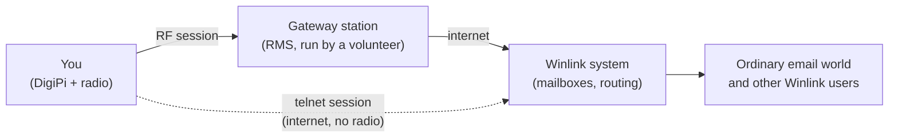

# Winlink: email over radio with Pat

Email that travels by radio is the most quietly astonishing thing a data station does. Winlink is amateur radio's global system for it — real email, with addresses and attachments and inboxes — carried over RF when the internet is absent, unavailable, or simply not the point. DigiPi ships a complete Winlink capability built on **Pat** (the open-source Winlink client), with the **ARDOP** modem for world-wide HF work, an experimental **MERCURY** OFDM transport, and even a **server** role. This chapter explains the system, then the DigiPi workflow.

## Winlink in one diagram

Your station connects to a **gateway** — a volunteer-run station bridging RF to the Winlink core — exchanges any waiting mail in both directions, and disconnects. Email waits in your mailbox between sessions, exactly like the email you already know. The [HF data modes](outpost:entry/logbook73.handbook/hf-data-modes) chapter places Winlink among its siblings; here we work it.

## Telnet versus RF: the two session types, plainly

- **A telnet session** runs over the ordinary internet — no radio involved. It exists for testing your account, learning the workflow, and moving mail when RF isn't the point. It is also the honest way to rehearse: same client, same mailbox, zero propagation variables.
- **An RF session** does the same mail exchange over the air, via a gateway you can actually reach with radio waves. This is the capability everyone is actually here for — and the one where [propagation](outpost:entry/logbook73.handbook/propagation), frequency choice and modem settings all matter.

The disciplined habit: **prove each layer separately.** Telnet proves account and client; a local VHF RF session (where geography allows) proves your radio path; HF proves the long-haul modem. When something breaks later, you will know which layer to suspect.

## The transports DigiPi offers

| Transport        | What it is                                                                        | Honest status                                                                                                    |
| ---------------- | --------------------------------------------------------------------------------- | ---------------------------------------------------------------------------------------------------------------- |
| **Telnet**       | Internet session, no RF                                                           | The rehearsal room                                                                                               |
| **ARDOP**        | The open HF modem for Winlink — the project bills it plainly: "world-wide E-Mail" | The workhorse for HF RF sessions                                                                                 |
| **MERCURY**      | An OFDM modem in the VARA-HF style                                                | Carried by DigiPi as **experimental**, in the project's own labelling — try it with expectations set accordingly |
| **Packet/AX.25** | VHF/UHF sessions to local gateways                                                | Where a local packet gateway exists, the low-drama RF option                                                     |

A note on the wider ecosystem: much of the Winlink world also uses the proprietary VARA modems, which are Windows software; DigiPi's stack is the open-source path, and ARDOP is its passport. Gateways advertise which modes they accept — matching modem to gateway is part of the craft below.

## The DigiPi workflow

Setup gave the station your Winlink identity ([chapter 2](outpost:entry/logbook73.guide.digipi/install)); the web interface's Pat-based screens give you compose, inbox and session control ([chapter 3](outpost:entry/logbook73.guide.digipi/web-interface)'s tour). An RF session, end to end:

1. **Choose a gateway and frequency.** Gateway directories (via the Winlink organisation's tools and Pat's own catalogue features) list stations, frequencies and modes. Choose one plausibly reachable _now_ — a [propagation](outpost:entry/logbook73.handbook/propagation) judgement on HF.
2. **Put the radio there.** Correct frequency, correct sideband convention for data, sensible power; [CAT control](outpost:entry/logbook73.guide.digirig/rig-control) makes this crisp if wired, and the [levels discipline](outpost:entry/logbook73.guide.digirig/levels) matters doubly for modems.
3. **Start the session** from the web interface and listen to your station work — connect, exchange, disconnect. Sessions are short by design; the system is store-and-forward, not a chatroom.
4. **Read your mail** at leisure. It is in the mailbox now; the RF part is over.

The **server** role, which DigiPi also provides, inverts the arrow: your station accepts connections and serves mail — infrastructure rather than user, with the same automatic/unattended licence considerations as [the digipeater discussion](outpost:entry/logbook73.guide.digipi/aprs), and the same advice: read your licence's terms before running it beyond your elbow.

## Etiquette and expectations

- **Gateways are gifts.** Every RMS is someone's station, power bill and goodwill. Efficient sessions, sane retry behaviour, and spreading your custom across gateways are the thanks.
- **Email over RF is email in public.** Amateur radio forbids encryption for privacy; treat every message as postcard-visible, because on the air, it is. (This is a feature of the service's character, not a bug — but it startles newcomers.)
- **Attachments cost airtime.** Kilobytes that vanish on broadband are minutes on HF. The Winlink culture of small, plain messages exists for good reason.
- **Emergency-readiness is a practice, not a purchase.** The operators who move traffic when it matters are the ones who moved test traffic monthly when it didn't. If emcomm is your why, put a recurring session in the calendar — [best practices](outpost:entry/logbook73.guide.digipi/best-practices) says more.

## When sessions fail

No connect at all → wrong frequency/sideband, dead band, or a gateway that isn't currently there: try another gateway before touching settings. Connects-then-fails → usually levels or margin: reduce ambition (closer gateway, better band) and check [audio levels](outpost:entry/logbook73.guide.digirig/levels). Everything fails including telnet → account/identity layer, nothing to do with radio. The [troubleshooting chapter](outpost:entry/logbook73.guide.digipi/troubleshooting) has the full tree.

Email done, we turn the station to the modes that thrive where signals whisper: [FT8, JS8 and the keyboard modes](outpost:entry/logbook73.guide.digipi/weak-signal).
