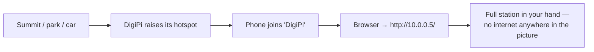

# Operating from a phone

The quiet revolution in DigiPi is not any single mode — it is that the operating position dissolved. The station is wherever your phone is: the sofa, the garden, a summit, the passenger seat. This chapter is about making that phone-first workflow genuinely good — at home, then in the field where there is no network but the one DigiPi brings with it.

## At home: the station in your pocket

On your home wifi, the recipe is simply ergonomics:

- **Add it to your home screen.** Browse to `http://digipi/` (or the IP from [install](outpost:entry/logbook73.guide.digipi/install)) and use your phone browser's _add to home screen_. The station gets an icon next to your other apps, which is exactly the mental slot it deserves.
- **Every family device is a console.** The map from [the APRS chapter](outpost:entry/logbook73.guide.digipi/aprs) on the kitchen tablet; WebChat on your phone; the [Winlink inbox](outpost:entry/logbook73.guide.digipi/winlink) on the laptop. Viewing scales freely — just keep to the one-operator-transmits discipline from [the web-interface chapter](outpost:entry/logbook73.guide.digipi/web-interface).
- **The radio stops living at a desk.** Pi, interface and radio belong wherever coax is shortest and the antenna happiest — loft, garage, the foot of the mast. You will visit it to change bands (unless [CAT](outpost:entry/logbook73.guide.digirig/rig-control) does it for you) and otherwise forget it exists.

## Bluetooth pairing

DigiPi provides **Bluetooth pairing for mobile-app integration** — the documented hook for pairing phones directly to the box in the mobile-app workflows the project supports. Where you use it (as against plain wifi-and-browser), pair in advance at home rather than discovering the dance on a hillside; pairing is a shack chore, not a field sport. The wifi path remains the universal fallback that needs nothing but a browser.

## In the field: the hotspot is the infrastructure

Away from home, the design from [first boot](outpost:entry/logbook73.guide.digipi/install) becomes the whole field story: **finding no known wifi, DigiPi raises its own `DigiPi` hotspot**, and your phone joins the station's network instead of the other way round.

Field craft that earns its keep:

- **Know the numbers by heart** (or from the [quick reference](outpost:entry/logbook73.guide.digipi/quick-reference)): network `DigiPi`, password `abcdefghij`, address `http://10.0.0.5/`. Cold fingers should not need to think.
- **Rehearse at home once**: power the box away from your wifi (or with wifi forgotten), join the hotspot, run a mode. Five minutes of rehearsal converts the field workflow from theory to reflex.
- **Mind what needs the internet and what doesn't.** RF things — APRS on the channel, FT8, an RF [Winlink](outpost:entry/logbook73.guide.digipi/winlink) session — need no internet at all, and this is the point of the whole exercise. Internet-flavoured things (iGating to APRS-IS, telnet sessions) naturally sleep until connectivity returns. The station degrades exactly as it should.
- **Clocks drift where networks aren't.** FT8's time slots care ([weak-signal chapter](outpost:entry/logbook73.guide.digipi/weak-signal)); give the box a time check while your phone still has signal, or lean on modes that don't count seconds.

## The field kit that works

A settled loadout, refined by the community's practice:

| Item                            | Notes                                                                                                                                     |
| ------------------------------- | ----------------------------------------------------------------------------------------------------------------------------------------- |
| **Pi Zero 2 W build**           | The [hardware chapter](outpost:entry/logbook73.guide.digipi/hardware)'s portable pick; a small TFT earns its grams by answering "is it up?" without the phone   |
| **Interface + radio**           | AIOC-plus-HT for VHF packet days; [Digirig Mobile](outpost:entry/logbook73.guide.digirig/configs) plus an HF rig for the full menu                              |
| **Power**                       | A USB power bank for the Pi, the radio's own battery for the radio — separate, per the [hardware chapter](outpost:entry/logbook73.guide.digipi/hardware)'s rule |
| **The phone you already carry** | The entire operating position                                                                                                             |
| **Antenna**                     | The usual truth: [the wire matters more](outpost:entry/logbook73.handbook/antennas) than everything above it on this list                                        |

Total weight, radio included, rivals a paperback — which is how a [SOTA](outpost:entry/logbook73.handbook/sota) activation grows a data station, or a [POTA](outpost:entry/logbook73.handbook/pota) picnic table becomes a Winlink post office. The [configs chapter](outpost:entry/logbook73.guide.digipi/configs) turns this into named builds.

## Shutdown, the field version

The read-only design ([install chapter](outpost:entry/logbook73.guide.digipi/install)) was built for exactly this moment: when the activation ends, you may simply cut power, and the box will boot clean next time. Prefer a polite shutdown when convenience allows; feel zero guilt when it doesn't. That guilt-free unplug — tiny thing that it is — is half of why DigiPi field boxes actually get taken outside, and taken outside is the whole point.

Next, for the curious: what all these browser screens are actually driving — [the theory chapter](outpost:entry/logbook73.guide.digipi/theory).
