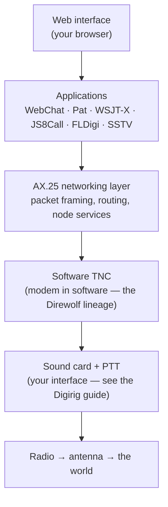

# Under the hood: Direwolf, Pat and packet plumbing

You can run DigiPi for years without this chapter. But the box is a beautiful teaching specimen — a complete, working exhibit of how amateur digital radio actually fits together — and the project itself publishes its code precisely so the curious can look. This chapter lifts the lid: the packet stack, the email plumbing, amateur radio's own corner of the internet, and the small systems-engineering decision that makes the whole thing appliance-grade.

## The stack, top to bottom

Each layer replaced something that once was hardware. Follow the history downward and DigiPi stops being magic and starts being _inevitable_.

## AX.25: the protocol that will not die

Amateur packet radio standardised in the 1980s on **AX.25** — a link-layer protocol (a cousin of the X.25 of that era) that wraps data into _frames_ carrying source callsign, destination, digipeater path and payload. Every APRS packet you saw in [chapter 4](outpost:entry/logbook73.guide.digipi/aprs) is an AX.25 frame; the [packet radio](outpost:entry/logbook73.handbook/packet-radio) chapter tells the full story, and [APRS anatomy](outpost:entry/logbook73.handbook/aprs-anatomy) dissects a frame byte by byte.

The genuinely clever part is what Linux did with it: AX.25 lives in the kernel's networking stack alongside TCP/IP, so radio links become _network interfaces_. That is what makes DigiPi's **node services** possible — connectable services and bulletin boards over RF in the classic packet-BBS tradition — not as retro cosplay but as the same code, still working, now administered from a web page.

## The software TNC: the box that became a program

Packet originally required a **TNC** — terminal node controller — a hardware modem-and-brain between radio and computer. The modern stack replaced it with software: sample the radio's audio through a sound card, do the modem mathematics in the CPU, key PTT through [an interface](outpost:entry/logbook73.guide.digirig/how-it-works). **Direwolf** is the software TNC this whole ecosystem standardised on — the engine of the Pi packet world that DigiPi's packet services are built around — decoding multiple signals at once and outperforming the old hardware at, effectively, no cost.

This is the same "radio work becomes mathematics" story as [software-defined radio](outpost:entry/logbook73.handbook/software-defined-radio), one layer up: the RF still needs real hardware, but everything after audio is code. It is also why [audio levels](outpost:entry/logbook73.guide.digirig/levels) matter so much on this box — the sound card _is_ the modem's front door.

## Pat and the Winlink plumbing

The [Winlink chapter](outpost:entry/logbook73.guide.digipi/winlink) drove the workflow; the machinery is worth one paragraph. **Pat** is the open-source Winlink client that handles mailbox, message format and session protocol, while pluggable _transports_ — telnet for internet sessions, **ARDOP** as the open HF modem, the experimental **MERCURY** OFDM modem, AX.25 for VHF packet gateways — carry the session. The separation is clean engineering: Pat neither knows nor cares whether your session crossed the room by wire or the planet by [skywave](outpost:entry/logbook73.handbook/propagation); the modem's only job is to be a reliable pipe for the minutes the session lasts.

## Net-44: amateur radio's own internet

DigiPi's feature list includes **IP tunneling with amateur radio addressing — the `44.*` network** — and thereby hangs one of networking's best obscure stories. In the 1980s, amateurs were allocated network 44 — tens of millions of IPv4 addresses set aside for radio experimentation, decades before such space was precious — and AMPRNet still runs today: real IP, routed over RF links and tunnels, addressed to licensed amateurs. DigiPi's participation means your station can hold a `44.*` address and speak IP over the amateur service. It is a niche within a niche — and a living connection between the hobby's packet heritage and the internet it helped rehearse. If that history itches pleasantly, the public source at the project's GitHub is your rabbit hole.

## The read-only appliance pattern

The [install chapter](outpost:entry/logbook73.guide.digipi/install) promised the reasoning; here it is. An SD card dies two ways: **corruption** (power fails mid-write, filesystem structures half-updated) and **wear** (flash cells endure finite writes; logs and caches nibble them ceaselessly). Both share a root cause — routine writes — so DigiPi adopts the router-firmware pattern: after configuration, **the filesystem mounts read-only**. Nothing routine writes; a power cut interrupts nothing; wear approximately stops. The costs are real but chosen deliberately: persistent changes are confined to sanctioned configuration moments, and upgrades arrive as [whole-image re-flashes](outpost:entry/logbook73.guide.digipi/updates) rather than package updates. For an unattended box on a shelf — or one whose power switch is a summit-cold hand yanking a cable — it is the right trade a hundred times out of a hundred.

## Why this architecture rhymes

Notice the same idea at each layer: **specialised hardware became general hardware plus software, and the interface moved to wherever you are.** The TNC became Direwolf; the radio's data port became a [USB audio codec](outpost:entry/logbook73.guide.digirig/theory); the operating position became a browser tab; the appliance-ness itself became a filesystem mount option. Amateur radio has always been the hobby of building your station from the era's spare parts — DigiPi is simply what that tradition looks like when the era's spare parts are a pocket computer and open source.

Back to practical matters: [keeping the box current](outpost:entry/logbook73.guide.digipi/updates).
