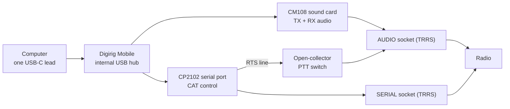

# Why the Digirig (the translator in the gap)

Somewhere between your radio and your computer sits a problem that has quietly shaped fifty years of amateur radio: the two of them speak different languages. The radio deals in microphone audio, speaker audio and a push-to-talk line; the computer deals in USB. Every digital mode you have ever admired — FT8 crossing an ocean on a watt, Winlink email over HF, an APRS tracker chirping up a hill — needs a translator in that gap. The Digirig Mobile is that translator, shrunk to a matchbox: a sound card, a serial CAT port and a proper hardware PTT switch in one aluminium box the size of your thumb, one USB-C lead to the computer, one cable to the radio. This guide is the manual it deserves: what is inside, which cable your radio needs, how to set levels that earn compliments instead of complaints, and what to do on the day it all goes quiet.

## What the Digirig Mobile actually is

Under the lid, the Digirig Mobile is **a tiny USB hub carrying three tools**, as the official documentation describes it: a **sound card built on the CM108 chip**, a **serial port bridge built on the CP2102 chip**, and the supporting circuitry for **hardware PTT switching, serial level conversion, filtering and signal attenuation**.

In plain terms, that means:

- **It is a second sound card for your computer**, dedicated to the radio. Your applications play transmit audio into it and record receive audio out of it, while your laptop's own speakers stay free for you. It appears as a generic USB audio device — **no driver needed** for the audio half on any major system.
- **It keys the radio properly.** A real, electrically isolated-style open-collector switch closes your radio's PTT line, **driven by the RTS signal of the serial port**. No VOX guesswork, no dropped first syllables: when the software says transmit, the radio transmits, and not a moment longer.
- **It can control the radio too.** The serial port carries CAT — computer-aided transceiver control — so logging and digital-mode software can read and set frequency and mode. This half is optional (audio and PTT alone run most modes on most radios) and is the part that comes in [hardware variants](outpost:entry/logbook73.guide.digirig/how-it-works), because radio makers never agreed on an electrical standard.
- **It connects through two 3.5 mm TRRS sockets** — one labelled for audio (which also carries the PTT line), one for serial — chosen deliberately so that cables are simple to buy or make. The current hardware revision is **1.11**, and the connector scheme is stated to be backward compatible to revision 1.6, so cables and advice travel well across recent units.
- **It is powered by the USB lead** — nothing to charge, no battery to age, and one warning inherited from the USB-C world: **the lead must be a real data cable**. The charge-only leads that breed in desk drawers are the single most common "my Digirig is dead" false alarm.

## Why interfaces like this exist at all

You can, in a pinch, run digital modes with no interface: prop a phone's speaker against a microphone and let VOX key the radio. It even works, badly. The problems that method leaves behind are exactly the ones a proper interface solves:

1. **Room noise and acoustics** are in your transmitted signal. A cabled interface carries pure audio both ways.
2. **VOX keying is a guess** — it clips the start of transmissions, hangs after them, and triggers on the dog. Hardware PTT via RTS is a command.
3. **Ground loops and level mismatches** between two mains-powered devices produce hum and distortion; an interface built for the job carries attenuation and filtering to hand the radio the level it expects.
4. **No frequency control**: without CAT, the log doesn't know where you were, and the software can't follow band changes.

The classic solution for two decades was a comparatively bulky box with cables for a specific radio. The Digirig's contribution was to shrink the whole idea into something pocketable and _radio-agnostic_ — one box, and a [cable per radio](outpost:entry/logbook73.guide.digirig/cables) — which is why it has become the default answer to "how do I do FT8 from a picnic table?"

## Mobile or Lite? An honest word about the little sibling

Digirig also make the **Digirig Lite** — the same audio codec in a smaller, simpler device with **no serial port**. Its PTT is keyed by the sound chip itself (via the CM108's GPIO3 line, with an experimental VOX-by-tone fallback) rather than by RTS. It is a lovely minimal choice when audio-plus-PTT is truly all you need.

The rule of thumb this guide suggests:

| You want                                                                | Choose                                                                                               |
| ----------------------------------------------------------------------- | ---------------------------------------------------------------------------------------------------- |
| CAT control — frequency and mode following, rig control from the logger | **Mobile** (the Lite has no serial port at all)                                                      |
| RS-232 / CI-V radios, Elecraft, Lab599 serial families                  | **Mobile**, in the matching [serial configuration](outpost:entry/logbook73.guide.digirig/how-it-works)                     |
| A companion for a DigiPi                                                | **Mobile** — the DigiPi project states its supported interface is the Digirig Mobile, _not_ the Lite |
| The absolute minimum for FT8/APRS audio + PTT                           | Either; the Lite is smaller and simpler                                                              |

This guide is written about the Mobile; where a difference matters, the Lite is called out explicitly.

## Who this little box suits

- **The FT8 and weak-signal operator** — the archetypal use: laptop, Digirig, HF radio, and the [whole digital-mode world](outpost:entry/logbook73.handbook/hf-data-modes) opens.
- **The portable operator** — for [SOTA](outpost:entry/logbook73.handbook/sota) and [POTA](outpost:entry/logbook73.handbook/pota) data activations it adds almost nothing to the pack and replaces a tangle of home-made audio leads.
- **The Winlink and emergency-communications volunteer** — reliable hardware PTT and CAT are exactly what unattended-ish, must-work sessions need.
- **The APRS experimenter** — paired with a handheld and sound-modem software (or a [DigiPi](outpost:entry/logbook73.guide.digipi/overview), which lists the Digirig Mobile among its supported interfaces), it turns cheap FM radios into packet stations.
- **The owner of several radios** — one Digirig and a handful of cables beats one interface per rig.

## What it is not

- **It is not radio-specific — but its cables are.** The box works with essentially anything; the cable and, for CAT, the serial configuration must match your radio. The [cables chapter](outpost:entry/logbook73.guide.digirig/cables) exists because this is where every difficult afternoon with a Digirig actually starts.
- **Its serial configuration is set in hardware.** Logic levels, RS-232, CI-V or TX-500 — chosen by solder jumpers, not a menu. Officially: configuration "is done with solder jumpers and can not be changed operationally", though it _can_ be changed on the bench more than once by someone comfortable soldering. Order the right one; [chapter 2](outpost:entry/logbook73.guide.digirig/how-it-works) tells you which that is.
- **It is not a magic audio-quality machine.** It faithfully carries whatever you feed it — including an overdriven, ALC-flattened horror if you ignore the [levels chapter](outpost:entry/logbook73.guide.digirig/levels). Clean signals come from settings, and the settings are yours.
- **It does not make RF immunity problems disappear.** A tiny station with the antenna close by can still bite its own USB tail on transmit; the [troubleshooting chapter](outpost:entry/logbook73.guide.digirig/troubleshooting) carries the official ferrite-and-choke first-aid kit.

## How this guide is organised

[Getting started](outpost:entry/logbook73.guide.digirig/getting-started) plugs it in and proves each half works before a radio ever gets involved. [How it works](outpost:entry/logbook73.guide.digirig/how-it-works) opens the box: the two chips, RTS keying and the four serial configurations. [Cables](outpost:entry/logbook73.guide.digirig/cables) maps radio families to leads and pinouts. [Levels](outpost:entry/logbook73.guide.digirig/levels) is the short chapter that decides how you sound on the air, [software](outpost:entry/logbook73.guide.digirig/software) sets up the applications that matter, and [rig control](outpost:entry/logbook73.guide.digirig/rig-control) goes deeper on CAT. [Theory](outpost:entry/logbook73.guide.digirig/theory) explains the ideas underneath for the curious, [configurations](outpost:entry/logbook73.guide.digirig/configs) gives copy-and-go station recipes, and the guide closes with [troubleshooting](outpost:entry/logbook73.guide.digirig/troubleshooting), [best practices](outpost:entry/logbook73.guide.digirig/best-practices) and a [quick-reference card](outpost:entry/logbook73.guide.digirig/quick-reference).

## Try it yourself

No radio required for any of this:

1. **Plug it into a computer** with a known-good data cable and watch two devices appear — a USB audio device and a CP210x serial port. That's the whole architecture, visible in Device Manager.
2. **Play music into it** and record it back with any recorder app while a 3.5 mm lead loops the audio socket — a five-minute loopback that proves the sound card end-to-end.
3. **Read your radio's data-jack page** in its manual tonight, and then the [cables chapter](outpost:entry/logbook73.guide.digirig/cables). Knowing which socket your radio offers is most of the shopping decision made.
