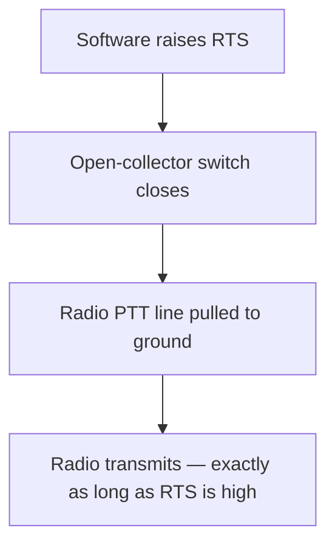

# How it works: two chips, one switch, four dialects

You can use a Digirig for years without this chapter. But one decision — the **serial configuration** — must be made _before_ you order or first solder, and it only makes sense once you see what the box actually does. Twenty minutes here buys you the right hardware the first time and turns every later cable question from mystery into logic.

## The tour: one hub, two devices, one switch

Officially, inside the case there is "a USB hub with a sound card based on a CM108 chip and a serial port bridge based on CP2102 chip", plus "circuitry for hardware PTT switching, serial port level conversion, filtering and signal attenuation." Each of those clauses is doing real work:

- **The USB hub** is why one lead gives your computer two devices. There is no magic pairing between them — the sound card and the serial port are independent, which is why [audio-only operation](outpost:entry/logbook73.guide.digirig/cables) with no CAT is perfectly normal.
- **The CM108 sound card** is a widely used USB audio codec — the same family behind countless headsets, which is exactly why every operating system already knows how to drive it. It converts your applications' playback into transmit audio and the radio's receive audio into a recording device.
- **The CP2102 serial bridge** gives the computer an honest COM port. Radio CAT protocols are, underneath everything, plain serial conversations, and this chip carries them.
- **The PTT switch** is an **open-collector transistor controlled by the serial port's RTS line**. "Open collector" means it behaves like a clean, polarity-friendly switch closing your radio's PTT line to ground — the same thing pressing the microphone button does — and RTS means any software that can raise a serial control line can key your radio with precise timing.
- **Level conversion, filtering and attenuation** are the unglamorous circuits that make computer-strength audio and radio-strength audio meet politely in the middle, and that let the serial port speak the _electrical_ dialect your radio expects — which brings us to the decision.

## The serial configurations: one port, four dialects

Radio manufacturers agree that CAT is a serial conversation; they never agreed on the voltages. The Digirig Mobile answers with four hardware configurations for its serial socket, selected by solder jumpers on the back of the board:

| Configuration                                  | Electrical dialect     | Typical radios (per the official guide)                                                |
| ---------------------------------------------- | ---------------------- | -------------------------------------------------------------------------------------- |
| **Logic levels** _(the default when ordering)_ | TTL-style logic        | HTs and mobile radios — where the serial line typically matters "for programming only" |
| **RS-232**                                     | Classic ±-swing serial | Older radios with a male DB9 socket; **Elecraft KX2/KX3**; Yaesu FTM models            |
| **CI-V**                                       | Icom's single-wire bus | **Icom** radios with the 3.5 mm socket labelled _remote_                               |
| **TX-500**                                     | Lab599's own scheme    | The **Lab599 TX-500**                                                                  |

Three official facts frame the decision:

1. **Audio + PTT work in ANY configuration with ANY radio.** The official wording is worth quoting because it defuses so much worry: Digirig Mobile "in ANY configuration can be used with ANY radio for basic operation (Audio + PTT)". The configuration only matters for **CAT control or radio programming**.
2. **It is not a runtime setting.** Configuration "is done with solder jumpers and can not be changed operationally" — there is no menu, no switch. Order the variant matching the radio you most want CAT with.
3. **It is not a life sentence.** The configuration "can be changed multiple times" by re-soldering the jumper pads — a bench job for someone with moderate soldering skill, not an operation for a picnic table.

**How to choose:** look up your radio in the official transceiver-compatibility resources (which map radios to both cables and configurations), or reason it out — Icom CI-V socket → CI-V; Elecraft/KX or a DB9-era rig → RS-232; TX-500 → its own; everything else, and every "I just want FT8 with audio and PTT" plan → the default logic levels.

## What RTS keying means for your software

Because PTT rides the RTS line of a real COM port, three practical rules follow, and they explain half of the settings screens in [chapter 5](outpost:entry/logbook73.guide.digirig/software):

- **Software must be told "PTT by RTS" on the Digirig's port.** CAT-based PTT (where the _radio_ is commanded to transmit over the serial protocol) is a different mechanism — some setups use it instead, and then RTS must not fight it.
- **Hardware flow control must be OFF.** Flow control uses RTS for its original 1960s purpose; leave it enabled and your radio keys whenever the driver feels chatty — the classic "radio transmits the moment I open the program" fault.
- **Only one program may own the port.** A logger and a mode program both opening the same COM port ends with one of them losing; rig-control multiplexers solve this properly ([chapter 6](outpost:entry/logbook73.guide.digirig/rig-control)).

One Linux-specific gremlin from the official troubleshooting guide belongs here because it is pure RTS logic: the GPS daemon `gpsd` probes new serial ports on some distributions, and its probing toggles control lines — keying your radio at random. The documented fix is `USBAUTO="false"` in `/etc/default/gpsd`.

## The audio path, honestly described

The audio side has no configurations to choose, but two behaviours are worth knowing:

- **Attenuation is built in on transmit.** Computer headphone-level audio would grossly overdrive a radio's data input; the interface's attenuation does the coarse matching, and your [level settings](outpost:entry/logbook73.guide.digirig/levels) do the fine matching. This is why "turn everything to 100%" is wrong at every stage.
- **The receive path is a microphone-class input to your computer.** Operating systems apply their full arsenal of "helpful" processing to microphones — AGC, noise suppression — which must stay off, and privacy systems can block applications from it entirely, which is why a perfectly wired station can report "sound card not ready" until permissions are granted ([chapter 1](outpost:entry/logbook73.guide.digirig/getting-started) covered both).

## Revisions, compatibility and the Lite, briefly

The current Digirig Mobile hardware revision is **1.11**, using TRRS connectors, and is officially "backward compatible to rev 1.6" — meaning cables, pinouts and advice hold across the units you are likely to meet. The **Digirig Lite** shares the CM108 audio codec but omits the serial port entirely; its PTT comes from the codec's own GPIO3 line (with an experimental VOX-by-tone alternative), so nothing in this chapter's serial-configuration story applies to it — and nothing needing CAT can be done with it.

## The mental model to keep

> **One USB lead. Two independent devices. PTT is the serial port's RTS line closing a switch. The serial socket's electrical dialect is fixed in hardware and must match the radio — but only for CAT.**

Hold that sentence and every settings screen, every cable diagram and every troubleshooting flowchart in the rest of this guide becomes an application of something you already understand. Next, the part everyone actually struggles with: [the cables](outpost:entry/logbook73.guide.digirig/cables).
