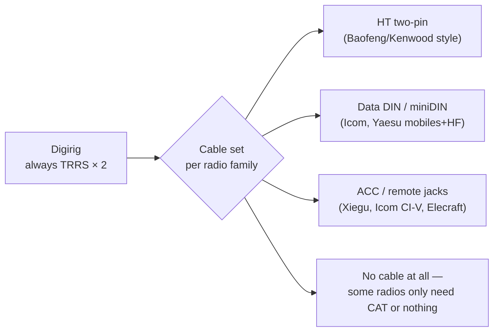

# Cables: where the difficult afternoons come from

Ask any Digirig forum regular where the difficult afternoons come from and you will get one word: cables. The box itself is close to fool-proof; the cable is where a hundred radio designs meet two 3.5 mm sockets, and where "it looks right" and "it is right" part company. This chapter gives you the map: how the cable system thinks, what your radio family needs, and the discipline that keeps cable trouble from ever reaching the air.

## How the cable system thinks

The Digirig side is always the same: up to two **TRRS 3.5 mm plugs** — one into the AUDIO socket (carrying transmit audio, receive audio and PTT), one into the SERIAL socket (carrying CAT, when used). The official line is that TRRS jacks were chosen "for simple homebrew cable builds": four contacts, standard plugs, no exotic connectors on the interface end, ever.

All the variety lives on the **radio end**, because that is where the variety exists in the world: Kenwood-style two-pin HT plugs, Icom data DINs, Yaesu 6-pin miniDINs, Elecraft TRRS jacks, bare-wire builds. Digirig sells a "growing collection of pre-made cables including popular Icom, Yaesu, Elecraft, Baofeng, Xiegu transceivers", and publishes compatibility notes mapping radios to cables and [serial configurations](outpost:entry/logbook73.guide.digirig/how-it-works).

## The three questions that choose your cable

1. **Which socket on the radio carries data audio?" ** The right answer is almost never the microphone jack if a data/accessory port exists: data ports bypass the mic preamp (built for a human voice an inch away, wrong for line audio) and often bypass speech processing too. HTs are the exception — their speaker-mic sockets are all they have, and the HT cables use them.
2. **How is PTT keyed on that socket?** Most data ports include a PTT pin the Digirig's switch closes. This is the pin that makes VOX unnecessary.
3. **Does the radio speak CAT, and in which dialect?** This decides whether you use the SERIAL socket at all, and which [serial configuration](outpost:entry/logbook73.guide.digirig/how-it-works) your unit must be. Remember the official reassurance: any configuration does audio+PTT with any radio — CAT is the only fussy part.

Answer those three from your radio's manual (the data-jack page) and the official compatibility notes, and the shopping is done.

## Family notes

**Handhelds (Baofeng, Kenwood-style two-pin, and friends).** The cable plugs into the speaker-mic socket; PTT is keyed by grounding the mic line through the same plug — which is why the cable, not the radio menu, does the keying. Two consequences: the HT's **VOX must be off** (the cable keys properly; VOX double-keys messily), and the **volume knob is your receive level** ([chapter 4](outpost:entry/logbook73.guide.digirig/levels)). These setups are audio+PTT only — an HT's "serial" is for memory programming, which is exactly what the default logic-levels configuration is for. This family plus sound-modem software is the classic budget [APRS](outpost:entry/logbook73.handbook/aprs) station, and the same wiring family a [DigiPi](outpost:entry/logbook73.guide.digipi/hardware) uses.

**HF radios with data/ACC sockets (Xiegu, Icom, Yaesu, Kenwood…).** The happy path: a proper data port with line-level audio in/out and a PTT pin, plus CAT on either the same connector family or a separate socket. Icom's CI-V "remote" jack wants the CI-V configuration; many Yaesu mobiles and older DB9-equipped rigs want RS-232; Elecraft's KX2/KX3 want RS-232 too, per the official mapping.

**Radios with built-in USB.** Modern rigs (IC-7300-class) contain their own sound card and serial port — for _those_, at the desk, a plain USB lead can replace an interface entirely. The Digirig earns its place with them when USB isolation trouble bites or when the station design wants one standard interface across every radio. No shame either way; this guide assumes you have a radio that needs it.

**The (tr)uSDX and other QRP oddities.** Small rigs have small sockets and their own conventions — the [(tr)uSDX guide](outpost:entry/logbook73.guide.trusdx/digital) covers that radio's audio-cable and USB paths in its own terms; a Digirig drives it via its audio jacks like any other rig when you prefer hardware PTT over VOX.

## Pinouts: the two traps

The official troubleshooting guide names both traps in one breath, and they account for most cable grief:

> "Similar looking cables can have different pinouts."

**Trap one: lookalikes.** A TRRS-to-two-pin lead for a _headset_ and one for a _Digirig_ are cosmetically identical and electrically different. Label your radio cables the day they arrive, and store them apart from consumer audio leads.

**Trap two: crossed expectations on serial.** Serial lines are named from each device's own point of view — "the radio's TX can be described as the interface's RX". A cable that "matches the pinout diagram" but reads the diagram from the wrong side swaps the data lines and produces perfect silence. The official diagnostic is the loopback: short TX and RX at the radio end of the CAT cable, type into a serial terminal, and your characters should echo back. Echo = the cable and Digirig are fine; the fault is beyond them.

**Home-brew builders** get first-class treatment — TRRS plugs were chosen for you — but earn the pinout responsibility that comes with it: work from the official pinout for your revision (1.11 connectors are compatible back to 1.6), from the radio's service page, and test with a meter before the first key-down.

## Buying and packing discipline

- **Buy the radio-specific set** unless you enjoy soldering; the pre-made families cover the popular Icom/Yaesu/Elecraft/Baofeng/Xiegu territory.
- **One bag per radio.** Cable, notes on which serial configuration the CAT lead expects, and the radio's data-jack settings on a card. Future-you at a windy picnic table will be grateful.
- **Strain relief matters at 3.5 mm scale** — these are small plugs carrying your whole station; loop and secure the leads so the sockets never take the tug.
- **A spare TRRS lead** for the loopback tests of [chapter 1](outpost:entry/logbook73.guide.digirig/getting-started) lives in the bag forever.

## When the cable arrives: the ten-minute acceptance test

1. **Look**: right plugs, right radio family, label it now.
2. **Receive path**: cable in, radio on a busy frequency, squelch open — band noise should reach the computer's recording meter ([levels](outpost:entry/logbook73.guide.digirig/levels) sets how much).
3. **PTT**: with the radio on a dummy load or low power on a clear frequency, software _Test PTT_ — the radio's TX indicator should follow it crisply. The official LED check applies for the whole chain: if the radio's status LED flips to transmit "in sync with the transmission time frame", PTT is proven.
4. **Transmit audio**: send a tone at modest level and watch the radio's power/ALC behaviour per [chapter 4](outpost:entry/logbook73.guide.digirig/levels).
5. **CAT last** (if used): correct COM port, correct baud, rig responds; if not, the [loopback test](outpost:entry/logbook73.guide.digirig/rig-control) splits cable from configuration in one move.

Pass all five and that cable never needs doubting again — which, in interface troubleshooting, is worth more than any single feature of the hardware.
