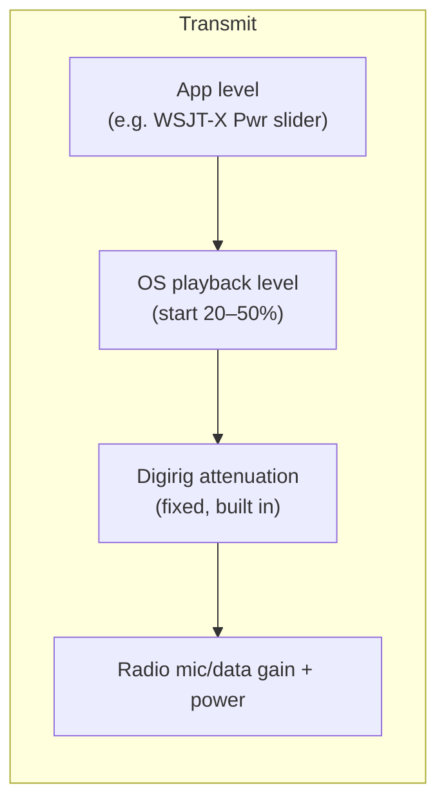

# Levels: how you sound on the air

This is the shortest important chapter in the guide. Audio levels are where digital-mode stations are won and lost: set them right and a five-watt signal decodes cleanly across an ocean; set them wrong and a hundred watts arrives as a wide, distorted smear that other operators mute on sight. The good news is that "right" is a fifteen-minute procedure you do once per station, and the signs of "wrong" are unmistakable once you know them.

## The chain, and who owns which knob

Between your software and the antenna, transmit audio passes four volume controls; receive audio passes three. Every one of them matters, and the golden rule is that **no stage should be near its maximum or minimum**:

- **The application's own output slider** (WSJT-X's _Pwr_, fldigi's TX attenuator) — your fine control, adjusted per band and day.
- **The operating-system playback level** for the Digirig device — the official starting point is **20–50%**, set once and mostly left alone.
- **The Digirig's built-in attenuation** — fixed hardware doing the coarse matching; not adjustable, not your problem.
- **The radio's own input gain and power setting** — set per the radio's data-mode documentation, then left alone.

Receive mirrors it: radio volume (or fixed-level data-out), OS recording level, application input meter.

## Setting transmit level: the ALC method

For HF radios the referee is the **ALC meter** — automatic level control, the radio's own "you are overdriving me" gauge. The universal procedure:

1. Radio into a **dummy load** (or minimum power on a clear frequency), data mode selected, meter switched to ALC.
2. Application transmitting a steady tone (WSJT-X _Tune_ button is made for this), app slider around three-quarters.
3. **Raise the OS playback level from low until RF output stops rising** — then check the ALC reading. The classic target for digital modes: **little to no ALC action**. On radios that show ALC as a bar, you want the bar barely flickering, not sitting proud.
4. Back the level off a touch from wherever ALC begins to rise. That is your setting. Note it on the radio's card in the cable bag.

Why so austere? Digital modes are already at full duty cycle; ALC exists to tame voice peaks, and when it works on a continuous tone it works by _distorting_ it. Distortion of a single tone becomes spurious tones — visible on the waterfall as bars beside your signal, audible to everyone as a wide signal. The [Modulation](outpost:entry/logbook73.handbook/modulation) chapter carries the theory; the waterfall carries the evidence.

**FM radios and HTs have no ALC** — their referee is deviation, which you can't easily meter. The practical method: start low, make a test transmission (APRS beacons are perfect — an [iGate's report of your packet](outpost:entry/logbook73.handbook/aprs-igates) is free feedback), and rise until decodes are reliable, then stop. Over-deviated FM packet sounds loud and decodes _worse_; more is not better.

## Setting receive level

Simpler, with one radio-specific fork:

- **Data-port radios**: the port's output is usually fixed line level — set the **OS recording level** so the application's meter sits comfortably in its recommended zone (WSJT-X likes around 30 dB on its scale with the band quiet; every app documents its target). Done once, stable forever.
- **HTs and speaker-jack radios**: the **volume knob is the level control**, which means it must live at a _marked position_ — find the spot where decodes are reliable, mark the knob with a paint pen, and treat "volume at the mark" as part of turning the station on. (Squelch open or off for data — squelch tails eat packet openings; the official troubleshooting list includes disabling squelch for exactly this reason.)

Too little receive audio and weak signals fall below the decoder's floor; too much and strong signals clip in the sound card — the meter in your application is the truth, not the loudness in the room.

## Reading the symptoms

| Symptom                                                                                 | Diagnosis                                                                                                   |
| --------------------------------------------------------------------------------------- | ----------------------------------------------------------------------------------------------------------- |
| Waterfall shows your signal with **sidebars/harmonics** at multiples of your audio tone | Transmit chain overdriven — find which stage is maxed                                                       |
| **ALC meter active** during data transmit                                               | OS or app level too high for the radio's input                                                              |
| Contacts report you "wide" or "distorted"                                               | Same, heard from the far end                                                                                |
| RF power **won't rise** as levels rise                                                  | You've hit a later stage's ceiling — usually correct behaviour; stop before ALC rises                       |
| Others decode you but **you decode little**                                             | Receive level too low/high — check the app's input meter against its target                                 |
| "**Sound card not ready**" or app sees no input                                         | OS privacy permission for the microphone ([chapter 1](outpost:entry/logbook73.guide.digirig/getting-started)), not a level at all |
| Everything perfect on the bench, distorted on air                                       | RF getting back into the audio — [chapter 9](outpost:entry/logbook73.guide.digirig/troubleshooting)'s ferrite kit                 |

One more official trick worth owning: **"Listen to this device"** (Windows) routes the Digirig's incoming audio to your speakers, so you can _hear_ what the computer receives — invaluable for telling "no audio arriving" from "audio arriving but the app is looking elsewhere". Turn it off afterwards; monitoring adds confusion in normal use.

## The philosophy, in one line

> Every knob in the middle of its range, ALC asleep, meters in their target zones — and then **stop touching it**.

Levels are not a performance you tune daily; they are a calibration you do once and record. The station that sounds clean tonight sounds clean in June because nobody "improved" it in March. Next: [pointing real software at the interface](outpost:entry/logbook73.guide.digirig/software).
