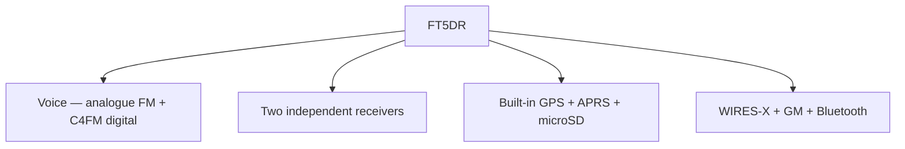
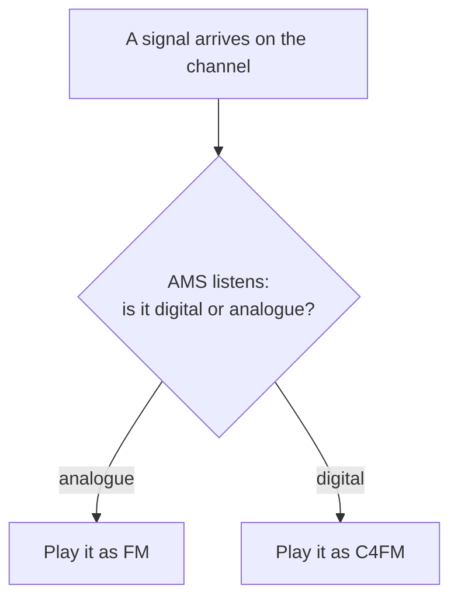

# Why the FT5DR (and who it is for)

The Yaesu FT5DR is a great deal of radio for something that slips into a jacket pocket. It is a dual-band handheld that talks both ordinary FM and Yaesu's own digital voice; it knows exactly where it stands thanks to a built-in GPS; it can beacon that position over APRS, link across the world through WIRES-X, stream its audio to a Bluetooth headset, and shrug off a rain shower on the way. All of that is real, and all of it is genuinely useful — but a radio this capable spreads its explanation across five separate manuals, and that is precisely where newcomers get lost. This guide gathers it back into one place and walks you through the whole set, plainly, one idea at a time.

## What the FT5DR actually is

Strip away the acronyms and the FT5DR is a **144/430 MHz dual-band handheld transceiver** — the 2 m and 70 cm amateur bands, the two bands a new licensee spends almost all their time on. It transmits FM and Yaesu's **C4FM digital** on both, at up to **5 W**, and it receives far more widely than it transmits. What sets it apart from a plain FM handie is the stack of features layered on top:

Taken one at a time:

- **Dual-mode voice.** Every channel can be plain [FM](outpost:entry/logbook73.handbook/modulation) or C4FM digital, and the radio can pick between them for you automatically (that is AMS, below). Digital voice sounds cleaner at the edge of range and carries data — your callsign, position and more — alongside the speech.
- **Two genuine receivers.** Most handhelds fake "dual watch" by hopping quickly between two frequencies. The FT5DR has **two independent receivers** and can truly listen to two channels at once — an A-band and a B-band, shown on two rows of the screen. You can sit on your local [repeater](outpost:entry/logbook73.handbook/repeaters) on one and keep half an ear on the [2 m](outpost:entry/logbook73.handbook/vhf) calling channel on the other.
- **A colour touchscreen and a keypad.** A 320 × 240 full-colour display you tap with a fingertip, backed up by a numeric keypad for typing frequencies directly. (It is a _resistive_ touchscreen, so it wants a firm, deliberate press rather than the feather-light swipe of a phone — and it works through gloves, which a phone screen does not.)
- **Built-in GPS.** A 66-channel receiver gives the radio its own position — used for the clock, for logging where you have been, and to feed APRS.
- **APRS.** A built-in packet modem (the [Automatic Packet Reporting System](outpost:entry/logbook73.handbook/aprs)) beacons your position and short messages over the air so they appear on maps worldwide. It has a proper 1200/9600 bps TNC and SmartBeaconing built in.
- **WIRES-X and GM.** WIRES-X links Fusion repeaters and hotspots across the internet, so a 5 W handheld can reach the other side of the planet. GM (Group Monitor) keeps track of which of your friends are in range.
- **Bluetooth and microSD.** Wireless audio to a headset, and a memory card for backups, GPS logs and firmware.
- **IPX7 waterproofing.** Rated to survive submersion in a metre of water for half an hour — in practice, it laughs off rain and a dropped-in-a-puddle moment.

## System Fusion and C4FM, at a glance

The one piece of jargon worth settling before anything else is **C4FM** and its bigger cousin **System Fusion**. C4FM ("Continuous 4-level FM") is Yaesu's brand of _digital voice_: instead of your voice riding on the radio wave as a wobble a human ear could recognise, it is turned into a stream of numbers, sent as data, and rebuilt at the far end. The full story — why digital voice exists, what it gains and gives up — is in [Digital Voice](outpost:entry/logbook73.handbook/digital-voice); here you only need the shape of it.

**System Fusion** is the wider ecosystem: C4FM radios, C4FM repeaters, and the WIRES-X network that links those repeaters over the internet. Buy into Fusion and your handheld can work a repeater down the road or a room full of operators in another country, in the same digital mode.

The clever part, and the reason a beginner need not fret about which mode a channel is in, is **AMS — Automatic Mode Select**. Switch AMS on and the radio listens to whatever arrives and matches it: an analogue signal comes out as FM, a digital one as C4FM, with no button-pushing from you.

Within C4FM there are two everyday voice modes, and it is worth knowing their names because they turn up throughout the menus:

- **DN** — labelled _V/D_ (Voice/Data) on the radio, and often called **Digital Narrow**. This is the standard mode. It splits the channel so half carries your voice and half carries error-correction and data (including GPS position). It is robust, it is what Fusion repeaters and WIRES-X expect, and it is the mode you will use 95% of the time.
- **VW** — labelled _Voice FR_ (Voice Full Rate), sometimes called **Voice Wide**. It hands the whole channel to voice for higher fidelity, but therefore carries **no data or GPS**. It is a simplex, direct-contact mode — not for repeaters — and it is switched **off at the factory**, so it does not even appear until you enable it. We will turn it on together later.

Do not memorise this. Just tuck away that DN is the normal one and VW is the "hi-fi but no data" one, and let AMS handle the rest.

## Two receivers, three "duals" — a heads-up

One thing worth flagging early, because it trips up almost everyone, is the word **dual**. The FT5DR uses it for three different features that beginners routinely merge into one:

- **Dual-band receive** — the two real receivers listening to two frequencies at once (the headline feature above).
- **AF DUAL** — a setting that lets you keep hearing, say, a broadcast FM station on one band while you monitor amateur traffic on the other.
- **Dual Receive (D.RCV)** — a _priority watch_ that peeks at one favourite channel every few seconds while you work another.

They are genuinely three separate things. You do not need to master them now; just know that "dual" on this radio is not one idea, so when a menu or a forum post says it, check which one they mean. We untangle all three in the dual-receive chapter.

## The FT5DR, the FT5DE and the FT5D

Here is a distinction that matters before you _buy_ one, not just before you use it. Yaesu sells what is essentially the same radio under three names for three markets, and they are **not** interchangeable:

| Model     | Market               | Transmit bands       | Notes                                       |
| --------- | -------------------- | -------------------- | ------------------------------------------- |
| **FT5DR** | US / North America   | 144–148, 430–450 MHz | Wider US band edges                         |
| **FT5DE** | Europe / UK / export | 144–146, 430–440 MHz | The one sold in the UK                      |
| **FT5D**  | Japan                | 144–146, 430–440 MHz | Japanese-market build, no overseas warranty |

The trap is the plain **FT5D** (Japan-market). Bought second-hand or from a grey-market seller by someone expecting the international model, it arrives set up for the Japanese market with Japanese-language documentation, no Yaesu warranty support outside Japan, and — the real sting — a **transmit inhibit** outside the Japanese allocations, so it simply will not key up where you expect. If you are buying in the UK you want the **FT5DE**; in the US, the **FT5DR**. This guide says "FT5DR" throughout for brevity, but everything applies equally to the FT5DE — the only real difference is the band edges, which follow your region's plan anyway.

Because band edges differ by region, wherever this guide names a frequency it points you back to **your national band plan and licence conditions**. The 2 m and 70 cm allocations are broadly similar across the world, but the exact edges — and what you may do within them — are set nationally, so treat the numbers here as the common core and confirm your own.

## Who the FT5DR is for

This is not a first-radio-for-a-tenner. It is a considered, premium handheld, and it suits a few kinds of operator especially well:

- **The newcomer who wants one radio to grow into.** If you would rather buy once and spend a year discovering what your radio can do than outgrow a basic set in a month, the FT5DR rewards that. Everything in this guide is something you can switch on when you are ready for it and ignore until then.
- **Anyone within reach of a Fusion repeater.** C4FM and WIRES-X are the reason many people choose Yaesu. If your local machine is a Fusion repeater, this radio speaks its language natively and opens up internet-linked operating from a handheld.
- **The APRS or GPS enthusiast.** A built-in GPS _and_ a proper APRS TNC in one waterproof package is a genuinely strong combination for hiking, cycling, events and mobile use.
- **The tinkerer.** With ~900 memories, microSD backup, Bluetooth and a deep tree of menus, there is a lot here to organise and optimise. If that sounds like fun rather than a chore, you will enjoy it.

If, on the other hand, you want the simplest possible push-to-talk on two bands and nothing more, the FT5DR will happily do that too — you will just be leaving most of what you paid for switched off. There is no shame in that, and this guide will not push you to use a feature you do not need.

## How to approach a radio this deep

The FT5DR's reputation for being "overwhelming" is not really about the radio — it is about how Yaesu documents it. The box contains a thin printed **Operating Manual** covering the basics, and everything else lives in downloads: a full **Advance Manual** with the complete menu tables, plus separate **APRS**, **GM** and **WIRES-X** editions. Five documents, each assuming you have read the others. No wonder the whole thing feels like more than it is.

Two habits keep it manageable.

**First, learn the menu's shape, not its contents.** The Setup Menu is not one endless list — it is **twelve named categories**, shown as tiles when you open it:

> DISPLAY · TX/RX · MEMORY · SIGNALING · SCAN · GM · WIRES-X · CONFIG · APRS · SD CARD · OPTION · CALLSIGN

You open it by **press-and-holding the top-left `[F MENU]` key** — that is the label silk-screened on the radio, though some of Yaesu's own documentation refers to the same key as `[DISP]`, an inconsistency worth knowing so the manuals do not confuse you. Crucially, **item numbers restart inside each category**, so "menu 5" means nothing on its own — you always have to say _which_ category. Throughout this guide we cite the category and the item name (for example, `TX/RX > DIGITAL > DIGITAL VW`), never a bare number. Once you know a setting lives under, say, APRS or DISPLAY, finding it is quick.

**Second, treat this guide as a reference you dip into, not a novel.** It is built in order but you need not read it that way:

- **Getting Started** orients you — the panel, the screen, the touchscreen, how to make your first contact. Read this one first.
- The **menu chapters** walk every setting group in turn, and each item gets the full treatment: what it does, why it exists, sensible values, and a plain verdict — **✅ set-and-forget · ⭐ useful, depends · ⚠️ advanced · ❌ leave off** — so you can skim for the ones that matter and skip the rest.
- The **feature chapters** (digital voice, APRS, WIRES-X, GM, dual receive) go deep on one thing at a time.
- **Practical setups** and **troubleshooting** are there for the "how do I…" and "why won't it…" moments.

Recommendations here lean towards **UK amateur practice** — the FT5DE is the model sold in the UK — but the concepts are universal, so if you are elsewhere, take the reasoning and apply your own band plan.

## A word on safety

A handheld is a transmitter held right next to your head, so a moment on safety is worth it — and none of it is alarming.

- **Never transmit without the antenna fitted.** A transmitter with nowhere to send its power can be damaged. Screw the supplied antenna in finger-tight, and use only the supplied or a proper replacement antenna — never a modified or damaged one, which Yaesu specifically warns against.
- **Keep the antenna away from your face and body when you key up.** Yaesu's precautions ask you to keep the radio a little away from your body while transmitting; the simple version is _don't press the antenna against your cheek_, and use the **lowest power that does the job** — you rarely need the full 5 W, and lower power is kinder to your battery and your neighbours on the band. The reasoning is in [RF Power](outpost:entry/logbook73.handbook/rf-power).
- **Mind medical devices and vehicles.** The manual cautions against transmitting close to a cardiac pacemaker, and against operating the radio while actually driving a car or riding a bike — pull over first.
- **You do not need a licence to listen, but you do to transmit.** Every receive-only thing in this guide is legal to do unlicensed; transmitting is not. If you are not yet licensed, [Getting Licensed](outpost:entry/logbook73.handbook/getting-licensed) explains how, and everything here still teaches you the radio in the meantime.

## Try it yourself

You can do all of this before you know a single menu — it is just orientation.

1. **Charge the battery fully** and fit the antenna finger-tight. Power on by pressing and holding the power switch, then set a comfortable volume with the top VOL knob.
2. **Find the two rows.** Notice the display shows two frequencies stacked — that is the A-band and the B-band, the two real receivers. Press `[A/B]` and watch which row goes bright: that is the one you are about to control.
3. **Type a frequency.** Touch the frequency on the active row, then tap `1 4 5 5 0 0` on the keypad to land on 145.500 MHz — the 2 m FM calling channel in much of the world (check your own band plan). Listen for a few minutes at a busy time.
4. **Open the Setup Menu.** Press-and-hold the top-left `[F MENU]` key and watch the twelve category tiles appear. Tap into `DISPLAY`, have a look, and press `[BACK]` (or the PTT) to bail out. Nothing you _view_ changes anything — you can explore freely.
5. **Peek at the firmware.** In `DISPLAY > SOFTWARE VERSION` you will see a Main and a Sub version number. Jot them down; you will want them later when we talk about updates.

## Key takeaways

- The FT5DR is a **144/430 MHz dual-band handheld** doing both analogue **FM** and Yaesu **C4FM digital**, at up to **5 W**, with two real receivers, a colour touchscreen and keypad, and an IPX7 waterproof case.
- Its standout extras are **GPS, APRS, WIRES-X, GM, Bluetooth and microSD** — capable features you can enable one at a time and ignore until you want them.
- **C4FM** is Yaesu's digital voice; **System Fusion** is the wider network; **AMS** picks FM vs digital for you automatically, and **DN** is the everyday digital mode while **VW** is a hi-fi, no-data simplex mode that ships switched off.
- Mind the **model split**: FT5DR (US), FT5DE (UK/EU — the one to buy here), and the grey-market FT5D (Japan) that arrives transmit-inhibited outside Japan.
- The radio feels deep only because Yaesu splits its documentation across five manuals; learn the **twelve-category Setup Menu shape** (numbers restart in each category) and treat this guide as a dip-in reference.
- Basic safety is simple: **antenna always fitted, kept off your face, lowest power that works**, and transmit only within your licence conditions.

With the radio in your hand and the big picture in place, the next step is to get properly oriented — the controls, the screen and your first contact — in [Getting Started](outpost:entry/logbook73.guide.ft5dr/getting-started).

---

_Firmware-specific statements in this guide were last verified against Yaesu's published FT5D releases (the v2406 line) in **July 2026**. Check Yaesu's downloads page for anything newer before updating._
