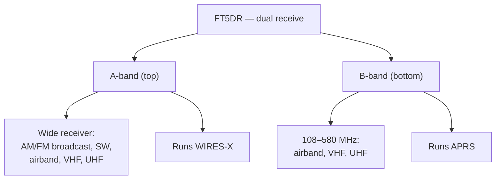
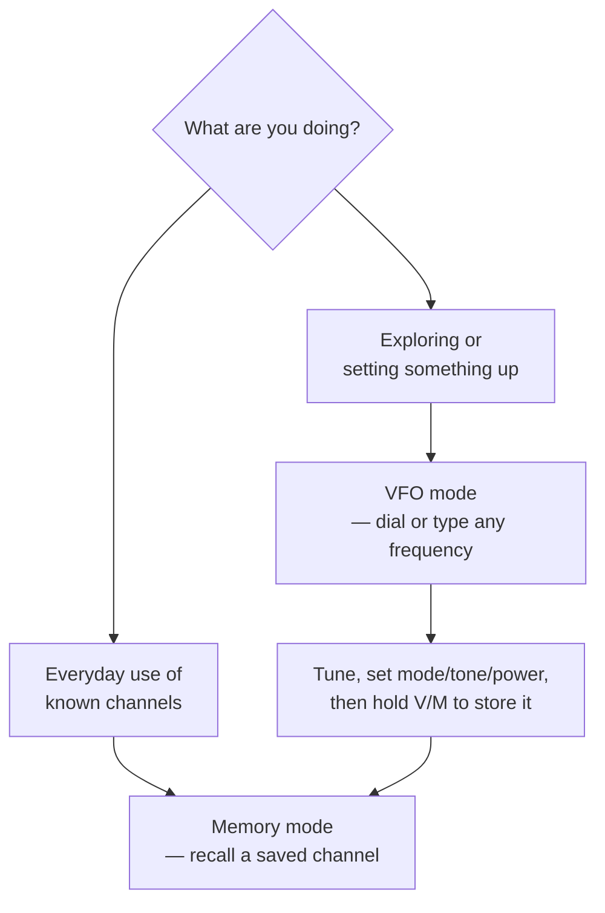
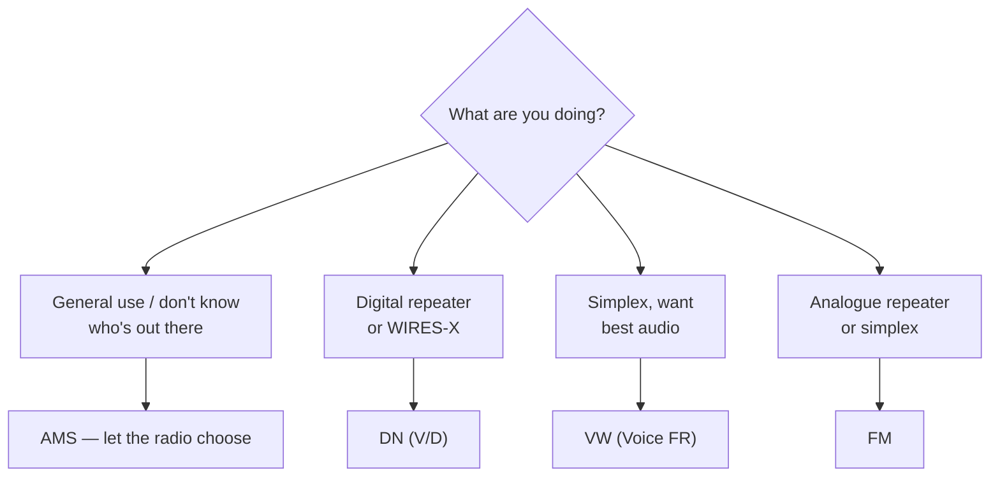

# Getting started: controls, touchscreen and first steps

The FT5DR looks daunting the first time you pick it up — a colour touchscreen, a numeric keypad, two knobs, a stack of keys and two frequencies staring back at you at once. It is not, in fact, complicated to _drive_; it is deep, which is a different thing. Spend twenty unhurried minutes learning what each control does, what the screen is telling you, and the handful of ideas the whole radio is built around — bands, VFO versus memory, the C4FM modes — and everything after it becomes obvious. That is what this chapter is for.

## What's in the box, and the options worth knowing

Before we touch a control, know what you should have in front of you. Yaesu pack the FT5DR with everything you need to get on the air: the radio, the **SBR-14LI** lithium-ion battery pack (7.2 V, 2,200 mAh), the **SAD-25** desktop charger, the antenna and a belt clip, a **Quick Release Holster (SHB-26BK)**, a USB cable, a protective cap for the battery's contacts, and two booklets — the slim Operating Manual and a separate one for the battery. The pack ships loose in the box rather than fitted, so fish it out before you assume it is missing.

The holster fits with the two supplied **black** screws, the belt clip with the two supplied **silver** ones — use only those, because the wrong screw can let the clip work loose and drop the radio.

The rest is optional, and you needn't buy any of it to start. The ones worth knowing:

| Want to…                       | Reach for                                                                                                                                                |
| ------------------------------ | -------------------------------------------------------------------------------------------------------------------------------------------------------- |
| Talk hands-free or on the move | Speaker-mic **SSM-17A**, earpiece mic **SSM-57A**, VOX headset **SSM-63A**, or Bluetooth headset **SSM-BT20**                                            |
| Send a picture over the air    | Camera speaker-mic **MH-85A11U**                                                                                                                         |
| Run from a vehicle             | Cigarette-lighter lead **SDD-13**, or the bare DC cable **E-DC-6**                                                                                       |
| Charge in a hurry              | Rapid charger **SBH-52** (or **CD-41**)                                                                                                                  |
| Fall back on shop batteries    | 3×AA cell case **FBA-39**; a spare **SBR-14LI**, or the slim **FNB-101LI** (7.4 V, 1,100 mAh)                                                            |
| Carry or protect it            | Soft case **SHC-40**, or belt clip **SHB-13**                                                                                                            |
| Wire it to other kit           | WIRES-X connection cable kit, cloning cable **CT-168**, data cables **CT-170** / **CT-176** (2.5 mm), TNC adapter **CT-44**, BNC-to-SMA adapter **CN-3** |

Don't be daunted by the list — most owners run the radio for years on nothing but what came in the box.

## The controls, in prose

There is a lot on this radio, but every control earns its place, and they fall into tidy groups. Don't try to memorise them — get a feel for where your thumb lands, and let the names settle in as we use them.

**On top** sit the aerials, the knobs and the power switch. The main **antenna** screws into a female **SMA** socket; fit the supplied whip finger-tight (turning it clockwise by the thick base, never by the slim upper part, which can break the conductors inside) and _never transmit without it_ — a transmitter with nowhere to send its power can damage itself. Beside it is the small **GPS antenna**. Then two separate knobs: the **DIAL** knob, which tunes the frequency (or steps through memory channels), and the **VOL** knob, which sets the volume — that is _all_ the VOL knob does, a mercy on a radio this feature-rich. The **Power (Lock) switch** turns the radio on or off with a press-and-hold, and — once it is on — locks and unlocks the controls with a quick press.

**Down the left edge** are the keys your left hand finds without looking. The big **PTT** (push-to-talk) switch is the transmit button: hold it and speak, release it to listen. Below it, the **MONI/T-CALL** key does one of two jobs, and which one is only a _default_, not a fixed fact of your radio: out of the box, UK/European sets send a **1750 Hz tone burst** (an older way of waking some repeaters), while US sets **open the squelch** to let you hear a signal too weak to break through on its own — and **CONFIG → 10 MONI/T-CALL** in the Setup Menu swaps the key to whichever job you prefer, on any version ([Operating Basics](outpost:entry/logbook73.guide.ft5dr/operating-basics) weighs the choice). Under that, the **SQL** key sets the squelch: press it, then turn VOL.

**On the front** is the star of the show: a **320 × 240 full-colour touch panel**. It is a _resistive_ touchscreen, not the capacitive glass of a phone, so it wants a firm, deliberate press — a fingernail, a stylus or a gloved fingertip all work, a feather-light tap often will not. Below the screen sits a small **speaker**, and below that two rows of physical **operation keys** — seven of them — that do the heavy lifting. Most have a _second_ job on a press-and-hold:

| Key        | Press                                           | Press and hold                               |
| ---------- | ----------------------------------------------- | -------------------------------------------- |
| **F MENU** | Toggle the on-screen function menu              | Open the **Setup Menu**                      |
| **A/B**    | Swap the operating band (A ↔ B)                 | Toggle **dual-band** ↔ **mono-band** receive |
| **BAND**   | Step up through the frequency bands             | —                                            |
| **GM/X**   | Turn **GM** (Group Monitor) on/off              | Start **WIRES-X** (hold again to leave it)   |
| **V/M**    | Swap **VFO** (frequency) ↔ **memory** (channel) | Write the current setup to a memory          |
| **PMG**    | Cycle **PMG** ↔ memory ↔ VFO                    | Write to a PMG (favourites) slot             |
| **BACK**   | Step back to the previous screen                | —                                            |

One label quirk to know now, because it can otherwise confuse you: Yaesu's own documents are not perfectly consistent about this key's name. The Operating Manual in the box calls the top-left button **[F MENU]**, and that is the name this guide uses throughout — but you will see the very same physical key written as **[DISP]** in some Yaesu material (and **DISP** turns up separately as an on-screen soft key too). While we are on the subject of manuals: the box holds only a slim Operating Manual, and the radio's deepest features — **WIRES-X**, **GM** and **APRS** — each come as their own _download-only_ manual from Yaesu's website. This guide pulls them together in the chapters ahead, so you needn't juggle five separate PDFs.

**Behind a rubber flap on the right edge** are four connectors, kept under waterproof caps: the **MIC/SP jack** (external speaker-microphone or earpiece), the **DATA terminal** (for the optional camera-microphone, cloning to another FT5DR, or a USB cable for _firmware updates_ — not for everyday programming), the **microSD card slot**, and the **EXT DC IN** jack for charging and external power. With the antenna, battery and all four rubber caps seated, the radio meets **IPX7** — proof against rain, splashes and a brief accidental dunk. But note two things the rating does not cover. First, the moment you plug a speaker-microphone, earpiece or cable into the **MIC/SP jack**, the seal is broken and the dust-and-splash protection stops. Second, the set is not _truly_ waterproof and must never be deliberately immersed — never in seawater, pool or hot-spring water, nor anything carrying soap, detergent, bath additive, alcohol or chemicals; if it does meet seawater, sand or dirt, rinse it under fresh water and dry it with a soft cloth. Leave a cap open and even the splash promise lapses, so press them home — and Yaesu offer an annual (fee-based) waterproof-maintenance check if you lean on the radio in the wet.

Finally, above the screen is the **TX/BUSY LED**. It glows **red** while you transmit — a reassuring glance to confirm the PTT has taken — and while you _receive_ it tells you the mode: **blue** for a C4FM digital signal, **green** for analogue FM.

## Reading the touchscreen

The screen looks busy because it is showing you two radios stacked one above the other. Learn the anatomy of one row and the status bar, and the rest falls into place.

```viz
{
  "type": "display",
  "title": "FT5DR — the dual-band standby screen",
  "caption": "Two independent receivers, stacked. The operating band (A here, in white) is the one the PTT, DIAL and menus act on; the sub-band (B, greyed) keeps listening. Every icon around the numbers is a live setting.",
  "screen": {
    "rows": [
      { "vfo": "A", "freq": "145.000", "mode": "FM", "active": true },
      { "vfo": "B", "freq": "433.000", "mode": "FM" }
    ],
    "topIcons": ["GPS", "SD", "BT", "100%"],
    "bottomTags": ["M▸V", "TX AUTO", "MODE"]
  },
  "callouts": [
    { "n": 1, "x": 22, "y": 3, "label": "Status bar", "side": "left" },
    { "n": 2, "x": 8, "y": 20, "label": "A-band (operating)", "side": "left" },
    { "n": 3, "x": 42, "y": 22, "label": "Frequency", "side": "left" },
    { "n": 4, "x": 90, "y": 20, "label": "Mode icon", "side": "right" },
    { "n": 5, "x": 8, "y": 56, "label": "B-band (sub)", "side": "left" },
    { "n": 6, "x": 58, "y": 42, "label": "S-meter", "side": "right" },
    { "n": 7, "x": 26, "y": 95, "label": "Soft keys", "side": "left" }
  ]
}
```

1. **The status bar** runs along the very top: the battery gauge (in eight steps) and icons that appear as features switch on — a **padlock** when the controls are locked, a speaker-with-slash when the sub-band is muted, plus **AF-DUAL**, **APO** (auto power-off), **DTMF**, **GPS** (solid when locked, blinking while acquiring), **LOG**, **SD** and **Bluetooth**.
2. **The A-band** is the top row. Its frequency is shown in **white** because A is currently the _operating band_ — the one the PTT, DIAL knob and menus act on.
3. **The frequency** is the big number: what that band is tuned to.
4. **The mode icon** sits to the right of the frequency and tells you how the radio is treating the signal — `FM` for analogue, `DN`/`VW`/`DW` for the digital modes, `AM` for the airband. A small bar _above_ the icon means AMS is active (more on that shortly).
5. **The B-band** is the bottom row, shown in **grey** to mark it as the _sub-band_ — still listening, but not the one your controls are pointed at. A tap on its frequency, or a press of **A/B**, makes it the operating band and swaps the colours.
6. **The meter** below the operating frequency is the **S-meter**, showing received signal strength in ten steps; when you transmit it becomes the **PO meter**, showing your output power in four steps. A `VOL`/`SQL` bar appears briefly here when you adjust either.
7. **The soft keys** along the bottom edge are on-screen buttons you touch: **M▸V** (copy a memory to the VFO), **TX AUTO** (set the transmit mode), and **MODE** (choose the communication mode). Press **F MENU** and the row is replaced by two pages of function buttons — TXPWR, SCAN, DG-ID, MEMORY and the rest — every one of which is decoded in [The Function Menu](outpost:entry/logbook73.guide.ft5dr/function-menu).

## Powering on and entering your callsign

With a charged battery and the antenna fitted, **press and hold the Power (Lock) switch** until the radio wakes. The very first time you power it on, the FT5DR insists on something no cheap radio would: it shows a **`CALLSIGN INPUT`** screen and will not go further until you type your callsign. Use the on-screen alphabet — touch the arrows to move the cursor, the ✕ to delete — and enter up to ten characters (capital letters A–Z, numbers 0–9, hyphen and slash). Save with a press of the **PTT** switch (or a hold of **F MENU**).

This matters because your callsign is your station's _identity_ to the radio — it is embedded in your C4FM digital transmissions and used by GM and [WIRES-X](outpost:entry/logbook73.handbook/digital-voice). If you are not yet licensed you have no callsign to enter and no business transmitting yet, but every _receiving_ thing in this chapter is legal to do meanwhile ([Getting Licensed](outpost:entry/logbook73.handbook/getting-licensed) explains how to earn the right to key up). You can change it later from the Setup Menu's **CALLSIGN** category, and the radio asks again after a full reset.

## Volume and squelch

The **VOL** knob sets the audio level, **separately for each band** (and separately again for the AM and FM broadcast bands), so a quiet A-band does not mean a quiet B-band. Turn it to a comfortable level on whichever band you are listening to.

**Squelch** is the gate that keeps the speaker silent when nothing is being received, so you are not listening to hiss all day. To set it: press the **SQL** key, rotate **VOL** until the background noise _just_ falls silent, and press **SQL** again (or wait three seconds) to save. The factory setting is level **1** (level **2** for FM broadcast). ✅ Set it just high enough to mute the hiss and no higher — too far and the gate also blocks weak, wanted signals, leaving you wondering why the radio has gone "deaf". Squelch, too, is set per band.

## Two receivers: choosing the operating band

Here is the FT5DR's headline trick, and the thing that trips up newcomers most. It has **two genuinely independent receivers**, so it can listen to two frequencies _at the same time_ — not the fast back-and-forth "dual watch" of a cheaper radio, but two real receivers running at once. They are shown as the **A-band** (top) and **B-band** (bottom).



Only one band is the **operating band** at a time — the one shown in **white**, the one your PTT, DIAL and menus act on. The other is the **sub-band**, shown in grey; it keeps listening. Press **A/B** to swap which is which, or simply **touch** a frequency to make it the operating band. When both bands are receiving at once and a signal opens the operating band, the radio automatically **mutes the sub-band** so you are not swamped by two conversations.

The two receivers are not equals. The **A-band is the wide-coverage one** — it alone reaches down to AM and FM broadcast and shortwave, up through the airband, VHF and UHF (roughly 0.5 MHz to nearly 1 GHz, with the US cellular block gapped out). The **B-band covers 108–580 MHz**. Two roles are pinned to a specific band, so remember them: **WIRES-X runs only on the A-band**, and **[APRS](outpost:entry/logbook73.handbook/aprs) runs only on the B-band**. Both bands transmit only where your licence allows — on the 144 MHz ([2 m](outpost:entry/logbook73.handbook/vhf)) and 430 MHz ([70 cm](outpost:entry/logbook73.handbook/uhf)) amateur segments.

To simplify things while you learn, **press and hold A/B** to collapse to a **mono-band** display — one band, full screen. Hold it again to go back to dual.

## Selecting a frequency band

Each of the two receivers can be pointed at a different chunk of spectrum with the **BAND** key. A press steps _up_ through the bands available to that receiver — on the A-band that runs AM broadcast → FM broadcast → shortwave → 50 MHz → airband → 144 MHz → VHF → 430 MHz → UHF, and wraps around. If some of those bands are only clutter to you, hide them later via **CONFIG → BAND SELECT** in the Setup Menu, so the key only cycles the ones you use.

## VFO and memory: the two ways to tune

Every radio like this offers two ways to reach a frequency, and the **V/M** key swaps between them.



**VFO (frequency) mode** gives you the whole band to roam: dial with the knob or type a frequency on the keypad. This is where you _set things up_ — find a repeater, choose its mode, add its tone and shift, pick a power level — before saving the result.

**Memory (channel) mode** recalls those saved channels. A memory is not just a frequency; it stores the mode, tones, repeater shift, power and a name in one recall, so you spin straight to "GB3 local" with everything already correct. The FT5DR has a _large_ memory — **900 regular channels** (over 1,200 once you count home, skip-scan, band-edge and the preset marine channels), organised into **24 nameable banks**. To store what you have dialled up, hold **V/M**, turn the **DIAL** to a channel number, and touch **M.WRITE**; memory mode is empty until you have saved at least one.

Alongside the ordinary memory there is **PMG** — a "Primary Memory Group" of your favourites. Press the **PMG** key and the radio shows those channels as a live **bar graph of signal strength**, so you can see at a glance which is active and **touch a bar to jump straight to it** (Yaesu calls this Touch & Go). And in memory mode, pressing **BAND** invokes **MAG** (Memory Auto Grouping), which automatically filters the memory list down to one band at a time — handy once you have hundreds of channels. Both are explored in the [Menu Reference](outpost:entry/logbook73.guide.ft5dr/menu-reference); for now, just know the keys exist.

## Tuning: the dial, the keypad and the step

In VFO mode you tune the operating band two ways. The **DIAL** knob steps the frequency by the current **step size** (and, from the function-menu view, in fast 1 MHz jumps). For a known frequency it is quicker to type it: **touch and _hold_ the big frequency digits on the screen** — hold, not tap — and after a moment a numeric keypad pops up. To enter 145.520 MHz you press `1 4 5 5 2`; for a round 430.000 MHz, `4 3` then `ENT`. A press of PTT or any key cancels a half-typed entry.

That **hold-versus-tap distinction on the frequency display** is the single thing most new owners wish someone had told them on day one, so here it is spelled out — a quick tap does something _different_ from a hold, and none of it is labelled on screen:

| Touch                                              | What happens                                                                                                    |
| -------------------------------------------------- | --------------------------------------------------------------------------------------------------------------- |
| **Touch and hold** the white (operating) frequency | The **numeric keypad** opens — type any frequency directly. Works on the dual-band and mono-band screens alike. |
| **Tap** the grey (sub-band) frequency              | That band becomes the **operating band** — same as pressing [A/B]                                               |
| **Tap** the white frequency (in memory mode)       | The display **toggles between the memory-tag name and the raw frequency** for your channels                     |

So if you tap the frequency expecting a keypad, the display will appear to "change" instead — you have either swapped bands or flipped the tag display. Nothing is broken: hold, don't tap, and the keypad comes.

The **frequency step** is where the dial "stops" as you tune — the spacing of the grid. It lives at **CONFIG → STEP** and ships on **AUTO**, which picks a sensible step for whatever band you are on, and is the right answer for almost everyone (✅). You would only override it to match an unusual channel plan: the amateur bands sit on a 12.5 kHz (or 25 kHz) grid, the European VHF airband moved to 8.33 kHz, and so on. The step changes only _where the dial lands_ — not your transmit bandwidth, which is a separate setting.

## Selecting the communication mode (AMS, DN, VW, FM)

This is the part that makes the FT5DR a _Fusion_ radio rather than a plain FM handheld, and it rewards a careful read. There are several modes, and the **MODE** soft key cycles through them.

The everyday answer is **AMS — Automatic Mode Select**. Touch **MODE** until a small **bar appears above the mode icon**: that bar means AMS is on. With AMS running, the radio _listens to each incoming signal and switches itself_ to match — analogue FM or one of the digital modes — and the icon changes to show what actually arrived (`FM`, `DN`, `VW`, `DW`). You never have to guess whether the station calling you is analogue or digital; the radio just follows. For general use, leave AMS on and forget it (✅).



If you want to _fix_ the mode instead of letting AMS pick, touching **MODE** steps through them:

| Mode   | Icon | What it is                                                                                                                                                                                                                                              |
| ------ | ---- | ------------------------------------------------------------------------------------------------------------------------------------------------------------------------------------------------------------------------------------------------------- |
| **DN** | `DN` | **V/D — Voice/Data.** The standard, robust digital mode: it splits the 12.5 kHz channel into voice plus a data stream carrying error-correction and your GPS position. This is the mode digital repeaters and WIRES-X expect.                           |
| **VW** | `VW` | **Voice FR — Voice Full Rate.** Uses the _whole_ channel for voice, so it sounds richer — but carries **no data or GPS**. A simplex, direct-contact mode. **Disabled by default**; switch it on at TX/RX → DIGITAL → DIGITAL VW = ON before it appears. |
| **FM** | `FM` | Ordinary analogue FM, for analogue repeaters, simplex and PMR-style contacts.                                                                                                                                                                           |
| **AM** | `AM` | Receive-only, selected automatically in the airband (108–137 MHz) when the RX mode is AUTO.                                                                                                                                                             |
| **DW** | `DW` | High-speed data — the radio drops into it by itself while sending a camera image; you never pick it by hand.                                                                                                                                            |

There is one more subtlety worth grasping: **the mode you transmit in is set separately from the mode you receive in.** The **TX AUTO** soft key controls your transmit behaviour and cycles through three states:

| Transmit setting      | On receive                      | On transmit                                  |
| --------------------- | ------------------------------- | -------------------------------------------- |
| **TX AUTO** (default) | AMS follows the incoming signal | Transmits in whatever mode AMS last detected |
| **TX FM**             | AMS follows the incoming signal | _Always_ analogue FM                         |
| **TX DN**             | AMS follows the incoming signal | _Always_ digital DN                          |

That split lets you monitor a mixed analogue-and-digital channel while pinning your _own_ transmissions to one mode — useful if, say, a net is analogue-only but you want the radio to keep decoding digital callers. For general operating, **AMS + TX AUTO** is the set-and-forget pairing (✅). The whole idea of digital voice — what it gains and gives up against plain FM — is unpacked in [Digital Voice](outpost:entry/logbook73.handbook/digital-voice).

## Transmitting

To transmit, **press and hold PTT** and speak across (not into) the microphone, holding the radio a few centimetres from your face. The **TX/BUSY LED glows red** while you are keyed up; release PTT to return to receive. If you try to transmit _outside_ the amateur bands, the radio refuses — it beeps an alarm and shows **`TX INHIBIT`**, which is exactly the behaviour you want. Hold a very long transmission and its thermal protection quietly drops you to low power, then back to receive; ease off and it recovers.

Two habits make you a good neighbour: use the **lowest power that does the job** (next section), and keep the antenna away from your head. Yaesu put a figure on that second one — when transmitting, keep the radio at least **5.0 mm (3/16 inch)** from your body, and use _only_ the supplied antenna, never a modified or damaged one. A little more caution rounds it out: don't key up hard against a pacemaker or other medical device, or in a tight crowd, and if a thunderstorm builds, switch off and unplug any external antenna. That is the whole of RF safety for a handheld; the reasoning is in [RF Power](outpost:entry/logbook73.handbook/rf-power).

## Changing the transmit power

Press **F MENU**, touch **TXPWR**, and turn the **DIAL** to choose your output; save with **PTT**. There are four levels:

| Level    | Output |
| -------- | ------ |
| **HIGH** | 5 W    |
| **LOW3** | 2.5 W  |
| **LOW2** | 1 W    |
| **LOW1** | 0.1 W  |

⭐ Run the **lowest level that reliably reaches** where you are trying to get to. Full power flattens the battery faster, runs the radio hotter and spreads your signal further than a local contact needs. Power is set **per band**, so the A- and B-bands can differ. (Fit the optional AA battery tray and the radio is limited to the two lowest levels, about 0.9 W and 0.3 W.)

## Locking the keys and dial

A handheld lives in a pocket, where the touchscreen and DIAL are easily nudged. A quick **press of the Power (Lock) switch** shows **`LOCK`**, puts a padlock on the display, and freezes the keys and DIAL; press it again for **`UNLOCK`**. ⭐ Get into the habit before it goes in a bag. Exactly _what_ gets locked is configurable at **CONFIG → LOCK** (the default is keys and dial together; you can add or exclude the PTT). The **MONI/T-CALL** key, the **SQL** key and the **VOL** knob stay live even when locked, so you can never mute or deafen yourself by accident.

## Inserting and using a microSD card

A microSD card gives the FT5DR a memory of its own: a **full backup of your settings and memories**, **voice recordings**, **GPS track logs**, camera **snapshots**, and messages saved from GM and WIRES-X. It is the best insurance you can buy — a full reset wipes all 900 memories, and with a card that is a five-minute restore rather than an evening's re-programming.

A few rules keep it trouble-free:

- **Power the radio off first**, every time you insert or remove a card — the slot is under the right-side rubber flap; push the card until it clicks. Then power back on and an **SD** icon confirms it is seen.
- The radio accepts **2, 4, 8, 16 or 32 GB** cards only. Larger cards are not supported.
- **Format the card in the radio before first use**: hold **F MENU → SD CARD → FORMAT → OK** (twice). A card formatted on a computer is often not recognised, and formatting erases everything on it, so use a fresh card.
- A real-world caveat from owners: some **32 GB cards behave unreliably** in this radio — it creates the folder structure but silently writes no files. If you hit that, an **8 GB** card is the commonly recommended sweet spot. This is unit- and firmware-dependent, so treat it as "if it misbehaves, try a smaller card" rather than a rule.

## Charging the battery

**Charge the battery fully before first use.** The supplied **SAD-25** desktop charger plugs into the **EXT DC IN** jack and takes about **nine hours** for a full charge. With the radio on while charging, the A-band **TX/BUSY LED lights red** and the screen shows **`Now Charging`** with a bar; when it finishes, the display reads **`CHGFUL`** and the LED turns green. (On US-version radios the LED stays dark during charging, and the set switches itself off a few minutes after completion.) Charge within **+5 to +35 °C** for the battery's health. If instead you see **`CHGERR`** on the display, and the pack still is not charged after ten hours or more, stop charging straight away — the battery is presumed to be at the end of its service life or defective, and should be replaced.

For a faster turnaround, the optional rapid charger — the **SBH-52** (or **CD-41**) — refills the SBR-14LI in about five hours: feed the supplied charger's DC plug into the jack on the rapid charger's rear panel, then sit the radio (or the bare pack) in the cradle. Its red **CHARGING** LED lights while it works and a green **FULL** LED shows when it is done; a blink from the red LED before completion is normal, not a fault. In a vehicle, the optional **SDD-13** cigarette-lighter lead runs the radio from the car — just don't feed the EXT DC IN jack anything outside Yaesu's specified voltage, and remember the **supplied USB cable is for firmware updates, not charging or programming**.

### How long a charge lasts

Running time depends most on how much you talk, but Yaesu's own figures give a fair yardstick. They assume digital is switched off and a fairly gentle duty cycle — six seconds transmitting at 5 W, six seconds receiving (volume around 16), then forty-eight seconds on standby with the battery-saver set to 1:5:

| Battery                         | 144 MHz | 430 MHz |
| ------------------------------- | ------- | ------- |
| **SBR-14LI** (supplied)         | ~9.5 h  | ~8 h    |
| **FNB-101LI** (slim)            | ~4.5 h  | ~4 h    |
| 3×AA alkaline in the **FBA-39** | ~12 h   | ~11 h   |

Real figures vary with use, temperature and settings — switch digital on, hold long overs at full power, or leave the backlight bright, and they fall.

## Try it yourself

With a charged battery and the antenna fitted:

1. **Power on and enter your callsign** (or, if you are not yet licensed, just explore — the radio still receives). Set the volume, then press **SQL** and turn **VOL** until the hiss just mutes.
2. **Tell the two bands apart.** Press **A/B** and watch the white/grey highlight swap between the top and bottom rows. Hold **A/B** to collapse to a single band, then hold it again to bring both back.
3. **Type a frequency.** In VFO mode (press **V/M** until the memory tags vanish), touch and hold the operating frequency, and key in `1 4 5 5 0 0` for the 2 m calling channel 145.500 MHz. Listen at a busy time of day.
4. **Feel the modes.** Touch **MODE** and watch the icon cycle — find the AMS bar, then the fixed `FM` and `DN`. You have just met the C4FM heart of the radio.
5. **Drop the power.** Press **F MENU → TXPWR** and set **LOW2 (1 W)**. For most local work you will never need more.

Nothing here can harm the radio, and **BACK** always steps you home.

## Key takeaways

- The **two knobs** are DIAL (tune / select) and VOL (volume only); the **Power (Lock) switch** turns the radio on with a long press and locks the controls with a short one.
- The **seven operation keys** — F MENU, A/B, BAND, GM/X, V/M, PMG, BACK — most of them carrying a second job on a press-and-hold; the resistive **touchscreen** wants a firm, deliberate press.
- The FT5DR has **two real receivers**: the white **operating band** is where your controls act, the grey **sub-band** keeps listening. WIRES-X lives on A, APRS on B.
- **VFO mode** dials any frequency (for setting up); **memory mode** recalls saved channels (for daily use), and there are 900+ of them across 24 banks.
- **AMS** lets the radio choose analogue FM or digital automatically — the set-and-forget default; **DN** is the everyday digital mode, **VW** is high-fidelity simplex (off by default), and your **transmit** mode is set separately with **TX AUTO**.
- Run the **lowest transmit power that works**, **lock** the keys before pocketing the radio, and fit a **microSD card** (8 GB is a safe size) so a reset never costs you your memories.

Now you can find your way around the radio, the next step is the map of everything the Setup Menu can do — its twelve categories and how to read them — in the [Menu Reference](outpost:entry/logbook73.guide.ft5dr/menu-reference).
