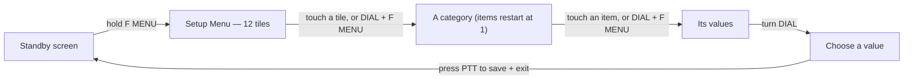
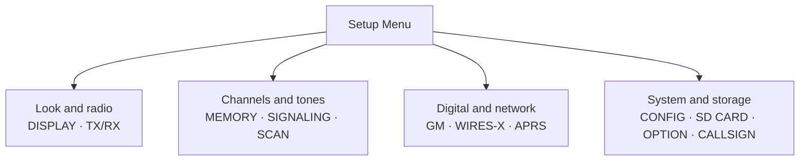

# Menu reference — settings at a glance

This is the map of the whole radio. The FT5DR's Setup Menu holds well over a hundred settings, and Yaesu spreads the explanations across five separate manuals — so this one page gathers every item into one tidy table per category, each with a one-line description and a sensible starting value. Use it two ways: as a **quick reminder** when you half-remember what a setting does, and as an **index** into the deep-dive chapters when you want the whole story.

## How to open the Setup Menu

Everything below lives behind a single button. **Press and hold the top display/menu key** and the Setup Menu appears as a grid of twelve labelled tiles. That key is a small source of confusion before you even start: Yaesu's own documentation refers to the same physical button under **two names — [DISP] and [F MENU]** — and the two even turn up in different places within the same book (the Operating Manual's own Setup Menu section uses [F MENU]). They are the same key. We will write it **[F MENU]** throughout, so if your radio or a forum post says [DISP], read it as the same button.

One more disambiguation before you dive in: a **short press** of that same key opens a completely different menu — the two-page **function menu** of on-screen action keys (SCAN, HOME, REV, TXPWR and friends). This chapter is the _long-press_ world of settings; the short-press world of actions has its own chapter, [The Function Menu — Every Soft Key Explained](outpost:entry/logbook73.guide.ft5dr/function-menu). If you held the key and got soft keys instead of tiles, you pressed too briefly.

From the tile grid you drive the menu with either the touchscreen or the DIAL knob:

Touch a tile to open a **category**; touch a sub-item to open it; turn the **DIAL** to change the value; then **press PTT to save and jump straight back to the frequency screen**. A handful of settings screens do not exit on PTT — there you press **[BACK]** first, then PTT. The touchscreen is _resistive_, so it wants a firm, deliberate press rather than a light smartphone tap; the DIAL works everywhere the touchscreen does, and is often quicker.

### The one quirk to internalise: numbers restart in every category

The menu is organised into **twelve named categories**, and **the item numbers begin again at 1 inside each one**. That means "menu 5" is meaningless on its own — there is a _5_ in DISPLAY, a _5_ in SIGNALING, a _5_ in CONFIG and so on. Always name the **category and the item together**: `CONFIG → 18 STEP`, `APRS → 4 APRS MODEM`. Every reference in this guide follows that convention, and so should you when you ask for help online.

The twelve categories fall into four natural groups, which is also roughly how the rest of this guide is organised:

### How to read the "Set to" column

Each item carries a one-glance verdict, using the same key as the rest of this guide:

| Symbol | Meaning                                                    |
| ------ | ---------------------------------------------------------- |
| ✅     | Set it like this and forget it — right for almost everyone |
| ⭐     | Genuinely useful, depending on how you operate             |
| ⚠️     | Advanced — understand it before you enable it              |
| ❌     | Leave it off unless you have a specific reason             |

The **Set to** value is a UK-leaning starting point, not gospel — the reasoning behind each lives in the linked chapter, and where a recommendation depends on your national band plan or licence conditions the table says so. The item names and numbers below are taken from the current (2024, v2406) Operating Manual; the **names are stable across firmware, but a number can occasionally shift** by one between revisions, so trust the name over the digit if they ever disagree on your radio.

## DISPLAY — the screen and what it shows

The look-and-feel category: brightness, colour, the backlight timer, and the smart-navigation compass. Two items here earn their keep beyond appearance — **3 Band scope** sets how wide the [band scope](outpost:entry/logbook73.guide.ft5dr/scan-scope) sweeps, and **10 Software version** is exactly where you check your firmware before an update. Full explanations in [The Setup Menu (1)](outpost:entry/logbook73.guide.ft5dr/setup-menu-1).

| Item                | What it does                                         | Set to           |
| ------------------- | ---------------------------------------------------- | ---------------- |
| 1 Target location   | Smart-navigation display style (compass or numeric)  | ⭐ Compass       |
| 2 Compass           | Compass orientation — heading up or north up         | ⭐ Heading up    |
| 3 Band scope        | Width of the band scope — 19 / 39 / 79 channels      | ✅ 39ch          |
| 4 Lamp              | Backlight duration, and whether keys light up        | ✅ 30 sec        |
| 5 Language          | Menu language — English or Japanese                  | ✅ English       |
| 6 LCD brightness    | Backlight/keypad brightness, level 1–6               | ⭐ Lower to save |
| 7 Display colour    | Font colour of the operating frequency               | ⭐ White         |
| 8 Opening message   | Boot screen — off, voltage, or your text             | Taste            |
| 9 Sensor info       | Displays the battery voltage (read-only)             | —                |
| 10 Software version | Shows Main / Sub / DSP firmware versions (read-only) | — check here     |

## TX/RX — modulation, digital audio and microphone

This is the only category with **two levels of nesting**: TX/RX opens into three sub-groups — **MODE**, **DIGITAL** and **AUDIO** — and the items you want live inside those. It is a genuine navigation trap the first time, so the tables below keep the sub-groups visible. This is where you enable **Digital VW** (the high-fidelity voice mode, off by default), set mic gain, and switch the [aviation airband](outpost:entry/logbook73.handbook/vhf) receiver to AM. Full explanations in [The Setup Menu (1)](outpost:entry/logbook73.guide.ft5dr/setup-menu-1).

**MODE**

| Item           | What it does                                                 | Set to           |
| -------------- | ------------------------------------------------------------ | ---------------- |
| 1 Antenna ATT  | Front-end attenuator on/off                                  | ⭐ OFF           |
| 2 FM deviation | FM [modulation](outpost:entry/logbook73.handbook/modulation) width — wide or narrow | ✅ match channel |
| 3 RX mode      | Receive demodulation — Auto / FM / AM                        | ✅ Auto          |

**DIGITAL**

| Item               | What it does                                                       | Set to          |
| ------------------ | ------------------------------------------------------------------ | --------------- |
| 1 Digital popup    | How long a received station's info pops up                         | ⭐ Band 10s     |
| 2 Location service | Send/show position data in [digital](outpost:entry/logbook73.handbook/digital-voice) mode | ⭐ ON           |
| 3 Standby beep     | Beep when a digital station stops transmitting                     | ⭐ ON           |
| 4 Digital VW       | Unlock the Voice-FR wide digital mode                              | ⭐ ON to unlock |
| 5 Audio pitch      | Tone of received digital audio — flat/high/low boost               | ⭐ Flat         |

**AUDIO**

| Item         | What it does                                  | Set to       |
| ------------ | --------------------------------------------- | ------------ |
| 1 Mic gain   | Microphone gain, level 1–9                    | ✅ 5         |
| 2 Mute       | Mute the sub-band while the main band is busy | ⭐ Mute 100% |
| 3 RX AF dual | How long AF-dual keeps a second band's audio  | ⭐ default   |
| 4 SP select  | Speaker routing with an external speaker/mic  | ✅ Auto      |
| 5 VOX        | Voice-operated transmit and its hang delay    | ❌ OFF       |
| 6 Recording  | Voice recorder — which band, and mic on/off   | ⭐ as needed |

## MEMORY — banks, names and channel housekeeping

The FT5DR holds around 900 memory channels in 24 nameable banks, and this small category governs how you organise them. The one habit worth forming: after you have programmed the radio, turn **4 Memory protect ON** so a stray press cannot overwrite your work. Full explanations in [The Memory System](outpost:entry/logbook73.guide.ft5dr/memory).

| Item             | What it does                                       | Set to          |
| ---------------- | -------------------------------------------------- | --------------- |
| 1 Bank link      | Chain banks so a scan runs across them             | ⭐ as needed    |
| 2 Bank name      | Name each of the 24 memory banks                   | ⭐ do it        |
| 3 Memory name    | Tag a channel with up to 16 characters             | ⭐ do it        |
| 4 Memory protect | Prevent memory channels being overwritten          | ⭐ ON when done |
| 5 Memory skip    | Mark a channel to skip, or scan only "select" ones | ⭐ skip pests   |
| 6 Memory write   | Where a new channel lands — next free or lowest    | ✅ Next         |

## SIGNALING — CTCSS, DCS, DTMF and the pager

Everything to do with sub-audible tones and selective calling: the [CTCSS](outpost:entry/logbook73.handbook/repeaters) and DCS tones that open [repeaters](outpost:entry/logbook73.handbook/repeaters) and keep your speaker quiet, the DTMF auto-dialler, and the enhanced pager (EPCS). One important limitation to know before you fight it: **the FT5DR cannot send one CTCSS tone and decode a different one** — no "split tones". Full explanations in [Tone Squelch, DCS & the Pager](outpost:entry/logbook73.guide.ft5dr/tones).

| Item             | What it does                                        | Set to          |
| ---------------- | --------------------------------------------------- | --------------- |
| 1 Bell           | Sound a bell when a matching tone is received       | Taste           |
| 2 DCS code       | The digital squelch code (023–754)                  | match repeater  |
| 3 DCS inversion  | Normal or inverted DCS, per direction               | ✅ Normal       |
| 4 DTMF mode      | Manual or auto DTMF dialling, with delay/speed      | ⚠️ default      |
| 5 DTMF memory    | Ten stored DTMF strings (CH1–CH10)                  | ⭐ as needed    |
| 6 Pager          | EPCS two-tone paging and answer-back                | ❌ off for chat |
| 7 PR frequency   | User-set tone for the "PR" personal squelch         | ⚠️ default      |
| 8 SQL level      | Noise squelch threshold, level 0–15                 | ✅ 1–5          |
| 9 SQL S-meter    | Open squelch only above a chosen signal strength    | ⭐ OFF          |
| 10 SQL expansion | Unlock combined tone+DCS squelch types              | ⚠️ OFF          |
| 11 SQL type      | Which squelch is active — Tone / Tone SQL / DCS / … | ⭐ Tone SQL     |
| 12 Tone SQL freq | The CTCSS frequency (67.0–254.1 Hz)                 | match repeater  |
| 13 Tone search   | Hunt for the tone an incoming signal is using       | ⭐ handy        |
| 14 WX alert      | NOAA weather-alert monitoring                       | ⭐ US only      |

## SCAN — how scanning and dual-receive behave

Six settings that shape _how_ the radio scans and how it watches a priority channel — not what it scans, which you set elsewhere. Newcomers are often thrown that FT5DR scanning shows only a "VFO SCAN" or "MEM SCAN" label rather than the live frequency; that is normal. **4 Scan resume** is the one to think about: whether the scan holds on a busy channel, stops dead, or pauses for a few seconds and moves on. Full explanations in [Band Scope, Scanning & Dual Receive](outpost:entry/logbook73.guide.ft5dr/scan-scope).

| Item              | What it does                                       | Set to          |
| ----------------- | -------------------------------------------------- | --------------- |
| 1 DW time         | How often dual-receive checks the priority channel | ⭐ 5.0 sec      |
| 2 Scan lamp       | Light the lamp when a scan stops                   | Taste           |
| 3 Scan re-start   | Delay before a stopped scan resumes                | ⭐ 2.0 sec      |
| 4 Scan resume     | Stop mode — busy / hold / timed pause              | ⭐ 5 sec / busy |
| 5 Scan width      | Scan all, or just the current band/bank            | ⭐ Band         |
| 6 Priority revert | Return to the priority channel during dual-receive | ⭐ OFF          |

## GM — Group Monitor (C4FM)

A tiny category with big reach: GM (Group Monitor) is Yaesu's feature for automatically seeing which members of your group are in range on a digital channel, built on **DP-ID** (Digital Personal ID). GM and WIRES-X look almost empty here for a reason — Yaesu documents each one in its own dedicated manual rather than the general Setup Menu tables. The catch worth remembering: DP-ID filtering only actually does anything when your **receive DG-ID is set to a non-zero value** — at RX DG-ID 00 you hear everyone regardless. Full explanations in [WIRES-X & Group Monitor](outpost:entry/logbook73.guide.ft5dr/wires-x-gm).

| Item             | What it does                                     | Set to       |
| ---------------- | ------------------------------------------------ | ------------ |
| 1 DP-ID list     | Register and manage the personal IDs you accept  | ⭐ as needed |
| 2 Radio ID check | Show this radio's unique built-in ID (read-only) | —            |

## WIRES-X — the worldwide digital network

WIRES-X links you to internet-connected [digital](outpost:entry/logbook73.handbook/digital-voice) repeaters and rooms across the world. Two facts frame this whole category: **WIRES-X runs only on the A-band** (press the GM/X key on B-band and the radio hops to A automatically), and it has **its own DG-ID separate from the main one** — leave that at **AUTO**, which connects to open nodes, unless a specific node tells you otherwise. Full explanations in [WIRES-X & Group Monitor](outpost:entry/logbook73.guide.ft5dr/wires-x-gm).

| Item                | What it does                                   | Set to        |
| ------------------- | ---------------------------------------------- | ------------- |
| 1 RPT/WIRES freq    | Node frequency — enter manually or preset one  | ⭐ preset one |
| 2 Search setup      | How rooms are listed — history or activity     | ⭐ Activity   |
| 3 Edit category tag | Name your five node/room category tabs (C1–C5) | ⭐ as needed  |
| 4 Remove room/node  | Delete registered category rooms               | Housekeeping  |
| 5 DG-ID             | The DG-ID WIRES-X uses — AUTO or 01–99         | ✅ AUTO       |

## CONFIG — the 23-item catch-all

The big one. CONFIG holds all the general configuration that does not belong to any other category: auto power-off, the key lock, the tuning [step](outpost:entry/logbook73.handbook/vhf), repeater shift, the battery saver, the clock, and the useful **22 Band select** that hides bands you never use so tuning is faster. If a setting feels like a "system preference", it is almost certainly in here. Full explanations in [The Setup Menu (2)](outpost:entry/logbook73.guide.ft5dr/setup-menu-2).

| Item                | What it does                                       | Set to                        |
| ------------------- | -------------------------------------------------- | ----------------------------- |
| 1 APO               | Auto power-off timer                               | ⭐ 1–2 hours                  |
| 2 BCLO              | Busy-channel lockout — refuse to TX over traffic   | ⭐ ON                         |
| 3 Beep              | Key beep, and band-edge/CH1 beep                   | ✅ Key / edge on              |
| 4 Beep level        | Beep volume — low or high                          | ✅ Low                        |
| 5 Busy LED          | Light the LED when the squelch opens               | ✅ ON                         |
| 6 Clock type        | Internal clock-shift (A/B) to dodge a birdie       | ⚠️ default A                  |
| 7 GPS log           | Log your track to microSD at a set interval        | ⭐ OFF                        |
| 8 Home VFO          | Let the DIAL tune off the Home channel into VFO    | ✅ Enable                     |
| 9 Lock              | What the lock locks — keys, dial, PTT or all       | ⭐ Key & dial                 |
| 10 MONI/T-CALL      | The MONI key's job — monitor or 1750 Hz tone burst | ⭐ by region                  |
| 11 Timer            | Timed power-on / power-off                         | ⭐ OFF                        |
| 12 Password         | Power-on password                                  | ⚠️ OFF                        |
| 13 PTT delay        | Data PTT lead-in delay                             | ⚠️ OFF                        |
| 14 RPT ARS          | Automatic Repeater Shift — set the offset for you  | ✅ ON                         |
| 15 RPT shift        | Offset direction — simplex / −RPT / +RPT           | ✅ band plan                  |
| 16 RPT shift freq   | Offset size (0–150 MHz)                            | ✅ 0.6 / 1.6 MHz              |
| 17 Save RX          | Receiver battery-saver ratio                       | ✅ default                    |
| 18 Step             | Tuning step — Auto or a fixed grid                 | ✅ match service              |
| 19 Date & time adj  | Set the built-in clock                             | ✅ set it                     |
| 20 TOT              | Time-out timer — cut an over-long transmission     | ⭐ 3 min                      |
| 21 VFO mode         | Tuning range in VFO mode — all, or current band    | ⭐ Band                       |
| 22 Band select      | Enable/disable AIR, VHF, UHF, SW, AM, FM, etc.     | ⭐ hide unused                |
| 23 Dial knob change | Swap the VOL and DIAL top knobs                    | Taste (default: upper = DIAL) |

## APRS — position reporting and messaging

The deepest category, at 28 items — and the one this guide deliberately keeps to a summary here, because the underlying protocol (paths, digipeaters, SSIDs and the AX.25 packet format) is explained properly in the handbook's [APRS book](outpost:entry/logbook73.handbook/aprs), starting with [the anatomy of a packet](outpost:entry/logbook73.handbook/aprs-anatomy) and [paths](outpost:entry/logbook73.handbook/aprs-paths). Three facts to fix before you touch it: **APRS runs only on Band B**; the modem is **off until you choose a baud rate** at item 4; and with position source set to GPS, **the radio will not beacon until it has a GPS fix**. Full explanations in [APRS, GPS & Data](outpost:entry/logbook73.guide.ft5dr/aprs).

| Item                  | What it does                                      | Set to             |
| --------------------- | ------------------------------------------------- | ------------------ |
| 1 APRS AF dual        | Mute B-band audio while APRS + AF-dual run        | ⭐ OFF             |
| 2 APRS destination    | The model/destination code (read-only)            | —                  |
| 3 APRS filter         | Which report types you display                    | ⭐ default         |
| 4 APRS modem          | Master switch/baud — OFF / 1200 / 9600 bps        | ⭐ 1200 to use     |
| 5 APRS msg flash      | Flash the LED on an incoming message              | Taste              |
| 6 APRS msg group      | Group filtering of received messages              | ⭐ default         |
| 7 APRS msg text       | Your canned outgoing text messages (1–8)          | ⭐ as needed       |
| 8 APRS mute           | Silence the B-band so APRS runs quietly           | ⭐ ON              |
| 9 APRS popup          | Pop up beacons/messages, and for how long         | ⭐ default         |
| 10 APRS ringer        | Bell on an incoming beacon or message             | Taste              |
| 11 APRS unit          | Units for the APRS display (km/mile, °C/°F…)      | ✅ metric (UK)     |
| 12 APRS TX delay      | Quiet lead-in before each packet                  | ✅ 300 ms          |
| 13 Beacon info        | Position ambiguity, speed/course, altitude        | ⭐ default         |
| 14 Beacon interval    | Auto-beacon interval (30 s–60 min)                | ⭐ 5 min           |
| 15 Beacon status text | Optional status text sent with your beacon        | ⭐ optional        |
| 16 Beacon TX          | Beacon mode — Manual / Auto / Smart               | ⭐ by use          |
| 17 COM port setting   | External GPS / waypoint output over the data jack | ⚠️ OFF             |
| 18 Digi path          | The relaying request your beacon carries          | ✅ WIDE1-1,WIDE2-1 |
| 19 GPS setup          | Map datum for GPS — leave on WGS-84               | ✅ WGS-84          |
| 20 GPS power          | Turn the GPS receiver on/off                      | ✅ ON              |
| 21 GPS time set       | Auto-set clock and date from GPS                  | ✅ Auto            |
| 22 GPS unit           | Units for the GPS display                         | ✅ metric          |
| 23 Callsign (APRS)    | Your callsign + SSID for APRS (−7 for a handheld) | required           |
| 24 My position        | Position source — GPS or a stored fixed point     | ✅ GPS (portable)  |
| 25 My symbol          | The icon you appear as on the map                 | ⭐ choose to suit  |
| 26 Position comment   | Canned status — En Route, Off Duty, Emergency…    | ⭐ En Route        |
| 27 SmartBeaconing     | Speed/turn-adaptive beaconing (Type 1–3)          | ⚠️ Type 1 mobile   |
| 28 Time zone          | UTC offset for time display                       | ✅ your zone       |

## SD CARD — backup, cloning and formatting

Four items that turn a microSD card into your safety net. A card **must be formatted in the radio** (item 4) before first use, and the golden rule is to **run a full backup (item 1) before any reset or firmware update**, both of which can wipe all 900 memories. A community note worth knowing: although the manual allows up to 32 GB, some 32 GB cards have proved unreliable in the field — an 8 GB card is a safe bet. Full explanations in [The Setup Menu (2)](outpost:entry/logbook73.guide.ft5dr/setup-menu-2).

| Item          | What it does                                  | Set to           |
| ------------- | --------------------------------------------- | ---------------- |
| 1 Backup      | Write/read the full radio configuration to SD | ✅ before resets |
| 2 Memory CH   | Write/read just the memory channels to SD     | ⭐ as needed     |
| 3 Memory info | Card capacity and free space (read-only)      | —                |
| 4 Format      | Initialise (erase) a microSD card             | ⚠️ once, erases  |

## OPTION — Bluetooth and the camera mic

Bluetooth pairing and the optional camera-microphone live here. The one setting that catches everyone is **4 Bluetooth audio**: counter-intuitively, **AUTO sends sound to the headset _only_ (silencing the internal speaker)**, while FIX plays through both. If your radio goes quiet after you pair a headset, this is why. Full explanations in [The Setup Menu (2)](outpost:entry/logbook73.guide.ft5dr/setup-menu-2).

| Item              | What it does                                    | Set to       |
| ----------------- | ----------------------------------------------- | ------------ |
| 1 USB camera      | Resolution/speaker for the MH-85A11U camera mic | ⭐ if fitted |
| 2 Bluetooth       | Turn Bluetooth on/off and connect               | ⭐ as needed |
| 3 Device list     | Manage paired Bluetooth devices                 | —            |
| 4 Bluetooth audio | Headset only (AUTO) or headset + speaker (FIX)  | ⭐ FIX       |

## CALLSIGN — your identity

A single item, but not an optional one: **enter your amateur callsign here**. The radio demands it the first time it powers up and after any All Reset, and it is what identifies your digital transmissions and stamps the on-screen call. Full explanations in [The Setup Menu (2)](outpost:entry/logbook73.guide.ft5dr/setup-menu-2).

| Item     | What it does          | Set to   |
| -------- | --------------------- | -------- |
| Callsign | Set your station call | required |

## Try it yourself

With the radio on and your callsign already entered:

1. **Open the menu** — press and hold **[F MENU]** and watch the twelve tiles appear. Touch **DISPLAY**, then **10 Software version**, and note your Main / Sub / DSP numbers; that is the screen you will return to before any firmware update.
2. **Feel the nesting** — back out with **[BACK]**, open **TX/RX**, and see it split into MODE / DIGITAL / AUDIO before you reach a single value. That two-level dip is the navigation quirk that trips newcomers.
3. **Prove the "numbers restart" rule** — glance at item **5** in three different categories (DISPLAY → Language, SIGNALING → DTMF memory, CONFIG → Busy LED). Same number, three unrelated settings.
4. **Make one safe, useful change** — in **CONFIG → 20 TOT**, set the time-out timer to 3 minutes, press **PTT** to save, and you have just fitted a courtesy safeguard against a stuck transmission.
5. **Learn the two rescue combos** while you are here (they are key presses at power-on, not menu items): hold **[F MENU]+[A/B]** to reset settings only, or **[F MENU]+[A/B]+[BAND]** for a full All Reset that also wipes every memory — so back up to SD first.

Nothing here can harm the radio, and **[BACK]** always steps you out.

## Key takeaways

- The Setup Menu opens by **press-and-holding the top display/menu key** — the same physical button appears in Yaesu's manuals under **two names, [DISP] and [F MENU]**; we use [F MENU] throughout.
- The menu is **twelve named categories**, and **item numbers restart at 1 in each** — always quote the _category and item together_ (`CONFIG → 18 STEP`), never a bare number.
- Navigate by **touch or DIAL**, choose a value, and **press PTT to save and exit** (or **[BACK]** then PTT on the screens that need it).
- **TX/RX is nested two levels deep** (MODE / DIGITAL / AUDIO) and **CONFIG is the 23-item catch-all** — the two categories worth knowing your way around first.
- The **Set to** column is a UK-leaning starting point; item _names_ are stable across firmware even if a _number_ shifts by one.
- The three settings most likely to confuse: **TX/RX → DIGITAL → 4 Digital VW** (off by default), **APRS → 4 APRS modem** (APRS is off until you pick a baud rate), and **OPTION → 4 Bluetooth audio** (AUTO silences the speaker).

Now that you can find any _setting_, the next chapter covers the other half of the [F MENU] key — the two pages of on-screen _actions_ behind a short press: [The Function Menu — Every Soft Key Explained](outpost:entry/logbook73.guide.ft5dr/function-menu).
