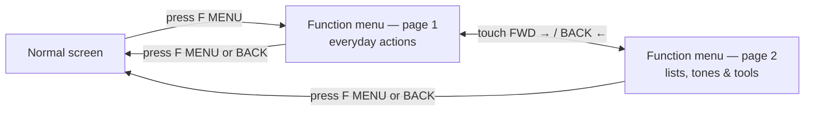

# The function menu — soft keys explained

One physical key on this radio hides two entirely different menus, and telling them apart is half the battle of learning the FT5DR. **Press and hold [F MENU]** and you get the **Setup Menu** — twelve tiles of _settings_, the things you configure once and revisit rarely, all catalogued in the [Menu Reference](outpost:entry/logbook73.guide.ft5dr/menu-reference). But a **short press** of the very same key opens something different and, day to day, far more useful: the **function menu** — two pages of on-screen soft keys that hold the radio's _actions_. Start a scan. Jump home. Change power. Fire off an APRS beacon. Start the voice recorder. Switch on the torch. This chapter walks through every one of those twenty soft keys: what each does, how to drive it, and where its full story lives in the rest of the guide.

The distinction is worth a rule of thumb you will use for the life of the radio:

> **Short press [F MENU] = _do_ something (the function menu). Press and hold [F MENU] = _set_ something (the Setup Menu).**

(And the standing reminder from the rest of this guide: some Yaesu documents label this same physical key **[DISP]**. It is one key; we call it [F MENU] throughout.)

## How the function menu works

A short press of **[F MENU]** swaps the bottom of the screen for a grid of soft keys; another short press (or **[BACK]**) puts the normal display back. There are **two pages** of keys, and you move between them with the small arrows in the bottom-right corner: touch **[FWD →]** to go to page 2, **[BACK ←]** to return to page 1. This is why the manual keeps saying things like "if [SCOPE] is not displayed, touch [FWD →]" — the key you want is simply on the other page. Each key lives on a fixed page, so after a week you will page without thinking.

Three behaviours to know before the tour:

- **The DIAL speeds up.** While the function menu is showing, the DIAL knob tunes in **1 MHz** jumps instead of the normal step — the fast way to cross a band. This is a feature, not a fault, but it surprises people who leave the menu open and wonder why the dial has gone "coarse".
- **Some keys grey out.** Depending on the communication mode and current settings, a soft key may do nothing when touched — [BCN·TX] without APRS configured, for instance, or [CODE] with the squelch type off. If a key seems dead, it usually wants a setting made first; each entry below says which.
- **Keys act on the operating band** — the frequency shown in white. If an action lands on the wrong band, press **[A/B]** first.

Here is the full layout, exactly as the two pages appear:

| Page 1 — everyday actions |           |            |            |
| ------------------------- | --------- | ---------- | ---------- |
| **TXPWR**                 | **HOME**  | **REV**    |            |
| **SCAN**                  | **D.RCV** | **P.RCVR** | **A.DUAL** |
| **DG-ID**                 | **REC**   | **LOG**    | _[FWD →]_  |

| Page 2 — lists, tones & tools |               |            |            |
| ----------------------------- | ------------- | ---------- | ---------- |
| **MEMORY**                    | **BCN·TX**    | **S.LIST** | **M.LIST** |
| **SCOPE**                     | **CAM**       | **SQTYP**  | **CODE**   |
| **DISP**                      | **LED LIGHT** |            | _[BACK ←]_ |

Loosely, **page 1 is the operating page** — power, scanning, repeaters, recording — and **page 2 is the lists-and-tools page** — memory and APRS lists, tone squelch, the band scope and a couple of extras. Now, key by key.

## Page 1 — the everyday actions

### TXPWR — transmit power

Touch **[TXPWR]**, rotate the **DIAL** to pick **HIGH (5 W)**, **LOW3 (2.5 W)**, **LOW2 (1 W)** or **LOW1 (0.1 W)**, and press **PTT** to save. Power is remembered **per band**, so 2 m and 70 cm can differ. ⭐ This is the soft key you should wear out: run the lowest power that reliably makes the trip, and save HIGH for when it is genuinely needed. Full reasoning in [Operating Basics](outpost:entry/logbook73.guide.ft5dr/operating-basics) and [RF Power](outpost:entry/logbook73.handbook/rf-power).

### HOME — jump to your home channel

One touch takes you to the **home channel** — the drop-everything frequency you have chosen for that band (each band keeps its own). While you are there, each press of **[BAND]** hops to the next band's home channel. Touch **[HOME]** again (or press **[V/M]**) to return to where you were. Two wrinkles: rotating the DIAL while on a home channel slides that frequency onto the VFO so you can tune away from it (disable this hand-off at **CONFIG → 8 HOME VFO** if it annoys you), and you store a new home frequency with a **hold of [V/M]** → touch **[H.WRITE]**. The home-channel system lives in [The Memory System](outpost:entry/logbook73.guide.ft5dr/memory).

### REV — listen on the repeater's input

**Reverse** temporarily swaps your transmit and receive frequencies, so you hear the repeater's _input_ — in other words, the other station's raw signal instead of the repeater's retransmission. Its whole purpose is one question: **could we do this simplex, without the repeater?** If they are loud and clear on reverse, yes. The shift icon **blinks** while reversed; touch **[REV]** again to go back to normal. ⭐ A good habit before settling into a long local chat. More in [Operating Basics](outpost:entry/logbook73.guide.ft5dr/operating-basics).

### SCAN — start scanning

Touch **[SCAN]** and the radio starts hunting for activity — a **VFO scan** (sweeping frequencies) if you are in VFO mode, or a **memory scan** (stepping your stored channels) if you are in memory mode. Touch **[STOP]** or press **PTT** to quit; turn the DIAL mid-scan to steer its direction. What happens when it _finds_ a signal — pause for a few seconds, wait for the signal to finish, or stop dead — is set at **Setup Menu → SCAN → 4 SCAN RESUME**. The whole scanning family, including PMS band-segment scanning and skip channels, is in [Band Scope, Scanning & Dual Receive](outpost:entry/logbook73.guide.ft5dr/scan-scope).

### D.RCV — the priority watch

**Dual Receive** here means something narrower than the radio's two-receivers trick: it is a **priority watch**. You nominate one memory channel as the **priority channel**, and while you get on with something else the radio dips to it roughly **every five seconds** to check for activity — a watchful glance rather than continuous listening. If a signal is there, the radio beeps and switches you to the priority channel; if not, you never notice the check. The classic use: keep your local repeater watched while you tune around simplex — or while you listen to broadcast radio, since D.RCV happily runs during FM/AM reception.

It takes a one-time setup plus a switch-on, and the setup is the part nobody finds unaided:

1. **Store the channel to be watched as an ordinary memory** (frequency, mode, tone — hold **[V/M]**, pick a slot, **[M.WRITE]**), if it is not one already.
2. **Mark it as the priority channel.** Press **[V/M]** to enter memory mode, **press and hold [F MENU]** to open the memory-edit screen, rotate the **DIAL** to that channel, and touch **[PRI.CH]** (page the soft keys with the arrow key if it is not showing). A small **"P"** appears beside the channel number — that channel is now the one D.RCV will watch. There is only one priority channel; marking another moves the flag.
3. **Set up what you want to listen to in the meantime** — spin the VFO somewhere, recall a different memory, or sit on the home channel. All three work, and the status icon tells you which flavour you have: **VDR** (VFO + priority), **MDR** (memory + priority) or **HDR** (home + priority).
4. **Switch it on:** short-press **[F MENU]** and touch **[D.RCV]**. The VDR/MDR/HDR icon appears top-left and the five-second glances begin. Touch [D.RCV] again to switch it off.

Two settings decide how it behaves when the priority channel _does_ come alive, and the first is the feature's classic trap:

- **What happens after a catch** lives at **Setup Menu → SCAN → 4 SCAN RESUME** (select the **DW** entry). The default is **HOLD** — the radio stays parked on the priority channel and the watch _does not resume_. If D.RCV seems to "stop working" after its first catch, this is why. Choose **2–10 seconds** or **BUSY** there if you want it to listen, then go back to watching automatically.
- **SCAN → 6 PRIORITY REVERT** changes what PTT does while the watch is running: set to ON, pressing PTT transmits **straight onto the priority channel** without waiting for it to become active — handy when the watched channel is _your_ channel and everything else is background listening.

D.RCV works with AMS on, and is one of three similarly named features (true dual-band receive, AF Dual, D.RCV) that newcomers blur together; [Band Scope, Scanning & Dual Receive](outpost:entry/logbook73.guide.ft5dr/scan-scope) untangles the trio.

### P.RCVR — the preset receiver channels

Behind this key are three banks of channels Yaesu loaded at the factory, all **receive-only** and impossible to overwrite: **weather broadcast** channels, the **international VHF marine** channels, and a library of **worldwide shortwave broadcasters**. They only work with the **A-band** as the operating band (it is the wide receiver). Touch **[P.RCVR]**, then press **[BAND]** to cycle the three banks and rotate the **DIAL** to step channels; touch [P.RCVR] again or press **[BACK]** to leave. Details and channel lists in [Audio & Extras](outpost:entry/logbook73.guide.ft5dr/audio-extras).

### A.DUAL — broadcast radio plus band watch

**AF Dual** lets you listen to an AM/FM **broadcast** station while the radio quietly monitors the amateur bands: the moment a signal appears on A or B, the music mutes and the amateur audio takes over, then the broadcast returns. Touch **[A.DUAL]** to start, **[BACK]** to stop; how quickly the broadcast comes back after activity is tuned at **TX/RX → AUDIO** in the Setup Menu. A lovely companion for a desk or a hike — covered in [Band Scope, Scanning & Dual Receive](outpost:entry/logbook73.guide.ft5dr/scan-scope).

### DG-ID — your digital group IDs

Opens the **transmit and receive DG-ID** setting — the two-digit group numbers that decide who hears you and whom you hear on C4FM digital. Press **[F MENU]** to move between the TX and RX fields, rotate the **DIAL** to set a number, and press **[BACK]** or **PTT** to save. The everyday answer is **TX 00 / RX 00** — the "hear everyone" wildcard (✅); non-zero values create private groups and open DG-ID-controlled repeaters. If digital contacts have mysteriously gone silent, a forgotten RX DG-ID from a previous outing is the first suspect. The whole ID system is the heart of [C4FM Digital, AMS & DG-ID / DP-ID](outpost:entry/logbook73.guide.ft5dr/c4fm).

### REC — the voice recorder

Touch **[REC]** and the radio starts recording received audio to the **microSD card** as ordinary `.wav` files — "RECSTART" flashes up and a recording icon sits in the status bar. The key becomes **[REC STOP]**; touch it to finish. By default it captures the **A-band** and pauses itself a few seconds after the squelch closes, resuming on the next signal, so a day's monitoring produces a tidy file rather than hours of silence. Which band(s) to record, and whether your own transmit audio is included, is set at **TX/RX → AUDIO → 6 RECORDING**. Needs a card fitted, and setting the clock first gives the files sensible names. Full detail in [Audio & Extras](outpost:entry/logbook73.guide.ft5dr/audio-extras).

### LOG — play back what the radio has kept

The playback hub for everything stored on the microSD card. Touch **[LOG]** and choose **[VOICE]** (your recordings — touch a file to play, with pause, skip and delete), **[MESSAGE]** (saved digital messages), or **[PICT]** (photos taken with the optional camera microphone, which you can view and re-send). Live receive is muted while a recording plays. Recordings and pictures are covered in [Audio & Extras](outpost:entry/logbook73.guide.ft5dr/audio-extras); the messages side belongs to [WIRES-X & GM](outpost:entry/logbook73.guide.ft5dr/wires-x-gm) and [APRS](outpost:entry/logbook73.guide.ft5dr/aprs).

## Page 2 — lists, tones and tools

### MEMORY — the memory channel list

Opens the **memory channel list** — all your stored channels as a scrollable list rather than one at a time on the dial. Browse with the DIAL or by touch, and recall a channel directly; it is much the quickest way to reach "that channel I stored months ago" once the memory fills up. The filing system around it — banks, tags, skip flags and the rest — is [The Memory System](outpost:entry/logbook73.guide.ft5dr/memory).

### BCN·TX — send your APRS beacon

Transmits your **APRS position beacon** — the on-demand counterpart to the automatic beaconing you configure at **APRS → BEACON TX** (MANUAL / AUTO / SMART). With everything set up, one touch sends your position to the local APRS network. It has prerequisites, which is why it can seem to "do nothing" on a fresh radio: the APRS modem must be on, the B-band tuned to the APRS frequency, and — with `MY POSITION = GPS` — the GPS must have a fix before the radio will beacon at all. The full setup, and beaconing etiquette, is in [APRS, GPS & Data](outpost:entry/logbook73.guide.ft5dr/aprs).

### S.LIST — the APRS station list

Opens the **station list**: every APRS station the radio has heard, each one opening into a genuinely rich card — bearing and distance to the station, speed, course, altitude and status, all decoded from their packets. This is APRS as a _receiver_, and it is fascinating even before you transmit anything. Covered in [APRS, GPS & Data](outpost:entry/logbook73.guide.ft5dr/aprs).

### M.LIST — the APRS message list

Opens the **APRS message list**, where you read messages sent to your callsign and compose replies — APRS's text-messaging side. Like the other APRS keys it needs the modem configured first. How messaging works, and what the acknowledgements mean, is in [APRS, GPS & Data](outpost:entry/logbook73.guide.ft5dr/aprs).

### SCOPE — the band scope

Sweeps the channels **above and below your current frequency** and draws their signal strengths as a live bar chart — a spectrum view of the neighbourhood, perfect for answering "is anything happening on this band?" at a glance. Touch a bar to jump to that signal; touch **[SEARCH]**/**[STOP]** to run or pause the sweep; touch the channel-count readout to widen the view from 19 to 39 to 79 channels. VFO mode only, and on most of the VHF/UHF range it sweeps continuously while you listen. The scope has a full walkthrough in [Band Scope, Scanning & Dual Receive](outpost:entry/logbook73.guide.ft5dr/scan-scope).

### CAM — the Channel Activity Monitor

Displays a **named group of up to five channels as live signal-strength bars** — like PMG, but for fixed sets you define in advance (up to ten groups). Set one up per club net or per town, open it with **[CAM]**, see at a glance which channel is active, and touch a bar to jump there. Building and using CAM groups — and how CAM, PMG and MAG divide the "who's active?" job — is in [The Memory System](outpost:entry/logbook73.guide.ft5dr/memory).

### SQTYP — squelch type, without the menu dive

A shortcut to the same choice as **Setup Menu → SIGNALING → 11 SQL TYPE**: which tone system the current band uses. Touch **[SQTYP]**, rotate the **DIAL** through the options, and press **PTT** to save:

| Choice       | You transmit        | Your speaker opens for              | Typical use                                  |
| ------------ | ------------------- | ----------------------------------- | -------------------------------------------- |
| **OFF**      | nothing extra       | everything                          | simplex, general listening                   |
| **TONE**     | a CTCSS tone        | everything                          | ⭐ **repeater access** — the everyday choice |
| **TONE SQL** | a CTCSS tone        | only signals carrying the same tone | quiet standby on a shared channel            |
| **DCS**      | a digital code      | only signals with the same code     | as TONE SQL, using DCS instead               |
| **REV TN**   | a CTCSS tone        | mutes on matching tone (inverted)   | niche                                        |
| **PR FREQ**  | a programmable tone | —                                   | odd commercial systems                       |
| **PAGER**    | your two-tone code  | calls addressed to you              | selective calling within a group             |

The type is remembered per band, and this soft key plus [CODE] is the fast, two-touch way to set a repeater up — no Setup Menu required. The everyday distinction to keep straight: **TONE** changes only what you _send_ (you still hear everything); **TONE SQL/DCS** also filter what you _hear_, which is wonderful on standby and baffling if you forget it is on. What each type does in depth — encode versus decode — is the subject of [Tone Squelch, DCS & the Pager](outpost:entry/logbook73.guide.ft5dr/tones).

### CODE — the tone or code itself, and the tone detective

The companion to [SQTYP]: it sets **which** CTCSS tone frequency (50 tones, 67.0–254.1 Hz, default 100.0) or DCS code (104 codes, 023–754, default 023) the selected squelch type uses. Touch **[CODE]**, rotate the **DIAL** to the value, and press **[BACK]** to save. For a UK repeater listed as "110.9 Hz", that means SQTYP = TONE, CODE = 110.9. Two notes: the tone frequency you set here is shared by every tone-based squelch type (TONE, TONE SQL, REV TN), so you set it once; and if [CODE] seems to do nothing, the squelch type is probably still OFF — pick one with [SQTYP] first.

**Tone search — when you don't know the tone.** The [CODE] screen hides a genuinely clever tool: a **[SEARCH]** soft key that listens to whatever signal you are receiving and works out which CTCSS tone or DCS code it is carrying. When a repeater listing is missing or wrong, this discovers the answer from the air:

1. Set **[SQTYP]** to **TONE SQL** (to hunt a CTCSS tone) or **DCS** (to hunt a DCS code), and save with PTT.
2. Tune to the signal, and while it is actually transmitting, touch **[F MENU] → [CODE] → [SEARCH]**. The radio steps through every tone or code in turn.
3. On a match it **beeps and the found value blinks**; the search pauses for five seconds and you hear the audio. Touch **[STOP]** to end the hunt, then press **[BACK]** to keep the discovered value.
4. Now set [SQTYP] back to plain **TONE** if repeater access was the goal — you have the tone; you don't need the receive filtering.

Three practicalities: a signal must be **present and carrying a tone** for the search to find anything; it only runs in **analogue FM** (or with AMS on) — never in a fixed digital mode; and whether you hear audio during the hunt, and how fast it steps, is set at **SIGNALING → 13 TONE SEARCH** (mute on, fast — the defaults — suit most people). Details and the full tone tables in [Tone Squelch, DCS & the Pager](outpost:entry/logbook73.guide.ft5dr/tones).

### DISP — the GPS and Backtrack screens

Switches the main display to the radio's **navigation faces**: the **GPS information screen** (satellite status, your position, altitude, speed, time) and the **Backtrack screen** (a compass that points back to a spot you saved — camp, the car park, the trailhead — with live distance, and it holds up to **three** such spots, labelled **★**, **L1** and **L2**). It opens on whichever of the two you used last; touch the screen to flip between them, and [BACK] returns to the frequency display. During a C4FM digital contact the compass can even point at the _other station_, using the position their signal carries.

**Backtrack — save a spot, walk back to it.** Each of the three slots (**★**, **L1**, **L2**) holds one position, so you can register your camp, the car park and the trailhead independently. To save where you are standing:

1. Open the Backtrack screen: **[F MENU] → [DISP]** (touch **[FWD →]** first if [DISP] is not shown; if the GPS information screen appears instead, touch the compass to switch to the navigation screen).
2. Touch the **own-station icon** to show your own location, then touch **[MEM]** — the three slot markers **★**, **L1** and **L2** begin to blink.
3. Touch the blinking slot you want to fill (up to three positions can be stored), then press **[F MENU]** to exit. That spot is now saved.

To head back later, open the screen again with **[F MENU] → [DISP]** and touch the slot (**★**, **L1** or **L2**) you saved. The face relabels itself **DISTANCE** and shows the live distance to that point, a green **registration-point** dot and an arrow inside the compass circle aimed at it; keep walking so the arrow stays pointing to the top and you will arrive. A small **H-UP / N-UP** indicator (heading-up or north-up) tells you how the compass is oriented. The same screen can also guide you to _another person_: while a remote station's position is on show (touch the **remote-station icon**), you can register their callsign and location too, so the arrow leads to them rather than to your own departure point.

GPS, Backtrack and smart navigation live in [APRS, GPS & Data](outpost:entry/logbook73.guide.ft5dr/aprs).

### LED LIGHT — yes, it is a torch

Touch **[LED LIGHT]** and the small white LED built into the radio lights up; touch it again to switch it off. That is the whole feature — a torch for finding the keyhole or reading a map — and it is easy to forget the radio has it until the evening you need it. Endearingly, Yaesu made it one of the very few functions that still works when the radio is locked down in memory-only mode.

## When a soft key plays dead

A quick diagnostic table, because "I touched it and nothing happened" is this menu's most common complaint:

| Key                              | Usually means                                                                                                   |
| -------------------------------- | --------------------------------------------------------------------------------------------------------------- |
| **[BCN·TX], [S.LIST], [M.LIST]** | APRS is not set up yet — modem off, B-band not on the APRS frequency, or no GPS fix with `MY POSITION = GPS`    |
| **[P.RCVR]**                     | The **B-band** is the operating band — the presets need A-band; press [A/B] first                               |
| **[CODE]**                       | The squelch type is **OFF** — choose one with [SQTYP] first                                                     |
| **[REC], [LOG]**                 | No microSD card fitted (or not formatted in the radio)                                                          |
| **[SCOPE]**                      | You are in memory mode — the scope runs from **VFO mode**                                                       |
| Anything                         | You are on the wrong page — touch [FWD →] / [BACK ←] — or the touchscreen wants a firmer, resistive-style press |

## Try it yourself

Five minutes, nothing here transmits except step 5:

1. **Learn the page flip.** Short-press **[F MENU]**, touch **[FWD →]** and **[BACK ←]** a few times, and notice which keys live on which page. Press [F MENU] again to dismiss it.
2. **Feel the fast dial.** With the function menu open, turn the DIAL and watch the frequency leap in 1 MHz strides. Close the menu and it is back to normal steps.
3. **Sweep the band.** In VFO mode on 2 m, touch **[SCOPE]**, widen it to 79 channels, and touch the tallest bar you see.
4. **Set a tone the quick way.** On a repeater frequency, touch **[SQTYP]** → TONE, then **[CODE]** → your repeater's tone. You have just done, in two touches, what the Setup Menu does in six.
5. **Jump home and back.** Touch **[HOME]**, note the "HOM" flag, then touch it again to return. Then, purely for morale, touch **[LED LIGHT]**.

## Key takeaways

- **Short press [F MENU] = actions (function menu); press and hold = settings (Setup Menu).** Internalise that and the radio's whole control scheme makes sense.
- The function menu is **two fixed pages** — page 1 for everyday operating (power, home, reverse, scan, priority watch, presets, AF Dual, DG-ID, recorder), page 2 for lists and tools (memory list, APRS beacon/stations/messages, scope, CAM, tone type and code, GPS screens, torch). **[FWD →]** and **[BACK ←]** flip between them.
- While the menu is open the **DIAL jumps in 1 MHz steps** — the built-in fast-tune.
- A "dead" soft key almost always means a **prerequisite is missing** (APRS not configured, wrong band, no SD card, squelch type off) — not a fault.
- The two most-used keys deserve muscle memory: **[TXPWR]** (run the least power that works) and **[SQTYP]/[CODE]** (tones without the menu dive).

You now know both halves of the [F MENU] key. Next, those actions in context — bands, VFOs, modes and your first transmissions — in [Operating: Bands, VFOs, Modes & Transmitting](outpost:entry/logbook73.guide.ft5dr/operating-basics).
