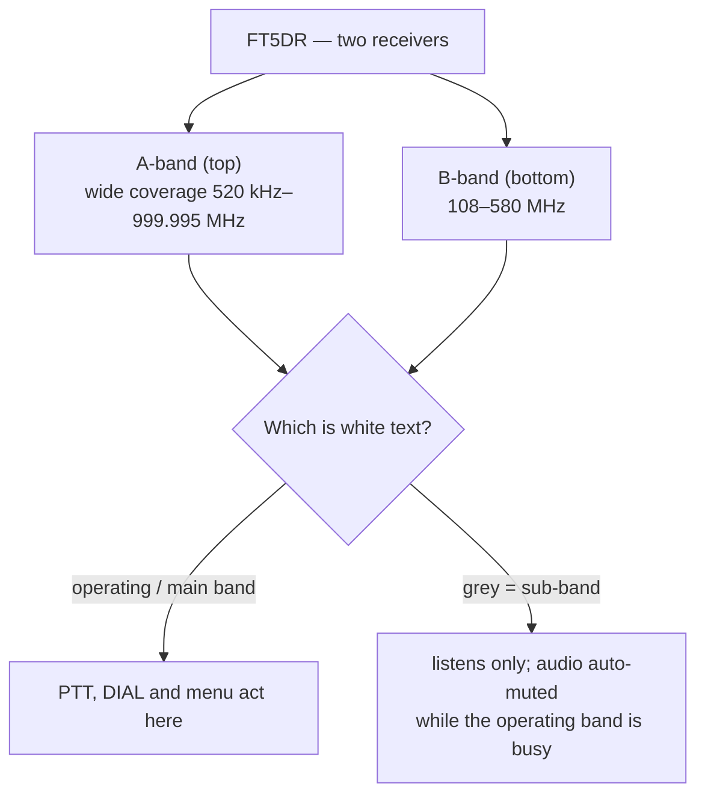
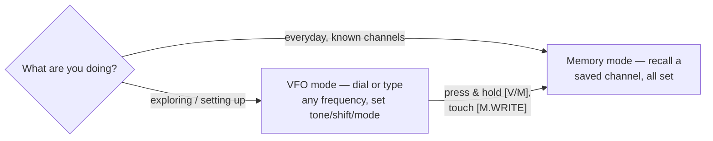
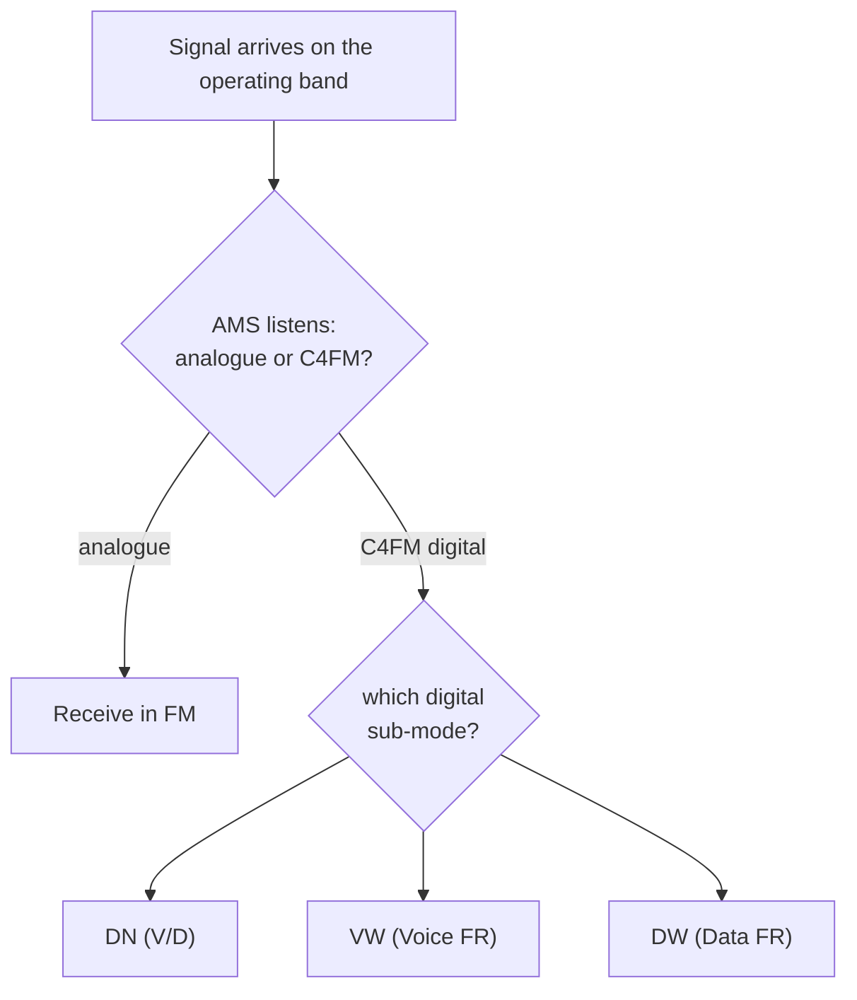

# Operating: bands, VFOs, modes and transmitting

Everything the FT5DR can do — WIRES-X, GM, APRS, the band scope, the whole Setup Menu — sits on top of a handful of everyday moves: choose a band, tune it, pick a mode, and press to talk. Get these fluent and the rest of the radio stops being intimidating, because you will always know how to get back to a working, transmitting station. This chapter walks through the daily operating layer end to end: the two receivers, frequency versus memory, the digital and analogue modes with AMS choosing between them, transmitting and power, the key lock, and working a repeater.

If you have not yet powered the radio on and set your callsign, do that first in [Getting Started](outpost:entry/logbook73.guide.ft5dr/getting-started) — the FT5DR asks for your call the very first time it boots, and will not transmit properly without it.

## Two receivers: A-band and B-band

Most handhelds show two frequencies but really only listen to one at a time. The FT5DR is different: it has **two genuinely independent receivers**, so it can monitor two frequencies at once. They are shown stacked — **A-band** on top, **B-band** below — and this is what Yaesu means by "dual receive". You can watch a repeater on one and a simplex calling channel on the other, and hear whichever speaks first.

At any moment one of the two is the **operating band** (Yaesu also calls it the "main" band) and the other is the **sub-band**. The operating band is the one shown in **white** text; the sub-band is **grey**. This distinction matters constantly, because the operating band is the one the **PTT transmits on**, the one the DIAL tunes, and the one your menu changes apply to. The `[A/B]` key swaps which band is operating — or just touch the frequency you want on the screen. **Press and hold `[A/B]`** to collapse to a single-band (mono-band) display, showing only the operating band; hold it again to bring both back.



One quirk to expect: in dual receive, when a signal opens the **operating** band, the radio automatically **mutes the sub-band** audio so the two do not talk over each other. So if B goes quiet the instant A gets busy, nothing is broken — that is the design.

The two receivers are not identical. **A-band is the wide-coverage one.** Its published span is **520 kHz to 999.995 MHz** — from long and medium wave, through shortwave and the FM broadcast band, up past the air band to just shy of 1 GHz — and it is the **only** band that can hear AM/FM broadcast and shortwave. (US-market sets have the cellular segment blocked, as regulations there require.) **B-band is narrower** — about 108 to 580 MHz — covering the air band, 2 m, the VHF/UHF ranges and 70 cm, but not the broadcast or HF bands. (Transmitting, of course, is limited to your amateur 2 m and 70 cm allocations regardless of band — 144–148 / 430–450 MHz on the US FT5DR, 144–146 / 430–440 MHz on the European FT5DE; check your own licence conditions.) Two features that later chapters cover depend on this split: **WIRES-X runs only on A-band**, and **APRS runs only on B-band**.

> **Don't confuse three "dual" ideas.** _Dual receive_ (two bands at once, above) is not the same as _AF Dual_ (keep hearing a broadcast station while you monitor) or _D.RCV_ (a priority-channel watch). They are three different features that newcomers routinely blur together; the other two are explained in [Band Scope, Scanning & Dual Receive](outpost:entry/logbook73.guide.ft5dr/scan-scope).

### Choosing what a band tunes to

Because A-band covers so much, you tell it which slice you want with the **`[BAND]`** key. Press `[F MENU]` — the top-left display/menu key, which some Yaesu documentation labels `[DISP]` (it is the same physical button) — to bring up the [function-key row](outpost:entry/logbook73.guide.ft5dr/function-menu), then `[BAND]` steps through the available ranges — AM broadcast, FM broadcast, shortwave, 50 MHz, air band, 144 MHz, the VHF ranges, 430 MHz and the UHF ranges — with `[BACK]` to return. B-band offers the shorter list from the air band up to UHF.

If you never listen to, say, shortwave or the air band, you can hide those ranges so `[BAND]` skips them: **Setup Menu → CONFIG → 22 BAND SELECT** lets you switch each range on or off per band (the broadcast and HF ranges are A-band only). ⭐ Tidying this list to the bands you actually use makes band-hopping far quicker.

## Frequency and memory: the two ways to tune

Everything on this radio hangs off one basic choice: are you dialling a frequency by hand, or recalling one you stored earlier? Those are **VFO (frequency) mode** and **memory mode**, and the **`[V/M]`** key swaps between them.



**VFO mode** gives you the whole band to roam. This is where you _set things up_ — find a repeater, add its shift and tone, choose a power level — and then store the result as a memory. **Memory mode** recalls those stored channels, each one remembering its frequency, offset, tones, mode, power and a name in a single recall. Day to day you live in memory mode; you drop into VFO mode to build or edit something new. The full memory system — banks, tags, and the auto-grouping that filters the list by band — has its own chapter, [The Memory System](outpost:entry/logbook73.guide.ft5dr/memory).

### Tuning in VFO mode

Three ways to move the operating band's frequency:

- **The DIAL knob** steps up and down by the current frequency step (below). Press `[F MENU]` first and the knob instead jumps in **1 MHz** strides — the fast way to cross a band — then `[BACK]` to return to normal stepping.
- **The touchscreen keypad.** Touch and **hold** the frequency on the screen — a deliberate press-and-keep-pressing, not a tap — and a numeric keypad pops up. Type the frequency and it goes straight there — `1 4 5 5 2` for `145.520`, or `4 3 ENT` for `430.000` (`ENT` fills the rest with zeros). This is much faster than winding the knob, and a `PTT` tap (or any key) cancels a half-typed entry. If you get a change of display instead of a keypad, you tapped rather than held: a quick tap on the grey sub-band frequency swaps the operating band, and a tap on the white frequency in memory mode flips between the channel's name tag and its raw frequency.
- **The frequency step** itself is set in **CONFIG → 18 STEP**. The default is **AUTO**, which picks a sensible step for whatever band you are on — ✅ leave it there unless a specific service needs a particular grid (for example 12.5 kHz on the 2 m/70 cm band plan, or the 8.33 kHz air-band grid). To change it, hold `[F MENU]`, touch `[CONFIG]`, touch `[18 STEP]`, rotate the DIAL, and press `PTT` to save.

### Volume and squelch — set per band

Because there are two receivers, **volume and squelch are set separately for each band** (and separately again for the AM and FM broadcast bands). That surprises people: turn up the volume and only the operating band gets louder.

- **Volume** is just the top VOL knob, applied to whichever band is operating.
- **Squelch** is the gate that silences the background hiss when no signal is present. Press the **`[SQL]`** key, then rotate the **VOL** knob until the hiss just goes quiet; a `SQL` bar shows the level. Press `[SQL]` again (or wait about three seconds) to save. The default is level **1** (the FM broadcast band defaults to 2). ✅ A low setting — 1 to a few — opens for weak signals; wind it too high and you silence the very stations you were straining to hear.

```viz
{
  "type": "wave",
  "title": "Squelch — the gate that silences the hiss",
  "caption": "Background hiss sits below the squelch threshold (dashed), so the speaker stays quiet; a real signal crosses the line and the audio opens. Set the level just high enough that the hiss goes silent — wind it further up and weak stations vanish along with it.",
  "xLabel": "time",
  "traces": [
    { "kind": "points", "label": "received level", "tone": "primary", "points": [[0,-0.62],[0.07,-0.5],[0.14,-0.6],[0.22,-0.52],[0.3,-0.58],[0.36,0.45],[0.44,0.58],[0.52,0.5],[0.6,0.55],[0.67,0.44],[0.73,-0.55],[0.8,-0.6],[0.88,-0.5],[1,-0.58]] },
    { "kind": "points", "label": "squelch threshold", "tone": "danger", "style": "dashed", "points": [[0,0],[1,0]] }
  ]
}
```

## Communication modes and AMS

Here is the part that makes the FT5DR a System Fusion radio rather than an ordinary FM handheld, and the part worth reading twice. The radio can operate in analogue FM _or_ Yaesu's C4FM digital voice, and it has several digital sub-modes. **AMS — Automatic Mode Select — is the feature that spares you from guessing which is which on receive.**

The modes you will meet:

| Mode   | Icon | What it is                                                                                                                                                                                                                   | Carries data/GPS too? |
| ------ | ---- | ---------------------------------------------------------------------------------------------------------------------------------------------------------------------------------------------------------------------------- | --------------------- |
| **DN** | `DN` | **V/D (Voice/Data)** — the everyday digital mode. It splits the 12.5 kHz channel into digital voice plus forward-error-correction and data (including your GPS position). Robust, and the mode repeaters and WIRES-X expect. | Yes                   |
| **VW** | `VW` | **Voice FR (Voice Full Rate)** — the whole 12.5 kHz given over to voice, for higher fidelity. **Off by default** (enable it below). No data, so no GPS to the far end.                                                       | No                    |
| **FM** | `FM` | Ordinary **analogue FM** — the mode every other 2 m/70 cm handheld speaks.                                                                                                                                                   | n/a (analogue)        |
| **AM** | `AM` | **AM, receive only** — auto-selected in the air band (108–136.995 MHz). You cannot transmit AM.                                                                                                                              | n/a                   |
| **DW** | `DW` | **Data FR** — full-rate data. The radio switches to it _automatically_ while sending an image from the camera microphone; you do not pick it by hand.                                                                        | data only             |

### How AMS works

AMS watches the incoming signal and switches the _receiver_ to match it, so a mixed channel of analogue and digital users just works. You turn it on by **touching `[MODE]` repeatedly until the mode icon shows a small bar above it** — that bar is the "AMS is on" indicator. From then on the icon reflects reality: it may read `FM` while the channel is quiet, then flip to `DN` (or `VW`, or `AM`) the instant a station of that type keys up.



Crucially, **AMS only decides your _receive_ mode**. What you _transmit_ is a separate choice, made with the transmit-mode soft key, which cycles through three states:

- **TX AUTO** (default) — transmit in whatever mode AMS last detected. Perfect for a mixed net: reply to an FM station in FM, a digital station in DN, without thinking.
- **TX FM** — always transmit analogue FM, whatever you are hearing. Use this to make sure you never accidentally answer an FM operator in digital (which they would hear as noise).
- **TX DN** — always transmit digital DN. Use this on a digital-only channel or repeater.

So the healthy default is **AMS on, TX AUTO**: the radio listens in whatever mode arrives and answers in kind. Lock the transmit mode only when you have a reason to.

### Fixing the mode by hand

If you would rather not use AMS, touch `[MODE]` (without the AMS bar) to _fix_ the mode — `DN`, `VW`, `FM` or `AM` — and the radio stays there regardless of what it hears. ⭐ Useful on a channel you know is single-mode; otherwise AMS is friendlier.

**To unlock VW** (it is hidden by default), set **Setup Menu → TX/RX → 2 DIGITAL → 4 DIGITAL VW = ON**. Remember VW carries no data or GPS and uses the full channel, so keep it for **direct, simplex, high-quality voice contacts** — not for repeaters or WIRES-X, which rely on the DN data stream. The digital modes, DG-ID, DP-ID and the whole C4FM story are covered next in [C4FM Digital, AMS & DG-ID / DP-ID](outpost:entry/logbook73.guide.ft5dr/c4fm); the underlying idea of turning voice into data is in [Digital Voice](outpost:entry/logbook73.handbook/digital-voice).

## Transmitting

With a band tuned and a mode chosen, transmitting is exactly what you expect: **press and hold `PTT` and speak into the microphone.** The **TX/BUSY** indicator glows **red** while you transmit. Let go to return to receive.

That same indicator doubles as a receive tell-tale, and its colours are worth knowing:

| Indicator    | Meaning                                                                                             |
| ------------ | --------------------------------------------------------------------------------------------------- |
| **Red**      | You are transmitting                                                                                |
| **Blue**     | Receiving a **C4FM digital** signal                                                                 |
| **Green**    | Receiving an **analogue FM** signal                                                                 |
| **Blinking** | Receiving a signal that does **not** match your DG-ID/tone, or whose audio is muted as the sub-band |

That blink is a useful early clue in the digital chapters: if the light flickers but you hear nothing, a station is there but a DG-ID or tone is filtering it out.

Two safety behaviours run in the background. First, if you press `PTT` while tuned **outside an amateur band**, the radio beeps and shows **"TX INHIBIT"** and refuses to transmit — it will not let you key up on the air band or a broadcast frequency. Second, if you transmit continuously for a long time the **thermal protection** kicks in: the radio drops itself to low power, and if you keep going it forces itself back to receive to cool down. Both are features, not faults.

### Transmit power levels

The FT5DR gives you four power steps. Press `[F MENU]`, touch **`[TXPWR]`**, rotate the DIAL to choose, and press `PTT` to save. **Power is stored separately for each band**, so your 2 m and 70 cm channels can run different levels.

| Setting  | Output            |
| -------- | ----------------- |
| **HIGH** | **5 W** (default) |
| **LOW3** | 2.5 W             |
| **LOW2** | 1 W               |
| **LOW1** | 0.3 W             |

(With the optional FBA-39 alkaline battery tray fitted, only **LOW2 (~0.9 W)** and **LOW1 (~0.3 W)** are available.)

⭐ **Run the lowest power that reliably does the job.** Into a strong local repeater, LOW2 or even LOW1 is often plenty, and it saves battery, reduces the RF next to your head, and keeps you from splattering across a wide area for a short contact. Save HIGH for when you genuinely need to reach out. The reasoning — why "more power" is rarely the right first move — is in [RF Power](outpost:entry/logbook73.handbook/rf-power).

## Locking the keys and dial

Handhelds live in pockets and rucksacks, where a stray press can retune you or key the transmitter. The lock guards against that. **Press the top Power/Lock switch briefly** (a short press — a long press powers off): "LOCK" appears for a second, a padlock icon shows on screen, and the controls freeze. Press it again to see "UNLOCK" and release them.

What actually gets locked is set in **Setup Menu → CONFIG → 9 LOCK**. The default, **KEY&DIAL**, locks the keys and the DIAL knob but leaves the `PTT` live so you can still transmit one-handed; other choices add or subtract the PTT and dial in various combinations. ✅ The default suits most people. Note that the **`[MONI/T-CALL]`** key, the **`[SQL]`** key and the **VOL** knob are never locked — you can always open the squelch, monitor, and adjust volume even with the lock on.

## Repeater operation

A [repeater](outpost:entry/logbook73.handbook/repeaters) listens on one frequency and re-transmits on another, so your radio must **transmit on a different frequency from the one it receives** (the "duplex shift" or offset) and usually send a sub-audible **tone** to prove you are entitled to open it. The FT5DR makes this almost automatic.

**ARS — Automatic Repeater Shift — does the setup for you.** Tune the operating band to the repeater's **output (downlink)** frequency — the frequency you hear it on — and the radio recognises it as a repeater channel: a **`+`** or **`−`** shift icon and a **`TN`** (tone encoder) icon appear above the frequency by themselves. Then just press `PTT` and talk; the radio transmits on the shifted input frequency with the tone attached, and drops back to the output to listen.

When you do need to set things by hand — a repeater ARS does not recognise, or an unusual plan — the pieces live in the Setup Menu:

- **CONFIG → 14 RPT ARS** — turn ARS off if you want to control the shift yourself.
- **CONFIG → 15 RPT SHIFT** — the shift _direction_ (`+`, `−` or simplex).
- **CONFIG → 16 RPT SHIFT FREQ** — the shift _size_ in MHz (typically 0.6 MHz on 2 m; the 70 cm figure varies by region — 1.6 MHz in much of Europe, 5 MHz in the US — so check your national band plan).
- **SIGNALING → 12 TONE SQL FREQ** — the CTCSS tone the repeater expects. Tones, DCS and paging get their own chapter, [Tone Squelch, DCS & the Pager](outpost:entry/logbook73.guide.ft5dr/tones).

### Reverse — check before you call

The **reverse** function temporarily swaps your transmit and receive frequencies, so you listen on the repeater's _input_. Its purpose is to answer a simple question: **can I reach the other station directly, without the repeater?** If you can hear them clearly in reverse, you are close enough to talk simplex and free the repeater for others.

Press `[F MENU]`, then touch `[REV]` (touch `[BACK]` first if `[REV]` is not on the row). The shift icon blinks to remind you that you are reversed; touch `[REV]` again to return to normal. ⭐ A good habit before a long local chat.

### Tone-burst access (1750 Hz)

Some repeaters — especially older European ones — open on a **1750 Hz tone burst** rather than a continuous CTCSS tone: a short audible whistle sent at the start of your transmission that tells the repeater "wake up, someone wants you". On the **European FT5DE**, press and hold the **`[MONI/T-CALL]`** key (just below the PTT) and the radio keys up with a 1750 Hz burst superimposed; once the repeater responds, release it and carry on with the PTT. That is **T-CALL**, and it is the European key's factory job.

### Monitoring — opening the squelch on demand

The same key's _other_ job is **MONI (monitor)**: hold it and the squelch opens completely, so you hear absolutely everything on the frequency — raw hiss included. That is genuinely useful, in two situations: a station is _almost_ there but too weak to break your squelch and you want to dig it out of the noise; or you are about to transmit and want to confirm the frequency is truly clear, including of signals your tone squelch would be hiding from you.

Out of the box only the **US FT5DR** gets MONI on the key — the **European FT5DE defaults to T-CALL** — but this is a default, not a limitation. **Both jobs are available on every version**, and **Setup Menu → CONFIG → 10 MONI/T-CALL** assigns whichever you prefer. So a UK owner has a straightforward choice:

- **If your local repeaters all open on CTCSS** (most now do), set the key to **MONI** — you lose nothing and gain a proper monitor button. ⭐ This is the choice most UK operators end up making.
- **If a repeater you use still needs the 1750 Hz burst**, keep **T-CALL** on the key — and when you want to listen with no squelch, use the workaround: press **`[SQL]`** and wind the **VOL** knob down until the squelch level reads **0**. The gate is now wide open and you hear everything; set it back up when you are done. (Remember squelch is per band, so you are only opening the band you are on.)

Either way, note the pleasant design touch from the lock section: the MONI/T-CALL key, the SQL key and the VOL knob are never locked, so your monitor — whichever form it takes — always works.

Digital (C4FM) repeaters are a little different again: instead of a tone they often use a **DG-ID** number to control access. That, and how to hear "all" digital traffic versus a single group, is the heart of the [next chapter](outpost:entry/logbook73.guide.ft5dr/c4fm).

## Try it yourself

With a charged battery, the antenna fitted and your callsign set:

1. **Feel the two receivers.** Put A-band on your local repeater's output and B-band on `145.500 MHz` (the 2 m FM calling channel in Region 1; `146.520` in the Americas). Press `[A/B]` and watch the white text jump between them — that white band is the one your PTT will use. Then **hold `[A/B]`** to collapse to mono-band and back.
2. **Tune three ways.** In VFO mode, spin the DIAL, then press `[F MENU]` and spin it again to feel the 1 MHz jumps, then touch-and-hold the frequency and type one on the keypad.
3. **See AMS work.** Touch `[MODE]` until the AMS bar appears, then listen to a Fusion repeater: watch the icon flip between `FM` and `DN` as analogue and digital users key up.
4. **Practise power discipline.** On a strong local repeater, press `[F MENU] → [TXPWR]` and drop to LOW2 or LOW1. If your signal report is still good, leave it there.
5. **Check reverse.** On a repeater channel, press `[F MENU] → [REV]` and listen. If you can still hear the other station, you two could talk simplex and give the machine a rest.

Nothing here can harm the radio, and `[BACK]` (or the PTT) always steps you back out.

## Key takeaways

- The FT5DR has **two real receivers** — A-band (wide, 520 kHz–999.995 MHz, the only one with broadcast/HF) and B-band (108–580 MHz). The **operating (main) band is white**; it tunes, transmits and takes menu changes. `[A/B]` swaps it; hold `[A/B]` for mono-band.
- **VFO mode** dials any frequency for setting up; **memory mode** recalls finished channels for daily use — `[V/M]` swaps, and you build in VFO then store. Volume and squelch are set **per band**.
- **AMS** auto-picks your _receive_ mode (FM / DN / VW / AM); your _transmit_ mode is chosen separately as **TX AUTO / TX FM / TX DN**. The sensible default is AMS on, TX AUTO. **DN** is the everyday digital mode; **VW** is higher-fidelity voice (off by default, no data, simplex only).
- **Transmit** with PTT: the indicator is **red** on transmit, **blue** for digital receive, **green** for analogue. **"TX INHIBIT"** blocks out-of-band keying, and thermal protection trims power on long overs. Run the **lowest power that works** — HIGH 5 W down to LOW1 0.3 W, stored per band.
- The **lock** (short press of Power/Lock) freezes the keys and dial per **CONFIG → 9 LOCK**, but never the monitor, squelch or volume.
- For **repeaters**, tune the output and let **ARS** add the shift and tone automatically; **reverse** checks whether you could go simplex instead; tone-burst repeaters use the 1750 Hz `[MONI/T-CALL]` burst. That key's job is a **choice, not a regional fixture** — `CONFIG → 10` assigns it to T-CALL or to MONI (squelch fully open), and squelch level 0 opens the gate on any version.

Next, we go deep on the feature that sets this radio apart — System Fusion digital voice, how AMS decides, and the group and personal ID systems that control who you hear — in [C4FM Digital, AMS & DG-ID / DP-ID](outpost:entry/logbook73.guide.ft5dr/c4fm).
