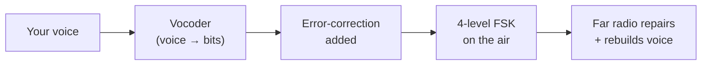
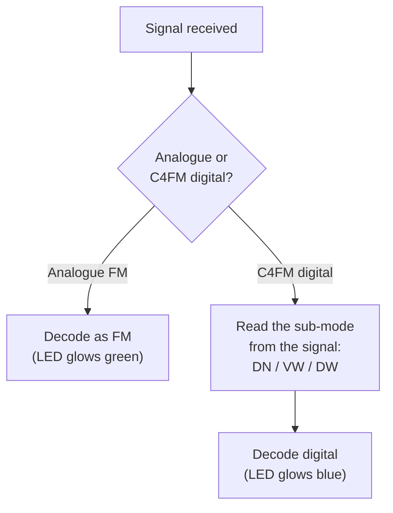
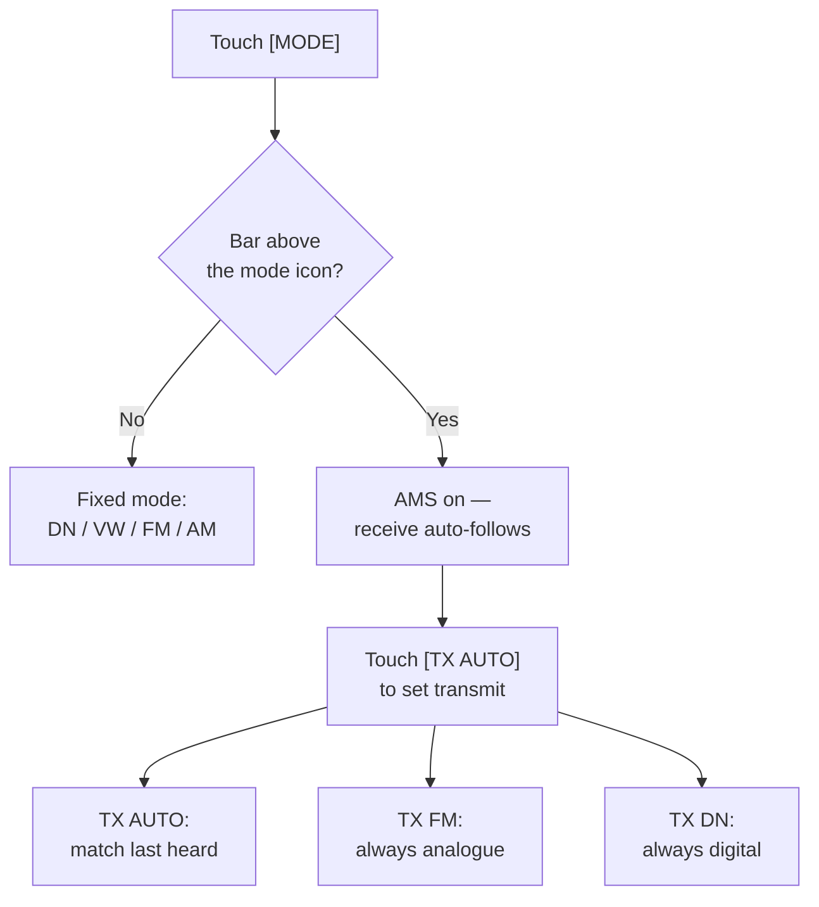
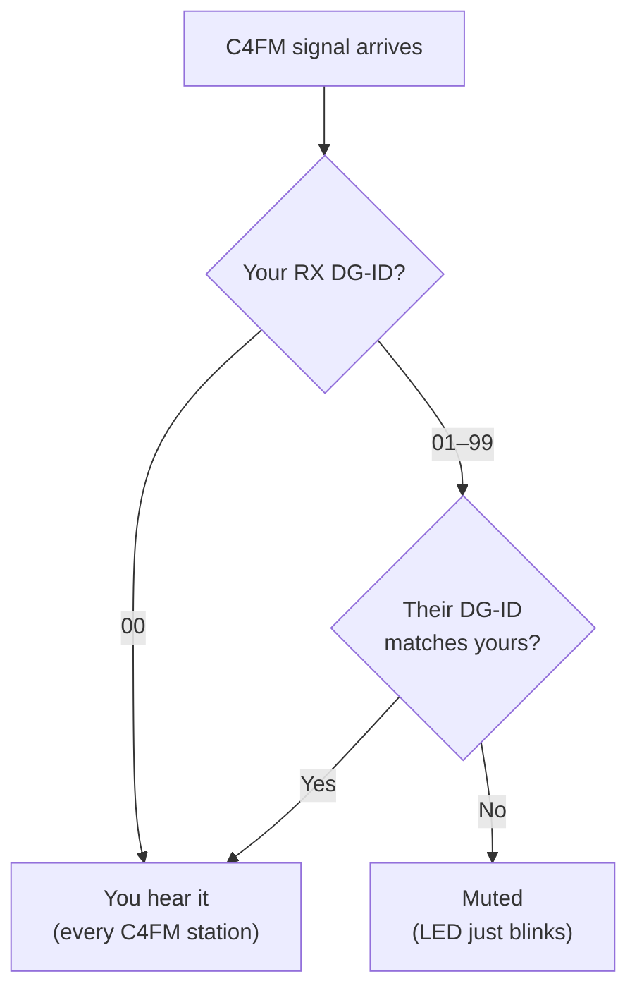

# C4FM digital, AMS and DG-ID / DP-ID

This is the feature the FT5DR is built around, and the one that separates it from an ordinary FM handheld: **C4FM digital voice**, Yaesu's flavour of the System Fusion family. Once you understand three things — what C4FM is, how **AMS** lets the radio decide for itself whether a signal is analogue or digital, and how the **DG-ID** and **DP-ID** codes decide who you hear — the digital side of this radio stops feeling like a wall of icons and starts feeling like the point of owning it. This chapter is that walk-through, menu by menu, key by key.

A quick reminder of the one-glance verdict key used throughout the guide:

| Symbol | Meaning                                                    |
| ------ | ---------------------------------------------------------- |
| ✅     | Set it like this and forget it — right for almost everyone |
| ⭐     | Genuinely useful, depending on how you operate             |
| ⚠️     | Advanced — understand it before you enable it              |
| ❌     | Leave it off unless you have a specific reason             |

## What C4FM digital actually is

Ordinary FM sends your voice as a continuously wobbling radio wave — the frequency swings up and down in step with the sound of your voice, and the receiver reads those swings straight back into audio. It is beautifully simple, and it is what the whole [modulation](outpost:entry/logbook73.handbook/modulation) chapter of the handbook is about. Its weakness is that noise rides in alongside the voice: as a signal gets weaker, the hiss creeps up until the voice drowns in it, fading away gradually.

**C4FM** — "Continuous 4-level FM" — takes a completely different route. First the radio _digitises_ your voice: a chip called a vocoder (a "voice coder") turns the sound into a compact stream of ones and zeros, wraps that stream in error-correcting maths, and only then transmits it. The transmission itself is **4-level FSK** — the carrier is shifted between four discrete frequencies rather than smoothly wobbled, and each of those four levels stands for two bits of the data stream. The receiver reads the levels back into bits, uses the error-correction to repair anything the noise damaged in flight, and reconstructs your voice.

The pay-off is a different _shape_ of coverage. A digital signal stays crisp right to the edge of usable range, then drops off a cliff (the classic "digital cliff") rather than fading into hiss. There is also spare room in the data stream for extras: your callsign, and — in the everyday mode — your live GPS position, sent automatically alongside your voice.



For the deeper, radio-agnostic theory of how the four levels, the framing and the vocoder fit together, see [C4FM modes](outpost:entry/logbook73.handbook/c4fm-modes) and the [C4FM overview](outpost:entry/logbook73.handbook/c4fm) in the main handbook. This page is where that theory meets the FT5DR's actual keys.

### The vocoder, and why it matters

The vocoder is the quiet star of the show. It does **not** record your voice the way a phone records a message. Instead it _models_ speech: many times a second it works out the pitch of your voice, how loud it is and roughly the shape your mouth is making, and sends only those few numbers. The far radio feeds them into a matching model and re-synthesises speech that sounds like you — you are shipping a recipe, not the finished dish, which is why a whole conversation squeezes into a data stream far thinner than the original sound. System Fusion uses a vocoder from the **AMBE+2** family, the same broad family DMR and D-STAR draw on, which is one reason all three share a faintly similar "digital" timbre.

The single fact that explains almost everything about the FT5DR's modes is this: **it runs that vocoder at two different settings.** More bits per second means a finer model and fuller audio — and the two modes below simply split the channel's fixed bit budget in different ways. Hold that thought; it is the key to the whole chapter.

C4FM is one of three digital-voice systems an amateur is likely to meet, alongside **DMR** (two-slot TDMA, colour codes and talkgroups) and **D-STAR** (GMSK, callsign routing). None is outright "best", and they do not interoperate over the air — a C4FM radio cannot decode DMR and vice versa, though internet networks can bridge them. The FT5DR speaks C4FM (and plain analogue FM), and that is the world this chapter lives in. For the full, even-handed comparison, see [Digital Voice](outpost:entry/logbook73.handbook/digital-voice).

## The FT5DR's communication modes

When AMS shows you what an incoming signal _is_, or when you fix your own transmit mode, the radio speaks in a small vocabulary of mode names and icons. Here is the whole set, taken from the mode table in the Operating Manual:

| Icon   | Mode                       | What it carries                                      | When you meet it                                                 |
| ------ | -------------------------- | ---------------------------------------------------- | ---------------------------------------------------------------- |
| **DN** | V/D mode (Voice/Data)      | Digital voice **+** data/GPS, with error correction  | The everyday digital mode; used on repeaters and WIRES-X         |
| **VW** | Voice FR (Voice Full Rate) | Digital voice only, higher fidelity, **no** data/GPS | Simplex "hi-fi" chats; **off by default**                        |
| **FM** | FM mode                    | Ordinary analogue FM                                 | Non-Fusion repeaters, PMR446/FRS, most of the band               |
| **AM** | AM mode (receive only)     | Analogue AM                                          | Auto-selected in the aviation airband                            |
| **DW** | Data FR (Data Full Rate)   | High-speed data only                                 | Entered _automatically_ when sending a photo from the camera mic |

The two you will actually choose between are **DN** and **VW**, and — as promised — the difference is entirely about how the vocoder's bit budget is spent inside the 12.5 kHz channel.

- **DN (V/D, "Digital Narrow")** runs the vocoder at **half rate**: only half the channel's bits go to voice, the other half to forward-error-correction plus data (your GPS position and callsign). That spent-on-robustness half is why DN reaches furthest and degrades gracefully deep into the noise — and why every Fusion repeater, WIRES-X node and GM session expects it.
- **VW (Voice FR, "Voice Full Rate")** hands the _entire_ channel to the vocoder at **full rate** — roughly double the bits for audio, so speech is noticeably richer and less "digital". But no room is left for data (callsign yes, position no) and far less error-correction remains. It is a direct, simplex mode for a strong local contact, not for a repeater.
- **DW (Data FR)** applies the same full-rate idea to data: the whole channel becomes a data pipe. You never select it by hand — the radio switches to it when you transmit a photo from the optional camera microphone.

```viz
{
  "type": "spectrum",
  "title": "DN vs VW — two ways to spend one 12.5 kHz channel",
  "caption": "DN splits the channel's bit budget down the middle: half carries your voice at half rate, half carries forward error correction plus data — your callsign and GPS position. VW hands the entire channel to the vocoder for richer full-rate audio, leaving no room for the data half.",
  "xLabel": "the 12.5 kHz channel",
  "noiseFloor": 0.04,
  "components": [
    { "f": 8, "amp": 0.75, "width": 38, "label": "DN: voice (half rate)", "tone": "primary" },
    { "f": 52, "amp": 0.75, "width": 38, "label": "DN: FEC + data / GPS", "tone": "muted" }
  ]
}
```

So the plain-English rule is: **DN for anything networked or anywhere you want data, GPS or GM; VW only for a close, strong, simplex chat where audio quality is the whole point.** You cannot swap DN↔VW mid-over on one link, and a VW signal pushed into a DN repeater may not pass at all.

## AMS — Automatic Mode Select

Here is the problem AMS solves. On a shared frequency you might hear an analogue FM station, then a C4FM digital one, then another analogue one — and without help you would have to guess each time and switch modes by hand, missing the start of every over while you fumbled. **AMS listens to each incoming transmission, works out whether it is analogue FM or one of the C4FM digital modes, and configures the receiver to match — instantly, on every over, without you touching a thing.**



### AMS — ✅ leave it on

The master switch for automatic mode detection on receive.

- **What it does:** the radio identifies the mode of every signal it receives and decodes it correctly — analogue FM as FM, digital as DN/VW/DW — so a single frequency can carry a mix of both and you never miss a word choosing.
- **Inside:** the receiver samples the leading edge of the incoming signal, recognises the digital "signature" if it is there (and reads _which_ sub-mode from it), and falls back to analogue FM if it is not. The mode icon's "FM" changes to show what actually arrived.
- **Why it exists:** Fusion was designed so that legacy analogue users and new digital users can share one repeater during the changeover. AMS does the mode-spotting so nobody has to announce "going digital now".
- **How to turn it on:** touch **[MODE]** repeatedly until the mode icon shows a small **bar above it** — that bar is the AMS indicator. Touch through again and you cycle instead to the _fixed_ modes (DN, VW, FM, AM) with no bar.
- **UK recommendation:** ✅ **On.** For anyone using the radio's digital side at all, AMS is set-and-forget — leave it on and the radio always sounds right.
- **Common mistakes:** touching [MODE] one press too far and landing on a _fixed_ mode (no bar), then wondering why a digital station suddenly sounds like a burst of noise — you have switched AMS off. Check for the bar.
- **Should you change it?** No — turn it on once and forget it. What _you_ transmit is a separate choice, and that is next.

## Choosing your transmit mode

AMS decides how the radio _listens_; it does not force how it _talks_. A separate soft key sets your transmit mode independently, so you can monitor a mixed frequency on AMS while locking your transmissions to one mode. With AMS on, touch **[TX AUTO]** to cycle three options:

| Soft key              | On receive                           | On transmit                                  |
| --------------------- | ------------------------------------ | -------------------------------------------- |
| **TX AUTO** (default) | AMS auto-selects to match the signal | Transmits in whatever mode AMS last detected |
| **TX FM**             | AMS auto-selects to match the signal | **Always** analogue FM                       |
| **TX DN**             | AMS auto-selects to match the signal | **Always** digital DN                        |

The whole picture — turning AMS on, then choosing how you transmit — looks like this:



### Transmit mode — ⭐ AUTO for mixed use

Which mode leaves your radio when you press PTT.

- **What it does:** **TX AUTO** mirrors the last mode AMS heard — reply to a digital station and you go digital, reply to an analogue one and you go analogue. **TX FM** clamps you to analogue whatever you hear; **TX DN** clamps you to digital DN. Receive stays on AMS throughout.
- **Why it exists:** sometimes you want to answer in kind (AUTO), and sometimes you want certainty — an analogue-only net where you must not accidentally transmit digital, or a digital net where you must not drop to FM.
- **UK recommendation:** ⭐ **TX AUTO** for general Fusion use — it does the polite thing automatically. Switch to **TX FM** for an analogue-only repeater or net, and **TX DN** to stay digital regardless.
- **Common mistakes:** in AUTO the radio answers in whatever it _last_ decoded, so if AMS mistracked a burst you can reply digital into an analogue chat (a harsh warble to everyone) or vice versa — force TX DN or TX FM when it matters. Also, expecting TX FM to _silence_ digital on receive — it does not, receive is still AMS.
- **Should you change it?** Set it to suit the net you are on. AUTO is the sensible resting state.

## Voice Wide (VW) — the hidden hi-fi mode

VW is switched **off** from the factory, so you will not see it in the [MODE] cycle until you enable it. That is deliberate: it is a specialist simplex mode, and hiding it stops newcomers reaching for higher-fidelity audio and unknowingly dropping their GPS and error-correction on a repeater that needs them.

### DIGITAL VW — ⭐ enable for simplex, ⚠️ never for repeaters

Unlocks the full-rate Voice Wide mode so it appears alongside DN.

- **What it does:** adds VW to the modes you can select with [MODE], reallocating the whole 12.5 kHz channel to the voice vocoder at full rate — roughly double the bits of DN's half-rate voice — so speech is clearer and fuller, at the cost of the data/GPS half and most of the error-correction that DN carries.
- **Why it exists:** for a strong, close-range simplex chat where audio quality matters more than robustness or position reporting, full-rate voice genuinely sounds better.
- **Menu path:** Setup Menu → **[TX/RX]** → **[2 DIGITAL]** → **[4 DIGITAL VW]** = **ON** (factory default OFF). Open the Setup Menu by **press-and-holding** the **[F menu]** key — the same top function key that, with a _short_ press, brings up the on-screen soft keys like [DG-ID] and [MODE].
- **UK recommendation:** ⭐ Enable it if you make digital simplex contacts and want the better audio — but treat VW as a **simplex-only** tool. ⚠️ Do **not** use it into a repeater or WIRES-X: those expect the DN data stream, and VW carries none, so you lose GPS and the far end may struggle to decode you at range.
- **Example:** two of you on a strong simplex path both enable DIGITAL VW, switch [MODE] to VW for noticeably cleaner voice — then switch back to DN before touching the repeater again.
- **Common mistakes:** keying VW into a Fusion repeater and wondering why your position stopped updating; forgetting it is on and losing GPS/[APRS](outpost:entry/logbook73.guide.ft5dr/aprs) reporting on a day you wanted your track logged; expecting VW to interwork with GM (it does not — GM needs DN).
- **Should you change it?** Enable it once if you value hi-fi simplex audio; otherwise leave it off and live happily in DN.

## DG-ID — the digital group code

DG-ID (**Digital Group ID**) is the single most common source of "this radio is broken, I can't hear anyone" — and once you understand it, that panic disappears for good. It is a **two-digit code from 00 to 99** that acts like a channel-within-a-channel: stations sharing a DG-ID form a group, and you can be tuned to exactly the same frequency as someone yet not hear them because your codes do not match. Crucially it has **separate transmit and receive values** doing very different jobs — the receive value decides _who you hear_; the transmit value decides _which group your signal is tagged for_.



Both values live on one screen: short-press **[F menu]** and touch **[DG-ID]** (if it is not shown, touch **[BACK ←]** until it appears). A shortcut lives here too — **press and hold [GM/X]** on the DG-ID screen to snap **both** values back to 00. Memorise it; it is your one-touch rescue when the radio has gone quiet.

### RX DG-ID — ✅ keep it at 00

The code that decides which C4FM stations open your speaker.

- **What it does:** with RX DG-ID at **00**, you hear **every** C4FM station regardless of their code. Set it to any value **01–99** and you hear only stations transmitting that exact DG-ID; everyone else is muted.
- **Inside:** every C4FM burst carries the sender's DG-ID in its data. Your radio compares it to your RX value; a mismatch mutes the audio (the TX/BUSY LED still _blinks_ to tell you a signal is there — a useful "someone's transmitting, just not for me" cue). RX 00 is the wildcard that matches everything, including stations sending on a non-zero code.
- **Why it exists:** on a busy shared frequency, a group can set a common DG-ID to hear only each other and ignore the rest — a soft, digital version of a tone squelch.
- **UK recommendation:** ✅ **Leave RX DG-ID at 00.** This is the golden rule. At 00 you hear all digital traffic, and it is the fix for nine out of ten "why is my radio silent on a live repeater?" reports. Only raise it if you deliberately want to filter down to one group.
- **Example:** your club has set DG-ID 15 to keep their chatter to themselves. To hear _only_ them, set RX to 15; when you leave, set it back to 00 (or hold [GM/X]) so your radio hears the whole band again.
- **Common mistakes:** leaving RX set to a non-zero value from a previous outing and concluding the radio has died; assuming a blinking LED with no audio means a fault, when it actually means "a signal is present but its DG-ID doesn't match yours".
- **Should you change it?** Rarely. 00 is the right home for it; move it only for a specific, temporary group filter.

### TX DG-ID — ⭐ 00 unless a repeater or net asks

The code your own transmissions carry.

- **What it does:** tags every C4FM transmission you send with a DG-ID, so that only stations whose RX DG-ID is 00 or matches your code will hear you. It has no effect on what _you_ hear — that is RX's job.
- **Why it exists:** the main real-world use is reaching a **DG-ID-controlled Fusion repeater**. Some repeaters only relay signals carrying a particular input DG-ID; you set your TX DG-ID to that number so the repeater accepts you. Groups also use it for closed simplex nets.
- **UK recommendation:** ⭐ **00** for general use — your calls are heard by all. Set a specific value **only** when a repeater's or net's information tells you to. When you do set a repeater's input DG-ID on TX, still leave **RX at 00**: the manual notes that even then you will hear all the downlink traffic coming back from the repeater.
- **Example:** a Fusion repeater is documented as requiring input DG-ID 62. You set TX DG-ID 62 to access it, leave RX at 00, and you both reach the repeater _and_ hear everything it sends back. (WIRES-X has its _own_ separate DG-ID, covered in the [next chapter](outpost:entry/logbook73.guide.ft5dr/wires-x-gm).)
- **Common mistakes:** setting a non-zero TX DG-ID for one net and forgetting it, so later you call on a normal frequency and only part of the group (those at 00) can hear you; confusing the repeater's _input_ DG-ID with a CTCSS tone — they are different mechanisms.
- **Should you change it?** Only to match a specific repeater or group; return it to 00 afterwards.

### Worked example: joining a group on DG-ID 50

Say your local group runs a closed simplex net on DG-ID 50 — everyone sets both TX and RX to 50, so on that frequency they hear only each other. Here is the exact sequence from the Operating Manual to join them:

1. Press **[F menu]**, then touch **[DG-ID]**. The DG-ID setting screen appears, showing `DG-ID TX : 00` and `DG-ID RX : 00`.
2. Press **[F menu]** to start editing, then rotate the **DIAL** knob to set the transmit value to `DG-ID TX : 50`.
3. Press **[F menu]** again to move to the receive value.
4. Rotate the **DIAL** to set `DG-ID RX : 50`.
5. Press **[BACK]** or the **PTT** switch to save and return to normal operation.

Now you both transmit tagged as 50 _and_ hear only stations sending 50 — a private group sharing an open frequency. **When the net ends, put RX back to 00** (rotate it back, or hold **[GM/X]** on the DG-ID screen to zero both). Contrast that with joining a group's _repeater_ rather than their simplex net: there you set **TX = the repeater's input DG-ID** but leave **RX = 00**, so you hear all the downlink and not just one group's traffic.

## DP-ID — the personal, per-radio filter

Where DG-ID groups stations by a shared number you both type in, **DP-ID (Digital Personal ID)** is tied to each radio's **unique built-in Radio ID** — a fingerprint baked in at the factory that you cannot type or change. Every C4FM transmission already carries this Radio ID; DP-ID lets your radio open its speaker only for _specific individual radios_ you have registered, **even if their DG-ID differs from yours.** It is the mechanism behind **GM (Group Monitor)**, covered fully in the [next chapter](outpost:entry/logbook73.guide.ft5dr/wires-x-gm).

### DP-ID — ⚠️ advanced

A whitelist of individual radios you will hear.

- **What it does:** filters received C4FM audio down to only those stations whose DP-ID you have registered — a personal guest list, keyed to each set's unique identity rather than a shared number. Because it keys on the hardware ID, it survives even if that operator changes their DG-ID. You register another station's Radio ID into your **DP-ID list** _after_ hearing them transmit; up to **24 stations** can be stored.
- **Why it exists:** for a private group who want to hear only each other's actual radios, regardless of what codes drift across the frequency — the backbone of GM's "who in my group is in range?" display. A DP-ID-equipped repeater can also use it to grant priority contact in an emergency, regardless of the DG-ID in use.
- **Menu path:** open the Setup Menu (**press-and-hold [F menu]**) → **[GM]** → **[1 DP-ID LIST]**. When a station you want transmits in C4FM, their callsign and `REGISTRATION?` appear — touch **[OK]** to store them, and the radio shows `COMPLETED`. Your own Radio ID is in the same category, at **[GM]** → **[2 RADIO ID CHECK]**.
- **UK recommendation:** ⚠️ Advanced — leave it alone until you are running a GM group. There is a crucial trap: **DP-ID filtering is bypassed whenever RX DG-ID is 00.** To actually _use_ DP-ID you must set RX DG-ID to a non-zero value — which conflicts with the "keep RX at 00" advice above, so only do this deliberately, and it must be registered on **both** radios to work both ways.
- **Common mistakes:** trying to register a DP-ID _before_ receiving that station; expecting DP-ID to work while RX DG-ID is still 00; registering it on only one radio and wondering why it is one-way.
- **Should you change it?** Only as part of setting up a GM group — otherwise leave it empty.

### Worked example: two friends, mismatched DG-IDs

Here is the case that shows what DP-ID is _for_, from the manual's own diagram. Station **A** is set to `DG-ID TX 01 / RX 01`; station **B** to `DG-ID TX 02 / RX 02`. Their DG-IDs do **not** match, so on DG-ID alone they would mute each other. But each has registered the _other's_ DP-ID: A holds B's Radio ID, B holds A's. Because DP-ID keys on the hardware identity, **A and B hear each other perfectly despite the mismatched DG-IDs.**

Now add station **C**, who has registered B's DP-ID but whom B has _not_ registered. The link is one-way: **C hears B, but B cannot hear C**, because B's guest list has no entry for C. That asymmetry is the lesson — DP-ID must be registered on _both_ radios for two-way audio, and it is the tool GM leans on to keep a group talking even when their DG-ID numbers have drifted apart.

## Reading the digital display and the LED

The FT5DR gives you two quiet confirmations of what mode is in play, and they are worth committing to memory:

| Signal                          | Meaning                                                                              |
| ------------------------------- | ------------------------------------------------------------------------------------ |
| **LED green**                   | Receiving analogue **FM**                                                            |
| **LED blue**                    | Receiving **C4FM digital**                                                           |
| **LED red**                     | You are **transmitting**                                                             |
| **LED blinking** (no audio)     | A signal is present but its DG-ID or sub-tone doesn't match yours — muted on purpose |
| Mode icon with a **bar** above  | **AMS** is on (auto-detecting)                                                       |
| Mode icon **DN / VW / FM / AM** | A **fixed** mode is selected (AMS off)                                               |

One more safeguard: press PTT while tuned outside the 144/430 MHz amateur bands and the radio beeps and shows **"TX INHIBIT"** rather than transmitting — a built-in reminder to stay [within your licence conditions](outpost:entry/logbook73.handbook/getting-licensed). Remember, too, that all of this is _addressing_, not secrecy: DG-ID and DP-ID decide who _hears_ you, but they do not scramble your speech, and deliberately obscuring a transmission's meaning is forbidden on the amateur service almost everywhere.

## Try it yourself

With the radio on and tuned to a Fusion frequency or repeater in your area:

1. **Confirm AMS is on.** Touch **[MODE]** until the mode icon shows the small **bar**. The radio now decodes analogue or digital automatically — watch the LED go **green** for FM callers and **blue** for digital ones.
2. **Watch DG-ID do its thing.** Short-press **[F menu]**, touch **[DG-ID]**, confirm **RX = 00**, and listen — you should hear all digital traffic. Now set RX to an unused number like 22 and notice the frequency go quiet even as the **LED blinks** on passing signals. Set it back to 00 (or hold **[GM/X]**) and the band comes back to life. That single experiment inoculates you against the "my radio is broken" panic forever.
3. **Peek at your Radio ID.** Open the Setup Menu (**press-and-hold [F menu]**) → **[GM]** → **[2 RADIO ID CHECK]** to see the unique fingerprint that DP-ID is built on. You cannot change it — it is who your radio _is_.

## Key takeaways

- **C4FM** digitises your voice with a vocoder, adds error-correction, and sends it as 4-level FSK — giving clean audio to the edge of range and room for GPS and callsign data alongside speech. It does not interoperate over the air with DMR or D-STAR; for the theory see [C4FM modes](outpost:entry/logbook73.handbook/c4fm-modes) and [Digital Voice](outpost:entry/logbook73.handbook/digital-voice).
- **DN** runs the vocoder at half rate (voice **+** data/GPS + strong FEC) — robust, and required for repeaters, WIRES-X and GM. **VW** runs it at full rate for richer simplex audio but drops data and most error-correction; it is **off by default** (enable via [TX/RX] → [2 DIGITAL] → [4 DIGITAL VW]) and should never go into a repeater.
- **AMS** auto-detects analogue vs digital on receive — turn it on (mode icon shows a bar) and forget it. Your **transmit** mode is a _separate_ choice via **[TX AUTO] / [TX FM] / [TX DN]**.
- **DG-ID** is a 00–99 group code with separate TX and RX values. **Keep RX at 00 to hear everyone** — this fixes almost every "I can't hear anyone" complaint. To join a group, set both TX and RX to their number (e.g. 50); to reach a controlled repeater, set TX to its input DG-ID but leave RX at 00.
- A **blinking LED with no audio** means a signal is present but its DG-ID or tone doesn't match yours — not a fault. Green LED = FM, blue = digital, red = transmitting.
- **DP-ID** filters by each radio's unique identity, so registered friends hear each other even with mismatched DG-IDs — but it needs RX DG-ID set non-zero and registration on _both_ radios, which makes it advanced. Leave it until you run a GM group.

Next, the two features DG-ID feeds into — the internet-linked rooms of WIRES-X and the who's-nearby display of Group Monitor: [WIRES-X & GM](outpost:entry/logbook73.guide.ft5dr/wires-x-gm).
