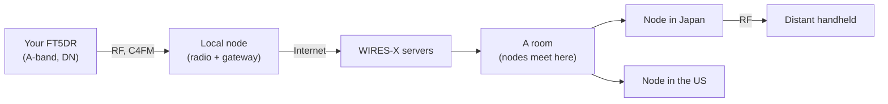
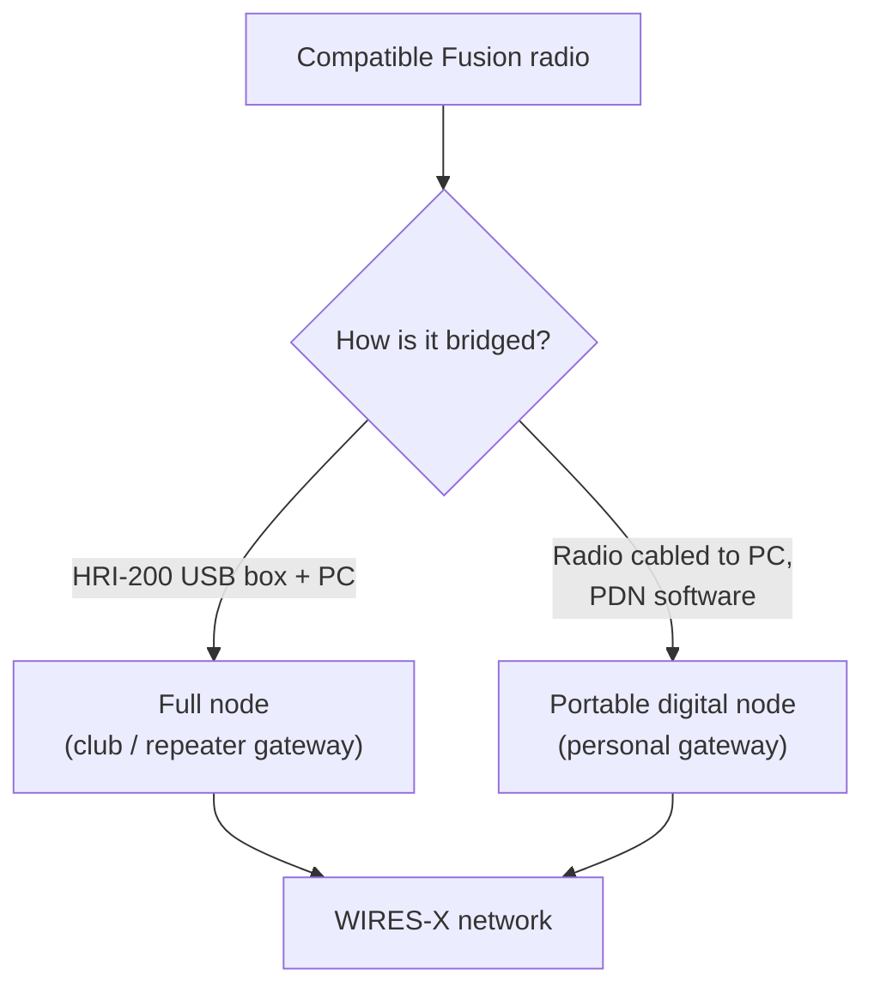
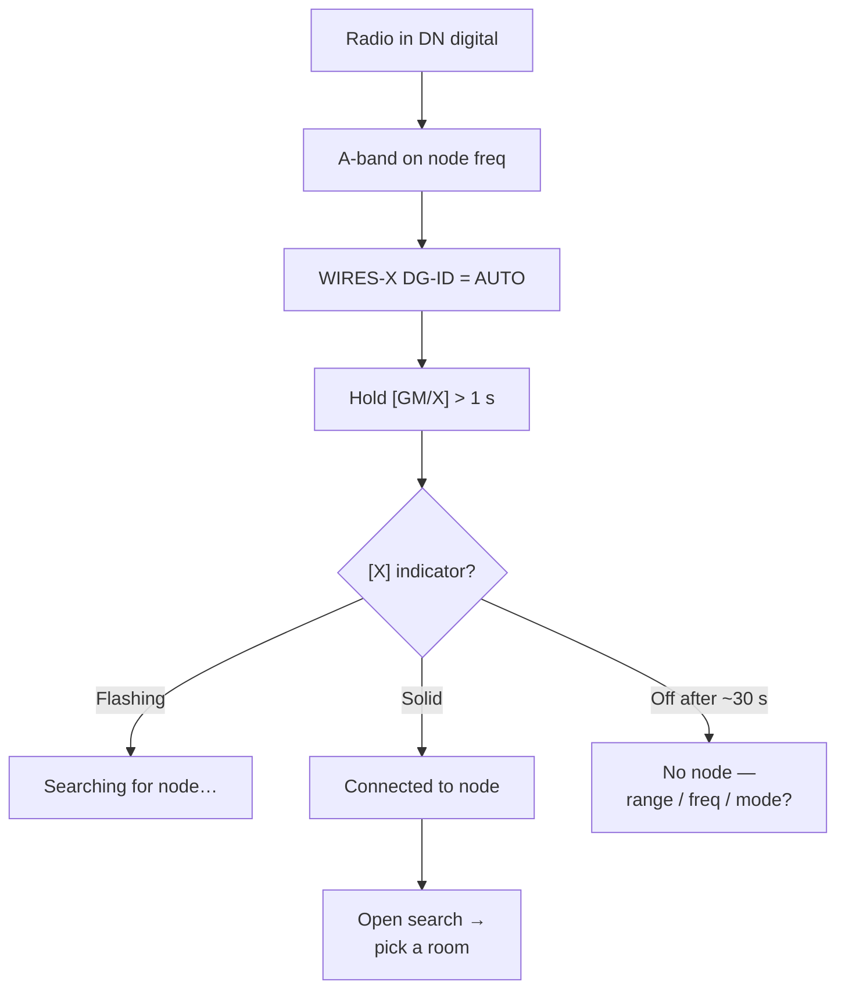
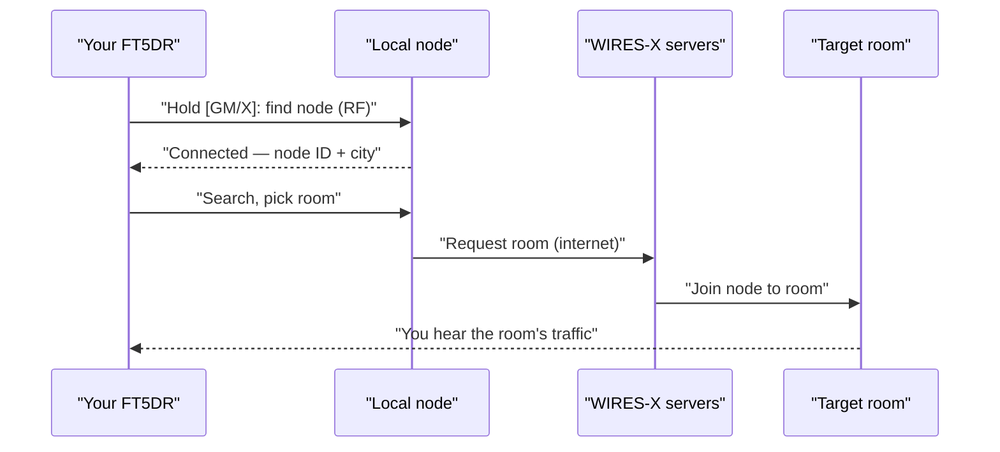

# WIRES-X and group monitor (GM)

A five-watt handheld should, by rights, only reach as far as the next hill. WIRES-X quietly rewrites that: it lets your FT5DR reach a local internet gateway over the air and, through it, talk to Yaesu System Fusion stations on the other side of the planet. Group Monitor — **GM** — is the opposite trick, close and personal: it shows which of your friends are in range right now. This chapter is about WIRES-X in depth — what the network is made of and exactly how you drive it from the radio — and it introduces GM before handing you off to the page that covers GM properly.

## A word about the manuals first

Yaesu documents WIRES-X and GM in their own dedicated PDFs — the **WIRES-X Instruction Manual** and the **GM Function Instruction Manual** — quite separate from the printed Operating Manual and the download-only Advance Manual. That is not an accident: WIRES-X is a whole networking system with server-side rooms, node software and an interface box, and most of that machinery lives at the _node_ end, not in your handheld. So treat this chapter as the map and the driving lesson. When you need the fine print — building your own node, the full room directory, every firmware edge case — those Instruction Manuals are where it lives, and we will point you there at the moment it matters. One reassurance up front, though: **using** WIRES-X needs no sign-up at all — a C4FM set can connect straight to any open local node within radio range without registering. Registration and a Radio ID come into it only when you **build** a node (PDN or HRI-200), never when you simply use one.

Both features are **digital-only**. They ride on C4FM System Fusion in the **DN** (Voice/Data) mode, because they need the data half of the signal that DN carries and that the higher-fidelity **VW** (Voice FR) mode deliberately gives up. If you have not met AMS, DN and VW yet, read [C4FM Digital, AMS & DG-ID / DP-ID](outpost:entry/logbook73.guide.ft5dr/c4fm) first, and skim the universal theory in [C4FM Digital Voice](outpost:entry/logbook73.handbook/c4fm) and [C4FM & WIRES-X](outpost:entry/logbook73.handbook/c4fm-wires-x) — everything below assumes the radio is sitting in digital DN.

## The shape of the network: nodes, rooms and gateways

Before any buttons, get the picture straight, because two words do all the work in WIRES-X and newcomers routinely swap them.

A **node** is a real radio station near you that has been bridged to the internet. Someone has taken an ordinary Fusion set, connected it to a PC and a broadband line, and run Yaesu's node software. On the air it behaves like any Fusion repeater or simplex frequency — you can hear it on your handheld — but it is also a doorway. Everything you say to a node it can forward onto the internet, and everything arriving from the internet it re-transmits on RF for you to hear. A node has a numeric ID and usually a city name.

A **room** is a virtual meeting place living on Yaesu's servers, where many nodes gather so that everyone connected hears everyone else. Other digital systems call the same idea a reflector or a talkgroup. A busy room shows an **activity count** — how many nodes are joined right now — which is how you spot a lively one. A node connects to _one_ room at a time; the room is what stitches distant nodes into a single conversation.

The third piece is the **gateway** — the plumbing that carries a node's digital stream over the internet to the servers and on to whatever room it has joined. You never touch the gateway; it is simply why a node is more than a repeater.

Two consequences follow, and they are the two things beginners get wrong. First, **your FT5DR never connects to the internet**. It has no data connection of its own; it only ever talks over RF to a node, exactly as it would work any Fusion repeater. Second, **you need a node within RF range**. In a city there may be several; in the countryside there may be none — which is where the portable digital node (below) earns its keep.

### PDN versus a full HRI-200 node

There are two ways someone builds a node, and it is worth knowing the difference because it shapes what "a node near you" actually is.

A **full node** uses Yaesu's **HRI-200** interface — a small USB box that sits between a Fusion transceiver and a PC. The box is bus-powered, the PC runs the WIRES-X software, and the whole thing behaves like a permanent gateway, typically on a repeater or a dedicated simplex frequency. This is the classic club node: always on, well sited, open to the public.

A **portable digital node** — Yaesu's **PDN** function, and one of the FT5DR's listed features — skips the HRI-200 entirely. A compatible C4FM radio is cabled straight into a PC running the software, with no interface box and no need for a fixed, globally reachable internet address. It is the cheap, personal way onto WIRES-X: set one up at home and your own handheld reaches the whole network through it; carry a compact version out portable on a mobile-broadband link and you have a personal gateway wherever you have signal.

The important thing for _this_ guide is what it means for your FT5DR: when you operate it handheld, it is the _user_ of a node — but the very same radio can also **be** the node, running Yaesu's PDN mode cabled straight into a PC (the FT5DR is the first set Yaesu lists for the job). That is a separate project with its own rules, walked through in the new [Portable Digital Node](outpost:entry/logbook73.guide.ft5dr/portable-node) chapter and, in full detail, the WIRES-X and PDN Instruction Manuals. If you find yourself node-less in a rural spot and keen on Fusion, a personal node is the standard answer; just know it is a second setup — a deliberate mode you switch the radio into, not something that happens by accident while you are chatting.

## Two jobs, one key

The FT5DR gathers both digital features onto a single physical button, printed with two legends — **GM** and **X** — and the Operating Manual writes it **[GM/X]**. Because the one key carries two jobs, Yaesu's manuals also name it after whichever job they mean: the Advance Manual lists "the **[GM]** key" for Group Monitor and "the **[X]** key" for WIRES-X. They are the same physical button.

The press-versus-hold split is what selects the job:

| Action on the [GM/X] key              | What happens                            |
| ------------------------------------- | --------------------------------------- |
| Short press                           | Turns **GM** (Group Monitor) on and off |
| Press and hold (> 1 second)           | **Starts WIRES-X**                      |
| Press and hold again while in WIRES-X | Returns to normal operation             |

That is straight from the Operating Manual's controls table, and it is worth burning in because the "hold to enter, hold to leave" symmetry is how you get out of WIRES-X cleanly.

One structural rule matters before anything else: **WIRES-X operates on the A-band.** If you are working the B-band and start WIRES-X, the radio moves you to the A-band to do it. This is the mirror image of APRS, which the FT5DR runs on the B-band — a deliberate split so the two data features never compete for the same receiver. (More on the APRS half in [APRS, GPS & Data](outpost:entry/logbook73.guide.ft5dr/aprs).)

## Connecting to a node and joining a room

Here is the whole flow, start to finish, assuming there is a node you can hear. Work through it once slowly and it becomes muscle memory.

**1. Put the radio in digital.** Touch [MODE] until you are in **DN**, or leave AMS on and force the transmit mode to DN with the [TX DN] soft key. The digital **[X]** search will not work in analogue FM, and it needs the data channel that VW does not carry. (⚠️ There is a separate back-door to _analogue_ nodes: stay in FM, hold PTT, touch [DTMF] and key **#** then the node or room's five-digit number; release and stay in receive for about ten seconds to hear audio — no connection screen appears. Disconnect the same way with **#99999**. Fiddly, but it is how you reach an analogue-only gateway.)

**2. Get onto the A-band.** Press [A/B] to make the A-band active if it is not already. (Starting WIRES-X will move you there anyway, but it is tidier to be there deliberately.)

**3. Tune the A-band to the node's frequency.** This is an ordinary VHF or UHF frequency that you find from the node owner, a club, or Yaesu's online active-node list. Confirm you can actually hear digital traffic on it — if the node is silent and you have no signal bar, no amount of button-pressing will connect you.

**4. Set the WIRES-X DG-ID.** Leave it on **AUTO** (the default) unless a node owner has told you a specific number — AUTO connects to any _open_ node. This lives in the WIRES-X menu, covered below, and it is a _different_ setting from the main radio DG-ID.

**5. Press and hold [GM/X] for over a second.** The on-screen **[X]** indicator flashes while the radio searches for a node. When it finds one, [X] lights steadily and the node's ID and city name appear — you are connected to the node and hearing whatever room it is currently linked to.

**6. Move to the room you want.** With [X] solid, open the search screen (below), choose a destination room, and the radio asks the node to connect you. The node does the internet work; your handheld just follows and starts hearing the room.

### The search screen: finding rooms and nodes

Once WIRES-X is active, the search screen is how you browse the network and jump to a destination. The FT5DR gives you a few routes in, and the WIRES-X menu's **SEARCH SETUP** item decides which is the default:

- **By activity** — the busiest rooms first, so you land somewhere with people in it. Good when you just want to find a conversation.
- **By history** — the places you connected to recently, for one-touch return to your regulars.
- **By category or name** — browse Yaesu's directory grouped by region or theme, or type part of a room's name on the keypad to filter it.
- **By ID** — key a room or node's numeric ID directly. This is the quickest route when you already know it — a well-known room often has a memorable five-digit number that people quote like a phone number.

Choose a destination and the node connects you. To leave a room and drop back to the node's own default, **press and hold [BAND]** — that disconnects you from the room (or the node) and returns you to the local-node connection screen. To leave WIRES-X altogether, **press and hold [GM/X]** again — the same hold that got you in takes you back to normal operation. So the clean exit is two holds: **[BAND]** to drop the room, then **[GM/X]** to release WIRES-X.

While you are in WIRES-X, the radio can also show you _where_ the station you are connected to sits: press [F MENU] and touch **[DISP]** to swap to a compass with the partner's callsign, distance and bearing, toggled between heading-up and north-up. It is the WIRES-X cousin of GM's [APL] compass, and [V/M] flips you back to the plain frequency display.

### A worked example: joining a room from cold

Say your nearest reliable node is a 70 cm club machine, and you want to drop into a busy international room one evening.

1. You touch [MODE] until the display shows **DN**, press [A/B] to sit on the A-band, and dial the A-band to the club node's output frequency. You can hear the node ident, so you know it is in range.
2. The WIRES-X DG-ID is already on **AUTO** — the club node is open — so you leave it.
3. You **press and hold [GM/X]**. The **[X]** indicator flashes for a couple of seconds, then goes solid, and the screen shows the node's ID and its town. You are on the node, hearing whatever room it was last linked to — say, a quiet regional room.
4. You open the search screen, switch it to browse **by activity**, and there near the top sits the international room with an activity count of forty-odd nodes. You select it. The radio sends the request; a moment later the room's name appears and you start hearing a QSO already in progress.
5. You wait for a gap, key up in DN, and give your callsign. Your 5 W only had to cross town to the node — the node and the room did the rest.
6. When you are done, you **press and hold [BAND]** to disconnect back to the node, then **press and hold [GM/X]** to leave WIRES-X entirely.

## The WIRES-X menu

Everything you can pre-set about WIRES-X lives in one Setup Menu category. Open the Setup Menu by **pressing and holding the function-menu key** — the Advance Manual prints it **[F MENU]** — then choose **WIRES-X**. Remember the whole-radio quirk: item numbers restart at 1 inside every category, so "menu 5" only means something once you have named the category. WIRES-X has five items.

#### 1 RPT/WIRES FREQ — ⭐ your one-touch node frequency

Stores the frequency of the node you use most, so you can reconnect without dialling it in.

- **Does:** presets a repeater/node frequency that WIRES-X jumps to, letting you reach your home node with a single action instead of retuning by hand each session. The choice is **MANUAL** (the default — use whatever the A-band is on) or **PRESET** (use the stored frequency).
- **Why it exists:** most people have one local node they use daily; typing its frequency every time is tedious and error-prone.
- **On a preset, it looks different:** holding [GM/X] flashes a **[P]** indicator (not [X]) to the left of the frequency while it searches; when a local node is found, **[X]** lights up steadily and the node's ID and town appear, while the **[P]** indicator disappears after **30 seconds** if none is found. If the node it finds is on a different frequency from your preset, the radio **switches to the node's frequency automatically** — which is how a group sharing one preset channel can still drop onto a local node while travelling in another area.
- **UK recommendation:** ⭐ set it to **PRESET** with your nearest reliable node once you have found one that works — then connecting becomes muscle memory.
- **Example:** you regularly use a club node on 70 cm; store it here and a hold of [GM/X] takes you straight to it.
- **Common mistakes:** presetting a node you can rarely hear, so one-touch connect just fails; forgetting the node must be in _RF_ range regardless of what you preset.
- **Should you change it?** Yes, once — set your home node and leave it.

#### 2 SEARCH SETUP — ⭐ how the browse list opens

Controls which view the search screen offers first — **HISTORY** (your recent connections) or **ACTIVITY** (the busiest rooms).

- **Does:** sets the default sorting of the search results so the destinations you actually want are the ones you see first.
- **Why it exists:** the global directory is large; a sensible default view makes finding a room faster.
- **UK recommendation:** ⭐ **ACTIVITY** is a good starting choice — it drops you among rooms with people in them. Switch to **HISTORY** once you have a short list of regulars.
- **Common mistakes:** none serious — this only changes what you see first, never what you can connect to.
- **Should you change it?** For convenience, whenever your habits settle.

#### 3 EDIT CATEGORY TAG — ⭐ build your own favourites tabs

Lets you create up to five personal categories (**C1** to **C5**), each with a name of up to **16 characters**, and file favourite rooms and nodes under them — **up to 20** entries in each.

- **Does:** makes personal category "tabs" so your regular rooms and nodes are grouped where you can reach them quickly, instead of hunting the global list every time. To file the room or node you are currently on, touch **[ADD]** from its menu and choose the category.
- **Why it exists:** everyone has a handful of rooms they actually use; category tags turn the whole network into a short, personal menu.
- **UK recommendation:** ⭐ genuinely worth doing once you know which rooms you like — a UK/EU room, a hobby room, your club's room.
- **Example:** a "Favourites" tab holding your club room and one international room means two taps to either.
- **Common mistakes:** none serious — this is organisation, not signal.
- **Should you change it?** Optional but recommended once you have favourites.

#### 4 REMOVE ROOM/NODE — line item

Deletes entries you previously filed under a category tag (**C1** to **C5**) — housekeeping for the up-to-20-per-tab lists you built in item 3, nothing more.

#### 5 DG-ID — ⭐ the WIRES-X access code (leave it AUTO)

The DG-ID the radio uses specifically for WIRES-X connections — separate from the main radio DG-ID you met in the [C4FM chapter](outpost:entry/logbook73.guide.ft5dr/c4fm).

- **Does:** decides which nodes your radio will connect to. **AUTO** (the default) connects only to **open** nodes — those set to DG-ID 00. A value of **01–99** connects only to nodes configured with that same number.
- **Inside:** it is a matching gate at the node. An open node accepts AUTO callers; a node locked to, say, DG-ID 23 ignores everyone whose WIRES-X DG-ID is not 23.
- **Why it exists:** node owners sometimes want a private or club-only gateway; a shared DG-ID lets a group keep their node to themselves without hiding the frequency.
- **Values:** AUTO (default) / 01–99.
- **UK recommendation:** ⭐ **leave it on AUTO.** The vast majority of nodes you will meet are open. Only set a number when a specific node owner tells you theirs.
- **Common mistakes:** confusing this with the _main_ radio DG-ID that controls which C4FM voice you hear — they are different settings; leaving a leftover number here and then wondering why you cannot connect to an open node.
- **Should you change it?** Rarely — AUTO is right almost always.

## The News function: text, pictures and voice on the network

WIRES-X carries more than live voice. Running quietly alongside every digital connection is **News** — a data service that lets a node or room hold **text messages** (MESSAGE), **still pictures** (PICT) and **audio clips** (VOICE) on the PC behind the local node, ready for any connected digital station to read, download or play. Think of it as a notice-board bolted to the network: the club node can leave a net reminder, someone can post a photograph from a rally, and it sits there until the owner deletes it. ⭐ It is genuinely useful and costs you nothing to read — but note the **microSD card is required**: the radio will not handle News data without a card fitted (that is the second reason, after GM, a card matters).

There are two News stores you can reach. **LOCAL NEWS** is the notice-board living in the node or room you are connected to — the one you and your neighbours can both post to. **INT NEWS** is the WIRES-X server's own board, where you read bulletins and data supplied by Yaesu; that one is download-only, so treat it as read-only.

### Reading messages

While connected, touch the local node's name, then **[NEWS STATION] > [DOWNLOAD] > [MESSAGE]**, and touch a message to download and display it. The content screen carries **[DEL]**, **[FWD]** and **[REPLY]** buttons; press [F MENU] then touch **[DISP]** to see where the sender was when they posted it. Lists come newest-first and, once there are more than twenty, split into pages of 20 with on-screen [TOP] / [▲] / [▼] to page through them. For Yaesu's server bulletins instead, the path is **[INT NEWS] > [NEWS STATION] > [MESSAGE]** — INT NEWS is download-only, so it has no separate [DOWNLOAD] step.

### Importing pictures

Pictures work the same way but through **[PICT]** rather than [MESSAGE]: from the data-type screen touch [PICT], touch the image you want, confirm, and touch **[OK]** — "Waiting" shows while it downloads, then the picture appears. Touch **[SAVE]** to write it to the microSD card. Two error strings are worth recognising: an unsupported image format shows **"NOT COMPLETED"**, and a full card shows **"Memory is full"** — either way you drop back to the data list.

### Emergency vs routine

News comes in two classes. A **NEWS STATION** item is the ordinary sort — a routine message, picture or clip you can read or play any time it stays undeleted on the node or room. An **EMERGENCY** item is different: depending on the node/room settings, an emergency bulletin is pushed to every connected node and room in **five-minute intervals for two hours** from when it was first sent, and anything registered within the past two hours **flashes** in the list so it catches your eye. In the menus you reach the urgent ones by touching [EMERGENCY], the routine ones by touching [VOICE] for audio or [MESSAGE] for text.

### Listening to audio — but you cannot keep it

VOICE items play straight off the node or room in real time; while a clip runs, **"DOWNLOAD"** flashes on screen, and [F MENU] > [DISP] shows where the sender was when it was recorded. One hard limit to know before you go hunting for a save button: **you can play audio News but you cannot save it to the transceiver.** Pictures write to the microSD with **[SAVE]**, and received text is kept in the node's log automatically (its content screen offers only [DEL]/[FWD]/[REPLY], with no save button); audio, by contrast, is listen-only, played on the spot and never stored locally — if you want to keep it, that is not something the FT5DR will do for you.

### Posting your own News

You can post to a node or room's board as well as read it — on the connected node/room's menu the entry point is **[NEWS STATION] > [UPLOAD]**.

- **New text:** [UPLOAD] > [MESSAGE] > [NEW] > [EDIT], type your message, press and hold [BACK] for over a second to confirm, then [UPLOAD] to send. On the character screen, **[MTXT]** drops in one of 19 canned lines — the usual Q-codes (QRM, QRP, QRT, QRX, QRZ, QSY) and everyday phrases (Good morning, on my way, Pick me up, Thank you, OK, urgent) — handy when you are thumbing a keypad.
- **Something you already saved:** touch [MESSAGE] or [PICT], pick the item, then [UPLOAD] for a message or [FWD] for a picture — "Completed" confirms it.
- **Voice:** [UPLOAD] > [VOICE], hold PTT and speak into the mic — the **maximum clip is one minute** — then release; "COMPLETED" appears. An emergency clip is the same but starts from [EMERGENCY] and beeps when it finishes.

## GM (Group Monitor): who is in range

WIRES-X reaches outward; **GM** looks close to home. Group Monitor is a feature for a _group_ of Fusion operators — a club net, friends on a walk, a SOTA or POTA team — that continuously shows **which members are in radio range** and, with GPS, how far away and in what direction each one sits. A short press of [GM/X] turns it on; another press turns it off. Because GM needs the data channel, activating it moves the radio to the **A-band** and **DN** mode, just like WIRES-X.

On screen it behaves like a live roster. The FT5DR lists the stations running GM on your frequency, drawing in-range callsigns in white and out-of-range ones in grey, so you can see at a glance who has just come over the hill and who has drifted away. Touch **[APL]** and those members plot onto a compass centred on you, with bearing and distance. GM can also carry short text messages and small photographs between radios, written to the microSD card — which is why a card matters for the digital features, and why both stations must be in DN for any of it to pass.

There is one gotcha that decides whether GM does anything useful, and it catches everyone: GM recognises individual radios by their **DP-ID**, but **DP-ID filtering does nothing while your RX DG-ID is 00** (the setting that hears every C4FM station). To make GM's personal filtering matter, the group agrees a non-zero DG-ID and everyone sets it.

That is the orientation. The full GM story — the DP-ID list and how to register members, the RADIO ID CHECK item, the APL compass in detail, messages and pictures, and how GM sits alongside the FT5DR's **PMG** (Primary Memory Group) feature on the adjacent key — has a page of its own. Read it next: [PMG, GM & DG-ID](outpost:entry/logbook73.guide.ft5dr/pmg-gm-dgid).

## Try it yourself

With a charged battery, the antenna fitted, your callsign set, and a microSD card formatted in the radio:

1. **Find a node.** Look up a WIRES-X node near you (a node list, or ask locally). Put the radio in **DN**, tune the **A-band** to that node's frequency, and confirm you can hear digital traffic on it.
2. **Connect.** Leave the WIRES-X **DG-ID on AUTO**, then **press and hold [GM/X]** for over a second. Watch the **[X]** indicator: flashing means searching, solid means connected. If it never settles, re-check mode, band and frequency.
3. **Join a room.** With [X] solid, open the search screen, browse **by activity** to a room that interests you, and listen. Then **press and hold [BAND]** to disconnect back to the node, and hold [GM/X] to leave WIRES-X.
4. **Make a favourites tab.** In **Setup Menu → WIRES-X → 3 EDIT CATEGORY TAG**, create a category (C1–C5) and file the room you just enjoyed into it.
5. **Peek at GM.** Short-press [GM/X] to bring up the Group Monitor roster, see what the screen looks like with no one else on it yet, then read the [PMG, GM & DG-ID](outpost:entry/logbook73.guide.ft5dr/pmg-gm-dgid) page before you try it with a friend.

## Key takeaways

- **WIRES-X links C4FM stations worldwide over the internet**, but your handheld only ever talks over RF to a **node**; the node is the gateway, and a **room** is the multi-node meeting place it joins. You must be in **digital DN** and in **RF range of a node** for any of it to work.
- **A node is a real station bridged to the internet** — either a full **HRI-200** setup or a **portable digital node (PDN)** running a radio straight into a PC. Your FT5DR is the _user_ of a node when you operate it handheld — but it can also **be** the node in PDN mode (see [Portable Digital Node](outpost:entry/logbook73.guide.ft5dr/portable-node)).
- **Both features share the [GM/X] key**: short press for **GM**, press-and-hold over a second to **start WIRES-X**, hold again to leave. WIRES-X runs on the **A-band** — the mirror of APRS on the B-band.
- **Connect** by tuning the A-band to the node frequency and **holding [GM/X]**; the **[X]** indicator flashes then goes solid. The **search screen** joins **rooms** by activity, history, name or numeric ID.
- Leave the **WIRES-X DG-ID on AUTO** (it connects to open nodes); set 01–99 only when a node owner asks. It is a _different_ setting from the main radio DG-ID.
- **GM (Group Monitor)** shows which of your group are **in range** and where — but its DP-ID filtering is bypassed while RX DG-ID is 00, and the full detail lives on the next page.
- **Yaesu documents both features in dedicated Instruction Manuals** (WIRES-X and GM); this chapter is the orientation and the on-radio operation — reach for those PDFs for node-building and the full room directory.

Next, we open up GM properly — the DP-ID roster, the APL compass, messages and pictures — and its keyboard neighbour, the Primary Memory Group: [PMG, GM & DG-ID](outpost:entry/logbook73.guide.ft5dr/pmg-gm-dgid).
