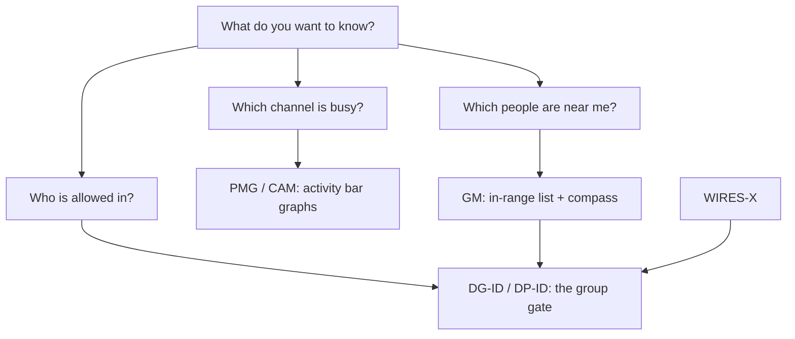
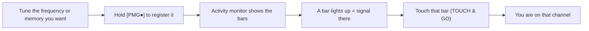
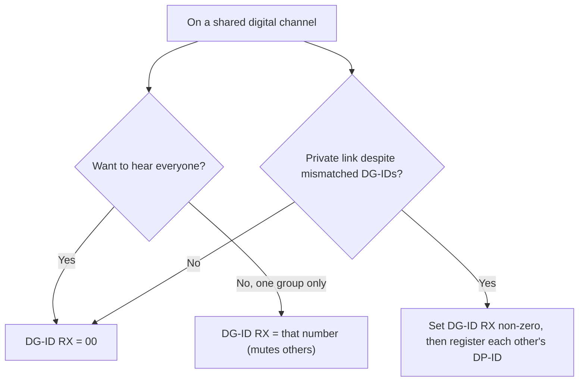
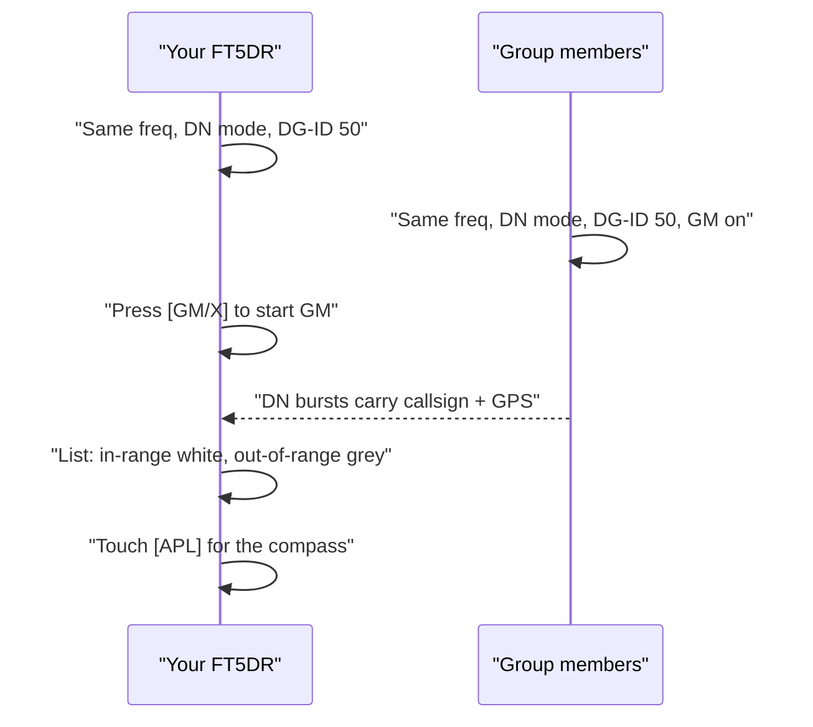

# PMG, GM and DG-ID: knowing who is there

Three of the FT5DR's most useful features sit under keys most owners never touch, partly because their names all start to blur together: PMG, CAM, GM, DG-ID, DP-ID. They answer three genuinely different questions, though — _which channel is busy right now_, _which people are near me right now_, and _who is allowed into this conversation_ — and once you separate those questions the keys stop feeling cryptic. This page pulls them apart one at a time, grounds every key press in the FT5DR manuals, and gives you a worked walkthrough for each.

If you have not yet met C4FM digital voice itself, read [the FT5DR C4FM page](outpost:entry/logbook73.guide.ft5dr/c4fm) and the universal theory in [C4FM & System Fusion](outpost:entry/logbook73.handbook/c4fm) first — everything below assumes you know what the `DN` (V/D) digital mode is, because two of these three features only work in it.

## Three features, three different questions

It helps to fix the mental model before any buttons get pressed. The FT5DR has a family of "watch several things at once" tools, and they split cleanly by _what_ they watch:

- **PMG** and **CAM** watch **frequencies**. They show you, as live bar graphs, which of your favourite channels are carrying a signal — so you can pounce on whichever one lights up. They do not care whether the traffic is digital or analogue, and they say nothing about who is transmitting.
- **GM** (Group Monitor) watches **people**. On a shared digital frequency it lists which stations running GM are within range, and — with GPS — how far away each one is and in which direction. It is about presence and position, not channel-hunting.
- **DG-ID** and **DP-ID** are not monitors at all. They are the **gate**: two-digit group codes and per-radio personal codes that decide who you hear and who hears you on a shared digital channel. They sit underneath GM and underneath [WIRES-X](outpost:entry/logbook73.guide.ft5dr/wires-x-gm), quietly controlling both.

Keep that split in mind and the rest is detail. Now the reference table, then each feature in turn.

## The comparison at a glance

| Feature                                         | Watches                                       | Key to open           | Digital / analogue | Capacity                                 | Needs GPS?                  | Needs microSD?           |
| ----------------------------------------------- | --------------------------------------------- | --------------------- | ------------------ | ---------------------------------------- | --------------------------- | ------------------------ |
| **PMG** (Primary Memory Group activity monitor) | Signal strength on your go-to frequencies     | `[PMG●]`              | Both               | Up to 5 frequencies (VFO or memory)      | No                          | No                       |
| **CAM** (Channel Activity Monitor)              | Signal strength on grouped memory channels    | `[F menu]` → `[CAM]`  | Both               | Up to 10 groups of 5 memory channels     | No                          | No                       |
| **GM** (Group Monitor)                          | Who is in range, their distance and direction | `[GM/X]` (press)      | Digital `DN` only  | The stations on-frequency running GM     | Yes, for distance/direction | Only for messages/images |
| **Dual Receive** (priority watch)               | One priority channel while you use another    | Set Mode / `[PRI.CH]` | Both               | One priority channel, checked ~every 5 s | No                          | No                       |

A few things fall straight out of that table. PMG and CAM are the everyday "favourites at a glance" tools and work on any mode. GM is the digital-only presence tool and is the only one that involves other operators' radios at all. Dual Receive is the odd one out — it is a background _listening_ function (it keeps one ear on a priority channel while you operate elsewhere), not a screen full of bars, and it is covered fully on [the memory page](outpost:entry/logbook73.guide.ft5dr/memory); it earns its place here only so you do not confuse it with the others. One close relative is deliberately kept out of the table: the **Band Scope** (`[F menu]` → `[SCOPE]`), which draws signal strength for a run of channels _above and below_ wherever you are tuned. That answers "what is busy around my current frequency?" rather than "which of my chosen favourites is busy?", so it is not a favourites tool at all — it lives in full on [the scan and scope page](outpost:entry/logbook73.guide.ft5dr/scan-scope).

## PMG — your five go-to frequencies on one screen

PMG stands for **Primary Memory Group** — though be warned, Yaesu's own keypad table calls the same key "Priority Memory Group Activity Monitor". Marketing says _Primary_, the manual's controls table says _Priority_; it is one feature, so do not go hunting for two. The `●` on the keycap simply marks the press-and-hold function, which you will use in a moment. And do not read too much into that word "Group": PMG holds a single flat set of up to five frequencies with no sub-groups. Only CAM, below, subdivides — into ten named groups — so if you find yourself hunting for a second PMG group, there isn't one.

The idea is small and lovely: register up to five frequencies you care about, and PMG draws each one as a **bar graph** whose height is the received signal strength on that channel — an "activity monitor". You watch all five at once, and the instant one lights up you **touch its bar** to jump straight there and start listening or transmitting. Yaesu calls that last move **TOUCH & GO**. The manual's own advice is not to feel obliged to fill all five slots: registering two or three frequently used frequencies is where PMG is at its most useful.

### Walkthrough: build and use a PMG monitor

1. **Register the first frequency.** Set the VFO to a frequency (or recall a memory channel) you want to watch — say your local 2 m simplex calling frequency. Press and hold `[PMG●]` for over one second. The radio registers that channel and drops you into the activity-monitor screen with one bar showing.
2. **Add more.** Press `[PMG●]` (a short press) or `[BACK]` to return to the normal screen, tune the next frequency, and hold `[PMG●]` again. Repeat up to five times. If you try to register a channel that is already in PMG, the radio sounds an error alarm and refuses — no duplicates. Unlike CAM below, PMG happily accepts **both** raw VFO frequencies and memory channels, which is why it is the more flexible of the two.
3. **Watch and pounce.** With PMG active, the bars rise and fall with activity. The currently selected channel's bar is drawn in **orange**; the others sit in the normal colour. When one lifts, touch it. That bar turns orange, the radio retunes there, and you can key up immediately. You can also spin the `DIAL` knob to step between the registered channels instead of touching.
4. **Leave PMG.** A short press of `[PMG●]` toggles between the PMG activity-monitor view and your ordinary VFO or memory mode; `[BACK]` also returns you to the screen you started from. Your registrations survive — PMG is still built, just not on screen. On the A/B band-mode indicator, PMG mode shows its own little icon so you always know which mode a band is in.

### The 108–580 MHz catch

The bar graph can only draw signal strength for frequencies inside the **108 to 580 MHz** window. Register something outside that — a shortwave broadcast band, the AM/FM broadcast band, 50 MHz, and so on — and PMG shows a permanently **grey** bar for it. That is not a fault: you can still _touch_ the grey bar to retune there and hear the signal, you just do not get a live strength reading. A grey bar can therefore mean one of two different things, so read it in context:

- On an in-range VHF/UHF entry: the signal has simply dropped away (no traffic right now).
- On an out-of-band entry (HF, 6 m, broadcast): it will _always_ be grey, by design.

### Removing a channel

To unregister one, select it (touch its bar or turn `DIAL` to it) and press and hold `[PMG●]`. It is removed. When you delete the **last** remaining channel the registration count hits zero, PMG switches itself off, and the display returns to normal. There is no separate "clear all" — you delete them one at a time, or just empty the last one to collapse the whole group.

## CAM — ten groups of five, drawn from your memories

CAM, the **Channel Activity Monitor**, is PMG's bigger sibling and looks almost identical on screen: the same style of live bar graph, the same **TOUCH & GO** so that touching a bar makes it the operating frequency and lets you answer immediately with the `PTT`. Two things set it apart, and they are the whole reason it exists:

- **Capacity.** CAM holds up to **10 groups of 5 memory channels** — fifty channels in all, organised into named groups you can name yourself (up to 16 characters each). PMG's flat list of five is for your handful of daily drivers; CAM is for the club net's channel set, the contest group, the holiday repeaters, each in its own group you switch between.
- **Memory channels only.** CAM can _only_ register channels you have already stored as memories. PMG, by contrast, takes VFO frequencies too. So the honest rule of thumb is: **PMG for quick, ad-hoc watching of whatever you have dialled up; CAM for a curated, named, standing set of memories.**

CAM lives under the [Function menu](outpost:entry/logbook73.guide.ft5dr/operating-basics), not on a dedicated key.

### Walkthrough: build a CAM group

1. Press `[F menu]`, then touch `[CAM]`. (If `[CAM]` is not on the first page of soft keys, touch `[FWD →]` until it appears, then touch it.) The CAM screen opens.
2. Touch `[GROUP]` and turn `DIAL` to pick the group to fill, from `GROUP 01` to `GROUP 10`.
3. Touch `[EDIT]` to see that group's channel list. A handy toggle here: pressing `[V/M●]` switches the list between showing memory **tags** (names) and raw **frequencies** — press and hold `[V/M●]` to flip between the two displays.
4. Turn `DIAL` to the memory channel you want, touch `[ADD]`, then turn `DIAL` to confirm the channel and touch `[ENT]`. Repeat to add up to five channels to the group. The radio refuses to register the same memory twice in one group. If your memory list is long, touch the fast-forward soft key to jump ten channels at a time.
5. Press `[BACK]` to return to the CAM screen. The bars for that group now show live signal strength; touch any bar to go there.

To switch which group is on display, touch `[GROUP]` and pick another. To tidy up, `[EDIT]` a group and touch `[DEL]` to remove one channel (confirm the `DELETE?` prompt with `[OK]` twice), or `[CLEAR]` to empty an entire group at once — at either prompt, touch `[CANCEL]` instead of `[OK]` to back out without deleting a thing. `[NAME]` lets you rename a group so `GROUP 03` becomes, say, `CLUB NET`: you get up to 16 characters, with `[←]`/`[→]` to move the cursor, `[INS]` to insert a space at it, the backspace key to erase the character under it, and `[Space]` to type a space — then press `[F menu]` to confirm the name, or `[BACK]` to return to the CAM screen leaving the old tag unchanged.

## DG-ID and DP-ID — the gate behind GM and WIRES-X

This is the section most FT5DR owners get wrong, and it is worth reading slowly, because the same setting that unlocks GM is also the classic cause of "my radio has gone deaf". DG-ID and DP-ID are covered in full theory on [C4FM modes & IDs](outpost:entry/logbook73.handbook/c4fm-modes); here is the FT5DR-specific version.

### DG-ID: a two-digit group gate

A **Digital Group ID** is a number from **00 to 99** that acts like a talk-group label on a shared C4FM frequency or repeater. You set it **separately** for transmit (`DG-ID TX`) and receive (`DG-ID RX`). The behaviour is:

- **RX 00 is the open, hear-everything value.** With `DG-ID RX` set to `00`, your radio decodes signals with _any_ DG-ID. This is — and should stay — the normal setting.
- **RX non-zero hears only that one number.** Set `DG-ID RX` to, say, `50`, and the radio now opens the speaker _only_ for stations transmitting DG-ID 50. Everyone else, **including open 00 stations**, is silenced. That is the trap: a non-zero receive DG-ID is a deliberate mute of the whole rest of the channel. If a busy repeater suddenly goes silent, your first check is `DG-ID RX`.
- **TX is how you get _into_ a group or repeater.** To work a closed group, everyone sets both TX and RX to the same non-zero number. To access a C4FM repeater that gates on a DG-ID, set your `DG-ID TX` to the repeater's required number — but usually leave `DG-ID RX` at `00` so you still hear all of the repeater's downlink traffic.

**Setting it on the FT5DR:**

1. Press `[F menu]`, then touch `[DG-ID]` (touch `[BACK ←]` to find it if it is not on the first soft-key page). The DG-ID setting screen appears, showing `DG-ID TX` and `DG-ID RX`.
2. Rotate `DIAL` to set the transmit number, `DG-ID TX`.
3. Press `[F menu]`, then rotate `DIAL` to set the receive number, `DG-ID RX`.
4. Press `[BACK]` or the `PTT` to save and return to normal operation.

There is a fast reset worth memorising: **while you are in the DG-ID setting screen, press and hold `[GM/X]` to slam both TX and RX back to `00`.** That is your one-move cure for the "gone deaf" problem — it puts you back to open receive instantly.

### DP-ID: a per-radio personal key for GM

A **Digital Personal ID** is a different kind of thing entirely. Every C4FM radio already transmits a unique built-in Radio ID with every over; DP-ID is the feature that _uses_ it. It is **not** a number you choose from 00–99 — it is tied to the individual transceiver. Its job: let two specific radios talk to each other under GM **even when their DG-ID numbers differ**, by each registering the other's personal ID.

Two things to hold onto:

- **DP-ID does nothing while `DG-ID RX` is `00`.** To make DP-ID filtering take effect you must set a non-zero receive DG-ID. (This is the one legitimate reason to leave RX non-zero.)
- **Registration is mutual.** Station A registers B's DP-ID _and_ B registers A's; only then do they hear each other regardless of DG-ID mismatch. Register just one side and it will not work both ways.

On the FT5DR you register another station's DP-ID like this: press and hold `[F MENU]`, touch `[GM]`, then touch `[1 DP-ID LIST]` to open the list. When that station next transmits in C4FM digital nearby, the radio shows their callsign and `REGISTRATION?` — touch `[OK]` and it is saved (`COMPLETED` appears for three seconds). You can register up to **24** stations. To remove one, open the same list, turn `DIAL` to the callsign, touch `[DEL]` and confirm with `[OK]`.

### How the IDs gate WIRES-X

The same DG-ID mechanism reaches into [WIRES-X](outpost:entry/logbook73.guide.ft5dr/wires-x-gm) and the open [YSF network](outpost:entry/logbook73.handbook/c4fm-wires-x). Many WIRES-X nodes and rooms are entered by setting a particular `DG-ID TX`; the node only forwards traffic tagged with its number. So the DG-ID screen you just learned is not only for local groups — it is often the key that lets you into an internet-linked room. When you press and hold `[GM/X]` for over a second to start WIRES-X (the same physical key as GM — more on that shortcut below), the DG-ID you have set can determine whether the node accepts you. Treat DG-ID as one setting that quietly governs three different things: local groups, GM membership, and node access.

## GM — who is out there, and where

Now the headline feature. **Group Monitor** turns the FT5DR into a passive presence radar for a digital net. Press the `[GM/X]` key and the radio listens on the current frequency for other stations that also have GM switched on, and builds a live list of them. In-range stations' callsigns are drawn in **white**; stations that have dropped out of range are shown in **grey** — so you can watch members fade in and out as a group spreads across a hillside or a convoy strings out along a road. Next to each callsign the radio shows the **direction** and **distance** to that station. The FT5DR's separate GM Instruction Manual (on Yaesu's site) covers the finer points; the operating essentials are below.

Because GM piggybacks on the position and callsign data that only the `DN` (V/D) digital mode carries, it has hard requirements. Everyone in the group must be:

- on the **same frequency**;
- in **`DN` digital mode** (GM is a digital-only feature — it cannot see analogue FM or full-rate `VW` stations);
- running **GM switched on**; and
- either sharing the **same non-zero DG-ID**, or linked by **registered DP-IDs**.

For the distance and direction to appear, **both** radios need a GPS fix — yours to know where you are, theirs to tell you where they are. If your GPS is off you can still see the _list_ of who is present, you just will not get the geometry. (GPS is enabled via `[F MENU]` → `[APRS]` → `[20 GPS POWER]`; give it a few minutes of open sky on a cold start.)

### The APL compass

The list is useful, but the party trick is the compass. From the GM screen, touch `[APL]` (Automatic Position Locating) and the radio plots your group members as arrows on a compass rose **centred on you**, with their bearing and distance shown out to a radius of around 1000 km — up to four members at once. You can flip the rose between **North-Up** (`N-UP`, north always at the top) and **Heading-Up** (`H-UP`, the way you are pointing at the top), which matters a great deal if you are actually walking with the radio in your hand. Touch `[LOG]` on the GM screen instead to review messages and photos exchanged with the group. Those media features — recorded voice, short text messages, and images from a camera microphone — do need a **microSD card** in the radio (2–32 GB SD/SDHC; microSDXC is _not_ supported; format it in the radio). The live who's-here list and the compass do **not** need a card — only the stored messages and images do.

### Walkthrough: GM for a group activation or a hike

Picture a Saturday hilltop activation with three friends, or a walk where you want to keep tabs on the group.

1. **Agree the plan off-air.** Everyone picks the same simplex frequency, the same non-zero DG-ID (say `50`), and agrees to run `DN` mode with GM on. Doing this before you split up saves a lot of shouting later.
2. **Set the frequency and DG-ID.** Tune the agreed frequency. Press `[F menu]` → `[DG-ID]`, set `DG-ID TX` and `DG-ID RX` both to `50` (a closed group), and save with `[BACK]`. Make sure you are in `DN` — if the mode soft key shows `AMS` or `FM`, touch it until the display reads `DN`. See [the C4FM page](outpost:entry/logbook73.guide.ft5dr/c4fm) for the mode softkeys.
3. **Confirm GPS.** Check the GPS icon is solid, not blinking. Blinking means it is still searching; move to open sky.
4. **Start GM.** Press `[GM/X]`. The GM screen appears and, as your friends key up or as their radios beacon, their callsigns populate the list — white for in range, grey for out. Distances and a direction arrow appear beside each once both ends have a fix.
5. **Use the compass.** Touch `[APL]`. Now you can see, at a glance, that G4ABC is 2 km to your north-east and M0XYZ has slipped 6 km to the south-west and gone grey. Flip to `H-UP` if you are on the move so "straight ahead" is at the top of the rose.
6. **Message the group.** With a microSD fitted, touch `[LOG]` to send a short text or a picture to everyone or to one member's callsign — handy for "at the summit" or "heading down the far side".
7. **Finish.** Press `[GM/X]` again to switch GM off and return to normal operation.

If, instead, you want a private two-person link on a busy shared channel where you and a friend happen to be running _different_ DG-IDs, that is the DP-ID case: set both radios' `DG-ID RX` to a non-zero value, register each other's DP-ID from `[F MENU]` → `[GM]` → `[1 DP-ID LIST]`, and GM will pair you regardless of the DG-ID mismatch.

## The three keys: tap versus hold

Because `[GM/X]` and `[PMG●]` each do one thing tapped and a different thing held, it is worth a small reference of its own. This is the single most common source of "I pressed the button and the wrong thing happened".

| Key                                    | Short press                                                  | Press and hold (> 1 s)                                                            |
| -------------------------------------- | ------------------------------------------------------------ | --------------------------------------------------------------------------------- |
| `[PMG●]`                               | Toggle the PMG activity-monitor view against VFO/memory mode | Register the current channel into PMG (or, on a selected member, remove it)       |
| `[GM/X]`                               | Turn GM (Group Monitor) on / off                             | Start WIRES-X (and, when WIRES-X is running, hold again to return to normal mode) |
| `[GM/X]` _(while in the DG-ID screen)_ | —                                                            | Reset both `DG-ID TX` and `DG-ID RX` to `00`                                      |

Two notes. First, GM and WIRES-X share the one `[GM/X]` key — a tap is GM, a long hold is WIRES-X — so a slightly-too-long press when you meant GM can launch WIRES-X instead; be deliberate. Second, the DG-ID-zeroing hold only works _inside_ the DG-ID setting screen, so open `[F menu]` → `[DG-ID]` first, then hold `[GM/X]`.

## Try it yourself

You do not need a group on the air to get fluent with these:

- **Build a PMG monitor from cold.** Register your two local repeater outputs and your favourite simplex calling frequency into PMG (hold `[PMG●]` on each). Leave the radio on the bench for an evening and watch which bars light up — you will quickly learn which channel your area actually uses.
- **Prove the "gone deaf" trap to yourself.** In `DN` mode, deliberately set `DG-ID RX` to `50` while a friend transmits on `00`. Notice the `TX/BUSY` LED still _blinks_ (the radio hears a signal) but the speaker stays shut — that blink-without-audio is the fingerprint of a non-zero RX DG-ID. Then, from the DG-ID screen, hold `[GM/X]` to zero it and hear the channel return.
- **Run GM solo.** With just one radio you cannot populate the list, but pressing `[GM/X]` and touching `[APL]` shows you the empty compass rose and lets you practise the `N-UP`/`H-UP` toggle so it is second nature on the hill.

Log the repeaters and simplex frequencies you settle on into LogBook73's memory planner so the PMG and CAM sets you build here match the channels you actually work.

## Key takeaways

- **PMG, CAM and GM answer different questions.** PMG and CAM watch _frequencies_ (which channel is busy, any mode); GM watches _people_ (who is in range and where, digital `DN` only). Do not conflate the neighbouring keys.
- **PMG** holds up to five VFO-or-memory frequencies as live bars — hold `[PMG●]` to register, touch a bar for TOUCH & GO. Bars outside 108–580 MHz show grey by design.
- **CAM** is the bigger, memory-only version: up to ten named groups of five, reached by `[F menu]` → `[CAM]`. Use PMG for ad-hoc watching, CAM for a curated standing set.
- **DG-ID (00–99, set TX and RX separately) is the group gate.** `RX 00` hears everyone; any non-zero RX silences the rest of the channel — the classic "gone deaf" fault. In the DG-ID screen, hold `[GM/X]` to reset both to `00`.
- **DP-ID is a per-radio personal key**, not a number you pick; it lets two radios pair under GM despite mismatched DG-IDs, but only works when `DG-ID RX` is non-zero and both sides register each other.
- **GM** (press `[GM/X]`) lists in-range members in white, out-of-range in grey, and — with GPS on both ends — plots up to four on the `[APL]` compass out to ~1000 km. It needs `DN` mode, a shared frequency, and a shared non-zero DG-ID (or registered DP-IDs); only its messages and images need a microSD card.
- **`[GM/X]` and `[PMG●]` each do one thing tapped and another held** — and `[GM/X]` doubles as the WIRES-X launcher on a long hold.

Next, put your position on the map for the wider world rather than just your GM group: [APRS on the FT5DR](outpost:entry/logbook73.guide.ft5dr/aprs).
