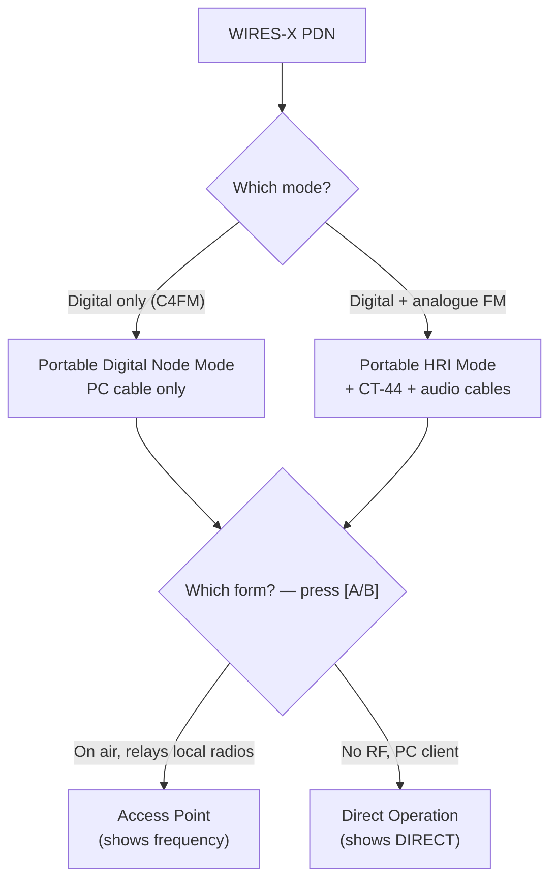
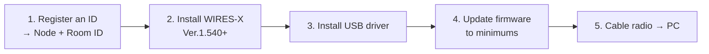
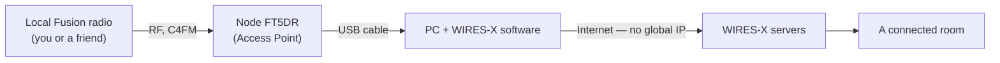

# Running your own portable digital node

In the [WIRES-X & Group Monitor](outpost:entry/logbook73.guide.ft5dr/wires-x-gm) chapter your FT5DR was the _user_ of a node — a five-watt handheld reaching a gateway that somebody else had built. This chapter turns that round: the very same radio, cabled to a PC, can _be_ the gateway. That is the **Portable Digital Node** — Yaesu calls the function **PDN** — and the FT5DR is the first handheld Yaesu lists for the job. It is not a hidden mode you stumble into while chatting; it is a deliberate, second setup, and what follows is the honest walk-through of building one. ⚠️ Treat this as an advanced project, not a beginner's first evening on the radio.

## Why run your own node?

The [WIRES-X & Group Monitor](outpost:entry/logbook73.guide.ft5dr/wires-x-gm) chapter drew the difference between a **full HRI-200 node** — the classic club machine, an interface box between a Fusion radio and a PC — and a **portable digital node**, which skips that box entirely. This chapter is about the second kind: what it is for, what it costs you in kit and effort, and exactly how you switch the FT5DR into it.

The appeal is straightforward. A PDN is a **personal WIRES-X gateway**. There is no HRI-200 to buy, and — this is the part that makes it home-friendly — **no fixed or dynamic global IP address is required** on your broadband line. An ordinary domestic connection behind a router is enough. So if you live somewhere with no node within radio range, or you want a private doorway onto the network that answers only to you and your friends, you cable a compatible Fusion set into a PC, run Yaesu's software, and your own handheld reaches the whole WIRES-X world through it. Set one up at home; carry a compact version out on mobile broadband and you have a gateway wherever you have signal.

Before you get excited, set expectations honestly. The manual is blunt about the boundary:

> With the WIRES-X Portable Digital Node function, you cannot operate a WIRES-X Room (including a digital room), or use the remote-control function from the outside.

In plain terms: a PDN lets you connect **into** existing nodes and rooms, but you **cannot host your own room** on it, and it cannot be **remote-controlled** from elsewhere. It is a private on-ramp, not a public meeting place. If hosting a room is what you are after, that is HRI-200 territory, and a different project altogether.

## The two modes

A PDN runs in one of two modes, and you choose between them before you buy a single cable, because the mode decides what you need.

| Mode                          | What it carries over the internet  | Extra kit beyond the PC cable   |
| ----------------------------- | ---------------------------------- | ------------------------------- |
| ✅ Portable Digital Node Mode | **C4FM digital only**              | none — PC connection cable only |
| ⚠️ Portable HRI Mode          | **C4FM digital _and_ analogue FM** | CT-44 adapter + audio cables    |

One point of vocabulary trips people, so clear it up now: **"HRI" here is the name of a mode, not the hardware.** Portable HRI Mode does _not_ use an HRI-200 box — no PDN mode does. The name simply signals that this mode behaves like a full HRI-200 node in one respect: it can bridge **analogue FM** stations onto the internet as well as digital ones. In Digital Node Mode, the MIC/SP terminal need not even be connected; the radio talks to the PC through the DATA jack alone.

The rule of thumb: if you only ever work Fusion digital, ✅ **Portable Digital Node Mode is the simpler build** — fewer cables, less to go wrong. Choose ⚠️ **Portable HRI Mode only if you genuinely need to relay analogue FM** stations to and from the internet too.

### Access Point vs Direct Operation

Each of the two modes then runs in one of two _forms_, and you pick the form on the radio after power-on with the **[A/B]** key.

| Form                 | Node radio on air?           | Who can use it                                           | Screen shows        |
| -------------------- | ---------------------------- | -------------------------------------------------------- | ------------------- |
| **Access Point**     | **Yes** — transmits/receives | local C4FM radios _and_ the node's own PTT reach WIRES-X | operating frequency |
| **Direct Operation** | **No** — no RF at all        | only the operator at the node itself                     | **DIRECT**          |

In **Access Point** the node transceiver goes on air. It relays nearby local Fusion transceivers to and from the internet, and you can also work it directly from its own microphone — so one radio, or several, in your house or your group can reach WIRES-X through your node. This is the form you want if the point of the exercise is to give your handheld (or a friend's) a doorway onto the network.

In **Direct Operation** the node transceiver does not transmit or receive over the air at all. It becomes, in effect, a desktop internet client with **no RF footprint** — internet audio is heard only from the PC's speaker. On the screen, the giveaway is the word **DIRECT** where the operating frequency would normally sit. Choose this form when you just want to sit at the PC and work rooms directly, without radiating anything.

## What you need

Building a node is a five-step preparation, and it pays to have everything lined up before you start rather than discovering a missing cable at step five.

### The kit and cables

The FT5DR/FT5DE connects to the PC through Yaesu's **WIRES-X Connection Cable Kit**, sold as either the **SCU-57 kit** or the **SCU-39 kit**. The two kits are largely the same bundle; the difference is which PC cable is inside.

| Item                           | Where it comes from       | What it is for                                                                   |
| ------------------------------ | ------------------------- | -------------------------------------------------------------------------------- |
| **SCU-55** PC connection cable | inside the **SCU-57** kit | radio **DATA** jack ↔ PC USB — the _only_ cable Digital Node Mode needs          |
| **SCU-19** PC connection cable | inside the **SCU-39** kit | the same job, in the older kit                                                   |
| **CT-44** adapter              | in **both** kits          | Portable HRI Mode only — sits at the **MIC/SP** jack                             |
| Two audio cables               | in **both** kits          | Portable HRI Mode audio — **two** for Access Point, **one** for Direct Operation |

The one that is easy to overlook is the **CT-44**. Digital Node Mode ignores it entirely, but Portable HRI Mode will not carry analogue audio without it, so if you have chosen HRI Mode, check the CT-44 and audio cables are actually in the box before you commit.

⚠️ **A firmware-update warning worth reading twice:** you must update the FT5DR's firmware with the **supplied USB cable**, not with the SCU-55/SCU-19 PC connection cable. The PC connection cable cannot be used to update the FT5DR firmware — try it and the update will simply fail.

### PC and internet

The PDN software has modest requirements, but a couple of them will catch you out if you skip this section.

- **Operating system:** Windows 8.1, 10 or 11.
- **PC:** a 2.0 GHz or faster CPU, 2 GB or more RAM, at least 1 GB free disk, USB 2.0 (Full Speed), a 1366 × 768 display, and a wired **100BASE-TX** or Wi-Fi connection.
- **Internet:** ADSL at **8 Mbps or faster** — and, as noted above, **no global IP address is needed**, which is the whole reason a PDN is cheap and lives happily behind a home router.
- **WIRES-X software:** **Ver.1.540 or later** (free, but the download needs a WIRES-X login).
- **USB driver:** the SCU-58/SCU-57/SCU-40/SCU-39 device driver, installed from the Yaesu website.
- **Firmware minimums:** update the FT5DR to at least **MAIN Ver.1.11, SUB Ver.1.01, DSP Ver.7.11**.

⚠️ **The Windows 11 cable trap:** the **SCU-39/SCU-40 kit cannot be used with Windows 11.** Only the **SCU-57/SCU-58 kit** works on Windows 11 — otherwise the two share the same driver. If your node PC runs Windows 11, buy the SCU-57 kit; the older kit will leave you stuck at the connection stage with no obvious reason why.

One practical operating tip while we are here: keep the node radio's antenna **as far as you can from the connecting cables and the PC** to head off RF interference into your own gateway, and set the node's transmit power **as low as the coverage needs** — a node feeding a handheld across a house needs very little.

### Register for an ID

Using WIRES-X needs no sign-up at all; _building_ a node does. To run one you must register on the WIRES-X website using the transceiver's **Radio ID** — a **5-digit alphanumeric** ID unique to your set.

Read it on the radio from **[F MENU] > [GM] > [2 RADIO ID CHECK]**. Two cautions: the Radio ID is **case-sensitive** — upper- and lower-case letters are treated as different, so type it into the registration form exactly as shown — and if it is genuinely hard to read on the screen, you can instead put the transceiver's **serial number** in the form's comment field.

Registration is not instant. It usually takes **2 to 3 business days**, so start it early. When it completes, Yaesu e-mails you your **Node ID** and **Room ID** — both 5-digit numbers — and the WIRES-X software uses those to activate the server side of your node. Plan the registration as the _first_ thing you do, not the last, or you will have a fully cabled node sitting idle waiting for an e-mail.

## Starting the node

Here is the part that surprises people: you do **not** reach PDN from a menu. The FT5DR enters it only through a **special power-on key hold** — you hold a key combination _while_ switching the radio on.

| Mode                       | Hold while switching POWER on | LCD shows       |
| -------------------------- | ----------------------------- | --------------- |
| Portable Digital Node Mode | **[GM/X] + [BAND]**           | **WIRES-X PDN** |
| Portable HRI Mode          | **[GM/X] + [F MENU]**         | **WIRES-X**     |

Once it starts, press **[A/B]** to choose **Access Point** or **Direct Operation** (the [Access Point vs Direct Operation](#access-point-vs-direct-operation) forms above). To **leave** the node and return to normal operation, repeat the _same_ power-on combination. And to **switch between the two modes**, you cannot hop across directly — return to normal mode first, then power up again into the other one.

(If you also own an FT2D, note it shows just **PDN** rather than **WIRES-X PDN**; and mobile sets such as the FTM-400 use a different combination again, **[D X] + POWER** — so do not go looking for the FT5DR's keys on another radio.)

### Open node or private group

Once running, your node's own **DG-ID** decides who is allowed to connect _through_ it — the mirror image of the DG-ID you set as a _user_ back in the [WIRES-X & Group Monitor](outpost:entry/logbook73.guide.ft5dr/wires-x-gm) chapter.

- **DG-ID 00 — an open node.** Reachable by any user whose WIRES-X DG-ID is set to **AUTO**. This is the public setting.
- **DG-ID 01–99 — a private group.** Only users who have set that same number will connect. This is how you keep a personal or club node to yourselves without hiding the frequency.

Set both the **TX** and **RX** DG-ID on the radio from **[F MENU] > [DG-ID]**; holding **[GM/X]** snaps both fields straight back to **00**. There is a wrinkle in Access Point worth knowing: if you set a **non-zero RX DG-ID you must set TX to the same number**, or it will not work. Set RX to 00 while TX is non-zero and you will _hear_ every local C4FM station, but only DG-ID-matched traffic is relayed onward to the internet.

One capability a PDN simply does not have, and it is the sharpest line between it and a full HRI-200 node: the **DG-ID SUBCODE** — the second 00–26 field an HRI-200 node offers — **cannot be used or set in Portable Digital Node Mode.** If you have read about subcodes on a club node, that is why you will not find the option here.

## Running it day to day

With the node up and its DG-ID set, a few controls make it pleasant to live with. This diagram is the path your voice actually takes when the node is an Access Point.

### Muting the speaker

Running a node in the corner of the living room means it chatters. When the FT5DR is an **Access Point** node, pressing **[A/B]** cycles its speaker mute through four states, and the current state shows for about a second each time you press.

| Press [A/B] | State        | What it silences                                   |
| ----------- | ------------ | -------------------------------------------------- |
| 1st         | **MUTE ALL** | both the local C4FM voice _and_ the internet voice |
| 2nd         | **MUTE TX**  | the internet node voice only                       |
| 3rd         | **MUTE RX**  | the received local C4FM voice only                 |
| 4th         | **MUTE OFF** | nothing — back to normal                           |

A mute icon **blinks** at the top of the LCD whenever any mute is active, so you can tell at a glance that the node is running quiet. Note that speaker mute is an Access Point feature only — it **cannot be set in Direct Operation**, where the audio comes from the PC anyway.

### Talking to analogue stations (FT5D only)

⭐ The FT5DR (along with the FT3D and FT2D) has one function you will not find on other Fusion sets, and it lives **only in Direct Operation of Portable HRI Mode**: _Output of analog voice (uplink)_.

Press **[V/M]** to toggle it **ON/OFF**. It decides whether your voice is sent to **analogue** stations on the internet:

- **OFF** (the default) — internet communication in **digital only**.
- **ON** — an asterisk **\*** appears to the right of the callsign, and your voice now reaches analogue stations too.

With it ON, you can fine-tune the analogue uplink audio: hold **PTT** and turn the **VOL** control, and the screen shows **LEVEL XX** — a range of **0–31**, default **10**. Leave it at the default unless analogue stations tell you your audio is thin or over-driven.

### Bookmarking your regulars

⭐ Once you have a handful of rooms you return to, save them so reconnecting is one action. There are two places to do it.

**On the radio.** While connected, **touch** the node or room you want to bring up the WIRES category list, touch **[ADD]**, then touch a category **C1–C5** — the current node/room is filed there. If it is already in that category the radio beeps and refuses to add a duplicate. Press **[BACK]** twice to return to the connection screen. (The rotate-and-press-DIAL method you may read about elsewhere is how the FTM-300D/FTM-200D mobiles do it, not the FT5DR.)

**On the PC.** In the WIRES-X software, **right-click** a station in the **Active node** or **Active room** window and choose **Add to Bookmark**. Bookmarked stations then appear in the **group window** for one-click access.

## Try it yourself

You will need a Windows PC on broadband, the right cable kit, and a little patience — the ID registration alone takes a couple of days.

1. **Read your Radio ID.** On the FT5DR, go to **[F MENU] > [GM] > [2 RADIO ID CHECK]** and write down the 5-digit ID _exactly_, minding upper- and lower-case. Register it on the WIRES-X website and wait for your Node ID and Room ID to arrive.
2. **Prepare the PC.** While you wait, install **WIRES-X software Ver.1.540 or later** and the **USB driver**, and update the FT5DR firmware to the minimums using the **supplied USB cable** (not the SCU-55/SCU-19). If the PC runs **Windows 11**, make sure you have the **SCU-57** kit, not the SCU-39.
3. **Cable it and pick a mode.** For a digital-only node, plug the **SCU-55/SCU-19** into the **DATA** jack. Switch the radio on while holding **[GM/X] + [BAND]** and watch for **WIRES-X PDN** on the LCD.
4. **Choose the form.** Press **[A/B]** to select **Access Point** (your handheld can reach it over RF) or **Direct Operation** (a PC-only client showing **DIRECT**).
5. **Set who can connect.** From **[F MENU] > [DG-ID]**, leave both TX and RX at **00** for an open node, or set a matching **01–99** on both to keep it to your group.
6. **Connect from a second radio.** Put your handheld in **DN**, tune it to the node's frequency, and connect exactly as in the [WIRES-X & Group Monitor](outpost:entry/logbook73.guide.ft5dr/wires-x-gm) chapter — you are now using a node you built. Bookmark a room you like into a **C1–C5** category, and if the living room gets noisy, press **[A/B]** on the node to cycle the speaker mute.

## Key takeaways

- A **Portable Digital Node (PDN)** turns your FT5DR into a **personal WIRES-X gateway** — no HRI-200 box, and crucially **no global IP address** on your broadband — but it lets you connect **into** rooms only: ❌ you **cannot host a room** or be **remote-controlled**.
- There are **two modes**: ✅ **Portable Digital Node Mode** (C4FM digital only, PC cable alone) and ⚠️ **Portable HRI Mode** (adds analogue FM, needs the **CT-44** and audio cables). "HRI" is the mode's _name_ — no HRI-200 hardware is involved.
- Each mode runs as **Access Point** (node on air, relays local radios, shows the frequency) or **Direct Operation** (no RF, a PC client showing **DIRECT**), chosen with **[A/B]**.
- Line up the kit first: the **SCU-57 or SCU-39 cable kit**, **WIRES-X software Ver.1.540+**, the **USB driver**, and firmware at least **MAIN 1.11 / SUB 1.01 / DSP 7.11**. On **Windows 11 you must use the SCU-57 kit**, and firmware updates need the **supplied USB cable**, never the PC connection cable.
- **Register early:** read your **case-sensitive 5-digit Radio ID** at **[F MENU] > [GM] > [2 RADIO ID CHECK]**, register it, and wait **2–3 business days** for your **Node ID and Room ID**.
- You **enter PDN by a power-on hold**, not a menu: **[GM/X] + [BAND]** for Digital Node Mode, **[GM/X] + [F MENU]** for HRI Mode; repeat the combo to leave, and return to normal before switching modes.
- The node's **DG-ID** gates access — **00** open, **01–99** for a group — set at **[F MENU] > [DG-ID]** (hold **[GM/X]** to snap to 00); there is **no subcode** in PDN. Day to day, **[A/B]** cycles the speaker mute (Access Point only), **[V/M]** toggles the analogue uplink (Direct Operation of HRI Mode, default **LEVEL 10**, range 0–31), and favourites bookmark to **C1–C5** on the radio or the group window on the PC.

Next, we leave the digital-voice network behind and turn to the FT5DR's other data brain — the built-in TNC, GPS, beaconing and messaging that live on the B-band: [APRS, GPS & Data](outpost:entry/logbook73.guide.ft5dr/aprs).
