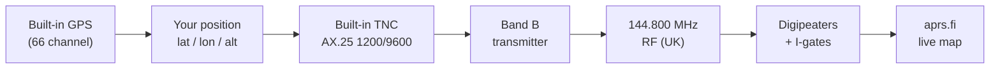
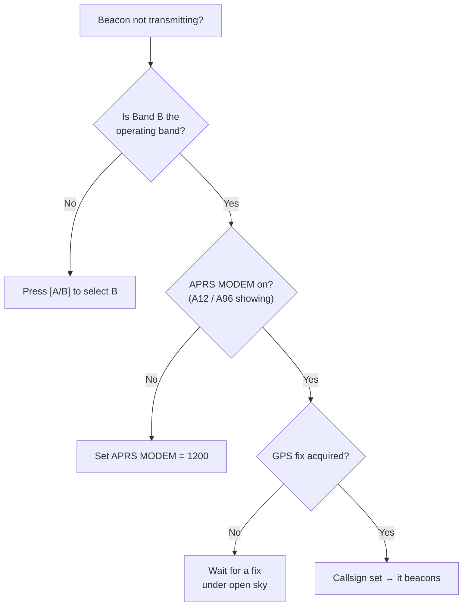
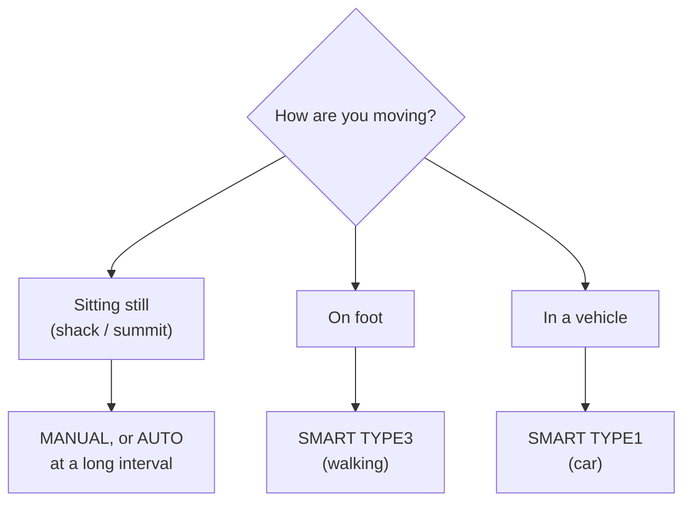

# APRS, GPS and data

Tucked inside the FT5DR is something that used to need a separate box, a cable and a laptop: a complete APRS station. A 66-channel GPS works out where you are, a built-in 1200/9600 bps packet modem turns that into a data packet, and the transmitter puts it on the air — so your position appears on a live map that anyone can see. This chapter is not a lesson in what APRS _is_ — the [handbook's APRS book](outpost:entry/logbook73.handbook/aprs) does that properly, and we link to it throughout. This chapter is the button-presses: which menu items to set, in which order, and the two rules that stop it working if you skip them.

## The FT5DR as an APRS station

APRS — the **Automatic Packet Reporting System**, invented by Bob Bruninga WB4APR — is a shared VHF channel on which stations announce where they are, exchange short messages, and relay each other's packets across the country. Everything you need to join in is already in the radio:

- a **built-in TNC** (terminal node controller — the modem that turns data into audio tones and back) running the **AX.25** packet protocol at **1200 bps** (audio-frequency shift keying) or **9600 bps** (a faster scheme). The packet protocol underneath is covered in [Packet Radio](outpost:entry/logbook73.handbook/packet-radio);
- a **66-channel GPS receiver** that supplies latitude, longitude, altitude, speed, course and accurate time;
- the **screen and keypad** to show received stations and type messages.

A word of orientation before anything else. Yaesu splits the FT5DR's documentation across several PDFs, and APRS gets its **own manual** — the _APRS Function Instruction Manual_, downloaded separately from the Yaesu website. The thin printed book that comes in the box barely mentions the feature; it just says "refer to the APRS Function Instruction Manual." That split is exactly why a chapter like this earns its place: it pulls the essentials into one narrative aimed at someone doing it for the first time.



Throughout this chapter, "hold **[F MENU]**" means press-and-hold the top display/menu key. Confusingly, Yaesu's own documents label that one physical button **[DISP]** on some printings and **[F MENU]** on others — they are the same key. From the Setup Menu you touch the **APRS** category tile to reach every item below. Menu _item numbers_ restart at 1 inside each named category — so a bare "item 4" means nothing without its category — and they can shift a little between firmware versions too, so trust the **name** (`APRS MODEM`, `BEACON TX`, and so on) over the number.

## Two rules to learn before you beacon

Two facts about the FT5DR trip up almost everyone the first time, and neither is your fault — they are just not obvious.

**1. APRS runs only on Band B.** The FT5DR has two genuinely independent receivers, called the A-band and the B-band (more on that in [Band Scope, Scanning & Dual Receive](outpost:entry/logbook73.guide.ft5dr/scan-scope)). APRS lives exclusively on **Band B**. Press **[A/B]** so that B is the operating band, and tune it to your national APRS channel: **144.800 MHz** in the UK and most of Region 1, **144.390 MHz** in North America (Region 2). Check your national band plan — the APRS calling frequency is regional. If you try to run APRS with A selected, nothing happens and there is no error to tell you why.

**2. With `MY POSITION = GPS`, nothing transmits until the GPS has a fix.** This is the single most common "my beacon never appears" complaint. When the radio is set to beacon its live GPS position (the sensible default for anything portable), it will politely refuse to transmit a beacon that would carry no coordinates — so until the GPS has locked onto enough satellites, your beacon just does not go out. Give it a clear view of the sky and a minute or two on first power-up.



## The built-in GPS

The GPS is the quiet workhorse behind everything else, so it is worth a moment on its own. The FT5DR's 66-channel receiver calculates your position "within the tolerance of several metres," in Yaesu's words, and even reads the exact time from the satellites' atomic clocks — handy for setting the radio's clock and for time-stamping your beacons.

- **Turning it on.** Hold **[F MENU] → APRS → 20 GPS POWER** and set it to **GPS ON** (this is the factory default). This is the master switch for the position receiver. The manual confirms the path verbatim.
- **Battery cost.** An active GPS increases current draw by **about 15 mA** — noticeable over a long day, but the price of being on the map. If you are not beaconing and do not need position, turning it off stretches the battery.
- **`GPS SETUP` — datum, pinning and DGPS.** `APRS → 19 GPS SETUP` holds three sub-items. `DATUM` must stay on **WGS-84**, because APRS assumes WGS-84 worldwide; changing it puts you in the wrong place on everyone else's map (✅ never touch it). `PINNING` (default **ON**) freezes your latitude/longitude whenever GPS speed is zero — this is why a parked station's dot does not wander on the map; OFF lets it recompute even at rest. `DGPS` (default **ON**) folds in correction data from geostationary (SBAS) satellites to sharpen the fix. Both are sensibly left on.
- **Time zone.** `APRS → TIME ZONE` (default **UTC ±0:00**) offsets the _displayed_ clock. APRS itself works in UTC internally, so this is purely cosmetic — UK operators can leave it at UTC or set it to local time to taste.
- **GPS logging.** Separately, `CONFIG → GPS LOG` records a breadcrumb track (interval OFF / 1 / 2 / 5 / 10 / 30 / 60 s) to a microSD card, written to `FT5D/GPSLOG/` for import into mapping software afterwards. This is a personal track recorder — it does not transmit anything.
- **An external GPS.** `APRS → COM PORT SETTING` with `INPUT = GPS` lets an external GPS feed the radio; the internal receiver is then ignored. Almost nobody needs this — the internal GPS is perfectly good.

## Getting on APRS: the setup order

APRS has a lot of knobs, but there is a natural order that avoids first-time grief. Do these once, and the radio remembers them:

1. **Enable the GPS** — `APRS → GPS POWER → GPS ON`, and let it get a fix under open sky.
2. **Set your callsign and SSID** — `APRS → CALLSIGN (APRS)` (below). You cannot legally transmit APRS without your own callsign.
3. **Choose your station symbol** — how you appear on the map (below).
4. **Set the position source** — `APRS → MY POSITION → GPS` for anything that moves.
5. **Turn on the TNC** — `APRS → APRS MODEM → 1200 bps`. This is the switch people forget.
6. **Put Band B on the APRS channel** — press **[A/B]** for B, tune **144.800 MHz** (UK) or **144.390 MHz** (US).
7. **Choose how you beacon** — `APRS → BEACON TX → MANUAL / AUTO / SMART` (below).
8. **Optionally set a path** — `APRS → DIGI PATH` (below); the default is fine to start.

The rest of the chapter is these steps explained in full — the settings worth understanding rather than just copying.

## The key settings, item by item

Each item below carries the same one-glance verdict used across this guide: ✅ set and forget · ⭐ useful, depends · ⚠️ advanced · ❌ leave off.

### Callsign (APRS) — ✅ required, your identity on the map

Your amateur callsign, with an optional SSID suffix, stamped onto every packet you send.

- **Does:** sets the "from" address of your beacons and messages — `APRS → 23 CALLSIGN (APRS)`, up to six characters plus a two-digit SSID.
- **Inside:** APRS is built on [AX.25 packet](outpost:entry/logbook73.handbook/packet-radio), where every station is addressed by callsign. Your callsign is how the network — and [aprs.fi](outpost:entry/logbook73.handbook/aprs-running) — knows a packet is _you_. (The matching _destination_ address is fixed: every FT5DR beacon carries the model "tocall" code `APY05D` — `APRS → 2 APRS DESTINATION`, display-only and uneditable — which is how aprs.fi recognises the transmitting rig as a Yaesu FT5D. You never set it; it identifies your radio for you.)
- **Why it exists:** transmitting requires identification by law, and APRS needs a unique address to plot you and route messages back.
- **Values:** your callsign (e.g. `M0ABC`) plus an SSID from `-0` to `-15`.
- **UK recommendation:** required. Set your own call. This is a _separate_ setting from the radio's main `CALLSIGN` category (which identifies you on C4FM digital — see [C4FM Digital](outpost:entry/logbook73.guide.ft5dr/c4fm)); setting one does not fill in the other, which catches people out.
- **Example:** a handheld beacon from `M0ABC-7` shows up on the map as `M0ABC-7`, tagged as a walkie-talkie.
- **Common mistakes:** leaving it blank and wondering why beaconing does nothing; setting the C4FM callsign but not the APRS one (they are independent); an SSID that misrepresents your station (below).
- **Related:** SSID (below), `MY POSITION`, and the main `CALLSIGN` category.
- **Should you change it?** Set it once. Change the SSID only if the kind of station changes.

### SSID — ⭐ which of your stations this is

The number after the dash — `-7`, `-9` and so on — that tells the map _what sort_ of station you are.

- **Does:** distinguishes several stations sharing one callsign. One licence, many radios — the SSID keeps them apart on the map.
- **Inside:** it is one to fifteen appended to your call in the packet address. The numbers carry _conventional_ meanings the whole APRS world recognises; they are customs, not rules enforced by the radio.
- **Why it exists:** you might run a handheld, a car and a home station all as `M0ABC`; without SSIDs they would collide into one confusing dot.
- **Values and the common conventions.** Yaesu prints its own full 16-type SSID list; the ones you meet most:

| SSID        | Conventionally means (Yaesu's list)        |
| ----------- | ------------------------------------------ |
| `-0` (none) | fixed station that exchanges messages      |
| `-1`, `-2`  | digipeaters (1200 / 9600 bps)              |
| `-5`        | mobile devices (smartphone / tablet app)   |
| `-7`        | handheld / walkie-talkie (the FT5D's slot) |
| `-8`        | marine & land mobile                       |
| `-9`        | mobile in a vehicle (e.g. FTM-300D)        |
| `-10`       | I-gate / internet-connection station       |
| `-12`       | one-way tracker (cannot exchange messages) |

Note Yaesu puts I-gates and internet gateways at **`-10`**, not `-1`/`-2` — those two are reserved for digipeaters.

- **UK recommendation:** ⭐ **`-7` for the FT5DR** as a handheld. Yaesu itself recommends `-7`. Use `-9` if it lives in the car. The full convention list is in [APRS Anatomy](outpost:entry/logbook73.handbook/aprs-anatomy).
- **Example:** you beacon as `M0ABC-7` on foot; when you drive, switching to `-9` tells everyone you are now mobile.
- **Common mistakes:** using `-1`/`-2` (reserved for infrastructure) for a personal tracker; leaving different radios on the same SSID so they overwrite each other on the map.
- **Related:** Callsign; station symbol (they should agree — a `-7` handheld carrying a car symbol is confusing).
- **Should you change it?** Match it to the station type, then leave it.

### Station symbol — ⭐ the icon you appear as

The little picture that represents you on the map.

- **Does:** chooses your APRS symbol — a person, car, bicycle, house, tent and so on — via `APRS → 25 MY SYMBOL`.
- **Inside:** the symbol is two characters in the packet (a table identifier and a code) that every APRS map renders as the same icon. The full symbol scheme lives in [APRS Payloads](outpost:entry/logbook73.handbook/aprs-payloads).
- **Why it exists:** a map of identical dots tells you nothing; symbols let a glance separate the walkers from the cars from the weather stations.
- **Values:** 48 built-in symbols, with four quick presets — **ICON1** Human/person (`/[`, the factory default), **ICON2** Bicycle (`/b`), **ICON3** Car (`/>`) and **ICON4** Yaesu Radio (`YY`). Choosing ICON4 opens `25 MY SYMBOL (User)`, where you type any symbol directly by its Symbol Table ID and Symbol Code — the current table lives at aprs.org/symbols.
- **UK recommendation:** ⭐ pick the symbol that matches reality — the **person/jogger** or **portable** symbol for handheld use, the **car** when mobile. Honesty here is good manners; it helps others read the map.
- **Example:** out on a hill you set the **hiker** symbol so people can see the dot climbing is a walker, not a vehicle stuck in a field.
- **Common mistakes:** leaving the default symbol when it misrepresents you; choosing a special symbol (ambulance, digipeater star) you are not entitled to.
- **Related:** SSID (keep them consistent); Mic-E status.
- **Should you change it?** Set it to suit how you are operating; change it when that changes.

### APRS MODEM — ⭐ the switch that turns the TNC on

There is no "APRS on/off" toggle as such — you _turn APRS on by choosing a baud rate_.

- **Does:** `APRS → 4 APRS MODEM` sets the modem off, or to `1200 bps` or `9600 bps`. Anything other than OFF means "APRS is live."
- **Inside:** 1200 bps is **AFSK** — two audio tones keyed over FM, the near-universal APRS standard. 9600 bps is **GMSK**, a faster baseband scheme used on a few dedicated channels. When the modem is on, **`A12`** (1200) or **`A96`** (9600) appears next to the Band B frequency — your at-a-glance confirmation that the TNC is running (steady when unmuted; it _flashes_ while `APRS MUTE` is on — see below).
- **Why it exists:** it is the master power switch for the packet engine; off by default so the radio behaves as an ordinary voice handheld until you ask for APRS.
- **Values:** OFF (default) / 1200 bps / 9600 bps.
- **UK recommendation:** ⭐ **1200 bps.** Standard APRS on 144.800 (UK) and 144.390 (US) is 1200 bps AFSK — use 9600 only on a channel you _know_ runs 9600, which is rare.
- **Example:** you set `1200 bps`, glance at the display, see `A12` by the B-band frequency, and know you are on the air.
- **Common mistakes:** forgetting this step entirely (the number-one cause of "it does nothing"); setting 9600 on a 1200 channel, so nobody can decode you and you cannot decode them.
- **Advanced — TX delay:** ⚠️ `APRS → 12 APRS TX DELAY` sets the preamble sent ahead of each packet (100 ms–1000 ms, default **300 ms**). A longer delay helps slow or squelch-gated digipeaters catch the start of your packet; almost everyone should leave it at 300 ms.
- **Related:** Band B frequency; `BEACON TX`; `MY POSITION`.
- **Should you change it?** Turn it on to use APRS; turn it off to save battery and return to plain voice.

### MY POSITION — ✅ GPS for anything that moves

Whether your beacon carries your live GPS fix or a fixed set of coordinates you typed in.

- **Does:** `APRS → 24 MY POSITION` chooses **GPS** (use the live fix) or **Manual** (use stored coordinates `P1`–`P10`, ignoring the GPS entirely).
- **Inside:** in GPS mode the beacon is built from the satellite fix each time it transmits; in Manual mode it always sends the same typed-in latitude and longitude.
- **Why it exists:** a moving station needs live position; a fixed home station has no reason to keep a GPS powered and can just state where it is.
- **Values:** GPS (default) / Manual (P1–P10).
- **UK recommendation:** ✅ **GPS** for a handheld or anything portable. Use **Manual** only for a genuinely fixed base station, where you can turn the GPS off and save power. Remember rule 2: in GPS mode, **no fix means no beacon**.
- **Example:** at home you enter your coordinates into `P1`, set `MY POSITION = Manual`, and beacon a rock-steady house position without the GPS running.
- **Common mistakes:** setting Manual "to be safe" and then beaconing stale coordinates from wherever you last typed them; expecting a beacon before the GPS has locked.
- **Related:** `GPS POWER`; SmartBeaconing (which _requires_ `MY POSITION = GPS`).
- **Should you change it?** GPS for portable, Manual for a fixed base — otherwise leave it.

### BEACON TX — ⭐ how your position gets sent

The heart of beaconing: whether _you_ send beacons, the radio sends them on a timer, or it sends them intelligently as you move.

- **Does:** `APRS → 16 BEACON TX` picks **MANUAL**, **AUTO** or **SMART**. (The on-screen `[BEACON]` soft key on the station-list screen also cycles this mode — see below for where that key lives.)
- **Inside:** MANUAL sends a beacon only when you press the **beacon key** — and here is the thing the menus never spell out: there is **no physical beacon button** on the FT5DR. "The beacon key" means the on-screen **`[BEACON]`** soft key that appears along the bottom of the **APRS station-list screen** (hold **`[F MENU]`** → touch **`[APRS]`** to get there). With `BEACON TX = MANUAL`, touching it fires exactly one beacon; every "press the beacon key" in this chapter means that soft key. AUTO sends one every fixed interval (below), regardless of whether you have moved. SMART hands the timing to SmartBeaconing, which beacons based on your speed and turns. The station-list header shows which mode is live at a glance — **no icon** for MANUAL, a filled circle **●** for AUTO, an open circle **○** for SMART (the same ○ sits top-right of the display while SmartBeaconing is running).
- **Why it exists:** different operators need different behaviour — a demo needs a beacon on demand, a fixed station a slow steady heartbeat, a moving tracker something cleverer that does not flood the channel while parked.
- **Values:** MANUAL / AUTO / SMART.
- **UK recommendation:** ⭐ **MANUAL** while you are learning (you stay in control and cannot accidentally hammer the channel). **SMART** once you are mobile and want a hands-off tracker. Use **AUTO** for a fixed station at a _long_ interval.
- **Example:** demonstrating APRS to a friend, you leave it on MANUAL and press beacon each time you want to show a fresh dot appear on aprs.fi.
- **Common mistakes:** leaving AUTO on a short interval while sitting still, transmitting a redundant beacon every minute from a car park; using AUTO in a moving vehicle where SMART would be far kinder to the channel.
- **Related:** `BEACON INTERVAL` (used by AUTO), `SmartBeaconing` (used by SMART), `MY POSITION`.
- **Should you change it?** Yes — pick the mode that fits what you are doing that day.



### BEACON INTERVAL — ⭐ the AUTO heartbeat

How often AUTO beaconing fires.

- **Does:** `APRS → 14 BEACON INTERVAL` sets the fixed gap between automatic beacons.
- **Inside:** a simple timer used _only_ in AUTO mode; SMART ignores it completely.
- **Why it exists:** a fixed station wants a predictable rhythm, and the interval trades map freshness against channel congestion.
- **Values:** 30 s / 1 / 2 / 3 / 5 / 10 / 15 / 20 / 30 / 60 min (default **5 min**).
- **UK recommendation:** ⭐ for a **fixed** station, **10–30 minutes** is plenty — it is not moving. The 30-second and 1-minute options are for special cases, not everyday use; short intervals from a stationary radio are the classic APRS bad manners.
- **Example:** your home weather-station-style beacon at 30 minutes keeps you on the map without adding needless traffic.
- **Common mistakes:** running 1-minute AUTO beacons all day from a fixed location; using AUTO (fixed interval) in a car instead of SMART.
- **Related:** `BEACON TX = AUTO`; SmartBeaconing (the moving-station alternative).
- **Should you change it?** Lengthen it for a fixed station; otherwise use SMART for moving.

### SmartBeaconing — ⭐ beaconing that thinks about speed

The clever timing engine that beacons often when you are moving fast or turning, and rarely when you are slow or stopped — so a tracker gives a smooth trail without swamping the channel.

- **Does:** `APRS → 27 SmartBeaconing` sets `STATUS` to OFF or one of three presets, **TYPE1 / TYPE2 / TYPE3**, tuned for different speeds. Requires `BEACON TX = SMART` and `MY POSITION = GPS`.
- **Inside:** rather than a fixed clock it watches your GPS speed and heading: faster means more frequent beacons, a sharp turn triggers an extra one (so corners are not cut on the map), and standing still throttles it right down. The screen exposes eight editable figures — `STATUS`, `LOW SPD`, `HIGH SPD`, `SLOW RATE`, `FAST RATE`, `TURN ANGL`, `TURN SLOPE` and `TURN TIME`. `SLOW RATE` and `FAST RATE` are the numbers that actually set the pace: on TYPE1, at or below `LOW SPD` (5 km/h) it beacons every `SLOW RATE` (30 min); at or above `HIGH SPD` (70 km/h) every `FAST RATE` (120 s); in between, the interval scales with speed. Yaesu licenses the algorithm from HamHUD Nichetronix.
- **Why it exists:** a fixed interval is always wrong for a vehicle — too sparse at speed (gaps in your trail) or too dense when parked (channel flooding). SmartBeaconing fixes both.
- **The three presets** (factory defaults — only low/high speed and turn slope differ between them):

| Preset | For              | Low / high speed | Slow / fast rate | Turn angle | Turn slope |
| ------ | ---------------- | ---------------- | ---------------- | ---------- | ---------- |
| TYPE1  | vehicle (fast)   | 5 / 70 km/h      | 30 min / 120 s   | 28°        | 26         |
| TYPE2  | bicycle (medium) | 3 / 30 km/h      | 30 min / 120 s   | 28°        | 11         |
| TYPE3  | walking (slow)   | 2 / 12 km/h      | 30 min / 120 s   | 28°        | 7          |

`TURN TIME` (30 s) is the same across all three. Every figure is adjustable — `LOW SPD` 2–30, `HIGH SPD` 6–90 km/h, `SLOW RATE` 1–100 min, `FAST RATE` 10–180 s, `TURN ANGL` 5–90°, `TURN SLOPE` 1–255, `TURN TIME` 5–180 s.

```viz
{
  "type": "wave",
  "title": "SmartBeaconing — the interval follows your speed",
  "caption": "At or below LOW SPD the radio beacons only every SLOW RATE (30 minutes on the presets); at or above HIGH SPD, every FAST RATE (120 s). In between, the interval scales with speed — and a sharp turn fires an extra beacon so corners are not cut on the map.",
  "xLabel": "GPS speed — LOW SPD → HIGH SPD",
  "traces": [
    { "kind": "points", "label": "time between beacons", "tone": "primary", "points": [[0,0.8],[0.22,0.8],[0.72,-0.72],[1,-0.72]] }
  ]
}
```

- **UK recommendation:** ⭐ **TYPE1 in a car, TYPE3 on foot.** You can fine-tune the underlying figures (low/high speed, turn angle, fast/slow rates), but the presets are sensible starting points — leave them until you have a reason.
- **Example:** driving with TYPE1, you beacon every couple of minutes on a motorway and get an extra beacon at each junction, giving a clean trace on aprs.fi.
- **Common mistakes:** running the **walking** preset (TYPE3) at vehicle speed, which floods the channel with beacons — switch back to TYPE1 when you get in the car; enabling SMART but forgetting it needs `MY POSITION = GPS`.
- **Related:** `BEACON TX = SMART`; `MY POSITION = GPS`; and the etiquette in [Running APRS](outpost:entry/logbook73.handbook/aprs-running).
- **Should you change it?** Pick the preset for your speed; adjust the numbers only once you understand them.

### DIGI PATH — ⭐ how far your beacon asks to be relayed

The relaying request your beacon carries, telling digipeaters how many hops to give it.

- **Does:** `APRS → DIGI PATH` selects the path string added to each packet. `P1` = OFF (no relay), `P2` = `WIDE1-1`, `P3` = `WIDE1-1,WIDE2-1` are fixed; `P4`–`P8` are user-editable, with `P8` allowing up to eight addresses.
- **Inside:** the path is a list of relay aliases. A packet's path is _consumed_ hop by hop as digipeaters repeat it, which is why a long path means many repeats and heavy congestion. The full theory — `WIDE1-1`, `WIDE2-1`, fill-in versus wide digipeaters, the New-N paradigm — is in [APRS Paths](outpost:entry/logbook73.handbook/aprs-paths), and it is worth reading before you touch this.
- **Why it exists:** without a path your beacon is heard only by stations in direct range; the path lets trusted digipeaters relay it far enough to reach an [I-gate](outpost:entry/logbook73.handbook/aprs-igates) and the internet.
- **Values:** P1 OFF / P2 `WIDE1-1` / P3 `WIDE1-1,WIDE2-1` / P4–P8 custom.
- **UK recommendation:** ⭐ **`WIDE1-1,WIDE2-1`** (P3) is the sensible, polite default almost everywhere — enough to reach a couple of digipeaters and get gated, without abusing the channel. Yaesu explicitly warns against longer paths. Only shorten to `WIDE1-1` (or OFF) where you are already close to a digipeater or I-gate.
- **Example:** in town with a digipeater nearby you drop to `WIDE1-1` — one hop is all it takes, and you keep the channel clear for others.
- **Common mistakes:** building a long custom path (`WIDE2-2` or worse) "to get further," which just clogs the network for everyone; using OFF and then wondering why you never reach the map.
- **Related:** the receiving side (below); digipeaters and I-gates in the handbook.
- **Should you change it?** Leave it on the sensible default unless local advice says otherwise.

A quick way to confirm a path is working: switch `APRS → 10 APRS RINGER → DUP.BCN` **ON**, and the radio sounds a distinctive "pee-po-po" the moment your own beacon is heard coming back after a digipeater relays it — instant audible proof your path worked and someone picked you up, without opening aprs.fi.

### Status text & position comment — ⭐ the words that ride with your dot

A beacon can carry a little more than a position. Two independent settings add text, and they are easy to confuse:

- **`APRS → 15 BEACON STATUS TXT`** — your own **free-typed comment**. Turn its `S.TXT` sub-item **ON**, choose a `TX RATE` (`1/1` = attached to every beacon … `1/8` = every eighth), then open `TEXT`, pick one of the **five memories** `TEXT1`–`TEXT5`, touch **`[EDIT TEXT]`** and type up to **60 characters** on the on-screen keyboard; press **PTT** to store. Yaesu warns that a `:` lands at the 21st, 29th and 43rd character and some receiving radios truncate past those points — so keep it short and put what matters first. This is the setting for "`Portable /P on the hill, QRV 145.500`".
- **`APRS → 26 POSITION COMMENT`** — a **fixed status code** chosen from Yaesu's list: **Off Duty** (default), En Route, In Service, Returning, Committed, Special, Priority, Custom 0–6, and **EMERGENCY!**. It maps to the standard APRS position-comment set, so you show up as `(En Route)` next to your dot. (Selecting `EMERGENCY!` and keying up fires a confirmation prompt and an alarm tone — leave it alone unless you truly mean it.)

The two are independent and can both be sent. One trap worth knowing: the status-text on/off lives in **item 15's `S.TXT`**, _not_ in **`APRS → 13 BEACON INFO`** — that item only toggles position ambiguity, speed/course and altitude. (Yaesu's FTM mobile radios bundle a "BEACON INFO SELECT" screen with a status toggle; the FT5DR is laid out differently, so look under `15 BEACON STATUS TXT`.) To reach any of these: press-and-hold **`[F MENU]`** → touch **`[APRS]`** → the numbered item.

## Receiving stations and the station list

APRS is not only about being seen — the FT5DR shows you everyone else too. When a packet arrives, the radio can pop up the station and add it to a **station list** — up to **60** received beacons, newest first (once full, the oldest drop off) — that you can scroll through; the on-screen `[TOP]` key jumps back to the most recent, and you can prune a stale entry with `[S.LIST] → [☰] → [DEL] → [OK]`. The received-station screen is genuinely rich: for a station like `JA1ZRL-9` in Yaesu's own example, it shows a **compass rose** pointing to their bearing, the **distance** to them (`12.5 km`), their **speed** and **course**, **altitude**, the radio **model** they are using, a Mic-E **status** such as `(Off duty)`, and their **latitude and longitude** — all decoded from one short packet. (Open a station before the GPS has a fix and the bearing and distance are simply left off, falling back to the last known coordinates until a fix returns.)

A few settings shape how this behaves; most are taste rather than critical:

- **RX pop-up, ringer and flash** — three items handle the alerts. `APRS → 10 APRS RINGER` is a per-event bell (every event defaults ON — including `TX BCN` and `TX MSG`, so the radio even beeps when _it_ beacons); `APRS → 9 APRS POPUP` sets how long a received station or message stays on screen (received beacons default `ALL 10 sec`, message events `BND 10 sec`, with a 2–60 s range, `ALL CNT` to hold until you press a key, or a compact two-character band-area popup); `APRS → 5 APRS MSG FLASH` strobes the white LED on an incoming message (MSG/GRP/BLN each default 4 sec). ⭐ Handy at first so you can see it working; quieten the ringer once the novelty fades.
- **APRS MUTE + AF DUAL** — `APRS → 8 APRS MUTE` silences the Band B data audio so the packet "braaap" does not blast out of the speaker while APRS runs in the background. Pair it with `APRS → 1 APRS AF DUAL` (default **OFF**): turn AF DUAL ON and Band A keeps playing even when a packet lands on B — so you can listen to a voice repeater on A and let APRS work silently underneath. A neat tell: with APRS MUTE on, the `A12`/`A96` tag beside the frequency **flashes** rather than sitting steady. ⭐ Well worth turning on.
- **APRS FILTER — which beacon types show** — `APRS → 3 APRS FILTER` picks which packet _types_ the radio decodes: Mic-E, POSITION, WEATHER, OBJECT, ITEM and STATUS all default **ON**, while OTHER (non-APRS packets) and ALTNET (packets with an alternate-net destination) default **OFF**. Turning types off keeps the list to real position traffic. ⭐
- **APRS UNIT — display units** — `APRS → 11 APRS UNIT` sets the units for that rich display, independently for position, distance (km/mile), speed (km/h / knot / mph), altitude (m/ft), temperature (°C/°F), rain (mm/inch) and wind (m/s / mph). The factory default follows the radio's regional version, so UK users should confirm it reads km, m, °C and m/s. (Separate from `22 GPS UNIT`, which governs your _own_ position readout.) ⭐
- **RAW packet — who relayed you** — from a station's detail screen, touch `[☰]` then `[RAW]` to see the decoded AX.25 packet: `DEST` (the destination/software address, e.g. `APNU19`), `DIGI(F)` and `DIGI(L)` (the first and last digipeaters it passed through), the raw data, and the station's `PHG` code. It is the tool for confirming exactly which digipeaters relayed a packet; for a beacon gated in from the internet, the third-party header's route is shown instead. ⭐
- **Mic-E status** — the compact status field (`En Route`, `Off Duty`, and so on) that some stations send; the mechanism is explained in [APRS Anatomy](outpost:entry/logbook73.handbook/aprs-anatomy).

## Messaging

Beyond position, APRS carries short **text messages** between stations — the FT5DR can send and receive them, and the received-station screen offers a `[REPLY]` soft key to answer on the spot. Messages are typed on the touchscreen keypad and addressed to another station's callsign-and-SSID. The protocol's own format and conventions live in [APRS Payloads](outpost:entry/logbook73.handbook/aprs-payloads); on the radio the workflow is simple: receive a station, press `[REPLY]` (or start a new message), type up to the radio's hard cap of **67 characters**, and touch `[M-TX]` to send — on the same Band B, at the same `1200 bps`, as your beacons.

**How a send is confirmed.** Unlike a beacon, which broadcasts to everyone, a message is acknowledged by its recipient. The radio waits for an **ACK** packet; if none arrives within a minute it re-sends the same message automatically, up to **5 times**, and if it is still unacknowledged the status changes to **`TX OUT`**. In the message list the remaining retries count down `4…0` beside the message, a `*` marks one that _was_ acknowledged, and `>` shows during a transmission; an incoming "pee…" tone signals an ACK, `RM<call>` a reject.

**Preset messages — `APRS → 7 APRS MSG TXT`.** For traffic you send often, register up to **eight** fixed "standard messages" of **16 characters** each: hold `[F MENU] → [APRS] → [7 APRS MSG TXT]`, turn the DIAL to a slot 1–8, press `[F MENU]`, type your text, press `[BACK]`, then PTT to store. When composing, touch the function-key icon → `[MTXT]`, pick the slot, and `[PASTE]` drops it in — you can paste several in a row, or add words around them. Ideal for a repeated "QRV 145.500" or "Mobile en route". (There is no auto-reply item on the FT5DR — every reply goes out by hand via `[REPLY]`.)

**Message filter — `APRS → 6 APRS MSG GROUP`.** This decides which group and bulletin messages reach you. Group codes are `G1 ALL`, `G2 CQ`, `G3 QST`, `G4 YAESU` and a custom `G5`; bulletins are `B1–B3`. The factory default enables ALL, CQ, QST and YAESU, and a `*` acts as a wildcard matching any character. A group message shows `GRP<name>` (or `BLN<n>`) above the text and sounds its own "pee po pee po…" alarm, distinct from the normal message tone. One caveat: a message addressed to your call but a _different_ SSID is still received, yet the radio only returns an acknowledgement when every character — SSID included — matches.

**The message list — `[F MENU] → [M.LIST]`.** It holds **60** messages, sent and received combined, newest at the top; past 60 the oldest is deleted automatically — which can quietly drop a message still working through its retries. Delete one by hand with the function-key icon → `[DEL] → [OK]`.

Messaging only works while the TNC is on and Band B is on the APRS channel — the same two rules as beaconing. Keep it short and purposeful: APRS is a shared, low-bandwidth channel, not a chat app.

## Try it yourself

With a charged battery, the antenna fitted, and a clear view of the sky:

1. **Wake the GPS.** Hold **[F MENU] → APRS → GPS POWER → GPS ON**, step outside, and wait for the position display to stop flashing — that is your fix.
2. **Set your identity.** In `APRS → CALLSIGN (APRS)` enter your call with **`-7`**, then choose a **hiker or person** symbol. Confirm `MY POSITION = GPS`.
3. **Arm the TNC on the right band.** Press **[A/B]** so B is selected, tune it to **144.800 MHz** (UK) or **144.390 MHz** (US), then `APRS → APRS MODEM → 1200 bps`. Check that **`A12`** appears beside the frequency.
4. **Send one beacon by hand.** Leave `BEACON TX = MANUAL`, then hold **[F MENU] → APRS** to bring up the station list and touch the on-screen **`[BEACON]`** soft key once (that is "the beacon key" — there is no physical button). Open [aprs.fi](outpost:entry/logbook73.handbook/aprs-running) on a phone and search your callsign-`-7`. Within a minute or two, if a digipeater or I-gate heard you, your dot appears on the world map. That first dot is a genuinely satisfying moment.
5. **Watch the traffic.** Turn on `APRS MUTE`, sit near a city, and let received stations populate the station list — scroll one open and read its distance, bearing and speed.

Everything here is reversible, and setting `APRS MODEM = OFF` returns the radio to an ordinary voice handheld.

## Key takeaways

- The FT5DR is a self-contained APRS station: a **66-channel GPS**, a built-in **1200/9600 bps AX.25 TNC**, and the screen to see it all — but the depth is documented in Yaesu's **separate APRS Function Instruction Manual**.
- **Two rules underpin everything:** APRS runs **only on Band B** (tune 144.800 MHz UK / 144.390 MHz US), and with `MY POSITION = GPS` **no beacon transmits until the GPS has a fix**.
- You turn APRS on by **choosing a baud rate** — `APRS MODEM = 1200 bps` — and confirm it by the **`A12`** tag beside the frequency; this is the step people forget.
- Set your **callsign with SSID `-7`** (separate from the C4FM callsign) and an honest **symbol**; beacon **MANUAL** while learning, **SMART TYPE1/TYPE3** when mobile, **AUTO** only for a slow fixed heartbeat.
- Keep the **path polite** — `WIDE1-1,WIDE2-1` almost everywhere, shorter near a digipeater; never build a long path.
- For the concepts under all of this — paths, Mic-E, symbols, I-gates and the packet protocol — lean on the handbook's **[APRS book](outpost:entry/logbook73.handbook/aprs)** rather than the radio's menus.

With position and data sorted, the last piece of daily operating is keeping your channels organised: next up, [The Memory System: Banks, MAG, PMG & CAM](outpost:entry/logbook73.guide.ft5dr/memory).
