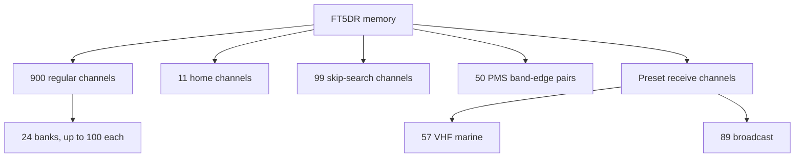
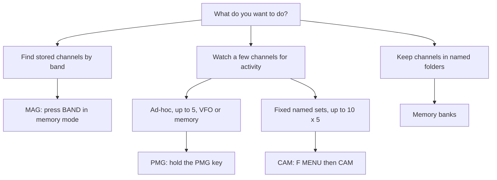

# The memory system: banks, MAG, PMG and CAM

The FT5DR does not have "a memory" so much as a small filing system. Nine hundred everyday channels, a set of home channels, band-edge pairs for limited scanning, and a little library of marine and broadcast presets baked in at the factory — all of it wrapped in three features whose names read like alphabet soup: **MAG**, **PMG** and **CAM**. Get those three straight and the rest falls into place, so this chapter untangles the whole cabinet: how a channel is stored and recalled, how banks and tags keep it tidy, and what each of the three activity tools is actually for.

## What one memory channel actually stores

On a simple radio a "memory" is just a frequency. On the FT5DR a memory channel is a complete snapshot of how the radio was set up when you saved it — so recalling one restores everything in a single keypress, not just the number on the dial. Each regular memory channel records:

| The channel remembers  | Which means                                                                |
| ---------------------- | -------------------------------------------------------------------------- |
| Operating frequency    | Where you receive (and, with a shift, where you transmit)                  |
| Operation mode         | AMS / DN / VW / FM / AM — see [Digital Voice](outpost:entry/logbook73.handbook/digital-voice)     |
| Frequency step         | The tuning grid this channel sits on                                       |
| Transmitter output     | High / Mid / Low power for this channel                                    |
| Repeater shift         | Direction and size of the duplex offset ([repeaters](outpost:entry/logbook73.handbook/repeaters)) |
| TX/RX DG-ID            | The C4FM group codes for this channel                                      |
| Tone information       | CTCSS tone / tone-squelch settings                                         |
| DCS information        | Digital coded squelch settings                                             |
| FM-mode bandwidth      | Wide or narrow deviation                                                   |
| ATT                    | Whether the receive attenuator is on                                       |
| S-meter squelch        | The signal-strength squelch threshold                                      |
| Memory tag             | A name of up to 16 characters                                              |
| Skip information       | Whether scanning skips or selects this channel                             |
| Specified-channel flag | Whether it is marked as a priority/preferred channel                       |

The practical lesson is the one from the tuning chapters: **do all your tuning, toning and mode-setting first, then save.** A memory saved before you added the repeater's tone will not open that repeater, because the channel faithfully remembers that the tone was off.

## The memory categories at a glance

The 900 figure is only the headline. The radio keeps several separate pools of memory, each with its own job:



| Pool                 | Count                  | What it is for                                                         |
| -------------------- | ---------------------- | ---------------------------------------------------------------------- |
| Regular channels     | 900                    | Your everyday repeaters, simplex calling channels and favourites       |
| Memory banks         | 24 (up to 100 ch each) | Named folders for sorting the 900 into groups                          |
| Home channels        | 11                     | One fast-recall "home" frequency per band                              |
| Skip-search channels | 99 (ch 901–999)        | Frequencies for the skip/search scan mode                              |
| PMS pairs            | 50 (L1/U1 … L50/U50)   | Band-edge pairs for programmable-limit scanning                        |
| Preset VHF marine    | 57                     | The international marine channel plan, built in ([VHF](outpost:entry/logbook73.handbook/vhf)) |
| Preset broadcast     | 89                     | Worldwide broadcast presets, built in                                  |

The marine and broadcast presets are **receive-only reference channels** — a courtesy the radio ships with, not something you programme. The pools you will actually fill are the 900 regular channels and the 24 banks that organise them. A single channel can belong to more than one bank, so "GB3 mountain repeater" can live in both your "Local" and your "Summits" bank at once. And before anything else: **back your memories up to a microSD card**, because an All Reset (or a firmware update) wipes all 900 in one stroke.

**A note on the two scan pools.** The **skip-search channels** live at channel numbers **901–999**: you either grab one mid-scan (press and hold **[V/M]** when a VFO scan stops on a frequency you would rather it skipped, pick a 901–999 slot, and the scan resumes) or store it like any other memory in VFO mode. A **PMS band-edge pair** carries its own registration rules — the two channels must sit in the **same band**, span **100 kHz or more**, run low-below-high (do not register them reversed), use **matching numbers** (L05 pairs with U05), and neither may also be flagged as a skip channel. To run the limited scan, recall the L or U channel and press **[F MENU] → [SCAN]**; "PMSP" appears top-left and the sweep stays inside the pair. The [scan chapter](outpost:entry/logbook73.guide.ft5dr/scan-scope) has the full mechanics.

## Registering a channel

Saving a channel is a press-and-hold on the VFO/Memory key. In these manuals that key is written **[V/M]** (it also carries a small dot on the case), and the display/menu key is written **[F MENU]** — the same physical top key that some Yaesu documents label **[DISP]**; do not let the two names confuse you, it is one button.

1. In VFO mode, set the **frequency and mode** (and shift, tone, power — everything you want the channel to remember).
2. **Press and hold [V/M].** The channel number blinks; the radio proposes the next slot after the one you last used.
3. **Rotate the DIAL** to the channel number you want. A slot that already holds data — or was deleted — **blinks red**. Touch **[>>]** and turn the DIAL to jump ten channels at a time; touch **[>>]** again to stop.
4. **Press [V/M].** If the slot is already occupied, the screen asks **"OVERWRITE?"** — touch **[OK]** twice to replace it.
5. The **memory-tag** entry screen appears. Type a name (see _Memory tags_, below), or skip it.
6. **Press [V/M] or PTT** to save and return to normal operation.

If you programme a lot of channels at once, the **MEMORY** Setup-Menu category has a **MEMORY WRITE** item that chooses whether the radio offers the _next_ free slot or the _next lower_ number after each save — handy for filling a block in order. The same category holds **MEMORY PROTECT**, which locks a channel against accidental overwriting.

## Recalling a channel, and the name/frequency toggle

1. **Press [V/M]** to enter memory mode; the last-used channel appears.
2. **Rotate the DIAL** to step through channels. Press **[F MENU]** then turn the DIAL to fast-forward ten at a time (press [F MENU] again to stop). To copy a channel's contents back onto the VFO for editing, **touch and hold [M▶V]**.
3. **Press [V/M]** again to leave memory mode and return to the VFO.

When you recall a channel that has a name tag, the screen shows **both the tag and the frequency** — though the tag appears **only on the operating band**, so on the sub-band that same channel shows the plain frequency rather than its name. **Touch the operating-band frequency area** to flip the display, and note that it is a _global_ switch: it toggles **every** memory channel between tag-view and frequency-view as you scroll, not just the one line you are on — useful when two channels share a name but you need to confirm which one you are on. One quirk to know: the **B-band receiver only covers 108–580 MHz**, so channels stored in the AM broadcast, FM broadcast, shortwave, 50 MHz or UHF(2) ranges **cannot be recalled on the B-band** — put those on the wide-coverage A-band.

## Memory tags — naming your channels

A bare channel number tells you nothing; a name tells you everything. Tags can be up to **16 characters** — upper- and lower-case letters, numbers and symbols — and they attach to both regular channels and home channels.

1. Press **[V/M]** to enter memory mode and rotate the **DIAL** to the channel (or recall the home channel) you want to name.
2. **Press and hold [F MENU]**, then touch **[MEMORY]**.
3. Touch **[3 MEMORY NAME]**.
4. Enter the text on the on-screen keyboard (the numeric keys also type letters; the arrow key moves the cursor). Save with [V/M] or PTT.

The house advice holds here as with any radio: name channels by **what they are**, not by number — `GB3xx`, `2m Calling`, `Club S20`. A named list is one you can actually use on a hilltop in the rain.

## Memory banks — the 24 folders

Twenty-four banks turn a flat list of hundreds into something navigable. A bank is just a named folder; a channel can sit in several banks at once, and each bank can hold up to 100 channels. The banks ship **pre-named BANK 1 to BANK 24**, and you rename any of them from **press and hold [F MENU] → [MEMORY] → [2 BANK NAME]** (up to 16 characters — letters, numbers and symbols). The golden rule is the same one the whole hobby has learned the hard way: **group by purpose, not by band.** "Repeaters", "Simplex", "Airband", "Nets" beats "144 MHz" and "430 MHz" every time, because the channels you reach for together end up together.

**Filing a channel into a bank is a press-and-hold, not a menu chore** — you build a bank one channel at a time:

1. In memory mode, **rotate the DIAL** to the channel you want to file.
2. **Press and hold [V/M].** The channel number blinks.
3. **Rotate the DIAL** to the target bank, **BANK1–BANK24**.
4. **Press [V/M]** to drop the channel into that bank.

The **MEMORY → [1 BANK LINK]** item is _not_ how you build a bank — that one sets up multi-bank link scanning; only **[2 BANK NAME]** lives in the setup menu. A bank's channels appear in the list between memory channel 1 and PMS channel U50.

**Opening and switching banks.** In memory mode, press **[F MENU] → [BANK]** (touch **[BACK ←]** first if [BANK] is not shown) to swap the display from plain memories to banks — the slots now read **B1–B24**, and an **[M]** icon marks the plain memory view; press **[F MENU] → [MR]** to switch back. With a bank shown, press **[BAND]**, rotate the **DIAL** to **BANK1–BANK24**, then press **[BAND]** or **PTT** to activate it. An empty bank beeps and shows **"NO BANK"**. Mind the role-swap: here **[BAND]** selects the bank, whereas in ordinary memory mode it drives MAG grouping.

**Taking a channel out of a bank** (without deleting the channel itself): recall the bank, **press and hold [V/M]**, rotate to the channel, touch the keyboard icon, then **[M.DEL]**.

You can scan a single bank — recall it and press **[F MENU] → [SCAN]** — or link several banks and sweep them together, at which point the bank label changes from upper-case **[B]** to lower-case **[b]**; the [scan chapter](outpost:entry/logbook73.guide.ft5dr/scan-scope) has the mechanics.

Banks are the _organising_ layer. They are not to be confused with the three activity tools below, which are about _watching_ channels, nor with MAG, which filters the list automatically. Keep those roles separate in your head and the radio stops feeling cluttered.

## Home channels

A **home channel** is a one-touch favourite — the frequency you jump to first. The FT5DR keeps **11** of them, effectively one per band group.

- **Recall:** press **[F MENU]**, then touch **[HOME]** (touch **[BACK ←]** first if [HOME] is not on screen). "HOM" and the home frequency appear. Each press of **[BAND]** hops to the home channel of the _next_ band.
- **Return:** press **[V/M]**, or press [F MENU] and touch [HOME] again.
- **Change the frequency:** set the frequency and mode you want, **press and hold [V/M]**, touch the keyboard icon, then **[H.WRITE]**; answer **"OVERWRITE?"** with **[OK]** twice, and add a tag if you like.

While you are sitting on a home channel, rotating the DIAL normally slides the home frequency onto the VFO so you can tune away from it. If you would rather the DIAL leave the home channel alone, set **CONFIG → 8 HOME VFO** to stop the transfer.

## Split memory, memory-only mode, and the memory list

Three smaller features round out the system:

- **Split memory** stores **two different frequencies in one channel** — one to receive on, a separate one to transmit on. That is more flexible than a fixed repeater shift: it lets you save an oddball repeater whose input is nowhere near the standard offset, or a satellite/cross-band pairing, as a single recallable channel. To build one: store the **receive** frequency to a memory channel as normal; return to the VFO and set the **transmit** frequency; **press and hold [V/M]**, rotate the **DIAL** to that same channel number, then — **while holding the PTT** — press **[V/M]**; a beep confirms the save. A recalled split channel shows a small split icon, and **[F MENU] → [REV]** temporarily swaps TX and RX (the icon blinks while reversed).
- **Memory-only mode** locks the radio so it will **only** operate on stored channels — the VFO disappears and **"M-ONLY"** shows on screen. It is the "hand it to a newcomer, or a marshal at an event" mode: everything they need is pre-programmed and there is nothing to mistune. Enable it by holding **[V/M]** while switching the radio on. Once in it, a press of [V/M] just beeps; only a limited set of controls stays live — mode ([MODE]), the AMS transmit choice, MAG band grouping with **[BAND]**, volume, key-lock (POWER switch), squelch ([SQL]), Group Monitor and WIRES-X (the **[GM/X]** key), plus the MEMORY, DISP, LED, SCAN and D.RCV items on the function menu. You can still jump straight to a channel by touching and holding the frequency, typing its **3-digit** channel number, and touching **[ENT]**. You cannot toggle the mode off live: turn the radio **off**, then hold **[V/M]** while powering back **on** — the same action that enabled it.
- The **Memory Channel List** shows every channel on one scrollable screen for recall — the fastest way to find a channel when you cannot remember its number. Open it with **[F MENU] → [MEMORY]** (touch **[FWD →]** first if [MEMORY] is not shown), rotate the **DIAL**, and touch **[ENT]** to recall the highlighted channel. The list has its own shorthand: a **skip** channel carries an **"X"** on its left, a **specified** (priority) channel a small **arrow**, and a **deleted** slot shows in grey. Touch **[>>]** to make the digits blink and fast-forward ten at a time (touch **[>>]** again to stop), and **press and hold [V/M]** to flip the whole list between name-tag and frequency display.

## Clearing and restoring channels

Housekeeping has a safety net.

- **Clear a channel:** press and hold **[V/M]**, rotate the **DIAL** to the channel, touch the keyboard icon, then **[M.DEL]**; the screen asks **"DELETE?"** — touch **[OK]** twice.
- **Restore one you just cleared:** press and hold **[V/M]**, rotate the **DIAL** to the (now empty) slot, touch the icon, then **[M.REV]** (memory revive). The channel comes back.

Two things cannot be wiped this way — **Memory Channel 1, the Priority Channel and the Home Channel are protected** — so you can always find your way home. `M.REV` is a stumble-guard for an accidental deletion, not a full undo history — which is exactly why a microSD backup matters before any big tidy-up.

## Marking channels for scanning

The channel record carries two scan flags — **Skip** and **Specified** — that the stores table lists but which need setting by hand. Recall the channel, **press and hold [F MENU] → [MEMORY] → [5 MEMORY SKIP]**, then rotate the **DIAL** through **OFF → SKIP → SELECT**:

- **SKIP** drops the channel from memory scans and marks it with an **"X"** — good for a persistently busy data channel you never want a scan to dwell on.
- **SELECT** makes it one of the _specified_ (priority) channels, marked with an **arrow**.
- **OFF** clears both flags.

To scan only the specified channels, recall one and press **[F MENU] → [SCAN]** (touch **[BACK ←]** first if [SCAN] is not shown) — this needs **two or more** specified channels registered, or it will not run. The [scan chapter](outpost:entry/logbook73.guide.ft5dr/scan-scope) covers the full range of scan modes.

## The three activity tools: MAG, PMG and CAM

Now the part that confuses everyone. Yaesu bolts three differently-named features onto the memory system, and their initials do them no favours. The trick is that they answer three _different_ questions:

- **MAG** answers "**show me only this band's channels**" — it filters the memory list.
- **PMG** answers "**which of my handful of go-to frequencies is busy right now?**" — an on-the-fly activity monitor.
- **CAM** answers the same "who's active?" question but for **fixed, named sets of channels** you set up in advance.



MAG is a _list filter_; PMG and CAM are _signal-strength monitors_ that paint a live bar-graph and let you jump to any channel by touching its bar. Here is each in full.

### MAG — Memory Auto Grouping — ✅ automatic and helpful

Filters the memory list so you see only the channels in one frequency band at a time.

- **Does:** in memory mode, each press of **[BAND]** cycles the list through band groups — **ALL, AIR, 144 MHz, 430 MHz, AM, FM, SW, OTHER** — showing only the channels that belong to that band.
- **Inside:** every channel is tagged with its band when you save it. MAG simply hides all the others; only groups that actually contain channels appear, so an empty group is skipped rather than shown blank.
- **Why it exists:** once you have a few hundred channels, scrolling past airband and broadcast presets to reach your 2 m repeaters is miserable. MAG lets you step straight to the band you want.
- **The groups:**

| Group      | Shows                                              |
| ---------- | -------------------------------------------------- |
| **ALL**    | Every memory channel                               |
| **AIR**    | Airband channels only                              |
| **144MHz** | 2 m band channels only                             |
| **430MHz** | 70 cm band channels only                           |
| **AM**     | AM broadcast channels only                         |
| **FM**     | FM broadcast channels only                         |
| **SW**     | Shortwave broadcast channels only                  |
| **OTHER**  | 50 MHz, VHF(1), VHF(2), UHF(1) and UHF(2) channels |

- **UK recommendation:** ✅ Nothing to configure — just remember that **[BAND] means "next band group" while you are in memory mode**, not "change the operating band". The **ALL** icon glows steadily; the others blink when selected.
- **Example:** you store your county's repeaters, a few airfields and some broadcast presets. In memory mode you tap [BAND] until "144MHz" shows, and now the DIAL steps only through 2 m channels.
- **Common mistakes:** expecting [BAND] to retune the radio (in memory mode it re-groups the list); wondering why the AM/FM/SW groups vanish on the **B-band** — that receiver cannot tune those bands (nor the 50 MHz and UHF(2) channels tucked inside OTHER), so they only appear on the A-band.
- **Related:** memory banks (manual grouping by purpose); **CONFIG → 22 BAND SELECT** (hide bands you never use).
- **Should you use it?** It is always on and costs nothing — treat it as free organisation.

### PMG — Primary Memory Group Activity Monitor — ⭐ your live watch-list

A quick, personal activity monitor: pick up to **5** frequencies and see, at a glance, which one is busy — then jump to it with a touch.

- **Does:** displays up to five registered channels as a row of **signal-strength bar-graphs** (an "activity monitor"). A busy channel's bar fills; touch any bar to switch the receiver to that frequency instantly — Yaesu calls this **Touch & Go**.
- **Inside:** the radio samples the received signal strength of each registered frequency in turn and paints its bar. When a signal drops, the bar is shown in **grey** rather than vanishing, so you can see it _was_ active. Frequencies outside **108–580 MHz** (broadcast FM, HF, 50 MHz, etc.) cannot be metered, so they show a grey placeholder bar — but touching still tunes you there to listen. The currently selected channel is drawn in **orange**.
- **Why it exists:** when you are waiting on a couple of calling channels and a local repeater during a net, full scanning hides which channel lit up. PMG shows all of them side by side, live.
- **How to use:**
  - **Register:** set a frequency/mode (or recall a memory channel), then **press and hold [PMG]**. Repeat for up to five; press [PMG] or [BACK] between adds to return to the normal screen.
  - **Open the monitor:** press **[PMG]** briefly.
  - **Jump:** touch a bar (or turn the **DIAL**) — the receiver moves to that channel.
  - **Remove one:** select it, then **press and hold [PMG]**; when the last one goes, PMG closes.
  - **Exit:** press **[PMG]** or **[BACK]**.
- **Values:** up to **5** channels; accepts **both raw VFO frequencies and memory channels**.
- **UK recommendation:** ⭐ Excellent for a net or a small stable of go-to frequencies — 2 m calling, your main repeater, a club simplex channel.
- **Example:** you register `145.500` (2 m FM calling; `146.520` in the US), your local GB3 repeater and the club simplex frequency. During the evening you glance at the three bars and touch whichever lit up.
- **Common mistakes:** trying to add a sixth channel (an error beep — cancel one first); expecting a live bar for broadcast FM (it shows the grey placeholder); confusing PMG with scanning — a scan steps through channels one at a time, PMG watches all five _at once_.
- **Related:** CAM (the structured, named-group version); the [scan and band-scope](outpost:entry/logbook73.guide.ft5dr/scan-scope) tools; MAG.
- **Should you use it?** Yes if you have a handful of channels you keep half an ear on — it is the fastest of the three to set up.

```viz
{
  "type": "spectrum",
  "title": "PMG — up to five channels watched side by side",
  "caption": "Each registered channel gets its own live signal-strength bar: a busy channel's bar fills, a quiet one sits at the floor, and a touch on any bar jumps the receiver straight there. Here the local repeater is active while the calling channel and club simplex stay quiet.",
  "xLabel": "your registered channels",
  "noiseFloor": 0.05,
  "components": [
    { "f": 18, "amp": 0.15, "label": "2m calling", "tone": "muted" },
    { "f": 50, "amp": 0.85, "label": "GB3 repeater", "tone": "primary" },
    { "f": 82, "amp": 0.2, "label": "club simplex", "tone": "muted" }
  ]
}
```

### CAM — Channel Activity Monitor — ⭐ named channel sets for clubs and nets

The same bar-graph activity monitor as PMG, but organised into **named, permanent groups** — up to **10 groups of 5 channels each**.

- **Does:** stores up to ten named sets ("GROUP 01"–"GROUP 10"), each holding up to five memory channels, and shows the selected group's channels as the same live signal-strength bar-graph with **Touch & Go**. Touch a bar to move there and receive; press **PTT** to transmit straight away.
- **Inside:** the metering is identical to PMG — live bars for 108–580 MHz, grey placeholders outside that, orange for the selected channel. The difference is storage: CAM keeps **ten** fixed groups, each with its own **name**, and — importantly — **CAM accepts only memory channels, never raw VFO frequencies**. PMG can grab whatever you are tuned to; CAM works from your stored list.
- **Why it exists:** clubs and regular nets keep several _standing_ sets of channels — the repeaters used on a Tuesday net, a contest group, the local simplex frequencies. CAM lets you build each set once, name it, and flip between them.
- **How to use:**
  - **Open:** press **[F MENU]**, then touch **[CAM]** (touch **[FWD →]** first if it is not shown).
  - **Pick a group:** touch **[GROUP]** and turn the **DIAL** (GROUP 01–10).
  - **Add channels:** touch **[EDIT]**, then **[ADD]**, turn the DIAL to a memory channel, touch **[ENT]**; repeat for up to five. Touch **[>>]** and turn the DIAL to jump the memory list ten at a time (touch **[>>]** again to stop). **Press and hold [V/M]** to flip the picker between name and frequency views. The same channel cannot be added twice to one group.
  - **Rename a group:** touch **[GROUP]**, select it, touch **[NAME]**, and enter a name.
  - **Remove one channel:** in **[EDIT]**, select it, touch **[DEL]**, confirm **[OK]** twice.
  - **Empty a whole group:** touch **[GROUP]**, select it, touch **[CLEAR]**, confirm **[OK]** twice.
  - **Exit:** press **[BACK]**, or [F MENU] then touch [CAM].
- **Values:** **10** groups × **5** channels; **memory channels only**.
- **UK recommendation:** ⭐ Set it up once if you run standing nets or belong to a club with fixed channel sets; for casual listening, PMG is quicker and less bother.
- **Example:** GROUP 01 named "GB3 repeaters", GROUP 02 "Tuesday net", GROUP 03 "Simplex". On net night you open CAM, select "Tuesday net", and watch which member's channel lights up.
- **Common mistakes:** trying to register a VFO frequency directly (CAM takes only stored channels — save it as a memory first, or reach for PMG); reading the manual's group count too literally — the register step and both delete steps say **GROUP 01 to 10**, but the "change the displayed group" instructions read "GROUP 01 to 05". That "01 to 05" is a typo in the manual's own body text, not something the radio ever shows; **10** is the correct figure.
- **Related:** PMG (the ad-hoc, VFO-friendly cousin); memory banks (organisation without the live meter); MAG.
- **Should you use it?** Yes if you have several fixed groups of channels you switch between; otherwise its extra structure is more than a casual operator needs.

## Try it yourself

1. **Store three channels.** In VFO mode tune `145.500` MHz (2 m calling), press and hold **[V/M]**, pick a slot, save, and tag it `2m Calling`. Repeat for your nearest repeater (add its shift and tone _before_ saving) and one simplex frequency.
2. **Watch MAG work.** Press **[V/M]** to enter memory mode, then tap **[BAND]** a few times. See how the list filters to ALL, then to 144 MHz, and skips any empty groups.
3. **Build a PMG watch-list.** Recall each of your three channels and **press and hold [PMG]** to add it. Press **[PMG]** to open the monitor and watch the three bars — key up a second radio, or wait for local traffic, and see a bar fill.
4. **Make a CAM group.** Press **[F MENU] → [CAM] → [GROUP]**, pick GROUP 01, touch **[NAME]** and call it after your club or net, then **[EDIT] → [ADD]** your three memory channels. Compare how it feels against PMG.
5. **Back it all up.** With the radio off, insert a formatted microSD card, power up, and run **SD CARD → 1 BACKUP → Write to SD** so your work survives the next reset.

## Key takeaways

- A memory channel stores a **complete setup** — frequency, mode, shift, tones, DG-ID, power and a 16-character name — so tune and tone _before_ you save.
- The radio keeps several pools: **900 regular channels** (organised into **24 named banks**), **11 home channels**, **99 skip** and **50 PMS** scan channels, plus **57 marine** and **89 broadcast** receive-only presets.
- Register with **press-and-hold [V/M]**; recall with a tap of **[V/M]**; clear with **[M.DEL]** and rescue the last deletion with **[M.REV]**. Memory 1, the Priority Channel and the Home Channel are protected.
- **MAG** is a _list filter_ — **[BAND]** in memory mode steps through band groups (ALL, AIR, 144, 430, AM, FM, SW, OTHER); broadcast and HF groups only appear on the A-band.
- **PMG** is a quick, personal **activity monitor** — up to 5 frequencies (VFO _or_ memory), a live bar-graph, and touch-to-jump; built on the fly with **press-and-hold [PMG]**.
- **CAM** is the structured version — up to **10 named groups of 5 memory channels**, the same bar-graph and Touch & Go, but **memory channels only**; ideal for club and net channel sets.
- **Always back up to microSD** — an All Reset or firmware update wipes all 900 channels at once.

With the memory system tamed, the next step is watching the bands live and hunting for signals — [Scanning & the Band Scope](outpost:entry/logbook73.guide.ft5dr/scan-scope).
