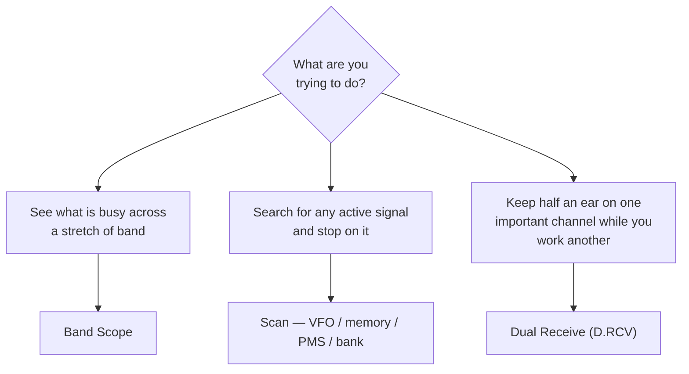
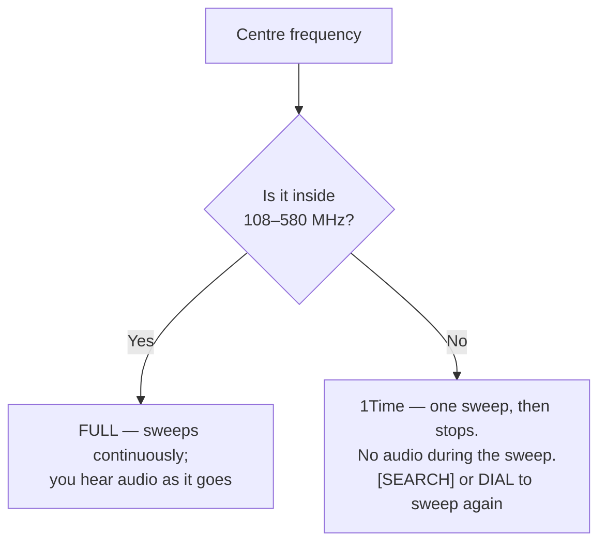
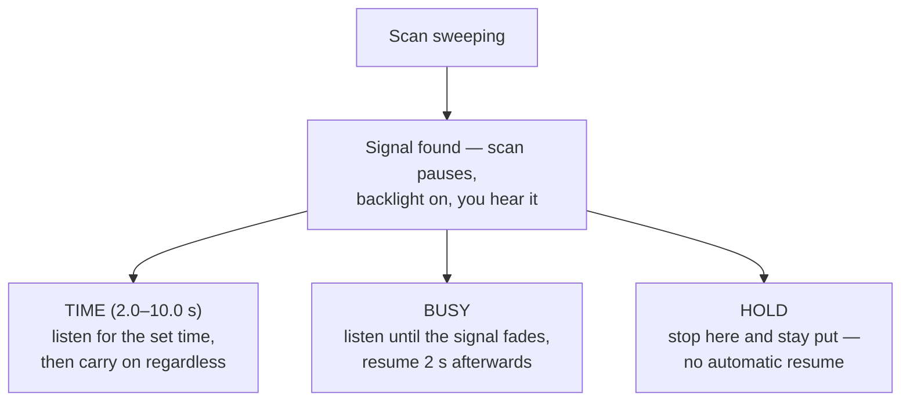

# Band scope, scanning and dual receive

A radio is only as useful as your ability to find something worth hearing on it, and the FT5DR gives you three quite different ways to do that: a **Band Scope** that draws you a picture of what is busy, a **scanner** that sweeps the band and stops when it hears a voice, and **Dual Receive**, which keeps half an ear on one important channel while you get on with something else. None of them are hard once you see how they fit together — this chapter maps all three, the exact keystrokes to reach them, and the handful of settings that decide how they behave.

## Three ways to find a signal

Before the detail, hold the shape of it in your head. These are three tools for three different jobs, and choosing the right one is most of the battle:



All three are **receive** functions. None of them transmit, and any of them drops out the instant you press the PTT so you can reply — so there is nothing to be nervous about. Explore freely; the [BACK] key and the PTT always bring you home.

One key note before we start. Every one of these functions is reached through the **top display/menu key**, and Yaesu cannot quite decide what to call it across its own documentation: some of its materials label this button **[DISP]**, while the current Operating Manual and the Advance Manual both call the very same physical button **[F MENU]**. It is one key. This chapter uses **[F MENU]** to match the current manuals; if your radio or an older manual says **[DISP]**, it is the identical button. A _short_ press pops up the on-screen panel of soft-key functions (where [SCOPE], [SCAN] and [D.RCV] live — the full soft-key tour is in [The Function Menu](outpost:entry/logbook73.guide.ft5dr/function-menu)); a _press-and-hold_ opens the full Setup Menu of twelve category tiles. Keep that short-versus-hold distinction in mind and everything below will make sense.

## The Band Scope — a picture of the band

The Band Scope (Yaesu also calls it the Spectrum Analyzer) draws a bar graph of signal strength for a run of channels centred on whatever your main band is tuned to. Tall bar, strong signal; flat, nothing there. It is the fastest way to answer "is anything happening around here?" without spinning the dial channel by channel.

```viz
{
  "type": "spectrum",
  "title": "The Band Scope — signal strength, channel by channel",
  "caption": "One bar per channel, fanned out either side of the channel you are listening to (centre): tall bar, strong signal; flat, nothing there. Each bar sits one tuning step from its neighbour, so a fine step surveys a narrow slice in detail and a coarse step sweeps a wide swathe.",
  "xLabel": "channels — one tuning step apart",
  "noiseFloor": 0.05,
  "components": [
    { "f": 8, "amp": 0.2, "tone": "muted" },
    { "f": 20, "amp": 0.55, "tone": "muted" },
    { "f": 32, "amp": 0.1, "tone": "muted" },
    { "f": 50, "amp": 0.9, "label": "centre — your channel", "tone": "primary" },
    { "f": 62, "amp": 0.3, "tone": "muted" },
    { "f": 76, "amp": 0.65, "label": "busy neighbour", "tone": "muted" },
    { "f": 90, "amp": 0.12, "tone": "muted" }
  ]
}
```

One honest caveat first, because it shapes what you should expect. This is a **stepping scope, not a true instantaneous spectrum**. It works by rapidly hopping channel to channel and measuring each in turn, then painting the result — it is not the wide, continuous SDR waterfall you may have seen on a benchtop rig or in [FFTs & Waterfalls](outpost:entry/logbook73.handbook/ffts-and-waterfalls). Yaesu markets it as "real-time", and for a handheld it is genuinely useful and rare at this size, but a very brief signal that opens up between sweeps can be missed. Think of it as a fast repeated survey rather than a live oscilloscope.

### Opening and closing it

1. **Short-press [F MENU]** to reveal the soft-key row. Touch **[SCOPE]**. If you do not see [SCOPE], touch **[FWD →]** to page the soft keys along until it appears, then touch it.
2. The graph fills the screen with your current frequency in the **centre** and the channels above and below it fanned out to each side.
3. To pause the sweep, touch **[STOP]**; to set it going again, touch **[SEARCH]**.
4. To close the scope entirely and return to normal operation, press **[BACK]**.

### Reading the scope

The centre column is the channel you are actually listening to. Each bar to the left is one channel lower, each to the right one channel higher, and the **spacing between channels equals your VFO tuning step** — so if your step is 25 kHz, each bar is 25 kHz away from its neighbour. Change the step (in CONFIG, covered in the [Setup Menu chapters](outpost:entry/logbook73.guide.ft5dr/setup-menu-2)) and the scope zooms in or out accordingly: a fine step surveys a narrow slice in detail, a coarse step sweeps a wide swathe more thinly.

You control **how many channels** are shown by touching the little channel-count readout at the **top-right of the scope** — it cycles **19 → 39 → 79** channels. Nineteen gives you a close-in view of your immediate neighbourhood; **79** throws the net widest, showing roughly four times the span. The factory default is 39, and you can set which width the scope opens on in the Setup Menu at **DISPLAY → 3 BAND SCOPE**. For general "what's on 2 m right now?" use, 79 channels (⭐) is the one to reach for; drop to 19 when you want to study activity right around one repeater.

### Why the audio sometimes goes quiet

Here is the quirk that confuses people. Whether you keep _hearing_ the band while the scope sweeps depends on **where** you are tuned:



- **Inside 108–580 MHz** — which covers the whole of the 2 m and 70 cm amateur bands, the aviation airband, PMR and the marine band — the scope shows **FULL** and sweeps **continuously**, and crucially you can **still hear the received audio** as it goes. This is the everyday case, and it is lovely: a live picture and live sound together.
- **Outside 108–580 MHz** — for example down on the broadcast, HF or shortwave ranges the wideband receiver reaches — the scope shows **1Time**. It performs a **single sweep and then stops**, and it stays **silent** while sweeping. To sweep again, touch **[SEARCH]** or turn the **DIAL** to move the centre frequency, and it takes one fresh survey.

Nothing is broken if the audio drops; the radio is simply telling you it is in single-sweep mode because you are outside the continuous-scan range.

### Retuning straight from the scope

The scope is not just a display — it is a tuning tool. **Touch any bar** and the radio jumps its receive frequency to that channel and re-centres the scope on it. It is a genuinely quick way to pounce on a busy channel you can see across the screen. You can also nudge the centre frequency the ordinary way by turning the **DIAL**. Between touch-to-tune and dial-to-pan, you can walk across a band visually, stopping wherever a bar catches your eye.

## Scanning — letting the radio search for you

Where the scope shows you a whole stretch at once, a **scan** does the walking for you: it steps through frequencies or channels, listens on each, and stops when it finds a signal. The FT5DR offers **four flavours** of scan, each suited to a different situation:

| Scan type       | What it searches                            | When to use it                                       |
| --------------- | ------------------------------------------- | ---------------------------------------------------- |
| **VFO scan**    | Every step across the current band          | Sweeping raw frequencies to find _any_ activity      |
| **Memory scan** | Your stored memory channels                 | Checking your regular repeaters and simplex channels |
| **PMS**         | Only between a chosen lower and upper limit | Confining a search to one band segment               |
| **Bank scan**   | The channels in one memory bank             | Scanning a themed group ("Repeaters", "PMR"…)        |

### VFO scan

This sweeps the band step by step, ignoring your memories.

1. Press **[V/M]** until you are in **VFO (frequency) mode**.
2. **Short-press [F MENU]** and touch **[SCAN]**. If [SCAN] is not on screen, touch **[BACK ←]** to page the soft keys until it appears, then touch it.
3. Away it goes. While it sweeps, the last two digits of the frequency (the 10 kHz and 1 kHz places) change to **dashes** and **blink** — the radio's way of saying "searching". When it lands on a signal, the **backlight comes on** and the **decimal point blinks**, and after about **five seconds** it moves on again (that dwell time is adjustable — see below). If you would rather the backlight did not flare every time the scanner stops — handy at night, or to save the battery — **SCAN → 2 SCAN LAMP** (default **ON**) turns that off.
4. To stop, press the **PTT** or touch **[STOP]**.

Two live controls make scanning feel natural. If the scan has **paused on a signal**, turning the **DIAL** resumes it instantly — handy when you have heard enough of this one. And if you turn the **DIAL while it is still sweeping**, the scan changes direction, running **up or down** to follow the way you turned. So the dial is both your "next" button and your steering wheel.

### Memory-channel scan

Instead of raw frequencies, this scans the channels you have saved — your repeaters, your simplex calling channels, your PMR list.

1. Press **[V/M]** and recall any **memory channel** to put the radio in memory mode.
2. **Short-press [F MENU]** and touch **[SCAN]** (again, use **[BACK ←]** to reveal it if needed).
3. **"MEM SCAN"** appears, and the radio cycles through your stored channels, stopping on activity with the same backlight-and-blink behaviour as VFO scan. **PTT** or **[STOP]** ends it.

A word owners often raise: while memory scanning, the screen shows the **"MEM SCAN"** label rather than a live, readable frequency for each channel it visits, so you cannot always watch exactly where the scan is at any instant. It is a minor irritation rather than a fault — it stops perfectly well when it hears something.

### Skip and specified (select) channels

Rarely do you want to scan _all_ your memories. Two settings, both under **MEMORY → 5 MEMORY SKIP**, let you shape the list:

- **Skip** ⭐ — marks a channel to be **left out** of scanning. Perfect for a channel that is nearly always busy (a data frequency, a constant beacon) and would otherwise trap the scan.
- **Select** ⭐ — the inverse: it marks a channel as one of a chosen few, and the radio then scans **only** those "specified" channels. This is how you build a quick "just these five" scan without deleting anything.

Set a channel's skip/select status in memory mode and the scanner honours it from then on. It is the single most effective way to make memory scanning genuinely useful rather than maddening.

### Programmable Memory Scan (PMS)

PMS confines a scan to a **band segment of your choosing**, defined by a lower and an upper frequency. The FT5DR gives you **50 pairs** of programmable-limit memories — labelled **L1/U1** through **L50/U50** — where the **L** channel holds the bottom edge and the **U** channel the top. Store a pair, recall it, and the scanner sweeps only between those two limits and no further.

This is exactly what you want when you care about one slice of a band. Set L/U to the 2 m FM simplex segment and PMS will sweep only there, never wandering off into the satellite or SSB portions. It is also the tidy way to keep a scan inside your national band plan's allocation. The full store-and-recall procedure for PMS pairs lives in the [memory-system chapter](outpost:entry/logbook73.guide.ft5dr/memory) alongside the other memory types; here the thing to remember is _what it is for_ — a leash on the scan.

### Memory Bank Scan

The FT5DR sorts memories into **banks** (up to 24 of them, and a channel can sit in several). **Bank scan** simply scans the channels of one bank — so a "Local repeaters" bank or a "Marine" bank becomes a one-touch themed sweep. Because banks are the backbone of how you organise the radio, they get their own treatment in the [memory chapter](outpost:entry/logbook73.guide.ft5dr/memory); the takeaway for scanning is that a well-built bank _is_ a ready-made scan list.

## What happens when the scan stops

Whichever scan you run, one setting decides how it behaves the moment it finds a signal — and it is worth getting right, because the wrong choice makes scanning either twitchy or sticky. It lives at **SCAN → 4 SCAN RESUME**, reached by **pressing and holding [F MENU]**, touching the **[SCAN]** category tile, then **[4 SCAN RESUME]**. There are three behaviours:



- **Time (2.0–10.0 sec)** ⭐ — the scan pauses on the signal for a fixed spell (settable from 2 to 10 seconds in half-second steps), then **carries on whether or not the other station is still talking**. Good for a busy band where you want a taste of each conversation and then to move on.
- **Busy** ⭐ — the scan **stays put for as long as the signal is present**, and only moves on **two seconds after it fades away**. This is the natural choice for following a conversation: you hear the whole over, and the scan waits for a gap. It is the setting most people end up leaving on. That two-second gap is only the factory default — **SCAN → 3 SCAN RE-START** sets it anywhere from **0.1 to 10 seconds** (default **2.0**), so you can make Busy jump to the next channel sooner, or linger a little longer after a station drops.
- **Hold** ⭐ — the scan **stops dead** on the first signal and does not resume at all; it simply parks you there. Use it when you are hunting for one specific thing and want the radio to grab it and hold.

The manual is explicit that **this one setting is common to every kind of scan** — VFO, memory, PMS and bank all obey it — so set it once to suit how you like to listen.

A separate item, **SCAN → 5 SCAN WIDTH**, decides how far each scan is allowed to roam. It is really three settings in one, chosen in turn as **VFO / MEMORY / BANK LINK**:

| Part          | Options (default first) | What it does                                                                                                                                                        |
| ------------- | ----------------------- | ------------------------------------------------------------------------------------------------------------------------------------------------------------------- |
| **VFO**       | **ALL** / BAND          | **ALL** sweeps every band across the radio's whole **1.8 MHz–999 MHz** range from where you are; **BAND** confines the sweep to the current band                    |
| **MEMORY**    | **ALL CH** / BAND       | **ALL CH** scans all memory channels **1–900** (or only your select/"specified" ones, if set); **BAND** scans only memories in the same band as the current channel |
| **BANK LINK** | **ON** / OFF            | **ON** lets a bank-link scan span two or more chosen banks; **OFF** scans only the recalled bank                                                                    |

The catch worth knowing is that **out of the box a VFO scan roams the entire 1.8–999 MHz, not just the band you are on**. Set **VFO** to **BAND** and a sweep stays sensibly inside, say, 2 m rather than charging off across the airband — a quiet quality-of-life win. Reach all three parts with press-and-hold **[F MENU] → [SCAN] → [5 SCAN WIDTH]**.

## Weather Alert Scan

Tucked in among the scan features is one aimed squarely at North America. **Weather Alert Scan** watches the **NOAA weather-broadcast channels** for the special **1050 Hz alert tone** that precedes a severe-weather warning, while you carry on scanning normally. Every five seconds the radio dips over to the weather channels, checks for that tone, and — hearing none — returns to your ordinary scan for another five seconds. If the tone appears, it alerts you.

To arm it, **press and hold [F MENU]**, touch **[SIGNALING]**, select **[14 WX ALERT]**, set it to **ON**, and save with the PTT. Then start any VFO or memory scan as usual; the display stays on your normal frequency while the radio quietly polls the weather channels in the background. While it is watching them you can press the PTT twice to jump into scanning the weather channels directly, and turn the **DIAL** to pick a particular one.

The regional reality, though: **NOAA Weather Radio is a United States (and broadly North American) service** on the 162 MHz band, and there is **no equivalent NOAA broadcast in the UK or across most of Region 1**. So for a UK operator this feature is largely inert — the channels it monitors carry nothing here. Happily, **WX ALERT ships OFF from the factory** (SIGNALING → 14 WX ALERT, Yaesu's opt-in for storm and hurricane alerting), so there is nothing to switch off — leaving it be (❌) is the whole job unless you operate where NOAA coverage exists. It is a valuable safety feature where the service is present, and simply dead weight where it is not.

## The three "dual" features people muddle up

Now for the part that trips up almost every newcomer. The FT5DR has **three** separate features with "dual" or "receive" in their names, and they do genuinely different things. Sort them out once and you will never be confused again:

| Feature                  | What it actually does                                                                                   | Where it lives                                                                                               |
| ------------------------ | ------------------------------------------------------------------------------------------------------- | ------------------------------------------------------------------------------------------------------------ |
| **Dual-band receive**    | Two _independent_ receivers hearing two frequencies **at the same time** (A-band + B-band, any V/U mix) | Covered in [Operating Basics](outpost:entry/logbook73.guide.ft5dr/operating-basics)                                                |
| **AF DUAL**              | Keeps you _hearing_ a second band's audio (e.g. broadcast FM) while you monitor another                 | Soft-key toggle — short-press [F MENU], then [A.DUAL] (see [The Function Menu](outpost:entry/logbook73.guide.ft5dr/function-menu)) |
| **Dual Receive (D.RCV)** | A **priority watch** — dips to _one_ memory channel every ~5 s while you operate elsewhere              | The subject of this chapter                                                                                  |

The important distinction is between the first and the third. **True dual-band receive** uses two real receivers, so it hears both frequencies genuinely simultaneously — that is the radio's headline "watch two frequencies at once" trick, and it belongs to the operating-basics chapter. **D.RCV**, by contrast, time-shares a single receiver: it is watching your working frequency _and_ periodically glancing at a priority channel, not listening to both continuously.

### AF DUAL — a broadcast in one ear, a silent watch in the other

The middle row of that table is the one people rarely get round to trying, and it is worth a moment on its own. **AF DUAL** lets you listen continuously to a broadcast station — either the AM medium-wave band or the FM broadcast band — while the radio keeps a _silent_ standby watch on your amateur A-band or B-band frequency. You hear the music or the news and nothing from the amateur side, right up until a voice or calling signal actually appears there, at which point the broadcast pauses and the amateur signal comes through. Press **[MONI]** at any time to hear the standby frequency on demand.

That is the crucial difference from D.RCV below. D.RCV interrupts what you are listening to roughly every five seconds to _sample_ the priority channel; AF DUAL leaves your broadcast alone and interrupts it **only when a genuine call arrives**. If you mostly want the broadcast and only need pulling off it when someone actually calls, AF DUAL is the gentler of the two. It can hold its watch on a memory channel or a whole memory bank rather than a raw VFO frequency. One limitation to know: it cannot keep an AM broadcast on one band and an FM broadcast on the other at the same time.

To use it, short-press **[F MENU]** and touch **[A.DUAL]** (touch **[BACK ←]** to page it into view if needed); an AF-DUAL icon appears. Press **[BAND]** to switch the broadcast source between the AM medium-wave and FM broadcast bands, and turn the **DIAL** to tune the station. Touch **[A.DUAL]** again to switch it off.

### Dual Receive (D.RCV) — the priority watch

D.RCV lets you get on with one frequency while the radio keeps checking a **priority memory channel** for you. Roughly **every five seconds** it dips to the frequency stored in your chosen priority channel to see whether anything has come up there; if the channel is quiet it drops straight back to what you were doing, and if a signal appears it can hand you over.

```viz
{
  "type": "wave",
  "title": "D.RCV — a priority watch that dips every few seconds",
  "caption": "The receiver stays on your working frequency and, roughly every five seconds (the DW TIME setting), dips briefly to the priority memory channel. Quiet there means straight back to what you were doing; a signal there means a beep and a hand-over.",
  "xLabel": "time — one dip roughly every 5 s",
  "traces": [
    { "kind": "points", "label": "where the receiver is listening", "tone": "primary", "points": [[0,0.55],[0.16,0.55],[0.17,-0.55],[0.21,-0.55],[0.22,0.55],[0.41,0.55],[0.42,-0.55],[0.46,-0.55],[0.47,0.55],[0.66,0.55],[0.67,-0.55],[0.71,-0.55],[0.72,0.55],[0.91,0.55],[0.92,-0.55],[0.96,-0.55],[0.97,0.55],[1,0.55]] },
    { "kind": "points", "label": "priority channel", "tone": "muted", "style": "dashed", "points": [[0,-0.55],[1,-0.55]] }
  ]
}
```

- **What it does:** designate one memory channel as the **priority channel**, then switch **D.RCV** on. While you operate on the VFO (or another channel), the radio samples that priority channel about once every five seconds; when it finds a signal there, it beeps and switches you over.
- **Designating the priority channel** (the step the printed manual leaves to the Advance Manual): store the channel as an ordinary memory — it needs both a receive frequency and its mode already set — press **[V/M]** for memory mode, **press and hold [F MENU]** to open the memory-edit screen, rotate the **DIAL** to the channel, and touch **[PRI.CH]**. A small **"P"** appears at the **upper-right** of the channel number, the setting saves, and the radio drops you back on whichever memory channel you had recalled before (not the one you just tagged). One channel holds the flag at a time.
- **Switching the watch on:** set what you want to listen to meanwhile — VFO, another memory, or the home channel — then short-press **[F MENU]** and touch **[D.RCV]** (page the soft keys with [FWD →] / [BACK ←] if it is not immediately visible). The top-left icon confirms the flavour: **VDR** (VFO + priority), **MDR** (memory + priority) or **HDR** (home + priority) — and when the memory watch is running from inside a bank the icon reads **DXX** instead, where XX is the bank number, or **dXX** if a bank link is set. Touch [D.RCV] again to stop.
- **Why it exists:** so you can rag-chew on a simplex frequency, listen around the band, or even sit on broadcast radio, without missing a call on your local repeater or a net frequency you care about. The repeater is your priority channel; everything else is what you do in between checks.
- **The dip interval:** that "every five seconds" is itself a setting — **SCAN → 1 DW TIME**, reached by press-and-hold **[F MENU] → [SCAN] → [1 DW TIME]**, sets how often the radio checks the priority channel while D.RCV runs. It ranges from **0.1 to 10 seconds**, and the default is **5.0**, which is exactly the "~5 s" quoted above. Shorten it to catch briefer calls, at the price of interrupting your working-frequency listening more often.
- **After a catch:** what D.RCV does once the priority channel goes active has its **own** entry inside **SCAN → 4 SCAN RESUME** — the same menu item that sets the resume behaviour for ordinary scanning, but a _separate_ selection within it. Open **[F MENU] → [SCAN] → [4 SCAN RESUME]**, rotate the **DIAL** to the **DW** line (Dual Receive, as distinct from the scanning line), press **[F MENU]**, then choose the condition: a **Time** value of **2.0–10.0 s** (resume the watch that long after the signal), **Busy** (resume two seconds after the signal fades out), or **Hold**. Its factory default is **Hold** — and Hold parks the radio on the priority channel so the watch **never resumes**, the classic "D.RCV died after one catch" symptom. Switch it to **Busy** or a **Time** value for an automatic return to watching. (That is the after-catch _behaviour_; the dip _cadence_ is the separate **DW TIME** above.)
- **The companion setting** is **SCAN → 6 PRIORITY REVERT**, and its factory default is **OFF**. With it **off**, you can transmit on the priority channel only _after_ a signal has actually been received there and the watch has paused on it; pressing **PTT** then drops out of D.RCV and transmits on the priority channel, and the watch does **not** resume — a pure background watch that ends the moment you talk. With it **on**, pressing **PTT** transmits on the priority channel at any time, active or not; when you release, the radio stays on that channel for about **five seconds** and then D.RCV resumes automatically. Turn it **on** when the watched channel is really _your_ channel and the rest is background listening.
- **Typical use (UK):** ⭐ set your most-used [repeater](outpost:entry/logbook73.handbook/repeaters) as the priority channel and enable D.RCV while you tune around 2 m simplex, so a call on the machine still reaches you.

D.RCV runs happily with AMS on. And keep the terminology straight: if you want to hear **two channels continuously and at full attention**, that is **dual-band receive**, not D.RCV.

## Try it yourself

With the radio on a 2 m frequency and a charged battery:

1. **Open the Band Scope.** Short-press **[F MENU]**, touch **[SCOPE]**, and watch the bars. Touch the channel count at the top-right to cycle **19 → 39 → 79** and see the span widen. Touch a tall bar to jump straight onto it, then press **[BACK]** to close the scope.
2. **See the FULL/1Time difference.** With the scope open on 2 m note it says **FULL** and you can hear audio; then tune the receiver down onto the FM broadcast band and reopen it — now it shows **1Time** and goes quiet between sweeps. That is the 108–580 MHz boundary in action.
3. **Run a VFO scan.** In VFO mode, **[F MENU] → [SCAN]**, and let it sweep. When it stops on a signal, turn the **DIAL** to send it hunting again, and note how turning the dial mid-sweep steers it up or down.
4. **Change how it resumes.** Press and hold **[F MENU] → [SCAN] → [4 SCAN RESUME]** and try **Busy** versus a 2-second **Time** setting on a moderately active band. Feel the difference between "wait for the gap" and "sample and move on".
5. **Set a priority watch.** Store your local repeater as a memory, designate it as the priority channel, and switch on **[D.RCV]** — then tune around simplex and watch the radio dip back to check the repeater every few seconds.

## Key takeaways

- The **Band Scope** ([F MENU] → [SCOPE]) draws signal strength for **19/39/79 channels** around your frequency; it is a fast **stepping** survey, not a live SDR spectrum, and channel spacing follows your tuning step.
- The scope **hears audio and sweeps continuously (FULL) only within 108–580 MHz**; outside that range it does a single silent sweep (**1Time**) until you touch [SEARCH] or move the dial.
- Four scans cover every need — **VFO**, **memory**, **PMS** (50 lower/upper limit pairs) and **bank** — and **MEMORY → 5 MEMORY SKIP** lets you _skip_ busy channels or _select_ just a chosen few.
- **SCAN → 4 SCAN RESUME** governs all scanning: **Busy** waits for the conversation to end, **Time** samples for 2–10 s and moves on, **Hold** stops and stays.
- **Weather Alert Scan** watches the NOAA 1050 Hz tone — valuable in North America, but there is **no NOAA service in the UK/Region 1**, so leave it off here.
- Keep the three "dual" ideas apart: **dual-band receive** (two receivers, truly simultaneous), **AF DUAL** (hear a second band's audio), and **D.RCV** (a priority _watch_ that dips to one memory channel every ~5 s).

With your eyes and ears trained on the bands, the next chapter turns to the FT5DR's other conveniences — hands-free audio, voice-activated transmit, the recorder and the snapshot camera-mic — in [Bluetooth, VOX, Voice Recorder & Snapshot](outpost:entry/logbook73.guide.ft5dr/audio-extras).
