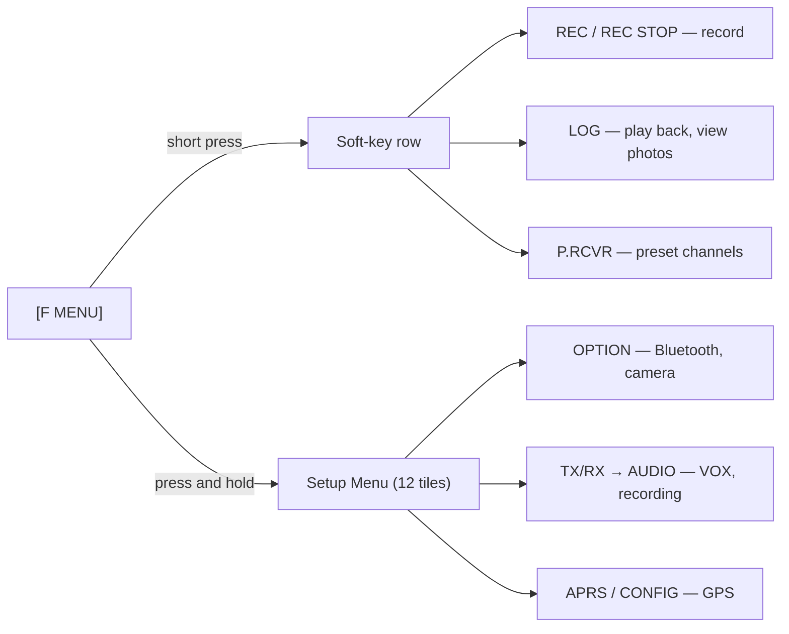
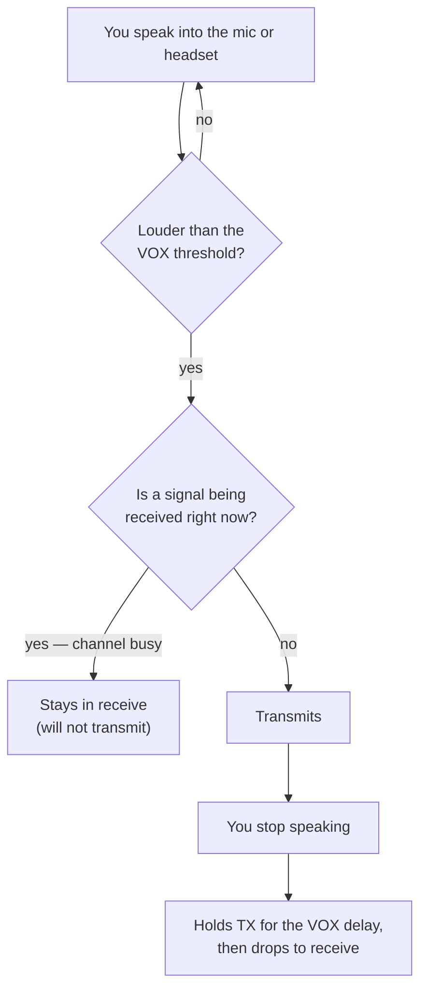
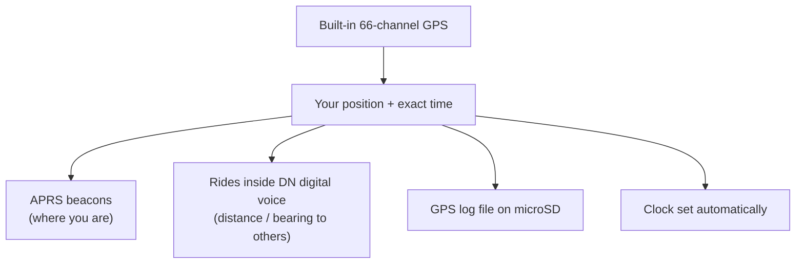

# Bluetooth, VOX, voice recorder and snapshot

Beyond the serious business of repeaters, digital voice and APRS, the FT5DR carries a cluster of _convenience_ features — the ones that make it pleasant to live with, not merely capable. You can pair a Bluetooth headset and go hands-free, let your voice key the transmitter, dip into a bank of ready-loaded broadcast channels, record a QSO to the memory card, snap and send a photograph with the optional camera microphone, and let the built-in GPS tell you (and everyone you talk to) where you are. None is essential; all are genuinely useful once you know they exist. This chapter walks each one, with the keystrokes and the quirks that trip people up.

## Where these features live

Almost everything here hangs off one key: the top display/menu key. Yaesu cannot quite decide what to call it — some documents label it **[DISP]**, while the current Operating Manual and the on-screen prompts call the same physical button **[F MENU]** — so this chapter uses **[F MENU]**. The crucial habit is short-press versus press-and-hold:

- A **short press** pops up the row of **soft keys** along the bottom — where the _actions_ live: `[REC]`/`[REC STOP]` for recording, `[LOG]` for playback and photos, `[P.RCVR]` for the preset channels. Touch `[FWD →]` to page along if the one you want is not showing; every soft key on both pages is decoded in [The Function Menu](outpost:entry/logbook73.guide.ft5dr/function-menu).
- A **press-and-hold** opens the full **Setup Menu** of twelve category tiles — where the _settings_ live: Bluetooth and the camera under **OPTION**, VOX and recording under **TX/RX → AUDIO**, GPS under **APRS** and **CONFIG**.

One reminder before we start: **recording, snapshots and GPS logging all write to the microSD card**, so those three do nothing until a 2–32 GB card is fitted and formatted _in the radio_ (**SD CARD → 4 FORMAT**), covered in [Getting Started](outpost:entry/logbook73.guide.ft5dr/getting-started).

## Bluetooth — going hands-free

The FT5DR has Bluetooth built in, so you can send its audio to a wireless headset and, with VOX or the headset's own button, transmit without ever touching the radio. Yaesu sells a matched headset, the **SSM-BT20**, but the radio will also pair with many ordinary Bluetooth headsets — Yaesu just cannot guarantee every third-party model. Everything Bluetooth lives under the Setup Menu's **OPTION** category.

### Bluetooth on/off and pairing — ⭐ useful if you go hands-free

Turning Bluetooth on, finding a headset and connecting to it.

- **Does:** switches Bluetooth on, searches for headsets in pairing mode, and connects to the one you choose. Once paired, the radio remembers it and reconnects automatically at power-on.
- **Inside:** a short-range 2.4 GHz radio, separate from the transmitter, carrying your receive audio out to the headset and the headset's microphone back in. When connected, a Bluetooth icon lights and _all_ receive audio and beeps come from the headset.
- **Why it exists:** genuine hands-free operation — driving, walking, both hands busy — without a snagging cable and without holding a transmitter against your head.
- **How:** put the headset into pairing mode first (on the SSM-BT20, hold its Multi-Function button until the LED blinks **red/blue alternately**). Then press-and-hold **[F MENU] → OPTION → 2 Bluetooth**, set **ON**, touch `[SEARCH]`, rotate the **DIAL** to highlight your headset, and touch `[CONNECT]`. On success the model name shows (the SSM-BT20's LED settles to blinking blue). Press **PTT** to return to normal operation.
- **UK recommendation:** ⭐ Pair it once and enjoy it — nothing region-specific here, as Bluetooth is licence-free everywhere.
- **Common mistakes:** running `[SEARCH]` before the headset is in pairing mode (it will not appear); expecting sound from the radio's speaker after connecting — by default there is none (see **Bluetooth AUDIO** next). To forget a headset, use **OPTION → 3 DEVICE LIST** and `[DEL]`; to disconnect without forgetting it, use `[DISCON]`.
- **Related:** **OPTION → 4 Bluetooth AUDIO** (routing); **OPTION → 3 DEVICE LIST** (paired devices); VOX (below).
- **Should you change it?** Only if you want hands-free audio; it costs a little battery, so leave it off otherwise.

### Bluetooth AUDIO — ⚠️ the counter-intuitive one

Where the sound comes out when a headset is connected. This single item causes more head-scratching than the rest of Bluetooth put together, because the labels feel backwards.

- **Does:** chooses whether audio plays _only_ through the headset or through **both** the headset and the radio's speaker.
- **Values:** **AUTO** (default) = **headset only**, internal speaker silenced. **FIX** = **both** headset and speaker.
- **Why it exists:** most of the time you want the headset to take over completely (AUTO); occasionally — passing the radio around, or letting a bystander hear — you want the speaker live too (FIX).
- **The trap:** "AUTO" does _not_ mean "the radio decides". It means "audio automatically follows the headset", i.e. the speaker goes quiet. So if you pair a headset, set the radio down and hear nothing, this is why — it is working perfectly, the sound is just going to the headset.
- **UK recommendation:** ⭐ Leave it on **AUTO** for personal hands-free use; switch to **FIX** only when you want the speaker live alongside the headset.
- **Common mistakes:** thinking the speaker has failed after pairing; forgetting you left it on FIX and broadcasting your QSO to a quiet room.
- **Should you change it?** Set it once to suit how you use the headset, then forget it.

### Talking through the headset: VOX or the Call button

Once a headset is connected, there are three ways to transmit: **VOX** (just talk — set up next); **the headset's own button** — with VOX _off_, pressing the "Call button" (the SSM-BT20's Multi-Function key, which beeps) toggles transmit and receive; and **the radio's PTT**, which always works whatever the Bluetooth or VOX state and feeds your voice through the _headset's_ microphone. One thing to hold onto: **the VOX settings are shared** between the headset and the radio's own microphone — there is no separate "headset VOX", which matters the moment you turn VOX on.

## VOX — transmit by talking

VOX (Voice-Operated transmit) keys the transmitter when it hears you speak, so you never touch the PTT. It is the natural partner to a Bluetooth headset, but it works equally with the radio's own microphone. It is also the classic source of "why is my radio transmitting on its own?", so it earns a careful read. VOX lives at **TX/RX → 3 AUDIO → 5 VOX**.

### VOX (gain) — ❌ off for general use

The master on/off, which doubles as the sensitivity control.

- **Does:** when on, the radio transmits the moment your voice crosses a loudness threshold and stops when you go quiet. Unusually for a radio, there is no numeric level scale here — just **OFF / LOW / HIGH**, where LOW and HIGH set how much gain is applied to the microphone before the trigger.
- **Inside:** an audio-level detector watches the microphone (the headset's when one is connected, otherwise the radio's). Cross the threshold and the firmware keys the transmitter exactly as a PTT press would. **LOW** demands a firmer, louder voice; **HIGH** triggers on quieter speech but also picks up more background noise.
- **Values:** OFF / LOW / HIGH.
- **UK recommendation:** ❌ Leave it **OFF** for general use. VOX transmits without you consciously deciding to — on shared channels and repeaters a quick way to send background chatter, half a conversation with someone in the room, or a cough. Turn it on only with a proper headset and a specific hands-free need, and start on **LOW**.
- **Two gotchas that catch everyone:** VOX **will not transmit while a signal is being received** — a mercy that stops it doubling with a station already talking, but it also means it will not "break in" over someone. And if **VOX is ON and Bluetooth is OFF**, the **PTT is disabled** — the radio expects you to talk, not press — so Yaesu's advice is to **turn Bluetooth off when using VOX with the built-in microphone**, and to turn VOX off if you want the PTT back.
- **Example:** a cyclist with a boom headset sets VOX to LOW to answer a call without letting go of the handlebars; in the shack, the same person leaves it off and uses the PTT.
- **Common mistakes:** leaving VOX on by accident and wondering why the radio keys up when you shuffle papers; setting HIGH in a car so road noise triggers it constantly; forgetting the shared setting, so headset VOX is still armed when you pick the bare radio back up.
- **Related:** VOX DELAY (below); Bluetooth AUDIO; the headset's Call button (an alternative to VOX).
- **Should you change it?** Only for deliberate hands-free work, and then set it to LOW.

### VOX DELAY — ⭐ 0.5–1.0 s

How long the radio keeps transmitting after you stop speaking.

- **Does:** holds the transmitter on for a set time after your voice drops below the threshold, so natural pauses between words do not chop your transmission into fragments.
- **Inside:** a hold timer restarted by every burst of speech; the transmitter only drops when the timer runs out with no new audio, riding over the natural gap between words.
- **Values:** 0.5 / 1.0 / 1.5 / 2.0 / 2.5 / 3.0 seconds; default **0.5 s**. Set it on the **DELAY** line of the same **TX/RX → 3 AUDIO → 5 VOX** screen.
- **UK recommendation:** ⭐ **0.5–1.0 s** — long enough to ride over a natural pause, short enough that you are not transmitting dead air for three seconds after every over.
- **Common mistakes:** setting it long and transmitting silence after every over; leaving it short but speaking with big pauses, so the radio chops you.
- **Related:** VOX (gain).
- **Should you change it?** Tune it once when you set VOX up, then leave it.

## DTMF — dialling tones for phone patch and link control

The touch-tones a telephone keypad makes have a second life on the air. The FT5DR can send **DTMF** (Dual-Tone Multi-Frequency) tones to dial through a **phone patch** onto the public telephone network, to pass control codes to repeaters and network links, or to connect through a **WIRES-X** analogue node. Rather than tap a long string out by hand every time, you can store the codes you use. It all lives under **SIGNALING**.

### Storing and sending codes — ⭐ dial without touching a keypad

- **Stores:** up to **10** DTMF registers, each holding up to **16 digits**. Set one at press-and-hold **[F MENU] → [SIGNALING] → [5 DTMF MEMORY]**: rotate the **DIAL** to a register (**1–10**), press **[F MENU]**, key in the digits, then press **PTT** to save. The character set is `0–9, A–D, *, #, -`, though the DIAL on its own reaches only 0–9.
- **Sending — AUTO or MANUAL:** pick the mode at **SIGNALING → 4 DTMF MODE** (the **MODE** line). In **AUTO** you fire off a whole stored register at once — hold the **PTT**, touch **[DTMF]**, then touch the numeric key **[0]–[9]** for that register; a **DTMF** icon shows, and transmission runs until the entire code has been sent even if you let go of the PTT early, then drops back to receive. In **MANUAL** you tap each digit yourself — hold the **PTT**, touch **[DTMF]**, then tap the keys in turn; transmission may run on for about **one second** after you release the PTT.
- **UK recommendation:** ⭐ Worth setting up if your local repeater or link node takes control tones, or you use a WIRES-X analogue node; otherwise harmless to leave alone.
- **Related:** [C4FM Digital, AMS & DG-ID / DP-ID](outpost:entry/logbook73.guide.ft5dr/c4fm) for WIRES-X and the digital modes.

## Packet radio — connecting a TNC

Old-fashioned **packet** — sending data over radio through a **TNC** (Terminal Node Controller) — is still possible with the FT5DR, but not by plugging a TNC straight in. You need the optional **CT-44 Microphone Adapter**, which fits the radio's **MIC/SP** jack and breaks that single connector out to the TNC: speaker and ground on the receive (EAR) side, and microphone, PTT and ground on the transmit side.

### Wiring it in and keeping it cool — ⚠️ advanced, needs the CT-44

- **Audio levels:** set the **transmit** audio fed to the TNC with the transceiver's own **volume** control; set the **receive** audio the other way, with the output-level control **on the TNC** — the receive input level cannot be adjusted on the radio.
- **Turn the receive battery-saver off:** it interrupts the receiver and corrupts packet, so switch it off at press-and-hold **[F MENU] → [CONFIG] → [17 SAVE RX]**.
- **Mind the heat:** ⚠️ sending a lot of data holds the transmitter keyed for a long time and can overheat the set. The overheat protection first **reduces power**, then **stops transmitting** altogether and returns to receive — leave it in receive to cool if that happens.
- **PC noise:** a computer's own noise can spoil reception; if the radio starts behaving strangely, unplug it from the PC and reconnect through a photo-coupler or noise filter.
- **UK recommendation:** ⚠️ A niche, wired-in mode — you will know if you need it, and the golden rule is the accessory: no CT-44, no packet.

## Preset Receiver Memory Channels — broadcast presets built in

Tucked behind the `[P.RCVR]` soft key are three banks of channels the FT5DR ships with **already loaded** — a genuine convenience if you have ever hunted for a weather or marine frequency. They are **receive-only** and **cannot be overwritten**, which is exactly what makes them dependable: they are not part of your 900 programmable memories, so you cannot accidentally clobber them.

- **How to reach them:** press **[A/B]** so the **A-band** is the operating band (they only work on A-band), short-press **[F MENU]** and touch **[P.RCVR]** (touch `[BACK ←]` to reveal it if it is not on the current soft-key page). Then press **[BAND]** to cycle between the three banks, and rotate the **DIAL** to step through the channels. Press `[BACK]` or touch `[P.RCVR]` again to leave.

### The three preset banks — ⭐ a receive-only convenience

| Bank       | Press [BAND] to | What it holds                                      | Mode |
| ---------- | --------------- | -------------------------------------------------- | ---- |
| **WX CH**  | Weather         | 10 VHF weather-broadcast channels (NOAA, ~162 MHz) | FM   |
| **INTVHF** | Marine          | 57 international VHF marine channels               | FM   |
| **SW**     | Shortwave       | 89 world shortwave broadcasters (VOA, BBC, DW…)    | AM   |

- **Does:** gives instant, tune-free access to three services with fixed, well-known channel plans, so you never key in a frequency. The 10 weather channels are the North-American **NOAA Weather Radio** frequencies: `162.550`, `162.400`, `162.475`, `162.425`, `162.450`, `162.500`, `162.525`, `161.650`, `161.775` and `163.275` MHz.
- **UK/region reality — read this before you go looking:** the WX bank is built for **North America** — there are **no NOAA transmitters in the UK or most of Europe**, so those channels stay silent here and the weather-alert tone is a US/Canada feature. The **marine (INTVHF)** channels _are_ an international plan, worth a listen near the coast — but for **listening** only; transmitting on marine channels needs a marine authorisation, not your amateur licence. The **shortwave** bank is the star for a UK listener: worldwide AM broadcasters, best after dark.
- **Scanning them:** with a bank open, **[F MENU] → [SCAN]** sweeps the presets, following the same scan-stop settings covered in [Band Scope, Scanning & Dual Receive](outpost:entry/logbook73.guide.ft5dr/scan-scope) — which is also where the **Weather Alert Scan** (the NOAA 1050 Hz alert watch, **SIGNALING → 14 WX ALERT**) lives.
- **Common mistakes:** reaching for `[P.RCVR]` on the B-band (it only appears with A-band operating); expecting to _store your own_ frequency here (you cannot, by design); concluding weather receive is broken when you are simply outside NOAA coverage.
- **Related:** a `*` beside a marine frequency marks a **base-station** channel; selecting one lights the duplex icon, and **[F MENU] → [REV]** reveals the paired **ship** frequency — **4.6 MHz below** the base — blinking, ready for duplex, with **[REV]** again returning to the base. See [VHF](outpost:entry/logbook73.handbook/vhf) for what these bands are.
- **Should you change it?** You cannot change the presets — and that is the point. Just dip in when you want them.

## Voice Recording — capturing what you hear

The FT5DR can record received (and, if you like, transmitted) audio straight to the microSD card as ordinary `.wav` files you can play back on the radio or copy to a computer. It is superb for catching a callsign you missed, keeping a record of a net, or saving a memorable contact — with the usual courtesy caveat that you are recording other people.

### Recording (REC / REC STOP) — ⭐ one-touch capture

- **Does:** records the current audio to the card. Short-press **[F MENU]** and touch **[REC]** (touch `[BACK ←]` to reveal it if needed); the screen shows **RECSTART** and a **●** appears at the top while recording. Touch **[REC STOP]** to end it — recording also stops if you switch off, and otherwise continues until you stop it or the card fills.
- **Inside:** the audio is written as a Wave file into a **VOICE** folder, named by date and time — `YYMMDDhhmmss.wav` — so **set the clock first** (**CONFIG → 19 DATE & TIME ADJ**). By default it captures the **A-band** received audio and **pauses about 3 seconds after the squelch closes**, resuming on the next signal, so it records conversation rather than hours of silence.
- **Why it exists:** a pocket QSO recorder with no extra kit — handy for logging, learning (play back your own overs), and catching details in fast traffic.
- **UK recommendation:** ⭐ Genuinely useful. Etiquette note: recording for your own reference is normally fine, but rebroadcasting or publishing someone's transmission without their agreement is another matter — keep recordings for personal use and ask before sharing.
- **Common mistakes:** recording with **no card fitted** (nothing is saved); expecting the file mid-recording (it is finalised when you stop); a firmware quirk — on some earlier firmware, starting a recording with the **volume at zero** made the radio record continuously even on a dead channel, filling the card, so update the firmware and check the volume first.
- **Related:** the recording setup below; microSD formatting in [Getting Started](outpost:entry/logbook73.guide.ft5dr/getting-started).
- **Should you change it?** It is an action, not a setting — use it whenever something is worth keeping.

### Recording setup (band + MIC) — ⭐ choose what gets captured

Two choices under **TX/RX → 3 AUDIO → 6 RECORDING** decide _what_ the recorder captures.

- **BAND** — which receiver to record: **A** (A-band audio, the default), **B** (B-band audio), or **A+B** (both bands mixed together). Match it to the band your QSO is actually on — recording A-band while your net runs on B-band is the classic "why is my recording silent?".
- **MIC** — whether to include **your own transmit audio**: **ON** records both transmit and receive (a full two-way record of the QSO), **OFF** records the received side only. Set **ON** if you want a complete conversation; **OFF** if you only care what the other station said.
- **Should you change it?** Set BAND to match where you operate; set MIC to ON if you want both sides of your QSOs on record.

### Playback and deleting — brief

Short-press **[F MENU] → [LOG] → [VOICE]** lists your recordings (touch `[▲/▼]` to page, `[TOP]` for the newest). Touch a file to play it — **live receive is muted during playback**, and you cannot record and play back at once. Touch the progress bar to jump, `[||]` to pause, `[◄◄ / ►►]` to skip 5 seconds. To delete, highlight a file with the **DIAL** and touch `[DEL]` then `[OK]`. One firmware wrinkle: on some versions, deleting a recording on the radio removes it from the on-screen list but **leaves the file on the card** — so if the card fills despite deletions, tidy it on a computer.

## Snapshot — the camera microphone (MH-85A11U)

Here is the FT5DR's most surprising trick: fit the **optional MH-85A11U camera-equipped speaker microphone** and the radio becomes a camera that can _transmit pictures over the air_ to other compatible Yaesu sets. It is a genuine System Fusion party piece — and entirely optional, so skip this section if you do not have the accessory.

### Taking and sending pictures — ⭐ needs the optional camera mic

- **Does:** takes a still photograph with the camera-mic, saves it to the microSD card, and can transmit it to another compatible transceiver.
- **The hardware:** the MH-85A11U is a speaker-microphone with a **lens**, **shutter button**, **Send Image button** (`D-TX`) and clip, plugging into the radio's **DATA terminal**. Connect or disconnect it **only with the radio powered off**, and mind the connector orientation — forcing it can cause damage.
- **How:** aim the lens (keep at least **50 cm** away, or it blurs), press the **shutter**, and the image appears on the screen. Touch **[SAVE]** to store it (into a **PHOTO** folder) or `[BACK]`/`[DEL]` to discard. To send it, press **[D-TX]** on the mic or touch **[SEND]**.
- **Inside:** transmitting a photo needs the whole channel for data, so the radio automatically switches to the **DW (Data FR)** digital mode — you never select DW by hand, and both stations must be in **C4FM digital**. That is why Snapshot is digital-only; the modes are explained in [C4FM Digital, AMS & DG-ID / DP-ID](outpost:entry/logbook73.guide.ft5dr/c4fm).
- **Settings:** picture **size (resolution)** and **quality (compression)** are set under **OPTION → 1 USB CAMERA**. View saved pictures with **[F MENU] → [LOG] → [PICT]** and re-send any with **[SEND]** or **[FWD]**.
- **UK recommendation:** ⭐ A fun, sociable feature on a local Fusion net, with no region-specific issues since it rides inside normal C4FM. Do not point the lens at the sun or bright lights (it can cause a malfunction), and clean it with a dry soft cloth.
- **Common mistakes:** connecting the mic with the radio switched on; shooting closer than 50 cm; trying to send to a station in analogue FM (the transfer needs digital at both ends).
- **Related:** [C4FM](outpost:entry/logbook73.guide.ft5dr/c4fm) for the digital modes; microSD setup for storage.
- **Should you change it?** Only relevant if you own the MH-85A11U — but if you do, it is a delightful extra.

## GPS — where you are, and using it

The FT5DR has a **66-channel GPS receiver** built in. Once it has a fix, it knows your position (latitude, longitude and altitude, to within a few metres) and the exact time from the satellites' atomic clocks — and that one piece of information quietly feeds several of the radio's best features.

### GPS Power — ✅ leave it on if you use location at all

The master switch for the GPS receiver.

- **Does:** turns the GPS receiver on or off, at **APRS → 20 GPS POWER**.
- **Inside:** with GPS on, the receiver continuously tracks satellites and updates your position; a GPS icon shows when it has a fix.
- **Why it exists:** GPS draws a little extra current (**about 15 mA**), so Yaesu lets you switch it off to save battery when you are not using anything that needs a position.
- **Values:** ON (default) / OFF.
- **UK recommendation:** ✅ Leave it **ON** if you use APRS, WIRES-X, GPS logging, or want the clock set automatically; turn it **OFF** only for a pure receive session where you want maximum battery life.
- **The gotcha to remember:** because APRS beacons your position, **with the position source set to GPS a beacon will not transmit until the GPS has a fix** — so a cold radio indoors sits silent until it sees the sky. Give it time, too: the first fix after purchase, or after GPS has been switched off for several hours, can take **a few minutes** to find the satellites. That interplay is covered fully in [APRS, GPS & Data](outpost:entry/logbook73.guide.ft5dr/aprs).
- **Where a fix struggles:** GPS wants an open sky. Between tall buildings, indoors or beside large buildings, under elevated roads or high-voltage lines, among trees, in a tunnel or underground, or through heat-reflective glass, the fix may wander or fail — and even where it holds, a poor environment can stretch the error to **several hundred metres** rather than the few metres of a clear-sky fix. If it will not fix at all, move into the open away from buildings; as few as **three satellites** are enough to get a position.
- **Related:** GPS LOG (below); APRS beaconing; [APRS](outpost:entry/logbook73.handbook/aprs) in the main handbook for what a position report is.
- **Should you change it?** Leave it on for anything location-aware; switch off only to save battery.

### Location display and real-time navigation — ⭐ more than a dot on a map

- **Does:** shows your own position and, in the digital **DN** mode, the position of stations you receive. Because DN carries GPS data alongside the voice, an incoming station's screen shows its **distance, bearing and course**, and a **compass** points the way to it. What that smart-navigation screen shows is chosen by **DISPLAY → 1 TARGET LOCATION** — **COMPASS** (the default) draws the compass, while **NUMERIC** shows raw latitude and longitude instead — and **DISPLAY → 2 COMPASS** sets whether the compass reads **Heading-Up** or **North-Up** (default Heading-Up). Yaesu calls the live form of this — tracking the station you are actually working — **Real-Time Navigation**.
- **The navigation screen:** to reach it, short-press **[F MENU]** and touch **[DISP]** (touch **[FWD →]** if it is not showing; if the GPS information screen is up instead, touch the compass to switch across), then touch the compass/list icon to bring up the remote-station display. For a station worked in **DN** (V/D) on the same frequency it shows, together: the partner's **callsign and distance** (Yaesu's example reads `JA1YOE-123  124.5km`), an **arrow to that station**, a second arrow for your **own travel direction**, and an **H-UP / N-UP** (heading-up or north-up) indicator. Press **[F MENU]** to return to the normal display.
- **Backtrack — find your way back:** the same **[F MENU] → [DISP]** screen (touch the screen to toggle it with the GPS information screen) hides a **Backtrack** function that registers up to **three** of your own return points — labelled **★**, **L1** and **L2** (the car park, the trailhead) — and then guides you back to any of them with the compass showing live distance. It complements the single stored **TARGET LOCATION**.
- **Seeing others with your own GPS off:** the distance and bearing to a DN station ride in on _their_ signal, so you can still see where they are even with your **GPS POWER off** — the only catch is that they then cannot see you. GPS-off is a one-way privacy setting on DN, not a blank navigation screen.
- **Why it exists:** on a group outing or a SOTA activation, seeing how far and in which direction your contacts are is genuinely useful, and navigating back to a saved point is a nice safety net.
- **UK recommendation:** ⭐ A pleasant bonus rather than a headline; it comes free once GPS is on and you are working DN. Analogue FM and VW carry no position, so the distance/bearing display only appears on DN contacts.
- **Related:** [C4FM](outpost:entry/logbook73.guide.ft5dr/c4fm) (DN carries the position data; VW does not); [APRS, GPS & Data](outpost:entry/logbook73.guide.ft5dr/aprs) for the fuller navigation picture.
- **Should you change it?** Nothing to switch on beyond GPS itself — just be in DN mode to see other stations' positions.

### The GPS information screen — reading your own fix

Touch the compass on the navigation screen and it flips to the **GPS information screen**, which lays your own fix out in six parts:

| Field                | Shows                                                                                                                                                               |
| -------------------- | ------------------------------------------------------------------------------------------------------------------------------------------------------------------- |
| Sky plot             | Azimuth and elevation of the satellites in view, drawn north-up                                                                                                     |
| Date & time          | From the satellites, in 24-hour format (as on the GPS and APRS screens)                                                                                             |
| Speed                | Your current speed                                                                                                                                                  |
| Satellites           | Satellite number and signal level, as a bar graph                                                                                                                   |
| Latitude / longitude | Latitude (N/S) on the upper line, longitude (E/W) below — degrees plus decimal minutes, e.g. `N 35° 37.250` (35°37′15″ north) and `E 139° 44.500` (139°44′30″ east) |
| Altitude             | Height of your position, shown as `ALTI 36m`                                                                                                                        |

### GPS logging — ⭐ record your track

- **Does:** writes your position to the card at a set interval, building a track for mapping software later. Set the interval at **CONFIG → 7 GPS LOG**; each track lands in the card's **FT5D → GPSLOG** folder, named `GPSyymmddhhmmss.log` after the date and time it began. Reselecting the interval, or switching the radio off and on, starts a **new** file — so one outing can split across several. To read them, power off, remove the card and open **FT5D/GPSLOG** on a computer through a card reader (Yaesu does not support the third-party map software you import the `.log` into).
- **Values:** OFF / 1 / 2 / 5 / 10 / 30 / 60 seconds. Shorter intervals give a smoother track but fill the card faster.
- **UK recommendation:** ⭐ Handy for hikes and drives — **5–10 s** balances detail and file size for walking or cycling; use **1–2 s** only if you need fine resolution.
- **Settings worth a glance (and one not to fiddle with):** the map **datum** at **APRS → 19 GPS SETUP** must stay **WGS-84** (APRS and virtually all mapping assume it). Set **TIME ZONE** at **APRS → 28 TIME ZONE** so timestamps make sense — it steps in **30-minute increments** and defaults to **UTC 0:00**. If you would rather read distances and heights in your own units, **APRS → 22 GPS UNIT** sets the position, speed and altitude units on the GPS screen. And to feed in an **external GPS**, **APRS → 17 COM PORT SETTING** takes its input instead.
- **Related:** microSD setup; the CONFIG and APRS groups in [The Setup Menu (2)](outpost:entry/logbook73.guide.ft5dr/setup-menu-2).
- **Should you change it?** Turn it on before a trip you want to map; leave it off otherwise to save the card and battery.

## Try it yourself

With a charged battery, the antenna fitted and a formatted microSD card in the radio:

1. **Pair a headset (if you have one).** Put it in pairing mode, then **[F MENU] → OPTION → 2 Bluetooth → ON → SEARCH → CONNECT**. Notice the speaker goes quiet — that is **Bluetooth AUDIO = AUTO**, not a fault.
2. **Feel VOX safely.** With the headset connected, set **TX/RX → 3 AUDIO → 5 VOX** to **LOW**, tune to a clear simplex frequency (not a repeater), and speak — watch it key up, then drop after the delay. Set it back to **OFF** afterwards.
3. **Record thirty seconds.** Set the clock (**CONFIG → 19 DATE & TIME ADJ**), tune to an active channel, short-press **[F MENU] → [REC]**, then **[REC STOP]**, and play it back via **[F MENU] → [LOG] → [VOICE]**.
4. **Meet the presets.** With A-band operating, **[F MENU] → [P.RCVR]**, press **[BAND]** to reach **SW**, and tune the shortwave broadcasters after dark — the one bank that works anywhere.
5. **Confirm GPS.** Step outside, check **APRS → 20 GPS POWER** is ON, and wait for the GPS icon to show a fix — the radio now knows where it is and has set its own clock.

## Key takeaways

- Everything here hangs off **[F MENU]**: a **short press** reveals the soft keys (`REC`, `LOG`, `P.RCVR`); a **press-and-hold** opens the Setup Menu (Bluetooth/camera under **OPTION**, VOX/recording under **TX/RX → AUDIO**, GPS under **APRS**/**CONFIG**).
- **Bluetooth** pairs via **OPTION → 2**; the counter-intuitive **Bluetooth AUDIO = AUTO** sends sound to the headset _only_ and silences the speaker — that is normal, not a fault.
- **VOX** is **OFF / LOW / HIGH** (no numeric level) with a **0.5–3.0 s delay**; leave it **off** for general use, and note it **won't transmit while receiving** and **disables the PTT when on with Bluetooth off**.
- **Preset Receiver channels** (`[P.RCVR]`, A-band only) give ready-loaded **weather / marine / shortwave** banks that are receive-only and cannot be overwritten — the NOAA weather bank is North-American, but shortwave works everywhere.
- **Voice Recording** writes `.wav` files to the card's VOICE folder; set the clock first, choose the band and whether to include your own audio (**MIC ON/OFF**), and record for personal use.
- **Snapshot** needs the optional **MH-85A11U** camera-mic and sends pictures using the automatic **DW** digital mode — a digital-only, both-ends-C4FM feature.
- **GPS** (leave **ON** for anything location-aware, ~15 mA) drives APRS, real-time navigation on DN contacts, automatic clock-setting, and **GPS logging** (**CONFIG → 7**, 5–10 s a good default) — keep the datum on **WGS-84**.

With the conveniences covered, the next chapter turns to the tones that keep your speaker quiet until the right signal arrives: [Tone Squelch, DCS & the Pager (EPCS)](outpost:entry/logbook73.guide.ft5dr/tones).
