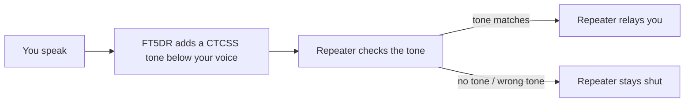
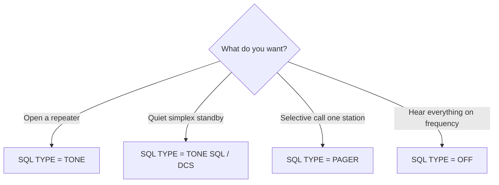

# Tone squelch, DCS and the pager (EPCS)

Most of the time your FT5DR sits with its squelch closed, silent until a signal arrives — but "a signal arrives" is a blunt instrument: a distant repeater, a burst of interference and the station you actually want all open a plain squelch alike. The **SIGNALING** category is where you teach the radio to be fussier: to slip an inaudible tone under your own transmissions so a repeater relays you, to stay quiet on a busy channel until it hears the _right_ tone, or to ring like a pager only when one specific friend calls. This chapter walks the whole family of analogue-FM signalling tricks — CTCSS tone squelch, DCS, and the New PAGER (EPCS) — and shows you which to reach for and why.

A quick scope note first: everything here is for **analogue FM**. When you are working in C4FM digital, the equivalent "who am I listening to" controls are DG-ID and DP-ID, which live with the radio's [digital-voice](outpost:entry/logbook73.handbook/digital-voice) features rather than in SIGNALING. If a menu item in this chapter seems to do nothing, check you are not sitting in a digital mode.

## The idea: encode, decode, and quiet standby

Two words unlock this category. **Encode** means your radio _sends_ a tone along with your voice. **Decode** means it _listens_ for a tone and refuses to open its speaker until it hears the matching one. Every squelch type below combines those two ideas — encode only, decode only, or both.

Why bother? A normal **carrier squelch** opens on any signal strong enough to cross the threshold, so on a shared frequency the speaker barks every time _anyone_ transmits. Tone signalling gives you **quiet standby** — silent through the traffic not meant for you, alive only for the station or repeater carrying your agreed tone. That tone is **sub-audible**: it sits at 67–254 Hz, below the pitch of speech, so it rides under the conversation and the receiver filters it out before the audio reaches the speaker. It is the same [CTCSS](outpost:entry/logbook73.handbook/repeaters) mechanism repeaters use worldwide — the repeaters chapter has the concept in full; here we cover how the FT5DR does it.



```viz
{
  "type": "spectrum",
  "title": "A CTCSS tone hides below the voice",
  "caption": "The sub-audible tone sits in the 67–254 Hz range, below the pitch of speech, so it rides under the conversation; the receiver filters it out before the audio reaches the speaker, while a decoder listening for exactly that pitch uses it to open the squelch.",
  "xLabel": "audio frequency →",
  "components": [
    { "f": 6, "amp": 0.6, "label": "CTCSS 67–254 Hz", "tone": "primary" },
    { "f": 50, "amp": 0.8, "width": 70, "label": "speech", "tone": "muted" }
  ]
}
```

### How to reach these settings

Press and hold the top function key — written **[F MENU]** in Yaesu's manuals. (Confusingly, Yaesu's own documentation is not consistent about this key: you may also see the same physical button referred to as **[DISP]** elsewhere — it is one and the same key.) Touch the **SIGNALING** tile, pick an item, rotate the DIAL to set the value, and press **PTT** to save.

Each item carries a one-glance verdict:

| Symbol | Meaning                                                    |
| ------ | ---------------------------------------------------------- |
| ✅     | Set it like this and forget it — right for almost everyone |
| ⭐     | Genuinely useful, depending on how you operate             |
| ⚠️     | Advanced — understand it before you enable it              |
| ❌     | Leave it off unless you have a specific reason             |

## SQL TYPE — the master switch — ⭐ pick to suit the channel

Everything in this chapter flows from one setting: **SQL TYPE** (SIGNALING item 11). It decides which signalling scheme is active on the current band; the other items (tone frequency, DCS code, pager codes) merely supply the details it needs. Each choice is a different pairing of the encode and decode ideas, as the table shows.

- **Values:** `OFF` / `TONE` / `TONE SQL` / `DCS` / `REV TONE` / `PR FREQ` / `PAGER`, plus three combination modes — `(D CD)` / `(TONE-DCS)` / `(D CD-TONE SQL)` — that only appear when **SQL EXPANSION** (item 10) is `ON`. Default `OFF`.
- **UK recommendation:** ⭐ Match it to the job (see the table). It is per-band and stored inside each memory channel, so you set it once per channel and forget it.

Here is what each value does, in plain terms — the **Icon** column shows the tag the display puts up, so you can confirm the active mode at a glance:

| SQL TYPE   | Icon  | You transmit (encode) | You receive (decode)                               | Typical use                  |
| ---------- | ----- | --------------------- | -------------------------------------------------- | ---------------------------- |
| `OFF`      | `–`   | nothing added         | opens on any signal                                | scanning, open listening     |
| `TONE`     | `TN`  | CTCSS tone sent       | opens on any signal                                | **repeater access**          |
| `TONE SQL` | `TSQ` | CTCSS tone sent       | opens only on the matching tone                    | quiet simplex standby        |
| `DCS`      | `DCS` | DCS code sent         | opens only on the matching code                    | quiet standby, many codes    |
| `REV TONE` | `RTN` | CTCSS tone sent       | **mutes** when the tone is present                 | silencing a nuisance carrier |
| `PR FREQ`  | `PR`  | your custom tone sent | **mutes** when the matching custom tone is present | non-standard tone systems    |
| `PAGER`    | `PAG` | two-tone code sent    | opens only for your personal code                  | selective calling (EPCS)     |



## TONE — the repeater access tone — ✅ for most repeaters

- **What it does:** adds a CTCSS tone to your transmission and _only_ to your transmission. Your receiver stays a plain carrier squelch, so you still hear everything on the frequency.
- **Inside:** this is **encode-only**. Almost every modern repeater refuses to repeat you unless it hears its access tone — proof you are a real local user, not a distant signal or interference on the input. Sending the tone opens the repeater; your open receiver still hears its output normally.
- **Why it exists:** repeaters sit on hilltops and hear a long way; a tone requirement stops them relaying every scrap of noise and far-off station that lands on their input.
- **Values:** selected via SQL TYPE; the tone itself is set in **TONE SQL FREQ** (below).
- **UK recommendation:** ✅ Set `TONE` and the correct **CTCSS** frequency for any repeater that needs one — in the UK, nearly all 2 m and 70 cm repeaters do. Your repeater's listing gives the exact tone; enter that. Some older repeaters are woken instead by a **1750 Hz tone-burst** from the **MONI/T-CALL** key — a CONFIG-menu matter tied to the [repeaters](outpost:entry/logbook73.handbook/repeaters) concept.
- **Example:** for a UK 2 m repeater with a listed 77.0 Hz access tone, set SQL TYPE `TONE` and TONE SQL FREQ `77.0 Hz`; key up and it relays you, leave the tone off and you transmit into silence.
- **Common mistakes:** using `TONE SQL` instead of `TONE` for a repeater (that mutes your receiver too); setting the wrong tone; forgetting the tone entirely — the single most common "my repeater is dead" fault.
- **Should you change it?** Yes — set it (and store it in the memory channel) for every repeater you use.

## TONE SQL — quiet standby on simplex — ⭐ for busy channels

- **What it does:** turns on _both_ encode and decode — your radio sends the tone **and** stays muted until it hears that same tone coming back. As the manual puts it, "the tone squelch opens the speaker audio only when a signal containing the specified CTCSS tone is received." Two stations both on `TONE SQL` with the same tone hear each other and nothing else.
- **Why it exists:** on a shared simplex frequency — a club net, an event working channel — quiet standby means your radio ignores other conversations and speaks up only for your group.
- **UK recommendation:** ⭐ Use it on a simplex channel your group has agreed, with an agreed tone. Do **not** make it your everyday setting: it hides signals, so a station calling you _without_ the tone (a newcomer, a slightly mis-set radio) is silently ignored and you never know they were there.
- **Example:** your walking group all set `145.4375` to SQL TYPE `TONE SQL`, TONE SQL FREQ `88.5 Hz`. On a crowded hill you hear only each other, not the other groups sharing the channel.
- **Common mistakes:** leaving TONE SQL on when you switch to general monitoring, then wondering why the band sounds dead; assuming it gives privacy — anyone with a plain carrier squelch hears you perfectly, it only quietens _your_ speaker.
- **Related:** the **MONITOR** key momentarily forces the squelch open so you can check whether the frequency is really busy.
- **When scanning:** the tone filter also governs a scan — with `TONE SQL` (or `DCS`) active the radio steps past every signal that lacks your tone or code and stops only on a matching one. Handy for hunting one group's traffic across a busy band, and a reason a scan can appear to "find nothing" when no one is sending your tone.
- **Should you change it?** Only for a specific quiet-standby need, then store it in that memory channel.

### TONE SQL FREQ — choosing the tone — ✅ match the listing

Sets the single CTCSS frequency used by `TONE`, `TONE SQL` and `REV TONE`: `67.0 Hz` to `254.1 Hz` — the 50 standard tones — default `100.0 Hz`. ✅ Enter the exact figure from your repeater's or group's listing; there is nothing to "tune", CTCSS is a fixed standard set and only the exact match works (77.0 and 79.7 Hz are _different_ tones). The FT5DR uses **one** tone for both directions — it has no "split tone" (different CTCSS on transmit than receive); the mixed SQL EXPANSION modes combine tone with DCS, never two CTCSS frequencies. And don't confuse the tone _frequency_ with the DCS _code_ — separate systems, separate items.

### TONE SEARCH — find an unknown tone — ⭐ handy detective tool

Steps through every CTCSS tone while listening to an active signal, stopping on the one that opens the squelch — so you can discover a repeater's or station's tone when the listing is missing or wrong. On a match it beeps, blinks the detected value and holds for 5 seconds with the audio open before resuming (what it does on a hit is governed by SCAN > SCAN RESUME, shared with the ordinary scan and the DCS search). Set **MUTE** `ON`/`OFF` (default `ON` — quiet until it finds the tone; `OFF` lets you hear the audio while it searches) and **SPEED** `FAST`/`SLOW` (default `FAST`). ⭐ Genuinely useful for a reconfigured repeater or a mystery channel; once found, set the tone manually so you are not searching every time. A signal must actually be _present_, carrying a tone, for the search to lock on. (This menu item only sets the search's _behaviour_ — to actually run one, set SQTYP to TONE SQL or DCS and touch **[SEARCH]** on the [CODE] screen; the step-by-step lives in [The Function Menu](outpost:entry/logbook73.guide.ft5dr/function-menu).)

## DCS — digital coded squelch — ⭐ the digital cousin

Same idea as tone squelch, different mechanism. **DCS (Digital Coded Squelch)** replaces the analogue tone with a continuously repeating low-speed digital code word sent under your audio; the manual sums it up as allowing "audio to be heard only when signals containing the same DCS code are received."

### DCS CODE — ⭐ set both ends the same

- **What it does:** selects which DCS code your radio encodes and decodes when SQL TYPE is `DCS`.
- **Inside:** the code is a three-digit octal number (hence the odd sequence — `023`, `025`, `026`, `031`…). There are 104 of them, far more than the 50 CTCSS tones, so DCS suits many distinct groups on nearby channels with little chance of a clash.
- **Values:** `DCS 023` to `DCS 754`. Default `DCS 023`.
- **UK recommendation:** ⭐ Use it where a system specifies DCS or your group prefers its larger code set. UK amateur repeaters overwhelmingly use CTCSS, so for repeater access you will usually want `TONE`; DCS shines for private simplex groups, both ends on the same code.
- **Common mistakes:** mixing DCS with CTCSS across a group (they are not interchangeable); expecting DCS to give privacy (again, it only mutes _your_ speaker).
- **Should you change it?** Only when a channel calls for DCS.

### DCS INVERSION — ⚠️ leave it normal

⚠️ Handles the code's _polarity_, separately for receive (`NORMAL` / `INVERT` / `BOTH`) and transmit (`NORMAL` / `INVERT`), both defaulting to `NORMAL`. On screen Yaesu labels these with its own terms rather than the plain words: _Homeomorphic_ (= `NORMAL`), _Inverted Phase_ (= `INVERT`) and, on receive only, _Both Phase_ (= `BOTH`) — so if the display shows "Homeomorphic", that is the normal setting. It exists only for the odd system that uses inverted DCS; if DCS "won't decode" and the code is right, try `BOTH` on receive (it decodes either polarity). You will almost never touch it.

## The specialist tone modes — ⚠️ know they exist

Two SQL TYPE choices are rarely needed but worth recognising:

- **REV TONE (reverse tone)** — ⚠️ inverts tone squelch: instead of _opening_ on the tone it **mutes** when the tone is present — niche use is silencing a specific, persistent carrier that always sends a known tone.
- **PR FREQ** — ⚠️ the user-programmable twin of REV TONE: it too **mutes** on a matching tone, except the tone is one _you_ define rather than a standard CTCSS frequency. Its set procedure is below.

### Setting PR FREQ — the User Programmed Reverse CTCSS Decoder — ⚠️ special systems only

`PR FREQ` uses a **user-defined** tone from the **PR FREQUENCY** item (SIGNALING 7), adjustable `300 Hz`–`3000 Hz` in 100 Hz steps (default `1600 Hz`) — well outside the standard 67–254 Hz CTCSS range. Yaesu heads its procedure "User Programmed Reverse CTCSS Decoder" and calls the mode a "no-communication squelch": rather than _opening_ on the tone it **mutes** the audio whenever it receives a signal carrying your programmed tone. You will almost never meet one in amateur use.

To set it:

1. Press **[F MENU]**, touch **[SQTYP]**, rotate the DIAL to `PR FREQ` and press **PTT** to save.
2. Press **[F MENU]** again, touch **[CODE]** to open the PR FREQUENCY screen (the same value as SIGNALING item 7), rotate the DIAL to pick the tone (`300 Hz`–`3000 Hz`, 100 Hz steps) and press **PTT** to save.

That chosen tone is the one the radio listens for and mutes on; note it is set from the **[CODE]** soft key on the working screen, not by diving into a separate menu.

### SQL EXPANSION — mixing tone and DCS — ⚠️ advanced

**SQL EXPANSION** (SIGNALING 10, default `OFF`) unlocks three extra SQL TYPE combinations that mix schemes across the two directions: `(D CD)` (DCS encode, open receiver; display icon `DC`), `(TONE-DCS)` (send a tone, decode a DCS code; icon `T-D`) and `(D CD-TONE SQL)` (send a DCS code, decode a tone; icon `D-T`) — for systems using one scheme on input and another on output. ⚠️ Turn it on only to match such a system; otherwise leave it `OFF`.

## The New PAGER (EPCS) — selective calling — ⭐ a clever party trick

This is the SIGNALING feature people overlook, and it is genuinely useful. **New PAGER**, also called **EPCS (Enhanced Paging & Code Squelch)**, calls one specific station — like a pager — "by using a pager code that combines two CTCSS tones," as the manual puts it, and "when the call is received, the bell sounds", with the LCD flagging the call. Your radio sits in silent standby, ringing only when someone sends _your_ two-tone code — the polite way for two operators to share a busy channel and disturb each other only on purpose.

### PAGER — codes and answer-back — ⭐ set your own and theirs

- **What it does:** turns on the pager (via SQL TYPE `PAGER`) and holds an **answer-back** switch and two code slots.
- **Inside:** a "code" is a **pair** of CTCSS tone numbers (each 01–50), a distinctive two-tone signature. The pair's order does not matter — `05 47` and `47 05` count as the same code. Set **CODE-RX** to _your own_ code (the one that rings your radio) and **CODE-TX** to the _other station's_ code (the one you send to ring theirs). **ANS-BACK** `ON` makes your radio reply automatically to confirm a page.
- **Values:** **ANS-BACK** `ON` / `OFF` (default `OFF`); **CODE-RX** and **CODE-TX** each a pair from `01` to `50` (default `05 47`).
- **Group call:** because a page fires whenever the incoming pair matches your CODE-RX, giving a _whole group_ the same CODE-RX lets one transmission ring them all at once — a deliberate group-call trick, not a fault.
- **In standby:** the radio sits silent until your code arrives (the bell rings and the envelope icon blinks if BELL is on). Press PTT and the `PAG` icon blinks and you hear _everything_ on the channel regardless of codes; about 10 seconds after the other station stops, the icon lights steady again and quiet standby resumes on its own.
- **UK recommendation:** ⭐ A lovely tool for two operators who want to monitor a shared channel silently and alert each other on purpose — a couple keeping a channel open across a rally site, say. Agree the codes in advance: your CODE-RX must equal their CODE-TX, and vice versa. Leave ANS-BACK `OFF` unless you want the automatic acknowledgement, which keys the radio for about 2.5 seconds to tell the other station you are ready to talk.
- **Example:** you use code `05 47`, your partner `12 34`. On your radio set CODE-RX `05 47`, CODE-TX `12 34`; on theirs, the mirror image. The channel stays silent for both until one deliberately pages the other, when the bell rings and the LCD flags the call.
- **Common mistakes:** using one shared code when you actually meant to page a single person (a shared code is deliberate for a _group_ call, but it can no longer single anyone out); forgetting the pager is still just CTCSS underneath, so a strong nearby station using one of your two tones can occasionally trip it; leaving PAGER selected and wondering why the radio is silent on an ordinary channel. A faint intermittent blip of the tone as a page arrives is normal, not a fault.
- **Should you change it?** Only for selective calling with a specific partner; otherwise leave SQL TYPE elsewhere.

### BELL — the audible alert — ⭐ how the call announces itself

Controls the ring that sounds when a matching signal (a page, or a tone-squelch/DCS opening) is received: **SELECT** `OFF`/`BELL`, and **RINGER** `1 Time` to `20 Time` or `CONTI` (continuous); defaults `OFF` and `1 Time`. ⭐ Set `BELL` on with a modest ringer count when using the pager or standing by on a quiet channel, so you notice a call you would otherwise miss with the volume low. `CONTI` nags — save it for calls you really must not miss. Off for general use.

## The plain squelch controls, and two you can skip

The rest of the SIGNALING category is quicker to cover.

- **SQL LEVEL** (item 8) — ✅ the ordinary carrier-squelch threshold, `LEVEL 0` (always open) to `LEVEL 15` (very tight), default `LEVEL 1` (on the AM/FM broadcast radio the range narrows to `LEVEL 0`–`LEVEL 8` with a `LEVEL 2` default). Raise it a notch if the squelch chatters on noise; keep it as low as stays quiet so you do not lose weak stations. This is the everyday "squelch" knob, independent of the tone modes.
- **SQL S-METER** (item 9) — ⭐ opens the squelch only above a chosen **signal-strength** level (`OFF`, or `LEVEL 1`–`LEVEL 10`) rather than on a noise threshold — handy for scanning past weak fluttery signals to stop only on solid ones. Default `OFF`. It is set per band, so press **[A/B]** to pick the band first.
- **DTMF MODE / DTMF MEMORY** (items 4–5) — ⭐ the touch-tone dialler (the beepy phone-keypad tones) for sending commands to some repeaters and controllers. MODE is `MANUAL` (tones follow your keypresses) or `AUTO` (a stored 16-digit string from CH1–CH10). A control feature, not a squelch one; set it only if a system asks for DTMF.
- **WX ALERT** (item 14) — ❌ enables the **NOAA Weather Alert** feature (default `OFF`), watching for the alert tone on US weather-radio channels. There is no equivalent service in the UK; it is relevant only in North America.

One thing you will _not_ find in this category is **DP-ID** handling — Digital Personal ID, like DG-ID, belongs to C4FM and lives with the radio's [digital-voice](outpost:entry/logbook73.handbook/digital-voice) operation (on the FT5DR it sits under the separate GM menu), not here.

## Try it yourself

- **Wake your local repeater.** Look up its access tone, set SQL TYPE `TONE` and TONE SQL FREQ to the listed value, and try a short call. If it relays you, store the channel — the tone travels with it.
- **Prove quiet standby.** With a friend on a simplex channel, both set SQL TYPE `TONE SQL` and the same TONE SQL FREQ. Have a third station transmit without the tone — you hear nothing, then hear your friend perfectly. Press the MONITOR key and confirm the third station was there all along.
- **Build a two-person pager.** Agree two codes with a friend, set each other's as CODE-TX and your own as CODE-RX, then SQL TYPE `PAGER` and BELL `ON`, and page each other across a busy channel without disturbing anyone else.

## Key takeaways

- **SIGNALING is analogue-FM only** — in digital, DG-ID and DP-ID do this job — and **SQL TYPE** is the master switch that picks the scheme for each band and memory channel.
- **Encode vs decode** is the whole idea: `TONE` sends a tone (to open a repeater) while your receiver hears everything; `TONE SQL` and `DCS` both send _and_ listen for a match, giving **quiet standby** on shared channels.
- **Set the exact CTCSS tone** from your repeater's listing — most UK repeaters need one, the values are a fixed standard set, only the exact match works, and the FT5DR uses one tone for both directions (no split tones).
- **DCS** is the digital-coded alternative with a much larger code set (`023`–`754`), better for private simplex groups than for UK repeaters; leave **DCS INVERSION** on `NORMAL`.
- **New PAGER (EPCS)** makes the radio a selective-call pager using a pair of CTCSS tones — silent standby that rings and flags the caller only for your code; pair it with **BELL** so you notice.
- **REV TONE, PR FREQ and SQL EXPANSION** are specialist modes you will rarely need — leave them alone unless a system demands them, and always operate within your national band plan and licence conditions.

With signalling understood, we can start the guided walk through the Setup Menu itself, category by category, beginning with the screen and how the radio looks and feels: [The Setup Menu (1): Display, Audio, TX & RX](outpost:entry/logbook73.guide.ft5dr/setup-menu-1).
