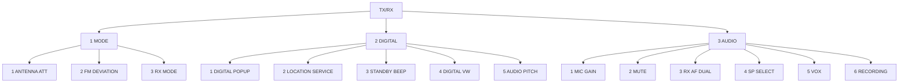
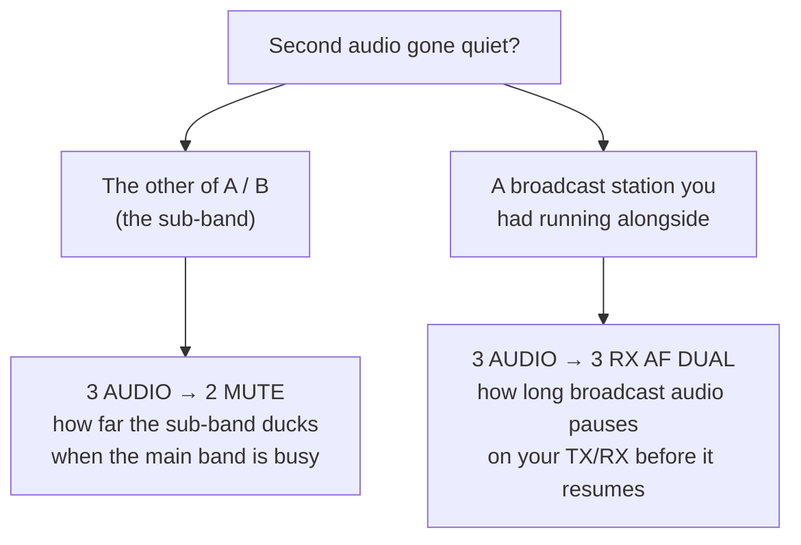

# The setup menu (1): display, audio, TX and RX

The FT5DR's Setup Menu is where the radio stops being a set of buttons and becomes _yours_ — dimmer or brighter, quieter or louder, tuned to how you actually operate. This chapter opens the first two of its twelve categories: **DISPLAY**, which decides how the radio looks and what the screen shows at rest, and **TX/RX**, which decides how it sounds and what it hears. Neither category is glamorous, but between them they set the daily feel of the radio and hide two or three settings that quietly rule your battery life and your audio reports.

## Finding your way around the Setup Menu

You reach the Setup Menu by **pressing and holding the display key** — a short press of the same key changes what the display shows, a long hold opens the menu. A quick naming warning before we start: Yaesu's own manuals label this one physical button two ways — **`[F MENU]`** in the Setup Menu instructions and **`[DISP]`** where it switches the display — so if one note says `[DISP]` and another says `[F MENU]`, they mean the same key. Do not go hunting for a second one. This guide calls it **`[F MENU]`**.

Hold it and the screen fills with **twelve labelled tiles** — DISPLAY, TX/RX, MEMORY, SIGNALING, SCAN, GM, WIRES-X, CONFIG, APRS, SD CARD, OPTION and CALLSIGN. Touch a tile (or rotate the **DIAL** to highlight it and press `[F MENU]`) to open it, touch the item you want, rotate the DIAL to change its value, and **press `PTT` to save and drop back to normal operation**. On a few screens `PTT` will not exit cleanly; there, press `[BACK]` first.

One structural point that trips up newcomers constantly: **item numbers restart at 1 inside each category** — and, inside TX/RX, at 1 inside each sub-group too. There is a "3" in DISPLAY (BAND SCOPE), a "3" in TX/RX's MODE sub-group (RX MODE) _and_ another "3" in its AUDIO sub-group (RX AF DUAL). A bare number means nothing — always name the category. Throughout this guide we write the full path, for example **TX/RX → 3 AUDIO → 1 MIC GAIN**.

Every item below carries the same one-glance verdict used across this guide:

| Symbol | Meaning                                                    |
| ------ | ---------------------------------------------------------- |
| ✅     | Set it like this and forget it — right for almost everyone |
| ⭐     | Genuinely useful, depending on how you operate             |
| ⚠️     | Advanced — understand it before you enable it              |
| ❌     | Leave it off unless you have a specific reason             |

## The DISPLAY category

Ten items, and not one of them changes what you transmit — they change how comfortable the radio is to live with. Two of them (LAMP and LCD BRIGHTNESS) also dominate your battery life far more than most people expect, so they are worth a moment's thought rather than a shrug.

### 1 TARGET LOCATION — ⭐ taste

Part of the "smart navigation" feature, which points you at a target station or saved waypoint.

- **Does:** chooses whether the smart-navigation screen shows a target as a graphical **COMPASS** rose (bearing and distance) or as plain **NUMERIC** figures — the target's raw **latitude and longitude** coordinates.
- **Inside:** using your GPS fix and the target's position (taken from a received C4FM or APRS signal, or a stored point), the radio works out direction and range; this only picks how that is drawn. Setting it to **COMPASS** is also the switch that turns the Real-Time Navigation and Backtrack screens (reached from the display key) into a usable compass — choose COMPASS before you expect those navigation screens to guide you.
- **Values:** COMPASS / NUMERIC (default **COMPASS**).
- **UK recommendation:** ⭐ **COMPASS** is the friendlier default — a needle and range you can read at a glance. Switch to NUMERIC if you would rather see the target's exact latitude and longitude.
- **Related:** 2 COMPASS below; the GPS and [APRS](outpost:entry/logbook73.guide.ft5dr/aprs) features that feed it.
- **Should you change it?** Only to taste.

### 2 COMPASS — ⭐ HEADING UP

Which way "up" is on that compass rose.

- **Does:** **HEADING UP** rotates the rose so the direction you are facing is always at the top (the target swings around as you turn); **NORTH UP** keeps north fixed at the top (the target stays put, the whole rose feels stationary).
- **Values:** HEADING UP / NORTH UP (default **HEADING UP**).
- **UK recommendation:** ⭐ **HEADING UP** matches how a car sat-nav behaves and is more intuitive on foot — "turn towards the top of the screen". Choose NORTH UP if you think like a paper map.
- **Should you change it?** Taste, and only relevant if you use smart navigation.

### 3 BAND SCOPE — ⭐ 39ch

How wide the band-scope view is.

- **Does:** sets how many channels the band scope shows either side of the centre frequency — a narrower or wider window on the spectrum around where you are tuned.
- **Values:** 19ch / 39ch / 79ch (default **39ch**).
- **UK recommendation:** ⭐ **39ch** is a sensible middle. Choose 19ch for a close-in look at a busy patch, 79ch to survey a whole segment at once (each channel is one tuning step wide, so the frequency span depends on your step size).
- **Related:** the whole band scope is covered in [Band Scope, Scanning & Dual Receive](outpost:entry/logbook73.guide.ft5dr/scan-scope) — this is just its width.
- **Should you change it?** Once, to the window you find most readable.

### 4 LAMP — ✅ 30 sec (or CONTINUOUS on charge)

The backlight timer — one of the two biggest levers on battery life.

- **Does:** sets how long the screen and keypad stay lit after you touch a control. **OFF** never lights them, a number lights them for that many seconds, **CONTINUOUS** never turns them off. A second sub-setting, **SAVE**, changes what happens once that timer elapses: with SAVE **ON** the backlight does not go fully out but drops to **LEVEL 1** of the LCD dimmer; with SAVE **OFF** it turns off completely. One caveat — **CONTINUOUS overrides SAVE**: once KEY is CONTINUOUS the illumination simply stays lit at your 6 LCD BRIGHTNESS level regardless of the SAVE setting.
- **Inside:** the colour TFT and its backlight are among the hungriest parts of the radio. Every second the lamp is on is current drawn from the battery, so a shorter timer directly buys you runtime.
- **Values:** KEY: OFF / 2 sec to 180 sec / CONTINUOUS (default **30 sec**); SAVE: ON / OFF (default **OFF**).
- **UK recommendation:** ✅ Leave the timer at **30 sec** for portable use — long enough to read the screen, short enough to be kind to the battery. Turn **SAVE ON** if you want to stretch a day's operating further. Only choose **CONTINUOUS** when you are on mains or in the car and can afford it.
- **Example:** on a summit with one battery, 30 sec plus SAVE ON can add a meaningful slice of talk time compared with a screen left permanently lit.
- **Common mistakes:** setting CONTINUOUS "so I can always see it", then wondering why the battery is flat by lunchtime.
- **Related:** 6 LCD BRIGHTNESS (below) is the other big battery lever; [RF Power](outpost:entry/logbook73.handbook/rf-power) covers the transmit side of battery discipline.
- **Should you change it?** Adjust it deliberately to match whether you are running on battery or on charge.

### 5 LANGUAGE — ✅ English

Switches the menus between **ENGLISH** and **JAPANESE** (default **ENGLISH**). Leave it on English. It exists because the FT5D is also sold on the home market in Japan.

### 6 LCD BRIGHTNESS — ✅ to taste, lower saves battery

How bright the display is.

- **Does:** sets the brightness of the screen and the numeric-keypad backlight, in six steps.
- **Inside:** brightness is the backlight's power level; like the LAMP timer, it trades battery for readability, so a lower number lasts longer.
- **Values:** LEVEL1 (dimmest) to LEVEL6 (brightest) (default **LEVEL6**).
- **UK recommendation:** ✅ The factory **LEVEL6** is gorgeous in daylight but wasteful. Indoors or at night, drop to **LEVEL2–3** — easier on the eyes and lighter on the battery. Push back up to LEVEL6 in bright sun.
- **Common mistakes:** running LEVEL6 indoors and blaming the battery; setting LEVEL1 outdoors and being unable to read it.
- **Related:** 4 LAMP (timer); these two together are your display's whole battery cost.
- **Should you change it?** Yes — set it for the light you are in.

### 7 DISPLAY COLOR — ⭐ White

The font colour of the operating-band frequency.

- **Does:** colours the big frequency figure of the operating (main) band **WHITE**, **BLUE** or **RED**.
- **Inside:** this is purely cosmetic — it does **not** change which band is operating (that is always the white-versus-grey distinction on the _sub_-band; this recolours the _main_ one).
- **Values:** WHITE / BLUE / RED (default **WHITE**).
- **UK recommendation:** ⭐ **WHITE** has the best contrast on the dark background. Some operators like RED at night for a less dazzling look; try it and see.
- **Should you change it?** Taste only.

### 8 OPENING MESSAGE — ⭐ your callsign

What the radio shows for a moment as it powers up.

- **Does:** picks the power-on splash: **OFF** shows nothing extra, **DC** briefly shows the battery voltage and the clock time, **MESSAGE** shows a short text of up to **16 characters** that you set (most people put their callsign or name here).
- **Values:** OFF / DC / MESSAGE (default **DC**).
- **UK recommendation:** ⭐ **MESSAGE** with your callsign is a nice touch and marks the radio as yours; **DC** is genuinely handy if you like a battery-health glance at every switch-on. You enter the text when you choose MESSAGE.
- **Should you change it?** Optional — a pleasant bit of personalisation.

### 9 SENSOR INFO — ✅ read-only

Displays the battery **voltage** (the FT5DR's one exposed sensor reading), tagged by power source — **Lit** for the battery pack, **Dry** for the dry-cell battery case, **Ext** for an external power adapter (with the optional SDD-13 cigarette-lighter adapter connected it reads that adapter's supply voltage). Nothing to set; a quick way to check how the pack is holding up. In **mono-band** operation the voltage can be shown on the screen continuously, so you can keep a permanent readout rather than opening this menu each time.

### 10 SOFTWARE VERSION — ✅ read-only

Shows the firmware versions of the radio's three processors — **Main**, **Sub** and **DSP**. This is exactly where you look before a firmware update to see what you are running. The FT5DR has two separately updated CPUs (Main and Sub) with their own version numbers, so check both here first. The microSD backup you should always take before an update or reset is covered in [The Setup Menu (2)](outpost:entry/logbook73.guide.ft5dr/setup-menu-2).

## The TX/RX category

This is where the radio's audio and receiver behaviour live — and it is the one category with an extra layer of nesting, which is itself a small navigation trap. Open TX/RX and you do not see settings; you see **three sub-groups**: **1 MODE**, **2 DIGITAL** and **3 AUDIO**. Touch one to drop into its items.

Remember the numbering restarts _again_ inside each sub-group, so the mic-gain item is fully **TX/RX → 3 AUDIO → 1 MIC GAIN**. We take the three sub-groups in turn.

### 1 MODE — receiver and transmit basics

#### 1 ANTENNA ATT — ⚠️ off, unless overloaded

A receive attenuator that turns down strong signals before they reach the front end.

- **Does:** switches a fixed **~10 dB of attenuation** into the receive path. ON makes the radio deliberately less sensitive.
- **Inside:** the FT5DR's wide-coverage front end can be swamped near strong transmitters — a paging, broadcast or cellular mast, or your own big outdoor antenna. When that happens you get **overload**: desensitisation, and phantom "[ghost signals](outpost:entry/logbook73.handbook/overload-and-ghost-signals)" that are not really on the frequency you are hearing. Pulling the whole input down with an attenuator often clears it.
- **Values:** ON / OFF (default **OFF**).
- **UK recommendation:** ⚠️ **OFF** for normal use — you want full sensitivity for weak signals. Turn it **ON** only when you are parked somewhere strong and actually seeing overload symptoms, then turn it off again afterwards.
- **Example:** on a hilltop near a broadcast site you keep hearing a "repeater" on an odd frequency; switch ANTENNA ATT ON and if the ghost vanishes, that is what it was.
- **Common mistakes:** leaving it ON and then complaining the radio is "deaf" to weak stations.
- **Related:** [VHF](outpost:entry/logbook73.handbook/vhf) and the overload discussion above; running lower transmit power does not affect this, since it is a receive-only setting.
- **Should you change it?** Only as a targeted fix, not as a standing setting.

#### 2 FM DEVIATION — ✅ Wide

How far your voice swings the transmitted FM carrier.

- **Does:** sets your **transmit** deviation to **WIDE** (the full swing used on 25 kHz channels) or **NARROW** (exactly **half** that swing, for 12.5 kHz channels).
- **Inside:** FM carries speech as [frequency swing](outpost:entry/logbook73.handbook/modulation); wide deviation sounds fuller but occupies more channel width, narrow deviation is more compact but quieter. The rule is to match the channel spacing — too wide on a narrow channel splatters your neighbours, too narrow on a wide channel sounds thin and muffled.
- **Values:** WIDE / NARROW (default **WIDE**).
- **UK recommendation:** ✅ **WIDE** for ordinary 2 m/70 cm amateur FM, which is still a wide-channel plan. Switch to **NARROW** only where a particular repeater, network or your national band plan specifies 12.5 kHz narrow operation.
- **Common mistakes:** setting NARROW to "save bandwidth" on a normal wide channel and then getting reports that your audio is quiet.
- **Related:** the C4FM digital modes are unaffected — this is analogue-FM only.
- **Should you change it?** Only to match a channel that calls for narrow.

#### 3 RX MODE — ✅ Auto

How the operating band demodulates analogue signals.

- **Does:** chooses **AUTO**, **FM** or **AM** for the current band. AUTO lets the radio decide by frequency.
- **Inside:** in AUTO the radio applies **AM** across the aviation air band (108–136.995 MHz), where aircraft and towers use it, and **FM** everywhere else. This is the _analogue_-mode selector; it works underneath AMS and is a different thing from the `[MODE]` key that picks between FM and the C4FM digital sub-modes.
- **Values:** AUTO / FM / AM (default **AUTO**).
- **UK recommendation:** ✅ Leave **AUTO** — it already gives you AM on the air band and FM on the ham bands without a thought. Force FM or AM only for an oddball frequency where AUTO guesses wrong.
- **Example:** tuned to your local airfield, AUTO is already demodulating AM; you hear the tower clearly with no menu-diving.
- **Common mistakes:** forcing AM and then wondering why 2 m FM sounds like unintelligible mush; confusing this setting with the AMS digital-mode selector in [Operating Basics](outpost:entry/logbook73.guide.ft5dr/operating-basics).
- **Related:** [VHF](outpost:entry/logbook73.handbook/vhf) (why airband is AM); AMS and the digital modes in [C4FM](outpost:entry/logbook73.guide.ft5dr/c4fm).
- **Should you change it?** Rarely — AUTO is right almost everywhere.

### 2 DIGITAL — how C4FM behaves

These five items shape the digital (System Fusion) experience. The digital story itself lives in [C4FM Digital, AMS & DG-ID / DP-ID](outpost:entry/logbook73.guide.ft5dr/c4fm); here we cover the switches.

#### 1 DIGITAL POPUP — ⭐ BAND10s

How long the caller-information pop-up lingers.

- **Does:** when you receive a C4FM signal, the radio can pop up the other station's details (callsign, and distance/bearing if positions are shared). This sets how long that pop-up stays before the normal display returns — a fixed number of seconds, or **BNDCNT** to hold it until the next event, or **OFF** to suppress it.
- **Values:** OFF / BAND2s / BAND4s / BAND6s / BAND8s / BAND10s / BAND20s / BAND30s / BAND60s / BNDCNT (default **BAND10s**).
- **UK recommendation:** ⭐ **BAND10s** is a good balance — long enough to read who called, short enough to clear itself. Lengthen it if you like to study the detail; set OFF if you find the pop-ups intrusive.
- **Related:** 2 LOCATION SERVICE (below) governs whether distance/bearing appear at all.
- **Should you change it?** To taste, once you have used digital for a while.

#### 2 LOCATION SERVICE — ⭐ On

Whether your position travels with your digital voice.

- **Does:** in DN (V/D) mode the digital stream can carry your **GPS position** alongside your voice. ON sends yours (and lets the far end show your distance and bearing); OFF withholds it.
- **Values:** ON / OFF (default **ON**).
- **UK recommendation:** ⭐ **ON** for the full Fusion experience — the distance-and-bearing readout is one of the nice things about C4FM. Set **OFF** if you would simply rather not broadcast where you are; you can still talk normally, the other end just will not see your location.
- **Related:** the built-in GPS and [APRS, GPS & Data](outpost:entry/logbook73.guide.ft5dr/aprs); the privacy trade-off is the same one APRS raises.
- **Should you change it?** Only if location privacy matters to you.

#### 3 STANDBY BEEP — ✅ on out of the box, leave it

The little "over to you" beep in digital.

- **Does:** sounds a short beep when a C4FM station you are hearing stops transmitting, so you know the channel is clear and it is your turn.
- **Values:** ON / OFF (default **ON**).
- **UK recommendation:** ✅ **ON** — and it already is, straight from the factory, which is exactly right. Digital audio ends cleanly with no background hiss, so without this cue it is easy to miss that the other station has finished; the beep is a useful turn-taking signal. The only reason to reach for it is to switch it **OFF** if you find the beep intrusive.
- **Should you change it?** No — the default is the setting you want; leave it on.

#### 4 DIGITAL VW — ⚠️ off (turn on only to unlock VW)

The master switch that reveals the high-fidelity voice mode.

- **Does:** when ON, adds **VW (Voice FR / Voice Full Rate)** to the modes the `[MODE]` key can select. It is **hidden by default**.
- **Inside:** VW hands the entire 12.5 kHz channel to voice for higher fidelity — but that leaves **no room for data**, so it carries **no GPS and no data** to the far end. Because repeaters and WIRES-X rely on the DN data stream, VW is a **direct, simplex, high-quality-voice** mode only.
- **Values:** OFF / ON (default **OFF**).
- **UK recommendation:** ⚠️ Turn **ON** only if you specifically want VW for local simplex chats with another Fusion operator. Leave it **OFF** otherwise, so you cannot accidentally select a mode that breaks your GPS and locks you out of repeaters/WIRES-X.
- **Common mistakes:** enabling VW, using it into a repeater, and finding your position never reaches anyone.
- **Related:** the mode explanations in [Operating Basics](outpost:entry/logbook73.guide.ft5dr/operating-basics) and [C4FM](outpost:entry/logbook73.guide.ft5dr/c4fm).
- **Should you change it?** Only to unlock VW deliberately.

#### 5 AUDIO PITCH — ⭐ Flat

Tone shaping of received digital audio.

- **Does:** adjusts the tone of incoming C4FM voice — **FLAT** (unshaped), **HIGH BOOST** (lifts the treble for crispness and intelligibility) or **LOW BOOST** (adds warmth/bass).
- **Values:** FLAT / HIGH BOOST / LOW BOOST (default **FLAT**).
- **UK recommendation:** ⭐ The factory **FLAT** is unshaped and fine for most ears; try **HIGH BOOST** if you want voices to cut through a small speaker more clearly, or **LOW BOOST** if digital audio sounds thin or harsh to you. It affects only _received_ digital audio — not what you transmit.
- **Should you change it?** Taste only.

### 3 AUDIO — microphone, speakers and the second receiver

The AUDIO sub-group is the busiest, and two of its items (MUTE and RX AF DUAL) are the source of a classic "why has my other receiver gone quiet?" puzzle. The figure below untangles which control governs which "second audio".

#### 1 MIC GAIN — ✅ Level 5

How much the radio amplifies your microphone.

- **Does:** sets the microphone sensitivity in nine steps, so your transmitted audio is neither too quiet nor over-driven.
- **Inside:** too little gain and you sound distant and weak; too much and you clip and distort, which actually makes you _harder_ to understand, not louder.
- **Values:** LEVEL1 to LEVEL9 (default **LEVEL5**).
- **UK recommendation:** ✅ Start at the factory **LEVEL5**. Only move it in response to real signal reports: raise it a step or two if people say you are quiet, lower it if they say you are distorted or "over-cooked".
- **Example:** a soft-spoken operator nudges to LEVEL6–7; someone who holds the mic close and speaks up may drop to LEVEL4.
- **Common mistakes:** cranking it to LEVEL9 and shouting, then being told you are unreadable; blaming the radio for audio that is really a gain-and-technique problem.
- **Related:** 5 VOX (below) uses the same microphone path; hold the mic a few centimetres away and speak across it for the cleanest result.
- **Should you change it?** Only to dial in your own voice against real reports.

#### 2 MUTE — ✅ Mute 100%

How far the _sub_-band ducks when the operating band is busy.

- **Does:** on the non-operating (sub) band, sets how much its audio is turned down while a signal is being received on the operating (main) band — OFF (no ducking), or 30%, 50% or 100% (full silence).
- **Inside:** with two receivers running, hearing both at once is chaos. This is the dual-receive **auto-mute** — the reason the second band goes quiet the instant the main band gets busy. It is not a fault; it is this setting doing its job.
- **Values:** OFF / MUTE 30% / MUTE 50% / MUTE 100% (default **MUTE 100%**).
- **UK recommendation:** ✅ **MUTE 100%** keeps things clean — full attention on the main conversation. Choose **30%** or **50%** if you would rather keep half an ear on the sub-band underneath your main contact; **OFF** only if you genuinely want to hear both at full volume and can cope with it.
- **Related:** the dual-receive behaviour in [Operating Basics](outpost:entry/logbook73.guide.ft5dr/operating-basics); do not confuse this with RX AF DUAL below, which is about a _broadcast_ station, not the sub-band.
- **Should you change it?** Lower it only if you truly want to monitor two conversations at once.

#### 3 RX AF DUAL — ⭐ Transmit and receive 2 s

How the AF-Dual broadcast audio resumes.

- **Does:** the AF Dual feature lets you keep listening to an FM/AM **broadcast** station while you monitor an amateur band. This item sets when that broadcast audio pauses and how quickly it comes back — pause on both your transmit and your receive and resume after **1–10 seconds**; **Fixed** (broadcast audio never pauses); or pause only on **transmit** and resume after 1–10 seconds.
- **Inside:** without a pause, the broadcast music would talk over the amateur traffic you are trying to catch; the resumption timer stops the audio flapping on and off for every brief signal.
- **Values:** Transmit-and-receive 1–10 s / Fixed / transmission 1–10 s (default **Transmit and receive 2 seconds**).
- **UK recommendation:** ⭐ The default **Transmit and receive 2 seconds** suits most people — the music dips whenever amateur activity appears or you talk, then returns two seconds later. Use **transmission-only** if you want the broadcast to keep playing under quiet monitoring and only pause when you actually key up; **Fixed** if you never want it to duck.
- **Related:** AF Dual is one of the three "dual" features explained in [Band Scope, Scanning & Dual Receive](outpost:entry/logbook73.guide.ft5dr/scan-scope); MUTE above is the separate sub-band control.
- **Should you change it?** Only if you use AF Dual and want a different feel.

#### 4 SP SELECT — ✅ Auto

Where audio goes when you plug in an external speaker-mic.

- **Does:** with an external SP/MIC connected, **AUTO** sends audio to the external speaker **only**; **FIX** sends it to **both** the external speaker and the radio's own.
- **Values:** AUTO / FIX (default **AUTO**).
- **UK recommendation:** ✅ **AUTO** is what you want for a shoulder speaker-mic — audio at your ear, silence from the radio on your belt. Choose **FIX** if you want the built-in speaker live as well.
- **Related:** the Bluetooth audio routing in [The Setup Menu (2)](outpost:entry/logbook73.guide.ft5dr/setup-menu-2) follows the same AUTO/FIX idea (and there, confusingly, AUTO also means "headset only").
- **Should you change it?** Only if you want both speakers sounding at once.

#### 5 VOX — ❌ off, unless hands-free with a headset

Voice-operated transmit, configured here in one place.

- **Does:** when on, the radio transmits when it hears your voice, so you can talk hands-free. This item holds both the sensitivity (**OFF / LOW / HIGH**) and the **DELAY** — how long it keeps transmitting after you stop (0.5 s to 3.0 s).
- **Inside:** an audio-level detector watches the microphone; cross the threshold and it keys up exactly as a PTT press would, then un-keys once the delay expires with no new speech.
- **Values:** VOX: OFF / LOW / HIGH (default **OFF**); DELAY: 0.5s / 1.0s / 1.5s / 2.0s / 2.5s / 3.0s (default **0.5s**).
- **UK recommendation:** ❌ Leave **OFF** for general use — VOX transmits without you consciously deciding to, which on shared channels is a fast way to send background noise or half a room conversation. If you do use it, pick **LOW** with a proper headset and keep DELAY around **0.5–1.0 s**.
- **Common mistakes:** running HIGH in a noisy car so road noise keys the radio; leaving VOX on by accident and keying up when you cough.
- **Related:** the full hands-free story, including Bluetooth headsets, is in [Bluetooth, VOX, Voice Recorder & Snapshot](outpost:entry/logbook73.guide.ft5dr/audio-extras); 1 MIC GAIN shares the same mic path.
- **Should you change it?** Only for a genuine hands-free need with a decent headset.

#### 6 RECORDING — ⭐ off until you need it

Configures the built-in voice recorder (which needs a microSD card).

- **Does:** sets which receiver(s) get recorded — **BAND A**, **B** or **A+B** — and whether your own transmitted (**MIC**) audio is included, **ON** or **OFF**.
- **Values:** BAND: A / B / A+B; MIC: ON / OFF (default **MIC OFF**).
- **UK recommendation:** ⭐ Set the band(s) you want captured and MIC **ON** if you want both sides of a QSO recorded, **OFF** to log only what you receive. Out of the box MIC is **OFF**, so your own transmitted audio is not captured until you turn it on. This is just the configuration; starting and stopping the recorder, and playing files back, is covered in [Bluetooth, VOX, Voice Recorder & Snapshot](outpost:entry/logbook73.guide.ft5dr/audio-extras).
- **Common mistakes:** a firmware-specific quirk has been reported where a recording started with the volume at zero runs continuously even with no signal — if that happens, check your firmware version and stop/restart the recorder rather than assuming the card is faulty.
- **Related:** microSD setup and formatting live in [The Setup Menu (2)](outpost:entry/logbook73.guide.ft5dr/setup-menu-2).
- **Should you change it?** Only when you actually want to record.

## Try it yourself

With a charged battery and the radio switched on:

1. **Tame the battery.** Open **DISPLAY → 4 LAMP** and set 30 sec (turn SAVE ON), then **DISPLAY → 6 LCD BRIGHTNESS** and drop it a couple of levels indoors. Notice how much calmer the screen feels — and that is runtime saved.
2. **Make it yours.** Set **DISPLAY → 8 OPENING MESSAGE** to MESSAGE and enter your callsign, then power-cycle to see it greet you.
3. **Dial in your voice.** Ask a local contact for an honest audio report, then nudge **TX/RX → 3 AUDIO → 1 MIC GAIN** up or down a step and ask again. Small changes, real difference.
4. **See the dual-receive mute.** With both bands active, watch the sub-band audio drop the instant the main band gets busy — that is **TX/RX → 3 AUDIO → 2 MUTE** at 100%. Set it to 50% and feel the difference.
5. **Prove the numbering trap.** Note that DISPLAY's "3" is BAND SCOPE while TX/RX's MODE "3" is RX MODE — same number, different worlds. Always name the category.

Every value here is safe to explore; `[BACK]` (or `PTT`) always steps you out without saving harm.

## Key takeaways

- Open the Setup Menu by **holding the `[F MENU]` / `[DISP]` key** (one button, two names in Yaesu's manuals); it splits into twelve categories and **item numbers restart at 1 in each**, so always name the category.
- **DISPLAY** is cosmetics plus battery: **LAMP** and **LCD BRIGHTNESS** are your two biggest display battery levers — shorten the lamp and dim the screen when you are on a battery.
- **TX/RX is nested** into **MODE / DIGITAL / AUDIO** sub-groups (with numbering that restarts again inside each), which is itself the category's main navigation trap.
- In **MODE**, leave **RX MODE AUTO** (it picks AM for airband, FM elsewhere) and **FM DEVIATION WIDE**; reach for **ANTENNA ATT ON** only as a targeted cure for overload.
- In **DIGITAL**, **DIGITAL VW** is the hidden switch that unlocks high-fidelity VW (no GPS/data, simplex only), **LOCATION SERVICE** decides whether your position rides with your voice, and **STANDBY BEEP** gives you the digital "your turn" cue.
- In **AUDIO**, set **MIC GAIN** by real reports (start Level 5), understand that **MUTE** ducks the _sub-band_ while **RX AF DUAL** governs a _broadcast_ station, and leave **VOX OFF** unless you have a headset and a hands-free need.

Next, [The Setup Menu (2): Config, SD Card, Option & Callsign](outpost:entry/logbook73.guide.ft5dr/setup-menu-2) works through the CONFIG catch-all (auto power-off, key lock, the repeater-shift trio, battery saver and the rest), the microSD backup and format screens, the Bluetooth and camera OPTION settings, your call sign, and the reset options — the settings that keep the radio running day to day rather than shaping a single QSO.
