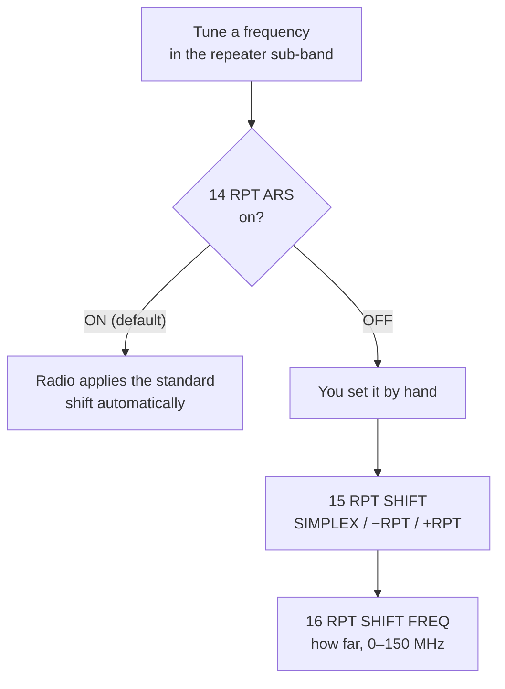
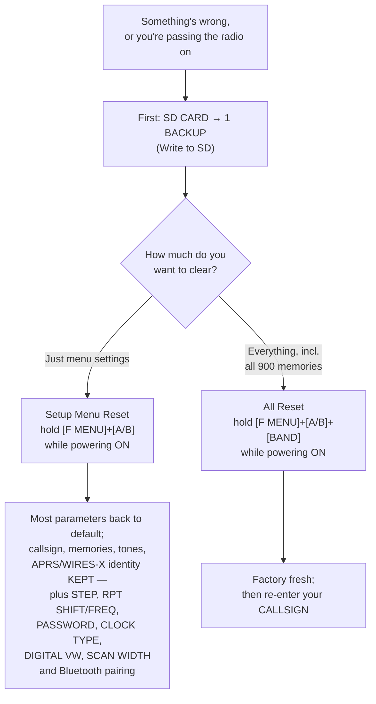

# The setup menu (2): config, SD card, option and callsign

This is the second half of the Setup Menu, and it is where the FT5DR's plumbing lives — the timers, locks and battery levers of **CONFIG**, the microSD housekeeping of **SD CARD**, the Bluetooth and camera plumbing of **OPTION**, and the single most important thing you will ever type into the radio, your **CALLSIGN**. None of it changes how you sound on the air, but it decides how the radio behaves when you are not looking: whether it turns itself off, locks in your pocket, keys the repeater the way your band plan expects, and keeps a copy of your settings safe.

## Where these sit in the twelve categories

The Setup Menu has **twelve named categories**, and — a point worth repeating because it trips up everyone — **item numbers restart at 1 inside each category**. "CONFIG 20" (the time-out timer) has nothing to do with "APRS 20" (GPS power). Always name the category, never a bare number.

Four of the twelve are covered in full here. The rest have their own homes in this guide, because they belong to a bigger topic than "a menu screen":

| Category     | What it holds                               | Covered in                                                      |
| ------------ | ------------------------------------------- | --------------------------------------------------------------- |
| DISPLAY      | Screen, backlight, band-scope width         | [The Setup Menu (1)](outpost:entry/logbook73.guide.ft5dr/setup-menu-1)                |
| TX/RX        | Audio, mic gain, receiver, digital switches | [The Setup Menu (1)](outpost:entry/logbook73.guide.ft5dr/setup-menu-1)                |
| MEMORY       | Banks, names, protect, skip                 | [The Memory System](outpost:entry/logbook73.guide.ft5dr/memory)                       |
| SIGNALING    | CTCSS, DCS, pager, squelch types            | [Tone Squelch, DCS & the Pager](outpost:entry/logbook73.guide.ft5dr/tones)            |
| SCAN         | Scan resume, width, priority revert         | [Band Scope, Scanning & Dual Receive](outpost:entry/logbook73.guide.ft5dr/scan-scope) |
| GM           | DP-ID list, Radio ID                        | [WIRES-X & Group Monitor](outpost:entry/logbook73.guide.ft5dr/wires-x-gm)             |
| WIRES-X      | Node frequency, search, DG-ID               | [WIRES-X & Group Monitor](outpost:entry/logbook73.guide.ft5dr/wires-x-gm)             |
| **CONFIG**   | The ~23-item catch-all                      | **this chapter**                                                |
| APRS         | Beacons, paths, GPS units                   | [APRS, GPS & Data](outpost:entry/logbook73.guide.ft5dr/aprs)                          |
| **SD CARD**  | Backup, restore, format                     | **this chapter**                                                |
| **OPTION**   | Bluetooth, USB camera                       | **this chapter**                                                |
| **CALLSIGN** | Your station call sign                      | **this chapter**                                                |

As before, each substantial item carries a one-glance verdict:

| Symbol | Meaning                                                    |
| ------ | ---------------------------------------------------------- |
| ✅     | Set it like this and forget it — right for almost everyone |
| ⭐     | Genuinely useful, depending on how you operate             |
| ⚠️     | Advanced — understand it before you enable it              |
| ❌     | Leave it off unless you have a specific reason             |

## The CONFIG category — the catch-all

CONFIG is the drawer where everything that did not fit elsewhere ended up: power management, the keypad lock, the repeater shift, the channel step, the clock. Twenty-three items, wildly mixed in importance. We give the ones that matter the full treatment and the trivial ones a line.

### 1 APO — ⭐ 1–2 HOUR as battery insurance

Automatic Power Off: the radio switches itself off after a spell with no key pressed.

- **Does:** turns the transceiver off automatically after the set period of inactivity, or never (OFF).
- **Inside:** a timer that any button, touch or dial movement resets. It watches your _operation_, not the channel — a busy repeater will not keep it awake. When APO is armed a small clock icon shows on the LCD to remind you, and the setting sticks across power cycles until you change it.
- **Why it exists:** a handheld left on in a bag flattens its battery by morning. APO is the safety net.
- **Values:** OFF / 0.5 HOUR to 12 HOUR (default **OFF**).
- **UK recommendation:** ⭐ Leave **OFF** if you are actively operating and hate being cut off mid-listen. Set **1–2 HOUR** if you are the sort who forgets to switch off — it costs you nothing while you are using the radio and saves the battery when you are not.
- **Common mistakes:** setting 0.5 HOUR and being switched off while quietly monitoring, then blaming a "faulty" power switch.
- **Related:** 17 SAVE RX below, and the battery discipline in [RF Power](outpost:entry/logbook73.handbook/rf-power); DISPLAY → LAMP in [The Setup Menu (1)](outpost:entry/logbook73.guide.ft5dr/setup-menu-1).
- **Should you change it?** Set it once to match how forgetful you are.

### 2 BCLO — ⭐ consider ON for shared channels

Busy Channel Lockout: refuses to transmit while a signal is present.

- **Does:** when ON, the radio will not key up if the channel is already busy (the squelch is open). PTT does nothing until the channel clears.
- **Inside:** it checks the receiver's busy state before allowing transmit — a courtesy interlock, not a tone or code.
- **Why it exists:** to stop you "doubling" — transmitting on top of a station you cannot hear well, or one your squelch is muting.
- **Values:** ON / OFF (default **OFF**).
- **UK recommendation:** ⭐ **OFF** is fine for repeaters (you _want_ to transmit into an open repeater). Consider **ON** for busy simplex calling channels where politeness matters. Note it will feel broken on a channel held open by noise, because the radio thinks it is busy.
- **Common mistakes:** turning it on, then panicking when PTT seems dead on a noisy channel — that is BCLO doing its job.
- **Related:** the tone systems in [Tone Squelch, DCS & the Pager](outpost:entry/logbook73.guide.ft5dr/tones), which decide when the channel counts as "busy".
- **Should you change it?** Only if you specifically want the anti-double interlock.

### 3 BEEP — ✅ KEY&SCAN · 4 BEEP LEVEL — ⭐ to taste

Two condensed items. **3 BEEP** sets what makes the confirmation beep: SELECT = KEY&SCAN (keys _and_ the scan-stop chirp) / KEY / OFF, plus a separate EDGE beep (ON/OFF) that sounds at a band edge or channel 1 (defaults **KEY&SCAN**, EDGE **OFF**). **4 BEEP LEVEL** sets its loudness, LOW / HIGH (default **LOW**). ✅ Leave beeps on while you are learning the radio — the confirmation is reassurance; turn EDGE on only if you want a warning when tuning runs off the end of a band.

### 5 BUSY LED — ⭐ to taste

Whether the front-panel LED lights when the squelch opens, set independently for the **A BAND**, the **B BAND** and **RADIO** (broadcast) reception — each ON / OFF (default all **ON**). Leave it on as a silent "signal present" cue; turn a band off if its LED flicker bothers you at night.

### 6 CLOCK TYPE — ⚠️ leave default

Selects the microprocessor **Clock Shift** function, **A / B** (default **A**). Clock Shift nudges an internal clock to move a faint, self-generated whistle — a "birdie" — off a frequency you are trying to hear: **A** (for normal use) switches the shift on and off automatically, **B** runs it constantly. Leave it on **A** unless a persistent birdie on one particular frequency clears when you try B. Do not change it chasing a wall-clock problem — set the actual time with **19 DATE & TIME ADJ** instead.

### 7 GPS LOG — ⭐ 5–10 sec for tracks

Records your GPS track to the microSD card.

- **Does:** writes a timestamped position fix to the card every OFF / 1 / 2 / 5 / 10 / 30 / 60 seconds.
- **Inside:** the built-in 66-channel GPS receiver's fixes are logged to `FT5D/GPSLOG/` as `GPSyymmddhhmmss.LOG` files (the name is the date and time the log began) that you can later import into mapping software to draw where you have been.
- **Why it exists:** a breadcrumb trail for a walk, a drive or a summit activation — separate from APRS, which _transmits_ your position rather than saving it.
- **Values:** OFF / 1–60 sec (default **OFF**).
- **UK recommendation:** ⭐ **OFF** unless you want a track. When you do, **5–10 sec** is plenty for walking or driving without bloating the file. Running the GPS costs roughly 15 mA extra, so it shortens battery life a little.
- **Common mistakes:** logging at 1 sec for a long drive and filling the card with near-identical points; expecting a log with no card inserted (it needs the microSD).
- **Related:** the GPS setup and datum live in [APRS, GPS & Data](outpost:entry/logbook73.guide.ft5dr/aprs); SD CARD below is where the file lands.
- **Should you change it?** Turn it on for a specific trip, off afterwards.

### 8 HOME VFO — ⭐ ENABLE

Sets whether the **Home** channel lets you tune away in VFO (frequency) mode: **ENABLE** (you can retune from the Home channel) or **DISABLE** (Home stays fixed on its stored frequency), default **ENABLE**. Leave it ENABLE unless you want the Home key to always snap back to one immovable channel.

### 9 LOCK — ✅ KEY&DIAL

Chooses which controls the lock function freezes.

- **Does:** when the radio is locked, this decides _what_ is locked: **KEY&DIAL**, **PTT**, **KEY&PTT**, **DIAL&PTT**, **ALL**, **KEY**, or **DIAL**.
- **Inside:** the lock itself is toggled from the front; this menu only sets its scope. Note that **PTT** and **ALL** modes lock the transmit button too.
- **Why it exists:** a handheld rattling around a rucksack changes frequency, keys up, or both. Locking the right things stops pocket-dialling without disabling the radio.
- **Values:** KEY&DIAL / PTT / KEY&PTT / DIAL&PTT / ALL / KEY / DIAL (default **KEY&DIAL**).
- **UK recommendation:** ✅ **KEY&DIAL** is the sensible default — it stops accidental frequency changes and key presses while leaving PTT live so you can still answer a call. Choose **ALL** to lock everything for transport, including PTT.
- **Common mistakes:** setting **ALL** and then wondering why PTT is dead; setting only **DIAL** and still fat-fingering the touchscreen keypad.
- **Related:** carrying and pocket safety; the physical lock switch in [Operating: Bands, VFOs, Modes & Transmitting](outpost:entry/logbook73.guide.ft5dr/operating-basics).
- **Should you change it?** Set it once to how you carry the radio.

### 10 MONI / T-CALL — ⭐ the region only sets the default

Sets what the side **MONI/T-CALL** button does. Both jobs are available on every version of the radio — only the **factory default** differs by region: **MONI** on the US version, **T-CALL** on European and Asian versions.

- **Does:** assigns the button to either **MONI** (hold to force the squelch open, so you can hear a weak or noisy signal that would otherwise be muted) or **T-CALL** (send a 1750 Hz tone burst).
- **Inside:** MONI is a receive aid; the 1750 Hz burst is a legacy way of "waking" a repeater. Because the EU default is T-CALL, many European owners assume the radio _cannot_ monitor — it can; this menu item is where you claim that back.
- **Values:** MONI / T-CALL (default: MONI on the US version; T-CALL on European/Asian versions).
- **UK recommendation:** ⭐ If your local repeaters all key on CTCSS — most now do, see [Repeaters](outpost:entry/logbook73.handbook/repeaters) — set the key to **MONI**: a proper monitor button is the more useful everyday tool for digging weak signals out of the noise and checking a frequency is clear. Keep **T-CALL** only if a repeater you actually use still needs the 1750 Hz burst; in that case, opening the squelch is still possible by pressing **[SQL]** and winding the level to **0** (see [Operating Basics](outpost:entry/logbook73.guide.ft5dr/operating-basics)).
- **Common mistakes:** expecting a 1750 Hz burst to open a modern CTCSS-only repeater; holding MONI, forgetting the squelch is open, and then transmitting the hiss; believing the EU radio has no monitor function at all.
- **Related:** CTCSS access tones in [Tone Squelch, DCS & the Pager](outpost:entry/logbook73.guide.ft5dr/tones).
- **Should you change it?** Set it to match how your local repeaters are accessed — and if none needs a tone burst, MONI wins.

### 11 TIMER — ⭐ off unless you want a schedule

A clock-driven auto on/off. Set a **POWER ON** time and a **POWER OFF** time (each 00:00–23:59); leave both at 00:00 to disable. Handy if you always want the radio awake for the same net and asleep afterwards. Most people leave it off and use the power switch.

### 12 PASSWORD — ⚠️ only if you must

A four-character power-on password (the keypad accepts **0–9, A–D, \* or #**, so it is not digits-only).

- **Does:** when ON, demands a code at switch-on before the radio will operate; OFF removes it.
- **Inside:** a stored four-character code checked at boot. It is a deterrent, not encryption of anything you transmit. Two quirks worth knowing: if **11 TIMER** is set to switch the radio on automatically, the password is bypassed on that timed power-up; and if you key in the wrong code, the radio just switches itself off again.
- **Values:** OFF / ON : - - - - (default **OFF**).
- **UK recommendation:** ⚠️ **OFF** for almost everyone. Turn it **ON** only if the radio is genuinely at risk of walking off, and accept the trade: forget the code and you have a locked brick until a service reset.
- **Common mistakes:** enabling it, forgetting the four characters, and needing an All Reset (which wipes everything) to recover.
- **Related:** the resets at the end of this chapter.
- **Should you change it?** Rarely — the risk of locking yourself out usually outweighs the benefit.

### 13 PTT DELAY — ⭐ OFF for voice

Inserts a short pause between pressing PTT and the audio path opening: OFF / 20 / 50 / 100 / 200 ms (default **OFF**). It gives a slow repeater or a linked system time to come up before your first word, so the opening syllable is not clipped. Leave **OFF** for normal voice; nudge to 100–200 ms only if reports say the start of your overs is being lost into a particular repeater.

### 14–16 RPT ARS · RPT SHIFT · RPT SHIFT FREQ — ⭐ the repeater-shift trio

These three together set how the radio moves its transmit frequency for a [repeater](outpost:entry/logbook73.handbook/repeaters). It helps to see them as one decision:

- **14 RPT ARS — Automatic Repeater Shift.** ON / OFF (default **ON**). When ON, tuning into the part of the band your national plan reserves for repeater _outputs_ makes the radio apply the standard shift on transmit for you — no menu-diving. ⭐ Leave **ON**; it is the reason a repeater "just works" when you tune to it.
- **15 RPT SHIFT — shift direction.** SIMPLEX / −RPT / +RPT (default depends on the band you are on). The direction the transmit frequency moves. Set it by hand only if ARS is off or you are building a repeater in VFO mode.
- **16 RPT SHIFT FREQ — shift size.** 0.000 to 150.000 MHz, adjustable in **0.05 MHz** steps; its default, like the direction above, is band-dependent rather than fixed. How far transmit moves from receive. **UK:** 0.600 MHz on 2 m, 1.600 MHz on 70 cm. Elsewhere check your band plan — the US uses ±5 MHz on 70 cm, so do not copy a US repeater's offset onto a UK one.
- **UK recommendation:** ⭐ Leave **ARS ON** and let it do the work; touch SHIFT and SHIFT FREQ only when adding a repeater manually. Better still, store repeaters as [memory channels](outpost:entry/logbook73.guide.ft5dr/memory), which remember all three for you.
- **Common mistakes:** entering `600` instead of `0.600`; forcing a shift on a simplex channel so you transmit off-frequency and nobody hears you.

### 17 SAVE RX — ✅ default at home, step up for battery life

The receive battery-saver: the receiver naps between quick listens.

- **Does:** sets how the radio power-cycles its receiver during standby, expressed as a nap time and a ratio, OFF / **0.05 sec (1:1)** up to 20.0 sec (1:400).
- **Inside:** in standby the receiver briefly sleeps, then wakes to check for a signal, over and over. A longer nap (toward 1:400) sleeps far more than it listens, saving real current; the trade is that a call arriving during a nap can have its first fraction of a second clipped before the radio wakes and grabs it.
- **Values:** OFF, then a nine-rung ladder from least to most saving — 0.05 sec (1:1) / 0.1 sec (1:2) / 0.2 sec (1:4) / 0.5 sec (1:10) / 1.0 sec (1:20) / 2.0 sec (1:40) / 5.0 sec (1:100) / 10.0 sec (1:200) / 20 sec (1:400). Default **0.05 sec (1:1)**, i.e. minimal saving. (The manual confusingly _prints_ the default as "0.2 sec (1:1)", which its own ladder contradicts — 0.2 sec is the 1:4 rung — so treat that as a Yaesu typo.) A middle rung such as **2.0 sec (1:40)** is the sensible portable compromise.
- **UK recommendation:** ✅ The default barely saves anything but never clips a call. For a long day on one battery, step it up to a moderate ratio — you will notice the runtime, and the tiny risk of missing the very start of an over rarely matters on voice.
- **Common mistakes:** setting maximum saving and then losing the first syllable of every call, and calling the radio "deaf".
- **Related:** APO above, plus LAMP and LCD brightness, are the other battery levers; [RF Power](outpost:entry/logbook73.handbook/rf-power) covers the transmit side.
- **Should you change it?** Leave default at home; raise it for portable endurance.

### 18 STEP — ✅ AUTO, or match the service

The tuning increment per dial click in VFO mode.

- **Does:** sets how far the frequency moves per step: AUTO / 5 / 6.25 / (8.33) / (9) / 10 / 12.5 / 15 / 20 / 25 / 50 / 100 kHz (default **AUTO**).
- **Inside:** AUTO picks a sensible step for the band you are on. Set it manually to land exactly on a service's channel grid. It also sets the _spacing_ of each column in the band scope.
- **Values:** as above; the bracketed 8.33 and 9 kHz steps appear where relevant (European airband, broadcast AM).
- **UK recommendation:** ✅ **AUTO** for everyday ham use. Force **12.5 kHz** on 2 m/70 cm if AUTO ever lands you between channels, **8.33 kHz** for the European VHF airband, **25 kHz** for marine.
- **Common mistakes:** trying to reach an 8.33 kHz airband channel on a 25 kHz step and never landing on it.
- **Related:** band-scope width in [The Setup Menu (1)](outpost:entry/logbook73.guide.ft5dr/setup-menu-1); [VHF](outpost:entry/logbook73.handbook/vhf) for airband spacing.
- **Should you change it?** Only when a service needs a specific grid.

### 19 DATE & TIME ADJ — ✅ set once (or let GPS do it)

Sets the built-in clock. Set it once so timestamps on recordings, photos and GPS logs are right — or, easier, let the GPS set it automatically (APRS → GPS TIME SET, covered in [APRS, GPS & Data](outpost:entry/logbook73.guide.ft5dr/aprs)). The clock also drives the TIMER above. On the same screen, touching **[SIGNAL]** ticks a box that sounds a short chime every hour on the hour — an optional time-signal alarm if you like the reassurance.

### 20 TOT — ✅ 3 min

The transmit time-out timer.

- **Does:** cuts your transmission after a set time, OFF / 30 sec to 10 min (default **3 min 00 sec**).
- **Inside:** a watchdog on the PTT. Hold the button too long — a stuck mic in a bag, a hand leaning on the radio — and it un-keys you automatically. It does not cut in silence: as a continuous over nears the limit the radio sounds a warning beep, and about ten seconds later it drops back to receive.
- **Values:** OFF / 30 sec–10 min, in 30-second steps (default **3 min 00 sec**).
- **UK recommendation:** ✅ Keep **3 min** or so. It protects the channel (and your finals) from a jammed PTT and nudges you towards shorter, more natural overs.
- **Common mistakes:** setting OFF and holding a repeater open indefinitely with a stuck key; setting 30 sec and being cut off mid-sentence.
- **Related:** courtesy and channel-sharing in [Repeaters](outpost:entry/logbook73.handbook/repeaters).
- **Should you change it?** Rarely — the default is well judged.

### 21 VFO MODE — ⭐ ALL

Sets how far the dial roams in VFO mode: **ALL** (tune across the receiver's whole range) or **BAND** (stay within the current amateur band), default **ALL**. ⭐ **ALL** suits a curious listener who tunes everywhere; **BAND** keeps the dial from wandering off your working band when you only ever use 2 m and 70 cm.

### 22 BAND SELECT — ⭐ hide the bands you never use

Chooses which bands the **[BAND]** key cycles through.

- **Does:** enables or disables each band group for selection: **AIR / VHF / UHF / OTHER / SW / AM / FM**, each ON / OFF (default all **ON**). You set the list for the **A band and B band separately** — press **[A/B]** first to choose which band you are editing. "OTHER" bundles the 50 MHz band and the extra VHF(1)/(2) and UHF(1)/(2) segments; on the **B band only AIR, VHF and UHF are available**, so OTHER, SW, AM and FM broadcast are all **A-band only**. The radio will not let you switch _every_ band off — at least one must stay ticked.
- **Inside:** it does not change what the radio _can_ receive by direct entry — it just trims what the [BAND] key steps through, so you are not paging past shortwave to reach 70 cm.
- **Values:** per-band ON / OFF (all **ON**).
- **UK recommendation:** ⭐ Turn **OFF** the bands you never touch so [BAND] cycles quickly through the ones you do. A pure ham operator might keep VHF, UHF and AIR and switch the rest off; a listener keeps them all.
- **Common mistakes:** disabling a band, then thinking the radio "lost" it when it simply is not in the [BAND] rotation any more.
- **Related:** [VHF](outpost:entry/logbook73.handbook/vhf) and [UHF](outpost:entry/logbook73.handbook/uhf) for what lives where; dual-receive band roles in [Band Scope, Scanning & Dual Receive](outpost:entry/logbook73.guide.ft5dr/scan-scope).
- **Should you change it?** A nice one-time tidy-up.

### 23 DIAL KNOB CHANGE — ⭐ swap the top knobs

Swaps the functions of the two knobs on top of the radio. By default the **upper** knob is the **DIAL** (tuning) and the **lower** knob is **VOLUME**; run this and they trade places, so the upper becomes VOLUME and the lower becomes DIAL. It is an ergonomics and handedness tweak — some operators simply find volume the more natural reach for a thumb, or want it to match another radio. To do it, hold **[F MENU]**, touch **CONFIG > 23 DIAL KNOB CHANGE**, then press **[CHANGE]**: the VOL and DIAL knob functions swap there and then. There is nothing haptic behind the name — the FT5DR has no vibrate alert, so do not expect one here.

## The SD CARD category — backup, restore, format

The microSD card is the FT5DR's safety-deposit box: it holds full-radio backups, memory channels, GPS logs, voice recordings and any camera snapshots. A few ground rules first. Use a **2–32 GB** microSD/microSDHC card, **always insert or remove it with the radio switched OFF**, and **format it in the radio** before first use. Cards formatted on a PC are often not recognised, or read painfully slowly, until the radio has formatted them. (Community reports flag some 32 GB cards as unreliable — the radio creates the folders but writes no real files — so if a backup looks empty, try a smaller, name-brand card.)

The card's folders are created for you, each with its own file convention: `FT5D/BACKUP` holds `BACKUP.dat` (the full settings file), `FT5D_MEMORY-CH` holds `MEMORY.dat`, `FT5D/GPSLOG` holds timestamped `yymmddhhmmss.log` tracks, `VOICE` holds `yymmddhhmmss.wav` recordings, `PHOTO` holds images named `H` + your Radio ID + a number, and `QSOLOG` holds message data. That `yymmddhhmmss` stamp is year/month/day/hour/minute/second, so files self-sort into chronological order when you browse the card on a PC.

### 1 BACKUP — ✅ your whole radio in one file

- **Does:** **Write to SD** saves _everything_ — settings and memories — to `BACKUP.dat`; **Read from SD** loads it back (and restarts the radio with the loaded configuration).
- **How:** press **[F MENU]**, touch **SD CARD > 1 BACKUP**, rotate the **DIAL** knob to pick **Write to SD** or **Read from SD**, press **[F MENU]** again, then touch **[OK]** twice; a beep and **COMPLETED** tell you it has finished. **2 MEMORY CH** works exactly the same way.
- **Why it exists:** it is your insurance. A firmware update and an All Reset both wipe the radio; a backup restores it in seconds.
- **UK recommendation:** ✅ Make a backup once the radio is set up the way you like, and again before any firmware update or reset. A "Read from SD" is also the quickest way to clone your setup onto a second FT5DR.
- **Common mistakes:** doing an All Reset or a firmware update _without_ a fresh backup, then rebuilding 900 memories by hand.
- **Should you change it?** Use it — this is an action, not a setting.

### 2 MEMORY CH — ⭐ just the channels

Saves or loads **only the memory channel list** (`MEMORY.dat`), via **Write to SD** / **Read from SD**. ⭐ Useful for sharing a channel set with a club or a friend without carrying across your personal settings, or for keeping several channel collections you swap between.

### 3 MEMORY INFO — ✅ read-only

Shows a bar graph plus three figures in MB — **used space**, **free space** and total **capacity**. Nothing to set; a quick glance to check you have room before a long GPS log or recording session.

### 4 FORMAT — ⚠️ erases the card

Initialises the microSD card. **This wipes everything on it.** ⚠️ Do it once to prepare a new card, or to fix a card the radio will not read cleanly — but back up anything you want to keep first, because there is no undo. Always the first step with a brand-new card. If a card that has been used in another device still misbehaves after formatting in the radio, run the SD Association's official SD Card Formatter on a computer first, then format again in the radio.

## The OPTION category — Bluetooth and the camera

Four items covering the radio's accessory ports. The Bluetooth _workflow_ — pairing, headsets and hands-free — lives in [Bluetooth, VOX, Voice Recorder & Snapshot](outpost:entry/logbook73.guide.ft5dr/audio-extras); here are the switches themselves.

### 1 USB CAMERA — ⭐ only with the camera speaker-mic

Configures the optional camera speaker-microphone — the Yaesu **MH-85A11U** — for sending snapshots over C4FM.

- **Does:** sets the picture **SIZE** (160×120 / 320×240), **QUALITY** (LOW / NORMAL / HIGH), and **SP SEL** — whether received audio comes from the **CAMERA** unit's own speaker or the radio's **INT SP** (internal speaker). The two are mutually exclusive: **CAMERA** routes sound to the MH-85A11U and mutes the radio's speaker, **INT SP** does the reverse. Defaults **160×120**, **LOW**, **CAMERA**.
- **Why it exists:** System Fusion can carry still images; the camera speaker-mic captures and sends them, and a received picture lands in the card's `PHOTO` folder.
- **UK recommendation:** ⭐ Irrelevant unless you own the camera accessory. If you do, higher SIZE/QUALITY makes a clearer picture but a bigger, slower transmission — LOW is fine for a quick snap.
- **Should you change it?** Only when using the camera mic.

### 2 Bluetooth — ⭐ ON to go wireless

The master Bluetooth switch: **OFF** / **ON**, and once on, **CONNECT / DISCON** to join or drop a paired device (default **OFF**). ⭐ Turn **ON** to use a wireless headset (the Yaesu SSM-BT20 or many generic units); it auto-reconnects to the last device at power-on. Leave **OFF** to save a little battery when you are not going hands-free.

### 3 DEVICE LIST — ⭐ manage paired headsets

Shows the Bluetooth devices you have registered, so you can select or remove one. ⭐ Where you go to switch between two headsets, or to forget one that will not behave.

### 4 Bluetooth AUDIO — ⚠️ the counterintuitive one

Where sound comes out when a Bluetooth headset is connected — and the naming is a genuine trap.

- **Does:** **AUTO** routes audio to the **headset only** (silencing the radio's own speaker); **FIX** plays it from **both** the headset and the radio's speaker. Default **AUTO**.
- **Why it catches people:** "AUTO" sounds like "the radio decides", but in practice it means "headset takes over and the speaker goes quiet". If you pair a headset and suddenly the radio itself is silent, this is why — and it is working as designed.
- **UK recommendation:** ⚠️ **AUTO** is right for private listening on a headset. Switch to **FIX** if you want the built-in speaker live at the same time (so people nearby can hear too).
- **Related:** the same AUTO/FIX idea appears for wired speaker-mics at TX/RX → AUDIO → SP SELECT in [The Setup Menu (1)](outpost:entry/logbook73.guide.ft5dr/setup-menu-1).
- **Should you change it?** Only if you want both the headset and the speaker sounding at once.

## The CALLSIGN category — the one you must set

**CALLSIGN** does exactly one thing: it stores your station call sign (up to ten characters, shown as `xxxxxxxxxx` until set). It is not decoration — the radio _demands_ it after any All Reset, and your call sign is what identifies you on WIRES-X, GM and the digital-mode caller pop-ups. ✅ **Set this first**, before anything else, and enter your call sign exactly as licensed.

Setting it opens the FT5DR's **text-input screen**, which is worth learning because it is how you name memories, banks and messages too.

### Using the text-input screen

The keyboard appears automatically the very first time the radio powers up after a reset, precisely so you can enter your call sign. It works by touch:

- **Enter a character:** touch it on the on-screen keyboard.
- **Move to the next position:** touch the **[→]** key, then touch the next character. Repeat to build the string.
- **Save and exit:** press **PTT** (or press and hold **[F MENU]**) to store what you typed and return to normal operation.

The small editing keys around the grid do the fiddly work:

- **[←] / [→]** — move the cursor left or right through what you have typed.
- **[INS]** — insert a space at the cursor (pushing the rest along).
- **[⌫]** (the back-arrow-in-a-box) — erase the character at the cursor.
- **[Space]** — enter a space at the cursor position.

Two mode buttons switch the character set. **[ABC]** brings up the alphabet; touching **[A]** / **[ABC]** toggles between one-byte and two-byte (full-width) letters. **[123]** brings up the numeric and symbol keypads, cycling through one-byte and two-byte digits and punctuation. For a call sign — and for anything you will use on the air — stay in the ordinary **one-byte** letters and numbers; the two-byte (full-width) characters exist for Japanese-market text entry and will look wrong in a callsign field. In fact the callsign field only accepts the numbers **0–9**, the **capital** letters **A–Z**, the hyphen **-** and the slash **/**, up to ten characters — lowercase and full-width letters are simply refused there, which is the concrete reason to stay in one-byte capitals. Take your time: it is a resistive touchscreen, so a firm, deliberate press registers better than a light tap.

## Resetting the radio — and why you back up first

Two resets live at the back of the manual, and the difference between them is the difference between "tidy up my menus" and "wipe everything". Know which is which before you hold any buttons.

- **Setup Menu Reset** — hold **[F MENU] + [A/B]** while switching on, then touch **[OK]**. It restores the Setup Menu _parameters_ to default but deliberately **leaves alone** the things you would hate to lose: your CALLSIGN, your memory channels, bank names, tone codes (DCS, pager, tone-squelch frequency), squelch type, WIRES-X presets and your APRS identity (callsign, digi path, position, symbol). Use it to undo menu tinkering without rebuilding the radio. It also spares more than you might expect — a defined set of Setup-Menu items survive it and only an **All Reset** clears them: CONFIG's **STEP**, **RPT SHIFT** and **RPT SHIFT FREQ**, **PASSWORD** and **CLOCK TYPE**; the TX/RX **DIGITAL VW**, antenna attenuator, FM deviation and RX mode; **SCAN WIDTH**; the DISPLAY opening message; and your whole Bluetooth setup (pairing, device list and audio routing). So a Setup Menu Reset will not, for instance, wipe a forgotten PASSWORD or undo a changed STEP.
- **All Reset** — hold **[F MENU] + [A/B] + [BAND]** while switching on, then touch **[OK]**. This wipes **everything**, including all 900 memory channels, and finishes by demanding a fresh call sign on the text-input screen. Yaesu's own caution is blunt: **note your settings on paper or back up to microSD first**, because there is no undo.

The lesson is simple and worth building into a habit: **make an SD CARD backup before any reset or firmware update.** With `BACKUP.dat` on the card, even an All Reset is a two-minute inconvenience rather than an evening of re-programming.

### Updating the firmware

This chapter keeps nagging you to back up "before a firmware update" — here is the update itself. Connect a PC to the radio's **DATA** terminal with the **supplied USB cable**, then download the firmware from the Yaesu website (yaesu.com) and apply it. That USB/DATA link is for firmware only — everyday programming and memory management happen through the microSD card, not over USB. As ever, take an **SD CARD > 1 BACKUP** first, because an update clears the radio much as a reset does.

### Cloning to a second radio over a cable

A "Read from SD" clones your whole setup onto a second FT5DR, but you can also copy radio-to-radio directly with the optional **CT-168** cloning cable — handy when you have two radios and no spare card.

1. Switch **both** radios OFF and join their **DATA** terminals with the CT-168.
2. On each radio, hold **[F MENU]** while pressing **POWER**; both show `CLONE`.
3. On the **receiving** radio, touch **[RECEIVE]** — it shows `WAIT`.
4. On the **sending** radio, touch **[SEND]** — `TX` appears, the transfer starts, and the receiver changes `WAIT` to `RX` with a bar showing how much data has arrived.
5. When it finishes the sender returns to `CLONE`. Switch both off and unplug.

If `ERROR` appears the copy failed — check the cable and start again from the top. One caveat: the **clock/time data is not copied**, so set the time (or let GPS set it) on the new radio afterwards.

## Try it yourself

With a charged battery, the radio on, and a formatted microSD card in the slot:

1. **Insure the radio.** Open **SD CARD → 1 BACKUP → Write to SD** and take a full backup now, before you touch anything else. You will thank yourself before your first firmware update.
2. **Set the identity.** Go to **CALLSIGN**, and use the text-input screen to enter your call sign in one-byte letters. Notice how **[→]** advances and **PTT** saves — the same keyboard names your memories later.
3. **Tame the battery.** Set **CONFIG → 1 APO** to 1–2 HOUR and step **CONFIG → 17 SAVE RX** up a notch. Together with the display settings from [The Setup Menu (1)](outpost:entry/logbook73.guide.ft5dr/setup-menu-1), that is real runtime.
4. **Pocket-proof it.** Check **CONFIG → 9 LOCK** is KEY&DIAL, then lock the radio and try to change frequency — it should refuse, while PTT still works.
5. **Tidy the [BAND] key.** In **CONFIG → 22 BAND SELECT**, switch off a band you never use and feel how much faster [BAND] cycles.

Every change here is reversible with **[BACK]** or by reloading your backup — explore freely.

## Key takeaways

- **CONFIG** is the catch-all: its highest-value items are the battery levers (**APO**, **SAVE RX**), the pocket-safety **LOCK**, the repeater-shift trio (**RPT ARS / SHIFT / SHIFT FREQ** — leave ARS ON; UK offsets are 0.6 MHz on 2 m and 1.6 MHz on 70 cm), and the channel-protecting **TOT** (keep ~3 min).
- **MONI / T-CALL** is region-dependent: UK/EU radios can send a 1750 Hz T-CALL burst for legacy repeater access, while MONI just forces the squelch open — set it to how your repeaters are accessed.
- **BAND SELECT** trims what the [BAND] key steps through (set per A/B band, and it will not let you empty the list), and **DIAL KNOB CHANGE** simply swaps the VOL and DIAL top knobs — the FT5DR has no vibrate alert, whatever the name suggests.
- **SD CARD** is your safety net: use a 2–32 GB card, format it _in the radio_, insert and remove it only with the power off, and take a **BACKUP** before every reset or firmware update.
- **OPTION → Bluetooth AUDIO** is the counterintuitive one: **AUTO means headset only** (the speaker goes silent); choose **FIX** to hear both.
- **CALLSIGN** must be set first — the radio demands it after an All Reset — and it is entered on the **text-input screen** (touch a character, **[→]** to advance, **PTT** to save), staying in one-byte characters.
- Know your two resets: **Setup Menu Reset** ([F MENU]+[A/B]) clears menu parameters but keeps your callsign, memories, tones and APRS/WIRES-X identity — plus a surprising set of Setup-Menu survivors (STEP, RPT SHIFT/FREQ, PASSWORD, CLOCK TYPE, Bluetooth pairing) that only an **All Reset** clears; **All Reset** ([F MENU]+[A/B]+[BAND]) wipes all 900 memories — always back up first.

With the whole Setup Menu now demystified, the next chapter steps back from the buttons to the ideas underneath them — digital voice, tone systems, packet and APRS: [The Theory: C4FM, Tones, APRS & Digital Voice](outpost:entry/logbook73.guide.ft5dr/theory).
