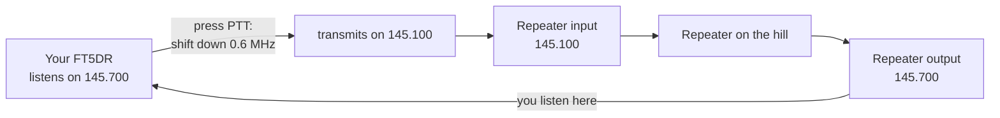

# The theory: C4FM, tones, APRS and digital voice

The menu chapters told you _what_ each setting does and _where_ it lives. This one steps back and explains _why_ any of it exists — the handful of ideas the whole radio is built on. The FT5DR feels complicated mostly because it does several genuinely different things at once: it speaks analogue and digital voice, it carries data alongside your speech, it works repeaters, and it knows where it is. Underneath, each of those rests on one clean concept. Learn the concepts and the menus stop being a maze of acronyms and start reading like a sensible set of choices you happen to be allowed to make. Throughout, we link out to the main [handbook](outpost:entry/logbook73.handbook) whenever you want the full, radio-agnostic story.

## Analogue FM, and the leap to digital voice

Start with the older half of the radio, because the newer half only makes sense as a contrast. In ordinary **FM** — frequency modulation — your voice is stamped onto the radio wave by wobbling its frequency slightly up and down in step with the sound of your speech. Louder sound, bigger wobble. At the far end, an FM detector watches how fast the frequency is wobbling and turns that straight back into the original sound pressure. It is a beautifully direct, entirely _analogue_ chain: a continuous voltage from your microphone becomes a continuous wobble on the air becomes a continuous voltage at the far loudspeaker. The full mechanics are in [Modulation](outpost:entry/logbook73.handbook/modulation).

```viz
{
  "type": "wave",
  "title": "Analogue FM — the frequency wobbles in step with your voice",
  "caption": "The carrier's frequency swings slightly up and down in step with the sound of your speech — bunching up and spreading out — and the far end's FM detector turns that wobble straight back into audio. The wave carries a copy of the sound itself.",
  "xLabel": "time",
  "traces": [
    { "kind": "fm", "freq": 16, "mod": 2, "depth": 3, "label": "FM carrier", "tone": "primary" },
    { "kind": "sine", "freq": 2, "amp": 0.35, "label": "your voice (audio)", "tone": "muted", "style": "dashed" }
  ]
}
```

That directness is FM's great virtue and its ceiling. Because the wave carries a _copy_ of the sound, anything that damages the wave on its journey — distance, obstructions, a passing lorry, another station — damages the sound. As a signal weakens, FM does not fail cleanly; it gets hissier and hissier, the voice sinking gently into a rising tide of noise until you can no longer make it out. You have all heard it: the mobile station driving out of range, readable, then scratchy, then gone.

**Digital voice** takes a completely different route. Instead of stamping a copy of your voice onto the wave, the radio first _turns your voice into numbers_ — a stream of bits — and then transmits those bits. At the far end, the receiving radio reads the bits back and _rebuilds_ the sound from them. Nothing analogue about your voice ever touches the air; what travels is data, and the sound is reconstructed fresh at the other side. That one change — carry a description of the voice, not the voice itself — is the whole idea behind Yaesu's **C4FM System Fusion**, and it buys a specific and interesting set of trade-offs that the rest of this chapter unpacks. The general theory sits in [Digital Voice](outpost:entry/logbook73.handbook/digital-voice); here we follow how _this_ radio does it.

## C4FM: turning a voice into four frequencies

So the radio has a stream of bits to send. How do bits actually ride on a radio wave? The answer is the name itself. **C4FM** stands for _Continuous 4-level FM_, and it is a kind of **frequency-shift keying** — the digital cousin of the FM you just met. Where analogue FM lets the frequency wobble smoothly to any value, C4FM shifts the carrier between just **four fixed frequencies**, and it is _which_ of the four it sits on at each instant that carries the data.

Why four, and not two? Because four distinct frequencies let each shift carry **two bits at once**. Two bits have exactly four combinations — 00, 01, 10, 11 — so one frequency level is assigned to each pair. Send a level, and you have sent two bits. This is the trick that lets a modest channel carry a useful amount of data: the radio changes level 4,800 times a second, and because each change carries two bits, that is a **9,600 bits-per-second** stream flowing over the air.

```viz
{
  "type": "wave",
  "title": "C4FM — four frequency levels, two bits each",
  "caption": "The carrier hops between four fixed frequency shifts. Each level stands for a two-bit pair (00/01/10/11), so every step carries two bits — 4,800 steps a second makes 9,600 bits per second.",
  "xLabel": "time — one step per symbol",
  "traces": [
    { "kind": "points", "label": "frequency shift", "tone": "primary", "points": [[0,0.9],[0.115,0.9],[0.125,0.3],[0.24,0.3],[0.25,-0.3],[0.365,-0.3],[0.375,-0.9],[0.49,-0.9],[0.5,0.3],[0.615,0.3],[0.625,-0.9],[0.74,-0.9],[0.75,0.9],[0.865,0.9],[0.875,-0.3],[1,-0.3]] },
    { "kind": "points", "label": "carrier centre", "tone": "muted", "style": "dashed", "points": [[0,0],[1,0]] }
  ]
}
```

Two things follow from this design, both of which explain features you meet elsewhere on the radio. First, because C4FM is _still a form of FM_ — it only shifts the frequency rather than wobbling it freely — a Fusion signal occupies a tidy, well-behaved slice of spectrum, which is why it fits neatly into the same **12.5 kHz** channel plan the amateur bands already use. Second, one C4FM transmission fills that channel on its own: there is a single conversation in there at a time. That "one channel, one conversation" arrangement is called **FDMA** — Frequency Division Multiple Access — and it is a deliberate design choice by Yaesu. (You may hear that a rival system, DMR, is _TDMA_ instead: it splits one channel into two rapid time-slots so two conversations share it. Neither is "better"; they are different bargains. Fusion's FDMA keeps each channel simple and the radio's timing undemanding, at the cost of packing fewer conversations into the same spectrum.) You do not have to _do_ anything with FDMA — it is just why a Fusion channel behaves the way it does.

## From sound to bitstream: the vocoder, FEC and the digital cliff

We skipped a step. Your voice is not naturally a stream of 9,600 bits a second — it is a rich, analogue sound. Something has to _compress_ it down to a bitstream small enough to send, and something has to _protect_ that bitstream against the knocks of the journey. Those two jobs — done in the fraction of a second between you speaking and the antenna radiating — are the heart of digital voice.


The first block is the **vocoder** (short for _voice coder_). It does not record your voice as sound; it _models_ it — analysing the pitch, resonances and shape of your speech many times a second and describing that model as a compact set of numbers. Yaesu's C4FM uses the **AMBE+2** vocoder, the same family of speech-modelling chip found across the digital-voice world, and it squeezes intelligible speech into just a few thousand bits a second. The price is subtle: the far end hears a _reconstruction_ of you, not a recording, so digital voice can sound very slightly synthetic — a touch "underwater" to ears used to analogue — even when it works perfectly.

The second block is **FEC** — _forward error correction_. Before transmitting, the radio adds carefully calculated extra bits so that if some bits are corrupted in flight, the receiver can work out what they _should_ have been and repair them, with no need to ask for a re-send. This is what makes digital voice so robust: right up to the point where the errors overwhelm the correction, the far end rebuilds your voice **perfectly**, hiss-free, exactly as clear at the fringe of range as it is next door.

But it also produces digital voice's signature behaviour, the thing every newcomer notices first: the **digital cliff**. An analogue FM signal fades away gradually; a digital one holds full, clean quality as the signal weakens — and then, when the errors finally beat the FEC, it does not get scratchy, it **falls off a cliff**: robotic burbling, then silence. There is almost no scratchy middle ground. So a Fusion contact is often _better_ than FM would be for most of its range and then _gone_ rather than merely poor. Knowing this saves a lot of confusion: if a digital station suddenly stutters into fragments, they have not turned down their audio — they have reached the edge, and a step back onto FM (which the radio can do automatically, next section) may still get a readable, if hissy, copy through.

```viz
{
  "type": "wave",
  "title": "The digital cliff — perfect, perfect, gone",
  "caption": "As a signal weakens, analogue FM sinks gradually into hiss — readable, then scratchy, then gone. Digital voice holds full clean quality while the FEC keeps repairing the errors, then falls off a cliff into robotic fragments and silence the moment the errors win.",
  "xLabel": "signal weakening →",
  "traces": [
    { "kind": "points", "label": "digital voice (C4FM)", "tone": "primary", "points": [[0,0.75],[0.62,0.75],[0.7,0.7],[0.74,-0.1],[0.78,-0.75],[1,-0.78]] },
    { "kind": "points", "label": "analogue FM", "tone": "muted", "style": "dashed", "points": [[0,0.75],[0.2,0.6],[0.4,0.35],[0.6,0.02],[0.8,-0.4],[1,-0.75]] }
  ]
}
```

## DN and VW: why one mode carries data and the other does not

Now the design decision that shapes half the FT5DR's digital menus. A C4FM channel is 12.5 kHz wide, and the radio can spend that width in two different ways — the two everyday digital modes, **DN** and **VW**.

**DN** — labelled _V/D_ (Voice/Data) on the screen, and often called **Digital Narrow** — splits the channel down the middle. Picture the 12.5 kHz cut into two 6.25 kHz halves: one half carries your compressed voice, and the _other half_ carries the forward error correction plus a data stream — including your callsign and, crucially, your **GPS position**. This is the everyday mode. It is the robust one (thanks to that generous helping of FEC), it is what every Fusion repeater and the whole WIRES-X network expect, and it is the mode that lets the other station's radio show your callsign and how far away you are while you talk. You will use DN roughly all the time.

**VW** — labelled _Voice FR_ (Voice Full Rate), sometimes called **Voice Wide** — makes the opposite choice: it hands the _entire_ 12.5 kHz to voice. More bits for the vocoder means higher-fidelity, fuller-sounding audio — but there is now **no room left for the data half of the channel**, so VW carries far less error-correction headroom and, notably, **no GPS or position data** — the far end still sees your callsign, but not where you are or how far off. It is therefore a direct, simplex, station-to-station mode for a strong local contact where you want the best possible audio and do not need the data. It is switched **off at the factory** (you enable it under `TX/RX > DIGITAL > DIGITAL VW`), and it should not be pointed at repeaters or WIRES-X, which are built around DN's data stream. That single design fact — full-voice _or_ voice-plus-data, never both — is the "why" behind a surprising amount of the radio's behaviour, and it is worth carrying with you: **if you want the radio to send your position, you must be in DN.** The operating detail lives in [C4FM Digital, AMS & DG-ID / DP-ID](outpost:entry/logbook73.guide.ft5dr/c4fm).

The piece that ties it all together, so you rarely have to think about any of this, is **AMS** — Automatic Mode Select. Switch AMS on and the radio _listens_ to each incoming signal and matches it: an analogue transmission comes out as FM, a DN transmission as digital, a VW one as full-rate, with no button-pressing from you. AMS is the bridge across the analogue/digital divide this whole chapter has been drawing — it means you can sit on a mixed channel where some people run FM and some run Fusion and simply hear everyone correctly. It is the feature that makes a dual-mode radio pleasant rather than a chore.

## Tone squelch and DG-ID: a private knock on a shared frequency

Squelch — the gate that mutes the receiver's hiss until a signal arrives — keeps _noise_ out, but on a busy shared frequency it cannot keep _other people_ out: plain squelch opens for every transmission on the channel, whether or not it was meant for you. The classic fix, on this radio and almost every other, is **tone squelch**, and Fusion adds a digital version of the same idea worth understanding side by side.

The analogue version is **CTCSS** — _Continuous Tone-Coded Squelch System_. Every transmitter in your group adds a single steady tone, somewhere between **67.0 and 254.1 Hz**, underneath its audio. That is deliberately _below_ the roughly 300–3,000 Hz range your voice occupies, so it is sub-audible — you never consciously hear it, but a receiver told to listen for, say, `88.5 Hz` will only open its speaker when that exact tone is present. Every conversation carrying your tone unlocks your radio; every other conversation on the frequency stays politely muted. **DCS** — _Digital-Coded Squelch_ — does the same job with a slow, continuously repeating digital codeword instead of a single tone, which simply gives more distinct codes to hand out when many groups share a band. The FT5DR sets both from its `SIGNALING` menu, covered in [Tone Squelch, DCS & the Pager](outpost:entry/logbook73.guide.ft5dr/tones); the etiquette of tones, and why most repeaters need one on your _transmit_ to open at all, is in [Repeaters](outpost:entry/logbook73.handbook/repeaters).

Two points keep people out of trouble, and they are true of every radio. First, **a tone is not privacy** — anyone with plain squelch, or a scanner, hears your whole conversation; a sub-tone only decides whose speaker _opens automatically_, never who _can_ listen. Second, receive and transmit tones are separate settings, and it is nearly always the _transmit_ tone the repeater cares about.

Now the digital parallel. On C4FM, the same "only open for my group" job is done by **DG-ID** — a _Digital Group ID_, a number from **00 to 99** that rides in the DN data stream. Set your radios to the same DG-ID and they hear only each other on a shared digital frequency; it is, in effect, CTCSS reinvented as a tidy two-digit code inside the data. There is one habit that saves endless "why can't I hear anyone?" grief: **a receive DG-ID of 00 is the master key that hears _all_ C4FM stations** regardless of their code, while any non-zero value locks you to matching stations only. Leave your _receive_ DG-ID at 00 unless you have a deliberate reason not to, and you will always hear the traffic. The related **DP-ID** (a _personal_ ID tied to each radio's unique serial identity) refines this further, opening your speaker only for specific stations you have registered — the full treatment is in the [C4FM chapter](outpost:entry/logbook73.guide.ft5dr/c4fm).

## Duplex, offset and repeaters

A [repeater](outpost:entry/logbook73.handbook/repeaters) is a radio on a hill or a tall building whose whole job is to listen to weak handhelds down in the valleys and re-transmit them from height and power, so two stations that could never hear each other directly can talk across a whole county. But it faces an unavoidable problem: a radio cannot transmit and receive on the _same_ frequency at the _same_ instant — its own powerful transmitter would swamp its own receiver. So a repeater **listens on one frequency and transmits on another**, a fixed distance apart. That gap is the **offset** (or "shift"), and working through a repeater like this is called operating **duplex**.

Your handheld has to mirror that split exactly. You _listen_ on the repeater's output frequency; the moment you press PTT, the radio must jump to the repeater's _input_ — the output shifted by the offset — transmit there, and jump straight back when you release.



A worked example on 2 m: a repeater with output `145.700 MHz` in a region using a `0.600 MHz` shift needs the radio set to transmit `0.600 MHz` _lower_, so your transmit lands on `145.100`, the input, and you fall back to `145.700` to listen. The exact figures come from your **national band plan**, and the 70 cm shift in particular varies a lot — around `1.6 MHz` across much of Europe, `5 MHz` in North America — so check your own plan rather than copying numbers across borders. The good news is that you rarely set any of this by hand: the FT5DR's **ARS** (Automatic Repeater Shift) recognises when you tune into a repeater sub-band and applies the standard offset for you, and once you store a repeater as a memory channel the offset, direction and tone are all remembered together. Set the _opposite_ — no shift at all — for **simplex**, which is talking directly to another station on a single frequency with no repeater in the middle, and which is most of what a new licensee actually does. The hands-on version is in [Operating: Bands, VFOs, Modes & Transmitting](outpost:entry/logbook73.guide.ft5dr/operating-basics).

## APRS and packet: your position as data

The GPS in the radio would be a private curiosity if the FT5DR could not _share_ where it is — and the way it shares is **APRS**, the Automatic Packet Reporting System. This is the single richest feature on the radio, and it has an entire book of its own in the handbook, so the job here is only to explain _what it is_, then point you at the depth.

APRS is **packet radio put to a purpose**. Packet radio is simply the technique of sending short, self-contained bursts of data — _packets_ — over the air, each wrapped in an addressing-and-error-checking envelope (the protocol is called AX.25) so receivers can tell where one message starts and stops and whether it arrived intact. The full mechanics are in [Packet Radio](outpost:entry/logbook73.handbook/packet-radio). APRS takes that plumbing and standardises it around location: every station periodically transmits a small packet — a **beacon** — containing its callsign, its position, and perhaps a short comment or a weather reading. Other stations, and a network of internet-connected receivers called **I-gates**, pick those packets up, so within seconds your position can appear on a live map anywhere in the world.

The FT5DR carries all the parts to join in without any add-ons: a built-in **TNC** (Terminal Node Controller — the modem that turns packets into tones and back) running at **1200 bps** (using audible AFSK tones) or **9600 bps** (using the faster GMSK method), fed by the internal GPS. A few ideas from the handbook are worth meeting before you switch it on:

- **The channel.** APRS uses one shared national frequency so everyone can hear everyone — `144.800 MHz` across Region 1 (the UK and Europe), `144.390 MHz` in North America. Check yours.
- **Paths and digipeaters.** A beacon can ask to be relayed onward by _digipeaters_ to reach further, but a greedy path clogs the shared channel for everyone. The polite, standard path and the reasoning behind it are covered in [APRS Paths](outpost:entry/logbook73.handbook/aprs-paths); the relaying and gatewaying in [Anatomy of an APRS Packet](outpost:entry/logbook73.handbook/aprs-anatomy) and [I-gates](outpost:entry/logbook73.handbook/aprs-igates).
- **How often to beacon.** Beaconing too often is the cardinal APRS sin. The radio's **SmartBeaconing** feature is the elegant answer: instead of a fixed timer, it beacons more often when you are moving fast or turning a corner and rarely when you are parked, so a moving track stays accurate without flooding the channel. (The catch to remember: it only works while the radio actually has a GPS fix, and running a "walking" profile at car speed floods the channel anyway.)

That is the concept. The exact menu-by-menu setup — callsign and SSID, GPS, beacon modes, symbols and paths — is in the radio's own [APRS, GPS & Data](outpost:entry/logbook73.guide.ft5dr/aprs) chapter, and the wider practice of running APRS well is in [Running APRS](outpost:entry/logbook73.handbook/aprs-running) and the main [APRS](outpost:entry/logbook73.handbook/aprs) chapter.

## GPS: how the radio knows where it stands

Everything above that involves _position_ — APRS beacons, the DN data stream, the clock, the track logs — is fed by one quiet component: the FT5DR's built-in **66-channel GPS receiver**. It is worth a paragraph, because a little understanding turns its one common frustration into an expectation rather than a fault.

GPS works by listening, not transmitting. High above you, a constellation of satellites each continuously broadcasts an extremely precise statement of the time and of where that satellite is. Your radio picks up several at once and measures how _long_ each signal took to arrive — which, since radio travels at the speed of light, is really the _distance_ to that satellite. Knowing its distance from several satellites whose positions it knows exactly, the receiver solves for the one spot on Earth consistent with all of them. That is why it is **66-channel**: more channels mean it can track more satellites at once, fixing your position faster and holding it more reliably among buildings and trees. The result is reported in the **WGS-84** coordinate system, the global standard that APRS assumes — which is why the menus warn you never to change the datum.

The one behaviour to expect: a GPS receiver needs a clear-ish view of the sky and a little time to find enough satellites, especially from a cold start or indoors. Until it has that **fix**, it has no position to share — and the radio will honestly refuse to send a position beacon rather than transmit a wrong one. So "my APRS isn't beaconing" indoors is very often "the GPS hasn't seen the sky yet." Give it a few minutes outdoors with a view up, watch the GPS icon settle, and the position flows. Everything downstream — beacons, distance-to-station on digital voice, the track log on the microSD card — simply reads from that fix.

## Try it yourself

None of this needs you to transmit anywhere you should not — most of it is listening and observing.

1. **Hear the digital cliff.** Find a local Fusion repeater or a friend running C4FM, switch **AMS** on, and listen as they move around or reduce power. Notice how the audio stays clean, hiss-free — and then breaks into robotic fragments rather than fading gently. That abrupt edge _is_ the FEC finally losing. Compare it to an analogue FM mobile fading out, and you have felt the whole analogue-versus-digital trade in two minutes.
2. **Prove DG-ID is a filter, not a wall.** On a C4FM frequency you can legally monitor, set your **receive DG-ID to 00** and confirm you hear everyone; if you have a second radio, set a matching non-zero DG-ID on both and watch the shared channel go "private" between them — while a third radio at 00 still hears the lot.
3. **Watch the offset happen.** Tune to a repeater's output in a memory or VFO with its shift set, glance at the displayed frequency, then briefly key up (legally, antenna fitted) and watch the number jump to the input and back. The duplex split, made visible.
4. **Get a fix, then beacon.** Take the radio outside with a clear view of the sky, wait for the GPS icon to settle, and only then try a manual APRS beacon. Doing it in that order shows you exactly why an indoor beacon so often "does nothing."

## Key takeaways

- **Analogue FM carries a copy of your voice** and fades gently into hiss; **digital voice (C4FM) carries your voice as numbers**, rebuilt perfectly at the far end — clean to the edge of range, then gone off the **digital cliff** rather than scratchy.
- **C4FM = 4-level FSK**: the carrier hops between four fixed frequencies, two bits per hop, for a 9,600 bps stream that fits a 12.5 kHz channel; it is **FDMA** — one conversation per channel.
- Inside, a **vocoder** models your voice into a few thousand bits and **FEC** protects them; **AMS** listens and picks FM vs digital for you so a mixed channel just works.
- **DN** splits the channel into voice **plus** data (callsign, GPS) and is the mode for repeaters and WIRES-X; **VW** spends the whole channel on hi-fi voice with **no GPS or position data** — so to send your position, be in DN.
- **CTCSS/DCS** (analogue) and **DG-ID** (digital) are a private knock, not privacy — and a **receive DG-ID of 00 hears every C4FM station**, the fix for "why can't I hear anyone?".
- **Duplex + offset** mirror a repeater's two-frequency split (ARS sets it for you); **APRS** turns your **GPS** fix into shared packet data on one national frequency — beacon sparingly, and only once you have a fix.

With the _why_ in place, the settings stop being a maze — so let's put them to work with copy-and-go setups in [Ready-made Configurations](outpost:entry/logbook73.guide.ft5dr/configs).
