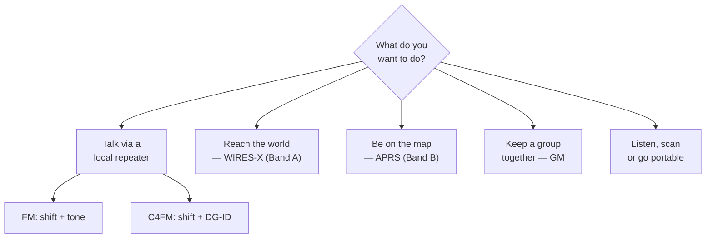
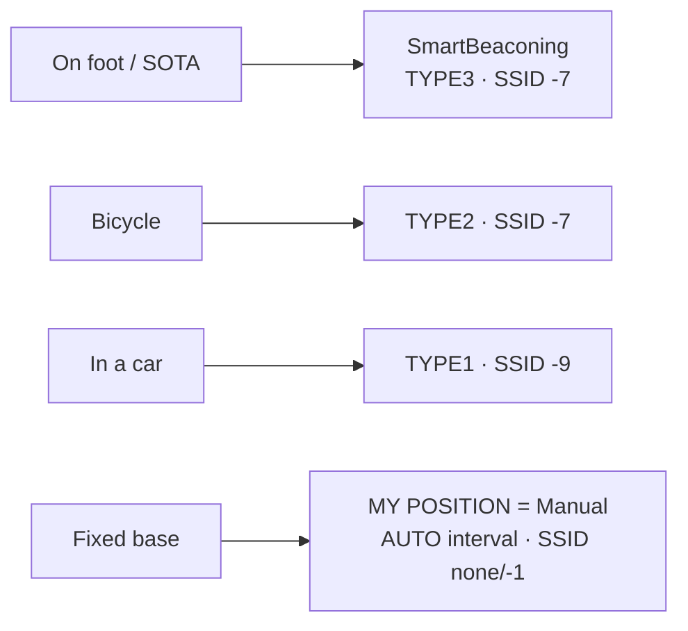

# Ready-made configurations

The rest of this guide explains every control one at a time; this chapter puts them together. Below are ready-made setups — a first-day baseline, a repeater, a WIRES-X node, an APRS tracker, a portable rig for the hills and more — each a short introduction plus a table you can copy straight onto the radio. They are starting points, not commandments: tune them to your own patch, your own licence conditions and your own taste, and where a setting has its own full explanation we link to the chapter that gives it.

## How to read these recipes

Every table names the **menu path** (the Setup-Menu category and the item within it), the **value** to set, and **why**. Two reminders before you start, because both save real confusion:

- The FT5DR's Setup Menu is **twelve named categories** — DISPLAY, TX/RX, MEMORY, SIGNALING, SCAN, GM, WIRES-X, CONFIG, APRS, SD CARD, OPTION, CALLSIGN — and the item numbers **restart at 1 inside each category**. So "item 4" means nothing alone; we always name the category (`APRS → 4 APRS MODEM`), and since numbers can shift between firmware versions, trust the **name** over the number.
- You open the Setup Menu by **press-and-holding the top-left display/menu key**. Yaesu's manuals have used two names for this one physical button — the current manuals call it **`[F MENU]`**, while some earlier and printed documentation labelled it `[DISP]` — so don't be thrown if you meet either; this guide uses **`[F MENU]`**, and when in doubt trust the button in that corner over the label printed against it. A _short_ press pops up the soft-key row (`[MODE]`, `[TXPWR]`, `[DG-ID]` and so on); a _hold_ opens the twelve category tiles.

A one-glance verdict travels with the important settings, same key as the rest of the guide:

| Symbol | Meaning                                          |
| ------ | ------------------------------------------------ |
| ✅     | Set it and forget it — right for almost everyone |
| ⭐     | Genuinely useful, depending on how you operate   |
| ⚠️     | Advanced — understand it before you enable it    |
| ❌     | Leave it off unless you have a specific reason   |

And two rules of the road that recur below, so learn them once: **APRS runs only on Band B**, and **WIRES-X runs only on Band A**. Everything else follows from those.

## 1. First-day setup

Do this once and every later recipe builds on it. It is the baseline that turns a boxed-fresh FT5DR into a radio that behaves sensibly: identified, clock set, hearing everything digital, and gentle on its battery.

Start by entering your **callsign**, which the radio demands on first power-on and after any full reset. Then set the clock (or let the GPS set it), tell the radio to hear _all_ digital traffic, and trim a few power-saving settings. The one item that catches people is **DG-ID**: leave the receive value at `00` and you hear every C4FM station; set it to anything else and you go mysteriously "deaf" to digital — the single most common early puzzle.

| Menu path                                  | Value                           | Why                                                                                                          |
| ------------------------------------------ | ------------------------------- | ------------------------------------------------------------------------------------------------------------ |
| CALLSIGN (category)                        | your callsign                   | ✅ Required to transmit C4FM, GM and [WIRES-X](outpost:entry/logbook73.guide.ft5dr/wires-x-gm); the radio demands it on first boot |
| `[F MENU] → [DG-ID]` — RX                  | ✅ `00`                         | Hears **all** C4FM stations; a non-zero RX value is the classic "why is digital silent?" trap                |
| `[F MENU] → [DG-ID]` — TX                  | ✅ `00`                         | Open group; change only for a group or repeater that asks for a specific code                                |
| `[MODE]` soft key                          | ✅ AMS on (bar over the icon)   | [Automatic Mode Select](outpost:entry/logbook73.guide.ft5dr/c4fm) picks analogue FM vs digital for you on receive                  |
| `[TX AUTO]` soft key                       | ✅ TX AUTO                      | Transmit in whatever mode AMS last heard; forces nothing                                                     |
| `SQL` key + VOL knob                       | just enough to mute the hiss    | Too high and the gate blocks weak wanted signals                                                             |
| CONFIG → 6 CLOCK TYPE / 19 DATE & TIME ADJ | set, or let GPS set it          | Time-stamps recordings, logs and beacons                                                                     |
| DISPLAY → 6 LCD BRIGHTNESS / 4 LAMP        | ⭐ mid brightness, LAMP `5 SEC` | Saves battery without leaving you squinting                                                                  |
| CONFIG → 1 APO                             | ⭐ `1 HOUR`                     | Auto power-off in case you leave it on in a bag                                                              |
| CONFIG → 17 SAVE RX                        | ✅ `0.2 s`                      | Receiver battery-saver; barely affects responsiveness                                                        |
| CONFIG → 9 LOCK                            | ⭐ `KEY`                        | Stops pocket key-presses; the Power switch still locks/unlocks on a tap                                      |
| SD CARD → 1 BACKUP                         | ⭐ Write to SD                  | Save this baseline before you experiment — a reset then costs you nothing                                    |

If you have a microSD card (2–32 GB, **formatted in the radio** via `SD CARD → 4 FORMAT`), that backup is the cheapest insurance on the radio — a fumbled setting or a firmware update then wipes nothing you cannot restore. The [memory-system chapter](outpost:entry/logbook73.guide.ft5dr/memory) covers backups in full.

## 2. A local analogue FM repeater

Your nearest [repeater](outpost:entry/logbook73.handbook/repeaters) extends a 5 W handheld from a few streets to a whole county, and it is where most new licensees make their first contact. A repeater listens on one frequency and re-transmits on another, so your radio must **shift** its transmit frequency away from where it is listening and usually **send a sub-audible CTCSS tone** to wake the machine. Tune Band A (or B) to the repeater's **output** — the frequency you hear it on — then apply the shift and tone. Switch **RPT ARS** (automatic repeater shift) on and the FT5DR adds the band-plan offset the moment you tune into the repeater sub-band, or set it by hand with `RPT SHIFT` and `RPT SHIFT FREQ`. The tone is the part people forget, then wonder why they hear the repeater perfectly but cannot key it.

| Menu path                    | Value                                   | Why                                                                        |
| ---------------------------- | --------------------------------------- | -------------------------------------------------------------------------- |
| Tune Band A/B                | repeater **output** frequency           | You listen here; the radio works out the input                             |
| `[TX AUTO]` / `[MODE]`       | TX FM (or AMS with TX AUTO)             | Analogue repeaters want plain FM, not digital                              |
| CONFIG → 14 RPT ARS          | ✅ `ON`                                 | Applies the standard shift automatically on the repeater sub-band          |
| CONFIG → 15 RPT SHIFT        | `−` (2 m and 70 cm, UK)                 | Direction of the transmit shift; ARS sets this for you                     |
| CONFIG → 16 RPT SHIFT FREQ   | `0.600` MHz (2 m) · `1.600` MHz (70 cm) | UK offsets; US uses `0.600`/`5.000` MHz — check your national band plan    |
| SIGNALING → 11 SQL TYPE      | `TONE`                                  | Sends a CTCSS tone on transmit (repeater access)                           |
| SIGNALING → 12 TONE SQL FREQ | the repeater's listed tone              | UK repeaters use a region-specific tone (e.g. `88.5 Hz`) — check its entry |
| `[F MENU] → [TXPWR]`         | ⭐ lowest that holds the repeater       | Into a strong local machine, LOW2 (1 W) is often ample                     |
| `V/M` hold → write to memory | save as a named channel                 | So you never re-enter any of this again                                    |

Two notes. If you want the tone to also **silence your speaker** until a matching tone arrives — cutting the hiss between overs — choose `TONE SQL` instead of `TONE` at `SIGNALING → 11`; that both sends _and_ requires it. And the FT5DR **cannot send one tone and require a different one** (no "split tone"), which almost no repeater needs anyway. Tones are covered in [Tone Squelch, DCS & the Pager](outpost:entry/logbook73.guide.ft5dr/tones); naming and banks in the [memory chapter](outpost:entry/logbook73.guide.ft5dr/memory).

## 3. A System Fusion (C4FM) repeater

A Fusion repeater carries your voice as data rather than analogue FM — crisp and drop-free on a clean path — and can bridge you onto the worldwide network in the next recipe. The good news: it is the _same_ frequency, shift and power as the analogue setup above; only the mode and the access method change. Instead of a CTCSS tone, digital repeaters are gated by a **DG-ID** group code.

Set the transmit mode to digital **DN** (the everyday "Voice/Data" mode — voice plus forward-error-correction plus your GPS position). Do **not** use **VW** (Voice Full Rate): it spends the whole channel on audio and carries no data, so it is simplex-only. Then set **TX DG-ID** to the repeater's input code, leaving **RX DG-ID at `00`** so you still hear all the downlink traffic.

| Menu path                             | Value                          | Why                                                                      |
| ------------------------------------- | ------------------------------ | ------------------------------------------------------------------------ |
| Tune Band A/B                         | repeater **output** frequency  | Same as the analogue recipe                                              |
| `[MODE]` / `[TX DN]`                  | DN (Voice/Data)                | The mode Fusion repeaters and WIRES-X expect; **not VW**                 |
| CONFIG → 14 RPT ARS                   | ✅ `ON`                        | Same shift as analogue; ARS applies it                                   |
| CONFIG → 15/16 RPT SHIFT · SHIFT FREQ | `−` · `0.600`/`1.600` MHz (UK) | As above; check your band plan                                           |
| `[F MENU] → [DG-ID]` — TX             | the repeater's **input DG-ID** | Its access code; `00` if the repeater is open                            |
| `[F MENU] → [DG-ID]` — RX             | ✅ `00`                        | Keep hearing all downlink traffic                                        |
| `[F MENU] → [TXPWR]`                  | ⭐ lowest that holds it        | Same power discipline                                                    |
| TX/RX → 2 DIGITAL → 4 DIGITAL VW      | ❌ `OFF`                       | Leave VW disabled unless you specifically want full-rate _simplex_ audio |

If nothing comes back, the culprit is almost always a non-zero **RX DG-ID** or the radio sitting in **VW**. The digital voice modes, AMS and the whole DG-ID / DP-ID system are unpicked in [C4FM Digital, AMS & DG-ID / DP-ID](outpost:entry/logbook73.guide.ft5dr/c4fm) and the theory behind them in [Digital Voice](outpost:entry/logbook73.handbook/digital-voice).

## 4. WIRES-X: reaching a node or room

WIRES-X links your local Fusion node — a repeater or a simplex gateway with an internet connection — to thousands of others worldwide, so a 5 W handheld into a nearby node can talk to Japan or join a themed "room" of stations. The one structural rule: **WIRES-X only runs on Band A.** Press `[GM/X]` on Band B and the radio politely switches you to A first.

Set the radio to C4FM, tune Band A to your local node's frequency (with its shift and DG-ID as in recipe 3), then **press and hold `[GM/X]`**. The `[X]` icon flashes while it searches and lights solid once it finds the node. From there, `[SEARCH & DIRECT]` browses nodes and rooms by category, name, recent list or DTMF ID; preset your favourite so it is one touch next time.

| Menu path                  | Value                     | Why                                                                           |
| -------------------------- | ------------------------- | ----------------------------------------------------------------------------- |
| Band **A** operating       | node frequency, mode DN   | WIRES-X is Band-A only; `[GM/X]` on B jumps to A                              |
| WIRES-X → 5 DG-ID          | ✅ `AUTO`                 | AUTO reaches open nodes (DG-ID 00); set 01–99 only for a code-controlled node |
| WIRES-X → 1 RPT/WIRES FREQ | your local node frequency | Presets one-touch connect to your usual node                                  |
| Hold `[GM/X]`              | —                         | Connects; `[X]` flashes then lights solid on success                          |
| `[SEARCH & DIRECT]`        | pick a node or room       | Browse by category / name / recent / DTMF ID                                  |
| WIRES-X → 2 SEARCH SETUP   | ⭐ default                | How the search list is sorted and filtered                                    |

If `[X]` flashes and gives up after about 30 seconds, no node was found — check you are on Band A, on the node's exact frequency and shift, and that the node is up. The full workflow, including rooms and category tags, is in [WIRES-X & Group Monitor (GM)](outpost:entry/logbook73.guide.ft5dr/wires-x-gm).

## 4b. Your own personal node (PDN)

Recipe 4 connected you _to_ a node; this one turns your FT5DR **into** one. **WIRES-X PDN** (Personal Digital Node) pairs the radio with a Windows PC so your handheld becomes a low-power gateway onto the worldwide network — other Fusion stations in range then connect _through you_ instead of a distant repeater. Most of the work lives PC-side, where Yaesu's free WIRES-X software does the internet lifting, so the table below is only the radio end; the full step-by-step is the [Portable Digital Node chapter](outpost:entry/logbook73.guide.ft5dr/portable-node).

Before you start, gather the pieces — a PDN will not come up without all of them:

- A **registered WIRES-X Radio ID** — free from Yaesu, but the node must be registered before it can connect.
- The **WIRES-X software v1.540 or later** plus its **USB driver**, on a Windows PC with a broadband internet connection.
- **FT5DR firmware** at **MAIN 1.11 / SUB 1.01 / DSP 7.11** or later — older firmware cannot run PDN; check yours and update first if need be.
- The Yaesu data cable — an **SCU-57** kit, or the **SCU-39** cable.

| Menu path                            | Value                      | Why                                                                               |
| ------------------------------------ | -------------------------- | --------------------------------------------------------------------------------- |
| Power up holding `[GM/X]` + `[BAND]` | enter **WIRES-X PDN** mode | Boots the radio as a node rather than an ordinary handheld                        |
| `[A/B]`                              | pick **Access Point**      | The mode that lets other radios connect through you (vs. Direct Operation)        |
| `[F MENU] → [DG-ID]` — node          | ✅ `00` for an open node   | `00` admits any Fusion station; a non-zero code makes the node private            |
| Tune operating frequency             | a clear simplex channel    | The RF channel your node listens and transmits on — check your national band plan |

If a connecting radio never sees your node, the usual causes are an unregistered Radio ID, the PC software not running, or a mismatched DG-ID. The whole PDN build — software, driver, firewall and all — is walked through in the [Portable Digital Node chapter](outpost:entry/logbook73.guide.ft5dr/portable-node).

## 5. An APRS tracker

[APRS](outpost:entry/logbook73.handbook/aprs) turns the radio into a little beacon: the built-in 66-channel GPS works out where you are, the built-in 1200/9600 bps TNC (APRS on the voice bands uses 1200) packages that into a data packet, and Band B puts it on the air, where digipeaters and I-gates relay it to a live map anyone can watch. Remember: **APRS is Band B only.**

The build order matters, because two things silently stop a beacon before it starts. First, put **Band B** on the APRS channel — `144.800 MHz` in the UK and most of Region 1, `144.390 MHz` in North America — and turn the modem on by _choosing a baud rate_ (`OFF` means off). Second, with `MY POSITION = GPS`, the radio **will not transmit a beacon until the GPS has a fix**, so give it open sky for a minute on first power-up. Set your callsign with the SSID **`-7`**, the long-standing convention for a walking/handheld station.

| Menu path                  | Value                                 | Why                                                                 |
| -------------------------- | ------------------------------------- | ------------------------------------------------------------------- |
| Band **B** operating       | `144.800` MHz (UK) · `144.390` (US)   | APRS is Band-B only; the channel is regional — check your band plan |
| APRS → 20 GPS POWER        | ✅ `GPS ON`                           | The position source; the default, but confirm it                    |
| APRS → 23 CALLSIGN (APRS)  | your call, SSID `-7`                  | `-7` is the convention for a handheld tracker                       |
| APRS → 24 MY POSITION      | ✅ `GPS`                              | Beacon your live position (not a fixed one)                         |
| APRS → 4 APRS MODEM        | `1200`                                | Turns the TNC on; shows `A12` by the frequency                      |
| APRS → 16 BEACON TX        | ⭐ `SMART` (moving) or `AUTO`         | SMART beacons cleverly by speed/turns; AUTO at a fixed interval     |
| APRS → 27 SmartBeaconing   | `TYPE3` walking · `TYPE1` in a car    | Wrong type for your speed floods the channel with beacons           |
| APRS → 14 BEACON INTERVAL  | ⭐ `5 min` (only if BEACON TX = AUTO) | SMART ignores this; AUTO obeys it                                   |
| APRS → 18 DIGI PATH        | ✅ `P3` (`WIDE1-1,WIDE2-1`)           | The polite standard path; drop to `P2` (`WIDE1-1`) in a busy metro  |
| Symbol of your own station | person / jogger                       | How you appear on the map — pick to suit                            |
| APRS → 8 APRS MUTE         | ⭐ `ON`                               | Silences B's packet chirps so you can listen to voice on A          |

The most common complaint — "my beacon never appears" — is almost always no GPS fix, the modem left `OFF`, or Band A selected instead of B. The whole APRS story — anatomy, [paths](outpost:entry/logbook73.handbook/aprs-paths), [I-gates](outpost:entry/logbook73.handbook/aprs-igates) and [running a station](outpost:entry/logbook73.handbook/aprs-running) — lives in the handbook's APRS book, and the radio-specific detail in [APRS, GPS & Data](outpost:entry/logbook73.guide.ft5dr/aprs).

## 6. A dual-watch monitor

This is where the FT5DR's two real receivers earn their keep: it can genuinely listen to **two frequencies at once**, in any combination of bands, rather than flicking between them — say your local repeater on one band and the 2 m calling channel, an airband frequency or the APRS channel on the other, both live together. Make sure you are in **dual-band receive** (a _hold_ of `[A/B]` toggles dual- and mono-band; you want the two-row display), set each band to its job with `[A/B]` selecting the operating one, and switch on **AF DUAL** to keep _hearing_ the second band while the first is active.

| Menu path                      | Value                                              | Why                                                    |
| ------------------------------ | -------------------------------------------------- | ------------------------------------------------------ |
| Hold `[A/B]`                   | dual-band (two rows)                               | Both receivers live at once                            |
| Band A                         | e.g. local [repeater](outpost:entry/logbook73.handbook/repeaters) output  | Your primary conversation                              |
| Band B                         | e.g. `145.500` calling, airband, or `144.800` APRS | The second thing you want to catch                     |
| TX/RX → 3 AUDIO → 3 RX AF DUAL | ⭐ `ON`                                            | Keeps you _hearing_ the sub-band, not just watching it |
| `SQL` on each band             | just above the hiss                                | Set squelch per band so neither chatters               |
| `[A/B]`                        | select which band the PTT uses                     | You transmit on the operating (white) band             |

Keep the terminology straight, because three features wear the word "dual". **Dual-band receive** (this recipe) is two receivers running truly at once. **AF DUAL** decides whether you _hear_ the sub-band's audio. **D.RCV** is different again — a priority _watch_ that dips to one memory channel every five seconds while you operate elsewhere. All three are pulled apart in [Band Scope, Scanning & Dual Receive](outpost:entry/logbook73.guide.ft5dr/scan-scope).

## 7. SOTA / portable

On a summit the priorities flip: battery life and a clean signal matter more than raw power. [Summits on the Air](outpost:entry/logbook73.handbook/vhf) and similar portable activity on 2 m FM is where a handheld with a decent antenna shines — the calling channel `145.500 MHz` to make contact, then move up or down to a working frequency for the chat.

The counter-intuitive part is **power**: on a hilltop with line-of-sight for a hundred miles you rarely need 5 W, and running lower doubles or triples battery life. Bring a better antenna — a half-wave whip or a small beam — rather than more watts, turn on the GPS features that help you navigate and log the walk, and let the auto power-off and battery-saver look after the pack.

| Menu path                               | Value                             | Why                                                               |
| --------------------------------------- | --------------------------------- | ----------------------------------------------------------------- |
| Band A                                  | `145.500` MHz FM (call), then QSY | 2 m FM calling channel (Region 1); move off it to work            |
| `[F MENU] → [TXPWR]`                    | ⭐ `LOW2` (1 W) or `MID3` (2.5 W) | From a summit, low power reaches a long way and saves the battery |
| `[TX AUTO]` / `[MODE]`                  | AMS on, TX AUTO                   | Hears digital and analogue; you TX in whatever answered           |
| APRS → 20 GPS POWER                     | ✅ `GPS ON`                       | Position for beaconing and for the compass/target below           |
| CONFIG → 7 GPS LOG                      | ⭐ `5 s` (needs microSD)          | Records your track to `FT5D/GPSLOG/` for the map afterwards       |
| DISPLAY → 1 TARGET LOCATION / 2 COMPASS | ⭐ as needed                      | Bearing and distance to a station or a fixed point                |
| CONFIG → 17 SAVE RX                     | ✅ `0.2 s`                        | Receiver battery-saver                                            |
| CONFIG → 1 APO                          | ⭐ `1 HOUR`                       | Guards against a flat pack if you forget it                       |
| DISPLAY → 4 LAMP                        | ⭐ `5 SEC`                        | The backlight is a surprising battery drain                       |

To appear on the APRS map from the summit, layer recipe 5 on top (Band B, SmartBeaconing `TYPE3`, SSID `-7`) — the two coexist happily on the two bands. A word on safety that costs nothing: a handheld is a transmitter next to your head, so keep the antenna a few centimetres clear when you key up and favour the lowest power that does the job — the reasoning is in [RF Power](outpost:entry/logbook73.handbook/rf-power).

## 8. Scanner / listening

Much of what the FT5DR can _hear_, you can enjoy without a licence, because receiving is not transmitting. The A-band alone tunes from the AM broadcast band (around 500 kHz) up past 999 MHz (with a cellular gap on US sets) and is the only band that gets AM/FM broadcast and shortwave; the B-band covers 108–580 MHz. Point it at the aviation [airband](outpost:entry/logbook73.handbook/vhf), the marine channels, PMR446, or your local [repeaters](outpost:entry/logbook73.handbook/repeaters) and let it sweep.

First enable the bands you want with `CONFIG → 22 BAND SELECT` (broadcast/AM/SW are A-band only). Leave `RX MODE` on `AUTO` so the airband is demodulated as AM and everything else as FM, keep AMS on so any C4FM signal you cross is decoded rather than heard as a buzz, then choose how the scanner behaves when it lands on a signal.

| Menu path                             | Value                                 | Why                                                              |
| ------------------------------------- | ------------------------------------- | ---------------------------------------------------------------- |
| CONFIG → 22 BAND SELECT               | enable AIR / VHF / UHF / FM / AM / SW | Unlocks the bands the scan and `[BAND]` key offer                |
| TX/RX → 1 MODE → 3 RX MODE            | ✅ `AUTO`                             | AM for airband, FM elsewhere, chosen for you                     |
| `[MODE]`                              | AMS on                                | Decodes C4FM instead of buzzing on it                            |
| SCAN → 4 SCAN RESUME                  | ⭐ `2.0 s` (or `BUSY`)                | `2 s` samples then moves on; `BUSY` waits until the signal drops |
| SCAN → 5 SCAN WIDTH                   | ⭐ `BAND`                             | Scans the current band rather than everything                    |
| SIGNALING → 13 TONE SEARCH            | ⭐ as needed                          | Finds which CTCSS/DCS tone a heard repeater uses                 |
| SIGNALING → 14 WX ALERT               | ⭐ region-dependent                   | Weather-alert monitoring where the service exists                |
| `[F MENU] → [SCAN]` (or hold `[V/M]`) | start scanning                        | VFO scan sweeps the band; memory scan sweeps your channels       |

One honest quirk: while it scans, the FT5DR shows only a `MEM SCAN` / `VFO SCAN` label, **not** the live frequency it is passing — you cannot watch where the scan is, only hear it stop. Store the frequencies you return to as memories and scan _those_ instead; it is faster and you get names. Memory scanning, skip channels and the Band Scope are all in [Band Scope, Scanning & Dual Receive](outpost:entry/logbook73.guide.ft5dr/scan-scope).

## 9. A GM (Group Monitor) group

**GM** is Yaesu's answer to "who else from our group is in range?" On a shared simplex frequency, every radio running GM in digital mode periodically announces itself, and each set shows a live list of the others — their callsigns, and if their GPS is on, their distance and bearing. It is superb for a club walk, a rally marshalling team or a group of friends keeping loose contact on a hillside, with no repeater or infrastructure at all.

The trick is that everyone must agree on three things: the **same simplex frequency**, the **same non-zero DG-ID** (say `50` — anything the group agrees on), and **digital DN mode**. Set those, press `[GM/X]` to start GM, and optionally register each other's **DP-ID** so your speaker opens only for your group even amid other traffic.

| Menu path                      | Value                               | Why                                                   |
| ------------------------------ | ----------------------------------- | ----------------------------------------------------- |
| Tune (all members)             | one agreed simplex frequency        | GM is simplex; everyone on the same channel           |
| `[MODE]` / `[TX DN]`           | DN (digital)                        | GM is a C4FM feature; analogue FM will not join       |
| `[F MENU] → [DG-ID]` — TX & RX | the group's shared code (e.g. `50`) | Same non-zero DG-ID defines the group                 |
| `[GM/X]` (short press)         | turn GM on                          | Shows the live list of in-range members               |
| GM → 1 DP-ID LIST              | ⭐ register each member             | Opens your speaker only for registered group radios   |
| GM → 2 RADIO ID CHECK          | read-only                           | Your radio's unique ID, used by DP-ID                 |
| APRS → 20 GPS POWER            | ⭐ `GPS ON`                         | So the list shows distance and bearing to each member |

A subtlety worth knowing: **DP-ID filtering is bypassed while RX DG-ID is `00`**, so for the personal-ID filter to bite, the group must be on a non-zero DG-ID (which the rows above already give you). GM's relationship to WIRES-X and DG-ID/DP-ID is covered in [WIRES-X & Group Monitor (GM)](outpost:entry/logbook73.guide.ft5dr/wires-x-gm).

## Try it yourself

With the first-day baseline (recipe 1) done and saved to microSD:

1. **Program one repeater.** Follow recipe 2 for your nearest analogue machine — output frequency, `RPT ARS` on, the listed CTCSS tone — then hold `V/M` to store it as a named memory, and key up briefly on low power to hear the tail.
2. **Add its digital twin.** If your local machine is Fusion, build recipe 3 alongside it: same frequency and shift, mode DN, TX DG-ID set, RX DG-ID `00` — the _same_ radio, two modes.
3. **Beacon once.** Set up recipe 5 outdoors for a clear GPS fix, set `BEACON TX = MANUAL`, and send one beacon with the `[BEACON]` key. Look for yourself on a public APRS map a minute later.
4. **Watch two things at once.** Build recipe 6 — your repeater on A, `145.500` on B, `RX AF DUAL` on — and hear both at once.
5. **Save each as you go** with `SD CARD → 1 BACKUP → Write to SD`, so your growing configuration is always recoverable.

## Key takeaways

- **Do the first-day baseline once** (callsign, `DG-ID 00/00`, AMS on, squelch, battery savers) and back it up to microSD — every other recipe builds on it.
- **A repeater is a shift plus a tone (analogue) or a DG-ID (digital)** — the frequency, shift and power are identical between the two; only mode and access code change.
- **RX DG-ID = `00`** hears all C4FM, and **DN, not VW**, is the mode for repeaters and WIRES-X — the two settings behind most "digital is silent" puzzles.
- **APRS is Band B, WIRES-X is Band A**, and with `MY POSITION = GPS` a beacon waits for a GPS fix before it transmits — the three facts behind most first-time confusion.
- **Match SmartBeaconing to your speed** (`TYPE3` walking, `TYPE1` driving) and your SSID to your station (`-7` handheld, `-9` mobile).
- **Two real receivers** let you monitor two frequencies at once; turn on `RX AF DUAL` to _hear_ the second, and keep dual-band receive, AF DUAL and D.RCV straight in your head.
- **Run the lowest power that works** — into a strong repeater or from a summit, LOW2 (1 W) often is plenty, and it saves battery and RF exposure alike.

When a recipe does not behave — a silent repeater, a beacon that never appears, WIRES-X that will not connect — the next chapter walks you through the fixes in order: [Troubleshooting](outpost:entry/logbook73.guide.ft5dr/troubleshooting).
