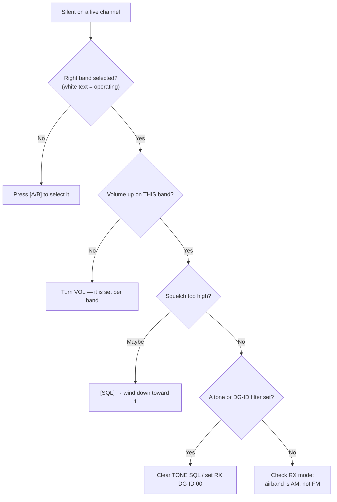
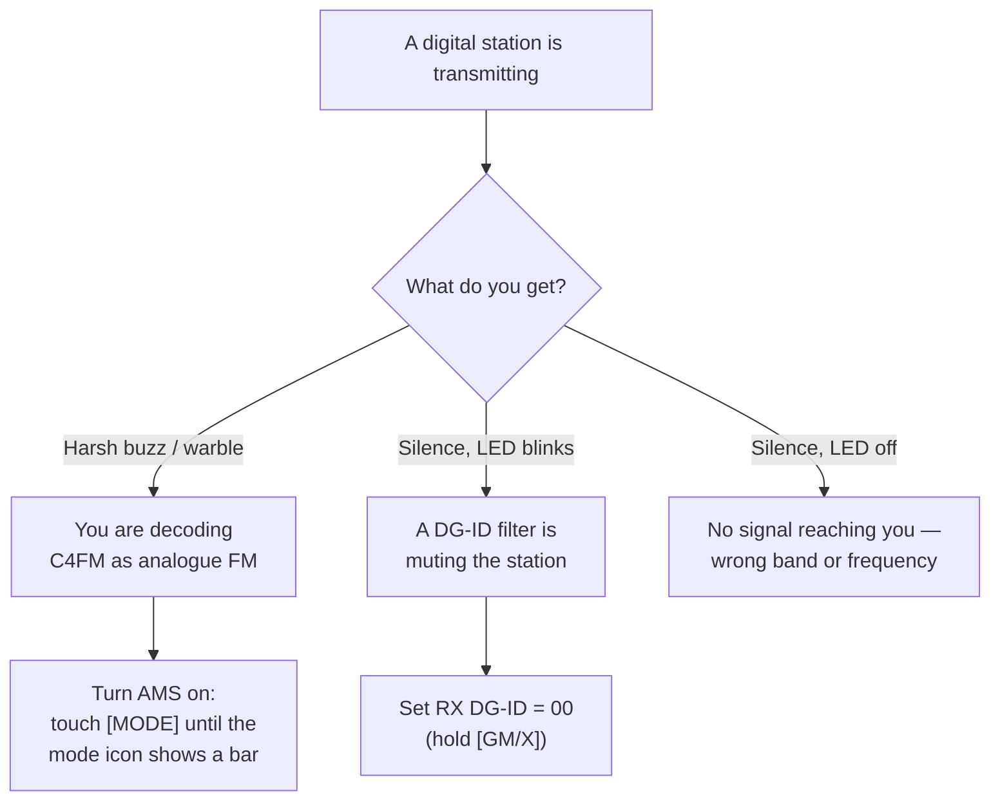
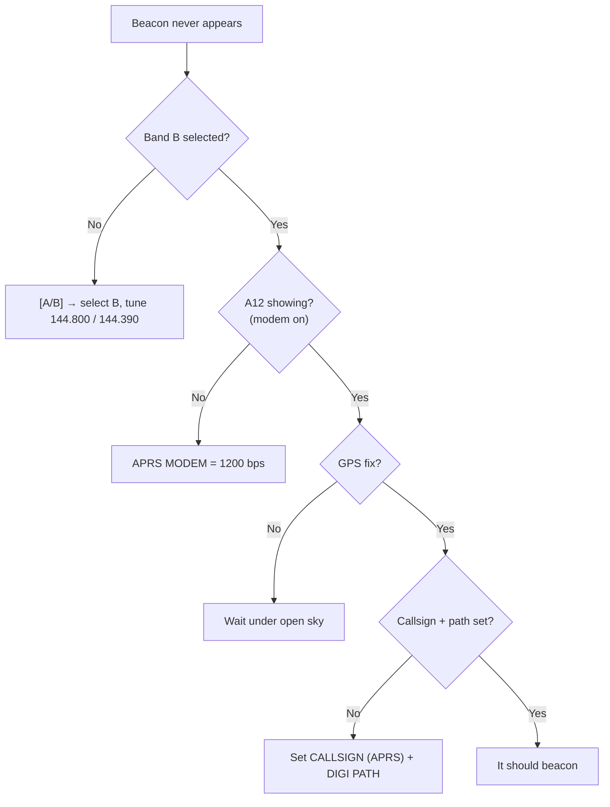
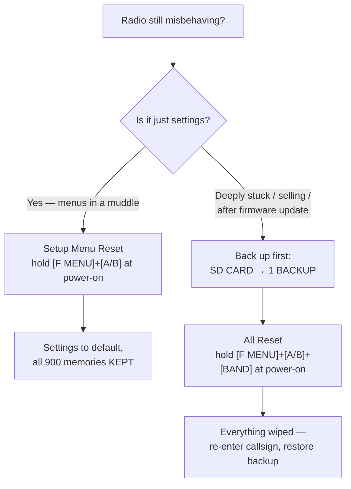

# Troubleshooting

Almost everything that feels "broken" on the FT5DR is really a setting quietly doing its job somewhere you have forgotten to look. A radio this deep has a lot of switches, and any one left in the wrong position can make the whole set seem dead, deaf or mute — when in fact it is obeying you perfectly. This chapter is the fault-finder: the symptoms newcomers actually hit, the real cause behind each, and the exact fix. Work through it symptom-first, and hold the golden rule in mind — the radio is almost never faulty; a setting is.

## How to use this chapter

Each section names a **symptom** in plain words, then its likely **cause** and the **fix**. Where a fix is a menu item, we name the **category and item** (for example `CONFIG → 9 LOCK`), because the FT5DR's Setup Menu restarts its numbering inside every one of its twelve categories — a bare number means nothing on its own, and numbers can shift between firmware versions, so trust the **name**.

To reach any item, **press and hold the top-left function key.** Yaesu's own documentation is not consistent about its name — the Operating Manual calls it **[F MENU]**, and you will also see it written **[DISP]** elsewhere in Yaesu's materials and on earlier sets — but it is the same physical button. Throughout, "hold [F MENU]" means that key. Two comforts before you start: **nothing here can damage the radio** — you are only changing settings — and if your symptom is not listed, the [two resets](#starting-over-the-two-resets) are the universal "make it behave again", gentler one first.

## "It's completely silent"

You are sure there is activity on the frequency, but the speaker says nothing. This is the single most common complaint, and it has a short ladder of causes — walk down it in order.

- **Wrong band selected.** The FT5DR has [two independent receivers](outpost:entry/logbook73.guide.ft5dr/operating-basics), A-band (top) and B-band (bottom), and only one is the **operating band** — shown in **white** text, the other in **grey**. Volume, squelch and PTT all act on the operating band. If the traffic is on the grey band, you are watching it but listening to the other. **Fix:** press `[A/B]` (or touch the frequency) so the busy band turns white.
- **Volume is down on this band — and volume is per band.** With two receivers, **volume and squelch are stored separately for each band** (and again for the AM and FM broadcast bands). Turn the knob and only the _operating_ band gets louder. **Fix:** select the band you want, then set its volume.
- **The squelch is set too high.** [Squelch](outpost:entry/logbook73.handbook/glossary) silences background hiss when no signal is present — but wound too far, it also silences the weak signals you are straining to hear. **Fix:** press `[SQL]`, rotate the VOL knob down toward level **1**, press `[SQL]` again. If the hiss returns, the receiver is alive — nudge it up just until the hiss closes.
- **The Bluetooth routing has stolen your audio.** If a headset is paired, `OPTION → 4 Bluetooth Audio` = **AUTO** sends _all_ audio to the headset and **silences the internal speaker** — so a headset that is off, in a drawer or out of range leaves the radio silent. **Fix:** set it to **FIX** (both play), or turn Bluetooth off — see [Bluetooth won't pair](#bluetooth-wont-pair) below.
- **A tone or DG-ID filter is muting the channel.** If you (or a stored memory) set **tone squelch** — `SIGNALING → 11 SQL TYPE` = `TONE SQL` — the radio stays silent until it hears the exact CTCSS tone you set. The digital equivalent is a non-zero **RX DG-ID**. **Fix (analogue):** set `SQL TYPE` to `OFF` (or `TONE`, which sends a tone on transmit but does not mute receive). **Fix (digital):** set `RX DG-ID = 00` — hold `[GM/X]` to snap it back. Tones get their own chapter, [Tone Squelch, DCS & the Pager](outpost:entry/logbook73.guide.ft5dr/tones); DG-ID is in [C4FM Digital](outpost:entry/logbook73.guide.ft5dr/c4fm).
- **Wrong demodulation mode.** The aviation [airband](outpost:entry/logbook73.handbook/vhf) is **AM**; amateur, PMR and marine are **FM**. An FM receiver on an AM signal gives a faint, distorted whisper, easily mistaken for silence. **Fix:** `TX/RX → 1 MODE → 3 RX MODE` chooses AUTO / FM / AM; AUTO picks AM in the airband, so if you fixed FM by hand, that is your culprit.
- **The band is muted as the sub-band.** In dual receive, when the _operating_ band gets busy the radio mutes the sub-band so they do not talk over each other. If B goes quiet the instant A opens, nothing is broken — that is by design.

## "The digital sounds like buzzing" — or nothing at all

On a C4FM Fusion channel someone is clearly transmitting, but instead of clean digital voice you get a harsh warble, or dead silence. The two symptoms have two _different_ causes, and telling them apart is the whole trick.

- **Buzzing = you are hearing digital through an analogue decoder.** C4FM is [digital voice](outpost:entry/logbook73.handbook/digital-voice) — four-level FSK, not FM — so an FM receiver renders it as an ugly modem buzz. This happens when **AMS is off** and the mode is fixed to `FM`. **Fix:** turn **AMS** on — touch `[MODE]` until the mode icon shows a small **bar** above it. AMS then decodes analogue as FM and digital as DN/VW automatically. (The usual way to switch AMS _off_ by accident is pressing `[MODE]` one press too far onto a fixed mode with no bar.)
- **Silence with a blinking LED = a DG-ID mismatch.** If the TX/BUSY LED **blinks** but you hear nothing, a C4FM signal is arriving whose **DG-ID** does not match your **RX DG-ID**, so the radio mutes it. **Fix:** set `RX DG-ID = 00` (hold `[GM/X]`). RX 00 is the wildcard that hears every C4FM station, and it clears nine in ten "I can't hear anyone on a live repeater" reports.
- **You are transmitting the wrong mode back.** If _they_ can't hear _you_, check the `[TX AUTO] / [TX FM] / [TX DN]` soft key, which is independent of AMS: `TX FM` left over from an analogue net sends analogue into a digital contact (a buzz to them), and `TX DN` sends digital into an analogue one. **Fix:** `TX AUTO` answers each station in the mode it arrived in.
- **VW into a repeater loses the far end.** Transmit **Voice Wide** (`TX/RX → 2 DIGITAL → 4 DIGITAL VW = ON`) into a Fusion repeater or WIRES-X and you drop the data stream they rely on — GPS stops updating and the far side may struggle to decode you. **Fix:** keep VW for direct simplex; use **DN** through a repeater.

## "The controls are frozen" — or it won't transmit

The keypad, dial or touchscreen ignore you, or the PTT does nothing. Almost always this is the **lock**, working exactly as asked.

- **The key/dial lock is on.** A short press of the top **Power/Lock switch** toggles the lock (a _long_ press powers off); "LOCK"/"UNLOCK" flashes and a **padlock icon** shows when engaged. **Fix:** short-press the switch once to release it.
- **The touchscreen "died".** Two things masquerade as a dead screen. First, if the lock includes the keys, the touch panel is frozen too — unlock it. Second, the FT5DR uses a **resistive** touchscreen, not a smartphone-style capacitive one, so it needs a firmer, more deliberate press (and works through gloves or with a stylus). A light tap may not register.
- **Choosing what the lock covers.** `CONFIG → 9 LOCK` sets _what_ freezes: `Key&Dial` (default), `PTT`, `Key&PTT`, `Dial&PTT`, `All`, `Key` or `Dial`. ✅ The default locks the keys and knob but **leaves PTT live** so you can transmit one-handed; if you picked an option that includes PTT, the transmitter is locked out too. The `[MONI/T-CALL]` key, `[SQL]` key and VOL knob are **never** locked.
- **"TX INHIBIT" appears when you key up.** This means you are tuned **outside an amateur band** — the airband, a broadcast frequency — and the radio is refusing to transmit illegally, which is a feature. **Fix:** tune the operating band into your 144 or 430 MHz allocation. TX is limited to those bands however wide the receiver roams — 144–148 / 430–450 MHz on the US **FT5DR**, 144–146 / 430–440 MHz on the European **FT5DE**; check your own [licence conditions](outpost:entry/logbook73.handbook/getting-licensed).
- **A grey-market FT5D that never transmits.** If the radio _never_ transmits and its manual is in Japanese, you may have the Japan-market **FT5D** rather than the FT5DR/FT5DE — these arrive TX-inhibited outside their home allocations and carry no regional warranty. That is a buying trap, not a menu fix.
- **It cut your transmission off mid-over.** The **time-out timer** (`CONFIG → 20 TOT`, default three minutes) ends a continuous transmission once it hits the set limit, so you cannot hold the channel indefinitely — let up and key again to carry on, or lengthen the timer. A low battery also disables transmit before the radio shuts down; charge it.

## "APRS never appears on the map"

You have set APRS up and nothing shows on [aprs.fi](outpost:entry/logbook73.handbook/aprs-running). The full setup lives in [APRS, GPS & Data](outpost:entry/logbook73.guide.ft5dr/aprs) and the concepts in the handbook's [APRS book](outpost:entry/logbook73.handbook/aprs) — here is the fault ladder, in rough order of how often each bites:

- **The TNC (modem) is off.** There is no "APRS on" switch — you turn APRS on by **choosing a baud rate**. `APRS → 4 APRS MODEM` must read `1200 bps`, not `OFF`. When on, **`A12`** (or `A96` for 9600) appears beside the Band B frequency — your at-a-glance confirmation, and the number-one forgotten step.
- **You are on the wrong band.** **APRS runs only on Band B.** Press `[A/B]` so B is operating and tune it to your national APRS channel — **144.800 MHz** in the UK and most of Region 1, **144.390 MHz** in North America (check your national band plan). On the wrong band, APRS silently does nothing.
- **The GPS has no fix.** With `APRS → 24 MY POSITION = GPS` (right for anything portable), the radio **will not beacon until the GPS has locked** — it refuses to send a position with no position in it. Give the GPS clear sky and a minute or two; see [GPS won't get a fix](#gps-wont-get-a-fix) below.
- **No callsign, or a broken path.** You cannot beacon without a callsign: set `APRS → 23 CALLSIGN (APRS)`, a **separate** setting from the radio's main C4FM `CALLSIGN` category. And if you reach a digipeater but never hit the _internet_ map, your path may be OFF: `APRS → 18 DIGI PATH` should be `WIDE1-1,WIDE2-1` in most places, so a digipeater relays you to an [I-gate](outpost:entry/logbook73.handbook/aprs-igates).

## "WIRES-X won't connect"

You hold `[GM/X]`, the `[X]` indicator flashes, and after about 30 seconds it gives up. WIRES-X is the mirror of APRS, with a short checklist of its own — the full walk-through is in [WIRES-X & GM](outpost:entry/logbook73.guide.ft5dr/wires-x-gm).

- **You are not in digital DN.** WIRES-X needs the data half of the C4FM signal, so it works **only in DN** — not FM, not VW. **Fix:** touch `[MODE]` to DN, or leave AMS on and force `TX DN`.
- **You are on the wrong band.** **WIRES-X runs only on the A-band** (the mirror of APRS on B). Press `[GM/X]` on B and the radio switches you to A automatically — but A must then be tuned to a node frequency.
- **There is no node within RF range.** Your handheld never touches the internet — it talks over the air to a local **node**: a Fusion radio bridged to a PC, either through Yaesu's **HRI-200** gateway box or, in **PDN** (Portable Digital Node) mode, cabled straight to the PC with no HRI-200 at all. The node is what reaches the internet. If none is within RF range of your 5 W, there is nothing to connect to. **Fix:** confirm from a node list that a node exists near you and that you can hear its traffic, then tune A-band to its exact frequency. In the countryside there may be none — the answer is a [personal portable node](outpost:entry/logbook73.guide.ft5dr/portable-node) of your own.
- **You are running your own node and the `[X]` won't blink.** A case for node _operators_ rather than users: if you have your FT5DR cabled to a PC as a PDN and holding `[GM/X]` does not make the **`[X]`** indicator blink, the transceiver has not linked to the WIRES-X software on the PC — so nothing on the air can reach it. **Fix:** check the USB cable is seated and that the USB driver is installed on the PC; the `[X]` blinks once that link is up.
- **A leftover WIRES-X DG-ID.** WIRES-X has its **own** DG-ID (`WIRES-X → 5 DG-ID`), separate from the main radio DG-ID. `AUTO` (default) connects to any _open_ node; a stray number connects **only** to nodes on that DG-ID, so an open node ignores you. **Fix:** set it back to **AUTO** unless a node owner gave you a number.
- **The node's own internet is down.** If your side is all correct and the node still won't pass traffic, the fault may be the node's internet link or the room it connects to — out of your hands. Try another node or come back later.

## "Bluetooth won't pair"

Hands-free audio is handy, but pairing trips people up. The Bluetooth menu lives under `OPTION`; the fuller treatment is in [Bluetooth, VOX, Voice Recorder & Snapshot](outpost:entry/logbook73.guide.ft5dr/audio-extras).

- **Bluetooth is switched off.** Turn it on at `OPTION → 2 Bluetooth = ON`, then use `[SEARCH]`, pick the device, and `[CONNECT]`.
- **The headset isn't in pairing mode.** A headset only appears in the search list while it is actively advertising itself. On Yaesu's **SSM-BT20**, hold its multi-function button until the LED blinks **red/blue**; on a generic headset, follow its own pairing procedure. If nothing shows in `[SEARCH]`, the headset is not in pairing mode. **Fix:** put it back into pairing mode and search again.
- **It paired but you hear nothing.** The routing gotcha again: `OPTION → 4 Bluetooth Audio` = **AUTO** sends audio _only_ to the headset. Connected but sitting on your desk, the radio is silent. **Fix:** wear the headset, or set **FIX** so both play.
- **A third-party headset that half-works.** Yaesu guarantees only the SSM-BT20; many generics work, but some pair yet drop audio or the microphone. The radio auto-reconnects to the last headset at power-on, and `OPTION → 3 DEVICE LIST` manages registered devices — remove a stale entry there if it keeps grabbing the wrong one.

## "GPS won't get a fix"

The position display flashes and never settles, or takes ages. The 66-channel receiver is capable, but satellite positioning has physics you cannot rush.

- **Cold start takes longer.** After a long time switched off, a long move, or on first use, the GPS does a **cold start** — downloading the satellites' orbital data from scratch, which can take several minutes. Later "warm" fixes are far quicker. **Fix:** be patient the first time and leave it running.
- **It needs a clear view of the sky.** GPS signals are faint. Indoors, in a car, under dense trees or between tall buildings, the receiver may never see enough satellites. **Fix:** step into the open, away from buildings, and hold still for a minute. Open sky helps far more than a window.
- **The GPS is turned off.** `APRS → 20 GPS POWER` must be `GPS ON` (the default). If a battery-saving tidy-up turned it off, there is nothing to fix a position. An active GPS costs about **15 mA** extra, so it does shorten the battery over a day.
- **Don't touch the datum.** If your position is _wrong_ rather than absent, check `APRS → 19 GPS SETUP` is still **WGS-84** — APRS assumes it worldwide, and changing it puts you in the wrong place on everyone's map. ✅ Leave it alone.

## "The microSD card isn't recognised"

You slot a card in for backups, GPS logging or Fusion images and the radio ignores it, or claims to write files that never appear.

- **It must be formatted in the radio.** A card formatted on a PC is often not recognised, or reads and writes painfully slowly. **Fix:** format it in the radio — `SD CARD → 4 FORMAT` (this erases the card, so copy anything off it first).
- **Capacity limits.** The FT5DR supports **2 GB to 32 GB** microSD / microSDHC only — a 64 GB or larger SDXC card will not work. **Fix:** use a card in that range.
- **Large cards can be flaky.** Owners report that some **32 GB** cards misbehave — the radio builds the folder structure and reports files "written" but nothing lands. This is anecdotal, not universal, but if a big card is unreliable an **8 GB** card is a safe choice.
- **Insert and remove with the power OFF.** Always seat or pull the card with the radio **switched off** to avoid corrupting it.

## Starting over: the two resets

When a symptom will not yield, or you are handing the radio on, the FT5DR has **two** resets — and the difference between them matters enormously, because one is harmless and the other wipes everything.

- **Setup Menu Reset — the gentle one.** Returns the Setup Menu parameters to factory defaults but **keeps all your memory channels**. Switch the radio off, hold **[F MENU] + [A/B]** while switching it on, and touch `[OK]`. ✅ Try this first for any "settings in a muddle" problem — it cannot lose your channels.
- **All Reset — the nuclear one.** Wipes **everything** — every setting _and_ all 900 memory channels — then asks for your callsign as if the radio were new. Hold **[F MENU] + [A/B] + [BAND]** while switching on. ⚠️ **Back up first:** `SD CARD → 1 BACKUP → Write to SD` saves the lot to microSD to restore later (`Read from SD`). Without a backup, every repeater, tone and APRS setting is gone for good.
- **Set your callsign again afterwards.** After an All Reset (and after a firmware update, which performs one automatically), the radio demands your **callsign** before it operates normally — have it ready.
- **Recovering a radio that will not respond.** If the set becomes unresponsive — usually after an interrupted firmware update — the same **[F MENU] + [A/B] + [BAND]** at power-on forces an "ALL RESET?" prompt to bring it back. You lose your data, which is why the [best-practices](outpost:entry/logbook73.guide.ft5dr/best-practices) habit of a microSD backup pays for itself the first time you need it.

## A few quick ones

Small symptoms with one-line answers, each tied to the menu item behind it:

- **The screen is too dark** — `DISPLAY → 6 LCD BRIGHTNESS` (1–6); `DISPLAY → 4 LAMP` sets when the backlight comes on. A dim setting saves battery but can look "dead".
- **It powers itself off** — the **Automatic Power Off** timer, `CONFIG → 1 APO`, is doing its job. Turn it off or lengthen it.
- **A band has vanished from `[BAND]`** — `CONFIG → 22 BAND SELECT` hides ranges (airband, shortwave); re-enable the one you want here.
- **No beep on key presses** — `CONFIG → 3 BEEP` toggles the confirmation beeps.
- **Weather-alert interruptions** (US) — the `SIGNALING → 14 WX ALERT` monitor is on.
- **You can't land on an exact frequency** — the **step** (`CONFIG → 18 STEP`) is on the wrong grid; AUTO suits most bands, but the 8.33 kHz airband needs its own step.

## Try it yourself

Deliberately _cause_ a couple of these faults so you recognise them instantly in the field:

1. **Make it "go deaf", then cure it.** On a busy channel, press `[SQL]` and wind the squelch right up until the audio closes. Then wind it back to 1. You have just felt the most common false alarm there is.
2. **Make digital buzz.** On a Fusion channel, touch `[MODE]` until the AMS bar disappears and the mode reads a fixed `FM`. Listen to a digital station buzz. Touch `[MODE]` back to the AMS bar and hear it clear up.
3. **Make the LED blink.** Set `RX DG-ID` to an unused number like 22 and watch the channel go silent while the LED **blinks** on passing digital signals. Hold `[GM/X]` to snap it back to 00 and the band returns.
4. **Lock and unlock.** Short-press the Power/Lock switch, try the keypad (frozen), confirm the VOL knob and `[SQL]` still work, then short-press again to release.
5. **Practise the gentle reset.** With nothing precious stored yet, power off and do a **Setup Menu Reset** (`[F MENU] + [A/B]` at power-on). Notice your would-be memories survive — that is the reset you reach for first.

## Key takeaways

- **The radio is almost never broken — a setting is.** Work symptom-first, and try the gentle **Setup Menu Reset** before anything drastic.
- **Silent receive** is usually the wrong band selected (white = operating), volume/squelch set **per band**, the squelch too high, a tone or **RX DG-ID** filter, the AM/FM mode wrong for the airband, or Bluetooth audio routed away — check them in that order.
- **Buzzing digital** means you are decoding C4FM as FM — turn **AMS** on (mode icon shows a bar); **silence with a blinking LED** means a **DG-ID mismatch** — set `RX DG-ID = 00` (hold `[GM/X]`).
- **APRS not beaconing:** the `A12` modem tag off, wrong band (APRS is **B-band only**, 144.800 UK / 144.390 US), **no GPS fix**, or a missing callsign/path. **WIRES-X not connecting:** not in **DN**, wrong band (**A-band only**), no node in RF range, or a leftover WIRES-X DG-ID (leave it **AUTO**).
- **Bluetooth** needs the headset in pairing mode and `Bluetooth Audio = FIX` to keep the speaker; **GPS** needs open sky and patience on a cold start; **microSD** must be **formatted in the radio**, 2–32 GB, inserted power **off**.
- The **key/dial lock** (short-press Power/Lock) explains most "frozen controls"; **"TX INHIBIT"** means out of band, not faulty.
- **Two resets:** Setup Menu Reset keeps your memories; **All Reset wipes all 900 channels** — back up to microSD first (`SD CARD → 1 BACKUP`) and re-enter your callsign after.

With the radio behaving, the last step is learning to operate it _well_ — clean, courteous and battery-wise: [Best Practices & Etiquette](outpost:entry/logbook73.guide.ft5dr/best-practices).
