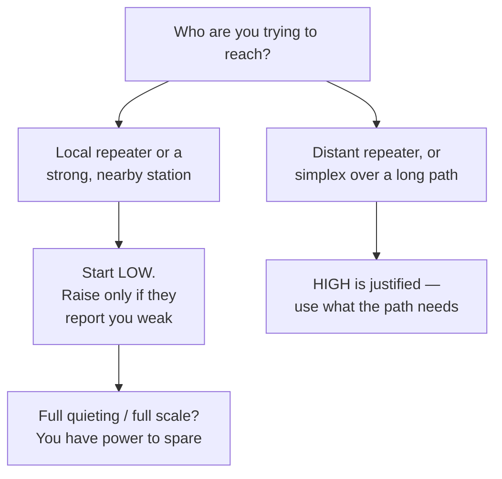
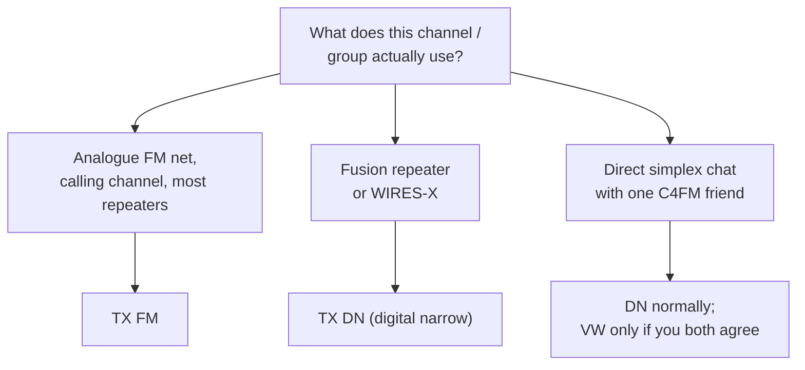
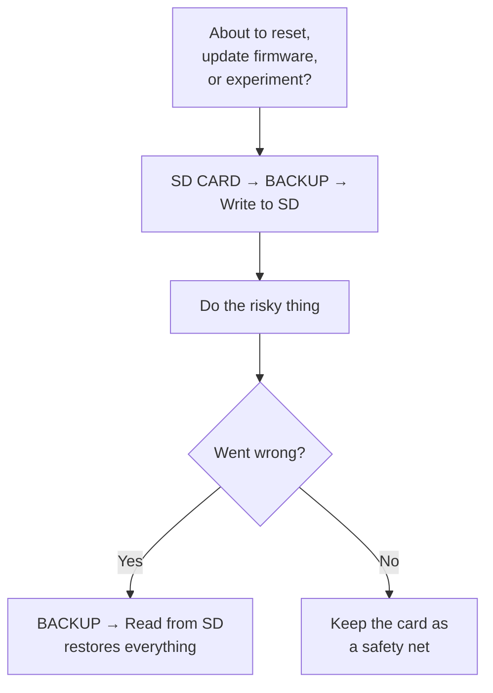

# Best practices and etiquette

A capable radio gives you more ways to reach the people around you — more power to carry further, more modes to get wrong, and more data to pour onto shared channels. Etiquette is simply using that reach thoughtfully. This last chapter is not about the FT5DR's features but about the operator holding it: a short, practical guide to being the kind of station other people are glad to hear, and to keeping the radio itself healthy for years. None of it is hard, and most of it comes down to a handful of habits.

We keep the same one-glance verdict key used throughout the guide:

| Symbol | Meaning                                         |
| ------ | ----------------------------------------------- |
| ✅     | Do this — right for almost everyone             |
| ⭐     | Genuinely good practice, worth the small effort |
| ⚠️     | Care needed — understand it before you act      |
| ❌     | A habit to avoid                                |

## Lowest power that works — the habit that covers most of it

If you take one thing from this chapter, take this: **run the lowest power that reliably does the job.** It is the single habit that most marks out a considerate operator, and on a 5 W handheld it costs you almost nothing.

The FT5DR gives you four transmit powers — **HIGH (5 W)**, **LOW3 (2.5 W)**, **LOW2 (1.0 W)** and **LOW1 (0.1 W)** — and you switch between them as covered in [Operating: Bands, VFOs, Modes & Transmitting](outpost:entry/logbook73.guide.ft5dr/operating-basics). (On the FBA-39 AA battery tray the ceiling drops to about 0.9 W and only the two lowest steps are offered, worth knowing if you carry one for emergencies.) The temptation is to leave it on HIGH and forget it. Resist that, because three separate things improve the moment you turn power down.

- **You cause less interference.** Radio does not stop at the station you are talking to. Your signal carries on past them, and the further it goes the more distant users share the same channel with your transmission. Turning power down shrinks that footprint to roughly what you actually need. The physics — why halving the distance quadruples the received power, and why a little less power costs you far less range than you would guess — is in [RF Power](outpost:entry/logbook73.handbook/rf-power).
- **You are kinder to yourself.** A handheld is a transmitter held near your head; less power means less RF close to you. More on that at the end of the chapter.
- **Your battery lasts longer.** Transmit is where the current goes. Dropping from 5 W to 1 W stretches a day in the field noticeably.

The rule of thumb: **start low and let the other operator tell you if you need more.** If they report you full-scale and perfectly readable, you had power to spare and could have used less. If a repeater a few miles away lifts your signal cleanly at LOW2, there is no reason to be sitting on it at 5 W. Save HIGH for the times the path genuinely demands it — a distant machine, a weak simplex contact, a summit on the far side of a hill.

- **UK/region note:** whatever the radio can produce, you transmit only **within your licence conditions**, which cap your permitted power. The FT5DE sold in the UK, the FT5DR in the US and the export models all obey the same principle — check your national licence for the number, and treat the radio's HIGH setting as a maximum you rarely need rather than a default. ⭐

## Sharing a channel: analogue and digital courtesy

The FT5DR speaks two languages on the same bands — analogue [FM](outpost:entry/logbook73.handbook/modulation) and Yaesu's C4FM digital — and **the two do not mix**. A digital transmission arriving at an FM-only listener is not quiet or muffled; it is a meaningless burst of noise, the "bacon frying" sound, and it tells them nothing at all. An analogue transmission into a digital net is just as useless the other way round. So getting the mode right is not about fidelity — it is the difference between communicating and simply making a noise on someone else's channel.

This is where **AMS** (Automatic Mode Select) needs a word of care. AMS is a courtesy _on receive_: it listens to whatever arrives and plays analogue as FM and digital as C4FM, so you always hear the channel correctly. The catch is your **transmit** mode. The `TX AUTO` / `TX FM` / `TX DN` soft key (see [C4FM Digital, AMS & DG-ID / DP-ID](outpost:entry/logbook73.guide.ft5dr/c4fm)) decides how _you_ go out, and `TX AUTO` transmits in whatever mode AMS last detected. On a mixed channel that can mean you drop a digital burst onto a group of analogue operators without meaning to.

The considerate practice is simple: **know the mode of the group you are joining, and lock your transmitter to it.**

A few rules of thumb fall out of that:

- **On an analogue channel, set `TX FM`.** The 2 m calling channel, a local FM net, most repeaters — if the traffic is analogue, transmit analogue. Don't leave it on `TX AUTO` and hope. ⭐
- **On a Fusion repeater or WIRES-X, use `TX DN`.** DN (V/D — Digital Narrow) is the mode repeaters and the WIRES-X network expect, because it carries the data stream they rely on. ✅
- **Keep VW for direct contacts, and only by agreement.** VW (Voice FR) hands the whole channel to higher-fidelity voice but carries **no data or GPS**, and it is **not for repeaters or WIRES-X** — they will not pass it properly. It is a nice-to-have between two operators who have both switched it on, and nothing more. ⚠️
- **Above all, listen before you transmit.** Ten seconds monitoring tells you the mode, whether the channel is busy, and whether there is a net in progress. It is the oldest courtesy in radio and the FT5DR's dual receivers make it effortless.

Two smaller courtesies round this out. **Leave a gap between overs** — a second or two of silence lets a repeater's timers reset and lets someone with priority traffic break in. And **identify with your callsign** as your licence requires — digital modes send your callsign in the data stream automatically, but that does not replace the identification your licence conditions ask for.

## DG-ID etiquette

C4FM's **DG-ID** (Digital Group ID) is a 00–99 group code with separate transmit and receive values, explained fully in the [C4FM chapter](outpost:entry/logbook73.guide.ft5dr/c4fm). It is a useful tool and an easy way to be accidentally antisocial, so a short note on manners.

- **Leave RX DG-ID at 00 as your normal state.** ✅ With receive set to **00** the radio hears _all_ C4FM stations regardless of their group code. Set it to a non-zero value and you hear only stations using that exact number — which is the origin of nearly every "why is the band dead?" message on the forums. Unless you are deliberately sitting in one private group, 00 is the neighbourly default: you can hear everyone, including the newcomer calling for help who has no idea what a DG-ID even is.
- **Only set a TX DG-ID when something asks for one.** ⭐ Some Fusion repeaters and groups use a specific DG-ID to control access; set your **TX** DG-ID to match theirs and leave RX at 00 so you still hear the general traffic. Do not sprinkle a non-zero DG-ID around casually — to anyone whose radio is not set to the same number, you have made yourself inaudible.
- **DP-ID is for genuinely private groups.** DP-ID filtering opens your speaker only for stations you have registered, which is fine for a closed group of friends — but remember it is **bypassed whenever RX DG-ID is 00**. Using it means deliberately narrowing who you hear, so use it knowingly, and switch back to the open default when you rejoin general operating.

The one-line version: **TX 00 / RX 00 unless a specific repeater or group has told you otherwise**, and a long-hold of `[GM/X]` on the DG-ID screen puts both back to 00 in one move if you ever lose track.

## Sensible APRS: short paths, sensible beacons

APRS is a shared VHF channel, and _shared_ is the operative word. Every beacon you send is airtime nobody else can use, so the whole system depends on operators being economical. The mechanics live in [APRS, GPS & Data](outpost:entry/logbook73.guide.ft5dr/aprs); the etiquette is in the handbook's [APRS book](outpost:entry/logbook73.handbook/aprs), and it is worth reading [Running APRS Sensibly](outpost:entry/logbook73.handbook/aprs-running) and [Paths & Digipeating](outpost:entry/logbook73.handbook/aprs-paths) before you key up a tracker in anger. Three habits keep you on the right side of it.

**1. Use a short path.** The digipeater path is the instruction your packet carries for how far to be relayed, and a long path asks every digipeater in the county to repeat you again and again. The FT5DR's `APRS → DIGI PATH` gives you a fixed **`WIDE1-1,WIDE2-1`** option (`P3` in the list), and for a mobile or portable station that is the standard, polite two-hop path almost everywhere. Longer, hand-built paths exist under `P4`–`P8` but you almost never want them — they clog the network for everyone within range. ✅ `WIDE1-1,WIDE2-1`; ⚠️ anything longer.

**2. Match your SSID and your beacon rate to what you are doing.** By convention a handheld beacons as SSID **-7** (`APRS → CALLSIGN (APRS)`), which tells everyone reading the map that you are a walker or a pack radio, not a car or a home station. And **do not beacon more often than you need to**:

| You are…                  | Sensible approach                                            |
| ------------------------- | ------------------------------------------------------------ |
| Walking / stationary      | A slow fixed interval, or SmartBeaconing **TYPE3** (walking) |
| Cycling                   | SmartBeaconing **TYPE2** (low speed)                         |
| In a vehicle              | SmartBeaconing **TYPE1** (high speed)                        |
| Sitting still for a while | Turn beaconing off, or beacon rarely                         |

SmartBeaconing is clever — it beacons more often when you are moving fast or turning and less often when you are ambling or parked — but **the type has to match your actual speed.** Running the walking preset (TYPE3) at 60 mph in a car floods the channel with beacons; running the car preset on foot barely marks your track. Pick the one that fits, and switch it as your speed changes. A stationary handheld thumping out a position every thirty seconds helps nobody and annoys everybody — if you are not moving and not adding value, there is no shame in turning the beacon off. ⭐

**3. Remember you are a guest on the frequency.** APRS reaches maps worldwide through volunteer digipeaters and [I-gates](outpost:entry/logbook73.handbook/aprs-igates) that nobody is paid to run. The lighter your footprint, the better the system works for the next person. The handbook's [APRS book](outpost:entry/logbook73.handbook/aprs) explains the AX.25 packet protocol and the paths in full — this guide just links to it rather than repeating it, because the etiquette is universal and not specific to the FT5DR.

## Back up before you need to

This is the ⭐ habit that turns a disaster into a shrug. The FT5DR holds up to 900 memory channels, banks, and a Setup Menu you will spend real time tuning — and a single mis-step can wipe the lot. An **All Reset** (holding `[F MENU]`+`[A/B]`+`[BAND]` at power-on — `[F MENU]` being the top display/menu key that some Yaesu documentation labels `[DISP]`) erases _every_ memory and setting, and — the sting in the tail — **a firmware update performs the same reset-all automatically.** Lose your config that way and rebuilding it by hand is an evening you will not get back.

The fix costs two minutes. With a microSD card fitted, `SD CARD → BACKUP → Write to SD` saves your entire configuration — every memory, every menu setting — to the card as a single file. Do it whenever your setup is worth keeping, and always before a reset or a firmware update.

A few points make backups reliable:

- **Format the card in the radio first.** `SD CARD → FORMAT` prepares a card the FT5DR can trust. A card formatted on a PC is often unrecognised or painfully slow.
- **Stick to a modest card.** The radio officially supports **2–32 GB** microSD/SDHC, but owners have found large 32 GB cards unreliable — the folder structure appears but files silently fail to write. A humble **8 GB** card is the safer choice, and you need nothing bigger for backups and GPS logs. ⭐
- **Insert and remove the card with the radio off**, and keep at least one backup somewhere other than the radio — copy the file off to a computer occasionally, so a lost or corrupted card is not the end of it.
- Backing up is also what makes experimenting _fun_: with a known-good file on the card, you can change anything, and `Read from SD` puts it all back.

## Firmware: keep it sensible, not obsessive

The FT5DR runs **two** separate firmware images — a **MAIN** and a **SUB** — each with its own version number, which you can read at `DISPLAY → SOFTWARE VERSION` (it shows Main, Sub and DSP). Keeping firmware current is good practice, but "current" does not mean "chasing every release." A calm approach:

- **Update when there is a reason.** A fix for a bug that actually affects you, or a feature you want — those justify an update. Updating for its own sake, on a radio that is working perfectly, mostly just risks the reset-all. ⭐
- **Match the region build to your radio.** ⚠️ Yaesu ships region-specific images — the US/AUS build and the EU/export build are not interchangeable, and flashing the wrong one can leave the radio misbehaving. If you are on a UK FT5DE, use the EU/EXP image.
- **Back up first, always.** The update wipes your data (see above). Back up to microSD, then update.
- **Update on good power and do not interrupt it.** A healthy battery or external power, and a flash you leave strictly alone until it finishes. If a radio ever ends up unresponsive, holding `[F MENU]`+`[A/B]`+`[BAND]` while powering on forces the All-Reset recovery prompt — but a clean backup means you never dread that.

Firmware version numbers move over time, so this guide deliberately does not quote a "latest" version — check Yaesu's own site for the current release and its notes, and read what a given update actually changes before deciding you need it.

## Battery care

The FT5DR's SBR-14LI (7.2 V, 2200 mAh) is a lithium-ion pack, and lithium-ion likes a few simple habits that add up to years of good service.

- **Avoid running it flat to nothing repeatedly.** Deep, total discharges are the hardest thing you can do to a lithium cell. Top it up before it is fully exhausted rather than draining it to shutdown every time. ✅
- **For long storage, leave it part-charged.** If the radio is going in a drawer for months, store it around **40–60%** rather than full or empty, somewhere cool. A pack left full and hot ages fastest.
- **Mind the temperature.** Charge and use it at sensible room temperatures where you can; a very cold pack gives less runtime (it recovers when warm), and charging a hot one is unkind to it.
- **Stretch a day in the field** with the battery-saver settings the radio provides: `CONFIG → SAVE RX` (receiver micro-sleep), `CONFIG → APO` (auto power-off if you forget it on), and a shorter `DISPLAY → LAMP` time. Remember too that the **GPS adds about 15 mA** and **dual-band receive draws more than single-band** — turn off what you are not using. ⭐
- **The IPX7 case is waterproof, not maintenance-free.** After a soaking, dry the battery and radio contacts before charging, and keep the terminals clean. Carry a spare charged pack (or the AA tray) for a long day rather than relying on one battery.

## RF safety, briefly

A 5 W handheld is a modest transmitter, and the safety story is short and undramatic — but worth stating plainly, and it echoes the advice from the [overview](outpost:entry/logbook73.guide.ft5dr/overview).

- **Never transmit without the antenna fitted.** ✅ A transmitter with nowhere to send its power can damage itself. Screw the supplied antenna in finger-tight, and use only a proper antenna — never a damaged or modified one.
- **Keep the antenna off your face when you key up**, and lean again on the first habit in this chapter: **lowest power that works.** Less power near your head is simply sensible, and you rarely need the full 5 W. [RF Power](outpost:entry/logbook73.handbook/rf-power) has the reasoning in full.
- **Mind pacemakers and don't operate while driving.** Yaesu cautions against transmitting close to a cardiac pacemaker and against operating the radio while actually driving or cycling — pull over first, both for safety and so you are not beaconing a wobbly APRS track anyway.

That really is the whole of RF safety for a radio this size. Good antenna, modest power, a little common sense.

## Try it yourself

A five-minute audit that leaves you a demonstrably better-behaved station:

1. **Drop your default power.** Set the radio to LOW2 (1.0 W) and try your usual local repeater. If it lifts you cleanly, that is now your everyday power — you were probably over-driving it before.
2. **Confirm RX DG-ID is 00.** On the DG-ID screen, check receive reads 00 (a long-hold of `[GM/X]` resets both to 00). Now you hear every C4FM station again.
3. **Check your APRS manners.** In `APRS → DIGI PATH`, confirm you are on `WIDE1-1,WIDE2-1`; in `CALLSIGN (APRS)`, confirm your SSID suits how you operate (`-7` for a handheld); and make sure your SmartBeaconing type matches how you actually move.
4. **Take a backup.** Format an 8 GB microSD in the radio (`SD CARD → FORMAT`), then `SD CARD → BACKUP → Write to SD`. Copy the file to a computer. You now have a safety net.
5. **Note your firmware.** Read `DISPLAY → SOFTWARE VERSION` and jot down the Main and Sub numbers, so you know what you are running before you ever consider an update.

## Key takeaways

- **Lowest power that works** is the habit that covers most of good operating — it cuts interference, RF near your head, and battery drain, and you rarely need the FT5DR's full 5 W. Start low, raise only if asked, and stay within your licence conditions.
- **Match your transmit mode to the channel:** `TX FM` on analogue, `TX DN` on Fusion repeaters and WIRES-X, and VW only for a direct C4FM contact by agreement — because digital and analogue are pure noise to each other. And always listen before you transmit.
- **Keep RX DG-ID at 00** so you hear everyone; set a TX DG-ID only when a repeater or group requires it.
- **Be economical on APRS:** a short `WIDE1-1,WIDE2-1` path, a `-7` handheld SSID, a beacon rate and SmartBeaconing type that match your actual speed, and beaconing turned down when you are still — it is a shared channel.
- **Back up to microSD before any reset or firmware update** (an All Reset or an update wipes all 900 memories); use a modest ~8 GB card formatted in the radio, and keep a copy off the card.
- **Update firmware only when there is a reason**, always to the correct region build, always after a backup; and treat the lithium battery kindly — avoid deep discharges, store it part-charged, mind temperature.
- **RF safety is short:** antenna always fitted, kept off your face, lowest sensible power, and transmit only within your licence conditions.

That completes the guide — from a first power-on to being a station others are glad to hear. From here on, the FT5DR is yours to enjoy, and the one page you will keep coming back to is the [Menu Reference](outpost:entry/logbook73.guide.ft5dr/menu-reference): every setting on the radio, in one place, each linked to its full explanation for the day you want to change it.
