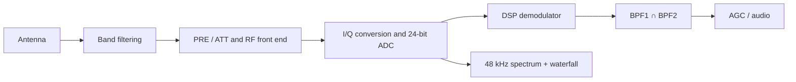

# Receiver, filters and DSP noise tools

The G90 gives you two very different kinds of receiver control. **PRE, ATT and RF Gain** act before or around the point where strong signals can overload the receiver. **BPF1/BPF2, AGC, audio and the noise blanker** shape what happens after conversion. Knowing which side of that boundary a problem lives on prevents endless filter fiddling.

## The signal path in plain English

An antenna delivers wanted signals, unwanted signals and noise together. The G90 first selects an analogue band region, optionally amplifies or attenuates it, converts it to in-phase and quadrature components and digitises at 24-bit/48 kHz. Software then demodulates the chosen mode, applies the filter and produces audio, spectrum and waterfall.

If C or D overloads, false signals and distortion are already present in the numbers. Narrowing F cannot reconstruct the lost information. The cure is less signal before overload: PRE off, RF Gain down, ATT on or an external broadcast/band filter.

## Sensitivity is not the same as readability

Maximum gain makes the S-meter move and the speaker hiss, which feels sensitive. On HF, however, the antenna usually supplies much more natural band noise than the receiver itself. Once that noise is clearly audible, extra gain adds little ability to hear a station. It mainly reduces headroom.

Start at RF Gain `50%`, front end normal. Tune a clear part of band and lower RF Gain until the background begins to fall; raise it a little. This places receiver noise below external noise without wasting dynamic range. Repeat after changing bands because 10 metres on a quiet day and 80 metres at night are different worlds.

## PRE and ATT as deliberate tools

**PRE** is most defensible on upper HF, roughly above 18 MHz, with a modest antenna and low external noise. If turning it on raises signal and noise equally, it has not improved signal-to-noise ratio. Turn it off.

**ATT** is for strong-signal trouble:

- a broadcast voice appears at several dial positions;
- a nearby transmitter raises the entire noise floor;
- strong signals grow wider than they should;
- tuning one carrier creates mirrored/ghost traces; or
- the receiver sounds better after disconnecting some antenna gain.

Attenuation may reduce the wanted signal's S reading but improve its shape. That is success. For a persistent medium-wave broadcaster entering every HF band, an external high-pass or band-pass filter before the G90 is more selective than attenuating the entire spectrum.

## AGC: controlling changes, not removing noise

Automatic gain control keeps loud signals from blasting and weak-to-strong fading manageable.

| Setting | Behaviour                                        | Good use                                  |
| ------- | ------------------------------------------------ | ----------------------------------------- |
| `AGC-A` | Radio chooses response                           | General starting point                    |
| `AGC-S` | Slower recovery                                  | SSB/AM, smooth listening                  |
| `AGC-F` | Faster recovery                                  | CW, rapid signals, strong adjacent bursts |
| Off     | Manual behaviour; S-meter unavailable/unreliable | Controlled experiments only               |

AGC pumping occurs when a strong neighbour repeatedly turns receiver gain down, making the background breathe. A narrower filter may keep that neighbour out of the AGC detector; lower RF Gain or ATT may prevent overload. Fast AGC can recover sooner between CW characters, while slow AGC may sound calmer on voice.

Turning AGC off is not a hidden weak-signal mode. It removes protection and meter behaviour and demands active RF Gain control.

## The two-filter model

Since v1.79, the G90 uses two band-pass windows. Call their passed frequency sets `BPF1` and `BPF2`. The actual heard audio is their intersection:

`audible passband = BPF1 ∩ BPF2`

This explains why moving one edge may appear to do nothing until it crosses the other filter, and why non-overlapping windows produce silence. The display's combined colour represents the intersection.

Short-press MFK, press to select a window/edge, rotate and listen. Long-press to finish. Use `FUNC+CMP` to reset BPF1 and `FUNC+NB` to reset BPF2.

### Voice filtering

The `300–3000 Hz` default is 2.7 kHz wide and sounds natural. In congestion:

- raise the low edge from 300 toward 400–500 Hz to remove low-frequency rumble;
- lower the high edge from 3000 toward 2400 Hz to reject high-side interference;
- avoid squeezing below roughly 1.8–2.0 kHz unless intelligibility genuinely improves.

A narrow filter cannot distinguish two voices occupying the same audio frequencies. Move frequency, use the reverse side where applicable, or wait.

### CW filtering

The default `−250…+250 Hz` gives 500 Hz. It is wide enough to find and tune a station. Narrowing to about 300 Hz isolates a signal and helps the decoder. Much narrower settings demand accurate centring and may ring—an artificial resonant sound created by a very sharp filter. Use CWR to place a nearby interfering carrier on the other side without changing the station's actual transmit frequency.

### Data filtering

The `100–3100 Hz` data default passes a 3 kHz sound-card window. A digital program may decode many FT8 signals spread across it, so do not narrow to one trace. For a single-tone mode you can narrow after confirming that CAT frequency, audio offset and transmit passband all remain correct.

### AM and NFM

AM's `−3000…+3000 Hz` filter yields 6 kHz—reasonable communications audio. Widening improves fidelity only when adjacent channels and noise permit. NFM's 9 kHz passband matches narrow FM deviation; using an SSB-width filter makes it distorted or weak.

## What the noise blanker does

A pulse noise blanker detects short, high-amplitude impulses and replaces/blanks those instants. `NB Level` controls what qualifies as a pulse; `NB Width` controls how much time around it is removed.

Tune it with the wanted signal present:

1. Enable NBSW.
2. Begin Level and Width low.
3. Raise Level until repeated ticks decrease.
4. Raise Width only enough to cover the remaining pulse.
5. Compare off/on for speech or CW damage.

It can transform electric-fence or ignition noise. It cannot remove white noise, thunder crashes, a continuous buzz or another operator. With a strong adjacent signal, too-aggressive blanking can generate intermodulation-like clicks. Off is the correct default.

## No stock DNR or notch

The G90's current stock control set has NB but no operator-facing digital noise reduction or automatic/manual notch filter. Some product comparisons and copied X6100 instructions imply otherwise. Do not waste time searching a nonexistent menu or assume a hardware fault.

You can still improve reception by using the filter overlap, RF Gain, AGC, CWR and proper antenna/common-mode-noise work. Software receiving via the I/Q output may provide extra DSP on a computer, but that is a separate receiver path.

## Mode choice is part of the filter

A passband width alone cannot make the wrong demodulator sound right.

### SSB

Upper and lower sideband reverse the relationship between RF and audio. The wrong choice makes speech unintelligible, not merely off pitch. Below 10 MHz amateurs normally use LSB and above use USB, but utility and special-mode stations may differ. Tune in 10–100 Hz increments until voice timbre is natural.

### CW and CWR

Both turn an unmodulated carrier into an audio note. They choose opposite receive injection/sideband, so switching can move an interferer from inside the filter to outside it. Match the station to the chosen sidetone and ΔF indication rather than comparing raw audio pitch across unlike radios.

### AM

AM contains a carrier and two sidebands. Centre the carrier precisely or audio distorts asymmetrically. On a crowded broadcast channel, selecting USB or LSB and listening to one AM sideband can reject interference, though this is not true synchronous AM and tuning must be exact.

### NFM

FM conveys information as frequency deviation, so an AM/SSB filter cannot demodulate it correctly. Use the 9 kHz-class NFM passband and squelch only after confirming a real FM channel. Very old support text said no usable FM; current firmware includes NFM and v1.81 corrects silent reception.

### U-D and L-D

The data modes are not merely renamed USB/LSB. On v1.79+ they select ACC line audio automatically and use a broad data filter. This is why a hand microphone goes quiet in U-D and why returning to USB is necessary for voice.

## Distinguish radio noise from local noise

Run a controlled test:

1. Note band, mode, filter, RF Gain and S-meter/dBm.
2. Disconnect the antenna and fit a screened dummy load.
3. Compare noise with the antenna connected.
4. Run the G90 from battery and safely turn nearby consumer devices off one group at a time.
5. Rotate or move a small receive loop/portable antenna if available.

Noise that vanishes on dummy load enters through the antenna/coax, though its source may still be in your house. Noise that remains can enter DC, head, USB or ACC leads—or be normal receiver noise. Noise that changes with computer activity points to USB, display or switch-mode sources. Keep notes by frequency and time; repeating patterns identify appliances.

A ferrite is not magic. Material, number of turns, placement and frequency determine effectiveness. Put common-mode choking near cable ends and address the antenna feed point, not only the radio desk.

## Reading the spectrum and waterfall

The top trace is an FFT: signal energy versus frequency right now. The waterfall records successive FFT lines through time. The displayed span is about ±24 kHz around centre.

Recognisable shapes include:

- CW: narrow vertical line;
- SSB voice: irregular 2–3 kHz-wide texture appearing with speech;
- AM: carrier line with symmetric side energy;
- FT8: repeated narrow lines in synchronised 15-second periods;
- impulse noise: broad horizontal events across much of the display.

AVE `1–10` trades responsiveness for smoothness. Low AVE shows fast signals and noise variation. High AVE steadies the trace but can conceal a brief call. Because SCALE is fixed AUTO on current firmware, colour/height changes are relative. A signal looking brighter after the noise floor changes is not necessarily stronger.

## Tune by eye, finish by ear

For SSB, move the waterfall energy into the filter, then listen to speech pitch. An off-frequency voice sounds unnaturally bassy or “Donald Duck”; adjust in 10–100 Hz steps. For CW, centre the carrier at the chosen sidetone pitch until the ΔF/CW indication responds. For AM, centre the carrier symmetrically.

The display's narrow span is ideal for local searching, not surveying an entire band. Use 100 kHz MFK moves or band memories to reposition, then allow the waterfall to refill.

## S-meter and dBm

Signal meters are useful for relative reports, antenna comparisons under controlled conditions and watching AGC. They are not laboratory instruments. AGC off disables or invalidates normal S-meter behaviour, automatic display scaling is independent, and received noise occupies part of the reading.

For an antenna A/B comparison, use the same frequency, bandwidth, mode, RF Gain, PRE/ATT and AGC, switch quickly, and compare both wanted signal and noise. A larger S reading with the same signal-to-noise ratio is not an improvement.

## Improving reception beyond menus

When controls reach their limit, fix the environment:

- move switch-mode supplies, USB chargers and displays away;
- use ferrites/common-mode chokes on DC, CAT and coax;
- bond/ground equipment according to local electrical and RF practice;
- use a balanced antenna and feedline choke;
- identify noise by temporarily running from battery and switching household circuits safely;
- add a receive band-pass/high-pass filter for a known strong broadcaster; and
- operate portable away from urban noise.

Never defeat protective earth or work inside mains equipment to chase an S-unit.

## Receiver recipes

### Quiet upper band

`AGC-A`, RF Gain 50–80%, PRE only if it improves S/N, ATT off, NB off, normal mode filter.

### Noisy 40/80 metres

PRE off, AGC-S or A, lower RF Gain until noise is comfortable, ATT if overload persists, narrow SSB filter modestly, NB only for pulse noise.

### Crowded CW

AGC-F, PRE normally off on lower bands, 500 Hz while finding then ~300 Hz, use CWR to move interference, RF Gain only high enough.

### Shortwave AM

Full Band stack, AM, AGC-S, 6 kHz on a clear channel or narrower in congestion, front-end normal/ATT, no squelch.

## Key takeaways

- Prevent overload before asking DSP to clean it up: PRE off, RF Gain down, ATT when necessary.
- Maximum S-meter deflection is not maximum readability.
- Current passband is the intersection of BPF1 and BPF2; non-overlap can cause silence.
- NB treats brief repetitive pulses only. Stock firmware has no DNR/NR/notch control.
- The 48 kHz display is relative and auto-scaled; use it to find patterns, not as a calibrated analyser.

Next, [CW](outpost:entry/logbook73.guide.g90/cw) turns the KEY sequences, paddle wiring, QSK and decoder into a reliable Morse setup.
