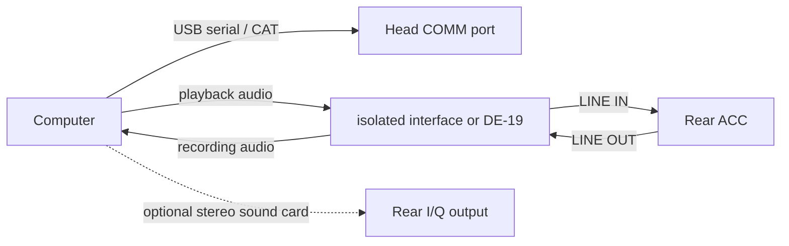

# CAT, CE-19 / DE-19 and digital modes

The G90 can be an excellent `20 W` digital station, but it is not a one-cable USB radio. Control and audio are separate paths. Understand that one fact and FT8 setup becomes ordinary; miss it and you can spend hours changing drivers while no audio ever had a route.

## The connection map

The ordinary blue/black USB-to-3.5 mm lead is **serial CAT/programming only**. It carries no transmit or receive audio. For sound-card modes you need the rear ACC audio through:

- Xiegu DE-19 (USB audio plus serial/interface functions);
- the earlier CE-19 with suitable sound-card connections; or
- a correctly wired, preferably isolated home-built interface.

The head's left COMM port is normal CAT. The rear/body COMM port is used to update BASE firmware, not everyday CAT.

## Identify the USB chipset

Different cable generations use different drivers:

- common blue Xiegu leads use FTDI;
- older black leads may use Prolific; and
- DE-19 commonly exposes a WCH CH342-family USB device.

Use the driver for the device actually reported by the operating system, not the colour alone. Record which serial port and audio devices appear when the interface is connected. Give the audio devices meaningful names if the OS permits.

## A bootloader trap

The G90 listens to serial input during startup for firmware loading. CAT software that polls continuously can send bytes at exactly that moment and make the radio remain in or appear stuck at a loader state.

A safe habit with the simple CAT cable is:

1. boot the radio with CAT software closed and, if necessary, the cable disconnected;
2. wait for the normal operating screen;
3. connect/open CAT;
4. close the program and disconnect before the next radio boot.

If the radio looks dead after working normally, remove CAT first, cycle DC safely and boot without PC polling before attempting recovery firmware.

## CAT serial settings

Normal control uses `19200 baud`, `8 data bits`, no parity, `1 stop bit` (`8N1`). The G90 implements a subset/extension of Icom CI-V commands. Xiegu's [CI-V reference](https://xiegu.eu/wp-content/uploads/sites/4/2023/08/XIEGU-RADIO-CI-V-REFERENCE.pdf) is the authority for command frames.

The commonly documented CI-V address is `0x70`. If software has a native G90 entry, use it. Otherwise practical arrangements include:

- **Flrig** with its G90 driver, then have applications talk to Flrig;
- a documented IC-7100 or IC-756PRO compatibility profile where the application lacks G90, after verifying every needed command; or
- direct CI-V implementation using Xiegu's command reference.

Do not assume every Icom command works merely because frequency control does. Firmware determines support for mode, split, meters, PTT and tuner commands.

APP v1.80 added CI-V commands `0x25` and `0x26` to improve WSJT-X/JTDX operation and `0x1D`/`0x19` radio identification. Earlier builds may need a bridge/fallback. Some T/RX command lengths changed around later firmware; application-specific G90 support is preferable to a generic Icom guess.

## Let one program own the radio

Only one process can usually open a serial port. If WSJT-X, logging software and a rig-control utility all try directly, one connects and the others fail—or they send conflicting mode/frequency commands.

Choose an architecture:

- the digital application talks directly to a native G90 CAT profile, while the logger receives updates through that application's integration; or
- Flrig owns the G90 port, and WSJT-X/logger talk to Flrig over its network interface.

Test one layer at a time: radio-to-controller first, then digital application, then logger. Disable “force mode” or frequency commands in secondary software until you know which program is authoritative. A log lookup should never retune a live transmitter.

Record the CI-V address, serial port and PTT method. If an OS renumbers ports, compare device identity rather than trying every port while PTT is armed.

## Ground loops and isolation

Radio, supply and computer may be grounded through DC negative, USB shield, audio shield, coax and mains protective earth simultaneously. Small differences can create hum; RF common-mode current can reset USB or modulate audio.

Good practice includes audio isolation transformers, a suitable isolated/open-collector PTT, shielded twisted audio pairs, ferrites with multiple turns near both ends, and a feedline common-mode choke at the antenna. Never lift protective earth to remove hum. If hum vanishes when a laptop runs on battery, the ground path is a clue; fix it with isolation and layout.

## PTT choices

Digital software can key the radio through:

- CAT PTT, if the program/driver supports the current command; or
- the rear ACC PTT line, pulled to its specified active state through a suitable interface.

Do not key by shorting arbitrary microphone contacts or feeding voltage into PTT. Use an opto-isolated/open-collector interface where appropriate. Test into a dummy load at 1 W and verify immediate unkey when software stops.

## Data modes and automatic audio routing

Firmware v1.79 introduced `U-D` and `L-D`. Selecting either automatically routes rear ACC LINE IN to the modulator, mutes the hand microphone and enables the intended LINE OUT path. This supersedes old instructions that use USB/LSB plus a manually selected `INPUT LINE`.

Use:

- `U-D` for FT8, FT4, WSPR, JS8Call, PSK and most modern sound-card operation;
- `L-D` where the protocol/software convention requires lower sideband, commonly some RTTY setups.

If microphone speech disappears in U-D, that is correct. Return to USB/LSB for voice.

## Receive-audio calibration

The chain is:

`antenna → G90 demodulator/filter → AUX OUT Volum → interface → computer recording level → decoder`

1. Choose U-D and the 100–3100 Hz default data filter.
2. Set System `AUX OUT Volum` to its default 15.
3. Select the interface's recording device in the digital application.
4. Disable automatic gain, noise suppression, spatial effects and communications “enhancements.”
5. Set sample rate as required by the program, normally 48 kHz or its supported standard.
6. Adjust computer input for a healthy waterfall/noise level without clipping.
7. If the PC must sit at its minimum, lower AUX OUT; if maximum remains too low, check wiring/device before adding software gain.

Clipping shows as flat-topped audio or an over-bright waterfall where signals merge. More level does not improve decoding after clipping.

## Transmit-audio calibration on v1.81

The chain is:

`digital waveform → computer playback → interface → AUX IN Volum → G90 modulator → ALC → RF`

Use a dummy load or a legal clear frequency with a station monitor:

1. Select U-D, compressor off, VOX off and `1 W`.
2. Start `AUX IN Volum` at `8`.
3. Set PC playback to a moderate position, not 100%.
4. Key one test tone/signal.
5. Raise playback/AUX IN only until reliable clean output is reached.
6. On **v1.81**, keep the digital ALC display **at or below 50**.
7. Inspect transmitted spectrum with a separate receiver/SDR if available; stop if it broadens, flattens or creates side products.

> **Do not import an old ALC target.** v1.78–v1.80 instructions variously recommend ranges such as 20–80, 30–85 or very high readings because the indication/interpretation was different. Official v1.81 says the scale is 0–100, higher means more MIC/LINE input, and DIGI must be `≤50` for linearity. The firmware version is part of the setting.

ALC is not the only test. A clean signal, correct power and thermal behaviour matter. If desired RF power needs excessive audio drive, raise the radio's commanded power slightly rather than overdriving the audio chain.

## FT8/FT4 setup

FT8 transmits continuously for about 12.6 seconds of each 15-second slot. That is a high duty cycle.

| G90 item   | Starting point                              |
| ---------- | ------------------------------------------- |
| Mode       | U-D                                         |
| Filter     | 100–3100 Hz / 3 kHz overlap                 |
| Power      | 5 W initially; only what is needed          |
| Compressor | Off                                         |
| VOX        | Off; CAT/ACC PTT preferred                  |
| AGC        | A or F; do not let one huge signal dominate |
| AUX OUT    | 15 then calibrate PC input                  |
| AUX IN     | 8 then calibrate                            |
| ALC        | v1.81: ≤50                                  |
| CAT        | 19200 8N1, native G90/Flrig where possible  |
| Clock      | Computer accurately synchronised            |

Choose the dial frequency prescribed by current band-plan/community practice and your licence. Keep the transmit audio offset away from filter edges. In WSJT-X, moving the red transmit cursor changes audio tone; `Hold Tx Freq` can prevent an unintended RF-frequency shift while answering.

Watch case temperature and supply voltage. Give the body unobstructed airflow, especially the later vented case. Twenty watts of FT8 is not equivalent thermally to brief 20 W speech peaks.

## Other digital modes

- **WSPR:** very high duty-cycle sensitivity; use extremely low power, accurate time and a clean U-D path.
- **JS8Call:** U-D, similar audio chain to FT8, but transmissions can be longer—watch heat.
- **PSK31:** narrow signal; use low power and just enough audio, no compressor.
- **RTTY:** software convention may use L-D. Confirm mark/space polarity and filter without assuming a particular sideband.
- **SSTV:** usually USB audio on appropriate bands; sustained tones demand clean, modest power.

Digital etiquette is spectrum etiquette. A visible gap is not automatically available if an ongoing sequence is between bursts. Monitor before transmitting.

## Rear ACC principles

Use the official connector pinout for the exact cable/interface. ACC contains low-level audio and control; it is not tolerant of guessing. Before a home-built lead:

- verify pin numbers from the socket view, not solder-side imagination;
- confirm ground and PTT with a meter;
- include galvanic audio isolation where ground loops are likely;
- use level attenuation, never speaker output directly;
- shield audio pairs; and
- add ferrites at both ends if RF enters the computer.

The Xiegu [data connection tutorial](https://xiegu.eu/wp-content/uploads/sites/4/2020/06/XIEGU-Radio-Data-Communication-Connection-Setup-Tutorial.pdf) illustrates the intended split between CAT and ACC audio.

## I/Q output

The rear `I/Q` 3.5 mm output provides analogue in-phase and quadrature baseband to a stereo sound card. At 48 kHz sample rate, software can display roughly ±24 kHz around the tuned centre—the same order as the radio's spectrum.

I/Q is not ordinary mono speaker audio. Left/right phase relationship matters. Use a stereo line input with enhancements off. If I and Q are swapped or one channel missing, the software may mirror signals or lose image rejection.

This path can feed SDR software for a larger waterfall and computer DSP. It does not by itself provide CAT, PTT or digital transmit audio. Those remain separate.

## External amplifier and XPA125B

The G90's 20 W can drive an appropriate linear amplifier, including Xiegu's ecosystem, but never connect one by wattage assumption alone. Confirm:

- maximum permissible drive on each mode;
- PTT/ALC/control wiring;
- band switching;
- amplifier input/output SWR;
- antenna and tuner power rating; and
- QSK/sequencing for CW.

Tune the antenna with the amplifier bypassed/off and low drive. Do not use the G90's internal SWR scanner through an enabled amplifier. For digital modes, amplifier duty-cycle limits are often lower than voice peak ratings.

## CAT troubleshooting sequence

1. Close all programs; only one should own the serial port.
2. Boot radio without polling, then connect/open cable.
3. Verify the OS device and driver.
4. Select `19200 8N1`, correct port and G90/CI-V address.
5. Test frequency read first, then mode, then PTT into dummy load.
6. If frequency changes one way only, check echo/CI-V transceive/application profile.
7. If PTT works but audio does not, remember CAT has no audio; inspect ACC devices.
8. Add ferrites and isolation if failures occur only while transmitting.

## Key takeaways

- Simple USB programming/CAT cable = serial only. Digital audio must use rear ACC/DE-19/CE-19.
- Normal CAT is on the head COMM port at 19200 8N1; rear COMM is BASE update.
- Boot before starting CAT polling to avoid accidental loader behaviour.
- U-D/L-D automatically route ACC line audio on v1.79+.
- On v1.81 digital ALC must remain **≤50**; all older high-ALC advice is version-stale.
- I/Q is stereo analogue baseband for SDR software, not ordinary audio or control.

Before installing drivers or firmware just because a connection failed, read [Firmware and recovery](outpost:entry/logbook73.guide.g90/firmware). Many apparent bricks are only wrong ports, mismatched halves or CAT bytes during boot.
