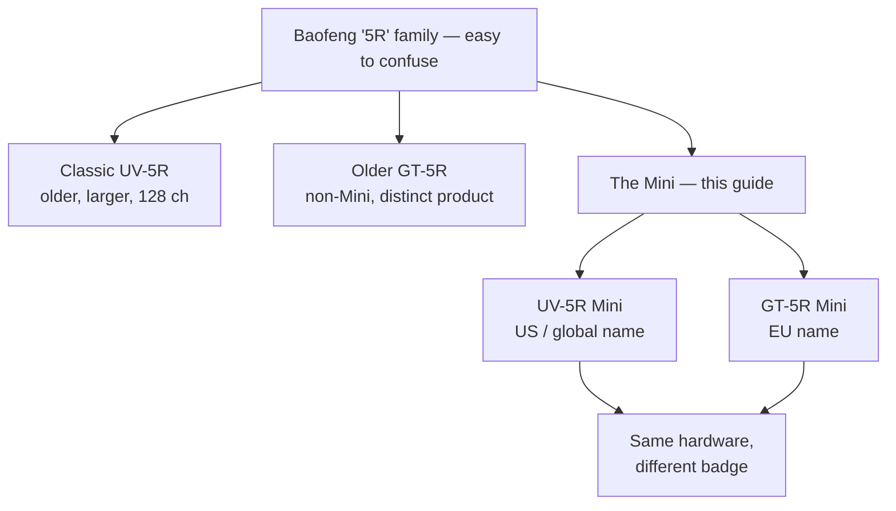
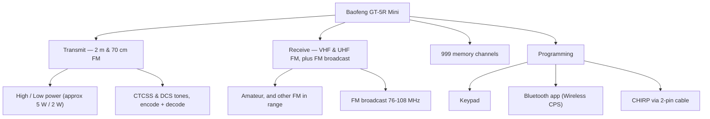
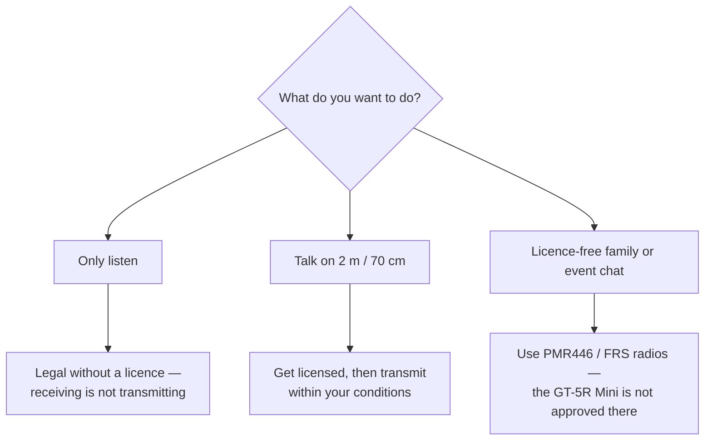

# Why this guide — what the GT-5R Mini really is

The Baofeng GT-5R Mini is one of those radios the internet has an opinion about before you've even switched it on. It is tiny, it is cheap, it charges from the same cable as your phone, and — confusingly — it is sold under two different names in two different markets, with two different sets of frequencies depending on which one you bought. This guide exists to cut through all of that and give you the verified truth: what this radio actually is, what it is not, and how to get the best from it. Where the facts are genuinely unsettled, we say so plainly rather than guess.

## A promise about accuracy

Most write-ups of budget handhelds are a stew of copied spec sheets, and the GT-5R Mini has been mixed up with at least two _other_ Baofeng radios that share part of its name. This guide is reviewed against the model scope, manuals, firmware basis and primary sources shown on its contents page. Where sources genuinely disagree, the text labels that uncertainty and points you to what can be checked on your own unit instead of supplying a tidy guess.

The pay-off reaches beyond one pocket radio. The GT-5R Mini is deliberately simple — two amateur bands, FM voice, a numeric keypad and a couple of side keys. Learn to set a repeater offset, choose a [CTCSS](outpost:entry/logbook73.handbook/repeaters) tone, pick the right bandwidth and run the lowest power that does the job here, and you have learned a working slice of amateur radio itself. Sit down later in front of a rig ten times the price and its menus will already make sense.

## The name game — what "GT-5R Mini" really is

This is the single most important thing to understand, because nearly every online argument about this radio starts from getting it wrong.

The **GT-5R Mini** and the **UV-5R Mini** are the _same radio_. "GT-5R Mini" is the name Baofeng uses for the European market; "UV-5R Mini" is the name for the US and global market. Same chassis, same firmware behaviour, same programming app, same accessory port — one product, two badges. Both the manufacturer and the retailer state this split in as many words, and the printed manual lists both names (alongside several other regional variants like "EU-5R Mini") on its cover. So if a US review of the "UV-5R Mini" tells you something about the hardware, it very probably applies to your GT-5R Mini too — with one big exception we will come to.

Just as importantly, this is **not** the older, non-Mini **GT-5R**, and it is **not** the classic **UV-5R** that has sold in its millions. Those are different, larger, older radios with different chassis, different channel counts and different regulatory paperwork. A great many web pages cheerfully copy the classic UV-5R's specifications onto the Mini. They are wrong to. Everything in this guide is for the _Mini_ specifically.

If you take one thing from this chapter, take this: **the Mini is its own radio, and its two names are the same radio.** Do not lend it the reputation — good or bad — of the classic UV-5R.

## What the GT-5R Mini actually is

At heart the Mini is a **dual-band amateur (ham) handheld transceiver** for the [2 m and 70 cm](outpost:entry/logbook73.handbook/vhf) bands, transmitting in FM (frequency modulation) voice, with a generous **999 memory channels**. "Amateur" is the key word: it is designed and sold as a licensed ham radio, and transmitting with it legally requires an amateur licence from your national regulator (Ofcom in the UK, the FCC in the US, and so on — every country has one).

In the hand it is genuinely small — roughly **108 × 52 × 37 mm** and about **200 g** with its battery, antenna not counted — noticeably more pocketable than the chunky classic UV-5R. It carries a colour LCD screen (the shared hardware uses a 1.44-inch colour display, though the GT-5R Mini's own manual lists it only as "LCD"), a full numeric keypad for typing frequencies and tones directly, a removable lithium-ion battery pack, and a side-key torch. It charges over **USB-C directly on the radio** — no cradle, no dock, and a phone charger or power bank will do the job.

In plain terms:

- **It transmits FM voice on the ham VHF and UHF bands.** Exactly _which_ frequencies it will transmit on depends on your market variant — see the section below, because this is where the two badges genuinely differ.
- **It has two power levels only: High and Low**, advertised as roughly **5 W and 2 W**. There is no medium step. (One independent bench test of the shared hardware measured real output a little under the advertised 5 W; treat the headline figure as optimistic rather than exact.)
- **It selects wide or narrow bandwidth** — **25 kHz or 12.5 kHz** — so you can match the channel spacing a repeater or net expects. More on why this matters in [Modulation](outpost:entry/logbook73.handbook/modulation).
- **It handles CTCSS and DCS tones**, both encode and decode, so it can open tone-protected [repeaters](outpost:entry/logbook73.handbook/repeaters) and ignore traffic not meant for it. (The exact number of tones the Mini offers is not documented in a source we trust, so we will not quote a count.)
- **It does dual watch** — keeping an ear on two frequencies at once — with two independent PTT (push-to-talk) buttons.
- **It has a built-in FM broadcast radio** (the ordinary 76–108 MHz band) on a side key, for music and news when the bands are quiet.
- **You can programme it three ways:** by keypad, over **Bluetooth** using Baofeng's phone app (enabled via a "Wireless CPS" option in the menu), or with the free, open-source **[CHIRP](outpost:entry/logbook73.guide.gt-5r-mini/getting-started)** software over a 2-pin cable. Note that CHIRP lists this radio as **"Baofeng UV-5R Mini"** — its US name — not "GT-5R Mini". One important catch: **the USB-C port charges only. Programming is done over Bluetooth or the 2-pin accessory port, never over USB-C.**

## The one place the two badges disagree: frequency coverage

Here is the exception promised above, and it matters enough to earn its own section. The US-market unit and the EU-market unit **genuinely differ in what they will transmit and receive** — this is not a rumour, the two official documents say different things — so any range must always be quoted _together with the variant it belongs to_.

|              | US / global unit (labelled UV-5R Mini / GT-5R Mini)                    | EU "GT-5R Mini" printed manual                           |
| ------------ | ---------------------------------------------------------------------- | -------------------------------------------------------- |
| **Transmit** | VHF 136–174 MHz, UHF 400–480 MHz                                       | VHF 144–146 MHz, UHF 430–440 MHz (ham-locked)            |
| **Receive**  | Wide: FM broadcast, aviation airband (AM), VHF, UHF, plus NOAA weather | FM broadcast 76–108 MHz only; **no airband, no weather** |

So the US-market unit receives much more widely — you can listen to the aviation airband (receive only, and reviewers rate its airband performance as weak) and, in North America, the NOAA weather channels (manual monitoring only — there are no automatic alerts). The EU "GT-5R Mini" as described by its own manual is a tighter, ham-focused radio: transmit locked to the 2 m and 70 cm allocations, and receive limited to the ham bands plus the ordinary FM broadcast radio.

Which behaviour a _particular_ unit shows appears to depend on the market and firmware it shipped with, and here the sources genuinely conflict: a US review of the wide unit reports it is not band-locked, while the EU manual plainly shows ham-only ranges. **We cannot resolve that for you from the sources, so we won't pretend to** — the honest advice is to check your own radio's coverage on receive and, before you ever transmit, to confirm you are inside the amateur allocations your licence permits.

Those amateur allocations vary by ITU region anyway. The 2 m band is 144–146 MHz in Region 1 (Europe, Africa) and 144–148 MHz in Regions 2 and 3 (the Americas, Asia-Pacific); 70 cm is commonly 430–440 MHz in Region 1 and part of 420–450 MHz elsewhere. Whatever your radio _can_ do, transmit only where your national band plan and licence conditions allow.

## What it is not

Knowing a tool's limits is part of using it well, so here is the honest list:

- **It is not a GMRS, PMR446 or business radio.** It is an _amateur_ radio, full stop. In the US, Baofeng's family-radio (GMRS) equivalent is a _different_ model, the UV-5G Mini — not this one. The GT-5R Mini carries no Part 95 (GMRS) or Part 90 (commercial/land-mobile) approval, and its removable antenna and power level disqualify it from licence-free PMR446 use in Europe. Match the radio to the licence: licence-free family and event chatter belongs on proper PMR446 or FRS radios, not on this.
- **It is not the classic UV-5R, and its reputation is its own.** Please resist copying that radio's famous bench figures — good or bad — onto the Mini. They are different radios and have not been tested identically.
- **It is FM only for voice — no SSB, no CW decode, no shortwave.** Like most handhelds of its class it demodulates FM (and AM on airband _receive_, where fitted), and nothing more. If you want to hear the [HF](outpost:entry/logbook73.handbook/hf) bands or single-sideband, this is the wrong radio.
- **It is a broad, budget receiver, not a fussy one.** Radios in this family reach their low price partly by using simple, wideband front-end filtering, which can let strong nearby transmitters — broadcast, paging, cellular masts — overload the receiver and produce signals that are not really on the frequency you think you are hearing. If a "repeater" appears somewhere odd near a transmitter site, suspect this before you believe it. In everyday pocket use you will rarely notice.
- **Its documentation is thin.** The bundled manual lists features and stops — which is precisely why this guide exists.

There is no published water or dust rating for the Mini, so treat it as an indoor-and-fair-weather radio. And a small honest note on the battery: the majority of sources give the pack as **1600 mAh**, but one retailer listing says **1800 mAh** — so check the label on your own pack rather than trusting a single number.

## A note for experienced operators

If you have been licensed for years, you may wonder why a careful reference should exist for a radio you might never reach for first. Fair — so let us be honest. A budget-class handheld is not a lab-grade radio, and this one shares the broad, lightly filtered front end common to its family, which trades selectivity for coverage and cost. Its transmit is acceptable for amateur use rather than premium, and where independent measurement exists it suggests real power output a touch under the advertised figure. None of that is a scandal; it is the product's design trade-off.

But two things are also true. First, radios like this bring more newcomers _into_ amateur radio than any recruitment drive, and this guide's job is to make sure they arrive understanding what they are doing — transmitting cleanly and legally, tones set right, behaving well on shared channels. Second, the skills transfer: an operator who can explain why you run the lowest power that does the job, or why you set a decode tone as well as an encode tone, is a good operator on any equipment. Wherever this guide makes a recommendation, it leans towards clean, legal, considerate operation — in-band only, lowest sensible power, tones set right, always within your [licence conditions](outpost:entry/logbook73.handbook/getting-licensed).

## A word on the law

Owning the GT-5R Mini is legal almost everywhere; _transmitting_ with it is what needs a licence. Its US regulatory record (FCC ID `2AJGM-5RMINI`) certifies only its receiver and its low-power Bluetooth link under Part 15 — it is explicitly **not** a Part 90 (business) or Part 95 (GMRS) device. Amateur transmitters generally do not require that kind of type-acceptance; your transmission is authorised by _your_ amateur licence, not by a sticker on the radio. Marketing that calls a radio "Part 97 compliant" is describing that posture, not an approval you can lean on.

The practical upshot is simple and universal: get your amateur licence through your national society (the RSGB in the UK, the ARRL in the US, the DARC in Germany, and their equivalents everywhere else — [Getting Licensed](outpost:entry/logbook73.handbook/getting-licensed) explains the idea), then transmit only within the allocations and power your licence grants you. Receiving, by contrast, is legal without a licence almost everywhere — so you can explore what this radio hears while you study.

## A quick safety note

A handheld is a small transmitter held close to your head. Two habits cover almost all of the sensible caution for a radio this size: keep the antenna a few centimetres from your face when you press to talk, and use the lowest power that does the job. One more rule matters for the radio's own health — **never transmit without an antenna fitted.** A transmitter with nowhere to send its power can damage itself; the reasoning is in [SWR](outpost:entry/logbook73.handbook/swr) and [RF Power](outpost:entry/logbook73.handbook/rf-power). That really is the whole of it.

## Try it yourself

You can start learning this radio before you can legally key it up — receiving needs no licence:

1. **Charge it fully over USB-C** from any phone charger, and fit the antenna finger-tight. Note which battery capacity is printed on your pack (1600 or 1800 mAh) — you now know more than most spec sheets.
2. **Find out which variant you have.** Tune the FM broadcast radio (a side key) to confirm it hears 76–108 MHz, then try the aviation airband. If the airband is present, you likely have the wider US-market unit; if not, you have the ham-focused EU coverage. This tells you what to expect for the rest of the guide.
3. **Listen to a local [repeater](outpost:entry/logbook73.handbook/repeaters).** Look up a 2 m or 70 cm repeater near you in LogBook73, type its output frequency straight into the keypad, and listen. You are now hearing the band you will soon be transmitting on.
4. **Read across, not just down.** Keep the [next chapter](outpost:entry/logbook73.guide.gt-5r-mini/getting-started) open as you handle the radio; the layout makes far more sense with the set in your hand.

## Key takeaways

- The **GT-5R Mini and UV-5R Mini are the same radio** — EU and US names for one product — and it is a _distinct, newer_ set from both the older non-Mini GT-5R and the classic UV-5R, whose specs must not be borrowed.
- It is a **licensed amateur** dual-band 2 m / 70 cm **FM** handheld with **999 memories**, USB-C charging, a colour LCD and Bluetooth/CHIRP programming — **not** a GMRS, PMR446 or business radio.
- **Frequency coverage genuinely differs by market:** the US unit transmits VHF 136–174 / UHF 400–480 MHz and receives widely (airband, weather); the EU manual shows a ham-locked VHF 144–146 / UHF 430–440 MHz and FM broadcast only. Always pair a range with its variant, and check your own unit before transmitting.
- **Programming is over Bluetooth or the 2-pin port — never USB-C**, which charges only; CHIRP lists the radio under its US name, "UV-5R Mini".
- A few facts are genuinely unsettled (exact tone counts, battery capacity, whether a given unit is band-locked); this guide **flags them rather than guessing**, and tells you how to check.
- Match the radio to the licence: licensed 2 m/70 cm work is where it shines, licence-free chat belongs on PMR446/FRS, and every transmission stays within your national band plan and licence conditions.

Ready? Let's pick it up and learn our way around it — [Getting Started: Layout, Display & Modes](outpost:entry/logbook73.guide.gt-5r-mini/getting-started).
