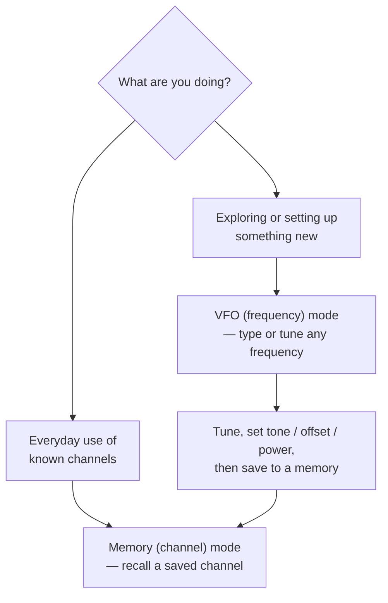
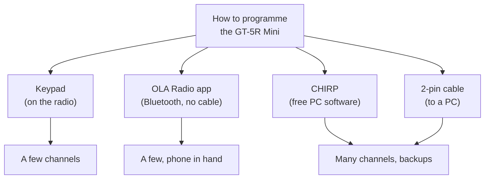
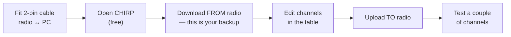

# Getting started: layout, display and modes

The quickest way to fall out with a new radio is to press the wrong button in the first five minutes, land somewhere baffling, and have no idea how to get home. The GT-5R Mini is a small set with a bright screen and a compact keypad, and — like most Baofeng handhelds — its buttons are quiet about what they do. So before we open a single menu, let's get properly oriented: what every control does, what the colour display is telling you, the two or three ideas the whole radio is built around, and the four different ways you can load channels into it. Twenty unhurried minutes here and the rest of this guide will feel obvious.

One thing to settle first, because it saves confusion later. The **GT-5R Mini** is the EU-market name for a radio sold in the US and globally as the **UV-5R Mini** — the _same hardware_, two badges — so "UV-5R Mini" and "GT-5R Mini" point at the same set when you look up manuals, apps or CHIRP entries. It is a distinct, newer radio from the older non-Mini _GT-5R_ and the classic _UV-5R_, so don't borrow their specs. And it is a **licensed amateur (ham) dual-band handheld**: legal to own, but transmitting needs an amateur licence from your national regulator (Ofcom in the UK, the FCC in the US, and so on). More on that in [Why This Guide](outpost:entry/logbook73.guide.gt-5r-mini/overview).

## The front panel

There is not much to the Mini's front panel, and a couple of controls do double duty. Don't try to memorise them; just get a feel for what does what as we walk through them, roughly top to bottom. The names below follow the GT-5R Mini manual's own labels.

1. **Antenna.** A detachable "rubber duck" on a threaded, screw-on connector at the top — finger-tight is enough, and **never transmit without an antenna fitted**, because a transmitter with nowhere to send its power can damage its own output stage. The GT-5R Mini's own manual doesn't print the connector _gender_, but the rest of the 5R family uses **SMA-Female on the radio** (SMA-Male on the antenna), which is the opposite gender to Yaesu, Icom and Kenwood handhelds — so their antennas need an adapter. Confirm the connector on your own unit before buying spares, and make sure any replacement is matched for the intended band; see [Antennas](outpost:entry/logbook73.handbook/antennas).
2. **SK1 — the customisable side key.** The upper side button. It is a user-assignable function key: what a short or long press does depends on how you have set it in the menu, so we'll cover its options in the menu chapters rather than assume a factory default here.
3. **PTT-A and PTT-B — dual push-to-talk.** The Mini has **two transmit buttons** on the side, one for each of its two frequency segments. Hold **PTT-A** and the radio transmits on **segment A** (the upper line on the screen); hold **PTT-B** and it transmits on **segment B** (the lower line). This is unusual and genuinely handy — no fiddling with an A/B selector before you key up. Build two habits from day one: run the **lowest power that does the job** (see [RF Power](outpost:entry/logbook73.handbook/rf-power)), and keep the antenna a few centimetres from your face while transmitting. Transmit only where your [licence](outpost:entry/logbook73.handbook/getting-licensed) permits.
4. **Flashlight.** A small white torch, toggled from the radio rather than a menu. Handy in a dark shack or footwell; it draws from the same battery that runs the radio, so treat it as a torch of convenience, not a survival tool.
5. **LED indicator.** A small light that signals radio state — it shows when you are transmitting and when a signal is being received. A glance at it confirms the PTT has actually taken.
6. **Colour LCD.** The Mini uses a small **1.44-inch colour screen** — a step up from the old UV-5R's two-line monochrome. It shows both frequency segments at once, wrapped in status tags. It rewards a proper read, so it gets its own section next.
7. **OK/Menu button.** Opens the menu and **confirms** a choice — the "yes" key.
8. **Cancel/Back button.** Steps back out of the menu, clears a half-typed entry, and is your escape hatch when you are lost.
9. **V/M (VFO/Memory) switch.** Swaps between **frequency (VFO) mode** — where you dial any frequency by hand — and **memory (channel) mode**, where you recall channels you saved earlier. It is the single most important key to understand, and it has its own section below.
10. **Up/Down navigation buttons.** Scroll the menu, tune the active segment, and change values.
11. **A/B side key.** Chooses which segment — A (upper) or B (lower) — is the _active_ one for menu edits and tuning. (With the dual PTT you also pick which segment to _transmit_ on simply by choosing PTT-A or PTT-B.)
12. **Numeric keypad (0–9, ✳, #).** In VFO mode, **type a frequency directly** — far quicker than winding the arrows. In memory mode, the number keys help you jump to channel numbers, and they send DTMF touch-tones on transmit. **Press and hold ✳ to lock the keypad** (a padlock icon appears); hold it again to unlock. The small extra words printed above some keys are menu shortcuts we'll meet in the reference.
13. **Volume/Power knob.** The top knob switches the radio on with a click and sets the volume — clockwise for on and louder, anticlockwise to the click for off. There is no separate power button; the click _is_ the on/off.
14. **Microphone, battery latch, and USB-C port.** The mic sits low on the front; the battery releases with a latch on the back; and a **USB-C port with its own charging-indicator light** lives on the body. That USB-C port is covered in its own section — it matters more than it looks.

> **The single most useful habit:** when you get lost, press **Cancel/Back** a couple of times. It walks you back to the standby screen without changing anything. There is no menu so deep you cannot escape it.

## Understanding the display

The standby screen looks busy because it is showing you two radios at once — segment A on top, segment B below — each ringed with little status tags. Learn the anatomy of one segment and you have learned both. The Mini's colour screen labels these more legibly than the old monochrome sets did, though the exact icon set can vary slightly between firmware versions, so treat the figure below as a guide and confirm the details against your own unit.

```viz
{
  "type": "display",
  "title": "GT-5R Mini — the standby display",
  "caption": "Two frequency segments, A (upper) and B (lower). Each carries its own tags — power, bandwidth, tone and, in memory mode, a channel number. Choose which to transmit on with PTT-A or PTT-B.",
  "screen": {
    "rows": [
      { "vfo": "A", "freq": "434.325", "power": "H", "bw": "N", "shift": "+", "tone": "CT", "active": true },
      { "vfo": "B", "freq": "145.500", "power": "L", "bw": "W", "tone": "DCS" }
    ],
    "topIcons": ["BT", "S", "|III|"],
    "bottomTags": ["VOX"]
  },
  "callouts": [
    { "n": 1, "x": 12, "y": 3, "label": "Status icons", "side": "left" },
    { "n": 2, "x": 6, "y": 16, "label": "Segment A / B", "side": "left" },
    { "n": 3, "x": 38, "y": 16, "label": "Frequency", "side": "left" },
    { "n": 4, "x": 90, "y": 16, "label": "Line tags", "side": "right" },
    { "n": 5, "x": 10, "y": 33, "label": "Sub-tone: CT / DCS", "side": "left" },
    { "n": 6, "x": 90, "y": 33, "label": "Channel number (memory)", "side": "right" },
    { "n": 7, "x": 92, "y": 3, "label": "Battery gauge", "side": "right" }
  ]
}
```

1. **Status icons** run along the top and appear only when a feature is active: a **signal-strength** bar when a station is breaking squelch; a marker when **dual watch** is running; a **Bluetooth** icon once you've switched on wireless programming; a **padlock** when the keypad is locked; and a `VOX` tag when hands-free transmit is armed. If the radio is misbehaving, this strip usually explains why.
2. **The two segments, A and B.** The top line is segment A, the bottom line segment B. Remember: **PTT-A transmits on A, PTT-B transmits on B**, and the `A/B` key sets which one your menu edits and tuning apply to.
3. **The frequency** is the big number on each segment. In VFO mode you can overtype it from the keypad; in memory mode it shows the frequency stored in the current channel.
4. **The line tags** sit around each frequency: a **power** marker (High/Low), a **bandwidth** marker (**W** wide / **N** narrow), and a **duplex-shift** marker (`+` or `−`) that appears when the segment is set up for a [repeater](outpost:entry/logbook73.handbook/repeaters). These save you diving into menus to check how a segment is configured.
5. **The sub-tone tag** shows `CT` when a **CTCSS** analogue tone is active, or `DCS` for a digital code — the quiet sub-audible tones that keep your speaker silent until the right station calls. A whole topic of their own, later.
6. **The channel number** appears in **memory mode** — the slot you are sitting on. In VFO mode this space is blank, because you're on a raw frequency, not a stored channel.
7. **The battery gauge** sits top-right — segmented bars are your fuel gauge; top up when it drops to one.

## VFO and memory: the two ways to tune

Almost everything on this radio hangs off one basic question: are you **dialling a frequency by hand**, or **recalling one you saved earlier**? Those are the two **modes**, and the `V/M` key swaps between them.



**VFO (frequency) mode** — the screen shows raw frequencies with no channel number — gives you the whole band to roam. Type a frequency on the keypad or step it with the arrows, and the radio goes there. This is where you _set things up_: find a repeater, add its offset and tone, pick a power level, then store the lot into a memory so you never do it again.

**Memory (channel) mode** — a channel number appears — recalls those stored channels. A memory is not just a frequency: one recall restores the frequency, the duplex offset, the CTCSS/DCS tones, the bandwidth, the power level and (if you named it in software) a label. The Mini holds a generous **999 memory channels**, so there is plenty of room to be tidy. This is where you live day to day — step to your local repeater and everything is already correct.

Two things trip people up, and both are worth reading twice. First, **memory mode is empty until you store at least one channel** — a brand-new Mini has nothing to recall, so pressing `V/M` may look as if it does nothing. Store a channel and it springs to life. Second, **you cannot freely re-tune a memory channel in place.** A memory is a saved snapshot; to change its frequency or tone you go back to VFO mode, make the change there, and save over the channel.

## A and B: dual watch and dual PTT

The two segments behave like two little independent radios sharing one speaker, one antenna and one battery. Each has its own frequency, its own band, its own tone and its own power level. The Mini's twist is the **dual PTT**: you don't have to make one "active" before transmitting — press **PTT-A** to talk on A, **PTT-B** to talk on B. That removes the classic Baofeng trap of keying up on the wrong segment.

For _listening_, the feature you want is **dual watch** (the manual's **Dual Watch** menu item), which keeps an ear on **both** segments at once, hopping between them so it catches a call on either. It is not true simultaneous reception — when one segment is busy, the other is briefly deaf — but for everyday monitoring it is exactly right. Park A on your local [repeater](outpost:entry/logbook73.handbook/repeaters) and B on the 2 m calling channel `145.500 MHz`, switch on dual watch, and you'll hear whichever comes alive. Because the Mini has separate PTT-A and PTT-B buttons, replying on the correct segment is then simply a matter of pressing the matching button.

## USB-C charging — and why you still can't programme over it

The Mini charges over **USB-C, directly on the radio** — no drop-in cradle or dock needed. Any decent phone charger or power bank will do the job; the small light by the USB-C port shows charging status. This is a real convenience over the old cradle-charged handhelds: top it up from the same lead as your phone.

Here is the catch that surprises almost everyone: **the USB-C port is for charging only — you cannot programme the radio through it.** Data programming goes over Bluetooth or over the separate 2-pin accessory port (next section). It's an easy assumption to make and an easy hour to waste, so it's worth stating plainly.

A brief, non-alarmist safety note while we're on power: the battery is a removable lithium-ion pack (nominal DC 7.4 V). Charge it from a reputable USB source, don't leave it charging unattended overnight, and if a pack ever swells, gets hot, or is physically damaged, retire it. Cross-checked sources put the pack at around **1600 mAh**, though at least one retailer listing quotes 1800 mAh — check the label on your own pack rather than trusting a spec table.

## First power-on

With a charged battery clipped in and the antenna screwed finger-tight:

1. **Turn the top knob clockwise** past the click — the radio wakes and the screen lights.
2. **Set a comfortable volume** with that same knob.
3. If the audio is silent, that's normal — the squelch is muting the hiss until a signal arrives. You can prove the receiver is alive by opening the squelch from the menu, which we'll do in _Try it yourself_ below.

That is genuinely all there is to it: one knob, one click.

## Four ways to programme it

You can load channels into the Mini **four** ways, and which is right depends mostly on **how many** channels you need and what you have to hand.



### 1. By keypad, on the radio

Fine for a handful — your two local repeaters and a couple of simplex frequencies. Tune the frequency in VFO mode, set the offset and tone and power, then store it to a channel number. It's worth doing once so you understand what a memory contains, but be honest: hand-programming any Baofeng is tedious — multi-tap entry, a menu step for every field, and no list view. The exact menu index for the "store to memory" step can differ by firmware, so read it off your own menu (covered in [Menu Reference](outpost:entry/logbook73.guide.gt-5r-mini/menu-reference)) rather than trusting a number from the internet.

### 2. By phone, over Bluetooth (OLA Radio app)

This is the Mini's headline trick: **wireless programming with no cable at all.** The manufacturer's app is **OLA Radio** (shown in some documentation as the "baofengradio app"), free on both the Apple App Store and Google Play. The workflow:

- On the radio, open the menu and switch on **Wireless CPS** (CPS = "Customer Programming Software"). It's usually off by default to save battery, so this step is essential — once on, a Bluetooth icon appears on the display.
- In the app, allow Bluetooth (and location, which Android requires for Bluetooth scanning), select the Baofeng brand and the **5R Mini series**, and connect.
- Edit channels and settings in the app, then write them back to the radio.

Great for tweaks from the sofa; a full-size keyboard is still faster for a big channel list, which is what the next two options give you.

### 3. By CHIRP (free computer software)

**CHIRP** is the free, open-source programming tool that experienced owners reach for — it runs on Windows, macOS and Linux, and treats your radio like a spreadsheet: each row a channel, each column a field (frequency, offset, tone, power, name). Write the whole table in one pass and what takes an afternoon on the keypad takes five minutes. One important detail: in CHIRP's model list, **select "Baofeng UV-5R MINI"** — that's the correct driver for this hardware (remember, same set as the GT-5R Mini). Use a current CHIRP Next build, as the Mini driver was refined over time. CHIRP talks to the radio through the 2-pin cable below.

### 4. By 2-pin programming cable

CHIRP (and the desktop CPS) need a physical link, and that link is a **2-pin Kenwood-style ("K1") programming cable** — a lead with two plugs (3.5 mm + 2.5 mm) that go into the radio's accessory jack under a rubber flap, and a USB-A plug for the computer. Note this is the **2-pin accessory port, not the USB-C port** and **not** the antenna connector. A genuine cable (CH340 or PL2303 chipset) is driverless on modern operating systems; the market is full of counterfeit leads whose chips confuse the driver, so a known-good cable saves real frustration.



Whichever software route you take, one rule stands above the rest: **download from the radio first and keep that file.** It is your backup — a fumbled setting or a factory reset then costs you nothing, because you can write the good copy straight back. With 999 slots to fill, a little planning pays off too: group channels sensibly (repeaters together, simplex together, licence-free channels like PMR446 or FRS together — name both, since they differ by region) and label them, so the list stays navigable. Ready-made channel plans to copy live in [Ready-made Configurations](outpost:entry/logbook73.guide.gt-5r-mini/configs).

## A note on what your unit can receive and transmit

One honest wrinkle worth flagging now, because it shapes everything later: the **TX and RX ranges genuinely differ between market variants.** The US/global unit (badged UV-5R Mini) transmits roughly VHF 136–174 MHz and UHF 400–480 MHz with wide receive including FM broadcast, airband and weather channels. The EU "GT-5R Mini" printed manual instead shows the set **locked to the amateur bands** (VHF 144–146 MHz, UHF 430–440 MHz) with FM broadcast receive only and no airband. Sources disagree on exactly how locked a given unit is, so **check what your own radio actually tunes**, and transmit only within your licence conditions and national band plan. We'll return to this in [Why This Guide](outpost:entry/logbook73.guide.gt-5r-mini/overview).

## Try it yourself

With a charged battery and the antenna fitted finger-tight:

1. **Power on and set the volume** with the top knob. If it's silent, that's the squelch doing its job.
2. **Prove the receiver works.** Open the menu, find the squelch setting, and step it down to `0` — the background hiss you now hear is the receiver actually listening. Step it back up and the hiss vanishes. You've just felt what squelch does; the _why_ is in [What the Settings Really Mean](outpost:entry/logbook73.guide.gt-5r-mini/theory).
3. **Go to VFO mode** (press `V/M` until the channel number disappears), tune segment A to the 2 m band and **type `145500`** — the 2 m FM calling channel in ITU Region 1 (Europe/Africa; it's `146.520 MHz` in the Americas, Region 2). Listen at a busy time.
4. **Give the two segments two jobs.** Set A to your nearest repeater's output and B to your local calling channel, switch on **dual watch**, and let it hop between them. Then practise the dual PTT: press **PTT-A**, then **PTT-B**, and watch which segment you'd be transmitting on.
5. **Try wireless programming.** Switch on **Wireless CPS** in the menu, install **OLA Radio** on your phone, and connect over Bluetooth — even if you only look around, you'll see how the channel list works.

Nothing here can harm the radio, and Cancel/Back always brings you home.

## Key takeaways

- The **GT-5R Mini** and **UV-5R Mini** are the same hardware under two names — and both are distinct from the older GT-5R and classic UV-5R. It's a **licensed amateur handheld**: transmitting needs a licence from your national regulator.
- The top **knob** does on/off and volume; the Mini has **two transmit buttons — PTT-A and PTT-B** — so you pick which segment to talk on directly, no A/B juggling.
- The **1.44-inch colour screen** shows two segments (A upper, B lower) with their own power, bandwidth, tone and channel tags; a Bluetooth icon confirms wireless programming is enabled.
- **VFO mode** dials any frequency (for setting up); **memory mode** recalls saved channels (up to **999** of them). Memory mode needs at least one stored channel, and you re-tune a channel by editing in VFO mode and saving over it.
- **USB-C is charging only** — you programme the radio over Bluetooth or the separate **2-pin accessory port**, never over USB-C.
- There are **four ways to programme it**: the keypad, the **OLA Radio** phone app over Bluetooth (enable **Wireless CPS** first), **CHIRP** on a computer (select the "Baofeng UV-5R MINI" driver), and a **2-pin K1 cable** — and whichever software route you use, **download a backup from the radio first**.
- **TX/RX ranges differ by variant** — check what your own unit tunes, and transmit only within your licence and band plan.

Now that you can find your way around, we can start decoding the settings themselves — beginning with the full map in [Menu Reference](outpost:entry/logbook73.guide.gt-5r-mini/menu-reference).
