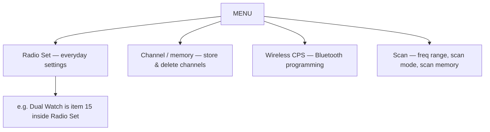

# Menu reference — documented options at a glance

The classic Baofeng UV-5R hid every setting behind a flat list of forty-one numbered codes, and half the internet still assumes the Mini works the same way. It does not. The GT-5R Mini — the EU-market name for the radio sold as the **UV-5R Mini** everywhere else, the same hardware under two labels — replaces that long numbered list with a smaller set of **grouped, icon-style menus** you step into and out of. This page is the map for that newer layout: the groups, the settings we can confirm from the official manual, a one-line job for each and a sensible starting value — and an honest note wherever the manual leaves something unstated.

## How to read this page

Use it two ways. As a **quick reminder** when a cryptic label on the screen has you stumped, and as an **index** into the two deep-dive chapters, where every setting worth explaining gets the full treatment: what it does, what the radio is doing inside, why the feature exists, sensible values and the mistakes people make.

The **Start with** column is a starting point, not gospel — a "if in doubt, this" — and every recommendation carries a one-glance verdict:

| Symbol | Meaning                                                    |
| ------ | ---------------------------------------------------------- |
| ✅     | Set it like this and forget it — right for almost everyone |
| ⭐     | Genuinely useful, depending on how you operate             |
| ⚠️     | Advanced — understand it before you enable it              |
| ❌     | Leave it off unless you have a specific reason             |

Where a cell says "taste", "as needed" or "match the repeater", the honest answer is that there is no universal right value — the linked chapter explains how to choose. Recommendations lean towards common amateur practice on the 2 m and 70 cm bands; the underlying reasoning is universal, so wherever you are, take the concept and check your national band plan and licence conditions.

## The Mini's menu is nested, not a flat list of 41

This is the single most important thing to understand before you start pressing buttons, because it is where most out-of-date advice goes wrong. On the older UV-5R every setting was one item in a single numbered run from `0` to `40`. The Mini instead presents a **short set of top-level groups** — think of them as folders — and each group holds its own numbered list of settings inside it. You press `MENU`, choose a group, then step through the settings within.

From the official manual we can confirm these top-level groups:



A worked example makes the nesting concrete: to reach **Dual Watch**, the manual's own path is `MENU` → `2` (Radio Set) → then step to **item 15** inside that group. So a setting has _two_ coordinates now — which group it lives in, and its number within that group — not a single 0–40 index.

**An honest limit up front.** Because the layout is grouped and partly icon-driven, there is no single published table that lists every item with a guaranteed number, and the old "41 items" count simply does not apply to this radio. The manual documents the groups and many individual settings, but it presents them as procedures scattered through the operating section rather than as one master list. So on this page you will see an exact group-and-number **only where the manual states it**; everywhere else a setting is listed by its name and job, and you should read the precise number off your own unit. Firmware revisions can also renumber items, which is another reason to trust the name over a memorised number.

## Driving the menu

Just a few keys drive the whole thing, and the rhythm is the same for every setting:

- **`MENU`** opens the menu, dives into a highlighted group or item, and — pressed once more on a value — **saves** your choice. (The radio even speaks "Menu" as you press it; `MENU` doubles as the Enter key.)
- **`▲` / `▼`** (or the **rotary encoder**, if your unit has one) step through groups, through the items in a group, and through an item's values once you are inside it.
- **`EXIT`** backs out one level and cancels a change you have not yet saved.


There is a faster path than scrolling: after `MENU`, **key the numbers straight in**. The manual's own shortcuts read like this — `MENU` `2` jumps into Radio Set, and a store-to-memory runs as `MENU` `3` … then the memory item. Crucially, **nothing commits until you press `MENU` on the value**, so you can wander through every group and read what is there without changing a thing — a calm way to learn the radio on a wet afternoon. Walk away and the menu times out on its own.

Two behaviours are worth knowing before you start, because between them they cause most "why won't this change?" confusion:

- **Memory channels are frozen snapshots.** A stored channel keeps its own tones, bandwidth, power and offset as saved. To change most of those you edit them in **VFO (frequency) mode** and store the channel again; you cannot freely rewrite them from within a memory. If VFO versus memory mode is new to you, [Getting Started](outpost:entry/logbook73.guide.gt-5r-mini/getting-started) walks through both.
- **The fastest way to load channels is a computer.** The Mini reads and writes in **CHIRP** (choose the "Baofeng UV-5R MINI" driver — a distinct entry, not the classic "UV-5R"), and it also pairs to Baofeng's phone app over **Bluetooth** once you switch **Wireless CPS** on. Loading a hundred repeaters by keypad is a chore; loading them from a CSV is a minute's work. See [The Menu in Depth](outpost:entry/logbook73.guide.gt-5r-mini/menus-2) for the programming routes.

## Understanding the on-screen indicators

Half of "reading the menu" is really reading the standby screen — the little tags that tell you what the current settings actually are. These are the ones you will meet most:

```viz
{
  "type": "display",
  "title": "The everyday indicators on the Mini's screen",
  "caption": "Each tag reflects a setting; learn the tags and you can read your configuration at a glance.",
  "screen": {
    "rows": [
      { "freq": "145.500", "vfo": "A", "power": "H", "bw": "N", "shift": "+", "tone": "CT", "mode": "FM", "active": true },
      { "freq": "433.400", "vfo": "B", "power": "L", "bw": "N", "tone": "DCS", "mode": "FM" }
    ],
    "topIcons": ["BT", "100%"],
    "bottomTags": ["VOX", "DW"]
  },
  "callouts": [
    { "n": 1, "x": 8, "y": 18, "label": "VFO A / B — the two receivers", "side": "left" },
    { "n": 2, "x": 62, "y": 18, "label": "H / L — transmit power", "side": "right" },
    { "n": 3, "x": 78, "y": 18, "label": "W / N — wide or narrow", "side": "right" },
    { "n": 4, "x": 40, "y": 40, "label": "CT / DCS — a sub-tone is set", "side": "left" },
    { "n": 5, "x": 20, "y": 4, "label": "BT — Bluetooth is on", "side": "left" },
    { "n": 6, "x": 30, "y": 92, "label": "DW — dual watch active", "side": "left" }
  ]
}
```

If a tag on your screen does not match what you expect — narrow when you wanted wide, a stray `CT` you did not set — that is your cue to dive into the relevant menu below.

## Find a setting by what you want to do

If you know the _job_ but not where it lives, start here, then read the item's full entry in the linked chapter.

| I want to…                        | Look at                                            |
| --------------------------------- | -------------------------------------------------- |
| Quiet the background hiss         | Squelch                                            |
| Turn the transmit power down      | Transmit power (High / Low)                        |
| Match a narrow (12.5 kHz) channel | Bandwidth (W/N)                                    |
| Set up a repeater                 | Shift direction, Offset, TX CTCSS / TX DCS         |
| Only hear my own group            | RX CTCSS / RX DCS                                  |
| Transmit hands-free               | VOX switch (Radio Set 4) + VOX level (Radio Set 5) |
| Watch two frequencies at once     | Dual Watch (Radio Set 15)                          |
| Store or tidy a memory            | Store channel / Delete channel (Channel group)     |
| Programme from a phone            | Wireless CPS (Bluetooth)                           |
| Assign the side key               | SK1 assignment                                     |
| Start again from factory defaults | Reset (VFO / All)                                  |

## The settings, group by group

Only settings confirmed from the manual are listed. Where the manual states an exact location, it appears in the name as _(group → number)_; where it does not, the setting is listed by name alone — read the number from your unit.

### Everyday settings

| Setting                       | What it does                                                          | Start with               |
| ----------------------------- | --------------------------------------------------------------------- | ------------------------ |
| Squelch                       | Mutes the hiss until a signal is strong enough to cross the threshold | ✅ around 3–5 (see note) |
| Transmit power                | High (advertised ~5 W) or Low (~2 W) — there is no middle step        | ⭐ Low where it reaches  |
| Bandwidth (W/N)               | Wide 25 kHz or narrow 12.5 kHz FM deviation for the current channel   | ✅ match the channel     |
| Step                          | How far the frequency moves per encoder click or arrow press          | ✅ 12.5 kHz for ham      |
| Dual Watch _(Radio Set → 15)_ | Keep an ear on both VFOs (A and B) and receive on whichever wakes up  | ⭐ On                    |
| Backlight timeout             | How long the screen light stays on after a key-press                  | ⭐ a few seconds         |
| Key beep                      | The confirmation chirp on each key-press                              | ✅ On (taste)            |

_Note on squelch:_ the setting exists and behaves as above, but the exact numeric range is not spelled out for the Mini in the manual — set it just high enough to silence the hiss and no higher, and read your unit's range off the screen.

### Tones — repeaters and quiet channels

The Mini does full **CTCSS** (an inaudible analogue sub-tone) and **DCS** (a digital squelch code), each **encode and decode** — that is, both sending on transmit and gating your receiver. The exact number of available tones and codes is not confirmed in the Mini's manual, so match whatever your repeater or group specifies rather than counting.

| Setting  | What it does                                                          | Start with         |
| -------- | --------------------------------------------------------------------- | ------------------ |
| RX CTCSS | Only open the squelch for a matching analogue sub-tone                | ⭐ shared channels |
| RX DCS   | Only open the squelch for a matching digital code                     | ⭐ shared channels |
| TX CTCSS | Send an analogue CTCSS sub-tone on transmit (e.g. to open a repeater) | match the repeater |
| TX DCS   | Send a digital sub-tone on transmit                                   | match the repeater |

### Voice, hands-free and IDs

| Setting                      | What it does                                              | Start with           |
| ---------------------------- | --------------------------------------------------------- | -------------------- |
| VOX switch _(Radio Set → 4)_ | Transmit hands-free when the radio hears your voice       | ❌ Off               |
| VOX level _(Radio Set → 5)_  | Voice-trigger sensitivity, 1–9                            | ⚠️ 3–5 if you use it |
| VOX delay                    | How long the transmitter hangs on after you stop speaking | ⭐ short             |
| Voice prompts                | Speaks menu actions aloud as you press keys               | ❌ Off (taste)       |
| Language                     | Sets the spoken-prompt language                           | ✅ your language     |
| Roger beep                   | A short "over" tone at the end of each transmission       | ❌ Off               |
| PTT delay                    | A brief pause before any ID/DTMF is sent after you key up | ✅ default           |
| SK1 assignment               | What the side key does — e.g. FM radio, monitor, torch    | ⭐ assign usefully   |

### Repeaters and duplex

Two of these are not menu items at all but key actions, and the manual is explicit about them — worth knowing because they trip people up:

| Control           | What it does                                                             | How                              |
| ----------------- | ------------------------------------------------------------------------ | -------------------------------- |
| Shift direction   | Sets the duplex offset direction for a repeater (none / + / −)           | menu                             |
| Offset            | Sets the size of the duplex shift, in MHz                                | menu — match your band plan      |
| Reverse frequency | Swaps TX and RX to hear the repeater's input directly (shows `R`)        | short-press `*` in repeater mode |
| Talk-around       | Transmit on the output frequency to work simplex through a repeater pair | `*` toggles the `T` / `R` icon   |
| 1750 Hz toneburst | Opens repeaters that need a tone burst rather than CTCSS                 | hold `PTT`, then tap `SK1`       |

The 1750 Hz burst matters chiefly in parts of Europe and on some older machines; [Repeaters](outpost:entry/logbook73.handbook/repeaters) explains where you still meet it, and how CTCSS tone access has largely taken over.

### Scan and memory

| Setting                | What it does                                                  | Start with      |
| ---------------------- | ------------------------------------------------------------- | --------------- |
| Freq range (scan)      | The lower and upper frequencies a VFO scan sweeps between     | ⭐ as needed    |
| Scan mode              | How a scan resumes when it stops on a signal                  | ⚠️ see note     |
| Scan memory (add/skip) | Include or skip a channel in memory scans                     | ⭐ housekeeping |
| Store channel          | Save the current VFO setup into a numbered memory (up to 999) | ✅ as needed    |
| Delete channel         | Remove a stored memory                                        | ⭐ housekeeping |

_Note on scan mode:_ the resume behaviour (timer-based, carrier-based, or search-and-hold) is not fully documented for the Mini — try each and keep the one that suits you.

### Housekeeping and safety

| Setting              | What it does                                                      | Start with            |
| -------------------- | ----------------------------------------------------------------- | --------------------- |
| Time-out timer (TOT) | Cuts a transmission that runs on too long — a stuck-PTT safeguard | ⭐ a few minutes      |
| Time-out alarm (TOA) | Warns you shortly before the time-out timer fires                 | ⭐ short              |
| Auto lock            | Locks the keypad after a spell with no key-presses                | ⭐ On                 |
| Power-on message     | The boot screen — a full display or your own welcome text/image   | taste                 |
| Wireless CPS         | Turns Bluetooth on so the phone app can pair and programme        | ❌ Off unless pairing |
| Reset                | Restore defaults — VFO settings only, or everything               | ⚠️ keep a backup      |

## A few honest notes before you dive in

- **Two power levels, not three.** Transmit power is only High (advertised ~5 W) or Low (~2 W) — there is no medium step. Run Low whenever it reaches the other station; it is easier on the battery and kinder to the band. [RF Power](outpost:entry/logbook73.handbook/rf-power) explains why lowest-that-works is good manners as well as good sense.
- **Programming is not over USB-C.** The Mini's USB-C port charges the radio and nothing else. To programme by cable you use the small **2-pin Kenwood-style accessory jack**; to programme wirelessly you enable **Wireless CPS** and pair the app. Do not go hunting for a data mode on the USB-C socket — there isn't one.
- **What the radio can _receive_ depends on the variant.** The US/global unit adds broad receive — FM broadcast, the aviation band and NOAA weather — while the EU "GT-5R Mini" printed manual describes a ham-locked set with FM broadcast only and no airband or weather. The FM broadcast receiver (roughly 76–108 MHz) is common to both. State any range together with the variant it belongs to — [Why This Guide](outpost:entry/logbook73.guide.gt-5r-mini/overview) sets out the split in full.
- **Numbers can shift with firmware.** Where this page gives an exact item number, it is the number the manual states — but a firmware update can renumber a group. Trust the name and the job over a memorised digit, and glance at the screen to confirm.

## A short word on safety

The Mini transmits up to about 5 watts from an antenna a hand's-width from your face. That is low power, and normal handheld use is well within accepted [RF exposure](outpost:entry/logbook73.handbook/rf-safety) guidance — but two easy habits are worth forming: hold the radio so the antenna is a little away from your eyes rather than pressed against your cheek, and never transmit with the antenna removed, which stresses the final stage. Running **Low** power whenever it reaches, as the menu lets you, keeps exposure lower still and the battery happier.

## Try it yourself

- **Take the no-risk tour.** From standby, press `MENU` and step through every group and item with `▲`/`▼` or the encoder, reading each label — but **do not press `MENU` on any value**, so nothing changes. You will learn the layout in five minutes and can back out with `EXIT`.
- **Set the five that matter.** Squelch to a value that just silences the hiss; transmit power to Low; bandwidth to match a channel you use; Dual Watch on; the time-out timer to a couple of minutes. Log the "before" and "after" in your LogBook73 station notes so you can retrace your steps.
- **Read your own screen.** Compare the tags on your standby display to the indicator figure above and name each one aloud. If a `CT`, `DCS` or `N` is showing that you did not set, track down the menu item that put it there — that is the whole skill this chapter teaches.
- **Prove the shortcut.** Enter Radio Set with `MENU` `2`, then find Dual Watch at item 15. Feeling the two-coordinate nesting once makes every other setting easy to find.

## Key takeaways

- The GT-5R Mini (the EU name for the **UV-5R Mini**) uses a **nested, grouped menu** — top-level groups like Radio Set, Channel, Wireless CPS and Scan — **not** the classic UV-5R's flat 41-item list, so a setting has a _group_ and a _number within it_.
- Drive it with **`MENU` → pick a group → `MENU` → change value → `MENU` to save**, with `EXIT` to back out; nothing commits until you confirm, and keying the number is faster than scrolling.
- We list only settings confirmed from the manual, with an exact location **only where the manual states it** (e.g. VOX switch is Radio Set 4, VOX level is 5, Dual Watch is 15); elsewhere find the number on your unit, as firmware can renumber items.
- A few things the older-radio advice gets wrong here: **no medium power step**, **no programming over USB-C** (use the 2-pin jack or Bluetooth), and **receive coverage that depends on the market variant**.
- The five worth burning into memory: **squelch just above the hiss, power Low, bandwidth to match the channel, Dual Watch on, and a sensible time-out timer**.

Ready for the detail? Start with the everyday settings in [The Menu in Depth, Part 1](outpost:entry/logbook73.guide.gt-5r-mini/menus-1).
