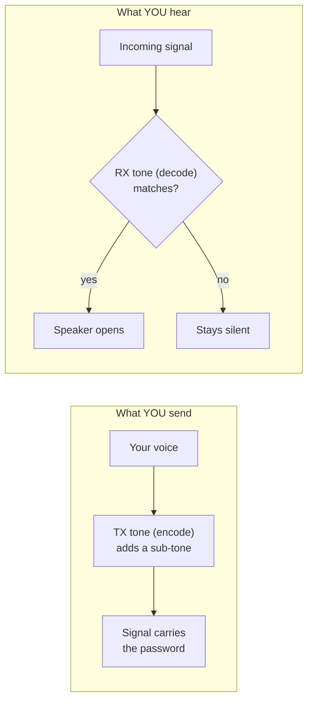

# The menu in depth, part 1

The GT-5R Mini does not hide its settings behind one long numbered list the way the older Baofengs do. Instead it groups them — you press **MENU**, drop into a named group such as **Radio Set**, and pick an item inside it. That is friendlier once you know the map, and baffling until you do. This chapter decodes the half of that map you touch day to day: squelch, tuning step, transmit power, the battery question, VOX, bandwidth, dual-watch, and the sub-tones that open repeaters. For each substantial item we answer what the on-screen label never spells out — what it does, what is happening inside, why the feature exists, sensible values, a recommendation, a worked example, the common mistakes, and whether to change it at all.

You met the mechanics in [Getting Started](outpost:entry/logbook73.guide.gt-5r-mini/getting-started): press **MENU**, step through with **▲/▼** (or type a group's shortcut number), **MENU** to open an item, arrows to change the value, **MENU** to save, **EXIT** to back out. Nothing in this chapter can harm the radio. This is the first of two reference chapters; [The Menu in Depth, Part 2](outpost:entry/logbook73.guide.gt-5r-mini/menus-2) covers display, memory, alarm and repeater housekeeping, and the one-line list of everything lives in [Menu Reference](outpost:entry/logbook73.guide.gt-5r-mini/menu-reference).

## A word about menu numbers on this radio

The classic Baofeng menu — a flat list from `0 SQL` to `40` — belongs to the **older UV-5R**, not to this set. The Mini (sold as **GT-5R Mini** in Europe and **UV-5R Mini** in the US and globally — the same hardware under two names) uses a **grouped, icon-style menu**. Some items sit two levels down: VOX, for example, is reached with `MENU` `2` (the **Radio Set** group) and then item `4` to switch it on and item `5` to set its level. Baofeng's printed documentation for the Mini is thin, and firmware revisions have shuffled labels, so **the real reference is your own screen**. Throughout this chapter we name each setting by its function and its values, give the menu path where the manual confirms it, and — where the exact position is not documented — tell you plainly to read it off your unit rather than invent a number. That honesty is the whole point of this guide.

## How to read these pages

Each substantial item carries a one-glance verdict:

| Symbol | Meaning                                                    |
| ------ | ---------------------------------------------------------- |
| ✅     | Set it like this and forget it — right for almost everyone |
| ⭐     | Genuinely useful, depending on how you operate             |
| ⚠️     | Advanced — understand it before you enable it              |
| ❌     | Leave it off unless you have a specific reason             |

Two honesty notes. The Mini is a sensitive little receiver, but like its larger cousins its squelch is coarse and its front end has modest filtering, so a couple of settings are really about managing those limits. And a few signalling items are only fully editable from a PC with [CHIRP](https://chirpmyradio.com) or the phone app — on the radio you can often select but not compose them.


## The everyday four: squelch, step, power and the battery question

### Squelch — the hiss gate — ✅ a low-to-middle setting

The control that silences the background hiss when no one is talking.

- **Does:** sets how strong a signal must be before the speaker opens. At the bottom it stays wide open (constant hiss); at the top it clamps so tightly that only a strong local signal gets through.
- **Inside:** the receiver measures the channel noise; squelch is a gate that mutes the audio below your threshold and opens it above. It is receive-only — it changes nothing you transmit.
- **Why it exists:** an FM (frequency-modulation) receiver with no signal produces a loud, tiring hiss. Squelch mutes that between overs so the radio sits quiet until something arrives.
- **Values:** a numeric squelch level, adjustable from the menu. Baofeng handhelds conventionally run this `0`–`9`, but the exact range on the Mini is not printed in its manual — **check the figures your unit shows** rather than trusting a number from an older model.
- **Recommendation:** ✅ **Start low-to-middle** (around the `3` mark on a `0`–`9` scale). This family's squelch is famously coarse and varies between units — the step from one number to the next can be large. Drop toward the bottom to chase weak signals; nudge up until the hiss just stops, and no further.
- **Example:** on a hilltop chasing a faint simplex station, a low squelch lets them break through; back home beside a busy road, a higher setting keeps the radio silent between overs.
- **Common mistakes:** cranking squelch to the top "to stop the hiss", then missing the weak repeater you could have heard underneath it. The **monitor** function (a side key that forces the squelch fully open) is there for exactly that moment — hold it to listen beneath the gate.
- **Related:** the monitor side key; the receiver's overload behaviour in [Overload & Ghost Signals](outpost:entry/logbook73.handbook/overload-and-ghost-signals).
- **Should you change it?** Yes — find your setting once by ear, then leave it.

### Frequency step — where the dial stops — ✅ match the service

How far the frequency moves for each press of the arrows when you tune by frequency (VFO mode) rather than by stored channel.

- **Does:** sets the tuning increment — the spacing of the grid the dial lands on.
- **Inside:** the synthesiser can only land on a grid of frequencies; the step is that grid's spacing. It does **not** change your transmit bandwidth (that is the wide/narrow setting below) — only where the dial stops.
- **Why it exists:** different services lay their channels on different grids; match the grid and every channel lands exactly on frequency.
- **Values:** a choice of step sizes in kilohertz. Baofeng radios typically offer the common `2.5` / `5` / `6.25` / `10` / `12.5` / `25` kHz set, but the **exact list on the Mini is not documented in its manual**, so treat that as the likely menu and confirm the choices on your screen.
- **Recommendation:** ✅ **Use the step that matches your band plan.** For the 2 m (144 MHz) and 70 cm (430 MHz) amateur bands, the modern channel grid is `12.5` kHz almost everywhere; a few legacy channels sit on `25` kHz. Your national band plan (from your national society — the RSGB, ARRL, DARC and their equivalents publish these) tells you which.
- **Example:** a `12.5` kHz step lands neatly on `145.500` MHz, the common 2 m FM calling frequency across much of the world; a `25` kHz step from `145.000` skips over channels you meant to reach.
- **Common mistakes:** blaming a "deaf" radio for missing a repeater when the real fault is a step that never lands square on the channel.
- **Related:** the wide/narrow bandwidth item (a different thing entirely).
- **Should you change it?** Yes, to suit whatever you tune. A `12.5` kHz step is the sensible home setting for amateur work.

### Transmit power — high or low — ⭐ the lowest that works

Chooses between the radio's two power levels.

- **Does:** switches between **HIGH** and **LOW** output. The Mini has **only these two levels — no mid step** — advertised at roughly **5 W** high and **2 W** low.
- **Inside:** it changes how hard the final amplifier is driven. More power means a stronger signal at the far end — but a flatter battery, a warmer radio, and more of your signal spilling where you would rather it did not.
- **Why it exists:** you rarely need full power. Through a nearby repeater a couple of watts is plenty; reaching a distant hilltop, you want everything the radio has.
- **Values:** HIGH / LOW. Independent bench measurements of this family suggest the true high figure sits a little under the advertised 5 W, so treat "5 W" as a headline rather than a promise; see [RF Power](outpost:entry/logbook73.handbook/rf-power).
- **Recommendation:** ⭐ **Run LOW wherever it works, HIGH only when you must** — the most considerate habit an operator can build. It saves battery, keeps the radio cooler against your head, and spreads less stray energy around the band.
- **Example:** a repeater three miles away lifts you full and clear on LOW, so you stay LOW all day; a simplex contact 20 miles off reports you noisy, so you switch to HIGH for that conversation only.
- **Common mistakes:** leaving HIGH on permanently "to be safe", flattening the battery by lunchtime for no gain on channels that were fine on LOW.
- **Related:** the wide/narrow bandwidth item; the battery question below.
- **Should you change it?** Constantly. Treat LOW as your default and HIGH as a deliberate choice.

> **A short safety note on power.** A 5 W handheld held to your face is low-risk, but the sensible habits are worth keeping: hold the radio so the antenna is a few centimetres clear of your eyes and head, do not transmit with a damaged or disconnected antenna, and prefer LOW power when it does the job. Running less power is the simplest way to reduce your RF exposure, and it happens to be good operating too.

### The battery question — save mode — ⚠️ check your unit

On the older UV-5R this is a `SAVE` menu item that micro-sleeps the receiver between checks to stretch standby time. It is worth understanding, because it explains a symptom people often misread.

- **What it would do:** rather than listening continuously, a battery-saver powers the receiver down for a fraction of a second, wakes, samples the channel, and sleeps again. The catch is that a call arriving _during_ a sleep window is not heard until the next wake, so the very start of a transmission can be clipped — you hear "…nyone about?" instead of the whole call.
- **On the Mini specifically:** the Mini's manual does **not** document a battery-save menu item, and no reliable source confirms one, so this guide will not tell you it is there or where to find it. ⚠️ **Look on your own unit.** If a save or power-save item exists, a modest setting suits everyday monitoring; turn it off only when catching the first syllable matters (net control, or listening for brief calls).
- **Why it matters even if absent:** if your radio seems to "miss the start of calls", the battery-saver — where one exists — is the usual culprit, not a fault. Knowing that saves a fruitless hunt.

## Bandwidth and the daily switches: VOX, wide/narrow, dual-watch, time-out

### VOX — hands-free transmit — ❌ normally off

Makes the radio transmit when it hears your voice, so you can talk without pressing anything.

- **Does:** when switched on, the radio keys up as your voice crosses a loudness threshold and drops when you go quiet — no push-to-talk (PTT) button needed.
- **Inside:** an audio-level detector watches the microphone; cross the threshold and the firmware keys the transmitter, then un-keys after a short hang. The Mini gives you a **sensitivity level, `1`–`9`** (higher is more sensitive).
- **Why it exists:** genuine hands-free use — driving, climbing, both hands busy — and headset operation.
- **Values:** switch it on at `MENU` `2` (**Radio Set**) → item `4`; set the sensitivity at `MENU` `2` → item `5`, `1`–`9`. (These two positions are confirmed in the Mini's manual; most other Radio Set items are not numbered as clearly, which is why we name them by function.)
- **Recommendation:** ❌ **Leave OFF for general use.** VOX transmits without you deciding to, which on shared channels and repeaters annoys people — it sends background noise, wind, or half a conversation in the room, and it does **not** listen first, so it will key straight over a station already talking.
- **Example:** a cyclist with an earpiece-and-boom headset sets VOX low to answer without letting go of the bars; indoors at a high level the same radio keys every time a door closes.
- **Common mistakes:** leaving it on and wondering why the radio keys when you cough; setting the level high "so it always catches me" and transmitting every rustle.
- **Related:** the VOX indicator on the display warns you it is armed; a proper headset helps enormously.
- **Should you change it?** Only with a specific hands-free need and a decent headset.

### Wide / narrow — the bandwidth switch — ✅ match the channel

Sets how much room your FM signal takes up, and how wide a slice the radio listens to.

- **Does:** switches between **WIDE** (a 25 kHz channel) and **NARROW** (a 12.5 kHz channel), for both transmit and receive.
- **Inside:** FM carries your voice as swings in frequency; _deviation_ is how far the carrier swings. Wide allows roughly twice the deviation of narrow — louder, fuller audio, but twice the spectrum used. On receive, the setting sets how wide a window the radio opens. See [Modulation](outpost:entry/logbook73.handbook/modulation).
- **Why it exists:** as bands filled, many services halved their spacing from 25 to 12.5 kHz to fit twice the channels — so a modern radio must do both, and match the station at the other end.

```viz
{
  "type": "spectrum",
  "title": "Wide vs narrow FM — the same voice, half the width",
  "caption": "Wide FM fills a 25 kHz channel; narrow FM fits in half the room. Match your setting to the channel, or the audio comes out wrong.",
  "xLabel": "Channel width",
  "components": [
    { "f": 30, "amp": 0.85, "width": 24, "label": "WIDE — 25 kHz", "tone": "primary" },
    { "f": 72, "amp": 0.85, "width": 10, "label": "NARROW — 12.5 kHz", "tone": "ink" }
  ],
  "noiseFloor": 0.04
}
```

- **Values:** WIDE / NARROW.
- **Recommendation:** ✅ **Match the channel.** Modern amateur repeaters and simplex on the `12.5` kHz grid want **NARROW**; a few legacy `25` kHz allocations want **WIDE**. Licence-free channels are set by regulation — [PMR446](outpost:entry/logbook73.handbook/uhf) in Region 1 is narrow, and the US FRS channels are likewise low-power narrow allocations — but the Mini is a licensed amateur set and is **not** a legal PMR446 or FRS radio, so that is context, not a use-case. When in doubt on the amateur bands, NARROW is the safer modern default.
- **Example:** set WIDE on a narrow repeater and your voice over-deviates — loud, distorted, splattering the channel above; switch to NARROW and it cleans up. Reversed, a narrow radio on a wide station sounds quiet and muffled.
- **Common mistakes:** leaving everything WIDE because "louder is better", and splattering your neighbours.
- **Related:** the frequency-step item (the channel _grid_, a separate idea); the narrow indicator on the display.
- **Should you change it?** Yes — store it correctly in each memory channel so you never think about it again.

### Dual-watch — half an ear on two lines — ⭐ useful, with one trap

Lets the radio keep watch on both frequency lines at once.

- **Does:** when on, the receiver hops between the two on-screen lines (A and B) so it catches a call on either.
- **Inside:** the Mini has one receiver, which it time-shares — sampling each line many times a second; when one goes active it parks there for the conversation, then resumes hopping. The radio also has two PTT buttons (A and B), one for each line — its **dual-standby, dual-PTT** design.
- **Why it exists:** you often want to watch two things at once — your local repeater _and_ the calling channel.
- **Values:** OFF / ON, at `MENU` `2` (**Radio Set**) → item `15` (**Dual Watch**).
- **Recommendation:** ⭐ **ON** when you genuinely want two channels; OFF for simplicity and slightly steadier squelch. **The trap:** which line the PTT transmits on can catch you out — an incoming call on the _other_ line can leave you keying up in the wrong place. Glance at the active-line arrow before you transmit, and see the transmit-line setting covered in [Part 2](outpost:entry/logbook73.guide.gt-5r-mini/menus-2).
- **Example:** line A on the calling channel, line B on your local repeater, dual-watch on, and the radio watches both while you make coffee.
- **Common mistakes:** transmitting on the wrong line after an incoming call moved the radio's attention; expecting true simultaneous reception — two signals at once still collide.
- **Related:** the A/B key; the transmit-line setting in [Part 2](outpost:entry/logbook73.guide.gt-5r-mini/menus-2).
- **Should you change it?** On when you need it, off when you do not.

### Time-out timer — the stuck-mic safety net — ⭐ set and forget

Cuts off an over-long transmission automatically.

- **Does:** limits continuous transmit time; reach the set value and the radio stops transmitting and beeps, even with the PTT held.
- **Inside:** a countdown starts when you key up and resets when you release. Hit zero and the firmware un-keys the transmitter regardless.
- **Why it exists:** a stuck or accidentally-pressed PTT — the radio sat on in a bag — would otherwise hold a channel or repeater open indefinitely. This is the classic "stuck mic", and the timer is your back-stop against it.
- **Values:** the Mini's manual lists the time-out timer (TOT) in `15`-second steps up to **180 seconds**.
- **Recommendation:** ⭐ **A minute to three minutes.** `180` s is a sensible ceiling — long enough for any single over, short enough to catch a stuck PTT quickly. Many repeaters run their own timer too; treat yours as the personal back-stop.
- **Example:** set to `180`, if your radio ends up pressed against a car seat with the PTT down, it cuts after three minutes rather than jamming the repeater all afternoon.
- **Common mistakes:** setting it so short that it cuts you off mid-sentence.
- **Related:** transmit power; repeater etiquette in [Best Practices](outpost:entry/logbook73.guide.gt-5r-mini/best-practices).
- **Should you change it?** Set it once and forget it — a safety net you hope never to hear.

### Beep and backlight — taste settings

Two minor comfort items you meet in this half of the menu. The **keypad beep** gives a confirmation tone on each press — leave it ON while you are learning the radio (useful with gloves or in the dark), OFF for silent operation on a quiet net. The **backlight** lights the screen on activity and drops after a few seconds to save power; a few seconds is a comfortable read, and there is a fixed choice of timings on your unit. Both are pure preference — pick once and move on. The **voice prompt** (a spoken announcement of menu actions) is the same kind of taste setting: handy while learning, off once the menu is familiar.

## The tone squelch quartet: the sub-tones that open repeaters

Four menu items are four faces of one idea, and they cause more confusion than anything else on the radio — so it is worth slowing down. All four concern a quiet **sub-tone** riding under your voice that a radio uses as a password. There are two systems and two directions.

**CTCSS** (Continuous Tone-Coded Squelch System) sends a single low pitch — in the range **`67.0` to `254.1` Hz**, down at the bottom of the audio range and filtered out before it reaches the speaker — continuously under your speech. **DCS** (Digital-Coded Squelch) does the same job with a slow digital code, written with a `D` prefix and an `N` (Normal) or `I` (Inverted) suffix, such as `D023N`. The Mini can both **encode** (send) and **decode** (require) CTCSS and DCS. _(The exact number of CTCSS tones and DCS codes on the Mini is not printed in its manual; the standard sets are the usual 50 CTCSS tones and the common DCS list, but treat the counts as unconfirmed and read what your unit offers.)_ And the direction matters:

- **Transmit (encode)** adds the tone or code to what **you send** — how you open a repeater that demands an access tone.
- **Receive (decode)** keeps your radio **silent unless** an incoming signal carries the tone or code you set — "tone squelch", so your speaker stays quiet through everyone else on a shared channel.



The everyday case is a [repeater](outpost:entry/logbook73.handbook/repeaters). Most repeaters need a **CTCSS access tone** to open — a specific pitch, usually assigned by region — so you set the **transmit CTCSS** to that tone and your radio quietly sends it whenever you transmit. You normally leave the **receive** tone **off**, so you still hear everything the repeater sends back. (An older way in to some repeaters is a **1750 Hz tone burst** — a momentary tone sent by holding the PTT and tapping a key, not the continuous CTCSS these menus produce; where the Mini supports it, its position is covered in [Part 2](outpost:entry/logbook73.guide.gt-5r-mini/menus-2).)

### Receive CTCSS — tone squelch — ⭐ for busy shared channels

Keeps your speaker silent unless an incoming signal carries the matching sub-tone.

- **Does:** sets a CTCSS tone (the Mini's manual shows OFF, or `67.0`–`254.1` Hz) that an incoming signal _must_ carry for your squelch to open; signals without it stay muted even though the radio can hear them.
- **Inside:** on top of the ordinary noise-squelch the radio adds a tone detector — both gates must pass, enough signal _and_ the right tone. The tone is filtered out of the audio, so you never hear it.
- **Why it exists:** on a channel shared by several groups, tone squelch lets you sit quietly through everyone else's traffic and be alerted only when _your_ group calls. It gives **no privacy** — anyone can still hear you — it only manages what your speaker bothers you with.
- **Recommendation:** ⭐ **Off for general listening**; set it to match only when a shared or noisy channel drives you mad with unwanted traffic. Never set it on a calling channel, where you _want_ to hear everyone.
- **Example:** a working party agrees on `88.5` Hz; a receive tone of `88.5` keeps your radio quiet through a neighbouring group and opens only for your team.
- **Common mistakes:** setting a receive tone then thinking the radio is "dead" because nothing is sending it; confusing it with encryption — it offers none.

```viz
{
  "type": "spectrum",
  "title": "The CTCSS sub-tone hides below your voice",
  "caption": "A continuous low tone sits beneath the speech band; the far radio checks for it but filters it out of what you hear.",
  "xLabel": "Audio frequency (0–3.4 kHz)",
  "components": [
    { "f": 3, "amp": 0.55, "width": 2, "label": "CTCSS tone (67–254 Hz)", "tone": "success" },
    { "f": 50, "amp": 0.85, "width": 44, "label": "Your voice (300–3000 Hz)", "tone": "primary" }
  ],
  "noiseFloor": 0.04
}
```

### Transmit CTCSS — the repeater access tone — match the repeater

Sends a CTCSS tone with everything you transmit.

- **Does:** adds a chosen tone (`67.0`–`254.1` Hz) under your transmitted audio.
- **Inside:** the radio mixes a low, steady tone beneath your voice; a repeater set for tone access responds only if it is present and correct.
- **Why it exists:** repeaters use a required access tone so they are not triggered by noise, distant co-channel signals or interference — only the right tone wakes them.
- **Recommendation:** **Set it to the tone your repeater requires** — published in the repeater's listing (your national society's repeater directory). Tones are assigned by region, so a repeater 50 miles away may want a different one.
- **Example:** a repeater requires `71.9` Hz, so a transmit tone of `71.9` makes it relay you; get the tone wrong and it ignores you, even with a perfect signal.
- **Common mistakes:** setting the _receive_ tone instead of the _transmit_ tone and wondering why the repeater never opens.
- **Related:** store the tone _in the memory channel_ so it travels with the frequency — the single best habit for painless repeater work.
- **Should you change it?** Yes, per repeater.

### DCS — the digital versions — ⭐ only if the channel uses them

The DCS pair works identically to the CTCSS pair — a **receive** side (tone squelch) and a **transmit** side (what you send) — the only difference being the coding. Instead of a single analogue pitch, DCS sends a continuous low-speed digital word, written with an `N` (Normal) or `I` (Inverted) suffix, such as `D023N` or `D754I`. A radio set for one system will not answer the other, so a channel is either CTCSS or DCS, never both. In amateur practice CTCSS dominates on repeaters; you meet DCS mostly on commercial and some licence-free setups. ⭐ Use it only when the channel specifies a DCS code; otherwise leave it OFF. **Never set both a CTCSS and a DCS tone on the same line**, and never mix a code's `N` and `I` versions — they are not interchangeable.

## The signalling tail: scan resume, PTT-ID and DTMF

The last cluster in this half is a set of DTMF-signalling odds and ends inherited from the radio's commercial-fleet roots. **DTMF** (Dual-Tone Multi-Frequency) is the touch-tone system your phone keypad uses. For ordinary amateur voice you can leave nearly all of it alone — but here is what each one does.

### Scan resume — how scanning behaves on a busy channel — ⭐ Carrier for monitoring

Decides what the radio does when a scan lands on an active channel. The Mini's manual describes two behaviours: **Time**, where it pauses a fixed few seconds and then moves on regardless; and **Carrier**, where it holds while the signal is present and resumes only once the channel goes quiet. ⭐ **Carrier is the best all-round choice** — the radio parks on a live conversation and resumes only when it clears, so you never lose a contact mid-flow. Use **Time** to keep sampling a busy band. _(A third "stop dead and wait for you" mode exists on some Baofengs; it is not confirmed on the Mini, so do not assume it.)_ Set your squelch properly first, or the scanner will stall on noise.

### PTT-ID and PTT-DLY — automatic signalling — ⚠️ off for ham chat

**PTT-ID** sends a stored DTMF identity code automatically when you key up, when you release, or both. Fleet and controller systems use it to log or gate transmissions by unit; the code itself is composed in software (CHIRP or the app), not typed on the radio. **PTT-DLY** is a short delay before that code is sent, so its first digits are not clipped while the transmitter and repeater settle — the Mini's manual lists a delay measured in milliseconds. ⚠️ **Leave PTT-ID OFF for ordinary amateur voice.** A burst of DTMF around every over is pointless on a ham channel and mildly antisocial — it clutters the audio and can trip other people's decoders. Crucially, that burst is **not** your callsign and does **not** satisfy your legal duty to identify: you must still give your callsign by voice within your licence conditions, whatever your national regulator (Ofcom, the FCC and their equivalents) requires. PTT-DLY matters only if PTT-ID is on.

### Other DTMF items

You may also meet a **DTMF side-tone** choice (whether _you_ hear the touch-tones the radio produces in your own speaker — it affects only your feedback, not what is transmitted) and a **signalling-code group** selector (which of several stored DTMF sequences is live). Both are fleet-radio legacy; for amateur voice, leave them at their defaults. None of them replaces saying your callsign.

## Try it yourself

- **Find the map.** Press `MENU`, then `2`, to drop into **Radio Set**. Step through it with `▲/▼` and simply read the labels — this is the single most useful five minutes you can spend with the radio. Note which items match this chapter and where they actually sit on _your_ firmware.
- **Feel the squelch.** With no strong signal present, open the squelch item and walk it from bottom to top. Hear the hiss appear and vanish, and feel how coarse the steps are. Set it just above where the hiss stops, then hold the **monitor** side key to hear what sits underneath.
- **Prove the power habit.** Log a couple of local contacts in LogBook73 on LOW power and note the reports. Only switch to HIGH if someone genuinely cannot copy you — most local work never needs it.
- **Store a repeater properly.** Pick a repeater from your national society's directory, set its transmit CTCSS tone, and store it to a memory channel with the tone and the correct narrow/wide setting baked in. Then it just works, every time.

## Key takeaways

- The Mini uses a **grouped menu**, not the old flat 0–40 list: press `MENU`, enter a group such as **Radio Set** (`MENU` `2`), then pick an item. Because Baofeng's Mini documentation is thin, **your screen is the real reference** — this guide names items by function and confirms menu numbers only where the manual does.
- The everyday controls are **squelch** (set low-to-middle by ear; it is coarse), **frequency step** (match your band plan — `12.5` kHz for modern amateur channels), and **transmit power** (**two levels only**, high ~5 W / low ~2 W — run LOW by default, HIGH only when you must).
- **Battery-save** is _not_ documented on the Mini — check your own unit — but knowing what it does explains the "missed the start of the call" symptom if yours has one.
- **Wide/narrow** must match the channel — NARROW for modern amateur repeaters, WIDE for legacy 25 kHz — or the audio comes out distorted or muffled. The **time-out timer** at around `180` s is your stuck-mic safety net. **VOX** (Radio Set items 4 and 5, level `1`–`9`) is best left OFF.
- The **tone quartet** is one idea in two systems and two directions: **transmit** adds a password to what you send (your repeater's access tone), **receive** silences your speaker until it hears one; CTCSS is an analogue pitch (`67.0`–`254.1` Hz), DCS a digital code (`N`/`I`) — never mix them, and store the tone in each memory.
- The **DTMF-signalling tail** (PTT-ID, PTT-DLY, side-tone, code groups) is commercial-fleet legacy — leave it off, and remember a DTMF burst is **not** your callsign. Of this group, **Carrier** scan-resume is the one genuinely useful setting.

With the everyday half decoded, the rest — display and memory management, alarm and repeater features, and the tail-tone tidiness that keeps repeaters happy — waits in [The Menu in Depth, Part 2](outpost:entry/logbook73.guide.gt-5r-mini/menus-2).
