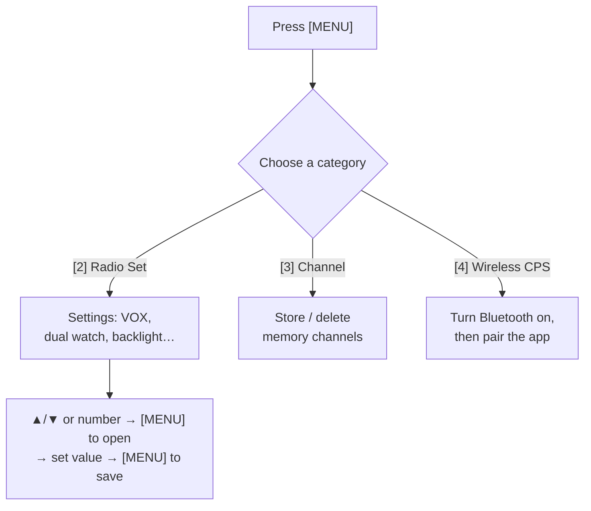
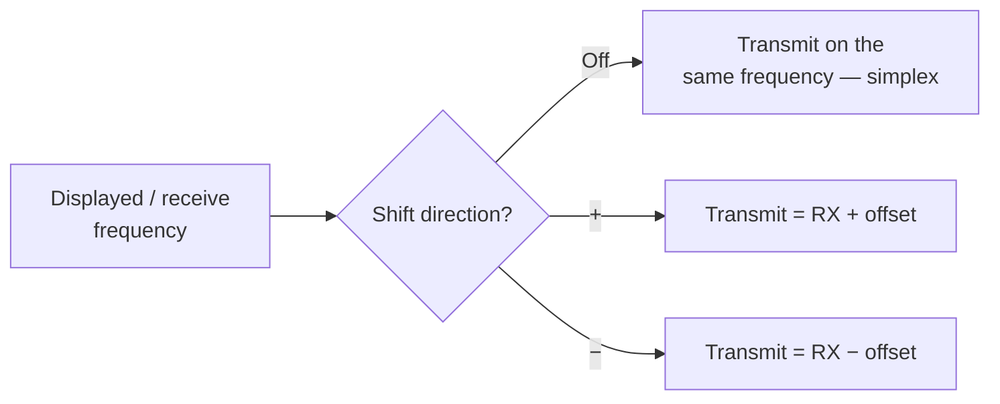

# The menu in depth, part 2

The second half of the GT-5R Mini's menu is the housekeeping: how a channel is stored, how the radio works out a repeater's transmit frequency, what the backlight does, and — the one that sets this little set apart from every classic Baofeng — the built-in Bluetooth you turn on right here in the menu. None of it is glamorous, but three or four of these items are the difference between a radio that behaves and one that surprises you. As in [the first half](outpost:entry/logbook73.guide.gt-5r-mini/menus-1), the settings that reward thought get the full treatment; the trivial ones get a line, and where the manual is genuinely unclear, this guide says so rather than guessing.

A reminder of what this radio is, because it shapes everything below. The **GT-5R Mini** is the EU-market name for the same hardware sold in the US and globally as the **UV-5R Mini** — one radio, two labels. It is a **newer, distinct set** from both the older non-Mini "GT-5R" and the classic "UV-5R"; do not carry those radios' menu numbers across to this one. It is a **licensed amateur (ham) dual-band handheld** — a licence is required to transmit — not a GMRS or business radio.

## How the Mini's menu is shaped

If you have used a classic UV-5R, forget the flat list of numbered items (0 to 40) for a moment. On the Mini, the menu is **nested**: press **[MENU]** and you land in a set of categories, and most of the settings in this chapter live one level down, inside a category called **Radio Set**. You reach an item either by scrolling with the **▲/▼** keys or by **typing its number** on the keypad, then pressing **[MENU]** to open it, **▲/▼** (or the keypad) to choose a value, and **[MENU]** again to save. **[EXIT]** backs out without saving. That is the whole grammar of the menu, and it is worth practising until it is muscle memory.



Because the Mini's menu is nested and icon-driven, the old "41 menu items" count does not apply, and **this guide will not invent item numbers it cannot confirm**. Where a key-press path is printed in the manual, you will see it below in `code`; where it is not, the item is named honestly with a note to check its position on your own unit — firmware revisions move these around, and a wrong number is worse than none.

One rule carries over from the classic radios: **set a channel's content in frequency (VFO) mode, then store it.** The tones, bandwidth, transmit power and repeater shift that make a channel are chosen while tuned to a plain frequency, then folded into a memory. Several items below depend on that order.

Here is the block at a glance. The verdict column uses the same key as the rest of the guide.

| Symbol | Meaning                                          |
| ------ | ------------------------------------------------ |
| ✅     | Set it and forget it — right for almost everyone |
| ⭐     | Genuinely useful, depending on how you operate   |
| ⚠️     | Advanced — understand it before you enable it    |
| ❌     | Leave it off unless you have a specific reason   |

| Setting                | What it does                                 | How to reach it                    | Verdict                 |
| ---------------------- | -------------------------------------------- | ---------------------------------- | ----------------------- |
| Channel name / display | How a stored channel is shown on screen      | Radio Set (item varies)            | ⭐ taste                |
| Busy-channel lockout   | Refuse to transmit onto a busy channel       | Not documented for the Mini        | ⭐ if present           |
| Keypad lock            | Lock the keys against stray presses          | Hold `[*]`                         | ⭐                      |
| Shift direction        | Transmit above / below / on the RX frequency | Set in VFO before storing          | ⭐ per repeater         |
| Offset                 | Size of the repeater shift, in MHz           | Set in VFO before storing          | ⭐ per band plan        |
| MEM-CH                 | Store the current VFO into a memory          | `[MENU][3][MENU][1][5]`            | ✅                      |
| DEL-CH                 | Delete a stored memory                       | `[MENU][3][MENU][1][6]`            | ⭐ housekeeping         |
| Backlight              | Screen brightness / timeout                  | Radio Set (options vary)           | ⭐ dim to save battery  |
| Emergency alarm        | The SOS attention-getter                     | `[SOS]` side shortcut              | ⚠️                      |
| Wireless CPS           | Turn on Bluetooth for app programming        | `[MENU][4]` → On                   | ⭐ the standout feature |
| Roger beep             | End-of-over beep                             | Not documented for the Mini        | see below               |
| Reset                  | Restore factory defaults                     | In the menu — confirm on your unit | ⚠️                      |

## How a channel is shown — name and display

The Mini has a small **colour LCD** rather than the classic radio's two-line green screen, and it can label a stored channel by a **name** rather than a bare frequency. That is why so many operators run a set shown as `GB3xx` instead of `433.000`: a name tells you _which_ repeater at a glance, where a number only tells you _where_ it is.

There is a catch worth stating plainly. **Channel names come from programming software, not the keypad** — you type them in [CHIRP](outpost:entry/logbook73.guide.gt-5r-mini/getting-started) or the phone app and write them to the radio. If you have never run software against the set, there are no names to show, and a display set to "name" falls back to the number or frequency. The exact menu item that switches a channel's on-screen style is not clearly printed in the Mini's manual, so **check its position on your unit** rather than trusting a number from an older radio.

- **UK/global recommendation:** ⭐ Show the **frequency** while you are learning — watching `145.500` scroll past teaches you the band — then switch to **names** once your channels are named in software.
- **Related:** MEM-CH (below), which stores the channel a name attaches to; the display anatomy in [Getting Started](outpost:entry/logbook73.guide.gt-5r-mini/getting-started).

## Guarding the channel — lockout and the keypad lock

### Busy-channel lockout — ⭐ if your firmware has it

On the classic Baofengs, "BCL" refuses to let you key up on top of a conversation in progress: press PTT while the channel is busy and the radio beeps instead of transmitting, sparing you from "doubling" — two stations transmitting at once, both unreadable — across someone you cannot hear.

Honesty first, though: **a busy-channel-lockout item is not clearly documented for the GT-5R Mini** in the sources this guide can verify. If your firmware offers it, enable it on **simplex** channels and leave it **off** on repeater memories — a repeater is "busy" the instant it answers you, so lockout can lock you out of a machine you are legitimately trying to use.

### Keypad lock — ⭐

The keypad lock is the seatbelt for a radio that lives in a pocket, where a stray press on the numeric keys can retune the frequency, wind up the power or start a scan.

- **Does:** locks the keypad so key-presses are ignored until you unlock. A padlock icon appears on the screen.
- **How:** **press and hold the `[*]` key** until the lock icon shows; hold it again to release. This is the one lock method the Mini's manual documents.
- **A note on automatic locking:** some Baofengs also lock the keypad _by themselves_ after a spell of inactivity. Whether the Mini offers a timed auto-lock is **not confirmed** in the sources here — so treat the manual `[*]`-hold as the reliable method and look for an auto-lock option in the menu only if you want one.
- **Worked example:** you clip the Mini to a rucksack strap for a hillwalk, hold `[*]` until the padlock shows, and the frequency you set at the car park is still there at the summit — not "441.mystery" because a buckle leaned on the keys.
- **Common mistakes:** panicking when the keypad "stops working" — it has simply locked; hold `[*]` to release. The **PTT and volume always keep working**, locked or not, so you can still transmit and change volume.

## The repeater shift — direction and offset

A [repeater](outpost:entry/logbook73.handbook/repeaters) listens on one frequency and re-transmits on another a fixed distance away, so your radio must **transmit shifted and receive un-shifted**, all without you retuning by hand mid-over. Two settings arrange that: the **shift direction** (transmit above, below, or on the receive frequency) and the **offset** (how far, in MHz). You set both in frequency (VFO) mode and then store the finished channel.



- **Shift direction** chooses only the _sign_ of the jump: `+` transmits above what you hear, `−` below it, `Off` transmits on the same frequency for a direct simplex contact.
- **Offset** is the _distance_ of that jump in MHz — the number added or subtracted on transmit. It does nothing while the direction is `Off`.
- **Band plan, not a fixed rule:** repeater shifts differ by band and by region, so take the numbers from the repeater's own listing or [your national band plan](outpost:entry/logbook73.handbook/repeaters). As a common reference: **2 m** typically shifts **0.6 MHz** (in Region 1, e.g. much of Europe and the UK, the sense is usually `−`); **70 cm** varies widely — around **1.6 MHz** in Region 1, but commonly **5 MHz** in the US (Region 2) and **7.6 MHz** across much of continental Europe.
- **Worked example:** you can hear a 70 cm repeater on `433.000` and its listing shows a `+1.6 MHz` shift. Set the direction `+` and the offset `01.600`, and the radio transmits on `433.000 + 1.600 = 434.600` — the repeater's input — while still listening on `433.000`.
- **Reverse and talk-around:** the Mini gives you two related tricks while in repeater mode. A **short press of `[*]` reverses** the transmit and receive frequencies, so you can check whether you can hear a repeater's input directly — handy for diagnosing coverage. **Talk-around** (also toggled from repeater mode) sets the receive frequency equal to the transmit frequency, i.e. drops the shift for a direct contact. Neither is something to leave on by accident.
- **The wake-up tone:** a few older machines still want a **1750 Hz** burst to open them — on the Mini, **hold `[PTT]` and press `[SK1]`** to send it.
- **Common mistakes:** leaving a shift set on a channel you meant to be simplex, so you transmit off-frequency and nobody answers; copying a US 5 MHz offset onto a Region 1 repeater; getting the shift right but forgetting the **CTCSS access tone** (covered in [menus-1](outpost:entry/logbook73.guide.gt-5r-mini/menus-1)), so your signal reaches the input but never keys the machine.

The exact menu labels for shift and offset are not printed verbatim in the Mini's manual this guide can verify, so set them in the Radio Set menu on your unit and confirm the result with the reverse trick before you store.

## Storing and deleting channels — MEM-CH and DEL-CH

### MEM-CH — store to a memory — ✅

This is the point of the radio for daily use: it takes everything about the current VFO — frequency, shift direction, offset, tones, bandwidth and power — and saves it as one recallable channel, so you never re-key a repeater's details again. The Mini holds **999 memory channels**, far more than a personal channel list will ever need.

- **How:** with the VFO set up the way you want it, press **`[MENU][3][MENU][1][5]`** to reach the channel-store function (`MEMCH`), pick a destination slot, and save.
- **Set power _before_ you store.** The memory keeps whatever transmit power was live at the moment you saved — so put the VFO on the **lowest power that reaches the target** (the Mini has just two levels, High and Low) before storing repeaters and local channels. That saves your battery and spares nearby receivers.
- **Odd-split repeaters:** for a repeater whose transmit and receive are _not_ a tidy fixed offset apart, store the **receive** frequency to a channel first, then tune the **transmit** frequency in VFO and store to the **same** channel number; the radio keeps the receive from the first save and the transmit from the second. (This is the classic UV-5R-series method; confirm the exact key sequence on your unit, as the store index can shift between firmware builds.)
- **Related:** DEL-CH (below); channel names come only from [software](outpost:entry/logbook73.guide.gt-5r-mini/getting-started).

### DEL-CH — delete a memory — ⭐ housekeeping

Empties a stored slot. Press **`[MENU][3][MENU][1][6]`** to reach the delete function (`DELCH`), choose the slot, and confirm. It does **not** renumber the channels around it — a deleted slot simply becomes empty. There is no undo, so if you built your channels in [CHIRP](outpost:entry/logbook73.guide.gt-5r-mini/getting-started) or the phone app, the safe route is to fix the list on the computer and write the whole lot back, keeping your backup file and the radio in step.

## The backlight — ⭐ dim it to save battery

The Mini has a **menu-adjustable backlight**, and the light is one of the biggest idle drains on any handheld. Turning it down, or setting it to time out quickly when nothing is happening, is the single easiest way to stretch the battery on a long day.

Being precise: the sources this guide can verify confirm the backlight _is_ adjustable from the menu, but they do **not** pin down the exact options — colours, brightness steps or timeout values — for the Mini. So rather than quote numbers that might be wrong: find the backlight item in the Radio Set menu, choose the dimmest setting or shortest timeout you can still read comfortably, and leave it there. You lose nothing while listening and gain real minutes of standby.

## The emergency alarm — ⚠️

The Mini has an **emergency alarm**, triggered from a preset **`[SOS]`** shortcut key in standby. It is a personal-safety attention-getter, not a substitute for a phone or a proper alerting scheme.

On the classic Baofengs this alarm has three behaviours — a local siren only, a siren _plus_ an over-the-air tone, and a mode that transmits an identifying code — and only the local-siren behaviour keeps the radio silent on air. **Whether the Mini exposes those same sub-modes is not confirmed** in the sources here, so treat the SOS key with respect until you have checked what your unit does when pressed. If any mode **transmits**, it belongs only on a channel where the people who might respond have agreed to it — never a shared calling channel or a repeater.

> **A note on RF and safety.** When you transmit, the Mini puts up to ~5 W into an antenna held close to your head. That is a modest, non-alarming amount of power, but two habits are worth keeping: hold the radio so the antenna is a little away from your face while you talk, and never transmit — including any alarm mode that keys up — without the antenna fitted, as an unterminated transmitter is hard on the radio. More on exposure in the handbook's [RF Safety](outpost:entry/logbook73.handbook/rf-safety) chapter.

## Bluetooth on board — Wireless CPS ⭐

This is the item that genuinely sets the Mini apart from the classic UV-5R, and the reason it earns its own section. The Mini has **Bluetooth built in**, so you can programme it **from a phone with no cable at all** — a first for this price class of Baofeng. You switch the radio's side of that link on right here in the menu.

- **Turn it on:** press **`[MENU][4]`** to enter **Wireless CPS**, then press **[MENU]** and **▲/▼** to select **On**. An indicator shows the radio is discoverable.
- **Then pair the app:** install the manufacturer's phone app — listed as **"OLA Radio"** on Baofeng's site and as the **"baofengradio APP"** in the manual — on **iOS or Android**, allow Bluetooth (and, on Android, location) when asked, choose the **Baofeng** brand and the **5R Mini series** model, and connect. From there the app reads the radio's channels and settings, lets you edit them on the phone, and writes them back.


Two points save real confusion. First, **the radio's USB-C port is for charging only** — you cannot programme the Mini over USB-C; Bluetooth or the cable are the two programming routes. Second, that cable is **not** USB-C either: it is the familiar **2-pin Kenwood-style ("K1") plug** into the accessory jack, going to a USB-A port on your computer, which is what [CHIRP](outpost:entry/logbook73.guide.gt-5r-mini/getting-started) uses. In CHIRP, the model to select is **"Baofeng UV-5R Mini"** — a distinct driver entry, not the classic "UV-5R".

```viz
{
  "type": "display",
  "title": "The Bluetooth indicator once Wireless CPS is on",
  "caption": "With Wireless CPS switched on, a BT indicator shows the radio is discoverable; the phone app then pairs over Bluetooth — no cable, and nothing over USB-C.",
  "screen": {
    "rows": [
      { "freq": "145.500", "vfo": "A", "power": "L", "bw": "N", "active": true },
      { "freq": "433.000", "vfo": "B", "power": "H", "bw": "W" }
    ],
    "topIcons": ["BT", "100%"]
  },
  "callouts": [
    { "n": 1, "x": 20, "y": 2, "label": "BT icon — Wireless CPS is on and discoverable", "side": "left" }
  ]
}
```

- **Recommendation:** ⭐ If you have a phone, Wireless CPS is the fastest way to build a channel list on the Mini — no cable, no driver hunt. Keep it **off** the rest of the time; there is no reason to leave the radio discoverable while you operate.
- **A word on the software's maturity:** the CHIRP driver for this radio has been under active development, and read/write quirks have been reported on some firmware. Use a **current CHIRP Next build**, and always **read the radio to a backup file first** so a failed write costs you nothing.

## Roger beep and the finishing touches

The classic Baofengs offer a **roger beep** — a short tone at the end of each transmission that tells the other station you have finished. On the amateur bands it is widely considered unnecessary and mildly irritating, so the usual advice is to turn it **off**.

For the Mini, though, be careful: a roger-beep menu item is **not documented** in the sources this guide can verify. So rather than tell you to switch off a setting that may not exist — if you find a roger-beep or end-of-over-tone option, turn it **off** for amateur operating; if you cannot find one, there is likely nothing to change. (The general key-beep and voice prompts, covered in [menus-1](outpost:entry/logbook73.guide.gt-5r-mini/menus-1), are a separate thing from a roger beep.)

## Starting over — reset — ⚠️

When the radio's settings have got into a tangle you cannot unpick — a stuck tone, a mystery lock, a menu you cannot escape — a **factory reset** is the clean way out, restoring the defaults held inside the radio.

The exact reset path on the Mini is **not something this guide can confirm to the keystroke**, and reset routines differ between firmware builds, so **find and read the reset item in the menu on your own unit before you use it** — do not trust a sequence copied from a different Baofeng. The principle matters most: many radios offer both a **partial** reset (operating settings only, memories kept) and a **full** reset (everything, _including every channel you programmed_). Reach for the partial reset first if offered; it clears operating confusion without touching the channel list you spent an evening building.

Above all: **back up before you reset.** Read the radio to a file over Bluetooth or CHIRP first, and a full reset becomes a two-minute restore rather than an evening of re-programming.

## Try it yourself

- **Learn the menu grammar.** Press `[MENU][4]`, watch the **Wireless CPS** item appear, and back out with `[EXIT]` without changing it. That one trip teaches you the whole open-set-save-exit rhythm safely.
- **Build one channel by hand.** In VFO mode, tune a local simplex frequency such as `145.500`, set **Low** power, then store it with `[MENU][3][MENU][1][5]`. Recall it in memory mode — everything you set comes back in one step.
- **Then do it the easy way.** Switch on Wireless CPS (`[MENU][4]` → On), pair the **OLA Radio / baofengradio** app, and add a repeater from the phone. Compare it with the keypad method — you will see why the Bluetooth is the headline feature.
- **Make a backup today.** Read the radio to a file in the app or [CHIRP](outpost:entry/logbook73.guide.gt-5r-mini/getting-started) and keep it. Every reset and every experiment below is then reversible. Log the channels you settle on in [LogBook73](outpost:entry/logbook73.guide.gt-5r-mini/configs) so your station notes match your radio.

## Key takeaways

- **The Mini's menu is nested, not a flat numbered list** — reach items through categories like **Radio Set** (`[MENU][2]`), scrolling or typing a number, then open/set/save with **[MENU]** and back out with **[EXIT]**. The classic "41 items" numbering does not apply.
- **Set a channel in VFO mode, then store it** — shift, offset, tones, bandwidth and power are all baked in at store time. Store with `[MENU][3][MENU][1][5]`, delete with `[MENU][3][MENU][1][6]`; the radio holds **999** channels.
- **The repeater shift is direction plus offset**, both taken from your band plan (2 m ≈ 0.6 MHz; 70 cm varies — ~1.6 MHz in Region 1, ~5 MHz in the US). Reverse with a short `[*]`, and do not forget the access tone.
- **Wireless CPS is the standout:** `[MENU][4]` → On, then pair the phone app over Bluetooth — no cable. The **USB-C port charges only**; wired programming uses the 2-pin K1 cable and the CHIRP **"UV-5R Mini"** driver.
- **Dim the backlight to save battery, lock the keys with a held `[*]`, and treat the `[SOS]` alarm with respect** — check what it actually does before you rely on it.
- **Back up before you reset, and confirm the reset path on your own unit** — a partial reset first, a full reset only with a saved file to restore from.
- **Where the manual is unclear — busy-channel lockout, auto-lock, roger beep, exact backlight and alarm options — this guide hedges rather than guesses.** Trust what you find in your radio's own menu over any number copied from an older set.

That is the whole menu decoded. Next we turn from _what_ each setting does to _why_ it works the way it does, in [What the Settings Really Mean](outpost:entry/logbook73.guide.gt-5r-mini/theory).
