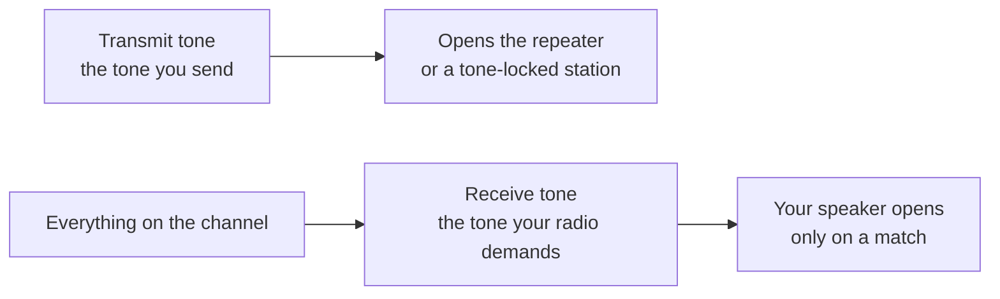
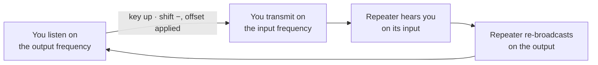

# What the settings really mean

The GT-5R Mini hides a lot of behaviour behind a small screen and a handful of icons — a bandwidth `N`, a tone symbol, a `+` or `−`, an `H` or `L` — and each one is a lever on something physical happening inside the radio. Once you can picture what that something is, the icons stop being clutter and become tools you reach for on purpose. This chapter is the _why_ behind the settings; the [menu reference](outpost:entry/logbook73.guide.gt-5r-mini/menu-reference) and the two [menu-in-depth](outpost:entry/logbook73.guide.gt-5r-mini/menus-1) chapters are the _what_ and _where_. Read them together and this dual-bander will never puzzle you again.

One thing to hold in mind throughout. The **GT-5R Mini** and the **UV-5R Mini** are the same hardware — "GT-5R Mini" is the EU-market name, "UV-5R Mini" the US and global one — so the physics here is identical whichever label is on your box. It is _not_ the older, larger non-Mini "GT-5R", and _not_ the classic "UV-5R"; those are different radios with different menus, so don't borrow their numbers. And because this radio ships in two frequency flavours — a wide-coverage US unit and a ham-band-locked EU unit — this chapter names the variant whenever a range depends on it. The [overview](outpost:entry/logbook73.guide.gt-5r-mini/overview) unpacks that split in full.

## The gate on the hiss: squelch

Leave a receiver switched on with nothing to hear and it does not fall silent — it hisses. That hiss is random radio noise, plus the receiver's own electronics, with no signal to override it, and listening to it for hours would drive anyone to distraction. **Squelch** is the gate that mutes it. Think of it as a bouncer on the speaker: it measures how strong the incoming signal is and only opens the door when something crosses a set loudness. Below the threshold — just noise — the speaker stays shut. Above it — a real signal — the speaker opens and you hear the traffic.

The squelch setting decides where that threshold sits. On this radio squelch is a menu-adjustable level; higher numbers demand a stronger, cleaner signal before the gate lifts. (The exact numeric range on the Mini's firmware is not printed in the manual — set it from the menu and note the value your own unit shows; the [menu reference](outpost:entry/logbook73.guide.gt-5r-mini/menu-reference) has the path.)

```viz
{
  "type": "wave",
  "title": "What squelch actually does",
  "caption": "The speaker opens only where the received signal (solid) rises above the squelch threshold (dashed). The weak blip in the middle never crosses, so it stays muted; the two strong signals open the gate.",
  "xLabel": "time →",
  "traces": [
    { "kind": "points", "label": "received signal", "tone": "primary", "points": [[0,0.12],[0.08,0.15],[0.16,0.1],[0.24,0.14],[0.3,0.4],[0.36,0.45],[0.44,0.42],[0.5,0.13],[0.58,0.11],[0.66,0.4],[0.74,0.72],[0.82,0.68],[0.9,0.22],[1,0.13]] },
    { "kind": "points", "label": "squelch threshold", "tone": "danger", "style": "dashed", "points": [[0,0.55],[1,0.55]] }
  ]
}
```

The trap is that squelch cuts both ways. Set it too low and you put up with hiss; set it too high and you silence exactly the weak, distant stations you most want to hear — a repeater on the very edge of its range, a friend just about making it in from the next valley. The right setting is **the lowest level that reliably mutes the hiss where you are**. When you are chasing something faint, drop it a notch, or use the **monitor** function — hold the pre-programmed monitor side key — to force the gate wide open and listen through the noise for a voice. That monitor key is your instant "is anyone actually there?" override.

## Tones that keep your speaker quiet: CTCSS and DCS

Picture a single simplex channel shared by three groups across a city, each unaware of the others because a hill sits between them. Left to plain squelch, your speaker would burst open every time _any_ of them transmitted. The fix is a quiet code ridden underneath the voice — a **sub-audible tone** — and a radio clever enough to keep its speaker shut unless that code is present. Two systems do this, and the GT-5R Mini supports both, for **encode and decode** (that is, sending _and_ acting on them).

**CTCSS** — Continuous Tone-Coded Squelch System, often called a "sub-tone" or by the trade name PL — sends one low, steady tone the whole time you transmit. The industry-standard CTCSS set runs from roughly `67` Hz to about `254` Hz, and crucially it sits _below_ the range your ear cares about (speech lives roughly 300 Hz to 3 kHz), so the far radio's decoder hears it perfectly while you never do. The radio shows a CTCSS icon when one is active.

```viz
{
  "type": "spectrum",
  "title": "A CTCSS tone hides below your voice",
  "caption": "The sub-audible tone (here around 71.9 Hz) sits below the 300 Hz–3 kHz speech band, so the far radio's decoder detects it but your ear never notices it.",
  "xLabel": "audio frequency →",
  "components": [
    { "f": 4, "amp": 0.95, "label": "CTCSS ~71.9 Hz", "tone": "primary" },
    { "f": 52, "amp": 0.5, "label": "your voice", "tone": "muted", "width": 72 }
  ]
}
```

**DCS** — Digital-Coded Squelch — does the same job with a continuous stream of low-speed digital data instead of a single tone. DCS codes are written like `D023N`, where the trailing letter is `N` for "normal" or `I` for "inverted". It is a slightly more selective dialect of the same idea, and the Mini shows a DCS icon when one is set. The Mini's exact list of tones and codes is not published in its manual, so pick from the on-radio menu rather than assuming a count — but the principle is identical: a code you cannot hear decides whether your speaker opens.

### The part everyone gets wrong: receive tone versus transmit tone

Here is the single most important idea in this chapter. Receiving a tone and transmitting a tone are two completely independent jobs, and mixing them up is the classic reason a newcomer "can't get into" a repeater.



- **The transmit tone is the key you send out.** Most repeaters will not relay you at all unless your signal carries the correct sub-tone — it is how they reject interference and stray carriers. Set the tone the repeater's listing specifies and it lets you in.
- **The receive tone is the lock on your own speaker.** Set it and your radio stays silent unless an incoming signal carries a _matching_ tone — this is what mutes the other two groups on that shared channel.

The two are separate on purpose. To simply _use_ a busy repeater, you usually set only the **transmit** tone — you want to hear everyone on the machine, so you leave the receive side open. To hide from co-channel groups on a _simplex_ frequency (talking radio-to-radio, no repeater), you set **both** to the same code so your team hears each other and nobody else. On this radio those are separate menu entries; the [menu-in-depth](outpost:entry/logbook73.guide.gt-5r-mini/menus-1) chapter walks the exact fields.

One honest warning: a tone is **not** privacy and **not** encryption. It only decides whose signal opens _your_ speaker; anyone listening with their tone-squelch off, or with plain squelch, hears every word. Use tones for tidiness and repeater access, never for secrecy.

## Working a repeater: duplex, offset and shift direction

A [repeater](outpost:entry/logbook73.handbook/repeaters) is a radio on a hill that listens on one frequency and re-transmits everything it hears on another, giving two low-powered handhelds a shared high point to talk through. For that to work it must listen and talk at the same time — so it uses **two** frequencies at once, and your radio has to mirror the split: transmit on the repeater's input, but sit on its output to listen. Doing that by hand every time you key up would be miserable, so the radio automates it with two settings.

The **shift direction** tells the radio whether to transmit **above** (`+`), **below** (`−`) or on the same frequency (for simplex) as the one on the screen — and the Mini shows that `+` or `−` on its display so you can see at a glance which way it will jump. The **offset** sets _how far_ it jumps. Together they mean you tune to the frequency you _hear_, and the radio quietly moves to the input the instant you press the key.



The actual numbers are regional, so check your national band plan. On **2 m** the amateur allocation is `144–146` MHz in Region 1 and `144–148` MHz in Regions 2 and 3, with a common repeater shift of `0.6` MHz. On **70 cm** (`430–440` MHz in Region 1, `420–450` MHz in Region 2) the shift is larger and its sign varies by country — `1.6` MHz is common in parts of Region 1, `5` MHz typical in Region 2. Because the conventions differ, let a **memory channel remember the whole recipe** — output frequency, shift direction, offset and tone — rather than dialling it each time. For simplex you set the shift to none, so transmit and receive land on the same frequency.

One extra key on the way in: some older repeaters, common across Europe, historically expected a short **1750 Hz tone burst** to wake them up. The GT-5R Mini sends it when you hold the PTT and press the `SK1` side key — a quick "knock" before you speak. Most machines have moved to CTCSS access, but the toneburst still lingers, and it is handy to know your radio can do it.

## How much of the channel you fill: wide versus narrow FM

The GT-5R Mini talks in FM ([frequency modulation](outpost:entry/logbook73.handbook/modulation)) — it carries your voice by wagging the transmit frequency slightly up and down in time with the sound. How _far_ it wags is the **deviation**, and that determines how much of the band your signal occupies. The Mini gives you two selectable channel widths: **wide at 25.0 kHz** and **narrow at 12.5 kHz**. When narrow is active, the display shows an `N`.

Why offer both? Spectrum is finite. As bands filled up, many services were squeezed onto tighter channel spacing, and narrow FM lets twice as many conversations sit side by side without treading on each other. The cost is a little audio level: narrow moves the frequency less, so it arrives quieter.

The setting matters because a **mismatch sounds broken**. Transmit wide to a radio expecting narrow and your voice arrives loud and over-driven; transmit narrow to a radio expecting wide and you sound thin and hard to hear — and each side blames the other's radio. The rule is to match the service: copy a channel's bandwidth when you copy its frequency. Many modern VHF/UHF amateur band plans now sit on a 12.5 kHz grid where narrow is the norm, though older wide-FM gear is still on the air; licence-free allocations such as PMR446 (in Region 1) are narrow by regulation, whereas FRS channels elsewhere have their own rules. So don't assume — and if a contact sounds distorted for no obvious reason, a wide/narrow mismatch is a prime suspect.

## Turning it down: power levels

The GT-5R Mini offers **two** output levels only — `HIGH` and `LOW`, advertised at **5 W and 2 W**, with no middle step — and the display shows an `H` or `L` for which is live. (Independent bench testing of this hardware suggests the real high figure is a little under the advertised 5 W, so treat 5 W as the optimistic label.) The instinct of every new operator is to leave it on high "to be sure", and it is almost always wrong. There is a golden rule in amateur radio — **use the lowest power that does the job** — and four reasons stand behind it.

- **Battery.** Transmitting is by far the thirstiest thing the radio does. Dropping to low power stretches a day's operating noticeably — and though the Mini charges over USB-C directly, a lighter draw still beats a flat battery in the field.
- **Interference.** Your signal does not stop at the person you are talking to. Excess power splashes further than you need, reaching stations you cannot even hear. Low power is quite literally being a considerate neighbour.
- **RF exposure.** A handheld transmits centimetres from your face. Less power means less energy near your head — the reasoning is in [RF Power](outpost:entry/logbook73.handbook/rf-power) — and it costs you nothing when the contact works fine anyway.
- **Cleanliness.** Budget transmitters tend to run cleanest when they are not pushed to their limit, so lower power, in-band, helps keep your signal tidy.

Worked example: if you can hit a repeater a few miles away on `LOW` with a full, quiet signal, use it. If a station struggles to hear you, _then_ step up to `HIGH`. Reach for power last, not first — and always transmit within your [licence conditions](outpost:entry/logbook73.handbook/getting-licensed), which is exactly why the ham-locked EU variant confines transmit to the amateur segments while the wide US variant can be tuned outside them.

## Listening to two channels: dual-watch and its limits

**Dual watch** — also called dual standby — lets the radio keep half an ear on **both** displayed frequencies, so you can monitor your local repeater and a simplex calling channel at once. On the GT-5R Mini it is a menu switch (in the manual's walk-through it appears as "Dual Watch", item 15 under the settings menu). Switch it on and the radio rapidly flips between the two, sampling each for activity; catch a signal on either and it stops there and lets you listen until that station finishes, then resumes hopping. The radio's two independent PTT buttons feed the two sides.

It is genuinely useful, but understand what it is _not_: it is not two receivers. The radio can only truly listen to one frequency at a time, so it is time-sharing — flicking back and forth many times a second — which means it can **miss the opening moment of a call** on one channel while it is sampling the other, and it cannot follow two conversations that overlap. For a calm pair of channels it works well; for two busy ones it will feel like it is dropping syllables, because it is.

There is one more trap. When dual-watch catches a signal, _which_ side does your PTT transmit on? The two PTT buttons and the active frequency decide that. If dual-watch ever leaves you talking to yourself — replying on the repeater while the radio is set to the simplex channel it was also watching — check which side is active before you blame the band.

## Guards and good manners

A cluster of smaller settings exist purely to protect the radio, protect the channel, and make you a tidier operator. Their exact menu positions are best read off the [menu reference](outpost:entry/logbook73.guide.gt-5r-mini/menu-reference); here is what they _do_.

**The time-out timer (TOT)** caps how long a single press of the key can transmit. It protects the radio — transmitting continuously heats the power transistors, and a runaway key-down (a PTT jammed against your rucksack) can cook them — and it protects the channel, stopping one long-winded over from hogging a repeater. The exact range of values the Mini offers is not documented in its manual, so set it from the menu and pick a limit; a few minutes is a sensible ceiling for any reasonable over.

**VOX** (voice-operated transmit) keys the radio hands-free when you speak. On the GT-5R Mini it is a two-part control: a VOX on/off switch and a **VOX level from 1 to 9** for sensitivity, higher numbers tripping more easily. Set it too sensitive and background noise keys you up unbidden; too insensitive and you clip the front of every word. Treat it as a convenience, not a default.

**Monitor and reverse** round out the everyday toolkit. Monitor, on a side key, forces the squelch open (and ignores any receive tone) so you can hear a marginal signal in full. **Reverse** — a short press of `*` while working a repeater — swaps your transmit and receive frequencies, letting you check whether you could reach the other station directly on simplex. Holding `*` locks the keypad so nothing changes in your pocket.

A word on the "squelch tail". When you release the key on a tone-squelched simplex channel, your carrier collapses, and for a fraction of a second — before the far radio realises the tone has gone and shuts its gate — it plays a brief burst of noise, that "kssht" at the end of an over. Radios often include a squelch-tail-elimination feature that sends a quick reversed-phase tone to close the far gate cleanly. Whether the GT-5R Mini exposes that control, and under what label, is not spelled out in its manual, so check the on-radio menu and the [menu-in-depth](outpost:entry/logbook73.guide.gt-5r-mini/menus-2) chapter rather than assuming it behaves like an older Baofeng.

### A short safety note

This is a low-power handheld, but the RF-exposure principle still holds: keep the antenna clear of your eyes and face while transmitting, favour `LOW` power when it works, and don't transmit with the antenna pressed against your head. There is nothing alarming about a few watts held at arm's length — good habits simply cost nothing. More on the reasoning in [RF Power](outpost:entry/logbook73.handbook/rf-power).

## Try it yourself

With the radio charged and a proper antenna fitted:

1. **Feel the squelch.** Drop the squelch to its lowest setting and listen to the raw hiss — that is your receiver with the gate wide open. Step it up one level at a time until the hiss just disappears; that value, for where you are, is your squelch. Then hold the monitor key and hear the gate forced open again.
2. **Set an offset by hand.** Tune to a local repeater's output, set the shift direction and offset from its listing, key up briefly (at `LOW` power, within your licence), and watch the displayed `+`/`−` and frequency behave as you press and release.
3. **Prove the power rule.** Work a repeater on `LOW` and listen to your own signal on a second radio or an [SDR](outpost:entry/logbook73.guide.gt-5r-mini/getting-started). If it is full and clean, a couple of watts was plenty — and you saved your battery doing it.
4. **Separate the two tones.** On a repeater you can hear, set only the transmit tone and leave the receive tone off. Confirm you still hear everyone on the machine _and_ get relayed — the clearest way to feel why the two tone jobs are independent.

Nothing here can harm the radio, and stepping out of any menu undoes anything you did not confirm.

## Key takeaways

- **Squelch** is the gate that mutes the hiss; set it to the lowest level that reliably silences the noise, or you mute the weak stations you most want — and the monitor side key forces it open on demand.
- **CTCSS and DCS** are inaudible codes deciding whose signal opens your speaker; the Mini keeps **transmit tone** (the key you send a repeater) separate from **receive tone** (the lock on your own speaker), and tones are for tidiness, never privacy.
- **Duplex** is two settings — shift direction (`+`/`−`, shown on the display) and offset — putting your transmit on a repeater's input while you listen on its output; the numbers are regional, so check your band plan and store them in a memory.
- **Wide (25 kHz) versus narrow (12.5 kHz)** is how much channel you fill; match the service or the audio comes out over-driven or thin.
- **Power** is two levels only — `HIGH`/`LOW`, advertised 5 W / 2 W; use the lowest that does the job to save battery, cut interference and lower RF exposure, within your licence conditions.
- **Dual watch** time-shares between two frequencies rather than truly hearing both, so it can miss the start of a call — know which side your PTT transmits on.
- The good-manners settings — time-out timer, VOX sensitivity (`1`–`9`), reverse and keypad lock — are small, but they separate a considerate operator from an annoying one; confirm any you can't find against the menu reference.

Now that you understand what every setting is _for_, let's turn theory into practice with copy-and-go setups in [Ready-made Configurations](outpost:entry/logbook73.guide.gt-5r-mini/configs).
