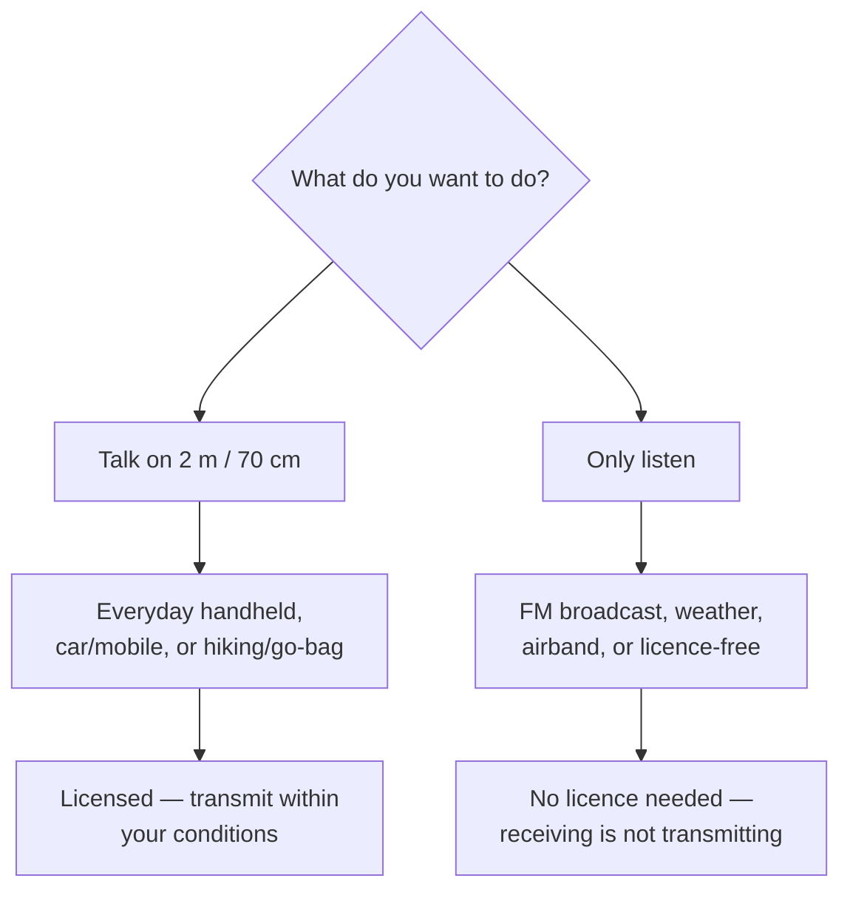

# Ready-made configurations

The quickest way to enjoy a GT-5R Mini is to stop reading menus and start using it — and the fastest route there is to copy a setup that already works. This chapter is a set of ready-made configurations: the everyday one, the one for the car, the one for a hike or a go-bag, and several receive-only setups for listening. Each is a short table of the radio's real functions and the values to give them, with a note on what it is for and where it earns its keep.

One thing to settle first, because it shapes everything below. "GT-5R Mini" is the EU-market name for the very same hardware sold in the US and globally as the **UV-5R Mini** — one radio, two badges. It is a **licensed amateur (ham) dual-band VHF/UHF handheld**, not a GMRS or business radio, and it is a newer, distinct set from the older non-Mini "GT-5R" and the classic "UV-5R" — so don't borrow their numbers. Crucially, the two badges can ship with **different frequency coverage**: US retail units receive very widely (FM broadcast, airband, weather, and up past 500 MHz), while units sold against the EU "GT-5R Mini" printed manual are ham-locked and receive far less. Where a config depends on that, this chapter says so plainly.

## How to use these configs

Unlike the classic UV-5R with its flat, numbered menu, the GT-5R Mini uses a **nested, icon-style menu** — a few top-level categories, each holding named sub-items on a small colour screen. Because of that, the configs below are written as **function name → value**, not as a single fixed "menu 25" style number. The set-wide options live under **Radio Set** (press `MENU`, then `2`); other jobs sit under their own category. The manual does not publish one tidy numbered table for every item, and the exact index of some options is not documented, so where this guide is unsure it tells you rather than inventing a number. The full walk-through of the menu system lives in the two menu chapters — [the first](outpost:entry/logbook73.guide.gt-5r-mini/menus-1) and [the second](outpost:entry/logbook73.guide.gt-5r-mini/menus-2) — and the layout basics are in [Getting Started](outpost:entry/logbook73.guide.gt-5r-mini/getting-started).

One rule saves a lot of confusion. **Per-channel settings — CTCSS/DCS tones, wide/narrow, the offset — must be set in frequency (VFO) mode _before_ you store the channel.** So you build a channel in VFO mode, get every value right, then save it to a memory. The confirmed save sequence on the Mini is: press `MENU`, `3`, `MENU`, then key `15` — the screen shows **MEMCH** — pick a free channel number with `▲`/`▼`, and press `MENU`. (Deleting a channel is the same path but `16`, **DELCH**; channel 1 cannot be deleted.)

Better still, do the whole job in software. The Mini takes a **CHIRP** file (choose the driver named **"Baofeng UV-5R Mini"**, not the classic UV-5R) over the 2-pin K-plug cable, or you can program it wirelessly over **Bluetooth** using Baofeng's phone app: enable **Wireless CPS** on the radio (`MENU`, `4`, then set On), open the app, and select the model listed as the "5R Mini Series". Note the radio's **USB-C port charges only — it does not program**; use the K-plug cable or Bluetooth. Every config here can be typed into CHIRP or the app just as easily as into the radio, and it saves you an afternoon of thumb-aching menu diving.



## The universal baseline

Set these once and every transmit config below inherits them. They encode the good manners this guide keeps pushing — lowest sensible power, sensible squelch — plus a couple of quality-of-life choices. Where a config wants something different, it says so. These are all confirmed functions of the Mini; a few older UV-5R menu items (a numbered battery-save, a roger beep) are **not documented for this radio**, so they are left out rather than guessed at.

| Function        | Value               | Why                                                                                                          |
| --------------- | ------------------- | ------------------------------------------------------------------------------------------------------------ |
| TX power (TXP)  | `LOW`               | The Mini has only two levels, High and Low (advertised ~5 W / 2 W). Low does the job most of the time        |
| Bandwidth (W/N) | `NARROW` (12.5 kHz) | Modern 2 m / 70 cm FM is narrow-band in most band plans; the Mini's wide is 25 kHz                           |
| Squelch (SQL)   | low, just closed    | Set it as low as you can while the hiss stays silent; raise it in strong RF, drop it for weak signals        |
| VOX             | `OFF`               | Hands-free transmit trips on coughs and background noise; the Mini's VOX runs levels 1–9 when you do want it |
| Backlight (ABR) | short timeout       | Long enough to read, short enough to save battery                                                            |
| Time-out timer  | on, ~1–2 min        | Cuts a stuck transmit if the PTT jams in a pocket                                                            |
| Voice prompt    | `OFF`               | The spoken menu prompts wear thin fast                                                                       |

**Dual watch** (Radio Set → the "Dual Watch" item, set On) is deliberately left out of the baseline because the right answer depends on the config — on when you want to watch two channels, off when you want maximum battery life. Each setup below tells you which.

A word on **power**, because it runs through everything here. The Mini offers only two levels, High and Low. Both sit comfortably inside any amateur allowance, so "run low power" is never about the licence — it is about good practice: less battery drain, less interference to distant users sharing the channel, and a cleaner signal. Turn it up only when Low genuinely will not reach. The reasoning is in [RF Power](outpost:entry/logbook73.handbook/rf-power).

> **A short safety note.** At High power this is a 5-watt transmitter held near your face. When you press PTT on High, keep the antenna a few centimetres clear of your eyes and head, and don't transmit continuously with the antenna touching your skin. It is a small, non-alarming precaution — the same one every handheld deserves — and it matters most on High power and with a gain antenna.

## 1 · Newly licensed operator — your first setup

This is the "do this first" configuration: the sensible baseline above, plus the handful of channels a newly licensed operator actually uses. Program your local [repeaters](outpost:entry/logbook73.handbook/repeaters) and the calling channels, and you are on the air properly.

Store these as memory channels (in VFO mode, or in CHIRP). Frequencies and offsets differ by **ITU region**, so both common families are shown — check your national band plan for the exact figures:

| Purpose              | Example RX freq                 | Shift | Offset (region)                                    | Tone                |
| -------------------- | ------------------------------- | ----- | -------------------------------------------------- | ------------------- |
| 2 m FM calling       | `145.500` (R1) / `146.520` (R2) | none  | simplex                                            | none                |
| 70 cm FM calling     | `433.500` (R1) / `446.000` (R2) | none  | simplex                                            | none                |
| Local 2 m repeater   | e.g. `145.700`                  | `-`   | `0.600` (R1 & R2)                                  | access tone (CTCSS) |
| Local 70 cm repeater | e.g. `430.900`                  | `-`   | `1.600` (UK) / `7.600` (much of EU) / `5.000` (R2) | access tone (CTCSS) |

Almost every repeater needs a **CTCSS access tone** — a sub-audible tone your radio sends to unlock it. The Mini does CTCSS and DCS, encode and decode; set the _transmit_ CTCSS tone before you store the channel. The repeater's own listing gives the figure. A few older machines instead want a **1750 Hz toneburst**: hold `PTT`, then press the `SK1` side key, and the radio sends the burst. Programming a repeater by hand always follows the same order:


Here is what a finished 2 m repeater channel looks like on the Mini's screen — output frequency, minus shift, the CTCSS marker, Low power, and dual watch keeping an eye on 70 cm:

```viz
{
  "type": "display",
  "title": "A stored 2 m repeater channel",
  "caption": "Minus shift, CTCSS tone set, Low power — dual watch also holding a 70 cm channel.",
  "screen": {
    "rows": [
      { "freq": "145.700", "vfo": "A", "power": "L", "bw": "N", "shift": "-", "tone": "CT", "active": true },
      { "freq": "430.900", "vfo": "B", "power": "L", "bw": "N", "shift": "-", "tone": "CT" }
    ],
    "topIcons": ["BT", "70%"],
    "bottomTags": ["DW"]
  },
  "callouts": [
    { "n": 1, "x": 78, "y": 20, "label": "Minus shift to the repeater input" },
    { "n": 2, "x": 60, "y": 20, "label": "CTCSS access tone enabled" },
    { "n": 3, "x": 40, "y": 20, "label": "Low power — good manners first" }
  ]
}
```

Transmit only within your amateur allocation, at your licensed power. If you are not yet licensed you can program and _listen_ to all of this legally — see [Getting Licensed](outpost:entry/logbook73.handbook/getting-licensed) when you are ready to talk.

## 2 · Everyday handheld

The daily driver: the same settings as above, but here is the _habit_ that makes it work. Turn **dual watch on** (Radio Set → Dual Watch → On) with a 2 m calling channel on one band and your busiest local repeater on the other, so you catch a call on either without touching the radio. Keep **TXP Low** — around town, 2 W into a rooftop repeater a few miles away is plenty — and reserve High for when Low visibly will not make it.

Two everyday tricks the Mini gives you:

- **Reverse** (a short press of the `*` key while in repeater mode) temporarily swaps a repeater's transmit and receive frequencies, so you can hear whether the station you are working is close enough to reach **direct** (simplex) and spare the repeater. Tap it, listen, tap it back. A longer stay on `*` toggles **talk-around**, which parks you on the repeater's output frequency simplex.
- **Monitor** (press and hold the preset monitor side key) opens the squelch so you can hear a signal too weak to break it — useful for judging whether a faint station is workable.

If you never hear yourself through the repeater, the usual causes are a missing or wrong CTCSS tone, the wrong shift direction, or simply being out of range — all covered in [Troubleshooting](outpost:entry/logbook73.guide.gt-5r-mini/troubleshooting).

## 3 · Car / mobile

A handheld in a car is a compromise, but a good external antenna turns it into a genuinely useful mobile rig. The changes from the everyday setup are about **power, an antenna on the roof, and safety**.

| Function        | Value   | Notes                                                                     |
| --------------- | ------- | ------------------------------------------------------------------------- |
| TX power (TXP)  | `HIGH`  | You want the reach, and the car is not stressing the battery              |
| Backlight (ABR) | longer  | Easier to read at a glance; a little more drain is fine on the move       |
| Dual watch      | `ON`    | Watch calling + local repeater as you drive through cells                 |
| Key lock        | engaged | Hold the keypad-lock key so nothing gets nudged; hold it again to release |

The single biggest upgrade is a **mag-mount antenna on the roof** — the metal roof acts as a ground plane and lifts both transmit and receive dramatically over the little screw-on whip indoors. The Mini's antenna is detachable (a standard threaded screw-on connector), so fitting a feed to a roof antenna is straightforward. Check it is a sensible match (see [SWR](outpost:entry/logbook73.handbook/swr)) before you lean on High power. One honest caveat: a bigger, higher antenna feeds the Mini's broad, lightly filtered front end more of _everything_, so near masts and city-centre transmitter sites you may notice more [overload and ghost signals](outpost:entry/logbook73.handbook/overload-and-ghost-signals) than you did on the stock whip. A band-pass filter cures it for a fixed installation.

Two safety notes, briefly. **Program before you drive, never during** — that is what CHIRP, the phone app, and pre-stored channels are for. And a proper **speaker-microphone** (the Mini has a 2-pin K-type accessory jack for one) keeps your hands and eyes where they belong far better than VOX.

## 4 · Hiking / go-bag on a summit

On a hill the enemy is a flat battery, so this config is tuned to sip power and still get you heard from a good high location. Amateurs activating summits live on 2 m FM simplex, where height does the work that watts cannot.

| Function        | Value                           | Notes                                                                     |
| --------------- | ------------------------------- | ------------------------------------------------------------------------- |
| TX power (TXP)  | `LOW`, `HIGH` for the long shot | Height does the work; from a summit, 2 W goes a very long way             |
| Backlight (ABR) | shortest / off                  | Kill the backlight — every milliamp counts on the hill                    |
| Dual watch      | `OFF`                           | Watch one channel; dual watch keeps two receivers awake and drains faster |
| Squelch (SQL)   | a touch higher                  | So the speaker is not hissing your battery away between contacts          |

Primary channel: the **2 m FM calling frequency** for your region (`145.500` in Region 1, `146.520` in Region 2), where activators call before moving to a working frequency; keep the 70 cm calling channel stored too. A **spare battery kept warm in an inside pocket** is worth more than any setting — the Mini's removable Li-ion pack, like all lithium cells, loses capacity in the cold, and it charges over USB-C straight from a power bank, no cradle needed. From a genuine summit you rarely need a repeater, but if you do, the 1750 Hz burst (hold `PTT`, press `SK1`) and a distant machine can give you real range. Height beats power every time.

## 5 · FM broadcast & local news (receive only)

This is the one receive-only listen that works on **both** badges of the Mini. The radio has a built-in **FM broadcast receiver**; set the `SK1` side key to the FM Radio function (Radio Set → SK1), then press `SK1` to hop into it. In there, `▲`/`▼` step-tune and a long press of `#` auto-searches for stations; press `SK1` again to return to the radio. The Mini can switch which broadcast band it tunes, so depending on your region it covers roughly the 65–74 MHz band, the 76–108 MHz band, or both — enough for national and local FM, weather bulletins and news wherever you are.

There is no config table here — it is a side-key toggle, not a set of stored channels — but two habits help: turn the **squelch** irrelevant (the FM receiver has its own), and remember the FM receiver is **muted the instant a call arrives** on your amateur channel, so it never costs you a contact. Listening is receive-only and needs no licence; you are receiving, not transmitting.

## 6 · Weather & airband listening (receive only, wide-RX units only)

Here honesty per variant matters more than a tidy table. **Weather (NOAA) and aviation airband are receivable only on the wide-coverage US retail units (badged UV-5R Mini / GT-5R Mini).** The EU "GT-5R Mini" printed manual describes a ham-locked receiver with **no airband and no weather band at all** — so if your unit follows that manual, this section simply will not tune. Check your own radio before relying on it.

If you _do_ have a wide-RX unit:

- **NOAA weather** (the 162.400–162.550 MHz channels in North America) is **manual monitor only — there are no automatic alerts** on the Mini. Store the weather channels and scan them yourself; the radio will not wake you for a warning, so never treat it as an alerting device.
- **Airband** (the 108–137 MHz aviation band) is worth honest expectations. Aviation uses **AM**, and reviewers rate the Mini's airband reception **weak** — usable for a strong, nearby transmitter such as a tower you are standing beside, poor for anything distant. For real airband listening, a purpose-made scanner or a cheap SDR dongle will run rings around it.

| Function      | Value        | Notes                                                        |
| ------------- | ------------ | ------------------------------------------------------------ |
| Mode          | AM (airband) | Airband is AM; the Mini receives AM on that band, but weakly |
| Squelch (SQL) | low          | Open it up; weak AM will not break a tight squelch           |
| Dual watch    | `OFF`        | One channel, all attention on the signal                     |

Whatever your unit does, **listening is receive-only**: you are never permitted to transmit on aviation or weather frequencies.

## 7 · Licence-free monitoring by region (receive only)

Every region has a licence-free band that families, event teams and neighbours use — **PMR446** (eight-plus analogue channels around 446 MHz) in Region 1, and **FRS/GMRS** (around 462/467 MHz) in Region 2. A Mini with **wide receive coverage** will _hear_ these perfectly, which makes it handy for keeping an ear on a group. But a **ham-locked EU GT-5R Mini may not tune out to 446/462 MHz at all** — its receiver can be restricted to the 430–440 MHz amateur segment — so this, again, depends on your unit. Try tuning one of the channels below; if it will not accept the frequency, your radio is the locked variant.

Region 1 — PMR446 (the first eight analogue channels):

| Ch  | Frequency   | Ch  | Frequency   |
| --- | ----------- | --- | ----------- |
| 1   | `446.00625` | 5   | `446.05625` |
| 2   | `446.01875` | 6   | `446.06875` |
| 3   | `446.03125` | 7   | `446.08125` |
| 4   | `446.04375` | 8   | `446.09375` |

Region 2 — FRS/GMRS shares the 462/467 MHz band; store your national FRS channel list instead. Either way, set bandwidth to **narrow** and a modest squelch, and remember the key limit: **you may monitor these bands on the Mini but you may not legally transmit on them.** Licence-free channels require a _type-approved_ radio with a fixed antenna and a low power cap — an amateur handheld with a removable antenna and several watts meets none of those conditions. To actually talk on the licence-free channels, buy a cheap type-approved PMR446 or FRS handset: match the radio to the licence, not the other way round.

## 8 · Emergency go-bag

A GT-5R Mini is small, cheap and sips battery, which makes it an ideal radio to charge, program, and forget in a rucksack until you need it. The configuration is really a _channel plan_ plus a storage discipline.

| Function        | Value    | Notes                                                                   |
| --------------- | -------- | ----------------------------------------------------------------------- |
| TX power (TXP)  | `LOW`    | Conserve battery; go `HIGH` only to reach a repeater                    |
| Backlight (ABR) | shortest | Minimal draw on standby                                                 |
| Dual watch      | `OFF`    | One channel, maximum endurance (switch on when actively monitoring two) |
| Key lock        | engaged  | Nothing gets nudged in the bag                                          |

Build a single block of memories that mixes **transmit-capable** amateur channels with a **listen-only** situational-awareness list — bearing in mind the listen-only entries only work if your unit's receiver reaches them:

| Memory                       | Purpose                                                                |
| ---------------------------- | ---------------------------------------------------------------------- |
| Local 2 m / 70 cm repeaters  | Your everyday machines — most likely to carry traffic and be monitored |
| 2 m / 70 cm calling channels | Where to call if the repeaters are down                                |
| FM broadcast (SK1 toggle)    | National and local news bulletins — works on every Mini                |
| NOAA weather (wide-RX units) | Coastal / severe-weather awareness, monitor only, no auto-alert        |
| PMR446 / FRS (wide-RX units) | Listen for family, neighbours and event teams (receive only)           |

Storage matters as much as programming. **Keep the pack charged** — lithium cells self-discharge, so top it up every few months, and store around half to two-thirds charge for longevity. Drop a **charged spare battery** and the K-plug programming cable in the bag. And remember the licensing reality: in an emergency you may always _listen_ on anything the radio can hear, but you may only _transmit_ within your licence — so being licensed, and having your local repeaters and calling channels already stored, is what turns this from a scanner into a communications tool. Your national society (RSGB, ARRL, DARC and the like) can point you to local emergency-communications groups and their calling frequencies.

## Try it yourself

Pick the one config that matches how you will use the radio today and build it now — it takes ten minutes:

1. **Set the universal baseline** — TXP Low, narrow, a sensible squelch, VOX off, a short time-out timer. Every transmit setup inherits it.
2. **Build one repeater channel in VFO mode:** type the output frequency, set the shift and offset for your region, set the CTCSS access tone, then save with `MENU`, `3`, `MENU`, `15` (**MEMCH**) to a free channel number.
3. **Switch to channel (MR) mode** with the `V/M` key and confirm you cannot change the tone there — proof of the "set it in VFO mode first" rule.
4. **Turn dual watch on** and watch the radio flick between two channels, catching a call on either.
5. **When you have more than a handful of channels**, stop doing it by hand — type the lot into [CHIRP](outpost:entry/logbook73.guide.gt-5r-mini/getting-started) (driver "Baofeng UV-5R Mini") or the Bluetooth app, reorder them, and keep the file as a backup a factory reset cannot touch.

## Key takeaways

- The Mini's menu is **nested and named, not a flat numbered list** — so configs here are **function → value**; set the **universal baseline once** (Low power, narrow, VOX off) and each setup inherits it.
- Set channels up in **VFO mode then save** with the **MEMCH** function — channel mode will not let you change tones, bandwidth or offset — and for anything past a few channels use **CHIRP** (driver "Baofeng UV-5R Mini") or the **Bluetooth app**; the **USB-C port charges only**.
- The transmit-capable setups (**first setup, everyday, car, hiking**) differ mainly in **power, dual watch and antenna**: low power and dual watch around town, High power and a roof antenna mobile, single-channel and shortest backlight on the hill.
- **Receive coverage depends on the badge**: **FM broadcast works on every Mini**, but **weather, airband and licence-free monitoring only work on the wide-RX US units** — the ham-locked EU "GT-5R Mini" may not tune them, so test your own radio.
- On the listen-only bands you may **monitor but never transmit**; weather is **manual monitor with no auto-alert**, and airband reception is **weak** — reach for an SDR or scanner if that is your main interest.
- Run the **lowest power that does the job**, keep it **in-band and within your licence**, program your **local repeaters and calling channels**, and you have a cheap radio set up like a careful operator's.

When one of these setups does not behave — no repeater, a dead channel, ghost signals — head to [Troubleshooting](outpost:entry/logbook73.guide.gt-5r-mini/troubleshooting), where every common "why won't it…" has an answer.
