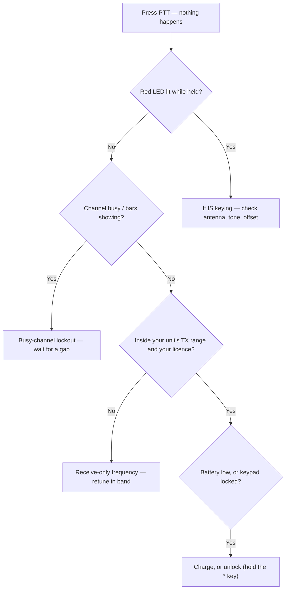
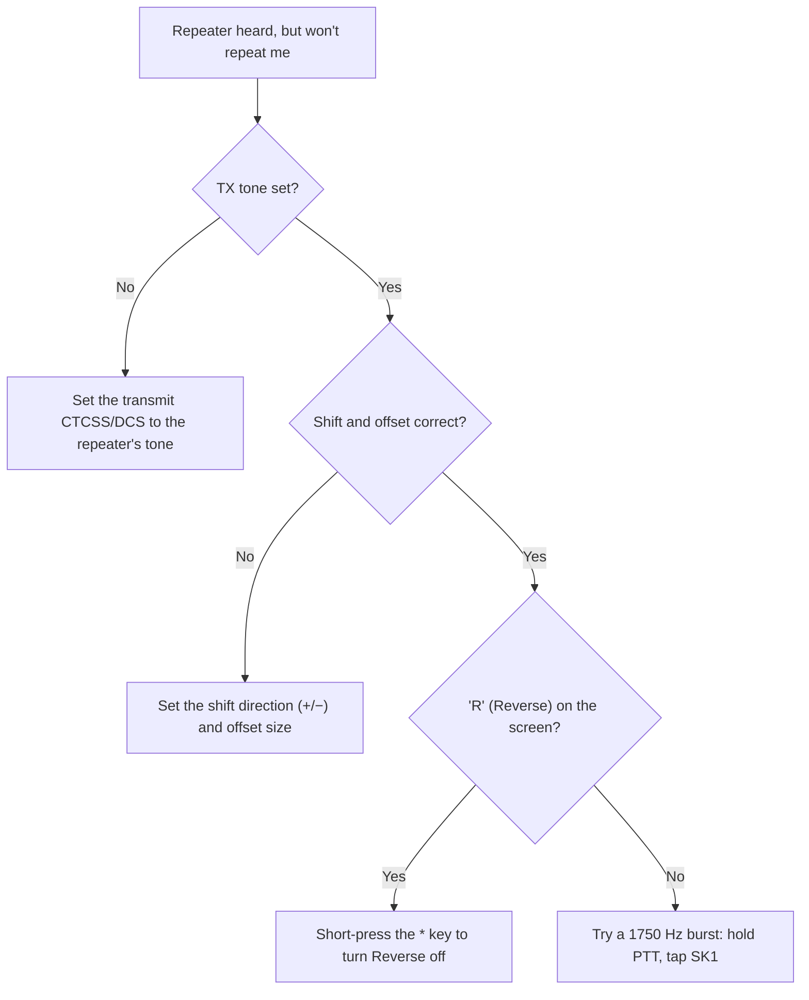
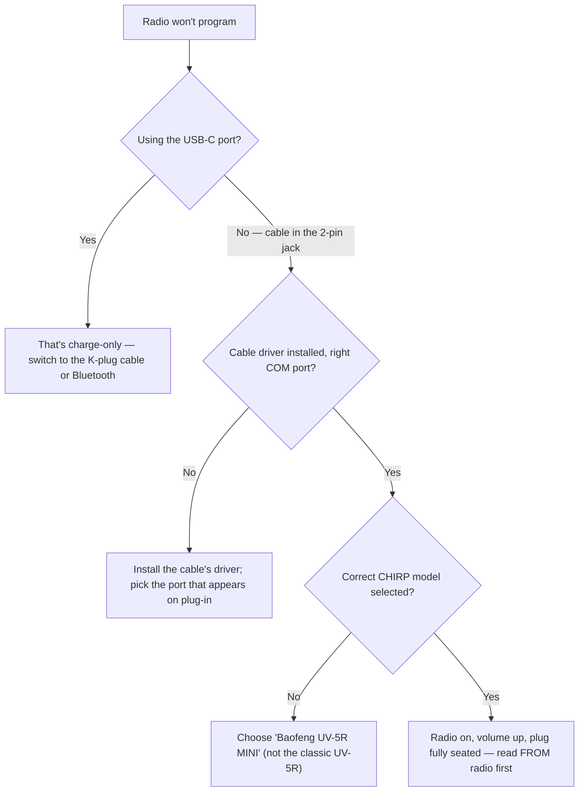

# Troubleshooting

Almost nothing that goes wrong with a GT-5R Mini is actually broken. It is a small, cheerful, robust set, and what trips people up — over and over — is a setting left somewhere unexpected: a receive tone that mutes a perfect signal, a frequency the radio will not transmit on, a USB-C lead that only ever charges. This chapter is a fault-finder built around the words you would really use — "it's gone silent", "it won't transmit", "CHIRP won't read it" — and for each one it walks you from symptom, to cause, to fix.

One thing to hold onto throughout: the "GT-5R Mini" (the EU-market name) and the "UV-5R Mini" (the US/global name) are the **same radio**, and everything here applies to both. It is a _different, newer_ set from the older non-Mini GT-5R and the classic UV-5R, so old forum fixes for those models do not always transfer. Where the two market variants genuinely differ — chiefly which frequencies they will transmit and receive — this chapter names which is which.

## Before you panic: the thirty-second checks

Two habits solve most problems before you have properly started worrying.

**First, read the icon strip on the display.** The Mini is honest about its own state, if you know where to look. A padlock means the keypad is locked; a `VOX` indicator means it can transmit on its own; an `R` means transmit and receive are swapped (Reverse); a narrowband marker means 12.5 kHz mode; `CT` or `DCS`-style markers mean a sub-tone is active; a `+`/`−` means a repeater shift is set. When the radio is "misbehaving", that little row of symbols has usually already confessed why. (For a guided tour of every symbol, see [Getting Started](outpost:entry/logbook73.guide.gt-5r-mini/getting-started).)

**Second, remember what a memory channel is.** A stored channel is a frozen snapshot — frequency, offset, tones, bandwidth and power, all saved together. So a fault that follows one channel around but vanishes on another is baked into that snapshot, not a hardware fault; the cure is to fix it in VFO (frequency) mode and re-save, or to reprogram the channel with software.

If you ever feel truly lost, back out of the menu with `EXIT` to the standby screen — it changes nothing — and start again from there.

## "It's gone silent — hiss but no voices, or nothing at all"

This is the most common panic, and it splits neatly into two very different faults. Work out which one you have and the fix is obvious.

**Fault A — total silence, not even background hiss.** Your **squelch** is set too high. Squelch is a noise-gate that keeps the speaker quiet until a signal is strong enough to be worth hearing; wind it up too far and it stays shut even on real signals.

- **The fix:** open the menu and drop the squelch level a few notches. To prove the receiver is alive at all, hold the **monitor** function (squelch-open): you should hear a wash of white noise. Hiss means the receiver is working perfectly — the squelch was simply doing its job too well. Set squelch back to the lowest number that stays quiet between signals. (The exact squelch tile number in the Mini's icon menu is not clearly documented, so confirm the position on your own unit; the setting is by name, not by a fixed classic-UV-5R number.)

**Fault B — the radio is clearly busy but stays mute.** Here the tell-tale is that the receive indicator lights, or the signal bars jump, yet no audio comes out. That is a **receive sub-tone** doing exactly what it was told. If a receive CTCSS or DCS code is set on the channel, the radio holds the speaker shut for every signal that does _not_ carry the matching sub-audible tone — even a loud, crystal-clear one.

```viz
{
  "type": "spectrum",
  "title": "Why a receive tone can silence a working radio",
  "caption": "A CTCSS sub-tone rides below your voice, too low to hear. Set the radio to listen for one and it keeps the speaker shut for every signal that doesn't carry the matching tone — even loud, perfect ones.",
  "xLabel": "audio frequency (low → high)",
  "components": [
    { "f": 4, "amp": 0.55, "label": "CTCSS sub-tone", "tone": "primary" },
    { "f": 48, "amp": 0.9, "width": 52, "label": "the voice you want to hear", "tone": "muted" }
  ],
  "noiseFloor": 0.04
}
```

- **How it happens:** you programmed the channel in software using a "Tone Squelch (TSQL)" setting, which quietly sets _both_ the transmit and the receive tone. Or you meant to set only a transmit tone and nudged the receive one by mistake.
- **The fix:** turn the _receive_ tone (both CTCSS and DCS) **off** for that channel. Now the radio opens on any signal on the frequency. Keep a _transmit_ tone if your repeater needs one — that is a separate setting (see the next section). A receive tone is only worth having on a busy shared channel where you genuinely want to ignore everyone not in your group. There is much more on why these tones exist in [The Menu in Depth](outpost:entry/logbook73.guide.gt-5r-mini/menus-1).

## "It won't transmit"

You press PTT and nothing goes out — no red light, or a light but nobody hears you. The Mini refuses to transmit for several sensible reasons, and it is worth stepping through them in order.



Walking the branches:

- **You are on a receive-only frequency — and which those are depends on your variant.** This is the single biggest "won't transmit" trap on the Mini, because the two market versions differ genuinely:

| Variant                                                 | Will transmit on                 | Notes                                                                            |
| ------------------------------------------------------- | -------------------------------- | -------------------------------------------------------------------------------- |
| US / global unit (labelled _UV-5R Mini_)                | VHF 136–174 MHz, UHF 400–480 MHz | Wider than the amateur allocations — you must still stay inside your own licence |
| EU unit (labelled _GT-5R Mini_), per its printed manual | VHF 144–146 MHz, UHF 430–440 MHz | Ham-locked to the amateur bands                                                  |

Sources disagree on whether _every_ EU-badged unit is hard-locked in firmware, so treat the table as the starting point and confirm what your own unit will actually key on. Either way, if you have tuned to the broadcast FM band, to airband, or to any frequency outside your unit's transmit range, the PTT does nothing useful. Retune inside your amateur allocation — see [Getting Licensed](outpost:entry/logbook73.handbook/getting-licensed) — and it will key. **Never transmit out of band**; it is not just impolite, it is illegal.

- **Busy-channel lockout.** With busy-channel lockout enabled, the radio will not let you key up onto a frequency that already carries a signal strong enough to open the squelch. This is a _good-manners_ feature — it stops you transmitting on top of a conversation you cannot hear because your own tone decoder is muting it. If the radio refuses while the channel plainly sounds active, this is why. The fix is usually to **wait for a gap**; only disable the feature if you have a legitimate reason, and switch it back on afterwards.
- **Low battery.** Transmitting is thirsty — it draws far more current than listening, so a pack that receives happily for hours can be too flat to key at full power, or drop out mid-over. Reviewers report roughly 8–10 hours of mostly-listening use from the standard pack; a tired, aged pack behaves as though flat even when the meter reads full. If receive is fine but transmit is weak or dead, charge it or swap the pack.
- **The keypad is locked.** A padlock icon and dead keys mean the lock is on. **Hold the `*` key** until the padlock clears.
- **The time-out timer cut you off.** If a time-out timer (TOT) is set, holding PTT past the limit makes the radio stop transmitting to protect its finals from overheating. It feels like a fault but is a safety feature — release PTT, let it reset, and keep your overs shorter. (The Mini's default TOT value and its menu position are not clearly documented; check yours if long overs keep cutting out.)

And one that is not really the radio's fault at all: **never key up without the antenna fitted.** A transmitter with nowhere to send its power can damage itself over time; the reasoning is in [SWR](outpost:entry/logbook73.handbook/swr). If you have swapped antennas, make sure the new one is finger-tight in the socket.

A note on expectations rather than faults: the Mini is advertised at 5 W high / 2 W low, but an independent bench test of this model measured closer to 4 W on high. That is normal for the class and not something you can "fix" — for reliable reach, a better antenna and height beat chasing the last watt every time.

## "I can hear the repeater, but it won't open for me"

Receiving a [repeater](outpost:entry/logbook73.handbook/repeaters) and _accessing_ one are two different jobs, and it is completely normal to do the first perfectly while failing at the second. Listening needs nothing special; getting the repeater to relay you needs three things to line up.



- **You are not sending the access tone.** Almost every modern repeater is guarded by a **transmit CTCSS tone** (occasionally DCS) — a sub-audible tone your radio must send to be let in. Crucially, this is _separate_ from the receive tone of the last section: to work a repeater you usually want a **transmit tone set and the receive tone off**, so you send the right code but still hear everyone. Set the transmit tone to the value in the repeater's listing (for example `77.0 Hz`), leave the receive tone off, and try again.
- **Your offset or shift is wrong.** A repeater listens on one frequency and transmits on another; your radio must mirror that split. You set the direction (`+` or `−`) and the offset size in the menu — the manual describes it as shifting the transmit frequency higher or lower than receive. Common values: on 2 m the shift is **±0.6 MHz**; on 70 cm it varies by region (around ±1.6 MHz in parts of Region 1, ±5 MHz in Region 2), so check your national band plan. If the shift is wrong you transmit where the repeater is not listening, so it never hears you even though you hear it. Storing the repeater as a memory channel bakes both settings in.
- **Reverse is switched on.** If you see an `R` on the display, Reverse is active — it has swapped your transmit and receive frequencies, so you are now transmitting on the repeater's _output_ and listening on its _input_, and nothing works. On the Mini a **short press of the `*` key** in repeater mode toggles Reverse; press it again to clear the `R`. (Reverse is genuinely useful for checking whether you could reach a station direct, simplex — but leave it off for normal repeater work. And note the double duty of the `*` key: a _short_ press is Reverse, a _held_ press is the keypad lock.)
- **Your repeater wants a 1750 Hz burst instead.** Some older European and UK repeaters open on a **1750 Hz tone-burst** rather than a continuous tone. The Mini can send one: **hold PTT and tap the `SK1` side key.** If CTCSS does not open a machine listed as toneburst-access, try that.

If all of that is right and it still will not trigger, only then consider power and antenna — but reach is rarely the real problem. Chasing more power before checking tone and shift is the classic new-operator wild-goose chase.

## "Airband is faint and full of noise" (and won't tune from the keypad)

If you have the US/global variant, it will _receive_ the aviation band (roughly 108–136 MHz, AM), the FM broadcast band and NOAA weather channels for manual monitoring. Two honest caveats:

- **Airband reception is the Mini's weak spot.** Reviewers rate it modest — signals can be faint and easily buried. This is a receiver limitation, not a fault in your unit, and no menu setting improves it.
- **The factory app will not let you _tune_ airband directly.** On the US variant the manufacturer's software refuses to program the 108–136 MHz segment; the practical route in is to store the frequencies you want in **CHIRP** and recall them as memory channels.

If you have the EU-badged unit whose printed manual describes it, airband and NOAA are simply **not present** — that variant's receiver is documented as FM broadcast 76–108 MHz only. So "my airband has vanished" may mean you have that variant, not a broken radio. Which functions your unit ships with is genuinely configuration-dependent, so match your expectations to the variant in hand.

## "There's interference in town — signals that come and go"

Budget dual-band handhelds that also cover a wide receive range — the Mini among them — reach that price partly by using **little front-end filtering**, the input tuning a premium set uses to reject everything except the frequency you want. Near a strong transmitter site (broadcast, paging, cellular, taxi), too much energy can reach the receiver at once and it **overloads**: it desenses (goes deaf to weak signals) and can manufacture **[ghost signals](outpost:entry/logbook73.handbook/overload-and-ghost-signals)** — mixing products that appear where nothing is really transmitting. This is a well-known trait of this _class_ of radio; I have not found a bench report on the Mini specifically, so treat the following as sound general guidance rather than a measured figure for this model.

- **It may not be the frequency's fault.** If a "signal" appears on an odd frequency close to a mast, suspect intermod before you believe it is real — it can be made inside your own receiver.
- **A bigger antenna can make it _worse_.** More gain feeds more out-of-band energy into a simple front end. The modest stock antenna sometimes behaves better than a big whip amid strong signals.
- **The cures are physical, not menu-driven.** Move away from the transmitter site; use a shorter antenna in the worst spots; for a fixed station, fit an external **band-pass filter** for just the 2 m or 70 cm band. No menu setting fixes overload, because the cause is in hardware. The physics is in [Overload & ghost signals](outpost:entry/logbook73.handbook/overload-and-ghost-signals) and [Receivers](outpost:entry/logbook73.handbook/receivers).

Likewise, if you ever find a steady, silent carrier that opens the squelch on exactly one frequency and nowhere near it, it may be a "birdie" — the receiver hearing one of its own internal oscillators. Nudge off the frequency and it vanishes. (The specific birdie frequencies are not documented for the Mini, so I will not invent a list — just recognise the pattern.) None of this makes the Mini a bad radio; it simply means the front end is where the money was saved.

## "It's stuck — I can't change channel, or edits do nothing"

This feels alarming and is almost always one of a few harmless states.

- **Memory mode with nothing stored.** If you switch into memory (channel) mode on a radio with no channels saved, there is nothing to recall, so the up/down keys appear dead. Switch back to frequency (VFO) mode and either operate there or store some channels — by hand, or far more easily with [software](outpost:entry/logbook73.guide.gt-5r-mini/getting-started).
- **You are editing the wrong VFO.** The Mini works two VFOs, an A and a B line; your changes apply to whichever is selected. If tuning or menu edits seem to do nothing, you may be watching one line while editing the other. Select the line you mean to change first.
- **You are in channel mode, trying to change per-channel settings.** In memory mode the radio deliberately locks most stored settings — tones, bandwidth, offset and so on are fixed in the snapshot. This is not a fault: to change a memory you return to VFO mode, set it up, and re-save over the channel.
- **Dual watch is transmitting on the "wrong" VFO.** With dual watch (dual standby) on, the radio listens to both A and B and may transmit on whichever it last heard, which can feel random. The manual reaches it via `[MENU]` `[2]`, then the **Dual Watch** item. If you keep transmitting on the wrong frequency, switch it off when it matters. See [The Menu in Depth](outpost:entry/logbook73.guide.gt-5r-mini/menus-2).
- **The keypad is simply locked.** Padlock icon, dead keys — hold the `*` key until it clears.

## "CHIRP or the app won't read it" — and the USB-C trap

Here is the mistake almost everyone makes first, because it is so reasonable: **the Mini's USB-C port is for charging only.** You cannot program the radio through it — plug a USB-C data lead into a computer and CHIRP will never see the radio, no matter which port or driver you try, because there is no data path on that connector. Programming happens two other ways: over Bluetooth from the phone app, or through the old-style **2-pin Kenwood (K-type) accessory jack** with a proper programming cable to USB. Knowing this saves an evening of confusion.



Working through cable programming with CHIRP:

1. **Use the right port and cable.** The programming cable plugs into the 2-pin K-type jack, not USB-C. Install the driver the cable's seller points to, then in CHIRP pick the serial/COM port that _appears_ when you plug the cable in and _disappears_ when you unplug it.
2. **Pick the right model in CHIRP.** Select **"Baofeng UV-5R MINI"** — this is a distinct driver entry, _not_ the classic "UV-5R", and choosing a near-neighbour can read garbage or refuse. The verbatim "GT-5R Mini" name may not appear in the dropdown; "UV-5R MINI" is the correct entry for both.
3. **Use a current CHIRP Next build.** The Mini's CHIRP driver started life as an alpha, and read/write glitches have been reported on some firmware versions. Most are resolved in current builds, so update CHIRP before assuming the radio is at fault.
4. **Radio on, volume up, plug seated.** Turn the radio on, set the volume to about halfway, and push the plug firmly all the way home — a millimetre proud is enough to fail. Do not transmit while connected.
5. **Read before you write — always.** Read the radio into CHIRP first, edit that image, then write it back, and **save the good read as a backup file.** Then a fumbled write or a reset costs you nothing to undo.

The Bluetooth route (the manufacturer's phone app) sidesteps cables entirely: enable **Wireless CPS** in the radio's menu, then pair from the app — the manual has you choose the Baofeng brand and the "5R Mini" series in the app. If the app cannot see the radio, the usual culprits are Wireless CPS not enabled on the radio, or phone Bluetooth/location permissions switched off.

## The quick-fix table: smaller gremlins

| Symptom                                              | Likely cause                                 | Fix                                                                                                  |
| ---------------------------------------------------- | -------------------------------------------- | ---------------------------------------------------------------------------------------------------- |
| Won't switch on                                      | Flat or badly seated battery                 | Recharge over USB-C; slide the pack off and click it firmly back on                                  |
| Battery drains fast                                  | Backlight/dual-watch on, or an aged pack     | Shorten the backlight, switch dual watch off when unused, replace a worn pack                        |
| Keys up on its own in standby                        | VOX too sensitive                            | Turn VOX off, or lower its level (`[MENU][2][MENU][5]`; smaller number = _more_ sensitive)           |
| Menu edits won't "stick"                             | You're in channel (memory) mode              | Switch to VFO mode, edit, re-save the channel                                                        |
| Audio muffled or odd to others                       | Wrong bandwidth for the channel              | Match the channel's spacing — narrow (12.5 kHz) where the plan calls for it, wide (25 kHz) otherwise |
| You hear other groups on "your" channel              | Shared frequency, different or no tones      | Change frequency, or set a _receive_ tone — which then hides your group from others too              |
| USB-C connected but CHIRP sees nothing               | USB-C is charge-only                         | Use the 2-pin K-plug cable, or program over Bluetooth                                                |
| Flashlight or `*`/`SK1` keys "doing the wrong thing" | Side-key function or short-vs-hold confusion | `SK1` is a configurable side key; `*` short = Reverse, `*` held = keypad lock                        |

If a radio is tangled beyond patience, most Baofengs offer a menu reset — a soft reset that keeps memories, or a full reset that wipes to factory defaults. The Mini's exact reset wording and menu position are not clearly documented, so find it in your manual and, above all, **keep a CHIRP backup first** — a full reset erases every stored channel.

## When it really is broken

Occasionally it genuinely is hardware. The honest short list: a **damaged or wrong antenna** (never key without one — replace a bent or cracked whip); a **PTT that sticks** or an accessory jack full of pocket lint; a **battery pack that no longer holds charge**; or **water ingress** — the Mini carries no published water or dust rating, so treat it as unrated and keep it dry. If a reset with a known-good battery and antenna does not restore normal behaviour, compare the cost and safety of a professional repair with replacing this budget-class unit.

**A brief word on RF safety, since transmitting is involved:** at 4–5 W from a handheld the exposure is modest, but the sensible habit is to hold the radio so the antenna is a few centimetres clear of your face and eyes while you transmit, and not to key continuously for long periods against your head. That is comfortable practice, not alarm.

## Try it yourself

The best way to stop fearing a fault is to cause one deliberately and cure it. With a charged, antenna-fitted radio in VFO mode:

1. **Make it go silent on purpose.** Set a _receive_ CTCSS tone on the channel — say `88.5 Hz`. Now find a busy local frequency or your local repeater output. The bars will jump but you will hear nothing: you have recreated the "receiving but muted" fault.
2. **Prove the receiver is fine.** Hold the monitor (squelch-open) function. The speaker bursts open — signal, hiss and all — because monitor overrides the tone gate. That is your diagnostic move for any "silent" radio.
3. **Cure it.** Turn the receive tone back off. Normal listening returns, and you now own both halves of the most common Mini mystery.
4. **Feel the squelch.** Wind the squelch level right up and weak signals vanish; drop it low and the hiss floods back. Leave it at the lowest number that stays quiet between signals.

Nothing here can harm the radio, and `EXIT` always brings you home.

## Key takeaways

- **Most "faults" are settings.** Read the icon strip first (`R`, tone markers, padlock, `VOX`) — it usually names the problem — and remember a memory channel is a frozen snapshot you edit in VFO mode.
- **Silent radio?** Either squelch is too high, or a **receive tone** is muting everything; hold monitor to prove the receiver is alive, then turn off the right one.
- **Won't transmit?** Check that you are inside _your variant's_ TX range (US wide 136–174 / 400–480 MHz; EU ham-locked 144–146 / 430–440 MHz per its manual) and your licence, then busy-lockout, battery, keypad lock and the time-out timer.
- **Repeater won't open?** You almost certainly need a **transmit tone with the receive tone off**, the right **shift and offset**, Reverse (`R`) turned off — or a **1750 Hz burst** (hold PTT, tap `SK1`).
- **The USB-C port is charge-only** — program over Bluetooth or the 2-pin K-plug cable, choose the **"UV-5R MINI"** model in a current CHIRP build, and read before you write.
- **Weak airband and town-centre interference are traits of the class, not breakage** — they get worse on a big antenna, and the cures are physical, never a menu.
- **Match your expectations to your variant** — airband and NOAA are on the US unit but absent from the EU-badged one; a "missing" feature may just be the other version.

Fixing problems is half the craft; the other half is never causing them — so let's turn to operating cleanly, legally and considerately in [Best Practices](outpost:entry/logbook73.guide.gt-5r-mini/best-practices).
