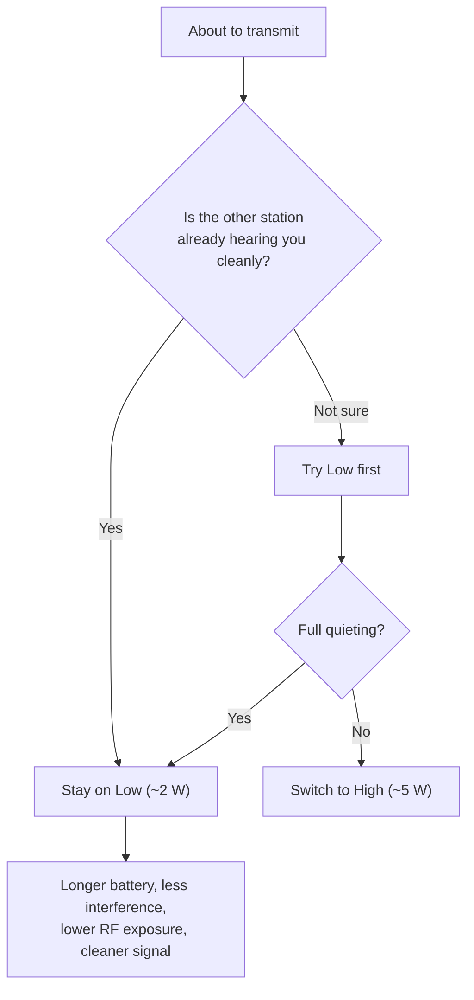
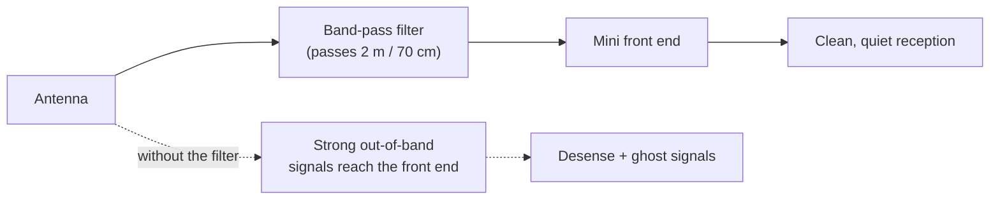
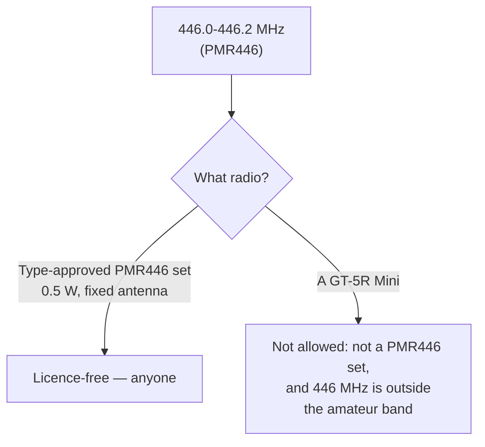

# Best practices

The GT-5R Mini is a capable budget handheld, and the quickest way to enjoy it is to operate it the way an experienced amateur would. What separates a Mini that is a pleasure to own from one that irritates everyone within earshot is almost never the radio — it is a handful of habits. This last full chapter gathers those habits in one place: how to get the best out of the set while being the sort of operator other people are glad to hear.

None of this is hard, and none of it costs much. A few settings, one small antenna upgrade, a backup on your laptop, and a way of thinking about power and legality that will serve you on any radio you ever own. One point worth restating before we start, because it colours everything that follows: the **GT-5R Mini** (the EU-market name) and the **UV-5R Mini** (the US/global name) are the _same hardware_ — a licensed amateur dual-band VHF/UHF handheld. It is a newer, distinct radio from both the older non-Mini "GT-5R" and the classic "UV-5R", so advice written for those older sets does not always transfer. Where it matters, this chapter says so.

## Run the least power that does the job

The single most useful habit on any handheld is **turning the power down**. The GT-5R Mini gives you two levels only — **High** and **Low**, advertised at **5 W** and **2 W** (one independent bench test measured the high setting closer to 4 W, so treat "5 W" as optimistic). There is no middle step. Most new operators leave it on High out of a vague sense that "more must be better." It usually isn't.

On the 2 m and 70 cm bands, communication is essentially line-of-sight, and getting into a [repeater](outpost:entry/logbook73.handbook/repeaters) — an unattended relay station that re-transmits what it hears from a high site — or across town to another handheld is far more about your antenna and your take-off point (are you in a dip or on a rise?) than about raw watts. Going from 2 W to 5 W is only about a 4 dB increase — well under one S-point on the other operator's meter — and if a signal is already **full quieting** (clean, with no background hiss), those extra watts change nothing the other station can hear. They just drain your battery faster, warm up the radio, put more RF next to your head, and add needless energy to a shared channel.



**Worked example.** You want to work a local repeater whose mast is 12 km away with a clear line-of-sight from your usual spot. Set the radio to Low and call. Nine times out of ten you will be full quieting on 2 W, because the path is open — the repeater's sensitive receiver and high antenna do the hard work. Only if you drop into a valley, or the repeater comes back weak and scratchy, do you reach for High. That is the whole discipline: **Low by default, High by exception.** It is better for your battery, better for everyone else, and — because a lower-power stage produces less spurious energy in absolute terms — it is a genuinely cleaner signal too. The reasoning behind watts, effective radiated power and RF exposure lives in [RF Power](outpost:entry/logbook73.handbook/rf-power), and the details of setting power on this radio are in [What the Settings Really Mean](outpost:entry/logbook73.guide.gt-5r-mini/theory).

## Sound tidy on the air

A big part of being a good operator is what your transmissions _sound like_ to the other station, and the Mini gives you a few tools for that. Some Baofeng firmware includes a **roger beep** (a chirp at the end of each over) and **squelch-tail elimination**, but the GT-5R Mini's printed manual does not document them by name or menu number, so do not assume yours behaves like an older UV-5R. Check your radio's own menu: **if your unit has a roger beep, turn it off.** It adds nothing another operator needs — the moment your carrier drops, they already know you have finished — and on a shared channel it is just one more noise everyone sits through, over and over.

Three courtesy tools _are_ confirmed for this radio, and they are the ones worth building into muscle memory:

- **Monitor.** Press and hold the pre-programmed **Monitor** key to open the squelch and listen for weak signals on the current channel — useful before you call, to check a channel really is clear rather than just below your squelch threshold. Release the key to return to normal.
- **Keypad lock.** Press and hold the **`*`** key until the lock icon appears, to stop pocket key-presses changing your channel mid-net; hold `*` again to unlock. Locked, the radio still powers on/off, changes volume, receives and transmits.
- **1750 Hz tone burst.** Many European repeaters open on a short **1750 Hz tone** rather than a sub-tone. On the Mini you send it by holding **`PTT`** and pressing **`SK1`** (the side key) — note this differs from older Baofengs, which used the `BAND` key. More on repeater access below.

The full menu walk-through of what each option means is in the [Menu in Depth](outpost:entry/logbook73.guide.gt-5r-mini/menus-1) chapters and the [Menu Reference](outpost:entry/logbook73.guide.gt-5r-mini/menu-reference).

## Program it with CHIRP, and keep a backup

You _can_ program the Mini from its keypad — you build a channel in VFO (frequency) mode, set the offset, tone, power and bandwidth, then store it to a memory number by pressing `MENU` (a beep confirms the save). But it is slow and easy to fumble. This is a radio designed to be programmed by computer, and the tool of choice is **CHIRP**: free, open-source, cross-platform, and specifically good with Baofeng radios. You lay your channels out in a spreadsheet-style table — frequency, offset, tone, name, power — and write them all in one pass, a job that takes minutes instead of an afternoon of thumb-aching menu-diving. Practical channel plans are in [Ready-made Configurations](outpost:entry/logbook73.guide.gt-5r-mini/configs).

Three practical notes save a lot of grief:

**Pick the right driver, and use a current build.** In CHIRP's model dropdown the Mini is listed as **"Baofeng UV-5R MINI"** — a distinct entry, _not_ the classic "UV-5R". The Mini's CHIRP support started life as an alpha driver, and read/write bugs have been reported against some firmware versions, so always use an up-to-date **CHIRP Next** build rather than an old release.

**The cable is a lottery, and USB-C won't do it.** The Mini programs over a **two-pin Kenwood-style (K-type) plug** into its accessory jack, not over the USB-C socket — that port is for **charging only**. Many budget cables use counterfeit serial chips that fight with modern drivers, so buy from a reputable ham dealer or one that names a genuine chipset. Alternatively, the Mini has **built-in Bluetooth**: enable **"Wireless CPS"** in the radio's menu and program wirelessly from the manufacturer's phone app — no cable at all.

**Download from the radio first, and keep that image as a backup.** Before you change a thing, read the radio's current contents into CHIRP and save the file. Now you have a known-good snapshot. If you ever fumble a reset, brick a channel, or just want to undo an experiment, you write the saved image back and you are exactly where you started. A Mini with a backup on your laptop is a radio you can tinker with fearlessly; one without is a radio you are slightly afraid of. Keep a dated file, and re-save it whenever you make a change worth keeping.

## Fit a better antenna

The stubby "rubber duck" that ships with the radio is a compromise: compact and convenient, but less efficient than a resonant full-length whip. If you change it, choose an antenna specified for 2 m / 70 cm, confirm the connector against your own radio, and verify its matching before transmitting. Do not assume longer is automatically better. A more efficient antenna can help in weak-signal conditions, but it can also make overload worse on a modest receiver. The theory is in [Antennas](outpost:entry/logbook73.handbook/antennas), and the matching that makes an antenna resonant is in [SWR & Matching](outpost:entry/logbook73.handbook/swr).

A note on fitting. The Mini's antenna connector is a **detachable, threaded screw-on** type. On the rest of the 5R family it is an **SMA-female** socket (the pin sits on the antenna, so antennas are SMA-male), and the Mini is almost certainly the same — but that gender is not spelled out in the Mini's own documentation, so **confirm it against your unit before buying**. Screw the antenna in **finger-tight only** — never force it — and, as with any transmitter, never key up without an antenna attached.

There is one honest caveat, and it leads straight into the next section. A bigger, more efficient antenna — especially a gain antenna up on a mast for fixed use — feeds the receiver _more_ of everything, including strong signals from services you never wanted. On a radio with a modest front end, that can make overload **worse**, not better. For handheld use, a correctly matched whip may help; near strong transmitters or on a rooftop antenna, test rather than assume, and read on before you are surprised by ghosts.

## The Mini's honest weaknesses

Every radio at this price makes compromises, and knowing the Mini's saves you from blaming yourself for the radio's limits.

**A wide-open front end.** A receiver's "front end" is the first amplifier and mixer that everything arriving at the antenna passes through — think of it as the bouncer on the door of a club. A premium radio's bouncer is fussy: it lets the wanted band in and turns strong neighbouring signals away at the door. Inexpensive wideband handhelds as a class — and the Mini is one — have very little front-end filtering, so near a strong source (an FM broadcast mast, a paging transmitter, a mobile-phone site) those out-of-band signals can flood and overwhelm the front end, causing two symptoms:

- **Desense:** the receiver goes partially deaf, and weak signals you should hear vanish beneath the strong nearby energy.
- **Ghost (intermod) signals:** strong signals mix together inside the overloaded front end and produce phantom "stations" on frequencies where nothing is really transmitting.

This behaviour is characteristic of the whole budget-handheld class rather than a documented defect of the Mini specifically; the full explanation and how to recognise it is in [Overload & Ghost Signals](outpost:entry/logbook73.handbook/overload-and-ghost-signals), with the receiver theory in [Receivers](outpost:entry/logbook73.handbook/receivers). If a "repeater" turns up on an odd frequency next to a transmitter site, suspect intermod before you believe it.

The fix, where you need one, is an **external band-pass filter**: a small in-line device that passes the amateur band you care about and rejects everything either side _before_ it reaches the radio.

```viz
{
  "type": "spectrum",
  "title": "Why a band-pass filter transforms a cheap receiver",
  "caption": "The radio only wants the small signal in the middle. A band-pass filter passes that band and rejects the strong broadcast, paging and mobile carriers either side before they can overload the front end.",
  "components": [
    { "f": 12, "amp": 0.95, "label": "FM broadcast", "tone": "danger" },
    { "f": 30, "amp": 0.7, "label": "Paging", "tone": "danger" },
    { "f": 50, "amp": 0.28, "label": "Your repeater", "tone": "primary" },
    { "f": 78, "amp": 0.85, "label": "Mobile", "tone": "danger" },
    { "f": 90, "amp": 0.6, "label": "Other services", "tone": "muted" }
  ],
  "noiseFloor": 0.05,
  "mask": { "kind": "bandpass", "from": 42, "to": 58 },
  "xLabel": "Frequency across the band"
}
```



You do **not** need a filter for ordinary portable use — most people never fit one. It earns its place at a fixed station on an outdoor antenna, or if you live in the shadow of a broadcast or paging site.

**Other honest limits, in brief.** Reviewers rate the Mini's **AM airband reception weak** where the US-market variant offers it at all. There are only **two power levels**, so you cannot dial in a precise middle setting. The battery is modest (a nominal ~1600 mAh Li-ion pack — one source lists 1800 mAh, so figures vary), which is another reason the low-power habit pays off. And the radio carries **no published water- or dust-resistance rating**, so treat it as unrated and keep it dry. None of these is a deal-breaker; they are simply the shape of a good, cheap radio, and knowing them makes you a calmer owner.

## RF safety, in one short paragraph

A handheld is a transmitter a few centimetres from your face, so a little common sense is worth stating plainly — and it is only a little, because this is a low-power radio (a few watts), not a mast. When you transmit, keep the antenna a hand's-width from your head and away from your eyes, hold the radio slightly away rather than pressed to your cheek, and lean on the low-power habit from earlier — less power out is less exposure. And **never transmit into a missing or damaged antenna.** A transmitter needs somewhere to send its energy; with no proper antenna, that energy reflects back into the final amplifier and can cook it. If your antenna is cracked, the connector is loose, or the whip has snapped, receive-only until you have replaced it. The reasoning — SWR, reflected power, why a bad match stresses the radio — is in [SWR & Matching](outpost:entry/logbook73.handbook/swr), and the exposure side in [RF Power](outpost:entry/logbook73.handbook/rf-power).

## Stay in-band, and stay legal

The Mini, like most radios of its kind, can be _made_ to transmit outside the amateur bands. Don't. **Transmit only where your licence permits.** Here the two name-variants genuinely differ, so know which unit you hold. The **EU "GT-5R Mini"**, per its printed manual, is ham-locked to **144–146 MHz (2 m)** and **430–440 MHz (70 cm)** for transmit. The **US-market "UV-5R Mini"** is advertised with a much wider transmit range (roughly **136–174** and **400–480 MHz**) — wider than the amateur allocations themselves, which is exactly why the discipline matters: the radio's capability is not your permission. Band edges also differ by ITU region — 2 m is 144–146 MHz in Region 1 and 144–148 MHz in Regions 2/3 — so check your national band plan and your own licence conditions, and stay inside them.

If you are not yet licensed, everything in the _receive_ half of this guide is legal to do — see [Getting Licensed](outpost:entry/logbook73.handbook/getting-licensed) when you are ready to press the button.

Two points of law that the internet routinely garbles are worth getting right:

**The FCC's action against radios like this was not a ban.** The US enforcement activity that swirls around Baofeng-type handhelds — the 2018 advisory — concerned their being **marketed with out-of-band transmit capability**, not their spectral purity, and emphatically _not_ a prohibition on licensed amateurs using them in-band. A licensed operator staying inside the ham bands was never the target. Note too that the Mini's FCC grant certifies only its _receiver and Bluetooth_ subsystems (under Part 15); an amateur transmitter is authorised by your operator's licence, not by an FCC type-acceptance, so marketing phrases like "Part 97 compliant" describe that posture rather than a transmitter grant. It is not a GMRS radio and not a business/land-mobile (Part 90) radio.

**PMR446 / FRS are separate services — the Mini is not one of them.** In Europe, PMR446 is a licence-free walkie-talkie service on **446.0–446.2 MHz**, using type-approved handsets limited to 0.5 W with a fixed, non-removable antenna. (The US equivalent, FRS, sits on different channels around 462/467 MHz with its own rules — name your own region's service.) A Mini can be _tuned_ toward those frequencies, but that does not make it legal there: it has a removable antenna, more power, and no PMR446/FRS type approval. And 446 MHz sits just _above_ the amateur 70 cm allocation, so an amateur licence does not cover it either.



If you want licence-free family radios, buy a pair of proper PMR446 (or FRS) handsets; if you want to explore amateur radio, get licensed and stay in your allocation. Your national regulator sets the rules — Ofcom in the UK, the FCC in the US, and their equivalents elsewhere — and your national society (RSGB, ARRL, DARC and the like) will point you to the current band plan. The wider context on these UHF services is in [The UHF Bands](outpost:entry/logbook73.handbook/uhf).

## Be a good operator on repeaters and simplex

The last habit is the oldest one in the hobby: **listen before you transmit.** Give any channel a good few seconds — someone may be mid-conversation, or pausing for breath — before you call. From there, a short courtesy checklist covers you almost everywhere:

- **Identify with your callsign** as your licence requires — at the start and end of a contact, and periodically through a long one. Never "kerchunk" a repeater (key up briefly just to hear it respond) without identifying; it is both discourteous and, in most jurisdictions, against your licence conditions.
- **Leave gaps.** On a repeater, pause a second between overs so a station with traffic — or an emergency — can break in.
- **Access the repeater the way it expects.** Many machines open on a **CTCSS sub-tone** (a sub-audible tone you set in the channel — see the [Menu Reference](outpost:entry/logbook73.guide.gt-5r-mini/menu-reference)); some European repeaters instead want a **1750 Hz tone burst**, which on the Mini you send by holding `PTT` and pressing `SK1`. Set the right one once and you never think about it again.
- **On simplex** (direct radio-to-radio, no repeater), call on the calling channel — `145.500 MHz` is the 2 m FM calling frequency in Region 1, `146.520 MHz` in much of Region 2 — then _move off it_ to a working frequency once you have made contact, so the calling channel stays clear for others. Don't transmit over the top of a contact already in progress.

None of this is stiff formality. It is nothing more than the behaviour that makes a shared, invisible resource pleasant for everybody on it — and an operator who does these things on a budget handheld is a better operator than one who ignores them on a flagship rig.

## Try it yourself

Fifteen minutes with your radio and a laptop:

1. **Prove low power is enough.** Call your local repeater on **Low** (~2 W). If you are full quieting — and you usually will be — leave it there. Only reach for High if it comes back scratchy.
2. **Tidy your tail.** Dig through your radio's menu; if your unit has a roger beep, switch it off, and have a friend confirm your overs now end cleanly. Practise the keypad lock (hold `*`) and the Monitor key so they are second nature.
3. **Take a CHIRP backup.** Install a current CHIRP Next, connect over the two-pin cable or Bluetooth "Wireless CPS", select the **UV-5R MINI** model, and _download from radio_ before changing anything. Save the file with today's date. That single file makes every future experiment safe.
4. **Hear the front end work — and struggle.** Near an FM broadcast or paging mast, scan around your usual channels. Any "stations" on odd frequencies, or reception that goes deaf near the site, is overload in action — exactly what a band-pass filter tames.

## Key takeaways

- **Low power by default, High by exception** — 2 W is usually plenty on line-of-sight VHF/UHF (High is only ~4 dB more), and it means longer battery, less interference, lower RF exposure and a cleaner signal.
- **Sound tidy on the air** — turn off any roger beep your unit has, and learn the confirmed courtesy tools: Monitor, keypad lock (hold `*`), and the 1750 Hz burst (`PTT` + `SK1`).
- **Program with CHIRP and keep a dated backup** — pick the **UV-5R MINI** driver, use a current CHIRP Next, program over the two-pin cable or Bluetooth (never USB-C, which only charges), and read from the radio first.
- **Match the antenna to the job** — confirm the connector on your unit, verify matching, fit it finger-tight, and remember a bigger antenna in a strong-RF spot can worsen **front-end overload**. A suitable band-pass filter may help a fixed, single-band setup, but sacrifices wideband receive.
- **Know the honest limits** — weak airband, only two power levels, a modest battery, no water rating — so you blame the price, not yourself.
- **Never transmit into a missing or damaged antenna**, and keep the whip a hand's-width from your head.
- **Stay in-band and within licence** — the EU and US variants transmit over different ranges, the FCC action targeted out-of-band _marketing_ not licensed amateur use, and a Mini is not a legal PMR446/FRS radio.

That is the radio, end to end: how it is built, what every setting does, how to set it up, and how to be a credit to the hobby while you use it. When a setting puzzles you from here on, the fastest way home is the one-page map in the [Quick Reference](outpost:entry/logbook73.guide.gt-5r-mini/quick-reference).
