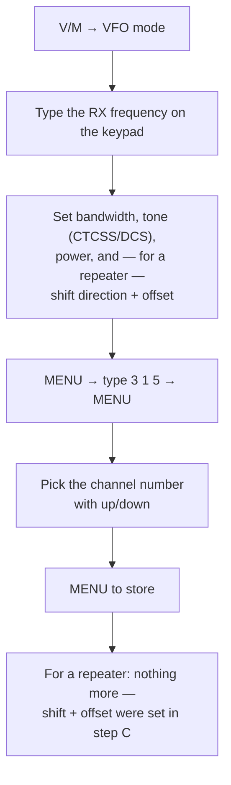
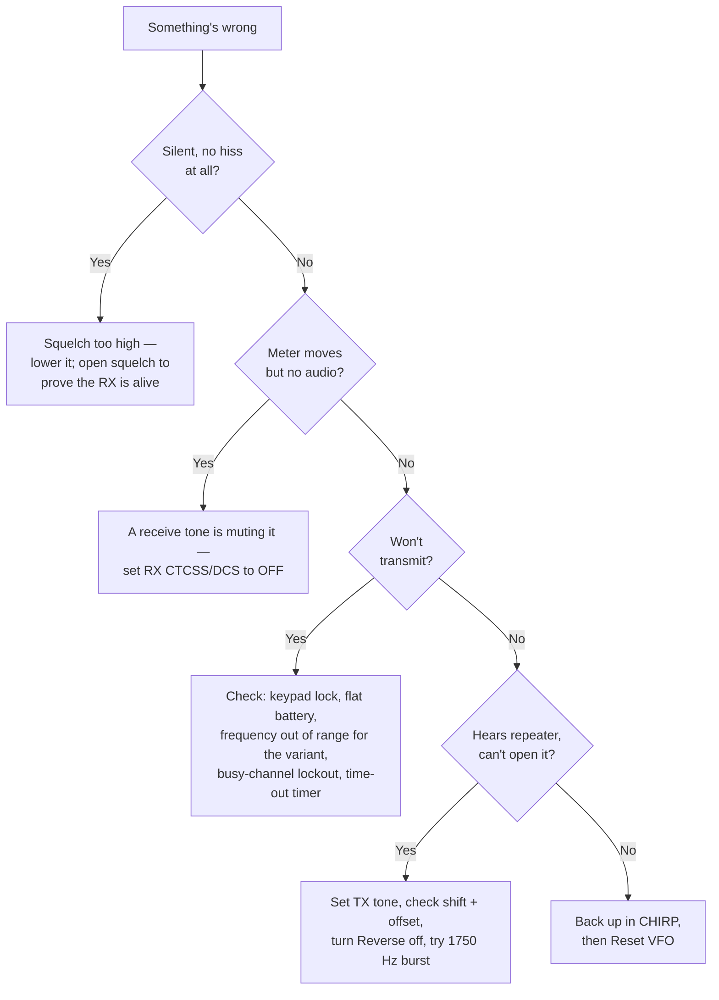

# Quick reference

_The whole guide on one page: the key presses worth memorising, the menu paths this radio actually uses, its verified facts at a glance, and the first thing to check when it misbehaves. Print it, fold it, and keep it with the radio. Where a menu number is not printed in the manual we could confirm, this page says so plainly rather than inventing one — always trust what your own unit shows._

Before anything else, one identity note that shapes every line below. The **GT-5R Mini** is the European name for the same hardware sold as the **UV-5R Mini** in the US and most of the world — one radio, two labels. It is _not_ the older, larger "GT-5R", nor the classic "UV-5R"; those are different sets with different specifications, and their cheat sheets do not apply here. It is a **licensed amateur (ham) dual-band handheld**: legal to own widely, but transmitting needs an amateur licence from your national regulator (Ofcom in the UK, the FCC in the US, and so on). For the fuller story see [Why This Guide](outpost:entry/logbook73.guide.gt-5r-mini/overview).

## The menu rhythm

The Mini does not use the classic flat "menu 0–40" list from the old UV-5R. Its settings live in a small **nested menu** — you pick a group, then an item inside it — and some functions are reached by typing a short numeric code after `MENU`. The rhythm, though, is always the same four beats.


If you ever feel lost, tap `EXIT` two or three times: it backs out without changing anything. Nothing you do in the menu takes effect until that second `MENU` press confirms it.

## Key presses worth memorising

These are the combinations we could confirm from the GT-5R Mini manual. Labels are as printed on the set; `SK1` is the customisable side key.

| Action                                         | Keys                                                 |
| ---------------------------------------------- | ---------------------------------------------------- |
| Enter the menu / confirm a choice              | `MENU`                                               |
| Move through items or values                   | `▲` / `▼`                                            |
| Back out (changes nothing)                     | `EXIT`                                               |
| VFO (tune-a-frequency) ↔ memory-channel mode   | `V/M`                                                |
| Switch VHF ↔ UHF while tuning                  | `#`                                                  |
| Keypad lock / unlock                           | **Hold** `✳` until the lock icon shows               |
| Reverse (swap TX and RX) on a repeater channel | **Short press** `✳`                                  |
| 1750 Hz repeater tone-burst                    | **Hold** `PTT`, then press `SK1`                     |
| Stopwatch                                      | **Hold** `MENU`; `MENU` starts/stops; `EXIT` leaves  |
| One-touch band/frequency search                | Assign `SEARCH` to `SK1`, or hold the tuning encoder |
| Custom side key (see below)                    | Short press `SK1`                                    |

Note the difference from the classic UV-5R here: on the Mini it is **hold `✳`** that locks the keypad and **short-press `✳`** that reverses — not the `#` key. Old muscle memory will trip you up.

### The SK1 side key does several jobs

There is one programmable side key. In the menu (Radio Settings → SideKey SK1, also settable in the CPS software) you choose **one** function for it from this confirmed list:

- **FM Radio** — toggle the broadcast FM receiver on/off
- **Scan** — start/stop channel scanning
- **SEARCH** — start/stop a one-touch frequency sweep
- **VOX** — toggle voice-activated transmit
- **LAMP** — toggle the built-in torch
- **SOS** — toggle the emergency alarm (this **transmits** — treat with care)

Because the torch, FM radio and alarm all share this one key, pick the function you use most. The others remain reachable through the menu.

## Storing a channel — programming at a glance

Manual (front-panel) programming follows the pattern below. Set _everything_ about the channel in VFO mode first, because most per-channel settings are frozen once you are in memory mode.



The store-to-channel code `[3][1][5]` and the delete-channel code `[3][1][6]` are the two we could confirm from the manual's own instructions. To wipe a channel you no longer want: `MENU` → `3` `1` `6` → pick the channel → `MENU`.

Three programming routes exist, and only two of them use a wire:

- **CHIRP** (free, cross-platform). In CHIRP Next choose the model **"Baofeng UV-5R MINI"** — a dedicated driver, _not_ the plain "UV-5R". Use a current build; earlier versions had read/write bugs on some firmware. Always **download from the radio first**, edit, then upload.
- **The phone app** — Baofeng call it **OLA Radio** (the manual also says "baofengradio APP"), over **Bluetooth**, no cable. First enable **Wireless CPS** in the radio's menu, then pair.
- **The programming cable**. Here is the trap: the cable plugs into the **2-pin Kenwood-style (K-type) accessory jack**, _not_ the USB-C port. **The USB-C socket charges only — you cannot program through it.**

For what each setting means before you commit it to 999 memories, see [The Menu in Depth](outpost:entry/logbook73.guide.gt-5r-mini/menus-1) and [Ready-made Configurations](outpost:entry/logbook73.guide.gt-5r-mini/configs).

## Menus worth knowing

Some menu codes are printed plainly in the manual; several common ones are not, and this guide will not guess at numbers. Where the exact code was not confirmed, the item is still real — reach it by name through the nested menu, or check the [Menu Reference](outpost:entry/logbook73.guide.gt-5r-mini/menu-reference) chapter and, above all, your own unit.

| Setting                      | Menu path / code             | Set to                                            | Confirmed?               |
| ---------------------------- | ---------------------------- | ------------------------------------------------- | ------------------------ |
| Store frequency to a channel | `MENU 3 1 5`                 | Pick a channel 000–998                            | Yes (manual)             |
| Delete a channel             | `MENU 3 1 6`                 | Pick the channel                                  | Yes (manual)             |
| VOX on/off                   | Radio Settings → VOX switch  | OFF unless hands-free                             | Yes (manual)             |
| VOX sensitivity              | Radio Settings → VOX level   | 1–9 (higher = more sensitive)                     | Yes (manual)             |
| Dual watch / dual standby    | Radio Settings → Dual Watch  | ON to monitor both lines                          | Yes (manual)             |
| Custom side key              | Radio Settings → SideKey SK1 | Your most-used function                           | Yes (manual)             |
| Factory reset                | Radio Settings → Reset       | **VFO** first; **ALL** only with a backup         | Yes (manual)             |
| Squelch level                | By name in the menu          | Lowest number that mutes the hiss                 | Exact code not confirmed |
| TX power High/Low            | By name in the menu          | LOW by default, HIGH by exception                 | Exact code not confirmed |
| Bandwidth wide/narrow        | By name in the menu          | Match the channel (25 kHz wide / 12.5 kHz narrow) | Exact code not confirmed |
| CTCSS / DCS receive tone     | By name in the menu          | OFF for general listening                         | Exact code not confirmed |
| CTCSS / DCS transmit tone    | By name in the menu          | The repeater's published access tone              | Exact code not confirmed |
| Shift direction + offset     | By name in the menu          | Per your band plan (see below)                    | Exact code not confirmed |
| Time-out timer (TOT)         | By name in the menu          | A sensible ceiling (stuck-mic net)                | Exact code not confirmed |

**Factory reset**, in the manual's own words, offers two choices: **Reset VFO** restores operating settings; **Reset All** returns the radio to factory defaults and, as on every set of this kind, will clear your memories too. Reach for VFO first. Only run ALL when you have a CHIRP file to restore from.

## The radio's verified facts

Everything here is cross-checked across at least two independent sources. A few numbers where sources disagree are flagged as such — trust your own unit over any table when they differ.

| Spec                 | Value                                                                                                                                 |
| -------------------- | ------------------------------------------------------------------------------------------------------------------------------------- |
| Class                | Amateur (ham) dual-band VHF/UHF handheld — licence needed to transmit                                                                 |
| Names                | GT-5R Mini (EU) = UV-5R Mini (US/global), same hardware                                                                               |
| Memory channels      | **999**                                                                                                                               |
| TX power             | **High / Low only**, advertised 5 W / 2 W (no mid step)                                                                               |
| Bandwidth            | 25 kHz (wide) / 12.5 kHz (narrow), selectable                                                                                         |
| Tones                | CTCSS and DCS, encode + decode (exact tone counts not confirmed for the Mini)                                                         |
| Receive modes        | FM/NFM narrowband; WFM broadcast; AM on airband is **receive-only** (US variant)                                                      |
| Dimensions           | 108 × 52 × 37 mm (4.3 × 2.0 × 1.5 in), no antenna                                                                                     |
| Weight               | ~200 g / 7.1 oz with battery                                                                                                          |
| Display              | 1.44" colour LCD (the EU manual says only "LCD")                                                                                      |
| Battery              | Removable Li-ion, DC 7.4 V; **1600 mAh** on most sources — Radioddity's product page lists 1800 mAh, so check your pack               |
| Charging             | **USB-C on the radio itself** — no dock; charging only, not programming                                                               |
| Antenna              | Detachable, screw-on (SMA — the female gender is very likely from shared UV-5R-series hardware but is not printed on a Mini document) |
| Accessory/cable port | 2-pin Kenwood (K-type) jack — this is _not_ the antenna connector                                                                     |
| FCC ID               | `2AJGM-5RMINI` (authorises the receiver and Bluetooth; the amateur transmitter is authorised by your licence, not by type-acceptance) |

### Frequency ranges — always state the variant

This is the one place people get badly caught out, because the two market variants genuinely differ. Match the row to the unit in your hand.

| Variant                                           | TX range                                      | RX range                                                                                            |
| ------------------------------------------------- | --------------------------------------------- | --------------------------------------------------------------------------------------------------- |
| US/global unit (labelled UV-5R Mini / GT-5R Mini) | VHF 136–174 MHz, UHF 400–480 MHz              | Wide: FM broadcast ~76–108 MHz, airband 108–136 MHz (AM), VHF, UHF, plus NOAA (manual monitor only) |
| EU "GT-5R Mini" as its printed manual describes   | VHF 144–146 MHz, UHF 430–440 MHz (ham-locked) | FM broadcast 76–108 MHz only — **no airband, no NOAA**                                              |

Band **edges** in the RX list are approximate — sources differ by a megahertz or two. Whether a given "GT-5R Mini" is band-locked is itself a point on which sources conflict, so verify on-air within your own band plan. A word of law, not radio: the US TX range is wider than the amateur allocations, and this set is **not** a licence-free PMR446 or FRS device — transmit only where your licence permits.

## Understanding a repeater channel on the display

When a memory is set up for a repeater, several indicators tell you it is ready. The stylised readout below shows a typical 2 m repeater channel: a shift direction, an offset applied to the transmit frequency, and an access tone.

```viz
{
  "type": "display",
  "title": "A configured 2 m repeater memory",
  "caption": "Shift arrow, tone flag and channel number are your at-a-glance proof the memory is set up right.",
  "screen": {
    "rows": [
      { "freq": "145.500", "vfo": "A", "power": "L", "bw": "N", "shift": "-", "tone": "CT", "mode": "FM", "zone": "CH 001", "active": true }
    ],
    "topIcons": ["BT", "100%"],
    "bottomTags": ["DW"]
  },
  "callouts": [
    { "n": 1, "x": 12, "y": 50, "label": "Active line arrow (A)", "side": "left" },
    { "n": 2, "x": 62, "y": 20, "label": "Shift direction: minus", "side": "right" },
    { "n": 3, "x": 82, "y": 50, "label": "Access tone armed (CT)", "side": "right" },
    { "n": 4, "x": 30, "y": 82, "label": "Low power (L), narrow (N)", "side": "left" }
  ]
}
```

## Go-to frequencies

These are simplex calling channels, not radio settings — they come from your national band plan and differ by ITU region. Listen first, call, then move to a working frequency. Check your own society's plan (RSGB, ARRL, DARC and the like) for the authoritative list.

| Use              | Frequency                                            | Notes                                                      |
| ---------------- | ---------------------------------------------------- | ---------------------------------------------------------- |
| 2 m FM calling   | `145.500` (Region 1); commonly `146.520` in Region 2 | Simplex, no tone                                           |
| 70 cm FM calling | `433.500` (Region 1); `446.000` common in Region 2   | Simplex, no tone                                           |
| 2 m repeater     | tune to output                                       | Shift + offset per your band plan, access tone on transmit |
| 70 cm repeater   | tune to output                                       | Shift + offset per your band plan, access tone on transmit |

Typical offsets vary by region — for example 600 kHz on 2 m and 1.6 MHz on 70 cm in much of Region 1 — so take them from your band plan, not from memory. More on how a hilltop box extends your handheld is in [Repeaters](outpost:entry/logbook73.handbook/repeaters).

## When things go wrong — first checks

Work top to bottom; the cheap fixes come first.



A few extras that are not faults:

- **Ghost signals near masts** are front-end overload, not a defect — the cures are physical (more distance, a smaller "rubber duck", a band-pass filter), never a menu setting. See [Overload and ghost signals](outpost:entry/logbook73.handbook/uhf) for the why.
- **Dead-feeling keys** usually mean memory mode with nothing stored, the wrong A/B line active, or the keypad locked (hold `✳`).
- **CHIRP won't connect** is nearly always the cable or driver, and remember the cable goes to the **2-pin K jack**, not USB-C. Pick the right port and the "UV-5R MINI" model, and download before you upload.

## A note on RF safety

This is a low-power handheld — at most an advertised 5 watts — so the exposure risk is modest, but the antenna sits close to your head. When you transmit, especially on High power, hold the radio so the antenna is a few centimetres clear of your face and eyes, and do not transmit continuously into a fully body-worn setup for long stretches. Fit a working antenna before keying up: transmitting into a missing or damaged antenna stresses the set. The general principles are in [RF safety](outpost:entry/logbook73.handbook/rf-safety).

## Try it yourself

Do a five-minute "cold start" drill so the panic never happens on the air. From the radio's normal state: hold `✳` to lock, then unlock. Switch `V/M` between VFO and memory. In VFO mode, key in `145.500`, then store it with `MENU` `3` `1` `5` to a spare channel and confirm it appears in memory mode. Open the squelch and listen to the band noise, then let it close. Finally, back the whole radio up in CHIRP (model "Baofeng UV-5R MINI") so a stray **Reset All** can never cost you your memories. Log the exercise in LogBook73 as your first "known-good" checkpoint.

## Key takeaways

- The **GT-5R Mini = UV-5R Mini** (same radio, EU vs US names), and it is a **distinct, newer set** from the old GT-5R and classic UV-5R — never borrow their specs.
- It is a **licensed amateur** dual-bander: 999 channels, High/Low power (advertised 5 W / 2 W), CTCSS and DCS, USB-C **charging** but **not** USB-C programming.
- The menu is **nested**, not the old flat 0–40 list; confirmed codes include store-channel `3 1 5` and delete-channel `3 1 6`. Reach uncertain items by name and trust your own unit.
- On the Mini, **hold `✳`** locks the keypad and **short-press `✳`** reverses — different from the classic UV-5R.
- **Frequency ranges differ by variant** — quote a range only together with the unit (US-wide vs EU ham-locked) it belongs to.
- Program with **CHIRP** ("Baofeng UV-5R MINI"), the **OLA Radio Bluetooth app** (enable Wireless CPS first), or the **2-pin K-jack cable** — never the USB-C port.
- When it misbehaves, walk the ladder: squelch → receive tone → transmit blocks → repeater tone/shift → back up and **Reset VFO**.

That is the guide on a single card. To go deeper on any line here, start back at [Why This Guide](outpost:entry/logbook73.guide.gt-5r-mini/overview) and work forward — every setting on this page is explained in full along the way.
