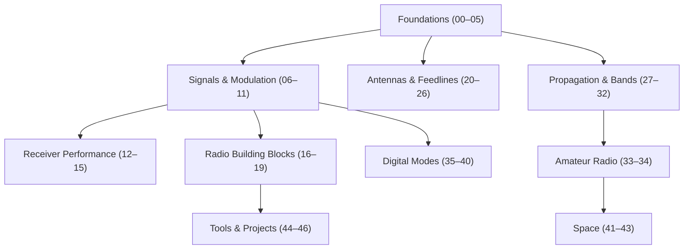
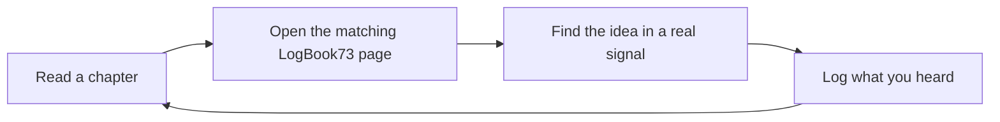

# Welcome

Somewhere above your head, right now, there are signals crossing continents: a beacon in Finland ticking away on 14 MHz, a voice from the Azores bouncing off a layer of charged air a hundred kilometres up, a five-watt digital signal from a back garden in Wales quietly reaching New Zealand. Radio is the art of joining in — and this handbook is here to teach you how it all works, from the first invisible wave to your first contact.

## What this handbook is

The Radio Engineering Handbook is a beginner's book about radio, built straight into LogBook73. It starts from absolutely nothing — no electronics background, no maths beyond what you learned at school — and builds, chapter by chapter, towards a genuinely solid understanding of how radios work, why antennas matter, what the ionosphere does to your signal, and how modern digital modes squeeze contacts out of almost no power at all.

It is not a licence exam crammer, although if you are working towards your country's entry-level amateur licence you will find that almost everything in a typical syllabus is covered here, usually in more depth and (we hope) with more warmth than a revision guide. Nor is it a university textbook: there are no pages of calculus, and every formula you do meet comes with a worked example using real numbers a radio amateur would actually encounter — real frequencies, real power levels, real antennas.

Think of it instead as the club Elmer you may not have met yet: the patient person at the radio club who answers your questions without making you feel small, draws diagrams on the back of an envelope, and keeps saying "try it and see".

## Who it's for

You, most likely, if any of these sound familiar:

- You have started using LogBook73 to log receptions or contacts and keep bumping into terms — `SNR`, `dBm`, `SWR`, `QRP` — that everyone else seems to already know.
- You are curious about how a voice or a picture can travel through empty air, and the explanations you have found are either too vague ("waves, basically") or too dense (Maxwell's equations by page three).
- You are thinking about, or studying for, your country's entry-level amateur licence and want the _why_ behind the facts.
- You own, or are tempted by, a cheap software-defined radio dongle and want to know what all those wiggly lines on the waterfall mean.

Those wiggly waterfall lines, for the record, look something like this:

```viz
{
  "type": "waterfall",
  "title": "Four signals you will learn to read at a glance",
  "caption": "A stylised SDR waterfall: a steady carrier, the dot-dash rhythm of Morse, the flicker of a voice signal, and FT8's tidy 15-second blocks — by the FFTs & Waterfalls chapter you will identify all four by eye.",
  "signals": [
    { "f": 16, "kind": "carrier" },
    { "f": 38, "kind": "cw" },
    { "f": 60, "width": 6, "kind": "ssb" },
    { "f": 84, "width": 4, "kind": "ft8" }
  ],
  "xLabel": "frequency →",
  "yLabel": "time ↓"
}
```

No prior knowledge is assumed. Every technical term is explained the first time it appears, and there is a [Glossary](outpost:entry/logbook73.handbook/glossary) at the back if you meet a term out of order.

## How the parts build on each other

The handbook is arranged in parts, and the parts are arranged as a learning path. Early chapters give you the vocabulary — waves, [frequency](outpost:entry/logbook73.handbook/frequency-and-wavelength), [decibels](outpost:entry/logbook73.handbook/decibels), [power](outpost:entry/logbook73.handbook/rf-power) — that every later chapter leans on. Once those foundations are in place, the book branches: you can follow the signal into the radio (modulation, transmitters, receivers), out of the radio ([antennas](outpost:entry/logbook73.handbook/antennas) and feedlines), or across the planet ([propagation](outpost:entry/logbook73.handbook/propagation) and the bands).



You do not have to read strictly in order. The numbering is a sensible default, and each chapter ends with a link to the next, but the cross-links scattered through the text let you jump wherever your curiosity points. If you skip ahead and hit something unfamiliar, the link back to the foundation chapter will be right there in the sentence.

A few honest signposts:

- **Foundations (00–05)** is the one part we do suggest reading first, in order. It is short, and everything else assumes it.
- **Antennas & Feedlines** and **Propagation & Bands** can be read early — they are the most practical parts of the book, and many readers find them the most exciting.
- **Receiver Performance** and **Radio Building Blocks** are the most "engineering" parts. Save them for a second pass if you like; nothing later strictly requires them.

## Pairing the book with LogBook73

This handbook lives inside a logbook application on purpose. Radio is not a spectator subject: the ideas only really land when you connect them to signals you have actually heard. LogBook73 gives you several pages that pair naturally with your reading:

- **Console** — where you log contacts as they happen. When [Decibels](outpost:entry/logbook73.handbook/decibels) talks about signal reports, or the modulation chapters talk about modes, the fields on the Console are where those ideas become habits.
- **Receive Log** — your diary of what you have _heard_, which matters long before you ever transmit. Most of the "Try it yourself" sections in the early chapters send you here: listening is free, unlicensed, and the fastest way to build intuition.
- **Beacons** — a directory of stations that transmit on schedule from known places at known power, purely so listeners can check propagation, with a clock showing which one is keying right now. Tune one in, tap in a report of what you heard, and the page graphs your own reception over days — the closest thing radio has to a controlled experiment, and they feature heavily in the [Propagation](outpost:entry/logbook73.handbook/propagation) chapters.
- **Propagation** — live space-weather and band-condition data. Reading chapter 27 and then watching this page for a week will teach you more about the ionosphere than any amount of prose alone.
- **DX Cluster** — the live feed of who is being heard where, right now: cluster spots, APRS position packets and mesh sightings on one map. When chapter 05 claims that five watts of [FT8](outpost:entry/logbook73.handbook/ft8) can cross an ocean, this page — and the public reporting map at pskreporter.info — will show you it happening tonight; you do not have to take our word for it.

A good rhythm: read a chapter, then spend ten minutes in the app looking for the idea in the wild. A decibel you have _seen_ — as the SNR figure on a beacon report you tapped in yourself — sticks far better than a decibel you have only read about.



## Learning in layers

One reassurance before you begin: nobody understands radio in one pass. Not the authors of this handbook, not the examiners, not the person at the club with the tower and the forty-year-old callsign. Radio is learned in layers. The first time you meet the ionosphere, you will get the cartoon version: a mirror in the sky. Later, the mirror becomes several layers that rise and fall with the Sun. Later still, you will learn why the mirror sometimes bends signals rather than reflecting them. Each layer is _true enough_ to be useful, and each one makes the next easier.

So give yourself permission to half-understand things. If a section does not click, take what you can and move on — the idea will come back, in another chapter, wearing different clothes, and the second meeting is nearly always easier. The "Key takeaways" at the end of every chapter are deliberately short: if you carry only those forward, you are carrying enough.

And do the "Try it yourself" sections when you can. Most need nothing more than the app you are already in, a broadcast radio, or a gadget costing less than a takeaway. Ten minutes of doing beats an hour of rereading.

## Try it yourself

Before the physics starts, get a feel for the territory:

1. Open **pskreporter.info** in your browser and just watch for two minutes. Every marker is a real signal, heard by a real station, moments ago. Notice the frequencies (numbers like `7.074` or `14.230` MHz), the modes, and the distances. Then open **Beacons** in LogBook73 and see which of the world's scheduled propagation beacons is transmitting right now.
2. Open the **Propagation** page. Ignore every number you do not understand — that is most of them, for now — and simply note whether conditions are described as good or poor. By chapter 27 you will read this page fluently.
3. If you have logged anything before, open your **Receive Log** and look at one entry. Count how many fields you could not yet explain to a friend. That number is what this handbook is for, and watching it shrink is rather satisfying.

## Key takeaways

- This handbook takes you from zero electronics knowledge to a solid working understanding of radio, in short layered chapters with worked, real-world examples.
- Read **Foundations (chapters 00–05)** first; after that, follow the learning path or your own curiosity — cross-links will catch you if you jump ahead.
- Pair every chapter with LogBook73's own pages — Console, Receive Log, Beacons, Propagation and the Map — so ideas attach to real signals.
- Nobody learns radio in one pass: half-understanding a chapter and moving on is not failure, it is the method.
- The "Try it yourself" sections are cheap or free, and they are where the learning actually happens.

Ready? Let's start with the biggest question of all — [What Is Radio](outpost:entry/logbook73.handbook/what-is-radio)?
