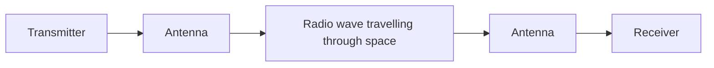
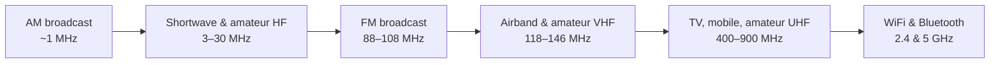

# What Is Radio

Press a button in Cornwall and, a twentieth of a second later, a station in New Zealand hears you. Nothing visible connects you: no wire, no cable, no satellite dish necessarily — just air, ocean, and a layer of electrified sky. That trick, sending information across the world on invisible waves, is radio. This chapter builds your first working picture of how it happens, and why amateur radio is the most interesting corner of it.

## Information on invisible waves

Start with something you can see. Drop a pebble into a still pond and ripples spread outward in rings. The water itself barely moves — a floating leaf just bobs up and down as the ripple passes — but the _disturbance_ travels, carrying energy from the splash to the far bank.

Now imagine you and a friend stand on opposite sides of the pond, and you agree a code: one splash means "yes", two splashes mean "no". Suddenly the ripples are carrying more than energy. They are carrying _information_. Your friend cannot see you through the reeds, but by watching the ripples arrive they know your answer.

Radio works on exactly this pattern, with two upgrades. First, the ripples are not in water but in the electric and magnetic fields that fill all of space — invisible, but every bit as real, and we will meet them properly in [Electromagnetic Waves](outpost:entry/logbook73.handbook/electromagnetic-waves). Second, instead of a crude splash code, we shape the waves with astonishing finesse, impressing voices, pictures and data onto them — a craft called modulation, which gets its own chapter in [Modulation](outpost:entry/logbook73.handbook/modulation).

Two properties of these waves make radio possible at all:

- **They travel without a medium.** Sound needs air; ocean waves need water. Radio waves need nothing. They cross the vacuum of space happily — which is how we talk to spacecraft — and they travel at the speed of light: about 300,000 kilometres every second. London to Sydney in a seventeenth of a second.
- **They pass through things that light cannot.** Walls, clouds, fog, your roof, the human body to a degree — radio waves shrug off obstacles that stop light dead. That is why your phone works indoors and why you have never needed a clear line of sight to hear a broadcast station. The reasons are genuinely interesting and are covered in [Electromagnetic Waves](outpost:entry/logbook73.handbook/electromagnetic-waves).

## The day-one mental model

Every radio system ever built — a broadcast station, a car key fob, a Mars rover, a five-pound walkie-talkie — is the same three-part machine. Fix this picture in your head now, because the whole handbook is really just this diagram examined in ever-greater detail:



Walk through it left to right:

1. **The transmitter** takes some information — your voice, a stream of data, a Morse key going up and down — and uses it to shape an electrical signal, wiggling at some enormous rate: millions of times per second.
2. **The transmitting antenna** is the pebble hitting the pond. It converts that wiggling electrical signal into a wave in the surrounding fields, launching it into space in (roughly) all directions.
3. **The wave travels.** It spreads out, getting weaker with distance, bending and bouncing off the atmosphere in ways explored in [Propagation](outpost:entry/logbook73.handbook/propagation). This part costs nothing and needs no infrastructure — space itself does the carrying.
4. **The receiving antenna** is the bobbing leaf. As the wave sweeps past, it induces a minuscule electrical wiggle in the wire — often less than a millionth of a volt.
5. **The receiver** amplifies that whisper, picks out the one signal you want from the thousands present, and turns the wiggle back into the original information: sound from a loudspeaker, text on a screen.

Notice what is _not_ in the diagram: no wire between the two sides, no subscription, no network operator, no permission needed from anyone in between. Once the wave leaves the antenna, physics does the rest. This is the deep appeal of radio: it is direct. When you eventually make a contact with Japan, nothing carried your signal but the universe.

One refinement worth adding on day one: most interesting radio is _two-way_. Broadcasting — one big transmitter, millions of receivers — is radio at its most industrial. Amateur radio, aviation, marine and emergency services all use **transceivers**: a transmitter and receiver in one box, so each station takes turns talking and listening. When this handbook says "make a contact", it means that conversational, turn-taking use of the same three-part machine in both directions.

## The question everyone is embarrassed to ask

Before moving on, look at that diagram once more, because a very reasonable objection should be forming. Everything you know about electricity says current needs a **complete circuit** — a wire out and a wire back, the way current loops from a battery through a torch bulb and home again. Break the loop and everything stops. Yet an antenna is one wire poking into the sky, connected to nothing at the far end. By torch logic it is a broken circuit. Where does the current go?

If that bothers you, be pleased: it is possibly the best question in radio, and your intuition is working perfectly. Here is the day-one version of the answer, which later chapters will deepen:

- **A transmitter is not a battery.** It does not push current steadily in one direction; it pushes and pulls, reversing millions of times per second — **alternating current**. The electrons in the antenna never travel anywhere. They sway back and forth on the spot, and a swaying crowd needs no exit. Current that only ever swaps direction does not need somewhere to _go_ — only room to move.
- **Nothing material leaves the wire.** Shake one end of a rope and a wave runs to the far end, yet every fibre of the rope stays put — each just bobs and settles. An antenna is the same trick with electric charge: the swaying electrons stay in the metal, and what leaves is a travelling disturbance in the surrounding fields. Not one electron crosses the sky to the other station.
- **The "missing half" of the circuit always exists.** Real antennas are secretly two-sided: the two arms of a dipole (the classic wire antenna, made of two equal halves), or a vertical whip working against a car roof, a set of ground wires — even the body of the person holding a handheld.

The next chapter shows what that travelling disturbance actually is, [Frequency & Wavelength](outpost:entry/logbook73.handbook/frequency-and-wavelength) puts numbers on the swaying, and [Antennas](outpost:entry/logbook73.handbook/antennas) closes the circuit properly. For now, simply retire the idea that anything is being squirted into the sky — radio is shaking, not throwing.

## One spectrum, many neighbours

Here is a question that puzzles most newcomers: if all these waves are flying around at once — every broadcaster, every phone, every WiFi router, every aircraft — why isn't the result a deafening jumble?

The answer is that radio waves come in different _rates of wiggle_, called frequencies, and a receiver can be built to respond to one narrow range of frequencies while ignoring all the rest. It is like a crowded room where every conversation happens at a different musical pitch, and your ears can tune to just one pitch at a time. The full sweep of usable frequencies is called the **radio spectrum**, and it is vast — it runs from a few thousand wiggles per second to tens of billions. (The units for all this, hertz and megahertz, get a proper introduction in [Frequency & Wavelength](outpost:entry/logbook73.handbook/frequency-and-wavelength); for now, just read the numbers as "rate of wiggle".)

A quick tour of the neighbourhood, from slow wiggles to fast:



| Region of spectrum      | Typical occupants                                                   | Character                                                                     |
| ----------------------- | ------------------------------------------------------------------- | ----------------------------------------------------------------------------- |
| Below 1 MHz             | Long-wave broadcast, time signals, maritime                         | Enormous waves; hug the ground for hundreds of miles                          |
| ~1 MHz (medium wave)    | AM broadcast radio                                                  | Local by day; at night, signals bounce and cross countries                    |
| 3–30 MHz (shortwave/HF) | International broadcasters, **amateur radio**, aviation over oceans | The magic region: waves reflect off the upper atmosphere and cross the planet |
| 88–108 MHz              | FM broadcast                                                        | Clear sound, roughly line-of-sight range                                      |
| 118–174 MHz (VHF)       | Aircraft, marine, **amateur 2 m band**                              | Local and regional; reliable, mostly line-of-sight                            |
| 400–900 MHz (UHF)       | TV, **amateur 70 cm band**, older mobile phones                     | Shorter range, small antennas, good in towns                                  |
| 2.4 & 5 GHz             | WiFi, Bluetooth, microwave ovens                                    | Room-to-building scale; huge data rates                                       |

Two big ideas fall out of this table. First, **frequency determines personality**. Low-frequency waves travel far and bend around the Earth; high-frequency waves carry more data but give up long range. There is no "best" frequency — only trade-offs, which is why the spectrum is shared out the way it is. Second, **the spectrum is common property**, like airspace or a river. Everyone's waves pass through everyone else's homes. So countries regulate who may transmit what, where, and at what power — through a national regulator such as Ofcom in the UK or the FCC in the US — and the spectrum is divided into allocations: slices reserved for broadcasting, aviation, mobile networks... and, remarkably, for amateurs.

```viz
{
  "type": "wave",
  "title": "Same wave, two personalities",
  "caption": "Two radio waves over the same slice of time: one wiggles six times, the other packs in four times as many cycles — and that rate of wiggle alone decides whether a wave hugs the planet or hops between rooftops.",
  "traces": [
    { "kind": "sine", "freq": 6, "label": "low frequency", "tone": "primary" },
    { "kind": "sine", "freq": 24, "amp": 0.6, "label": "high frequency", "tone": "muted" }
  ],
  "xLabel": "time →"
}
```

## What makes amateur radio special

Scattered through that spectrum, from the lowest frequencies to the microwave region, are slices reserved for the **amateur radio service** — frequencies set aside by international agreement for private individuals to experiment, self-train, and communicate, without any commercial purpose. Pass a straightforward exam, receive a callsign, and those frequencies are yours to use.

What makes it different from every other way of talking at a distance?

- **You are allowed to build and modify your equipment.** Almost every other radio user — phone owners included — must use type-approved gear as sold. Amateurs may design, build, repair and tinker. It is essentially the only licence that says: _experiment, please_.
- **It is infrastructure-free.** No masts you rent, no networks that go down, no accounts. Two amateurs with wire antennas can talk across an ocean using nothing but their own equipment and the ionosphere. This is why amateurs still matter in disasters, when everything else fails.
- **It is a worldwide community.** A few million licensed amateurs share the same bands under broadly the same rules, with a shared etiquette and a shared language of abbreviations. A contact, or **QSO**, with a stranger on another continent is normal Tuesday-evening stuff — the culture around it is explored in [Amateur Radio](outpost:entry/logbook73.handbook/amateur-radio).
- **The entry path is friendly.** Nearly every country offers an entry-level licence designed for beginners: a straightforward exam, and you are on the air with your own callsign. The details live in [Getting Licensed](outpost:entry/logbook73.handbook/getting-licensed).
- **It rewards skill over spending.** Because amateurs choose their own antennas, power and techniques, cleverness beats chequebooks. A well-placed wire and a patient operator with five watts will outperform a careless station running fifty — a theme picked up in [RF Power](outpost:entry/logbook73.handbook/rf-power).

And crucially for you, right now: **listening requires no licence at all.** Anyone may receive anything on the amateur bands. Your entire apprenticeship — learning the bands, recognising modes, logging what you hear in LogBook73's Receive Log — can begin today, for free.

## A one-minute history

Radio is young enough that its whole story fits in a paragraph or two — and amateurs are woven through all of it.

In the 1860s, the Scottish physicist James Clerk Maxwell worked out, purely on paper, that electric and magnetic effects should be able to travel through space as waves, at the speed of light. In 1887, Heinrich Hertz built the first deliberate transmitter and receiver on a lab bench and proved Maxwell right — then famously declared the discovery "of no use whatsoever". Guglielmo Marconi disagreed, and by 1901 had pushed a signal across the Atlantic. Within twenty years there was broadcasting; within forty, radar; within sixty, satellites.

The amateurs' moment came early. In the 1910s, governments assumed the "short waves" — frequencies above about 1.5 MHz — were useless for long distance, and handed them to hobbyists to keep them out of the way. The hobbyists promptly discovered that these cast-off frequencies bounced off the upper atmosphere and crossed oceans on a few watts, at a time when commercial stations were burning hundreds of kilowatts on the "valuable" long waves. Governments took much of the territory back, of course, but the amateur allocations that survived — and the tradition of amateurs finding out what the professionals missed — persist to this day. When you tune the HF bands, you are operating in territory your predecessors won by experiment.

The pattern has repeated ever since: amateurs were early to single-sideband voice, to bouncing signals off the Moon, to building their own satellites (the first, OSCAR 1, launched in 1961), and most recently to weak-signal digital modes like [FT8](outpost:entry/logbook73.handbook/ft8) that make contacts below the level of audible noise. It is a hobby with a habit of arriving first.

## Radio was already all around you

One last reframing before the physics begins. You have been a heavy radio user your whole life without ever calling it that. WiFi is radio at 2.4 or 5 GHz. Bluetooth is radio. Your phone is a remarkably sophisticated transceiver performing dozens of radio tricks a second. Car key fobs, contactless cards, smart meters, baby monitors, GPS — radio, radio, radio. The average home contains more transmitters than a 1960s embassy.

The difference with amateur radio is simply that the machinery stops being hidden. Instead of a sealed box that "just works", you get to see — and choose, and build, and improve — every stage of the chain from your voice to the far antenna. The rest of this handbook opens those boxes one at a time.

## Try it yourself

No licence, no equipment beyond what you likely own:

1. **Hear the spectrum's personality change.** Take any radio with AM (medium wave) and FM. In daylight, tune across medium wave and note the handful of listenable stations. After dark, tune again: the band fills with distant broadcasters, some from neighbouring countries, arriving by sky bounce. Then notice FM barely changes day to night. You have just observed, with your own ears, that frequency determines how waves travel.
2. **Watch the amateur bands live.** Open the public reporting map at **pskreporter.info** and look at the frequencies being reported. Match a few against the table above: `7.074` sits in HF, where planet-crossing bounces happen; `144.174` is VHF, so expect the reporting stations to be near the transmitting ones. Distance versus frequency — visible in live data.
3. **Log a reception.** Hear anything identifiable — a broadcaster, a beacon, an amateur calling — and enter it in the **Receive Log**: frequency, time, what you heard. Entry one of your apprenticeship.

## Key takeaways

- Radio sends information on invisible electromagnetic waves that need no medium, travel at the speed of light, and pass through obstacles that stop light.
- An antenna does not break the complete-circuit rule: the current alternates, the electrons only sway in place, and the wave — not the electrons — does the travelling.
- Every radio system is the same three-part machine: transmitter → wave through space → receiver. Two-way radio simply runs it in both directions, taking turns.
- Waves at different frequencies coexist because receivers tune to one narrow slice; the full range — from AM broadcast to WiFi — is the radio spectrum.
- Frequency determines personality: lower frequencies travel further; higher frequencies carry more data over shorter ranges.
- Amateur radio is the one licensed service built for experimentation: build your own gear, use no infrastructure, join a worldwide community — and listening is free, starting now.

Next, we open the first box and meet the waves themselves — what they are made of and how a wiggling electron launches one — in [Electromagnetic Waves](outpost:entry/logbook73.handbook/electromagnetic-waves).
