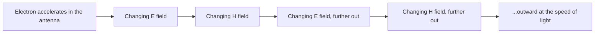
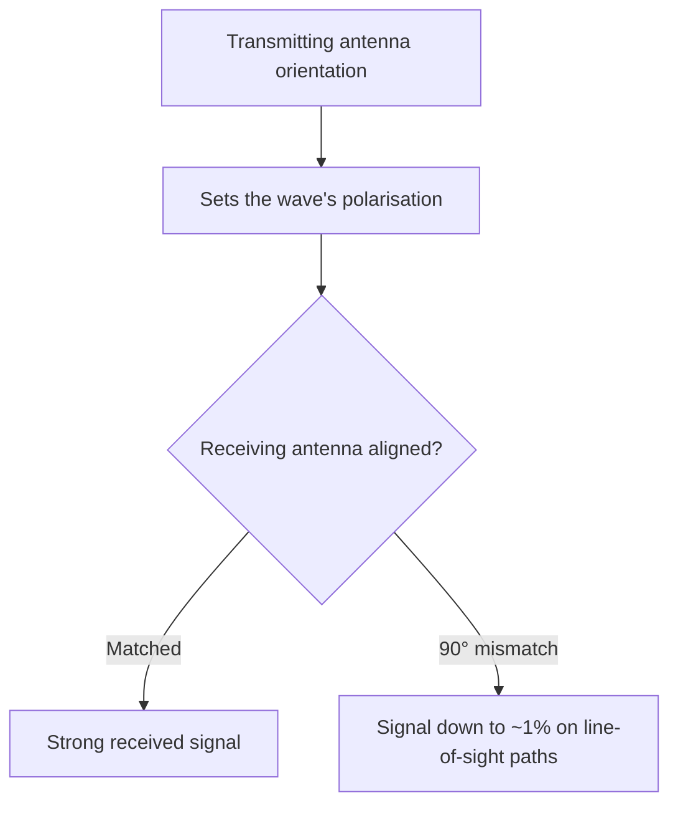

# Electromagnetic Waves

In [What Is Radio](outpost:entry/logbook73.handbook/what-is-radio) we cheerfully waved at "invisible waves" and moved on. Now we stop and look properly, because everything downstream — why antennas are the sizes they are, why you mount some aerials upright and some flat, why your signal reaches a valley the sunlight never does — follows from what these waves actually are. The good news: you can understand them deeply with no maths at all, just three ideas stacked on top of each other.

## Idea one: fields

Hold two magnets near each other and you feel something strange: a push or pull across empty air. Nothing visible connects them, yet the force is unmistakably there. Rub a balloon on your jumper and it will pick up scraps of paper from a distance — again, influence across a gap, with nothing apparently in between.

Physics handles this with the idea of a **field**: a region of space that has been given a property. A magnet does not reach out and grab the other magnet directly; instead, it fills the space around itself with a **magnetic field**, and the second magnet responds to the field _where it sits_. Likewise, any electric charge — like the static on that balloon — surrounds itself with an **electric field**, and other charges respond to the field at their own location.

If that sounds like a bookkeeping trick, here is the crucial point: fields are not just accounting. They are physically real. They store energy. They take time to change. If you wiggle a magnet, the field around it does not update everywhere instantly — the change ripples outward at a fixed, finite speed. Space, in other words, is not empty nothingness; it is a medium-that-isn't-a-medium, capable of holding and passing along electric and magnetic influence. Those two fields — electric (called **E**) and magnetic (called **H**) — are the pond that radio's ripples travel in.

A picture that helps: imagine the space around a charge as covered in tiny invisible arrows, each showing which way a small test charge would be pushed at that point, and how hard. That arrow-map _is_ the field. Static charge: frozen arrow-map. Moving charge: arrow-map that flows. And an _accelerating_ charge — one that speeds up, slows down, or reverses — does something far more interesting.

## Idea two: a shaken charge makes a wave

Here is the heart of the whole subject, and it fits in one story.

Take an electron sitting in a piece of wire. It has an electric field around it — the arrow-map, pointing calmly outward. Now grab the electron and shake it up and down.

Near the electron, the field adjusts almost immediately: the arrows swing to track the new position. But the field far away has not heard the news yet — changes in the field travel at a fixed speed, not instantly. So there is a moving frontier: inside it, the field points at where the electron _is_; outside it, at where the electron _was_. At the frontier itself the arrows are caught mid-swing — kinked. Keep shaking the electron rhythmically and you produce a continuous train of kinks racing outward: a **wave in the electric field**.

```viz
{
  "type": "wave",
  "title": "The wave train, felt from one spot",
  "caption": "Stand at one point in space as the kinks race past: the electric field there swings smoothly up and down — a delayed, fainter echo of the electron's rhythm back at the antenna.",
  "traces": [
    { "kind": "sine", "freq": 8, "label": "E field at your location" }
  ],
  "xLabel": "time →"
}
```

But that is only half the story, and the second half is what makes the wave self-sufficient:

- A **changing electric field creates a magnetic field**. (This is, in essence, what happens in every electromagnet: moving charge — a current — is a changing electric situation, and a magnetic field appears around it.)
- A **changing magnetic field creates an electric field**. (This is how every generator and transformer works: wave a magnet near a coil and a voltage appears.)

Put those two facts together and something wonderful happens. The wiggling E field at our frontier creates a wiggling H field beside it. That wiggling H field creates a fresh wiggling E field a little further out. Which creates a fresh H field. Which creates a fresh E field...



The wave has let go of the electron. It no longer needs the antenna, the wire, or any charge at all: each field continually regenerates the other, leapfrogging through space. This self-sustaining E-and-H pair is an **electromagnetic wave**, and it will run forever, through the emptiest vacuum, until something absorbs it. James Clerk Maxwell deduced all this on paper in the 1860s; Heinrich Hertz shook actual charges and caught the actual waves in 1887; and every transmission since is the same trick. Your antenna is, quite literally, a machine for shaking electrons — millions of times per second — and the far station's antenna is a machine that lets the arriving wave shake _its_ electrons in sympathy.

Notice the word **accelerating**. A stationary charge makes a static field: no wave. A charge drifting at constant speed carries its field along smoothly: still no wave. Only _change of motion_ — acceleration — throws off radiation. This is why direct current in a wire does not radiate, but the violently back-and-forth currents a transmitter drives into an antenna radiate beautifully.

### Nothing material makes the journey

This is the moment to bury, permanently, the most natural wrong picture in radio: electrons being flung off the end of the wire and streaking across the sky. It never happens. The electrons' net movement during one RF cycle is a tiny fraction of a millimetre — they sway, and stay. Think of the rope tied to a fence post: shake your end and a wave ripples to the far end and jerks it, yet the rope itself goes nowhere. Every fibre bobs in place; only the _pattern_ travels. An antenna is that rope, with charge doing the bobbing and the field carrying the pattern — which is the honest answer to the single-wire puzzle posed back in [What Is Radio](outpost:entry/logbook73.handbook/what-is-radio). When your signal reaches Japan, the electrons that wiggle in the far station's antenna have been in Japan all along, waiting to be shaken.

## Anatomy of the wave: E, H and polarisation

Freeze an electromagnetic wave mid-flight and inspect it, and you find a tidy geometric arrangement:

- The **E field** wiggles along one line — say, vertically.
- The **H field** wiggles along a line at right angles to it — horizontally, in this case.
- The wave **travels** at right angles to both — forward.

Three directions, all mutually perpendicular, like the edges of a box meeting at a corner. E and H rise and fall in step with each other, perfectly synchronised partners, their strengths locked in a fixed ratio. Neither can travel alone; the wave _is_ the pair.

```viz
{
  "type": "wave",
  "title": "E and H: perfectly in step",
  "caption": "The two fields peak, fall and cross zero together, their strengths locked in a fixed ratio — the page flattens their right-angle geometry into one plot, but the lock-step timing is the point.",
  "traces": [
    { "kind": "sine", "freq": 6, "label": "E field (vertical)", "tone": "primary" },
    { "kind": "sine", "freq": 6, "amp": 0.55, "label": "H field (horizontal)", "tone": "muted" }
  ],
  "xLabel": "position along the wave →"
}
```

The direction the E field wiggles along has a name you will meet constantly: **polarisation**. By convention we describe a wave by its E field, so a wave whose E field wiggles vertically is **vertically polarised**, and one whose E field wiggles horizontally is **horizontally polarised**. (There is also **circular polarisation**, where the E field corkscrews as it travels — beloved of satellite operators, and covered when you get to [Satellites](outpost:entry/logbook73.handbook/satellites).)

Why should you care, this early? Because polarisation is set by the transmitting antenna and _felt_ by the receiving one. A wave shakes electrons most effectively along the line of its E field. If the transmitting antenna is vertical, the arriving E field is (near enough) vertical, and a vertical receiving antenna catches it beautifully — while a horizontal one, side-on to the shaking, catches very little. A polarisation mismatch of a full 90° can cost you a hundredfold reduction in received power on line-of-sight paths. This is why VHF FM users (mostly mobile, with whip antennas) standardise on vertical, while long-distance VHF enthusiasts (with horizontal beams) standardise on horizontal — and why it genuinely matters which way up you mount things, as [Antennas](outpost:entry/logbook73.handbook/antennas) will keep reminding you. (Mercifully, on the HF bands the ionosphere scrambles polarisation in transit, so mismatch matters far less there — one of many favours the sky does us, detailed in [Propagation](outpost:entry/logbook73.handbook/propagation).)



## The speed of light — radio's one universal constant

Every electromagnetic wave, whatever its frequency, travels through vacuum at exactly the same speed: **299,792,458 metres per second**, the speed of light, written `c`. For every calculation in this handbook, `c ≈ 300,000,000 m/s` — 300 million metres, or 300,000 km, each second — is accurate to within 0.07%, which is why the delightfully round number 300 will appear in the key formula of [Frequency & Wavelength](outpost:entry/logbook73.handbook/frequency-and-wavelength).

That is not a coincidence of naming. Light _is_ an electromagnetic wave — the same self-regenerating E-and-H pair, just wiggling far faster. Radio and light are one phenomenon at different tempos, so of course they share a speed.

Get a feel for the scale with real journeys:

| Path                    | Distance    | Time for a radio wave        |
| ----------------------- | ----------- | ---------------------------- |
| Across a large room     | 10 m        | 33 billionths of a second    |
| London to Edinburgh     | ~530 km     | ~1.8 thousandths of a second |
| Halfway round the Earth | ~20,000 km  | ~0.07 s                      |
| Earth to Moon and back  | ~770,000 km | ~2.6 s                       |

Effectively instant for conversation — yet measurably finite. Moonbounce operators genuinely wait two and a half seconds for their own echo (see [Moonbounce (EME)](outpost:entry/logbook73.handbook/moonbounce-eme)), and GPS receivers work out where you are by timing radio arrivals to billionths of a second. In cables and other materials, by the way, the waves slow to perhaps 65–90% of `c` — a detail that becomes surprisingly important when you reach [Transmission Lines](outpost:entry/logbook73.handbook/transmission-lines).

## One spectrum, from radio to gamma rays

Since the only difference between electromagnetic waves is how fast they wiggle, all of them line up on a single scale — the **electromagnetic spectrum** — and radio occupies the leisurely end:


| Region         | Wiggle rate (roughly)            | Familiar sources                    |
| -------------- | -------------------------------- | ----------------------------------- |
| Radio          | thousands to billions per second | Broadcasting, amateur bands, phones |
| Microwaves     | billions to hundreds of billions | WiFi, radar, ovens, satellite links |
| Infrared       | ~100 trillion                    | Warmth, TV remotes, thermal cameras |
| Visible light  | ~500 trillion                    | The Sun, every lamp                 |
| Ultraviolet    | ~1,000 trillion                  | Sunburn, sterilising lamps          |
| X-rays / gamma | millions of trillions            | Medical imaging, radioactive decay  |

Everything on this line is the same physics: shaken charges, self-propelling E-and-H pairs, all travelling at `c`. Your eye is simply an antenna system for one narrow slice of it, and your radio for another. When you tune across a band you are doing, by knob, what you do by looking around a room: selecting which part of the electromagnetic environment to pay attention to.

One reassurance while we are here: position on this line also sets how much energy each little packet of the wave carries. Out at the ultraviolet-and-beyond end, individual packets carry enough punch to damage the molecules they strike — that is **ionising radiation**, the kind behind the word "radiation" in its scary sense. Radio sits at the opposite extreme: its packets are billions of times too feeble to break any chemical bond. Radio waves at high power can _heat_ things (that is precisely what a microwave oven does, and why transmitter safety rules exist — see the exposure notes in [RF Power](outpost:entry/logbook73.handbook/rf-power)), but they cannot make anything radioactive, at any power. Same family as gamma rays; utterly different manners.

## Why radio passes through walls but light doesn't

Both are electromagnetic waves — so why can you hear Radio 2 in a windowless basement that no sunlight reaches? Two reasons stack up.

**Reason one: what the material's electrons can do with the wave.** When a wave meets a material, it shakes the electrons in it, and the outcome depends on how those electrons are held. In metals, electrons roam free; any arriving wave sets them sloshing, and the sloshing both absorbs the wave and re-radiates it backwards. Metals therefore block and reflect radio almost completely — which is why cars and steel-framed buildings are poor places for reception, why a metal box makes a perfect shield, and, turned to advantage, why antenna reflectors and dishes work at all. In insulators like brick, plaster, glass and dry wood, electrons are bound to their molecules, and the gentle, slow shaking of a radio wave mostly passes them by: the wave saunters through with modest loss. Visible light is different: its wiggle rate — hundreds of trillions per second — happens to match the natural resonances of the bound electrons in most solids, so the material absorbs or scatters it within a hair's breadth of the surface. A brick wall is, in effect, opaque fog at light's tempo and thin mist at radio's.

**Reason two: wavelength versus obstacle size.** Waves are unbothered by objects much smaller than themselves — ocean swell ignores a mooring buoy but is stopped by a harbour wall. A radio wave metres long treats window frames, pipes, wiring and people as scattered small clutter and flows around and past; where gaps and openings exist, it diffracts through and around them. Light, with a wavelength around half a _millionth_ of a metre, finds every speck and surface an impassable cliff. (The numbers behind wavelength arrive properly in [Frequency & Wavelength](outpost:entry/logbook73.handbook/frequency-and-wavelength).)

The consequences run through the whole hobby. Lower frequencies (longer waves) penetrate buildings and terrain better; that is partly why your indoor reception of long- and medium-wave broadcast is so forgiving. Higher frequencies — WiFi at 2.4 GHz, wavelength about 12 cm — start to notice walls, which is why the router two floors down struggles. Damp matters too: water absorbs radio energy well (again: microwave ovens), so wet masonry, foliage and the human body all take a toll, increasingly so as frequency rises. And nothing radio does gets through a continuous metal skin — remember that when you wonder why the car park kills your handheld's signal.

## Try it yourself

1. **Feel a field.** Put a compass near a wire or power adaptor lead and switch the appliance on and off, or simply move a magnet slowly past the compass. The needle responds without contact: you are watching a magnetic field change. Radio is this, refined and accelerated a few million times.
2. **Test polarisation on FM.** Take a portable FM radio with a telescopic aerial, tune to a moderately weak station, and slowly rotate the aerial from vertical to horizontal. On many stations you will hear the hiss rise or fall as your antenna aligns with, then across, the arriving E field. You have just measured a wave's polarisation with your ears.
3. **Map your house's radio shadow.** Walk a portable FM radio (or watch your phone's WiFi bars) around the building: near windows, into the basement, beside radiators, inside a car in the garage. Sketch where signals die. Metal and damp mass will draw the map for you — and you will never again wonder where to put an indoor antenna.

## Key takeaways

- Space carries two real, energy-storing fields — electric (E) and magnetic (H) — and changes in them ripple outward at a fixed speed rather than appearing everywhere at once.
- An **accelerating** charge kinks its own field and launches a wave; steady charges and steady currents radiate nothing. Every antenna is a machine for shaking electrons.
- The wave sustains itself: changing E creates H, changing H creates E, leapfrogging through empty space with no medium needed.
- The E field's wiggle direction is the wave's **polarisation**; matching antennas to it matters enormously on line-of-sight paths, much less on ionospheric ones.
- Everything electromagnetic — radio to gamma rays — travels at `c ≈ 300,000,000 m/s`; radio's slow wiggle also means it is non-ionising: it can warm things, never irradiate them.
- Radio penetrates walls because building materials barely absorb slow wiggles and the waves are larger than the clutter; light fails on both counts, and continuous metal stops radio entirely.

Every wave in this chapter had a "wiggle rate" and a size we kept gesturing at — next, we pin numbers on both and meet the one formula you will use forever, in [Frequency & Wavelength](outpost:entry/logbook73.handbook/frequency-and-wavelength).
